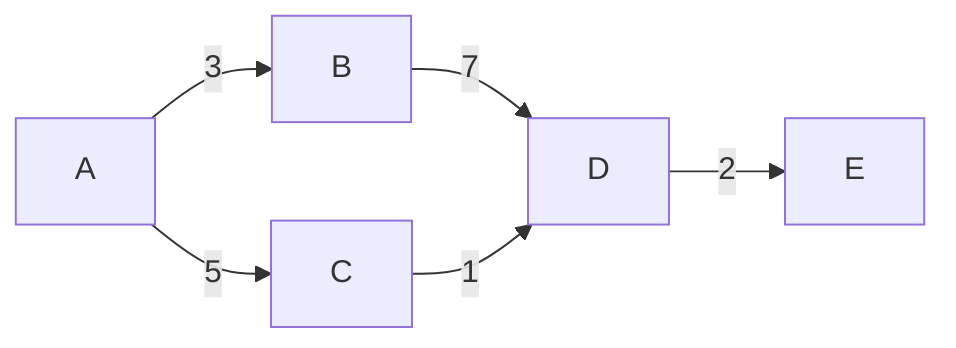

# 开源大模型食用指南

## 文档信息

| 项目 | 内容 |
| --- | --- |
| 文档标题 | 开源大模型食用指南 |
| 文档类型 | zh-CN 整合 Markdown |
| 上游仓库 | [datawhalechina/self-llm](https://github.com/datawhalechina/self-llm) |
| 锁定提交 | [e0fe14a35123](https://github.com/datawhalechina/self-llm/commit/e0fe14a35123f5cab6d32cb9e716b571bf0994cf) |
| 提交时间 | 2026-09-12T10:51:10+08:00 |
| 生成器版本 | `self_llm@1;engine@9` |

> 本文件由 reference 仓库自动生成。请修改上游源文件或本仓库的清单/适配器后重新生成，不要直接编辑此文件。

## 阅读说明

本文档按清单中的阅读顺序合并上游 Markdown。图片被改写为锁定提交的 GitHub Raw 链接，章节内有效的本地文档链接被改写为同一提交的 GitHub 源文件链接。

## 目录

- [项目概览](#项目概览)
  - [开源大模型食用指南](#开源大模型食用指南)
- [模型与环境导航](#模型与环境导航)
  - [主流模型教程导航](#主流模型教程导航)
  - [AMD GPU 平台模型导航](#amd-gpu-平台模型导航)
  - [昇腾 Ascend NPU 平台模型导航](#昇腾-ascend-npu-平台模型导航)
- [示例项目](#示例项目)
  - [示例项目 / AMchat-高等数学](#示例项目-amchat-高等数学)
  - [示例项目 / Chat-嬛嬛](#示例项目-chat-嬛嬛)
  - [示例项目](#示例项目)
  - [示例项目 / Tianji-天机](#示例项目-tianji-天机)
  - [示例项目 / 数字生命](#示例项目-数字生命)
- [主流模型教程](#主流模型教程)
  - [01-Atom-7B-chat-WebDemo](#01-atom-7b-chat-webdemo)
  - [02-Atom-7B-Chat Lora 微调](#02-atom-7b-chat-lora-微调)
  - [03-Atom-7B-Chat 接入langchain搭建知识库助手](#03-atom-7b-chat-接入langchain搭建知识库助手)
  - [Atom / 03-Atom-7B-Chat 接入langchain搭建知识库助手](#atom-03-atom-7b-chat-接入langchain搭建知识库助手)
  - [04-Atom-7B-chat 全量微调](#04-atom-7b-chat-全量微调)
  - [01-Baichuan2-7B-chat+FastApi+部署调用](#01-baichuan2-7b-chatfastapi部署调用)
  - [02-Baichuan-7B-chat+WebDemo](#02-baichuan-7b-chatwebdemo)
  - [03-Baichuan2-7B-chat接入LangChain框架](#03-baichuan2-7b-chat接入langchain框架)
  - [04-Baichuan2-7B-chat+lora+微调](#04-baichuan2-7b-chatlora微调)
  - [BGE-M3-finetune-embedding-with-valid](#bge-m3-finetune-embedding-with-valid)
  - [01-Index-1.9B-chat FastApi 部署调用](#01-index-19b-chat-fastapi-部署调用)
  - [02-Index-1.9B-Chat LangChain 接入](#02-index-19b-chat-langchain-接入)
  - [03-Index-1.9B-Chat WebDemo 部署](#03-index-19b-chat-webdemo-部署)
  - [04-Index-1.9B-Chat Lora 微调](#04-index-19b-chat-lora-微调)
  - [01-BlueLM-7B-Chat FastApi 部署](#01-bluelm-7b-chat-fastapi-部署)
  - [02-BlueLM-7B-Chat langchain 接入](#02-bluelm-7b-chat-langchain-接入)
  - [03-BlueLM-7B-Chat WebDemo 部署](#03-bluelm-7b-chat-webdemo-部署)
  - [04-BlueLM-7B-Chat Lora 微调](#04-bluelm-7b-chat-lora-微调)
  - [01-CharacterGLM-6B Transformer部署调用](#01-characterglm-6b-transformer部署调用)
  - [02-CharacterGLM-6B FastApi部署调用](#02-characterglm-6b-fastapi部署调用)
  - [03-CharacterGLM-6B-chat](#03-characterglm-6b-chat)
  - [04-CharacterGLM-6B Lora微调](#04-characterglm-6b-lora微调)
  - [CharacterGLM / image](#characterglm-image)
  - [CharacterGLM](#characterglm)
  - [01-ChatGLM3-6B Transformer部署调用](#01-chatglm3-6b-transformer部署调用)
  - [02-ChatGLM3-6B FastApi部署调用](#02-chatglm3-6b-fastapi部署调用)
  - [03-ChatGLM3-6B-chat](#03-chatglm3-6b-chat)
  - [04-ChatGLM3-6B-Code-Interpreter](#04-chatglm3-6b-code-interpreter)
  - [05-ChatGLM3-6B接入LangChain搭建知识库助手](#05-chatglm3-6b接入langchain搭建知识库助手)
  - [06-ChatGLM3-6B-Lora微调](#06-chatglm3-6b-lora微调)
  - [Extra-ChatGLM3-6B-Pipeline](#extra-chatglm3-6b-pipeline)
  - [01-DeepSeek-Coder-V2-Lite-Instruct FastApi 部署调用](#01-deepseek-coder-v2-lite-instruct-fastapi-部署调用)
  - [02-DeepSeek-Coder-V2-Lite-Instruct 接入 LangChain](#02-deepseek-coder-v2-lite-instruct-接入-langchain)
  - [03-DeepSeek-Coder-V2-Lite-Instruct WebDemo 部署](#03-deepseek-coder-v2-lite-instruct-webdemo-部署)
  - [04-DeepSeek-Coder-V2-Lite-Instruct Lora 微调](#04-deepseek-coder-v2-lite-instruct-lora-微调)
  - [01-DeepSeek-R1-Distill-Qwen-7B FastApi 部署调用](#01-deepseek-r1-distill-qwen-7b-fastapi-部署调用)
  - [02-DeepSeek-R1-Distill-Qwen-7B Langchain 接入](#02-deepseek-r1-distill-qwen-7b-langchain-接入)
  - [03-DeepSeek-R1-Distill-Qwen-7B WebDemo 部署](#03-deepseek-r1-distill-qwen-7b-webdemo-部署)
  - [04-DeepSeek-R1-Distill-Qwen-7B vLLM 部署调用](#04-deepseek-r1-distill-qwen-7b-vllm-部署调用)
  - [05-DeepSeek-R1-0528-Qwen3-8B-GRPO及swanlab可视化](#05-deepseek-r1-0528-qwen3-8b-grpo及swanlab可视化)
  - [DeepSeek-R1-Distill-Qwen](#deepseek-r1-distill-qwen)
  - [01-DeepSeek-V4-Flash-LoRA及SwanLab可视化记录](#01-deepseek-v4-flash-lora及swanlab可视化记录)
  - [02-DeepSeek-V4-Flash-SGLang部署](#02-deepseek-v4-flash-sglang部署)
  - [03-DeepSeek-V4-Flash-vLLM部署](#03-deepseek-v4-flash-vllm部署)
  - [01-DeepSeek-7B-chat FastApi](#01-deepseek-7b-chat-fastapi)
  - [02-DeepSeek-7B-chat langchain](#02-deepseek-7b-chat-langchain)
  - [03-DeepSeek-7B-chat WebDemo](#03-deepseek-7b-chat-webdemo)
  - [04-DeepSeek-7B-chat Lora 微调](#04-deepseek-7b-chat-lora-微调)
  - [05-DeepSeek-7B-chat 4bits量化 Qlora 微调](#05-deepseek-7b-chat-4bits量化-qlora-微调)
  - [06-DeepSeek-MoE-16b-chat FastApi部署调用](#06-deepseek-moe-16b-chat-fastapi部署调用)
  - [06-DeepSeek-MoE-16b-chat Transformer部署调用](#06-deepseek-moe-16b-chat-transformer部署调用)
  - [01-ERNIE-4.5-0.3B-PT Lora 微调及 SwanLab 可视化记录](#01-ernie-45-03b-pt-lora-微调及-swanlab-可视化记录)
  - [01-Gemma-2-9b-it FastApi 部署调用](#01-gemma-2-9b-it-fastapi-部署调用)
  - [02-Gemma-2-9b-it langchain 接入](#02-gemma-2-9b-it-langchain-接入)
  - [03-Gemma-2-9b-it WebDemo 部署](#03-gemma-2-9b-it-webdemo-部署)
  - [04-Gemma-2-9b-it peft lora微调](#04-gemma-2-9b-it-peft-lora微调)
  - [01-gemma-3-4b-it FastApi 部署调用](#01-gemma-3-4b-it-fastapi-部署调用)
  - [03-gemma-3-4b-it-ollama + open-webui部署](#03-gemma-3-4b-it-ollama-open-webui部署)
  - [04-Gemma3-4b  evalscope智商情商评测](#04-gemma3-4b-evalscope智商情商评测)
  - [05-gemma-3-4b-it LoRA](#05-gemma-3-4b-it-lora)
  - [6-gemma3-4B-itGRPO微调及通过swanlab可视化](#6-gemma3-4b-itgrpo微调及通过swanlab可视化)
  - [7-gemma3-4b-it AMD环境准备](#7-gemma3-4b-it-amd环境准备)
  - [8-gemma3-4b-it 模型服务部署](#8-gemma3-4b-it-模型服务部署)
  - [01-gemma-4-E4B-it FastApi 部署调用](#01-gemma-4-e4b-it-fastapi-部署调用)
  - [03-gemma-4-E4B-it-ollama + open-webui部署](#03-gemma-4-e4b-it-ollama-open-webui部署)
  - [04-Gemma4-E4B-it  evalscope智商情商评测](#04-gemma4-e4b-it-evalscope智商情商评测)
  - [05-gemma-4-E4B-it LoRA](#05-gemma-4-e4b-it-lora)
  - [6-gemma4-E4B-itGRPO微调及通过swanlab可视化](#6-gemma4-e4b-itgrpo微调及通过swanlab可视化)
  - [7-gemma4-E4B-it AMD环境准备](#7-gemma4-e4b-it-amd环境准备)
  - [8-gemma4-E4B-it 模型服务部署](#8-gemma4-e4b-it-模型服务部署)
  - [01-Gemma-2B-Instruct FastApi 部署调用](#01-gemma-2b-instruct-fastapi-部署调用)
  - [02-Gemma-2B-Instruct langchain 接入](#02-gemma-2b-instruct-langchain-接入)
  - [03-Gemma-2B-Instruct WebDemo 部署](#03-gemma-2b-instruct-webdemo-部署)
  - [04-Gemma-2B-Instruct Lora微调](#04-gemma-2b-instruct-lora微调)
  - [01-pip、conda换源](#01-pipconda换源)
  - [02-AutoDL开放端口](#02-autodl开放端口)
  - [03-模型下载](#03-模型下载)
  - [04-Issue&PR&update](#04-issueprupdate)
  - [01-GLM-4 1V-Thinking vLLM部署调用](#01-glm-4-1v-thinking-vllm部署调用)
  - [02-GLM-4 1V-Thinking Gradio部署](#02-glm-4-1v-thinking-gradio部署)
  - [03-GLM-4 1V-Thinking LoRA 及 SwanLab 可视化记录](#03-glm-4-1v-thinking-lora-及-swanlab-可视化记录)
  - [01-GLM-4.5-Air-vLLM 部署调用](#01-glm-45-air-vllm-部署调用)
  - [02-GLM-4.5-Air EvalScope 并发测试](#02-glm-45-air-evalscope-并发测试)
  - [03-GLM-4.5-Air-Lora 及 Swanlab 可视化微调](#03-glm-45-air-lora-及-swanlab-可视化微调)
  - [01-GLM-4.7-Flash-vLLM 部署调用](#01-glm-47-flash-vllm-部署调用)
  - [02-GLM-4.7-Flash SGLang 部署调用](#02-glm-47-flash-sglang-部署调用)
  - [03-GLM-4.7-Flash-Lora微调及Docker镜像](#03-glm-47-flash-lora微调及docker镜像)
  - [01-GLM-4-9B-chat FastApi 部署调用](#01-glm-4-9b-chat-fastapi-部署调用)
  - [02-GLM-4-9B-chat langchain 接入](#02-glm-4-9b-chat-langchain-接入)
  - [03-GLM-4-9B-Chat WebDemo](#03-glm-4-9b-chat-webdemo)
  - [04-GLM-4-9B-Chat vLLM 部署调用](#04-glm-4-9b-chat-vllm-部署调用)
  - [05-GLM-4-9B-chat Lora 微调](#05-glm-4-9b-chat-lora-微调)
  - [05-GLM-4-9B-chat-hf Lora 微调](#05-glm-4-9b-chat-hf-lora-微调)
  - [1-GLM-5.2-技术报告解读](#1-glm-52-技术报告解读)
  - [2-GLM-5.2-vLLM](#2-glm-52-vllm)
  - [3-GLM-5.2-SGLang](#3-glm-52-sglang)
  - [1-gpt-oss-20b vllm 部署调用](#1-gpt-oss-20b-vllm-部署调用)
  - [2-gpt-oss-20b Evalscope并发测试](#2-gpt-oss-20b-evalscope并发测试)
  - [3-gpt-oss-20b lmstudio 本地部署调用](#3-gpt-oss-20b-lmstudio-本地部署调用)
  - [4-gpt-oss-20b Lora 微调及 SwanLab 可视化记录](#4-gpt-oss-20b-lora-微调及-swanlab-可视化记录)
  - [5-gpt-oss-20b DPO 微调及 SwanLab 可视化记录](#5-gpt-oss-20b-dpo-微调及-swanlab-可视化记录)
  - [01-Hunyuan3D-2 系列模型部署](#01-hunyuan3d-2-系列模型部署)
  - [02-Hunyuan3D-2 系列模型代码调用](#02-hunyuan3d-2-系列模型代码调用)
  - [03-Hunyuan3D-2 系列模型Gradio部署](#03-hunyuan3d-2-系列模型gradio部署)
  - [04-Hunyuan3D-2 系列模型API Server](#04-hunyuan3d-2-系列模型api-server)
  - [01-Hunyuan-A13B-Instruct 模型架构解析 Blog](#01-hunyuan-a13b-instruct-模型架构解析-blog)
  - [02-Hunyuan-A13B-Instruct-vLLM](#02-hunyuan-a13b-instruct-vllm)
  - [03-Hunyuan-A13B-Instruct-SGLang部署调用](#03-hunyuan-a13b-instruct-sglang部署调用)
  - [04-Hunyuan-A13B-Instruct EvalScope 并发测试](#04-hunyuan-a13b-instruct-evalscope-并发测试)
  - [05-Hunyuan-A13B-Instruct-LoRA及SwanLab可视化记录](#05-hunyuan-a13b-instruct-lora及swanlab可视化记录)
  - [01-Hy3-vLLM docker部署调用](#01-hy3-vllm-docker部署调用)
  - [01-InternLM2-7B-chat FastAPI部署](#01-internlm2-7b-chat-fastapi部署)
  - [02-InternLM2-7B-chat langchain 接入](#02-internlm2-7b-chat-langchain-接入)
  - [03-InternLM2-7B-chat WebDemo 部署](#03-internlm2-7b-chat-webdemo-部署)
  - [04-InternLM2-7B-chat Xtuner Qlora 微调](#04-internlm2-7b-chat-xtuner-qlora-微调)
  - [01-InternLM3-8B-Instruct FastAPI](#01-internlm3-8b-instruct-fastapi)
  - [02-internlm3-8b-Instruct Langchain 接入](#02-internlm3-8b-instruct-langchain-接入)
  - [03-InternLM3-8B-Instruct WebDemo部署](#03-internlm3-8b-instruct-webdemo部署)
  - [04-InternLM3-8B-Instruct LoRA](#04-internlm3-8b-instruct-lora)
  - [05-internlm3-8b-instruct 与o1](#05-internlm3-8b-instruct-与o1)
  - [01-InternLM-Chat-7B Transformers 部署调用](#01-internlm-chat-7b-transformers-部署调用)
  - [02-internLM-Chat-7B FastApi](#02-internlm-chat-7b-fastapi)
  - [03-InternLM-Chat-7B](#03-internlm-chat-7b)
  - [04-Lagent+InternLM-Chat-7B-V1.1](#04-lagentinternlm-chat-7b-v11)
  - [05-浦语灵笔图文理解&创作](#05-浦语灵笔图文理解创作)
  - [06-InternLM接入LangChain搭建知识库助手](#06-internlm接入langchain搭建知识库助手)
  - [InternLM / 06-InternLM接入LangChain搭建知识库助手](#internlm-06-internlm接入langchain搭建知识库助手)
  - [01-Kimi-K2.5-论文解读](#01-kimi-k25-论文解读)
  - [02-Kimi-2.5-vLLM 部署调用](#02-kimi-25-vllm-部署调用)
  - [03-Kimi-2.5-SGLang部署应用](#03-kimi-25-sglang部署应用)
  - [01-Kimi-VL-对话助手](#01-kimi-vl-对话助手)
  - [Kimi-VL / 01-Kimi-VL-对话助手 / app](#kimi-vl-01-kimi-vl-对话助手-app)
  - [02-Kimi-VL-技术报告解读](#02-kimi-vl-技术报告解读)
  - [01-LLaMA3-8B-Instruct FastApi 部署调用](#01-llama3-8b-instruct-fastapi-部署调用)
  - [02-LLaMA3-8B-Instruct langchain 接入](#02-llama3-8b-instruct-langchain-接入)
  - [03-LLaMA3-8B-Instruct WebDemo 部署](#03-llama3-8b-instruct-webdemo-部署)
  - [04-LLaMA3-8B-Instruct Lora 微调](#04-llama3-8b-instruct-lora-微调)
  - [01-Llama3_1-8B-Instruct FastApi 部署调用](#01-llama31-8b-instruct-fastapi-部署调用)
  - [02-Llama3_1-8B-Instruct langchain接入](#02-llama31-8b-instruct-langchain接入)
  - [03-Llama3_1-8B-Instruct WebDemo部署](#03-llama31-8b-instruct-webdemo部署)
  - [04-Llama3_1-8B--Instruct Lora 微调](#04-llama31-8b--instruct-lora-微调)
  - [05-Llama3_1-8B-Instruct o1-like 推理链实现](#05-llama31-8b-instruct-o1-like-推理链实现)
  - [动手转换GGUF模型并使用Ollama本地部署](#动手转换gguf模型并使用ollama本地部署)
  - [01-Llama4-对话助手](#01-llama4-对话助手)
  - [Llama4 / 01-Llama4-对话助手 / app](#llama4-01-llama4-对话助手-app)
  - [01-MiniCPM5-1B-vLLM 部署调用](#01-minicpm5-1b-vllm-部署调用)
  - [02-MiniCPM5-1B-SGLang 部署调用](#02-minicpm5-1b-sglang-部署调用)
  - [03-MiniCPM5-1B-LoRA及SwanLab可视化记录](#03-minicpm5-1b-lora及swanlab可视化记录)
  - [01MiniCPM-o 2 6 FastApi部署调用](#01minicpm-o-2-6-fastapi部署调用)
  - [02minicpm-o-2.6WebDemo部署](#02minicpm-o-26webdemo部署)
  - [03-MiniCPM-o-2.6 多模态语音能力](#03-minicpm-o-26-多模态语音能力)
  - [04-MiniCPM-0-2.6 Lora微调](#04-minicpm-0-26-lora微调)
  - [MiniCPM-2B-chat FastApi 部署调用](#minicpm-2b-chat-fastapi-部署调用)
  - [MiniCPM-2B-chat langchain接入](#minicpm-2b-chat-langchain接入)
  - [MiniCPM-2B-chat Lora && Full 微调](#minicpm-2b-chat-lora-full-微调)
  - [MiniCPM-2B-chat transformers 部署调用](#minicpm-2b-chat-transformers-部署调用)
  - [MiniCPM-2B-chat WebDemo部署](#minicpm-2b-chat-webdemo部署)
  - [1-MiniMax-M2.5-vLLM](#1-minimax-m25-vllm)
  - [2-MiniMax-M2.5-SGLang](#2-minimax-m25-sglang)
  - [3-MiniMax-M2.5-Transformers](#3-minimax-m25-transformers)
  - [1-MiniMax-M2.7-vLLM](#1-minimax-m27-vllm)
  - [2-MiniMax-M2.7-SGLang](#2-minimax-m27-sglang)
  - [3-MiniMax-M2.7-Transformers](#3-minimax-m27-transformers)
  - [1-MiniMax-M2-Blog](#1-minimax-m2-blog)
  - [2-MiniMax-M2-vLLM](#2-minimax-m2-vllm)
  - [3-MiniMax-M2-SGLang](#3-minimax-m2-sglang)
  - [4-MiniMax-M2-EvalScope](#4-minimax-m2-evalscope)
  - [1-MiniMax-M3-vLLM](#1-minimax-m3-vllm)
  - [2-MiniMax-M3-SGLang](#2-minimax-m3-sglang)
  - [3-MiniMax-M3-Transformers](#3-minimax-m3-transformers)
  - [4-MiniMax-M3-BF16-LoRA及SwanLab可视化](#4-minimax-m3-bf16-lora及swanlab可视化)
  - [01-OpenELM-3B-Instruct FastApi部署调用](#01-openelm-3b-instruct-fastapi部署调用)
  - [02-OpenELM-3B-Instruct Lora微调](#02-openelm-3b-instruct-lora微调)
  - [OpenELM](#openelm)
  - [01-Phi-4 FastApi 部署调用](#01-phi-4-fastapi-部署调用)
  - [02-Phi-4-Langchain接入](#02-phi-4-langchain接入)
  - [03-Phi-4 WebDemo部署](#03-phi-4-webdemo部署)
  - [04-Phi-4-Lora 微调](#04-phi-4-lora-微调)
  - [05-Phi-4-Lora 微调 命名实体识别](#05-phi-4-lora-微调-命名实体识别)
  - [06-Phi-4-GRPO及swanlab可视化](#06-phi-4-grpo及swanlab可视化)
  - [01-Phi-3-mini-4k-instruct FastApi 部署调用](#01-phi-3-mini-4k-instruct-fastapi-部署调用)
  - [02-Phi-3-mini-4k-instruct langchain 接入](#02-phi-3-mini-4k-instruct-langchain-接入)
  - [03-Phi-3-mini-4k-instruct WebDemo部署](#03-phi-3-mini-4k-instruct-webdemo部署)
  - [04-Phi-3-mini-4k-Instruct Lora 微调](#04-phi-3-mini-4k-instruct-lora-微调)
  - [01-Qwen1.5-7B-Chat FastApi 部署调用](#01-qwen15-7b-chat-fastapi-部署调用)
  - [02-Qwen1.5-7B-Chat 接入langchain搭建知识库助手](#02-qwen15-7b-chat-接入langchain搭建知识库助手)
  - [03-Qwen1.5-7B-Chat WebDemo](#03-qwen15-7b-chat-webdemo)
  - [04-Qwen1.5-7B-chat Lora 微调](#04-qwen15-7b-chat-lora-微调)
  - [05-Qwen1.5-7B-Chat-GPTQ-Int4  WebDemo](#05-qwen15-7b-chat-gptq-int4-webdemo)
  - [06-Qwen1.5-MoE-A2.7B](#06-qwen15-moe-a27b)
  - [07-Qwen1.5-7B-Chat vLLM 推理部署调用](#07-qwen15-7b-chat-vllm-推理部署调用)
  - [08-Qwen1.5-7B-chat LoRA微调接入实验管理](#08-qwen15-7b-chat-lora微调接入实验管理)
  - [01-Qwen2-VL-2B-Instruct FastApi 部署调用](#01-qwen2-vl-2b-instruct-fastapi-部署调用)
  - [02-Qwen2-VL-2B-Instruct Web Demo部署](#02-qwen2-vl-2b-instruct-web-demo部署)
  - [03-Qwen2-VL-2B-Instruct vLLM部署调用](#03-qwen2-vl-2b-instruct-vllm部署调用)
  - [04-Qwen2-VL-2B Lora 微调](#04-qwen2-vl-2b-lora-微调)
  - [05-Qwen2-VL-2B-Instruct Lora 微调 SwanLab 可视化记录版](#05-qwen2-vl-2b-instruct-lora-微调-swanlab-可视化记录版)
  - [06-Qwen2-VL-2B-Instruct Lora 微调案例 - LaTexOCR](#06-qwen2-vl-2b-instruct-lora-微调案例---latexocr)
  - [01-Qwen2.5-Coder-7B-Instruct FastApi 部署调用](#01-qwen25-coder-7b-instruct-fastapi-部署调用)
  - [02-Qwen2.5-7B-Instruct Langchain 接入](#02-qwen25-7b-instruct-langchain-接入)
  - [03-Qwen2.5-Coder-7B-Instruct WebDemo部署](#03-qwen25-coder-7b-instruct-webdemo部署)
  - [04-Qwen2.5-Coder-7B-Instruct vLLM 部署调用](#04-qwen25-coder-7b-instruct-vllm-部署调用)
  - [05-Qwen2.5-Coder-7B-Instruct Lora 微调 SwanLab 可视化记录版](#05-qwen25-coder-7b-instruct-lora-微调-swanlab-可视化记录版)
  - [Qwen2.5-Coder-7B-Instruct Lora 微调](#qwen25-coder-7b-instruct-lora-微调)
  - [01-Qwen2.5-7B-Instruct FastApi 部署调用](#01-qwen25-7b-instruct-fastapi-部署调用)
  - [02-Qwen2.5-7B-Instruct Langchain 接入](#02-qwen25-7b-instruct-langchain-接入)
  - [03-Qwen2.5-7B-Instruct vLLM 部署调用](#03-qwen25-7b-instruct-vllm-部署调用)
  - [04-Qwen2_5-7B-Instruct WebDemo部署](#04-qwen25-7b-instruct-webdemo部署)
  - [05-Qwen2.5-7B-Instruct Lora 微调](#05-qwen25-7b-instruct-lora-微调)
  - [06-Qwen2.5-7B-Instruct o1-like 推理链实现](#06-qwen25-7b-instruct-o1-like-推理链实现)
  - [07-Qwen2.5-7B-Instruct Lora 微调 SwanLab可视化记录版](#07-qwen25-7b-instruct-lora-微调-swanlab可视化记录版)
  - [Qwen2.5](#qwen25)
  - [01-Qwen2-7B-Instruct FastApi 部署调用](#01-qwen2-7b-instruct-fastapi-部署调用)
  - [02-Qwen2-7B-Instruct Langchain 接入](#02-qwen2-7b-instruct-langchain-接入)
  - [03-Qwen2-7B-Instruct WebDemo部署](#03-qwen2-7b-instruct-webdemo部署)
  - [04-Qwen2-7B-Instruct vLLM 部署调用](#04-qwen2-7b-instruct-vllm-部署调用)
  - [05-Qwen2-7B-Instruct Lora 微调](#05-qwen2-7b-instruct-lora-微调)
  - [01-Qwen3-VL-MoE-模型结构解析-Blog](#01-qwen3-vl-moe-模型结构解析-blog)
  - [02-Qwen3-VL-4B-Instruct FastApi 部署调用](#02-qwen3-vl-4b-instruct-fastapi-部署调用)
  - [04-Qwen3-VL-4B-Instruct-vLLM](#04-qwen3-vl-4b-instruct-vllm)
  - [05-Qwen3-VL-4B-Instruct  Lora 可视化微调案例 - LaTexOCR](#05-qwen3-vl-4b-instruct-lora-可视化微调案例---latexocr)
  - [Qwen3-VL-4B-Instruct  Lora 可视化微调案例 - LaTexOCR](#qwen3-vl-4b-instruct-lora-可视化微调案例---latexocr)
  - [01-Qwen3.5-4B-vLLM 部署调用](#01-qwen35-4b-vllm-部署调用)
  - [02-Qwen3.5-4B-SGLang 部署调用](#02-qwen35-4b-sglang-部署调用)
  - [03-Qwen3.5-4B-LoRA及SwanLab可视化记录](#03-qwen35-4b-lora及swanlab可视化记录)
  - [01-Qwen3-模型结构解析-Blog](#01-qwen3-模型结构解析-blog)
  - [02-Qwen3-8B-vLLM 部署调用](#02-qwen3-8b-vllm-部署调用)
  - [03-Qwen3-7B-Instruct Windows LMStudio 部署](#03-qwen3-7b-instruct-windows-lmstudio-部署)
  - [04-Qwen3-8B EvalScope智商情商评测](#04-qwen3-8b-evalscope智商情商评测)
  - [05-Qwen3-8B-LoRA及SwanLab可视化记录](#05-qwen3-8b-lora及swanlab可视化记录)
  - [06-Qwen3-30B-A3B 微调及 SwanLab 可视化记录](#06-qwen3-30b-a3b-微调及-swanlab-可视化记录)
  - [07-Qwen3-Think-解密-Blog](#07-qwen3-think-解密-blog)
  - [08-Qwen3_0_6B的小模型有什么用](#08-qwen306b的小模型有什么用)
  - [09-Qwen3-1.7B-医学推理式对话微调 及 SwanLab 可视化记录](#09-qwen3-17b-医学推理式对话微调-及-swanlab-可视化记录)
  - [10-Qwen3-8B GRPO微调及通过swanlab可视化](#10-qwen3-8b-grpo微调及通过swanlab可视化)
  - [11-Qwen3-8B-AMD部署调用](#11-qwen3-8b-amd部署调用)
  - [01-Qwen-Audio-chat FastApi](#01-qwen-audio-chat-fastapi)
  - [02-Qwen-Audio-chat WebDemo](#02-qwen-audio-chat-webdemo)
  - [01-Qwen-7B-Chat Transformers部署调用](#01-qwen-7b-chat-transformers部署调用)
  - [02-Qwen-7B-Chat FastApi 部署调用](#02-qwen-7b-chat-fastapi-部署调用)
  - [03-Qwen-7B-Chat WebDemo](#03-qwen-7b-chat-webdemo)
  - [04-Qwen-7B-Chat Lora 微调](#04-qwen-7b-chat-lora-微调)
  - [05-Qwen-7B-Chat Ptuning 微调](#05-qwen-7b-chat-ptuning-微调)
  - [06-Qwen-7B-chat 全量微调](#06-qwen-7b-chat-全量微调)
  - [07-Qwen-7B-Chat 接入langchain搭建知识库助手](#07-qwen-7b-chat-接入langchain搭建知识库助手)
  - [Qwen / 07-Qwen-7B-Chat 接入langchain搭建知识库助手](#qwen-07-qwen-7b-chat-接入langchain搭建知识库助手)
  - [08-Qwen-7B-Chat Lora 低精度微调](#08-qwen-7b-chat-lora-低精度微调)
  - [09-Qwen-1_8B-chat CPU 部署](#09-qwen-18b-chat-cpu-部署)
  - [SpatialLM](#spatiallm)
  - [01-Step-3.5-Flash-vLLM部署教程](#01-step-35-flash-vllm部署教程)
  - [02-Step-3.5-Flash-SGLang](#02-step-35-flash-sglang)
  - [01-TransNormerLLM-7B FastApi 部署调用](#01-transnormerllm-7b-fastapi-部署调用)
  - [02-TransNormerLLM-7B 接入langchain搭建知识库助手](#02-transnormerllm-7b-接入langchain搭建知识库助手)
  - [03-TransNormerLLM-7B WebDemo](#03-transnormerllm-7b-webdemo)
  - [04-TrasnNormerLLM-7B Lora 微调](#04-trasnnormerllm-7b-lora-微调)
  - [01-XVERSE-7B-chat Transformers推理](#01-xverse-7b-chat-transformers推理)
  - [02-XVERSE-7B-chat FastAPI部署](#02-xverse-7b-chat-fastapi部署)
  - [03-XVERSE-7B-chat langchain 接入](#03-xverse-7b-chat-langchain-接入)
  - [04-XVERSE-7B-chat WebDemo 部署](#04-xverse-7b-chat-webdemo-部署)
  - [05-XVERSE-7B-Chat Lora 微调](#05-xverse-7b-chat-lora-微调)
  - [06-XVERSE-MoE-A4.2B](#06-xverse-moe-a42b)
  - [01-Yi-6B-Chat FastApi 部署调用](#01-yi-6b-chat-fastapi-部署调用)
  - [02-Yi-6B-Chat 接入langchain搭建知识库助手](#02-yi-6b-chat-接入langchain搭建知识库助手)
  - [03-Yi-6B-chat WebDemo](#03-yi-6b-chat-webdemo)
  - [04-Yi-6B-Chat Lora 微调](#04-yi-6b-chat-lora-微调)
  - [01-Yuan2.0-M32 FastApi 部署调用](#01-yuan20-m32-fastapi-部署调用)
  - [02-Yuan2.0-M32 Langchain 接入](#02-yuan20-m32-langchain-接入)
  - [03-Yuan2.0-M32 WebDemo部署](#03-yuan20-m32-webdemo部署)
  - [Yuan2.0-M32](#yuan20-m32)
  - [01-Yuan2.0-2B FastApi 部署调用](#01-yuan20-2b-fastapi-部署调用)
  - [02-Yuan2.0-2B Langchain 接入](#02-yuan20-2b-langchain-接入)
  - [03-Yuan2.0-2B WebDemo部署](#03-yuan20-2b-webdemo部署)
  - [04-Yuan2.0-2B vLLM部署调用](#04-yuan20-2b-vllm部署调用)
  - [05-Yuan2.0-2B Lora微调](#05-yuan20-2b-lora微调)
  - [Yuan2.0](#yuan20)
- [AMD GPU 平台教程](#amd-gpu-平台教程)
  - [1-env-prepare-ubuntu24-rocm7](#1-env-prepare-ubuntu24-rocm7)
  - [2-gemma4_model](#2-gemma4model)
  - [3-lm-studio-rocm7-deploy](#3-lm-studio-rocm7-deploy)
  - [4-vllm-rocm7-deploy](#4-vllm-rocm7-deploy)
  - [5-ollama-rocm7-deploy](#5-ollama-rocm7-deploy)
  - [6-llamacpp-rocm7-deploy](#6-llamacpp-rocm7-deploy)
  - [1-env-prepare-ubuntu24-rocm7](#1-env-prepare-ubuntu24-rocm7)
  - [2-lm-studio-rocm7-deploy](#2-lm-studio-rocm7-deploy)
  - [3-vllm-rocm7-deploy](#3-vllm-rocm7-deploy)
  - [4-ollama-rocm7-deploy](#4-ollama-rocm7-deploy)
  - [5-llamacpp-rocm7-deploy](#5-llamacpp-rocm7-deploy)
  - [AMD ROCm 云平台使用指南](#amd-rocm-云平台使用指南)
- [昇腾 Ascend NPU 平台教程](#昇腾-ascend-npu-平台教程)
  - [01-Qwen3.6-35B-A3B-vLLM-ascend部署调用](#01-qwen36-35b-a3b-vllm-ascend部署调用)
  - [01-Qwen3-8B-MindIE部署调用](#01-qwen3-8b-mindie部署调用)
  - [02-Qwen3-8B-vLLM-ascend部署调用](#02-qwen3-8b-vllm-ascend部署调用)
  - [03-Qwen3-8B-sglang-ascend部署调用](#03-qwen3-8b-sglang-ascend部署调用)
- [Apple M 平台教程](#apple-m-平台教程)
  - [MLX-LM_Intro](#mlx-lmintro)
  - [Apple M 平台](#apple-m-平台)
  - [Apple M 平台模型教程（英文）](#apple-m-平台模型教程英文)

---

## 项目概览

### 开源大模型食用指南


  <h1>开源大模型食用指南</h1>


中文 | [English](https://github.com/datawhalechina/self-llm/blob/e0fe14a35123f5cab6d32cb9e716b571bf0994cf/README_en.md)


&emsp;&emsp;本项目是一个围绕开源大模型、针对国内初学者、基于 Linux 平台的中国宝宝专属大模型教程，针对各类开源大模型提供包括环境配置、本地部署、高效微调等技能在内的全流程指导，简化开源大模型的部署、使用和应用流程，让更多的普通学生、研究者更好地使用开源大模型，帮助开源、自由的大模型更快融入到普通学习者的生活中。

&emsp;&emsp;本项目的主要内容包括：

  1. 基于 Linux 平台的开源 LLM 环境配置指南，针对不同模型要求提供不同的详细环境配置步骤；
  2. 针对国内外主流开源 LLM 的部署使用教程，包括 LLaMA、ChatGLM、InternLM 等；
  3. 开源 LLM 的部署应用指导，包括命令行调用、在线 Demo 部署、LangChain 框架集成等；
  4. 开源 LLM 的全量微调、高效微调方法，包括分布式全量微调、LoRA、ptuning 等。

&emsp;&emsp;**项目的主要内容就是教程，让更多的学生和未来的从业者了解和熟悉开源大模型的食用方法！任何人都可以提出issue或是提交PR，共同构建维护这个项目。**

&emsp;&emsp;想要深度参与的同学可以联系我们，我们会将你加入到项目的维护者中。

> &emsp;&emsp;***学习建议：本项目的学习建议是，先学习环境配置，然后再学习模型的部署使用，最后再学习微调。因为环境配置是基础，模型的部署使用是基础，微调是进阶。初学者可以选择Qwen1.5，InternLM2，MiniCPM等模型优先学习。***

> &emsp;&emsp;**进阶学习推荐** ：如果您在学习完本项目后，希望更深入地理解大语言模型的核心原理，并渴望亲手从零开始训练属于自己的大模型，我们强烈推荐关注 Datawhale 的另一个开源项目—— [Happy-LLM 从零开始的大语言模型原理与实践教程](https://github.com/datawhalechina/happy-llm) 。该项目将带您深入探索大模型的底层机制，掌握完整的训练流程。

> 注：如果有同学希望了解大模型的模型构成，以及从零手写RAG、Agent和Eval等任务，可以学习Datawhale的另一个项目[Tiny-Universe](https://github.com/datawhalechina/tiny-universe)，大模型是当下深度学习领域的热点，但现有的大部分大模型教程只在于教给大家如何调用api完成大模型的应用，而很少有人能够从原理层面讲清楚模型结构、RAG、Agent 以及 Eval。所以该仓库会提供全部手写，不采用调用api的形式，完成大模型的 RAG 、 Agent 、Eval 任务。

> 注：考虑到有同学希望在学习本项目之前，希望学习大模型的理论部分，如果想要进一步深入学习 LLM 的理论基础，并在理论的基础上进一步认识、应用 LLM，可以参考 Datawhale 的 [so-large-llm](https://github.com/datawhalechina/so-large-lm.git)课程。

> 注：如果有同学在学习本课程之后，想要自己动手开发大模型应用。同学们可以参考 Datawhale 的 [动手学大模型应用开发](https://github.com/datawhalechina/llm-universe) 课程，该项目是一个面向小白开发者的大模型应用开发教程，旨在基于阿里云服务器，结合个人知识库助手项目，向同学们完整的呈现大模型应用开发流程。

#### 项目意义

&emsp;&emsp;什么是大模型？

>大模型（LLM）狭义上指基于深度学习算法进行训练的自然语言处理（NLP）模型，主要应用于自然语言理解和生成等领域，广义上还包括机器视觉（CV）大模型、多模态大模型和科学计算大模型等。

&emsp;&emsp;百模大战正值火热，开源 LLM 层出不穷。如今国内外已经涌现了众多优秀开源 LLM，国外如 LLaMA、Alpaca，国内如 ChatGLM、BaiChuan、InternLM（书生·浦语）等。开源 LLM 支持用户本地部署、私域微调，每一个人都可以在开源 LLM 的基础上打造专属于自己的独特大模型。

&emsp;&emsp;然而，当前普通学生和用户想要使用这些大模型，需要具备一定的技术能力，才能完成模型的部署和使用。对于层出不穷又各有特色的开源 LLM，想要快速掌握一个开源 LLM 的应用方法，是一项比较有挑战的任务。

&emsp;&emsp;本项目旨在首先基于核心贡献者的经验，实现国内外主流开源 LLM 的部署、使用与微调教程；在实现主流 LLM 的相关部分之后，我们希望充分聚集共创者，一起丰富这个开源 LLM 的世界，打造更多、更全面特色 LLM 的教程。星火点点，汇聚成海。

&emsp;&emsp;***我们希望成为 LLM 与普罗大众的阶梯，以自由、平等的开源精神，拥抱更恢弘而辽阔的 LLM 世界。***

#### 项目受众

&emsp;&emsp;本项目适合以下学习者：

* 想要使用或体验 LLM，但无条件获得或使用相关 API；
* 希望长期、低成本、大量应用 LLM；
* 对开源 LLM 感兴趣，想要亲自上手开源 LLM；
* NLP 在学，希望进一步学习 LLM；
* 希望结合开源 LLM，打造领域特色的私域 LLM；
* 以及最广大、最普通的学生群体。

#### 项目规划及进展

&emsp;&emsp; 本项目拟围绕开源 LLM 应用全流程组织，包括环境配置及使用、部署应用、微调等，每个部分覆盖主流及特点开源 LLM：

##### Example 系列

- [Chat-嬛嬛](https://github.com/datawhalechina/self-llm/blob/e0fe14a35123f5cab6d32cb9e716b571bf0994cf/examples/Chat-%E5%AC%9B%E5%AC%9B/readme.md)： Chat-甄嬛是利用《甄嬛传》剧本中所有关于甄嬛的台词和语句，基于LLM进行LoRA微调得到的模仿甄嬛语气的聊天语言模型。

- [Tianji-天机](https://github.com/datawhalechina/self-llm/blob/e0fe14a35123f5cab6d32cb9e716b571bf0994cf/examples/Tianji-%E5%A4%A9%E6%9C%BA/readme.md)：天机是一款基于人情世故社交场景，涵盖提示词工程 、智能体制作、 数据获取与模型微调、RAG 数据清洗与使用等全流程的大语言模型系统应用教程。

- [AMChat](https://github.com/datawhalechina/self-llm/blob/e0fe14a35123f5cab6d32cb9e716b571bf0994cf/examples/AMchat-%E9%AB%98%E7%AD%89%E6%95%B0%E5%AD%A6/readme.md): AM (Advanced Mathematics) chat 是一个集成了数学知识和高等数学习题及其解答的大语言模型。该模型使用 Math 和高等数学习题及其解析融合的数据集，基于 InternLM2-Math-7B 模型，通过 xtuner 微调，专门设计用于解答高等数学问题。

- [数字生命](https://github.com/datawhalechina/self-llm/blob/e0fe14a35123f5cab6d32cb9e716b571bf0994cf/examples/%E6%95%B0%E5%AD%97%E7%94%9F%E5%91%BD/readme.md): 本项目将以我为原型，利用特制的数据集对大语言模型进行微调，致力于创造一个能够真正反映我的个性特征的AI数字人——包括但不限于我的语气、表达方式和思维模式等等，因此无论是日常聊天还是分享心情，它都以一种既熟悉又舒适的方式交流，仿佛我在他们身边一样。整个流程是可迁移复制的，亮点是数据集的制作。

##### 已支持模型


  **✨ 已支持 50+ 主流大语言模型 ✨**<br>
  *每个模型都提供完整的部署、微调和使用教程*<br>
  📖 **<a href="./support_model.md">查看完整模型列表和教程</a>** |
  🎯 **<a href="./support_model.md#通用环境配置">快速开始</a>**


<table align="center">
  <tr>
    <td valign="top" width="25%">
      • <a href="./support_model.md#minicpm5">MiniCPM5</a><br>
      • <a href="./support_model.md#qwen35">Qwen3.5</a><br>
      • <a href="./support_model.md#kimi-k25">Kimi-K2.5</a><br>
      • <a href="./support_model.md#step-35-flash">Step-3.5-Flash</a><br>
      • <a href="./support_model.md#glm-47-flash">GLM-4.7-Flash</a><br>
      • <a href="./support_model.md#glm-52">GLM-5.2</a><br>
      • <a href="./support_model.md#gemma3">Gemma3</a><br>
      • <a href="./support_model.md#minimax-m3">MiniMax-M3</a><br>
      • <a href="./support_model.md#minimax-m27">MiniMax-M2.7</a><br>
      • <a href="./support_model.md#minimax-m25">MiniMax-M2.5</a><br>
      • <a href="./support_model.md#minimax-m2">MiniMax-M2</a><br>
      • <a href="./support_model.md#qwen3">Qwen3</a><br>
      • <a href="./support_model.md#qwen3-vl-4b-instruct">Qwen3-VL</a><br>
      • <a href="./support_model.md#spatiallm">SpatialLM</a><br>
      • <a href="./support_model.md#hunyuan3d-2">Hunyuan3D-2</a><br>
      • <a href="./support_model.md#qwen2-vl">Qwen2-VL</a>
    </td>
    <td valign="top" width="25%">
      • <a href="./support_model.md#minicpm-o-2_6">MiniCPM-o</a><br>
      • <a href="./support_model.md#qwen25-coder">Qwen2.5-Coder</a><br>
      • <a href="./support_model.md#deepseek-coder-v2">DeepSeek-Coder-V2</a><br>
      • <a href="./support_model.md#gpt-oss-20b">gpt-oss-20b</a><br>
      • <a href="./support_model.md#glm-41-thinking">GLM-4.1-Thinking</a><br>
      • <a href="./support_model.md#deepseek-r1-distill">DeepSeek-R1</a><br>
      • <a href="./support_model.md#internlm3">InternLM3</a><br>
      • <a href="./support_model.md#phi4">phi4</a><br>
      • <a href="./support_model.md#glm-45-air">GLM-4.5-Air</a><br>
      • <a href="./support_model.md#hunyuan-a13b-instruct">Hunyuan-A13B</a><br>
      • <a href="./support_model.md#deepseek-深度求索">DeepSeek</a><br>
      • <a href="./support_model.md#baichuan-百川智能">Baichuan</a><br>
      • <a href="./support_model.md#internlm">InternLM</a><br>
      • <a href="./support_model.md#kimi">Kimi</a>
    </td>
    <td valign="top" width="25%">
      • <a href="./support_model.md#ernie-45">ERNIE-4.5</a><br>
      • <a href="./support_model.md#llama4">Llama4</a><br>
      • <a href="./support_model.md#apple-openelm">Apple OpenELM</a><br>
      • <a href="./support_model.md#llama31-8b-instruct">Llama3.1</a><br>
      • <a href="./support_model.md#gemma-2-9b-it">Gemma-2</a><br>
      • <a href="./support_model.md#qwen25">Qwen2.5</a><br>
      • <a href="./support_model.md#qwen2">Qwen2</a><br>
      • <a href="./support_model.md#glm-4">GLM-4</a><br>
      • <a href="./support_model.md#qwen-15">Qwen 1.5</a><br>
      • <a href="./support_model.md#phi-3">phi-3</a><br>
      • <a href="./support_model.md#minicpm">MiniCPM</a><br>
      • <a href="./support_model.md#yi-零一万物">Yi 零一万物</a><br>
      • <a href="./support_model.md#yuan20">Yuan2.0</a><br>
      • <a href="./support_model.md#yuan20-m32">Yuan2.0-M32</a>
    </td>
    <td valign="top" width="25%">
      • <a href="./support_model.md#哔哩哔哩-index-19b">哔哩哔哩 Index</a><br>
      • <a href="./support_model.md#characterglm-6b">CharacterGLM</a><br>
      • <a href="./support_model.md#bluelm-vivo-蓝心大模型">BlueLM</a><br>
      • <a href="./support_model.md#qwen-audio">Qwen-Audio</a><br>
      • <a href="./support_model.md#transnormerllm">TransNormerLLM</a><br>
      • <a href="./support_model.md#atom-llama2">Atom</a><br>
      • <a href="./support_model.md#chatglm3">ChatGLM3</a><br>
      • <a href="./support_model.md#qwen2-57b-a14b-instruct">Qwen2-57B-A14B-Instruct</a><br>
      • <a href="./support_model.md#qwen2-72b-instruct">Qwen2-72B-Instruct</a><br>
      • <a href="./support_model.md#qwen2-7b-instruct">Qwen2-7B-Instruct</a><br>
      • <a href="./support_model.md#internlm2-20b">InternLM2-20B</a><br>
      • <a href="./support_model.md#tele-chat">Tele-Chat</a><br>
      • <a href="./support_model.md#xverse2">XVERSE2</a>
    </td>
  </tr>
</table>

##### AMD GPU 专区


  &nbsp;&nbsp;&nbsp;


  **🚀 AMD GPU 平台已支持模型**<br>
  *每个模型都提供完整的 ROCm 环境配置与部署教程（LM Studio / vLLM / Ollama / llama.cpp）*<br>
  *感谢 AMD University Program（AMD 大学计划）对本项目的支持*<br>
  📖 **<a href="./support_model_amd.md">查看完整 AMD 平台模型列表和教程</a>**<br>
  📘 **进阶学习推荐：**<a href="https://github.com/datawhalechina/hello-rocm">hello-rocm</a>（Datawhale ROCm 部署 / 微调 / 基础设施完整教程）


<table align="center">
  <tr>
    <td valign="top" width="50%">
      • <a href="./support_model_amd.md#谷歌-gemma4">谷歌 Gemma4</a><br>
      • ROCm 7 环境准备<br>
      • LM Studio / vLLM / Ollama / llama.cpp
    </td>
    <td valign="top" width="50%">
      • <a href="./support_model_amd.md#qwen35">Qwen3.5</a><br>
      • ROCm 7 环境准备<br>
      • LM Studio / vLLM / Ollama / llama.cpp
    </td>
  </tr>
</table>

##### 昇腾Ascend NPU 专区


  **🚀 昇腾Ascend NPU 平台已支持模型**<br>
  *每个模型都提供完整的昇腾Ascend NPU 环境配置和部署教程*<br>
  📖 **<a href="./support_model_Ascend.md">查看完整昇腾 NPU 平台模型列表和教程</a>**<br>


<table align="center">
  <tr>
    <td valign="top" width="30%">
      • <a href="./support_model_Ascend.md#qwen3536">Qwen3.6</a><br>
      • vLLM-ascend 部署调用
    </td>
    <td valign="top" width="30%">
      • <a href="./support_model_Ascend.md#qwen3">Qwen3</a><br>
      • Ascend NPU 环境配置通用指南<br>
      • MindIE 服务化部署调用<br>
      • vLLM-ascend 部署调用<br>
      • sglang-ascend 部署调用
    </td>
    <td valign="top" width="40%">
      • <a href="./support_model_Ascend.md#大模型服务化性能和精度测试">大模型服务化性能和精度测试</a><br>
      • AISBench 测试工具环境配置<br>
      • 昇腾大模型服务化性能测试<br>
      • 昇腾大模型服务化精度测试
    </td>
  </tr>
</table>

##### 沐曦专区


  ***Coming Soon!***


##### Apple M 专区


  📖 **<a href="./models_mlx/README.md">点击跳转 Apple M 专区</a>**<br>


##### Welcome More Platforms!

- 🚀 即将支持更多平台（Apple M 系列已有设备测试），敬请期待！
- 🤝 欢迎昇腾 Ascend、摩尔线程 MUSA、沐曦等平台提供技术支持、硬件支持或参与贡献
- 🌟 欢迎各平台开发者共建共享，推动大模型技术在更多国产硬件生态中的繁荣发展！

#### 致谢

##### 核心贡献者

- [宋志学(不要葱姜蒜)-项目负责人](https://github.com/KMnO4-zx) （Datawhale成员）
- [邹雨衡-项目负责人](https://github.com/logan-zou) （Datawhale成员-对外经济贸易大学）
- [刘十一-Ascend专区负责人](https://github.com/Zhiwen-Liu)（Datawhale成员-鲸英助教）
- [姜舒凡](https://github.com/Tsumugii24)（内容创作者-Datawhale成员）
- [郭宣伯](https://github.com/Twosugar666)（内容创作者-北京航空航天大学）
- [林泽毅](https://github.com/Zeyi-Lin)（内容创作者-SwanLab产品负责人）
- [林恒宇](https://github.com/LINHYYY)（内容创作者-广东东软学院-鲸英助教）
- [王泽宇](https://github.com/moyitech)（内容创作者-太原理工大学-鲸英助教）
- [郭志航](https://github.com/acwwt)（内容创作者）
- [陈榆](https://github.com/LucaChen)（内容创作者-谷歌开发者机器学习技术专家）
- [肖鸿儒](https://github.com/Hongru0306) （Datawhale成员-同济大学）
- [张帆](https://github.com/zhangfanTJU)（内容创作者-Datawhale成员）
- [李娇娇](https://github.com/Aphasia0515) （Datawhale成员）
- [高立业](https://github.com/0-yy-0)（内容创作者-DataWhale成员）
- [Kailigithub](https://github.com/Kailigithub) （Datawhale成员）
- [丁悦](https://github.com/dingyue772) （Datawhale-鲸英助教）
- [谢好冉](https://github.com/ilovexsir)（内容创作者-鲸英助教）
- [惠佳豪](https://github.com/L4HeyXiao) （Datawhale-宣传大使）
- [王茂霖](https://github.com/mlw67)（内容创作者-Datawhale成员）
- [孙健壮](https://github.com/Caleb-Sun-jz)（内容创作者-对外经济贸易大学）
- [郑皓桦](https://github.com/BaiYu96) （内容创作者）
- [荞麦](https://github.com/yeyeyeyeeeee)（内容创作者-Datawhale成员）
- [骆秀韬](https://github.com/anine09)（内容创作者-Datawhale成员-似然实验室）
- [李柯辰](https://github.com/Joe-2002) （Datawhale成员）
- [程宏](https://github.com/chg0901)（内容创作者-Datawhale意向成员）
- [李秀奇](https://github.com/li-xiu-qi)（内容创作者-DataWhale意向成员）
- [余洋](https://github.com/YangYu-NUAA)（内容创作者-安徽理工大学副教授-Datawhale成员）
- [陈思州](https://github.com/jjyaoao) （Datawhale成员）
- [颜鑫](https://github.com/thomas-yanxin) （Datawhale成员）
- [杜森](https://github.com/study520ai520)（内容创作者-Datawhale成员-南阳理工学院）
- [散步](https://github.com/sanbuphy) （Datawhale成员）
- [郑远婧](https://github.com/isaacahahah)（内容创作者-鲸英助教-福州大学）
- [Swiftie](https://github.com/cswangxiaowei) （小米NLP算法工程师）
- [张友东](https://github.com/AXYZdong)（内容创作者-Datawhale成员）
- [张晋](https://github.com/Jin-Zhang-Yaoguang)（内容创作者-Datawhale成员）
- [娄天奥](https://github.com/lta155)（内容创作者-中国科学院大学-鲸英助教）
- [小罗](https://github.com/lyj11111111) （内容创作者-Datawhale成员）
- [邓恺俊](https://github.com/Kedreamix)（内容创作者-Datawhale成员）
- [赵文恺](https://github.com/XiLinky)（内容创作者-太原理工大学-鲸英助教）
- [王熠明](https://github.com/Bald0Wang)（内容创作者-Datawhale成员）
- [黄柏特](https://github.com/KashiwaByte)（内容创作者-西安电子科技大学）
- [左春生](https://github.com/LinChentang)（内容创作者-Datawhale成员）
- [杨卓](https://github.com/little1d)（内容创作者-西安电子科技大学-鲸英助教）
- [付志远](https://github.com/comfzy)（内容创作者-海南大学）
- [三水](https://github.com/sssanssss)（内容创作者-鲸英助教）
- [樊奇](https://github.com/fanqiNO1)（内容创作者-上海交通大学）
- [陈辅元](https://github.com/Fyuan0206)（内容创作者-Datawhale成员）
- [谭逸珂](https://github.com/LikeGiver)（内容创作者-对外经济贸易大学）
- [何至轩](https://github.com/pod2c)（内容创作者-鲸英助教）
- [康婧淇](https://github.com/jodie-kang)（内容创作者-Datawhale成员）
- [杨晨旭](https://github.com/langlibai66)（内容创作者-太原理工大学-鲸英助教）
- [赵伟](https://github.com/2710932616)（内容创作者-鲸英助教）
- [苏向标](https://github.com/gzhuuser)（内容创作者-广州大学-鲸英助教）
- [陈睿](https://github.com/riannyway)（内容创作者-西交利物浦大学-鲸英助教）
- [张龙斐](https://github.com/Feimike09)（内容创作者-鲸英助教）
- [孙超](https://github.com/anarchysaiko)（内容创作者-Datawhale成员）
- [卓堂越](https://github.com/nusakom)（内容创作者-鲸英助教）
- [fancy](https://github.com/fancyboi999)（内容创作者-鲸英助教）
- [谭斐然](https://github.com/frtanxidian)（西安电子科技大学-鲸英助教）

> 注：排名根据贡献程度排序

##### 其他

- 特别感谢[@Sm1les](https://github.com/Sm1les)对本项目的帮助与支持
- 部分lora代码和讲解参考仓库：https://github.com/zyds/transformers-code.git
- 如果有任何想法可以联系我们 DataWhale 也欢迎大家多多提出 issue
- 特别感谢以下为教程做出贡献的同学！


  *感谢 AMD University Program（AMD 大学计划）对本项目的支持*<br>

  &nbsp;&nbsp;&nbsp;


<div align=center style="margin-top: 30px;">
  <a href="https://github.com/datawhalechina/self-llm/graphs/contributors">

  </a>
</div>

##### Star History

<div align=center style="margin-top: 30px;">

</div>

## 模型与环境导航

### 主流模型教程导航

> 本仓库致力于知错和整理各大语言模型的部署、微调和使用教程。我们为每个支持的模型提供了详细的部署指南、API调用示例、LangChain集成方案、WebDemo实现以及微调方法。所有教程均经过实践验证，确保能够在实际环境中顺利运行。欢迎贡献新的模型教程或改进现有文档！

#### 目录

- [Hy3](#hy3)
- [DeepSeek-V4-Flash](#deepseek-v4-flash)
- [MiniCPM5](#minicpm5)
- [Qwen3.5](#qwen35)
- [Kimi-K2.5](#kimi-k25)
- [Step-3.5-Flash](#step-35-flash)
- [GLM-4.7-Flash](#glm-47-flash)
- [GLM-5.2](#glm-52)
- [谷歌-Gemma3](#谷歌-gemma3)
- [MiniMax-M3](#minimax-m3)
- [MiniMax-M2.7](#minimax-m27)
- [MiniMax-M2.5](#minimax-m25)
- [MiniMax-M2](#minimax-m2)
- [Qwen3-VL-4B-Instruct](#qwen3-vl-4b-instruct)
- [BGE-M3](#bge-m3)
- [gpt-oss-20b](#gpt-oss-20b)
- [GLM-4.1-Thinking](#glm-41-thinking)
- [GLM-4.5-Air](#glm-45-air)
- [ERNIE-4.5](#ernie-45)
- [Hunyuan-A13B-Instruct](#hunyuan-a13b-instruct)
- [Qwen3](#qwen3)
- [Kimi](#kimi)
- [Llama4](#llama4)
- [SpatialLM](#spatiallm)
- [Hunyuan3D-2](#hunyuan3d-2)
- [Gemma3](#gemma3)
- [DeepSeek-R1-Distill](#deepseek-r1-distill)
- [MiniCPM-o-2_6](#minicpm-o-2_6)
- [InternLM3](#internlm3)
- [phi4](#phi4)
- [Qwen2.5-Coder](#qwen25-coder)
- [Qwen2-vl](#qwen2-vl)
- [Qwen2.5](#qwen25)
- [Apple OpenELM](#apple-openelm)
- [Llama3_1-8B-Instruct](#llama31-8b-instruct)
- [Gemma-2-9b-it](#gemma-2-9b-it)
- [Yuan2.0](#yuan20)
- [Yuan2.0-M32](#yuan20-m32)
- [DeepSeek-Coder-V2](#deepseek-coder-v2)
- [哔哩哔哩 Index-1.9B](#哔哩哔哩-index-19b)
- [Qwen2](#qwen2)
- [GLM-4](#glm-4)
- [Qwen 1.5](#qwen-15)
- [phi-3](#phi-3)
- [CharacterGLM-6B](#characterglm-6b)
- [LLaMA3-8B-Instruct](#llama3-8b-instruct)
- [XVERSE-7B-Chat](#xverse-7b-chat)
- [TransNormerLLM](#transnormerllm)
- [BlueLM Vivo 蓝心大模型](#bluelm-vivo-蓝心大模型)
- [InternLM2](#internlm2)
- [DeepSeek 深度求索](#deepseek-深度求索)
- [MiniCPM](#minicpm)
- [Qwen-Audio](#qwen-audio)
- [Qwen](#qwen)
- [Yi 零一万物](#yi-零一万物)
- [Baichuan 百川智能](#baichuan-百川智能)
- [InternLM](#internlm)
- [Atom (llama2)](#atom-llama2)
- [ChatGLM3](#chatglm3)
- [通用环境配置](#通用环境配置)


#### 已支持模型列表

##### Hy3

[Hy3](https://huggingface.co/tencent/Hy3)
  - [x] [Hy3 vLLM docker部署调用](https://github.com/datawhalechina/self-llm/blob/e0fe14a35123f5cab6d32cb9e716b571bf0994cf/models/Hy3/01-Hy3-vLLM%20docker%E9%83%A8%E7%BD%B2%E8%B0%83%E7%94%A8.md)


##### DeepSeek-V4-Flash

[DeepSeek-V4-Flash](https://huggingface.co/deepseek-ai/DeepSeek-V4-Flash)
  - [x] [DeepSeek-V4-Flash LoRA 及 SwanLab 可视化记录](https://github.com/datawhalechina/self-llm/blob/e0fe14a35123f5cab6d32cb9e716b571bf0994cf/models/DeepSeek-V4-Flash/01-DeepSeek-V4-Flash-LoRA%E5%8F%8ASwanLab%E5%8F%AF%E8%A7%86%E5%8C%96%E8%AE%B0%E5%BD%95.md)

##### MiniCPM5

[MiniCPM5-1B](https://www.modelscope.cn/models/OpenBMB/MiniCPM5-1B)
  - [x] [MiniCPM5-1B vLLM 部署调用](https://github.com/datawhalechina/self-llm/blob/e0fe14a35123f5cab6d32cb9e716b571bf0994cf/models/minicpm5/01-MiniCPM5-1B-vLLM%20%E9%83%A8%E7%BD%B2%E8%B0%83%E7%94%A8.md)
  - [x] [MiniCPM5-1B SGLang 部署调用](https://github.com/datawhalechina/self-llm/blob/e0fe14a35123f5cab6d32cb9e716b571bf0994cf/models/minicpm5/02-MiniCPM5-1B-SGLang%20%E9%83%A8%E7%BD%B2%E8%B0%83%E7%94%A8.md)
  - [x] [MiniCPM5-1B LoRA 及 SwanLab 可视化记录](https://github.com/datawhalechina/self-llm/blob/e0fe14a35123f5cab6d32cb9e716b571bf0994cf/models/minicpm5/03-MiniCPM5-1B-LoRA%E5%8F%8ASwanLab%E5%8F%AF%E8%A7%86%E5%8C%96%E8%AE%B0%E5%BD%95.md)
  - [x] [MiniCPM5-1B LoRA Docker 镜像](https://www.codewithgpu.com/i/datawhalechina/self-llm/MiniCPM5)

##### Qwen3.5

[Qwen3.5-4B](https://www.modelscope.cn/models/Qwen/Qwen3.5-4B)
  - [x] [Qwen3.5-4B vLLM 部署调用](https://github.com/datawhalechina/self-llm/blob/e0fe14a35123f5cab6d32cb9e716b571bf0994cf/models/Qwen3.5/01-Qwen3.5-4B-vLLM%20%E9%83%A8%E7%BD%B2%E8%B0%83%E7%94%A8.md)
  - [x] [Qwen3.5-4B SGLang 部署调用](https://github.com/datawhalechina/self-llm/blob/e0fe14a35123f5cab6d32cb9e716b571bf0994cf/models/Qwen3.5/02-Qwen3.5-4B-SGLang%20%E9%83%A8%E7%BD%B2%E8%B0%83%E7%94%A8.md)
  - [x] [Qwen3.5-4B LoRA 及 SwanLab 可视化记录](https://github.com/datawhalechina/self-llm/blob/e0fe14a35123f5cab6d32cb9e716b571bf0994cf/models/Qwen3.5/03-Qwen3.5-4B-LoRA%E5%8F%8ASwanLab%E5%8F%AF%E8%A7%86%E5%8C%96%E8%AE%B0%E5%BD%95.md)
  - [x] [AMD / ROCm 部署专区（Qwen3.5）](https://github.com/datawhalechina/self-llm/blob/e0fe14a35123f5cab6d32cb9e716b571bf0994cf/support_model_amd.md#qwen35) · [vLLM on ROCm](https://github.com/datawhalechina/self-llm/blob/e0fe14a35123f5cab6d32cb9e716b571bf0994cf/models_amd/qwen3.5/3-vllm-rocm7-deploy.md)

##### Kimi-K2.5

[Kimi-K2.5](https://huggingface.co/moonshotai/Kimi-K2.5)
- [x] [Kimi-K2.5 论文解读](https://github.com/datawhalechina/self-llm/blob/e0fe14a35123f5cab6d32cb9e716b571bf0994cf/models/Kimi-K2.5/01-Kimi-K2.5-%E8%AE%BA%E6%96%87%E8%A7%A3%E8%AF%BB.md) @樊奇
- [x] [Kimi-K2.5 vLLM 部署调用及 Docker 镜像](https://github.com/datawhalechina/self-llm/blob/e0fe14a35123f5cab6d32cb9e716b571bf0994cf/models/Kimi-K2.5/02-Kimi-2.5-vLLM%20%E9%83%A8%E7%BD%B2%E8%B0%83%E7%94%A8.md) @谢好冉
- [x] [Kimi-K2.5 SGLang 部署调用及 Docker 镜像](https://github.com/datawhalechina/self-llm/blob/e0fe14a35123f5cab6d32cb9e716b571bf0994cf/models/Kimi-K2.5/03-Kimi-2.5-SGLang%E9%83%A8%E7%BD%B2%E5%BA%94%E7%94%A8.md) @谭斐然

##### Step-3.5-Flash

[Step-3.5-Flash](https://huggingface.co/stepfun-ai/Step-3.5-Flash)
- [x] [Step-3.5-Flash vLLM 部署调用及 Docker 镜像](https://github.com/datawhalechina/self-llm/blob/e0fe14a35123f5cab6d32cb9e716b571bf0994cf/models/Step-3.5-Flash/01-Step-3.5-Flash-vLLM%E9%83%A8%E7%BD%B2%E6%95%99%E7%A8%8B.md) @郑远婧
- [x] [Step-3.5-Flash SGLang 部署调用及 Docker 镜像](https://github.com/datawhalechina/self-llm/blob/e0fe14a35123f5cab6d32cb9e716b571bf0994cf/models/Step-3.5-Flash/02-Step-3.5-Flash-SGLang.md) @陈辅元
- [x] Step-3.5-Flash Lora 微调及 Docker 镜像

##### GLM-4.7-Flash

[GLM-4.7-Flash](https://huggingface.co/zai-org/GLM-4.7-Flash)
- [x] [GLM-4.7-Flash vLLM 部署调用及 Docker 镜像](https://github.com/datawhalechina/self-llm/blob/e0fe14a35123f5cab6d32cb9e716b571bf0994cf/models/GLM-4.7-Flash/01-GLM-4.7-Flash-vLLM%20%E9%83%A8%E7%BD%B2%E8%B0%83%E7%94%A8.md) @谢好冉
- [x] [GLM-4.7-Flash SGLang 部署调用及 Docker 镜像](https://github.com/datawhalechina/self-llm/blob/e0fe14a35123f5cab6d32cb9e716b571bf0994cf/models/GLM-4.7-Flash/02-GLM-4.7-Flash%20SGLang%20%E9%83%A8%E7%BD%B2%E8%B0%83%E7%94%A8.md) @三水
- [x] [GLM-4.7-Flash Lora 微调及 Docker 镜像](https://github.com/datawhalechina/self-llm/blob/e0fe14a35123f5cab6d32cb9e716b571bf0994cf/models/GLM-4.7-Flash/03-GLM-4.7-Flash-Lora%E5%BE%AE%E8%B0%83%E5%8F%8ADocker%E9%95%9C%E5%83%8F.md) @余洋

##### GLM-5.2

[GLM-5.2](https://huggingface.co/zai-org/GLM-5.2)
- [x] [GLM-5.2 技术报告解读](https://github.com/datawhalechina/self-llm/blob/e0fe14a35123f5cab6d32cb9e716b571bf0994cf/models/GLM-5.2/1-GLM-5.2-%E6%8A%80%E6%9C%AF%E6%8A%A5%E5%91%8A%E8%A7%A3%E8%AF%BB.md)
- [x] [GLM-5.2 vLLM 部署调用](https://github.com/datawhalechina/self-llm/blob/e0fe14a35123f5cab6d32cb9e716b571bf0994cf/models/GLM-5.2/2-GLM-5.2-vLLM.md)
- [x] [GLM-5.2 SGLang 部署调用](https://github.com/datawhalechina/self-llm/blob/e0fe14a35123f5cab6d32cb9e716b571bf0994cf/models/GLM-5.2/3-GLM-5.2-SGLang.md)

##### 谷歌-Gemma3

[谷歌-Gemma3](https://huggingface.co/google/gemma-7b-it)
- [x] [gemma-2b-it FastApi 部署调用 ](https://github.com/datawhalechina/self-llm/blob/e0fe14a35123f5cab6d32cb9e716b571bf0994cf/models/Gemma/01-Gemma-2B-Instruct%20FastApi%20%E9%83%A8%E7%BD%B2%E8%B0%83%E7%94%A8.md) @陈榆
- [x] [gemma-2b-it langchain 接入 ](https://github.com/datawhalechina/self-llm/blob/e0fe14a35123f5cab6d32cb9e716b571bf0994cf/models/Gemma/02-Gemma-2B-Instruct%20langchain%20%E6%8E%A5%E5%85%A5.md) @陈榆
- [x] [gemma-2b-it WebDemo 部署 ](https://github.com/datawhalechina/self-llm/blob/e0fe14a35123f5cab6d32cb9e716b571bf0994cf/models/Gemma/03-Gemma-2B-Instruct%20WebDemo%20%E9%83%A8%E7%BD%B2.md) @陈榆
- [x] [gemma-2b-it Peft Lora 微调 ](https://github.com/datawhalechina/self-llm/blob/e0fe14a35123f5cab6d32cb9e716b571bf0994cf/models/Gemma/04-Gemma-2B-Instruct%20Lora%E5%BE%AE%E8%B0%83.md) @陈榆
- [X] [AMD / ROCm 部署专区（Gemma4）](https://github.com/datawhalechina/self-llm/blob/e0fe14a35123f5cab6d32cb9e716b571bf0994cf/support_model_amd.md#谷歌-gemma4) · 详见 [models_amd/gemma4](https://github.com/datawhalechina/self-llm/tree/e0fe14a35123f5cab6d32cb9e716b571bf0994cf/models_amd/gemma4)（环境准备 / LM Studio / vLLM / Ollama / llama.cpp）

##### MiniMax-M3

[MiniMax-M3](https://github.com/MiniMax-AI/MiniMax-M3)
- [x] [MiniMax-M3 在线体验地址](https://agent.minimax.io/)
- [x] [MiniMax-M3 Hugging Face 地址](https://huggingface.co/MiniMaxAI/MiniMax-M3)
- [x] [MiniMax-M3 Text Generation Guide](https://platform.minimax.io/docs/guides/text-generation)
- [x] [MiniMax-M3 vLLM 部署调用](https://github.com/datawhalechina/self-llm/blob/e0fe14a35123f5cab6d32cb9e716b571bf0994cf/models/MiniMax-M3/1-MiniMax-M3-vLLM.md)
- [x] [MiniMax-M3 SGLang 部署调用](https://github.com/datawhalechina/self-llm/blob/e0fe14a35123f5cab6d32cb9e716b571bf0994cf/models/MiniMax-M3/2-MiniMax-M3-SGLang.md)
- [x] [MiniMax-M3 Transformers 部署调用](https://github.com/datawhalechina/self-llm/blob/e0fe14a35123f5cab6d32cb9e716b571bf0994cf/models/MiniMax-M3/3-MiniMax-M3-Transformers.md)

##### MiniMax-M2.7

[MiniMax-M2.7](https://github.com/MiniMax-AI/MiniMax-M2.7)
- [x] [MiniMax-M2.7 online experience](https://agent.minimax.io/)
- [x] [MiniMax-M2.7 on Hugging Face](https://huggingface.co/MiniMaxAI/MiniMax-M2.7)
- [x] [MiniMax-M2.7 text generation guide](https://platform.minimax.io/docs/guides/text-generation)
- [x] [MiniMax-M2.7 vLLM deployment](https://github.com/datawhalechina/self-llm/blob/e0fe14a35123f5cab6d32cb9e716b571bf0994cf/models/MiniMax-M2.7/1-MiniMax-M2.7-vLLM.md)
- [x] [MiniMax-M2.7 SGLang deployment](https://github.com/datawhalechina/self-llm/blob/e0fe14a35123f5cab6d32cb9e716b571bf0994cf/models/MiniMax-M2.7/2-MiniMax-M2.7-SGLang.md)
- [x] [MiniMax-M2.7 Transformers deployment](https://github.com/datawhalechina/self-llm/blob/e0fe14a35123f5cab6d32cb9e716b571bf0994cf/models/MiniMax-M2.7/3-MiniMax-M2.7-Transformers.md)

##### MiniMax-M2.5

[MiniMax-M2.5](https://github.com/MiniMax-AI/MiniMax-M2.5)
- [x] [MiniMax-M2.5 在线体验地址](https://agent.minimax.io/)
- [x] [MiniMax-M2.5 Hugging Face 地址](https://huggingface.co/MiniMaxAI/MiniMax-M2.5)
- [x] [MiniMax-M2.5 Text Generation Guide](https://platform.minimax.io/docs/guides/text-generation)
- [x] [MiniMax-M2.5 vLLM 部署调用](https://github.com/datawhalechina/self-llm/blob/e0fe14a35123f5cab6d32cb9e716b571bf0994cf/models/MiniMax-M2.5/1-MiniMax-M2.5-vLLM.md)
- [x] [MiniMax-M2.5 SGLang 部署调用](https://github.com/datawhalechina/self-llm/blob/e0fe14a35123f5cab6d32cb9e716b571bf0994cf/models/MiniMax-M2.5/2-MiniMax-M2.5-SGLang.md)
- [x] [MiniMax-M2.5 Transformers 部署调用](https://github.com/datawhalechina/self-llm/blob/e0fe14a35123f5cab6d32cb9e716b571bf0994cf/models/MiniMax-M2.5/3-MiniMax-M2.5-Transformers.md)

##### MiniMax-M2

[MiniMax-M2](https://github.com/MiniMax-AI/MiniMax-M2)
- [x] [MiniMax-M2 在线体验地址](https://agent.minimax.io/)
- [x] [MiniMax-M2 Hugging Face 地址](https://huggingface.co/MiniMaxAI/MiniMax-M2)
- [x] [MiniMax-M2 Text Generation Guide](https://platform.minimax.io/docs/guides/text-generation)
- [x] [MiniMax-M2 模型结构解析 Blog](https://github.com/datawhalechina/self-llm/blob/e0fe14a35123f5cab6d32cb9e716b571bf0994cf/models/MiniMax-M2/1-MiniMax-M2-Blog.md) @王泽宇
- [x] [MiniMax-M2 vllm 部署调用](https://github.com/datawhalechina/self-llm/blob/e0fe14a35123f5cab6d32cb9e716b571bf0994cf/models/MiniMax-M2/2-MiniMax-M2-vLLM.md) @姜舒凡
- [x] [MiniMax-M2 SGLang 部署调用](https://github.com/datawhalechina/self-llm/blob/e0fe14a35123f5cab6d32cb9e716b571bf0994cf/models/MiniMax-M2/3-MiniMax-M2-SGLang.md) @姜舒凡
- [x] [MiniMax-M2 evalscope 智商情商评测及并发评测](https://github.com/datawhalechina/self-llm/blob/e0fe14a35123f5cab6d32cb9e716b571bf0994cf/models/MiniMax-M2/4-MiniMax-M2-EvalScope.md) @姜舒凡
- [x] [AutoDL MiniMax-M2 vllm部署及evalscope镜像](https://www.codewithgpu.com/i/datawhalechina/self-llm/mimimax-m2) @姜舒凡

##### Qwen3-VL-4B-Instruct

[Qwen3-VL-4B-Instruct](https://github.com/QwenLM/Qwen3-VL)
  - [x] [Qwen3-VL 模型结构解析（DeepStack解析）](https://github.com/datawhalechina/self-llm/blob/e0fe14a35123f5cab6d32cb9e716b571bf0994cf/models/Qwen3-VL/01-Qwen3-VL-MoE-%E6%A8%A1%E5%9E%8B%E7%BB%93%E6%9E%84%E8%A7%A3%E6%9E%90-Blog.md) @王泽宇
  - [x] [Qwen3-VL-4B-Instruct FastApi 部署调用](https://github.com/datawhalechina/self-llm/blob/e0fe14a35123f5cab6d32cb9e716b571bf0994cf/models/Qwen3-VL/02-Qwen3-VL-4B-Instruct%20FastApi%20%E9%83%A8%E7%BD%B2%E8%B0%83%E7%94%A8.md) @王嘉鹏
  - [x] [Qwen3-VL-4B-Instruct vLLM 部署](https://github.com/datawhalechina/self-llm/blob/e0fe14a35123f5cab6d32cb9e716b571bf0994cf/models/Qwen3-VL/04-Qwen3-VL-4B-Instruct-vLLM.md) @姜舒凡
  - [x] [Qwen3-VL-4B-Instruct Lora 可视化微调案例-LaTexOCR](https://github.com/datawhalechina/self-llm/blob/e0fe14a35123f5cab6d32cb9e716b571bf0994cf/models/Qwen3-VL/05-Qwen3-VL-4B-Instruct%20%20Lora%20%E5%8F%AF%E8%A7%86%E5%8C%96%E5%BE%AE%E8%B0%83%E6%A1%88%E4%BE%8B%20-%20LaTexOCR.md) @李秀奇

##### BGE-M3

[BGE-M3](https://huggingface.co/BAAI/bge-m3)
  - [x] [代码检索场景微调实战 微调BGE-M3 embedding模型](https://github.com/datawhalechina/self-llm/blob/e0fe14a35123f5cab6d32cb9e716b571bf0994cf/models/BGE-M3-finetune-embedding-with-valid/README.md) @李秀奇

##### gpt-oss-20b

[gpt-oss-20b](https://huggingface.co/openai/gpt-oss-20b)
  - [x] [gpt-oss-20b vllm 部署调用](https://github.com/datawhalechina/self-llm/blob/e0fe14a35123f5cab6d32cb9e716b571bf0994cf/models/gpt-oss/1-gpt-oss-20b%20vllm%20%E9%83%A8%E7%BD%B2%E8%B0%83%E7%94%A8.md)@郭宣伯
  - [x] [gpt-oss-20b EvalScope 并发评测](https://github.com/datawhalechina/self-llm/blob/e0fe14a35123f5cab6d32cb9e716b571bf0994cf/models/gpt-oss/2-gpt-oss-20b%20Evalscope%E5%B9%B6%E5%8F%91%E6%B5%8B%E8%AF%95.md) @郭宣伯
  - [x] [gpt-oss-20b lmstudio 本地部署调用](https://github.com/datawhalechina/self-llm/blob/e0fe14a35123f5cab6d32cb9e716b571bf0994cf/models/gpt-oss/3-gpt-oss-20b%20lmstudio%20%E6%9C%AC%E5%9C%B0%E9%83%A8%E7%BD%B2%E8%B0%83%E7%94%A8.md) @郭
  - [x] [gpt-oss-20b Lora 微调及 SwanLab 可视化记录](https://github.com/datawhalechina/self-llm/blob/e0fe14a35123f5cab6d32cb9e716b571bf0994cf/models/gpt-oss/4-gpt-oss-20b%20Lora%20%E5%BE%AE%E8%B0%83%E5%8F%8A%20SwanLab%20%E5%8F%AF%E8%A7%86%E5%8C%96%E8%AE%B0%E5%BD%95.md) @郭宣伯
  - [x] [gpt-oss-20b DPO 微调及 SwanLab 可视化记录](https://github.com/datawhalechina/self-llm/blob/e0fe14a35123f5cab6d32cb9e716b571bf0994cf/models/gpt-oss/5-gpt-oss-20b%20DPO%20%E5%BE%AE%E8%B0%83%E5%8F%8A%20SwanLab%20%E5%8F%AF%E8%A7%86%E5%8C%96%E8%AE%B0%E5%BD%95.md) @郭宣伯

##### GLM-4.1-Thinking

[GLM-4.1-Thinking](https://github.com/zai-org/GLM-4.1V-Thinking)
  - [x] [GLM-4.1V-Thinking vLLM 部署调用](https://github.com/datawhalechina/self-llm/blob/e0fe14a35123f5cab6d32cb9e716b571bf0994cf/models/GLM-4.1V-Thinking/01-GLM-4%201V-Thinking%20vLLM%E9%83%A8%E7%BD%B2%E8%B0%83%E7%94%A8.md) @林恒宇
  - [x] [GLM-4.1V-Thinking Gradio部署](https://github.com/datawhalechina/self-llm/blob/e0fe14a35123f5cab6d32cb9e716b571bf0994cf/models/GLM-4.1V-Thinking/02-GLM-4%201V-Thinking%20Gradio%E9%83%A8%E7%BD%B2.md) @林恒宇
  - [x] [GLM-4.1V-Thinking Lora 微调及 SwanLab 可视化记录](https://github.com/datawhalechina/self-llm/blob/e0fe14a35123f5cab6d32cb9e716b571bf0994cf/models/GLM-4.1V-Thinking/03-GLM-4%201V-Thinking%20LoRA%20%E5%8F%8A%20SwanLab%20%E5%8F%AF%E8%A7%86%E5%8C%96%E8%AE%B0%E5%BD%95.md) @林恒宇
  - [x] [GLM-4.1V-Thinking Docker 镜像](https://www.codewithgpu.com/i/datawhalechina/self-llm/GLM4.1V-Thinking-lora) @林恒宇

##### GLM-4.5-Air

[GLM-4.5-Air](https://github.com/zai-org/GLM-4.5)
  - [x] [GLM-4.5-Air vLLM 部署调用](https://github.com/datawhalechina/self-llm/blob/e0fe14a35123f5cab6d32cb9e716b571bf0994cf/models/GLM-4.5-Air/01-GLM-4.5-Air-vLLM%20%E9%83%A8%E7%BD%B2%E8%B0%83%E7%94%A8.md) @不要葱姜蒜
  - [x] [GLM-4.5-Air EvalScope 智商情商 && 并发评测](https://github.com/datawhalechina/self-llm/blob/e0fe14a35123f5cab6d32cb9e716b571bf0994cf/models/GLM-4.5-Air/02-GLM-4.5-Air%20EvalScope%20%E5%B9%B6%E5%8F%91%E6%B5%8B%E8%AF%95.md) @不要葱姜蒜
  - [x] [GLM-4.5-Air Lora 微调](https://github.com/datawhalechina/self-llm/blob/e0fe14a35123f5cab6d32cb9e716b571bf0994cf/models/GLM-4.5-Air/03-GLM-4.5-Air-Lora%20%E5%8F%8A%20Swanlab%20%E5%8F%AF%E8%A7%86%E5%8C%96%E5%BE%AE%E8%B0%83.md) @不要葱姜蒜
  - [x] [GLM-4.5-Air Ucloud Docker 镜像](https://www.compshare.cn/images/lUQhKDCeCdZW?referral_code=ELukJdQS3vvCwYIfgsQf2C&ytag=GPU_yy_github_selfllm) @不要葱姜蒜

##### ERNIE-4.5

[ERNIE-4.5](https://huggingface.co/baidu/ERNIE-4.5-0.3B-PT)
  - [x] [ERNIE-4.5-0.3B-PT Lora 微调及 SwanLab 可视化记录](https://github.com/datawhalechina/self-llm/blob/e0fe14a35123f5cab6d32cb9e716b571bf0994cf/models/ERNIE-4.5/01-ERNIE-4.5-0.3B-PT%20Lora%20%E5%BE%AE%E8%B0%83%E5%8F%8A%20SwanLab%20%E5%8F%AF%E8%A7%86%E5%8C%96%E8%AE%B0%E5%BD%95.md) @不要葱姜蒜
  - [x] [ERNIE-4.5-0.3B-PT Lora Docker 镜像](https://www.codewithgpu.com/i/datawhalechina/self-llm/ERNIE-4.5-lora) @不要葱姜蒜

##### Hunyuan-A13B-Instruct

[Hunyuan-A13B-Instruct](https://github.com/Tencent-Hunyuan/Hunyuan-A13B)
  - [x] [Hunyuan-A13B-Instruct 模型架构解析 Blog](https://github.com/datawhalechina/self-llm/blob/e0fe14a35123f5cab6d32cb9e716b571bf0994cf/models/Hunyuan-A13B-Instruct/01-Hunyuan-A13B-Instruct%20%E6%A8%A1%E5%9E%8B%E6%9E%B6%E6%9E%84%E8%A7%A3%E6%9E%90%20Blog.md) @卓堂越
  - [x] [Hunyuan-A13B-Instruct SGLang 部署调用](https://github.com/datawhalechina/self-llm/blob/e0fe14a35123f5cab6d32cb9e716b571bf0994cf/models/Hunyuan-A13B-Instruct/03-Hunyuan-A13B-Instruct-SGLang%E9%83%A8%E7%BD%B2%E8%B0%83%E7%94%A8.md) @fancy
  - [x] [Hunyuan-A13B-Instruct Lora SwanLab 可视化微调](https://github.com/datawhalechina/self-llm/blob/e0fe14a35123f5cab6d32cb9e716b571bf0994cf/models/Hunyuan-A13B-Instruct/05-Hunyuan-A13B-Instruct-LoRA%E5%8F%8ASwanLab%E5%8F%AF%E8%A7%86%E5%8C%96%E8%AE%B0%E5%BD%95.md) @谢好冉
  - [x] [Hunyuan-A13B-Instruct Lora Docker 镜像](https://www.codewithgpu.com/i/datawhalechina/self-llm/Hunyuan-A13B-Instruct-lora) @谢好冉

##### Qwen3

[Qwen3](https://github.com/QwenLM/Qwen3)
  - [x] [Qwen3 模型结构解析 Blog](https://github.com/datawhalechina/self-llm/blob/e0fe14a35123f5cab6d32cb9e716b571bf0994cf/models/Qwen3/01-Qwen3-%E6%A8%A1%E5%9E%8B%E7%BB%93%E6%9E%84%E8%A7%A3%E6%9E%90-Blog.md) @王泽宇
  - [x] [Qwen3-8B vllm 部署调用](https://github.com/datawhalechina/self-llm/blob/e0fe14a35123f5cab6d32cb9e716b571bf0994cf/models/Qwen3/02-Qwen3-8B-vLLM%20%E9%83%A8%E7%BD%B2%E8%B0%83%E7%94%A8.md) @李娇娇
  - [x] [Qwen3-8B Windows LMStudio 部署调用](https://github.com/datawhalechina/self-llm/blob/e0fe14a35123f5cab6d32cb9e716b571bf0994cf/models/Qwen3/03-Qwen3-7B-Instruct%20Windows%20LMStudio%20%E9%83%A8%E7%BD%B2.md) @王熠明
  - [x] [Qwen3-8B Evalscope 智商情商评测](https://github.com/datawhalechina/self-llm/blob/e0fe14a35123f5cab6d32cb9e716b571bf0994cf/models/Qwen3/04-Qwen3-8B%20EvalScope%E6%99%BA%E5%95%86%E6%83%85%E5%95%86%E8%AF%84%E6%B5%8B.md) @李娇娇
  - [x] [Qwen3-8B Lora 微调及SwanLab 可视化记录](https://github.com/datawhalechina/self-llm/blob/e0fe14a35123f5cab6d32cb9e716b571bf0994cf/models/Qwen3/05-Qwen3-8B-LoRA%E5%8F%8ASwanLab%E5%8F%AF%E8%A7%86%E5%8C%96%E8%AE%B0%E5%BD%95.md) @姜舒凡
  - [x] [Qwen3-30B-A3B 微调及SwanLab 可视化记录](https://github.com/datawhalechina/self-llm/blob/e0fe14a35123f5cab6d32cb9e716b571bf0994cf/models/Qwen3/06-Qwen3-30B-A3B%20%E5%BE%AE%E8%B0%83%E5%8F%8A%20SwanLab%20%E5%8F%AF%E8%A7%86%E5%8C%96%E8%AE%B0%E5%BD%95.md) @高立业
  - [x] [Qwen3 Think 解密 Blog](https://github.com/datawhalechina/self-llm/blob/e0fe14a35123f5cab6d32cb9e716b571bf0994cf/models/Qwen3/07-Qwen3-Think-%E8%A7%A3%E5%AF%86-Blog.md) @樊奇
  - [x] [Qwen3-8B Docker 镜像](https://www.codewithgpu.com/i/datawhalechina/self-llm/Qwen3) @高立业
  - [x] [Qwen3-0.6B 的小模型有什么用](https://github.com/datawhalechina/self-llm/blob/e0fe14a35123f5cab6d32cb9e716b571bf0994cf/models/Qwen3/08-Qwen3_0_6B%E7%9A%84%E5%B0%8F%E6%A8%A1%E5%9E%8B%E6%9C%89%E4%BB%80%E4%B9%88%E7%94%A8.md) @不要葱姜蒜
  - [x] [Qwen3-1.7B 医学推理式对话微调 及 SwanLab 可视化记录](https://github.com/datawhalechina/self-llm/blob/e0fe14a35123f5cab6d32cb9e716b571bf0994cf/models/Qwen3/09-Qwen3-1.7B-%E5%8C%BB%E5%AD%A6%E6%8E%A8%E7%90%86%E5%BC%8F%E5%AF%B9%E8%AF%9D%E5%BE%AE%E8%B0%83%20%E5%8F%8A%20SwanLab%20%E5%8F%AF%E8%A7%86%E5%8C%96%E8%AE%B0%E5%BD%95.md) @林泽毅
  - [x] [Qwen3-8B GRPO微调及通过swanlab可视化](https://github.com/datawhalechina/self-llm/blob/e0fe14a35123f5cab6d32cb9e716b571bf0994cf/models/Qwen3/10-Qwen3-8B%20GRPO%E5%BE%AE%E8%B0%83%E5%8F%8A%E9%80%9A%E8%BF%87swanlab%E5%8F%AF%E8%A7%86%E5%8C%96.md) @郭宣伯
  - [X] [AMD / ROCm 部署专区（Qwen3.5）](https://github.com/datawhalechina/self-llm/blob/e0fe14a35123f5cab6d32cb9e716b571bf0994cf/support_model_amd.md#qwen35) · 详见 [models_amd/qwen3.5](https://github.com/datawhalechina/self-llm/tree/e0fe14a35123f5cab6d32cb9e716b571bf0994cf/models_amd/qwen3.5)（环境准备 / LM Studio / vLLM / Ollama / llama.cpp）

##### Kimi

[Kimi](https://github.com/MoonshotAI/Kimi-VL)
  - [x] [Kimi-VL-A3B 技术报告解读](https://github.com/datawhalechina/self-llm/blob/e0fe14a35123f5cab6d32cb9e716b571bf0994cf/models/Kimi-VL/02-Kimi-VL-%E6%8A%80%E6%9C%AF%E6%8A%A5%E5%91%8A%E8%A7%A3%E8%AF%BB.md) @王泽宇
  - [x] [Kimi-VL-A3B-Thinking WebDemo 部署（网页对话助手）](https://github.com/datawhalechina/self-llm/blob/e0fe14a35123f5cab6d32cb9e716b571bf0994cf/models/Kimi-VL/01-Kimi-VL-%E5%AF%B9%E8%AF%9D%E5%8A%A9%E6%89%8B.md) @姜舒凡

##### Llama4

[Llama4](https://huggingface.co/meta-llama/Llama-4-Scout-17B-16E-Instruct)
  - [x] [Llama4 对话助手](https://github.com/datawhalechina/self-llm/blob/e0fe14a35123f5cab6d32cb9e716b571bf0994cf/models/Llama4/01-Llama4-%E5%AF%B9%E8%AF%9D%E5%8A%A9%E6%89%8B/01-Llama4-%E5%AF%B9%E8%AF%9D%E5%8A%A9%E6%89%8B.md) @姜舒凡

##### SpatialLM

[SpatialLM](https://github.com/manycore-research/SpatialLM)
  - [x] [SpatialLM 3D点云理解与目标检测模型部署](https://github.com/datawhalechina/self-llm/blob/e0fe14a35123f5cab6d32cb9e716b571bf0994cf/models/SpatialLM/readme.md) @王泽宇

##### Hunyuan3D-2

[Hunyuan3D-2](https://huggingface.co/tencent/Hunyuan3D-2)
  - [x] [Hunyuan3D-2 系列模型部署](https://github.com/datawhalechina/self-llm/blob/e0fe14a35123f5cab6d32cb9e716b571bf0994cf/models/Hunyuan3D-2/01-Hunyuan3D-2%20%E7%B3%BB%E5%88%97%E6%A8%A1%E5%9E%8B%E9%83%A8%E7%BD%B2.md) @林恒宇
  - [x] [Hunyuan3D-2 系列模型代码调用](https://github.com/datawhalechina/self-llm/blob/e0fe14a35123f5cab6d32cb9e716b571bf0994cf/models/Hunyuan3D-2/02-Hunyuan3D-2%20%E7%B3%BB%E5%88%97%E6%A8%A1%E5%9E%8B%E4%BB%A3%E7%A0%81%E8%B0%83%E7%94%A8.md) @林恒宇
  - [x] [Hunyuan3D-2 系列模型Gradio部署](https://github.com/datawhalechina/self-llm/blob/e0fe14a35123f5cab6d32cb9e716b571bf0994cf/models/Hunyuan3D-2/03-Hunyuan3D-2%20%E7%B3%BB%E5%88%97%E6%A8%A1%E5%9E%8BGradio%E9%83%A8%E7%BD%B2.md) @林恒宇
  - [x] [Hunyuan3D-2 系列模型API Server](https://github.com/datawhalechina/self-llm/blob/e0fe14a35123f5cab6d32cb9e716b571bf0994cf/models/Hunyuan3D-2/04-Hunyuan3D-2%20%E7%B3%BB%E5%88%97%E6%A8%A1%E5%9E%8BAPI%20Server.md) @林恒宇
  - [x] [Hunyuan3D-2 Docker 镜像](https://www.codewithgpu.com/i/datawhalechina/self-llm/Hunyuan3D-2) @林恒宇

##### Gemma3

[Gemma3](https://huggingface.co/google/gemma-3-4b-it)
  - [x] [gemma-3-4b-it FastApi 部署调用](https://github.com/datawhalechina/self-llm/blob/e0fe14a35123f5cab6d32cb9e716b571bf0994cf/models/Gemma3/01-gemma-3-4b-it%20FastApi%20%E9%83%A8%E7%BD%B2%E8%B0%83%E7%94%A8.md) @杜森
  - [x] [gemma-3-4b-it ollama + open-webui部署](https://github.com/datawhalechina/self-llm/blob/e0fe14a35123f5cab6d32cb9e716b571bf0994cf/models/Gemma3/03-gemma-3-4b-it-ollama%20+%20open-webui%E9%83%A8%E7%BD%B2.md) @孙超
  - [x] [gemma-3-4b-it evalscope 智商情商评测](https://github.com/datawhalechina/self-llm/blob/e0fe14a35123f5cab6d32cb9e716b571bf0994cf/models/Gemma3/04-Gemma3-4b%20%20evalscope%E6%99%BA%E5%95%86%E6%83%85%E5%95%86%E8%AF%84%E6%B5%8B.md) @张龙斐
  - [x] [gemma-3-4b-it Lora 微调](https://github.com/datawhalechina/self-llm/blob/e0fe14a35123f5cab6d32cb9e716b571bf0994cf/models/Gemma3/05-gemma-3-4b-it%20LoRA.md) @荞麦
  - [x] [gemma-3-4b-it Docker 镜像](https://www.codewithgpu.com/i/datawhalechina/self-llm/self-llm-gemma3) @姜舒凡
  - [x] [gemma-3-4b-it GRPO微调及通过swanlab可视化](https://github.com/datawhalechina/self-llm/blob/e0fe14a35123f5cab6d32cb9e716b571bf0994cf/models/Gemma3/6-gemma3-4B-itGRPO%E5%BE%AE%E8%B0%83%E5%8F%8A%E9%80%9A%E8%BF%87swanlab%E5%8F%AF%E8%A7%86%E5%8C%96.md) @郭宣伯

##### DeepSeek-R1-Distill

[DeepSeek-R1-Distill](https://www.modelscope.cn/models/deepseek-ai/DeepSeek-R1-Distill-Qwen-7B)
  - [x] [DeepSeek-R1-Distill-Qwen-7B FastApi 部署调用](https://github.com/datawhalechina/self-llm/blob/e0fe14a35123f5cab6d32cb9e716b571bf0994cf/models/DeepSeek-R1-Distill-Qwen/01-DeepSeek-R1-Distill-Qwen-7B%20FastApi%20%E9%83%A8%E7%BD%B2%E8%B0%83%E7%94%A8.md) @骆秀韬
  - [x] [DeepSeek-R1-Distill-Qwen-7B Langchain 接入](https://github.com/datawhalechina/self-llm/blob/e0fe14a35123f5cab6d32cb9e716b571bf0994cf/models/DeepSeek-R1-Distill-Qwen/02-DeepSeek-R1-Distill-Qwen-7B%20Langchain%20%E6%8E%A5%E5%85%A5.md) @骆秀韬
  - [x] [DeepSeek-R1-Distill-Qwen-7B WebDemo 部署](https://github.com/datawhalechina/self-llm/blob/e0fe14a35123f5cab6d32cb9e716b571bf0994cf/models/DeepSeek-R1-Distill-Qwen/03-DeepSeek-R1-Distill-Qwen-7B%20WebDemo%20%E9%83%A8%E7%BD%B2.md) @骆秀韬
  - [x] [DeepSeek-R1-Distill-Qwen-7B vLLM 部署调用](https://github.com/datawhalechina/self-llm/blob/e0fe14a35123f5cab6d32cb9e716b571bf0994cf/models/DeepSeek-R1-Distill-Qwen/04-DeepSeek-R1-Distill-Qwen-7B%20vLLM%20%E9%83%A8%E7%BD%B2%E8%B0%83%E7%94%A8.md) @骆秀韬
  - [x] [DeepSeek-R1-0528-Qwen3-8B-GRPO及swanlab可视化](https://github.com/datawhalechina/self-llm/blob/e0fe14a35123f5cab6d32cb9e716b571bf0994cf/models/DeepSeek-R1-Distill-Qwen/05-DeepSeek-R1-0528-Qwen3-8B-GRPO%E5%8F%8Aswanlab%E5%8F%AF%E8%A7%86%E5%8C%96.md) @郭宣伯

##### MiniCPM-o-2_6

[MiniCPM-o-2_6](https://github.com/OpenBMB/MiniCPM-o)
  - [x] [minicpm-o-2.6 FastApi 部署调用](https://github.com/datawhalechina/self-llm/blob/e0fe14a35123f5cab6d32cb9e716b571bf0994cf/models/MiniCPM-o/01MiniCPM-o%202%206%20FastApi%E9%83%A8%E7%BD%B2%E8%B0%83%E7%94%A8%20.md) @林恒宇
  - [x] [minicpm-o-2.6 WebDemo 部署](https://github.com/datawhalechina/self-llm/blob/e0fe14a35123f5cab6d32cb9e716b571bf0994cf/models/MiniCPM-o/02minicpm-o-2.6WebDemo_streamlit.py) @程宏
  - [x] [minicpm-o-2.6 多模态语音能力](https://github.com/datawhalechina/self-llm/blob/e0fe14a35123f5cab6d32cb9e716b571bf0994cf/models/MiniCPM-o/03-MiniCPM-o-2.6%20%E5%A4%9A%E6%A8%A1%E6%80%81%E8%AF%AD%E9%9F%B3%E8%83%BD%E5%8A%9B.md) @邓恺俊
  - [x] [minicpm-o-2.6 可视化 LaTeX_OCR Lora 微调](https://github.com/datawhalechina/self-llm/blob/e0fe14a35123f5cab6d32cb9e716b571bf0994cf/models/MiniCPM-o/04-MiniCPM-0-2.6%20Lora%E5%BE%AE%E8%B0%83.md) @林泽毅

##### InternLM3

[InternLM3](https://github.com/InternLM/InternLM)
  - [x] [internlm3-8b-instruct FastApi 部署调用](https://github.com/datawhalechina/self-llm/blob/e0fe14a35123f5cab6d32cb9e716b571bf0994cf/models/InternLM3/01-InternLM3-8B-Instruct%20FastAPI.md) @苏向标
  - [x] [internlm3-8b-instruct Langchian接入](https://github.com/datawhalechina/self-llm/blob/e0fe14a35123f5cab6d32cb9e716b571bf0994cf/models/InternLM3/02-internlm3-8b-Instruct%20Langchain%20%E6%8E%A5%E5%85%A5.md) @赵文恺
  - [x] [internlm3-8b-instruct WebDemo 部署](https://github.com/datawhalechina/self-llm/blob/e0fe14a35123f5cab6d32cb9e716b571bf0994cf/models/InternLM3/03-InternLM3-8B-Instruct%20WebDemo%E9%83%A8%E7%BD%B2.md) @王泽宇
  - [x] [internlm3-8b-instruct Lora 微调](https://github.com/datawhalechina/self-llm/blob/e0fe14a35123f5cab6d32cb9e716b571bf0994cf/models/InternLM3/04-InternLM3-8B-Instruct%20LoRA.md) @程宏
  - [x] [internlm3-8b-instruct o1-like推理链实现](https://github.com/datawhalechina/self-llm/blob/e0fe14a35123f5cab6d32cb9e716b571bf0994cf/models/InternLM3/05-internlm3-8b-instruct%20%E4%B8%8Eo1%20.md) @陈睿

##### phi4

[phi4](https://huggingface.co/microsoft/phi-4)
  - [x] [phi4 FastApi 部署调用](https://github.com/datawhalechina/self-llm/blob/e0fe14a35123f5cab6d32cb9e716b571bf0994cf/models/phi4/01-Phi-4%20FastApi%20%E9%83%A8%E7%BD%B2%E8%B0%83%E7%94%A8.md) @杜森
  - [x] [phi4 langchain 接入](https://github.com/datawhalechina/self-llm/blob/e0fe14a35123f5cab6d32cb9e716b571bf0994cf/models/phi4/02-Phi-4-Langchain%E6%8E%A5%E5%85%A5.md) @小罗
  - [x] [phi4 WebDemo 部署](https://github.com/datawhalechina/self-llm/blob/e0fe14a35123f5cab6d32cb9e716b571bf0994cf/models/phi4/03-Phi-4%20WebDemo%E9%83%A8%E7%BD%B2.md) @杜森
  - [x] [phi4 Lora 微调](https://github.com/datawhalechina/self-llm/blob/e0fe14a35123f5cab6d32cb9e716b571bf0994cf/models/phi4/04-Phi-4-Lora%20%E5%BE%AE%E8%B0%83.md) @郑远婧
  - [x] [phi4 Lora 微调 NER任务 SwanLab 可视化记录版](https://github.com/datawhalechina/self-llm/blob/e0fe14a35123f5cab6d32cb9e716b571bf0994cf/models/phi4/05-Phi-4-Lora%20%E5%BE%AE%E8%B0%83%20%E5%91%BD%E5%90%8D%E5%AE%9E%E4%BD%93%E8%AF%86%E5%88%AB.md) @林泽毅
  - [x] [phi4 GRPO微调及通过swanlab可视化](https://github.com/datawhalechina/self-llm/blob/e0fe14a35123f5cab6d32cb9e716b571bf0994cf/models/phi4/06-Phi-4-GRPO%E5%8F%8Aswanlab%E5%8F%AF%E8%A7%86%E5%8C%96.md) @郭宣伯

##### Qwen2.5-Coder

[Qwen2.5-Coder](https://github.com/QwenLM/Qwen2.5-Coder)
  - [x] [Qwen2.5-Coder-7B-Instruct FastApi部署调用](https://github.com/datawhalechina/self-llm/blob/e0fe14a35123f5cab6d32cb9e716b571bf0994cf/models/Qwen2.5-Coder/01-Qwen2.5-Coder-7B-Instruct%20FastApi%20%E9%83%A8%E7%BD%B2%E8%B0%83%E7%94%A8.md) @赵文恺
  - [x] [Qwen2.5-Coder-7B-Instruct Langchian接入](https://github.com/datawhalechina/self-llm/blob/e0fe14a35123f5cab6d32cb9e716b571bf0994cf/models/Qwen2.5-Coder/02-Qwen2.5-7B-Instruct%20Langchain%20%E6%8E%A5%E5%85%A5.md) @杨晨旭
  - [x] [Qwen2.5-Coder-7B-Instruct WebDemo 部署](https://github.com/datawhalechina/self-llm/blob/e0fe14a35123f5cab6d32cb9e716b571bf0994cf/models/Qwen2.5-Coder/03-Qwen2.5-Coder-7B-Instruct%20WebDemo%E9%83%A8%E7%BD%B2.md) @王泽宇
  - [x] [Qwen2.5-Coder-7B-Instruct vLLM 部署](https://github.com/datawhalechina/self-llm/blob/e0fe14a35123f5cab6d32cb9e716b571bf0994cf/models/Qwen2.5-Coder/04-Qwen2.5-Coder-7B-Instruct%20vLLM%20%E9%83%A8%E7%BD%B2%E8%B0%83%E7%94%A8.md) @王泽宇
  - [x] [Qwen2.5-Coder-7B-Instruct Lora 微调](https://github.com/datawhalechina/self-llm/blob/e0fe14a35123f5cab6d32cb9e716b571bf0994cf/models/Qwen2.5-Coder/Qwen2.5-Coder-7B-Instruct%20Lora%20%E5%BE%AE%E8%B0%83.md) @荞麦
  - [x] [Qwen2.5-Coder-7B-Instruct Lora 微调 SwanLab 可视化记录版](https://github.com/datawhalechina/self-llm/blob/e0fe14a35123f5cab6d32cb9e716b571bf0994cf/models/Qwen2.5-Coder/05-Qwen2.5-Coder-7B-Instruct%20Lora%20%E5%BE%AE%E8%B0%83%20SwanLab%20%E5%8F%AF%E8%A7%86%E5%8C%96%E8%AE%B0%E5%BD%95%E7%89%88.md) @杨卓

##### Qwen2-vl

[Qwen2-vl](https://github.com/QwenLM/Qwen2-VL)
  - [x] [Qwen2-vl-2B FastApi 部署调用](https://github.com/datawhalechina/self-llm/blob/e0fe14a35123f5cab6d32cb9e716b571bf0994cf/models/Qwen2-VL/01-Qwen2-VL-2B-Instruct%20FastApi%20%E9%83%A8%E7%BD%B2%E8%B0%83%E7%94%A8.md) @姜舒凡
  - [x] [Qwen2-vl-2B WebDemo 部署](https://github.com/datawhalechina/self-llm/blob/e0fe14a35123f5cab6d32cb9e716b571bf0994cf/models/Qwen2-VL/02-Qwen2-VL-2B-Instruct%20Web%20Demo%E9%83%A8%E7%BD%B2.md) @赵伟
  - [x] [Qwen2-vl-2B vLLM 部署](https://github.com/datawhalechina/self-llm/blob/e0fe14a35123f5cab6d32cb9e716b571bf0994cf/models/Qwen2-VL/03-Qwen2-VL-2B-Instruct%20vLLM%E9%83%A8%E7%BD%B2%E8%B0%83%E7%94%A8.md) @荞麦
  - [x] [Qwen2-vl-2B Lora 微调](https://github.com/datawhalechina/self-llm/blob/e0fe14a35123f5cab6d32cb9e716b571bf0994cf/models/Qwen2-VL/04-Qwen2-VL-2B%20Lora%20%E5%BE%AE%E8%B0%83.md) @李柯辰
  - [x] [Qwen2-vl-2B Lora 微调 SwanLab 可视化记录版](https://github.com/datawhalechina/self-llm/blob/e0fe14a35123f5cab6d32cb9e716b571bf0994cf/models/Qwen2-VL/05-Qwen2-VL-2B-Instruct%20Lora%20%E5%BE%AE%E8%B0%83%20SwanLab%20%E5%8F%AF%E8%A7%86%E5%8C%96%E8%AE%B0%E5%BD%95%E7%89%88.md) @林泽毅
  - [x] [Qwen2-vl-2B Lora 微调案例 - LaTexOCR](https://github.com/datawhalechina/self-llm/blob/e0fe14a35123f5cab6d32cb9e716b571bf0994cf/models/Qwen2-VL/06-Qwen2-VL-2B-Instruct%20Lora%20%E5%BE%AE%E8%B0%83%E6%A1%88%E4%BE%8B%20-%20LaTexOCR.md) @林泽毅

##### Qwen2.5

[Qwen2.5](https://github.com/QwenLM/Qwen2.5)
  - [x] [Qwen2.5-7B-Instruct FastApi 部署调用](https://github.com/datawhalechina/self-llm/blob/e0fe14a35123f5cab6d32cb9e716b571bf0994cf/models/Qwen2.5/01-Qwen2.5-7B-Instruct%20FastApi%20%E9%83%A8%E7%BD%B2%E8%B0%83%E7%94%A8.md) @娄天奥
  - [x] [Qwen2.5-7B-Instruct langchain 接入](https://github.com/datawhalechina/self-llm/blob/e0fe14a35123f5cab6d32cb9e716b571bf0994cf/models/Qwen2.5/02-Qwen2.5-7B-Instruct%20Langchain%20%E6%8E%A5%E5%85%A5.md) @娄天奥
  - [x] [Qwen2.5-7B-Instruct vLLM 部署调用](https://github.com/datawhalechina/self-llm/blob/e0fe14a35123f5cab6d32cb9e716b571bf0994cf/models/Qwen2.5/03-Qwen2.5-7B-Instruct%20vLLM%20%E9%83%A8%E7%BD%B2%E8%B0%83%E7%94%A8.md) @姜舒凡
  - [x] [Qwen2.5-7B-Instruct WebDemo 部署](https://github.com/datawhalechina/self-llm/blob/e0fe14a35123f5cab6d32cb9e716b571bf0994cf/models/Qwen2.5/04-Qwen2_5-7B-Instruct%20WebDemo%E9%83%A8%E7%BD%B2.md) @高立业
  - [x] [Qwen2.5-7B-Instruct Lora 微调](https://github.com/datawhalechina/self-llm/blob/e0fe14a35123f5cab6d32cb9e716b571bf0994cf/models/Qwen2.5/05-Qwen2.5-7B-Instruct%20Lora%20%E5%BE%AE%E8%B0%83.md) @左春生
  - [x] [Qwen2.5-7B-Instruct o1-like 推理链实现](https://github.com/datawhalechina/self-llm/blob/e0fe14a35123f5cab6d32cb9e716b571bf0994cf/models/Qwen2.5/06-Qwen2.5-7B-Instruct%20o1-like%20%E6%8E%A8%E7%90%86%E9%93%BE%E5%AE%9E%E7%8E%B0.md) @姜舒凡
  - [x] [Qwen2.5-7B-Instruct Lora 微调 SwanLab 可视化记录版](https://github.com/datawhalechina/self-llm/blob/e0fe14a35123f5cab6d32cb9e716b571bf0994cf/models/Qwen2.5/07-Qwen2.5-7B-Instruct%20Lora%20%E5%BE%AE%E8%B0%83%20SwanLab%E5%8F%AF%E8%A7%86%E5%8C%96%E8%AE%B0%E5%BD%95%E7%89%88.md) @林泽毅

##### Apple OpenELM

[Apple OpenELM](https://machinelearning.apple.com/research/openelm)
  - [x] [OpenELM-3B-Instruct FastApi 部署调用](https://github.com/datawhalechina/self-llm/blob/e0fe14a35123f5cab6d32cb9e716b571bf0994cf/models/OpenELM/01-OpenELM-3B-Instruct%20FastApi%E9%83%A8%E7%BD%B2%E8%B0%83%E7%94%A8.md) @王泽宇
  - [x] [OpenELM-3B-Instruct Lora 微调](https://github.com/datawhalechina/self-llm/blob/e0fe14a35123f5cab6d32cb9e716b571bf0994cf/models/OpenELM/02-OpenELM-3B-Instruct%20Lora%E5%BE%AE%E8%B0%83.md) @王泽宇

##### Llama3_1-8B-Instruct

[Llama3_1-8B-Instruct](https://huggingface.co/meta-llama/Meta-Llama-3.1-8B-Instruct)
  - [x] [Llama3_1-8B-Instruct FastApi 部署调用](https://github.com/datawhalechina/self-llm/blob/e0fe14a35123f5cab6d32cb9e716b571bf0994cf/models/Llama3_1/01-Llama3_1-8B-Instruct%20FastApi%20%E9%83%A8%E7%BD%B2%E8%B0%83%E7%94%A8.md) @不要葱姜蒜
  - [x] [Llama3_1-8B-Instruct langchain 接入](https://github.com/datawhalechina/self-llm/blob/e0fe14a35123f5cab6d32cb9e716b571bf0994cf/models/Llama3_1/02-Llama3_1-8B-Instruct%20langchain%E6%8E%A5%E5%85%A5.md) @张晋
  - [x] [Llama3_1-8B-Instruct WebDemo 部署](https://github.com/datawhalechina/self-llm/blob/e0fe14a35123f5cab6d32cb9e716b571bf0994cf/models/Llama3_1/03-Llama3_1-8B-Instruct%20WebDemo%E9%83%A8%E7%BD%B2.md) @张晋
  - [x] [Llama3_1-8B-Instruct Lora 微调](https://github.com/datawhalechina/self-llm/blob/e0fe14a35123f5cab6d32cb9e716b571bf0994cf/models/Llama3_1/04-Llama3_1-8B--Instruct%20Lora%20%E5%BE%AE%E8%B0%83.md) @不要葱姜蒜
  - [x] [动手转换GGUF模型并使用Ollama本地部署](https://github.com/datawhalechina/self-llm/blob/e0fe14a35123f5cab6d32cb9e716b571bf0994cf/models/Llama3_1/%E5%8A%A8%E6%89%8B%E8%BD%AC%E6%8D%A2GGUF%E6%A8%A1%E5%9E%8B%E5%B9%B6%E4%BD%BF%E7%94%A8Ollama%E6%9C%AC%E5%9C%B0%E9%83%A8%E7%BD%B2.md) @Gaoboy

##### Gemma-2-9b-it

[Gemma-2-9b-it](https://huggingface.co/google/gemma-2-9b-it)
  - [x] [Gemma-2-9b-it FastApi 部署调用](https://github.com/datawhalechina/self-llm/blob/e0fe14a35123f5cab6d32cb9e716b571bf0994cf/models/Gemma2/01-Gemma-2-9b-it%20FastApi%20%E9%83%A8%E7%BD%B2%E8%B0%83%E7%94%A8.md) @不要葱姜蒜
  - [x] [Gemma-2-9b-it langchain 接入](https://github.com/datawhalechina/self-llm/blob/e0fe14a35123f5cab6d32cb9e716b571bf0994cf/models/Gemma2/02-Gemma-2-9b-it%20langchain%20%E6%8E%A5%E5%85%A5.md) @不要葱姜蒜
  - [x] [Gemma-2-9b-it WebDemo 部署](https://github.com/datawhalechina/self-llm/blob/e0fe14a35123f5cab6d32cb9e716b571bf0994cf/models/Gemma2/03-Gemma-2-9b-it%20WebDemo%20%E9%83%A8%E7%BD%B2.md) @不要葱姜蒜
  - [x] [Gemma-2-9b-it Peft Lora 微调](https://github.com/datawhalechina/self-llm/blob/e0fe14a35123f5cab6d32cb9e716b571bf0994cf/models/Gemma2/04-Gemma-2-9b-it%20peft%20lora%E5%BE%AE%E8%B0%83.md) @不要葱姜蒜

##### Yuan2.0

[Yuan2.0](https://github.com/IEIT-Yuan/Yuan-2.0)
  - [x] [Yuan2.0-2B FastApi 部署调用](https://github.com/datawhalechina/self-llm/blob/e0fe14a35123f5cab6d32cb9e716b571bf0994cf/models/Yuan2.0/01-Yuan2.0-2B%20FastApi%20%E9%83%A8%E7%BD%B2%E8%B0%83%E7%94%A8.md) @张帆
  - [x] [Yuan2.0-2B Langchain 接入](https://github.com/datawhalechina/self-llm/blob/e0fe14a35123f5cab6d32cb9e716b571bf0994cf/models/Yuan2.0/02-Yuan2.0-2B%20Langchain%20%E6%8E%A5%E5%85%A5.md) @张帆
  - [x] [Yuan2.0-2B WebDemo部署](https://github.com/datawhalechina/self-llm/blob/e0fe14a35123f5cab6d32cb9e716b571bf0994cf/models/Yuan2.0/03-Yuan2.0-2B%20WebDemo%E9%83%A8%E7%BD%B2.md) @张帆
  - [x] [Yuan2.0-2B vLLM部署调用](https://github.com/datawhalechina/self-llm/blob/e0fe14a35123f5cab6d32cb9e716b571bf0994cf/models/Yuan2.0/04-Yuan2.0-2B%20vLLM%E9%83%A8%E7%BD%B2%E8%B0%83%E7%94%A8.md) @张帆
  - [x] [Yuan2.0-2B Lora微调](https://github.com/datawhalechina/self-llm/blob/e0fe14a35123f5cab6d32cb9e716b571bf0994cf/models/Yuan2.0/05-Yuan2.0-2B%20Lora%E5%BE%AE%E8%B0%83.md) @张帆

##### Yuan2.0-M32

[Yuan2.0-M32](https://github.com/IEIT-Yuan/Yuan2.0-M32)
  - [x] [Yuan2.0-M32 FastApi 部署调用](https://github.com/datawhalechina/self-llm/blob/e0fe14a35123f5cab6d32cb9e716b571bf0994cf/models/Yuan2.0-M32/01-Yuan2.0-M32%20FastApi%20%E9%83%A8%E7%BD%B2%E8%B0%83%E7%94%A8.md) @张帆
  - [x] [Yuan2.0-M32 Langchain 接入](https://github.com/datawhalechina/self-llm/blob/e0fe14a35123f5cab6d32cb9e716b571bf0994cf/models/Yuan2.0-M32/02-Yuan2.0-M32%20Langchain%20%E6%8E%A5%E5%85%A5.md) @张帆
  - [x] [Yuan2.0-M32 WebDemo部署](https://github.com/datawhalechina/self-llm/blob/e0fe14a35123f5cab6d32cb9e716b571bf0994cf/models/Yuan2.0-M32/03-Yuan2.0-M32%20WebDemo%E9%83%A8%E7%BD%B2.md) @张帆

##### DeepSeek-Coder-V2

[DeepSeek-Coder-V2](https://github.com/deepseek-ai/DeepSeek-Coder-V2)
  - [x] [DeepSeek-Coder-V2-Lite-Instruct FastApi 部署调用](https://github.com/datawhalechina/self-llm/blob/e0fe14a35123f5cab6d32cb9e716b571bf0994cf/models/DeepSeek-Coder-V2/01-DeepSeek-Coder-V2-Lite-Instruct%20FastApi%20%E9%83%A8%E7%BD%B2%E8%B0%83%E7%94%A8.md) @姜舒凡
  - [x] [DeepSeek-Coder-V2-Lite-Instruct langchain 接入](https://github.com/datawhalechina/self-llm/blob/e0fe14a35123f5cab6d32cb9e716b571bf0994cf/models/DeepSeek-Coder-V2/02-DeepSeek-Coder-V2-Lite-Instruct%20%E6%8E%A5%E5%85%A5%20LangChain.md) @姜舒凡
  - [x] [DeepSeek-Coder-V2-Lite-Instruct WebDemo 部署](https://github.com/datawhalechina/self-llm/blob/e0fe14a35123f5cab6d32cb9e716b571bf0994cf/models/DeepSeek-Coder-V2/03-DeepSeek-Coder-V2-Lite-Instruct%20WebDemo%20%E9%83%A8%E7%BD%B2.md) @Kailigithub
  - [x] [DeepSeek-Coder-V2-Lite-Instruct Lora 微调](https://github.com/datawhalechina/self-llm/blob/e0fe14a35123f5cab6d32cb9e716b571bf0994cf/models/DeepSeek-Coder-V2/04-DeepSeek-Coder-V2-Lite-Instruct%20Lora%20%E5%BE%AE%E8%B0%83.md) @余洋

##### 哔哩哔哩 Index-1.9B

[哔哩哔哩 Index-1.9B](https://github.com/bilibili/Index-1.9B)
  - [x] [Index-1.9B-Chat FastApi 部署调用](https://github.com/datawhalechina/self-llm/blob/e0fe14a35123f5cab6d32cb9e716b571bf0994cf/models/bilibili_Index-1.9B/01-Index-1.9B-chat%20FastApi%20%E9%83%A8%E7%BD%B2%E8%B0%83%E7%94%A8.md) @邓恺俊
  - [x] [Index-1.9B-Chat langchain 接入](./models/bilibili_Index-1.9B/02-Index-1.9B-Chat%20接入%20LangChain.md) @张友东
  - [x] [Index-1.9B-Chat WebDemo 部署](./models/bilibili_Index-1.9B/03-Index-1.9B-chat%20WebDemo部署.md) @程宏
  - [x] [Index-1.9B-Chat Lora 微调](https://github.com/datawhalechina/self-llm/blob/e0fe14a35123f5cab6d32cb9e716b571bf0994cf/models/bilibili_Index-1.9B/04-Index-1.9B-Chat%20Lora%20%E5%BE%AE%E8%B0%83.md) @姜舒凡

##### Qwen2

[Qwen2](https://github.com/QwenLM/Qwen2)
  - [x] [Qwen2-7B-Instruct FastApi 部署调用](https://github.com/datawhalechina/self-llm/blob/e0fe14a35123f5cab6d32cb9e716b571bf0994cf/models/Qwen2/01-Qwen2-7B-Instruct%20FastApi%20%E9%83%A8%E7%BD%B2%E8%B0%83%E7%94%A8.md) @康婧淇
  - [x] [Qwen2-7B-Instruct langchain 接入](https://github.com/datawhalechina/self-llm/blob/e0fe14a35123f5cab6d32cb9e716b571bf0994cf/models/Qwen2/02-Qwen2-7B-Instruct%20Langchain%20%E6%8E%A5%E5%85%A5.md) @不要葱姜蒜
  - [x] [Qwen2-7B-Instruct WebDemo 部署](https://github.com/datawhalechina/self-llm/blob/e0fe14a35123f5cab6d32cb9e716b571bf0994cf/models/Qwen2/03-Qwen2-7B-Instruct%20WebDemo%E9%83%A8%E7%BD%B2.md) @三水
  - [x] [Qwen2-7B-Instruct vLLM 部署调用](https://github.com/datawhalechina/self-llm/blob/e0fe14a35123f5cab6d32cb9e716b571bf0994cf/models/Qwen2/04-Qwen2-7B-Instruct%20vLLM%20%E9%83%A8%E7%BD%B2%E8%B0%83%E7%94%A8.md) @姜舒凡
  - [x] [Qwen2-7B-Instruct Lora 微调](https://github.com/datawhalechina/self-llm/blob/e0fe14a35123f5cab6d32cb9e716b571bf0994cf/models/Qwen2/05-Qwen2-7B-Instruct%20Lora%20%E5%BE%AE%E8%B0%83.md) @散步

##### GLM-4

[GLM-4](https://github.com/THUDM/GLM-4.git)
  - [x] [GLM-4-9B-chat FastApi 部署调用](https://github.com/datawhalechina/self-llm/blob/e0fe14a35123f5cab6d32cb9e716b571bf0994cf/models/GLM-4/01-GLM-4-9B-chat%20FastApi%20%E9%83%A8%E7%BD%B2%E8%B0%83%E7%94%A8.md) @张友东
  - [x] [GLM-4-9B-chat langchain 接入](https://github.com/datawhalechina/self-llm/blob/e0fe14a35123f5cab6d32cb9e716b571bf0994cf/models/GLM-4/02-GLM-4-9B-chat%20langchain%20%E6%8E%A5%E5%85%A5.md) @谭逸珂
  - [x] [GLM-4-9B-chat WebDemo 部署](https://github.com/datawhalechina/self-llm/blob/e0fe14a35123f5cab6d32cb9e716b571bf0994cf/models/GLM-4/03-GLM-4-9B-Chat%20WebDemo.md) @何至轩
  - [x] [GLM-4-9B-chat vLLM 部署](https://github.com/datawhalechina/self-llm/blob/e0fe14a35123f5cab6d32cb9e716b571bf0994cf/models/GLM-4/04-GLM-4-9B-Chat%20vLLM%20%E9%83%A8%E7%BD%B2%E8%B0%83%E7%94%A8.md) @王熠明
  - [x] [GLM-4-9B-chat Lora 微调](https://github.com/datawhalechina/self-llm/blob/e0fe14a35123f5cab6d32cb9e716b571bf0994cf/models/GLM-4/05-GLM-4-9B-chat%20Lora%20%E5%BE%AE%E8%B0%83.md) @肖鸿儒
  - [x] [GLM-4-9B-chat-hf Lora 微调](https://github.com/datawhalechina/self-llm/blob/e0fe14a35123f5cab6d32cb9e716b571bf0994cf/models/GLM-4/05-GLM-4-9B-chat-hf%20Lora%20%E5%BE%AE%E8%B0%83.md) @付志远


##### Qwen 1.5

[Qwen 1.5](https://github.com/QwenLM/Qwen1.5.git)
  - [x] [Qwen1.5-7B-chat FastApi 部署调用](https://github.com/datawhalechina/self-llm/blob/e0fe14a35123f5cab6d32cb9e716b571bf0994cf/models/Qwen1.5/01-Qwen1.5-7B-Chat%20FastApi%20%E9%83%A8%E7%BD%B2%E8%B0%83%E7%94%A8.md) @颜鑫
  - [x] [Qwen1.5-7B-chat langchain 接入](https://github.com/datawhalechina/self-llm/blob/e0fe14a35123f5cab6d32cb9e716b571bf0994cf/models/Qwen1.5/02-Qwen1.5-7B-Chat%20%E6%8E%A5%E5%85%A5langchain%E6%90%AD%E5%BB%BA%E7%9F%A5%E8%AF%86%E5%BA%93%E5%8A%A9%E6%89%8B.md) @颜鑫
  - [x] [Qwen1.5-7B-chat WebDemo 部署](https://github.com/datawhalechina/self-llm/blob/e0fe14a35123f5cab6d32cb9e716b571bf0994cf/models/Qwen1.5/03-Qwen1.5-7B-Chat%20WebDemo.md) @颜鑫
  - [x] [Qwen1.5-7B-chat Lora 微调](https://github.com/datawhalechina/self-llm/blob/e0fe14a35123f5cab6d32cb9e716b571bf0994cf/models/Qwen1.5/04-Qwen1.5-7B-chat%20Lora%20%E5%BE%AE%E8%B0%83.md) @不要葱姜蒜
  - [x] [Qwen1.5-72B-chat-GPTQ-Int4 部署环境](https://github.com/datawhalechina/self-llm/blob/e0fe14a35123f5cab6d32cb9e716b571bf0994cf/models/Qwen1.5/05-Qwen1.5-7B-Chat-GPTQ-Int4%20%20WebDemo.md) @byx020119
  - [x] [Qwen1.5-MoE-chat Transformers 部署调用](https://github.com/datawhalechina/self-llm/blob/e0fe14a35123f5cab6d32cb9e716b571bf0994cf/models/Qwen1.5/06-Qwen1.5-MoE-A2.7B.md) @丁悦
  - [x] [Qwen1.5-7B-chat vLLM推理部署](https://github.com/datawhalechina/self-llm/blob/e0fe14a35123f5cab6d32cb9e716b571bf0994cf/models/Qwen1.5/07-Qwen1.5-7B-Chat%20vLLM%20%E6%8E%A8%E7%90%86%E9%83%A8%E7%BD%B2%E8%B0%83%E7%94%A8.md) @高立业
  - [x] [Qwen1.5-7B-chat Lora 微调 接入SwanLab实验管理平台](https://github.com/datawhalechina/self-llm/blob/e0fe14a35123f5cab6d32cb9e716b571bf0994cf/models/Qwen1.5/08-Qwen1.5-7B-chat%20LoRA%E5%BE%AE%E8%B0%83%E6%8E%A5%E5%85%A5%E5%AE%9E%E9%AA%8C%E7%AE%A1%E7%90%86.md) @黄柏特

##### phi-3

[phi-3](https://huggingface.co/microsoft/Phi-3-mini-4k-instruct)
  - [x] [Phi-3-mini-4k-instruct FastApi 部署调用](https://github.com/datawhalechina/self-llm/blob/e0fe14a35123f5cab6d32cb9e716b571bf0994cf/models/phi-3/01-Phi-3-mini-4k-instruct%20FastApi%20%E9%83%A8%E7%BD%B2%E8%B0%83%E7%94%A8.md) @郑皓桦
  - [x] [Phi-3-mini-4k-instruct langchain 接入](https://github.com/datawhalechina/self-llm/blob/e0fe14a35123f5cab6d32cb9e716b571bf0994cf/models/phi-3/02-Phi-3-mini-4k-instruct%20langchain%20%E6%8E%A5%E5%85%A5.md) @郑皓桦
  - [x] [Phi-3-mini-4k-instruct WebDemo 部署](https://github.com/datawhalechina/self-llm/blob/e0fe14a35123f5cab6d32cb9e716b571bf0994cf/models/phi-3/03-Phi-3-mini-4k-instruct%20WebDemo%E9%83%A8%E7%BD%B2.md) @丁悦
  - [x] [Phi-3-mini-4k-instruct Lora 微调](https://github.com/datawhalechina/self-llm/blob/e0fe14a35123f5cab6d32cb9e716b571bf0994cf/models/phi-3/04-Phi-3-mini-4k-Instruct%20Lora%20%E5%BE%AE%E8%B0%83.md) @丁悦

##### CharacterGLM-6B

[CharacterGLM-6B](https://github.com/thu-coai/CharacterGLM-6B)
  - [x] [CharacterGLM-6B Transformers 部署调用](https://github.com/datawhalechina/self-llm/blob/e0fe14a35123f5cab6d32cb9e716b571bf0994cf/models/CharacterGLM/01-CharacterGLM-6B%20Transformer%E9%83%A8%E7%BD%B2%E8%B0%83%E7%94%A8.md) @孙健壮
  - [x] [CharacterGLM-6B FastApi 部署调用](https://github.com/datawhalechina/self-llm/blob/e0fe14a35123f5cab6d32cb9e716b571bf0994cf/models/CharacterGLM/02-CharacterGLM-6B%20FastApi%E9%83%A8%E7%BD%B2%E8%B0%83%E7%94%A8.md) @孙健壮
  - [x] [CharacterGLM-6B webdemo 部署](https://github.com/datawhalechina/self-llm/blob/e0fe14a35123f5cab6d32cb9e716b571bf0994cf/models/CharacterGLM/03-CharacterGLM-6B-chat.md) @孙健壮
  - [x] [CharacterGLM-6B Lora 微调](https://github.com/datawhalechina/self-llm/blob/e0fe14a35123f5cab6d32cb9e716b571bf0994cf/models/CharacterGLM/04-CharacterGLM-6B%20Lora%E5%BE%AE%E8%B0%83.md) @孙健壮

##### LLaMA3-8B-Instruct

[LLaMA3-8B-Instruct](https://github.com/meta-llama/llama3.git)
  - [x] [LLaMA3-8B-Instruct FastApi 部署调用](https://github.com/datawhalechina/self-llm/blob/e0fe14a35123f5cab6d32cb9e716b571bf0994cf/models/LLaMA3/01-LLaMA3-8B-Instruct%20FastApi%20%E9%83%A8%E7%BD%B2%E8%B0%83%E7%94%A8.md) @高立业
  - [X] [LLaMA3-8B-Instruct langchain 接入](https://github.com/datawhalechina/self-llm/blob/e0fe14a35123f5cab6d32cb9e716b571bf0994cf/models/LLaMA3/02-LLaMA3-8B-Instruct%20langchain%20%E6%8E%A5%E5%85%A5.md) @不要葱姜蒜
  - [x] [LLaMA3-8B-Instruct WebDemo 部署](https://github.com/datawhalechina/self-llm/blob/e0fe14a35123f5cab6d32cb9e716b571bf0994cf/models/LLaMA3/03-LLaMA3-8B-Instruct%20WebDemo%20%E9%83%A8%E7%BD%B2.md) @不要葱姜蒜
  - [x] [LLaMA3-8B-Instruct Lora 微调](https://github.com/datawhalechina/self-llm/blob/e0fe14a35123f5cab6d32cb9e716b571bf0994cf/models/LLaMA3/04-LLaMA3-8B-Instruct%20Lora%20%E5%BE%AE%E8%B0%83.md) @高立业

##### XVERSE-7B-Chat

[XVERSE-7B-Chat](https://modelscope.cn/models/xverse/XVERSE-7B-Chat/summary)
  - [x] [XVERSE-7B-Chat transformers 部署调用](https://github.com/datawhalechina/self-llm/blob/e0fe14a35123f5cab6d32cb9e716b571bf0994cf/models/XVERSE/01-XVERSE-7B-chat%20Transformers%E6%8E%A8%E7%90%86.md) @郭志航
  - [x] [XVERSE-7B-Chat FastApi 部署调用](https://github.com/datawhalechina/self-llm/blob/e0fe14a35123f5cab6d32cb9e716b571bf0994cf/models/XVERSE/02-XVERSE-7B-chat%20FastAPI%E9%83%A8%E7%BD%B2.md) @郭志航
  - [x] [XVERSE-7B-Chat langchain 接入](https://github.com/datawhalechina/self-llm/blob/e0fe14a35123f5cab6d32cb9e716b571bf0994cf/models/XVERSE/03-XVERSE-7B-chat%20langchain%20%E6%8E%A5%E5%85%A5.md) @郭志航
  - [x] [XVERSE-7B-Chat WebDemo 部署](https://github.com/datawhalechina/self-llm/blob/e0fe14a35123f5cab6d32cb9e716b571bf0994cf/models/XVERSE/04-XVERSE-7B-chat%20WebDemo%20%E9%83%A8%E7%BD%B2.md) @郭志航
  - [x] [XVERSE-7B-Chat Lora 微调](https://github.com/datawhalechina/self-llm/blob/e0fe14a35123f5cab6d32cb9e716b571bf0994cf/models/XVERSE/05-XVERSE-7B-Chat%20Lora%20%E5%BE%AE%E8%B0%83.md) @郭志航

##### TransNormerLLM

[TransNormerLLM](https://github.com/OpenNLPLab/TransnormerLLM.git)
  - [X] [TransNormerLLM-7B-Chat FastApi 部署调用](./models/TransNormer/01-TransNormer-7B%20FastApi%20部署调用.md) @王茂霖
  - [X] [TransNormerLLM-7B-Chat langchain 接入](./models/TransNormer/02-TransNormer-7B%20接入langchain搭建知识库助手.md) @王茂霖
  - [X] [TransNormerLLM-7B-Chat WebDemo 部署](./models/TransNormer/03-TransNormer-7B%20WebDemo.md) @王茂霖
  - [x] [TransNormerLLM-7B-Chat Lora 微调](./models/TransNormer/04-TrasnNormer-7B%20Lora%20微调.md) @王茂霖

##### BlueLM Vivo 蓝心大模型

[BlueLM Vivo 蓝心大模型](https://github.com/vivo-ai-lab/BlueLM.git)
  - [x] [BlueLM-7B-Chat FatApi 部署调用](https://github.com/datawhalechina/self-llm/blob/e0fe14a35123f5cab6d32cb9e716b571bf0994cf/models/BlueLM/01-BlueLM-7B-Chat%20FastApi%20%E9%83%A8%E7%BD%B2.md) @郭志航
  - [x] [BlueLM-7B-Chat langchain 接入](https://github.com/datawhalechina/self-llm/blob/e0fe14a35123f5cab6d32cb9e716b571bf0994cf/models/BlueLM/02-BlueLM-7B-Chat%20langchain%20%E6%8E%A5%E5%85%A5.md) @郭志航
  - [x] [BlueLM-7B-Chat WebDemo 部署](https://github.com/datawhalechina/self-llm/blob/e0fe14a35123f5cab6d32cb9e716b571bf0994cf/models/BlueLM/03-BlueLM-7B-Chat%20WebDemo%20%E9%83%A8%E7%BD%B2.md) @郭志航
  - [x] [BlueLM-7B-Chat Lora 微调](https://github.com/datawhalechina/self-llm/blob/e0fe14a35123f5cab6d32cb9e716b571bf0994cf/models/BlueLM/04-BlueLM-7B-Chat%20Lora%20%E5%BE%AE%E8%B0%83.md) @郭志航

##### InternLM2

[InternLM2](https://github.com/InternLM/InternLM)
  - [x] [InternLM2-7B-chat FastApi 部署调用](https://github.com/datawhalechina/self-llm/blob/e0fe14a35123f5cab6d32cb9e716b571bf0994cf/models/InternLM2/01-InternLM2-7B-chat%20FastAPI%E9%83%A8%E7%BD%B2.md) @不要葱姜蒜
  - [x] [InternLM2-7B-chat langchain 接入](https://github.com/datawhalechina/self-llm/blob/e0fe14a35123f5cab6d32cb9e716b571bf0994cf/models/InternLM2/02-InternLM2-7B-chat%20langchain%20%E6%8E%A5%E5%85%A5.md) @不要葱姜蒜
  - [x] [InternLM2-7B-chat WebDemo 部署](https://github.com/datawhalechina/self-llm/blob/e0fe14a35123f5cab6d32cb9e716b571bf0994cf/models/InternLM2/03-InternLM2-7B-chat%20WebDemo%20%E9%83%A8%E7%BD%B2.md) @郑皓桦
  - [x] [InternLM2-7B-chat Xtuner Qlora 微调](https://github.com/datawhalechina/self-llm/blob/e0fe14a35123f5cab6d32cb9e716b571bf0994cf/models/InternLM2/04-InternLM2-7B-chat%20Xtuner%20Qlora%20%E5%BE%AE%E8%B0%83.md) @郑皓桦

##### DeepSeek 深度求索

[DeepSeek 深度求索](https://github.com/deepseek-ai/DeepSeek-LLM)
  - [x] [DeepSeek-7B-chat FastApi 部署调用](https://github.com/datawhalechina/self-llm/blob/e0fe14a35123f5cab6d32cb9e716b571bf0994cf/models/DeepSeek/01-DeepSeek-7B-chat%20FastApi.md) @不要葱姜蒜
  - [x] [DeepSeek-7B-chat langchain 接入](https://github.com/datawhalechina/self-llm/blob/e0fe14a35123f5cab6d32cb9e716b571bf0994cf/models/DeepSeek/02-DeepSeek-7B-chat%20langchain.md) @不要葱姜蒜
  - [x] [DeepSeek-7B-chat WebDemo](https://github.com/datawhalechina/self-llm/blob/e0fe14a35123f5cab6d32cb9e716b571bf0994cf/models/DeepSeek/03-DeepSeek-7B-chat%20WebDemo.md) @不要葱姜蒜
  - [x] [DeepSeek-7B-chat Lora 微调](https://github.com/datawhalechina/self-llm/blob/e0fe14a35123f5cab6d32cb9e716b571bf0994cf/models/DeepSeek/04-DeepSeek-7B-chat%20Lora%20%E5%BE%AE%E8%B0%83.md) @不要葱姜蒜
  - [x] [DeepSeek-7B-chat 4bits量化 Qlora 微调](https://github.com/datawhalechina/self-llm/blob/e0fe14a35123f5cab6d32cb9e716b571bf0994cf/models/DeepSeek/05-DeepSeek-7B-chat%204bits%E9%87%8F%E5%8C%96%20Qlora%20%E5%BE%AE%E8%B0%83.md) @不要葱姜蒜
  - [x] [DeepSeek-MoE-16b-chat Transformers 部署调用](https://github.com/datawhalechina/self-llm/blob/e0fe14a35123f5cab6d32cb9e716b571bf0994cf/models/DeepSeek/06-DeepSeek-MoE-16b-chat%20Transformer%E9%83%A8%E7%BD%B2%E8%B0%83%E7%94%A8.md) @Kailigithub
  - [x] [DeepSeek-MoE-16b-chat FastApi 部署调用](./models/DeepSeek/06-DeepSeek-MoE-16b-chat%20FastApi.md) @Kailigithub
  - [x] [DeepSeek-coder-6.7b finetune colab](https://github.com/datawhalechina/self-llm/blob/e0fe14a35123f5cab6d32cb9e716b571bf0994cf/models/DeepSeek/07-deepseek_fine_tune.ipynb) @Swiftie
  - [x] [Deepseek-coder-6.7b webdemo colab](https://github.com/datawhalechina/self-llm/blob/e0fe14a35123f5cab6d32cb9e716b571bf0994cf/models/DeepSeek/08-deepseek_web_demo.ipynb) @Swiftie

##### MiniCPM

[MiniCPM](https://github.com/OpenBMB/MiniCPM.git)
  - [x] [MiniCPM-2B-chat transformers 部署调用](https://github.com/datawhalechina/self-llm/blob/e0fe14a35123f5cab6d32cb9e716b571bf0994cf/models/MiniCPM/MiniCPM-2B-chat%20transformers%20%E9%83%A8%E7%BD%B2%E8%B0%83%E7%94%A8.md) @Kailigithub
  - [x] [MiniCPM-2B-chat FastApi 部署调用](https://github.com/datawhalechina/self-llm/blob/e0fe14a35123f5cab6d32cb9e716b571bf0994cf/models/MiniCPM/MiniCPM-2B-chat%20FastApi%20%E9%83%A8%E7%BD%B2%E8%B0%83%E7%94%A8.md) @Kailigithub
  - [x] [MiniCPM-2B-chat langchain 接入](https://github.com/datawhalechina/self-llm/blob/e0fe14a35123f5cab6d32cb9e716b571bf0994cf/models/MiniCPM/MiniCPM-2B-chat%20langchain%E6%8E%A5%E5%85%A5.md) @不要葱姜蒜
  - [x] [MiniCPM-2B-chat webdemo 部署](https://github.com/datawhalechina/self-llm/blob/e0fe14a35123f5cab6d32cb9e716b571bf0994cf/models/MiniCPM/MiniCPM-2B-chat%20WebDemo%E9%83%A8%E7%BD%B2.md) @Kailigithub
  - [x] [MiniCPM-2B-chat Lora && Full 微调](https://github.com/datawhalechina/self-llm/blob/e0fe14a35123f5cab6d32cb9e716b571bf0994cf/models/MiniCPM/MiniCPM-2B-chat%20Lora%20&&%20Full%20%E5%BE%AE%E8%B0%83.md) @不要葱姜蒜
  - [x] 官方友情链接：[面壁小钢炮MiniCPM教程](https://modelbest.feishu.cn/wiki/D2tFw8Pcsi5CIzkaHNacLK64npg) @OpenBMB
  - [x] 官方友情链接：[MiniCPM-Cookbook](https://github.com/OpenBMB/MiniCPM-CookBook) @OpenBMB

##### Qwen-Audio

[Qwen-Audio](https://github.com/QwenLM/Qwen-Audio.git)
  - [x] [Qwen-Audio FastApi 部署调用](https://github.com/datawhalechina/self-llm/blob/e0fe14a35123f5cab6d32cb9e716b571bf0994cf/models/Qwen-Audio/01-Qwen-Audio-chat%20FastApi.md) @陈思州
  - [x] [Qwen-Audio WebDemo](https://github.com/datawhalechina/self-llm/blob/e0fe14a35123f5cab6d32cb9e716b571bf0994cf/models/Qwen-Audio/02-Qwen-Audio-chat%20WebDemo.md) @陈思州

##### Qwen

[Qwen](https://github.com/QwenLM/Qwen.git)
  - [x] [Qwen-7B-chat Transformers 部署调用](https://github.com/datawhalechina/self-llm/blob/e0fe14a35123f5cab6d32cb9e716b571bf0994cf/models/Qwen/01-Qwen-7B-Chat%20Transformers%E9%83%A8%E7%BD%B2%E8%B0%83%E7%94%A8.md) @李娇娇
  - [x] [Qwen-7B-chat FastApi 部署调用](https://github.com/datawhalechina/self-llm/blob/e0fe14a35123f5cab6d32cb9e716b571bf0994cf/models/Qwen/02-Qwen-7B-Chat%20FastApi%20%E9%83%A8%E7%BD%B2%E8%B0%83%E7%94%A8.md) @李娇娇
  - [x] [Qwen-7B-chat WebDemo](https://github.com/datawhalechina/self-llm/blob/e0fe14a35123f5cab6d32cb9e716b571bf0994cf/models/Qwen/03-Qwen-7B-Chat%20WebDemo.md) @李娇娇
  - [x] [Qwen-7B-chat Lora 微调](https://github.com/datawhalechina/self-llm/blob/e0fe14a35123f5cab6d32cb9e716b571bf0994cf/models/Qwen/04-Qwen-7B-Chat%20Lora%20%E5%BE%AE%E8%B0%83.md) @不要葱姜蒜
  - [x] [Qwen-7B-chat ptuning 微调](https://github.com/datawhalechina/self-llm/blob/e0fe14a35123f5cab6d32cb9e716b571bf0994cf/models/Qwen/05-Qwen-7B-Chat%20Ptuning%20%E5%BE%AE%E8%B0%83.md) @肖鸿儒
  - [x] [Qwen-7B-chat 全量微调](https://github.com/datawhalechina/self-llm/blob/e0fe14a35123f5cab6d32cb9e716b571bf0994cf/models/Qwen/06-Qwen-7B-chat%20%E5%85%A8%E9%87%8F%E5%BE%AE%E8%B0%83.md) @不要葱姜蒜
  - [x] [Qwen-7B-Chat 接入langchain搭建知识库助手](https://github.com/datawhalechina/self-llm/blob/e0fe14a35123f5cab6d32cb9e716b571bf0994cf/models/Qwen/07-Qwen-7B-Chat%20%E6%8E%A5%E5%85%A5langchain%E6%90%AD%E5%BB%BA%E7%9F%A5%E8%AF%86%E5%BA%93%E5%8A%A9%E6%89%8B.md) @李娇娇
  - [x] [Qwen-7B-chat 低精度训练](https://github.com/datawhalechina/self-llm/blob/e0fe14a35123f5cab6d32cb9e716b571bf0994cf/models/Qwen/08-Qwen-7B-Chat%20Lora%20%E4%BD%8E%E7%B2%BE%E5%BA%A6%E5%BE%AE%E8%B0%83.md) @肖鸿儒
  - [x] [Qwen-1_8B-chat CPU 部署](https://github.com/datawhalechina/self-llm/blob/e0fe14a35123f5cab6d32cb9e716b571bf0994cf/models/Qwen/09-Qwen-1_8B-chat%20CPU%20%E9%83%A8%E7%BD%B2%20.md) @散步

##### Yi 零一万物

[Yi 零一万物](https://github.com/01-ai/Yi.git)
  - [x] [Yi-6B-chat FastApi 部署调用](https://github.com/datawhalechina/self-llm/blob/e0fe14a35123f5cab6d32cb9e716b571bf0994cf/models/Yi/01-Yi-6B-Chat%20FastApi%20%E9%83%A8%E7%BD%B2%E8%B0%83%E7%94%A8.md) @李柯辰
  - [x] [Yi-6B-chat langchain接入](https://github.com/datawhalechina/self-llm/blob/e0fe14a35123f5cab6d32cb9e716b571bf0994cf/models/Yi/02-Yi-6B-Chat%20%E6%8E%A5%E5%85%A5langchain%E6%90%AD%E5%BB%BA%E7%9F%A5%E8%AF%86%E5%BA%93%E5%8A%A9%E6%89%8B.md) @李柯辰
  - [x] [Yi-6B-chat WebDemo](https://github.com/datawhalechina/self-llm/blob/e0fe14a35123f5cab6d32cb9e716b571bf0994cf/models/Yi/03-Yi-6B-chat%20WebDemo.md) @肖鸿儒
  - [x] [Yi-6B-chat Lora 微调](https://github.com/datawhalechina/self-llm/blob/e0fe14a35123f5cab6d32cb9e716b571bf0994cf/models/Yi/04-Yi-6B-Chat%20Lora%20%E5%BE%AE%E8%B0%83.md) @李娇娇

##### Baichuan 百川智能

[Baichuan 百川智能](https://www.baichuan-ai.com/home)
  - [x] [Baichuan2-7B-chat FastApi 部署调用](./BaiChuan/01-Baichuan2-7B-chat%2BFastApi%2B%E9%83%A8%E7%BD%B2%E8%B0%83%E7%94%A8.md) @惠佳豪
  - [x] [Baichuan2-7B-chat WebDemo](https://github.com/datawhalechina/self-llm/blob/e0fe14a35123f5cab6d32cb9e716b571bf0994cf/models/BaiChuan/02-Baichuan-7B-chat+WebDemo.md) @惠佳豪
  - [x] [Baichuan2-7B-chat 接入 LangChain 框架](https://github.com/datawhalechina/self-llm/blob/e0fe14a35123f5cab6d32cb9e716b571bf0994cf/models/BaiChuan/03-Baichuan2-7B-chat%E6%8E%A5%E5%85%A5LangChain%E6%A1%86%E6%9E%B6.md) @惠佳豪
  - [x] [Baichuan2-7B-chat Lora 微调](https://github.com/datawhalechina/self-llm/blob/e0fe14a35123f5cab6d32cb9e716b571bf0994cf/models/BaiChuan/04-Baichuan2-7B-chat+lora+%E5%BE%AE%E8%B0%83.md) @惠佳豪

##### InternLM

[InternLM](https://github.com/InternLM/InternLM.git)
  - [x] [InternLM-Chat-7B Transformers 部署调用](https://github.com/datawhalechina/self-llm/blob/e0fe14a35123f5cab6d32cb9e716b571bf0994cf/models/InternLM/01-InternLM-Chat-7B%20Transformers%20%E9%83%A8%E7%BD%B2%E8%B0%83%E7%94%A8.md) @小罗
  - [x] [InternLM-Chat-7B FastApi 部署调用](https://github.com/datawhalechina/self-llm/blob/e0fe14a35123f5cab6d32cb9e716b571bf0994cf/models/InternLM/02-internLM-Chat-7B%20FastApi.md) @不要葱姜蒜
  - [x] [InternLM-Chat-7B WebDemo](https://github.com/datawhalechina/self-llm/blob/e0fe14a35123f5cab6d32cb9e716b571bf0994cf/models/InternLM/03-InternLM-Chat-7B.md) @不要葱姜蒜
  - [x] [Lagent+InternLM-Chat-7B-V1.1 WebDemo](https://github.com/datawhalechina/self-llm/blob/e0fe14a35123f5cab6d32cb9e716b571bf0994cf/models/InternLM/04-Lagent+InternLM-Chat-7B-V1.1.md) @不要葱姜蒜
  - [x] [浦语灵笔图文理解&创作 WebDemo](https://github.com/datawhalechina/self-llm/blob/e0fe14a35123f5cab6d32cb9e716b571bf0994cf/models/InternLM/05-%E6%B5%A6%E8%AF%AD%E7%81%B5%E7%AC%94%E5%9B%BE%E6%96%87%E7%90%86%E8%A7%A3&%E5%88%9B%E4%BD%9C.md) @不要葱姜蒜
  - [x] [InternLM-Chat-7B 接入 LangChain 框架](https://github.com/datawhalechina/self-llm/blob/e0fe14a35123f5cab6d32cb9e716b571bf0994cf/models/InternLM/06-InternLM%E6%8E%A5%E5%85%A5LangChain%E6%90%AD%E5%BB%BA%E7%9F%A5%E8%AF%86%E5%BA%93%E5%8A%A9%E6%89%8B.md) @Logan Zou

##### Atom (llama2)

[Atom (llama2)](https://hf-mirror.com/FlagAlpha/Atom-7B-Chat)
  - [x] [Atom-7B-chat WebDemo](https://github.com/datawhalechina/self-llm/blob/e0fe14a35123f5cab6d32cb9e716b571bf0994cf/models/Atom/01-Atom-7B-chat-WebDemo.md) @Kailigithub
  - [x] [Atom-7B-chat Lora 微调](https://github.com/datawhalechina/self-llm/blob/e0fe14a35123f5cab6d32cb9e716b571bf0994cf/models/Atom/02-Atom-7B-Chat%20Lora%20%E5%BE%AE%E8%B0%83.md) @Logan Zou
  - [x] [Atom-7B-Chat 接入langchain搭建知识库助手](https://github.com/datawhalechina/self-llm/blob/e0fe14a35123f5cab6d32cb9e716b571bf0994cf/models/Atom/03-Atom-7B-Chat%20%E6%8E%A5%E5%85%A5langchain%E6%90%AD%E5%BB%BA%E7%9F%A5%E8%AF%86%E5%BA%93%E5%8A%A9%E6%89%8B.md) @陈思州
  - [x] [Atom-7B-chat 全量微调](https://github.com/datawhalechina/self-llm/blob/e0fe14a35123f5cab6d32cb9e716b571bf0994cf/models/Atom/04-Atom-7B-chat%20%E5%85%A8%E9%87%8F%E5%BE%AE%E8%B0%83.md) @Logan Zou

##### ChatGLM3

[ChatGLM3](https://github.com/THUDM/ChatGLM3.git)
  - [x] [ChatGLM3-6B Transformers 部署调用](https://github.com/datawhalechina/self-llm/blob/e0fe14a35123f5cab6d32cb9e716b571bf0994cf/models/ChatGLM/01-ChatGLM3-6B%20Transformer%E9%83%A8%E7%BD%B2%E8%B0%83%E7%94%A8.md) @丁悦
  - [x] [ChatGLM3-6B FastApi 部署调用](https://github.com/datawhalechina/self-llm/blob/e0fe14a35123f5cab6d32cb9e716b571bf0994cf/models/ChatGLM/02-ChatGLM3-6B%20FastApi%E9%83%A8%E7%BD%B2%E8%B0%83%E7%94%A8.md) @丁悦
  - [x] [ChatGLM3-6B chat WebDemo](https://github.com/datawhalechina/self-llm/blob/e0fe14a35123f5cab6d32cb9e716b571bf0994cf/models/ChatGLM/03-ChatGLM3-6B-chat.md) @不要葱姜蒜
  - [x] [ChatGLM3-6B Code Interpreter WebDemo](https://github.com/datawhalechina/self-llm/blob/e0fe14a35123f5cab6d32cb9e716b571bf0994cf/models/ChatGLM/04-ChatGLM3-6B-Code-Interpreter.md) @不要葱姜蒜
  - [x] [ChatGLM3-6B 接入 LangChain 框架](https://github.com/datawhalechina/self-llm/blob/e0fe14a35123f5cab6d32cb9e716b571bf0994cf/models/ChatGLM/05-ChatGLM3-6B%E6%8E%A5%E5%85%A5LangChain%E6%90%AD%E5%BB%BA%E7%9F%A5%E8%AF%86%E5%BA%93%E5%8A%A9%E6%89%8B.md) @Logan Zou
  - [x] [ChatGLM3-6B Lora 微调](https://github.com/datawhalechina/self-llm/blob/e0fe14a35123f5cab6d32cb9e716b571bf0994cf/models/ChatGLM/06-ChatGLM3-6B-Lora%E5%BE%AE%E8%B0%83.md) @肖鸿儒

##### 通用环境配置

- [x] [pip、conda 换源](https://github.com/datawhalechina/self-llm/blob/e0fe14a35123f5cab6d32cb9e716b571bf0994cf/models/General-Setting/01-pip%E3%80%81conda%E6%8D%A2%E6%BA%90.md) @不要葱姜蒜
- [x] [AutoDL 开放端口](https://github.com/datawhalechina/self-llm/blob/e0fe14a35123f5cab6d32cb9e716b571bf0994cf/models/General-Setting/02-AutoDL%E5%BC%80%E6%94%BE%E7%AB%AF%E5%8F%A3.md) @不要葱姜蒜

- 模型下载
  - [x] [hugging face](https://github.com/datawhalechina/self-llm/blob/e0fe14a35123f5cab6d32cb9e716b571bf0994cf/models/General-Setting/03-%E6%A8%A1%E5%9E%8B%E4%B8%8B%E8%BD%BD.md) @不要葱姜蒜
  - [x] [hugging face](./General-Setting/03-模型下载.md) 镜像下载 @不要葱姜蒜
  - [x] [modelscope](https://github.com/datawhalechina/self-llm/blob/e0fe14a35123f5cab6d32cb9e716b571bf0994cf/models/General-Setting/03-%E6%A8%A1%E5%9E%8B%E4%B8%8B%E8%BD%BD.md) @不要葱姜蒜
  - [x] [git-lfs](https://github.com/datawhalechina/self-llm/blob/e0fe14a35123f5cab6d32cb9e716b571bf0994cf/models/General-Setting/03-%E6%A8%A1%E5%9E%8B%E4%B8%8B%E8%BD%BD.md) @不要葱姜蒜
  - [x] [Openxlab](https://github.com/datawhalechina/self-llm/blob/e0fe14a35123f5cab6d32cb9e716b571bf0994cf/models/General-Setting/03-%E6%A8%A1%E5%9E%8B%E4%B8%8B%E8%BD%BD.md)
- Issue && PR
  - [x] [Issue 提交](https://github.com/datawhalechina/self-llm/blob/e0fe14a35123f5cab6d32cb9e716b571bf0994cf/models/General-Setting/04-Issue&PR&update.md) @肖鸿儒
  - [x] [PR 提交](https://github.com/datawhalechina/self-llm/blob/e0fe14a35123f5cab6d32cb9e716b571bf0994cf/models/General-Setting/04-Issue&PR&update.md) @肖鸿儒
  - [x] [fork更新](https://github.com/datawhalechina/self-llm/blob/e0fe14a35123f5cab6d32cb9e716b571bf0994cf/models/General-Setting/04-Issue&PR&update.md) @肖鸿儒

### AMD GPU 平台模型导航


  &nbsp;&nbsp;&nbsp;


  *感谢 AMD University Program（AMD 大学合作部）对本项目的支持*


> 本页面收录在 AMD GPU（ROCm）平台上验证的大语言模型部署教程。教程基于 Ubuntu 24.04 + ROCm 7 实践整理，覆盖环境准备、LM Studio、vLLM、Ollama、llama.cpp 等常见部署路径。所有内容参考 Datawhale [hello-rocm](https://github.com/datawhalechina/hello-rocm) 的 `01-deploy` 专区并适配本仓库目录。

> 💡 **想学更多？** 完整的 ROCm 部署、微调与基础设施教程见：[hello-rocm](https://github.com/datawhalechina/hello-rocm) · [在线文档](https://datawhalechina.github.io/hello-rocm/)

#### AMD 硬件环境支持

目前教程主要面向以下 AMD 硬件（需支持 ROCm）：

- **AMD Ryzen AI MAX / AI 300 系列**：如 AI Max+ 395（gfx1151）等
- **AMD Radeon RX 系列**：RX 7000 / 9000 系列等
- **AMD Instinct 计算卡**：MI 系列等

具体型号请以 [ROCm 官方支持列表](https://rocm.docs.amd.com/projects/install-on-linux/en/latest/reference/system-requirements.html) 为准。

#### 实践算力支持（AMD 云平台）

感谢 **AMD University Program（AMD 大学合作部）** 提供的云算力支持。无本地 AMD GPU 时，可优先使用以下免费 / 学习用云平台完成 ROCm 环境验证与本仓库模型部署实践：

| 平台 | 定位 | 入口 |
|---|---|---|
| **AUP Learning Cloud（推荐）** | AMD 大学合作部学习云，GitHub 授权登录，适合正式训练与 Notebook 调试 | [tpe.aupcloud.io](https://tpe.aupcloud.io) |
| **AMD Radeon Cloud（备用）** | AMD AI 开发者计划中文站云算力，适合快速启动现成 ROCm 模板做验证 | [AMD 开发者云](https://developer.amd.com.cn/login?source=91kadjjnI) |

📖 **完整使用指南：** [AMD ROCm 云平台使用指南（AUP Learning Cloud 优先）](https://github.com/datawhalechina/self-llm/blob/e0fe14a35123f5cab6d32cb9e716b571bf0994cf/models_amd/README_00_AMD_AUP%E5%85%8D%E8%B4%B9%E4%BA%91%E5%B9%B3%E5%8F%B0%E4%BD%BF%E7%94%A8%E6%8C%87%E5%8D%97.md)

> 额度、镜像、硬件与授权方式以各平台当前页面及管理员通知为准。建议先走 AUP Learning Cloud 完成主流程，再用 Radeon Cloud 做快速验证。

#### 目录

- [实践算力支持（AMD 云平台）](#实践算力支持amd-云平台)
- [谷歌 Gemma4](#谷歌-gemma4)
- [Qwen3.5](#qwen35)

#### 已支持模型列表

##### 谷歌 Gemma4

[Gemma 4](https://huggingface.co/collections/google/gemma-4)（示例以 `gemma-4-E4B-it` 为主）

- [Ubuntu 24.04 + ROCm 7 环境准备](https://github.com/datawhalechina/self-llm/blob/e0fe14a35123f5cab6d32cb9e716b571bf0994cf/models_amd/gemma4/1-env-prepare-ubuntu24-rocm7.md)
- [Gemma 4 模型介绍](https://github.com/datawhalechina/self-llm/blob/e0fe14a35123f5cab6d32cb9e716b571bf0994cf/models_amd/gemma4/2-gemma4_model.md)
- [LM Studio 部署](https://github.com/datawhalechina/self-llm/blob/e0fe14a35123f5cab6d32cb9e716b571bf0994cf/models_amd/gemma4/3-lm-studio-rocm7-deploy.md)
- [vLLM 部署](https://github.com/datawhalechina/self-llm/blob/e0fe14a35123f5cab6d32cb9e716b571bf0994cf/models_amd/gemma4/4-vllm-rocm7-deploy.md)
- [Ollama 部署](https://github.com/datawhalechina/self-llm/blob/e0fe14a35123f5cab6d32cb9e716b571bf0994cf/models_amd/gemma4/5-ollama-rocm7-deploy.md)
- [llama.cpp 部署](https://github.com/datawhalechina/self-llm/blob/e0fe14a35123f5cab6d32cb9e716b571bf0994cf/models_amd/gemma4/6-llamacpp-rocm7-deploy.md)

##### Qwen3.5

[Qwen3.5](https://github.com/QwenLM/Qwen3.5)

- [Ubuntu 24.04 + ROCm 7 环境准备](https://github.com/datawhalechina/self-llm/blob/e0fe14a35123f5cab6d32cb9e716b571bf0994cf/models_amd/qwen3.5/1-env-prepare-ubuntu24-rocm7.md)
- [LM Studio 部署](https://github.com/datawhalechina/self-llm/blob/e0fe14a35123f5cab6d32cb9e716b571bf0994cf/models_amd/qwen3.5/2-lm-studio-rocm7-deploy.md)
- [vLLM 部署](https://github.com/datawhalechina/self-llm/blob/e0fe14a35123f5cab6d32cb9e716b571bf0994cf/models_amd/qwen3.5/3-vllm-rocm7-deploy.md)
- [Ollama 部署](https://github.com/datawhalechina/self-llm/blob/e0fe14a35123f5cab6d32cb9e716b571bf0994cf/models_amd/qwen3.5/4-ollama-rocm7-deploy.md)
- [llama.cpp 部署](https://github.com/datawhalechina/self-llm/blob/e0fe14a35123f5cab6d32cb9e716b571bf0994cf/models_amd/qwen3.5/5-llamacpp-rocm7-deploy.md)

#### AMD / ROCm 环境配置通用指南

##### 1. 系统要求

**操作系统：**

- Linux Ubuntu 24.04（推荐，教程主路径）
- Windows 11（部分框架 / pip 路线可用，详见各篇环境准备）

**硬件要求：**

- 支持 ROCm 的 AMD GPU（建议显存 8GB+；更大模型请参考对应教程）
- 最低 16GB 系统内存，推荐 32GB+
- 存储：至少 50GB 可用空间

##### 2. 驱动与 ROCm

- 安装 / 升级至 **ROCm 7.x**（教程以 ROCm 7.13 / TheRock 体系为参考）
- 使用 `rocminfo` / `rocm-smi` / `amd-smi` 验证 GPU 与驱动状态
- 详细步骤见各模型目录下的「环境准备」文档

##### 3. 软件环境

**Python 环境（示例）：**

```bash
# 推荐 Python 3.10+（部分路线使用 3.13）
uv python install 3.13
uv venv --python 3.13
source .venv/bin/activate

# 或使用 conda / venv
# conda create -n amd_llm python=3.13
# conda activate amd_llm
```

**常见推理栈：**

- PyTorch（ROCm 版本）
- vLLM（ROCm Docker / 源码）
- Ollama / llama.cpp（ROCm 后端）
- LM Studio（ROCm 版 llama.cpp 后端）

#### 推荐学习路径

1. 完成对应模型的 **环境准备**
2. 零基础可先走 **LM Studio** 或 **Ollama**
3. 需要高吞吐服务再看 **vLLM**
4. 需要命令行 / REST 精细控制再看 **llama.cpp**
5. 进阶内容（微调、基础设施、更多模型）前往 [hello-rocm](https://github.com/datawhalechina/hello-rocm)

#### 常见问题

##### Q: 如何确认 AMD GPU 是否支持 ROCm？

A: 参考 [ROCm 官方支持列表](https://rocm.docs.amd.com/projects/install-on-linux/en/latest/reference/system-requirements.html)，并在本机执行：

```bash
rocminfo
rocm-smi
# 或
amd-smi
```

##### Q: 部署时遇到 HIP error 怎么办？

A:

1. 确认 ROCm 已正确安装
2. 检查 `PATH` / `LD_LIBRARY_PATH` / `ROCM_PATH` 等环境变量
3. 确认用户已加入 `render` / `video` 组后重新登录或重启

##### Q: 如何贡献新的 AMD 模型教程？

A: 欢迎向本仓库提交 PR；更系统的 ROCm 教程也欢迎贡献到 [hello-rocm](https://github.com/datawhalechina/hello-rocm)。特别期待：

- 更多 AMD GPU 型号的实测记录
- 性能优化与基准测试结果
- 新模型在 ROCm 上的部署路径

> 💡 **提示：** AMD / ROCm 生态演进较快，若本仓库文档与最新实践不一致，请优先对照 [hello-rocm](https://github.com/datawhalechina/hello-rocm) 与 [ROCm 官方文档](https://rocm.docs.amd.com/)。

### 昇腾 Ascend NPU 平台模型导航

> 本页面专门收录了在Ascend NPU平台上经过测试和验证的大语言模型部署教程。我们为每个支持的模型提供了详细的 NPU 环境配置指南、部署步骤和优化建议。所有教程均在实际 NPU 硬件环境中验证通过，确保能够在 NPU 平台上顺利运行。

#### NPU 硬件环境支持

目前教程主要支持以下 NPU 硬件平台：
- **Atlas A2 系列**：Atlas 800I A2、Atlas 800T A2、Atlas 300I A2等；
- **Atlas A3 系列**：Atlas 800I A3、Atlas 800T A3等；

注：Atlas A2 代表昇腾910B系列芯片，型号包含昇腾910B1、910B2、910B3、910B4、910B4-1； Atlas A3 代表昇腾910C系列芯片。

#### 目录

- [Qwen3](#qwen3)
- [Qwen3.5/3.6](#qwen3536)

#### 已支持模型列表

##### Qwen3

[Qwen3](https://github.com/QwenLM/Qwen3)
- [x] [Qwen3-8B MindIE 部署调用](https://github.com/datawhalechina/self-llm/blob/e0fe14a35123f5cab6d32cb9e716b571bf0994cf/models_ascend/qwen3/01-Qwen3-8B-MindIE%E9%83%A8%E7%BD%B2%E8%B0%83%E7%94%A8.md) @刘十一
- [x] [Qwen3-8B vLLM-ascend 部署调用](https://github.com/datawhalechina/self-llm/blob/e0fe14a35123f5cab6d32cb9e716b571bf0994cf/models_ascend/qwen3/02-Qwen3-8B-vLLM-ascend%E9%83%A8%E7%BD%B2%E8%B0%83%E7%94%A8.md) @刘十一
- [x] [Qwen3-8B sglang-ascend 部署调用](https://github.com/datawhalechina/self-llm/blob/e0fe14a35123f5cab6d32cb9e716b571bf0994cf/models_ascend/qwen3/03-Qwen3-8B-sglang-ascend%E9%83%A8%E7%BD%B2%E8%B0%83%E7%94%A8.md) @陈辅元


##### Qwen3.5/3.6

[Qwen3.6](https://github.com/QwenLM/Qwen3.6)
- [x] [Qwen3.6-35B-A3B vLLM-ascend 部署调用](https://github.com/datawhalechina/self-llm/blob/e0fe14a35123f5cab6d32cb9e716b571bf0994cf/models_ascend/qwen3.5/3.6/01-Qwen3.6-35B-A3B-vLLM-ascend%E9%83%A8%E7%BD%B2%E8%B0%83%E7%94%A8.md) @刘志文


##### 大模型服务化性能和精度测试
- [x] [AISBench 测试工具环境配置](https://github.com/Zhiwen-Liu/LLM-Testing/blob/main/%E6%B5%8B%E8%AF%84%E5%89%8D%E5%87%86%E5%A4%87/AISBench%E5%AE%89%E8%A3%85%E4%B8%8E%E5%8D%B8%E8%BD%BD.md) @刘十一
- [x] [昇腾大模型服务化性能和精度测试](https://github.com/Zhiwen-Liu/LLM-Testing) @刘十一

#### Ascend NPU 环境配置通用指南

##### 1. 系统要求

**操作系统：**
- Linux openEuler 22.03 LTS for ARM（推荐）
- Linux Ubuntu 22.04 LTS for ARM（推荐）

**硬件要求：**
- Atlas A2 系列或Atlas A3 系列产品
- 最低 128GB 内存，推荐 256GB+
- 存储：至少 50GB 可用空间

##### 2. 驱动固件安装和Docker环境准备

**Ascend NPU 驱动：**
- 下载并安装最新的 [Ascend NPU 驱动和固件包](https://www.hiascend.com/hardware/firmware-drivers/community?product=4&model=32&cann=8.5.0.alpha002&driver=Ascend+HDK+25.3.RC1)
- 确保 NPU 驱动正确安装和识别
    ```bash
    # 检查 NPU 设备状态
    npu-smi info
    ```
    

**Docker 环境：**
- 安装 Docker 并配置镜像源
- 确保 Docker 容器可以正常使用，且在容器内可以访问Ascend NPU 设备。

##### 3. 软件环境

**Python 环境：**
```bash
# 推荐使用 Python 3.9+
conda create -n ascend_llm python=3.9
conda activate ascend_llm

# 更换 pypi 源加速安装
pip config set global.index-url https://pypi.tuna.tsinghua.edu.cn/simple
```

**核心依赖：**
- torch
- torch-npu
- transformers
- huggingface_hub
- modelscope


#### 性能优化建议

##### 1. CPU和内存优化
- 开启CPU高性能模式和透明大页
  ```bash
  # 开启CPU高性能模式，在相同时延约束下，大模型推理TPS会有约3%的提升。
  cpupower -c all frequency-set -g performance
  # 开启透明大页，多次实验的吞吐率结果会更稳定。
  echo always > /sys/kernel/mm/transparent_hugepage/enabled
  ```
##### 2. 框架加速
- 在支持的硬件上使用对应加速框架进行加速，如MindIE、vllm-ascend等。

##### 3. 模型量化
- 使用[msModelSlim](https://gitcode.com/Ascend/msit/tree/master/msmodelslim) 昇腾模型压缩工具对模型进行W8A8等量化减少内存占用，在保证精度的前提下提升推理速度。

#### 常见问题

##### Q: 如何检查我的 Ascend NPU 设备是否被正确识别？
A: 可以使用以下命令检查硬件支持情况：
```bash
# 检查 NPU 设备状态
npu-smi info
```


##### Q: 如何贡献新的 Ascend NPU 模型教程？
A: 欢迎提交 PR 到本仓库，我们特别期待：
- 更多 Ascend NPU 型号的支持教程
- Linux Ascend NPU 环境的部署指南
- 性能优化和基准测试结果

> 💡 **提示：** 本教程系列正在持续更新中，如果您有特定 Ascend NPU 平台的模型部署需求或建议，欢迎通过 Issue 或 PR 与我们联系。

## 示例项目

### 示例项目 / AMchat-高等数学

#### 📖 简介

AM (Advanced Mathematics) chat 是一个集成了数学知识和高等数学习题及其解答的大语言模型。该模型使用 Math 和高等数学习题及其解析融合的数据集，基于 InternLM2-Math-7B 模型，通过 xtuner 微调，专门设计用于解答高等数学问题。

你在这里可以学到 **收集数据**、**制作数据集**、**模型微调**和 **部署模型** 的全流程，帮助你更好地理解和掌握大模型应用开发的核心技术。

> *AMchat模型: Modelscope 地址：[*Link*](https://www.modelscope.cn/models/yondong/AMchat/summary)* ， *OpenXLab 地址：[*Link*](https://openxlab.org.cn/models/detail/youngdon/AMchat)*，HuggingFace 地址：[*Link*](https://huggingface.co/axyzdong/AMchat)\
> *AMchat 项目地址：*[*Link*](https://github.com/AXYZdong/AMchat)\
> *AMchat 应用地址：*[*Link*](https://openxlab.org.cn/apps/detail/youngdon/AMchat)\
> *AMchat 视频介绍：*[*Link*](https://www.bilibili.com/video/BV14v421i7So/)


#### 🛠️ 实现微调模型

接下来，我们将演示如何基于 Xtuner QLoRA 框架，快速实现一个用于高等数学的微调模型。 本教程将详细讲解针对 internLM2 进行数学微调的全流程，涵盖数据准备、微调执行以模型部署等环节。

本次微调示例选用 internlm2-math-7b 模型。你需要准备一台配备 24GB 显存的机器进行微调（例如 NVIDIA GeForce RTX 3090）。

微调模型的第一步是准备高质量的训练数据。对于数学大模型而言，你需要收集数学题目，数据来源可以是公开的数学数据集或自行收集的数据。

在准备完成数据来源以及获取到对应数据后，你需要使用该数据制作成结构化的数据集，以便于模型进行微调训练。


##### Step 1: 数据准备

我们可以用调用api的方式让一些大模型自动生成数学题目，然后再将生成的数学题目进行答案的标注。

另外，我们也可以自己从一些考研数学题库中通过OCR的方式获取数学题目，然后再进行答案的标注。

对与每一条数据，需要整理成如下格式：

```json
{
    "conversation": [
        {
            "input": "设 a_{n}=\\frac{3}{2} \\int_{0}^{\\frac{n}{n+1}} x^{n-1} \\sqrt{1+x^{n}} \\mathrm{~d} x, 则 \\lim _{n \\rightarrow \\infty} n a_{n}=\\\\",
            "output": "\\left(1+\\mathrm{e}^{-1}\\right)^{\\frac{3}{2}}-1 \\\\ 解\\\\\\\\\\begin{aligned}\\\\a_{n} & =\\frac{3}{2} \\int_{0}^{\\frac{n}{n+1}} x^{n-1} \\sqrt{1+x^{n}} \\mathrm{~d} x=\\frac{3}{2} \\cdot \\frac{1}{n} \\int_{0}^{\\frac{n}{n+1}}\\left(1+x^{n}\\right)^{\\frac{1}{2}} \\mathrm{~d}\\left(1+x^{n}\\right) \\\\\\\\& =\\left.\\frac{3}{2} \\cdot \\frac{1}{n} \\cdot \\frac{2}{3}\\left(1+x^{n}\\right)^{\\frac{3}{2}}\\right|_{0} ^{\\frac{n}{n+1}}=\\frac{1}{n}\\left\\{\\left[1+\\left(\\frac{n}{n+1}\\right)^{n}\\right]^{\\frac{3}{2}}-1\\right\\} .\\\\\\end{aligned}\\\\\\\\\\\\由 \\lim _{n \\rightarrow \\infty}\\left(\\frac{n+1}{n}\\right)^{n}=\\mathrm{e}, 知 \\lim _{n \\rightarrow \\infty}\\left(\\frac{n}{n+1}\\right)^{n}=\\frac{1}{\\mathrm{e}}, 故\\\\\\\\\\lim _{n \\rightarrow \\infty} n a_{n}=\\lim _{n \\rightarrow \\infty}\\left\\{\\left[1+\\left(\\frac{n}{n+1}\\right)^{n}\\right]^{\\frac{3}{2}}-1\\right\\}=\\left(1+\\mathrm{e}^{-1}\\right)^{\\frac{3}{2}}-1 .\\\\"
        }
    ]
}
```

每个 "conversation" 字段包含一个对话，对话中包含一个输入和一个输出。输入是数学题目，输出是数学题目的答案。

> 小规模开源数据集：[AMchat_dataset](https://github.com/AXYZdong/AMchat/tree/main/dataset)

##### Step 2: 环境准备

1. clone 项目

```bash
git clone https://github.com/AXYZdong/AMchat.git
cd AMchat
```

2. 创建虚拟环境

```bash
conda env create -f environment.yml
conda activate AMchat
pip install xtuner
```

##### Step 3:  模型微调

1. 基座模型下载

```bash
mkdir -p /root/math/model
```
`download.py`

```python
import torch
from modelscope import snapshot_download, AutoModel, AutoTokenizer
import os
model_dir = snapshot_download('Shanghai_AI_Laboratory/internlm2-math-7b', cache_dir='/root/math/model')
```

2. 准备配置文件

```bash
# 列出所有内置配置
xtuner list-cfg

mkdir -p /root/math/data
mkdir /root/math/config && cd /root/math/config

xtuner copy-cfg internlm2_chat_7b_qlora_oasst1_e3 .
```

3. 修改配置文件

> 仓库中 `config` 文件夹下已经提供了一个微调的配置文件，可以参考 `internlm_chat_7b_qlora_oasst1_e3_copy.py`。
> 可以直接使用，注意修改  `pretrained_model_name_or_path` 和 `data_path` 的路径。

配置文件代码如下：
```python
import torch
from datasets import load_dataset
from mmengine.dataset import DefaultSampler
from mmengine.hooks import (CheckpointHook, DistSamplerSeedHook, IterTimerHook,
                            LoggerHook, ParamSchedulerHook)
from mmengine.optim import AmpOptimWrapper, CosineAnnealingLR, LinearLR
from peft import LoraConfig
from torch.optim import AdamW
from transformers import (AutoModelForCausalLM, AutoTokenizer,
                          BitsAndBytesConfig)

from xtuner.dataset import process_hf_dataset
from xtuner.dataset.collate_fns import default_collate_fn
from xtuner.dataset.map_fns import oasst1_map_fn, template_map_fn_factory
from xtuner.engine import DatasetInfoHook, EvaluateChatHook
from xtuner.model import SupervisedFinetune
from xtuner.utils import PROMPT_TEMPLATE

#######################################################################
#                          PART 1  Settings                           #
#######################################################################
# Model
pretrained_model_name_or_path = '/root/math/model/Shanghai_AI_Laboratory/internlm2-math-7b'

# Data
data_path = '../dataset/AMchat_dataset.json'
prompt_template = PROMPT_TEMPLATE.internlm2_chat
max_length = 2048
pack_to_max_length = True

# Scheduler & Optimizer
batch_size = 2  # per_device
accumulative_counts = 1
dataloader_num_workers = 0
max_epochs = 3
optim_type = AdamW
lr = 2e-4
betas = (0.9, 0.999)
weight_decay = 0
max_norm = 1  # grad clip
warmup_ratio = 0.03

# Evaluate the generation performance during the training
evaluation_freq = 500
SYSTEM = "You're a professor of mathematics."

evaluation_inputs = [
    '2x^2+3x+1=10，求x', '求积分 $\int_{0}^{1} x dx$'
]

#######################################################################
#                      PART 2  Model & Tokenizer                      #
#######################################################################
tokenizer = dict(
    type=AutoTokenizer.from_pretrained,
    pretrained_model_name_or_path=pretrained_model_name_or_path,
    trust_remote_code=True,
    padding_side='right')

model = dict(
    type=SupervisedFinetune,
    llm=dict(
        type=AutoModelForCausalLM.from_pretrained,
        pretrained_model_name_or_path=pretrained_model_name_or_path,
        trust_remote_code=True,
        torch_dtype=torch.float16,
        quantization_config=dict(
            type=BitsAndBytesConfig,
            load_in_4bit=True,
            load_in_8bit=False,
            llm_int8_threshold=6.0,
            llm_int8_has_fp16_weight=False,
            bnb_4bit_compute_dtype=torch.float16,
            bnb_4bit_use_double_quant=True,
            bnb_4bit_quant_type='nf4')),
    lora=dict(
        type=LoraConfig,
        r=64,
        lora_alpha=16,
        lora_dropout=0.1,
        bias='none',
        task_type='CAUSAL_LM'))

#######################################################################
#                      PART 3  Dataset & Dataloader                   #
#######################################################################
train_dataset = dict(
    type=process_hf_dataset,
    dataset=dict(type=load_dataset, path='json', data_files=dict(train=data_path)),
    tokenizer=tokenizer,
    max_length=max_length,
    dataset_map_fn=None,
    template_map_fn=dict(
        type=template_map_fn_factory, template=prompt_template),
    remove_unused_columns=True,
    shuffle_before_pack=True,
    pack_to_max_length=pack_to_max_length)

train_dataloader = dict(
    batch_size=batch_size,
    num_workers=dataloader_num_workers,
    dataset=train_dataset,
    sampler=dict(type=DefaultSampler, shuffle=True),
    collate_fn=dict(type=default_collate_fn))

#######################################################################
#                    PART 4  Scheduler & Optimizer                    #
#######################################################################
# optimizer
optim_wrapper = dict(
    type=AmpOptimWrapper,
    optimizer=dict(
        type=optim_type, lr=lr, betas=betas, weight_decay=weight_decay),
    clip_grad=dict(max_norm=max_norm, error_if_nonfinite=False),
    accumulative_counts=accumulative_counts,
    loss_scale='dynamic',
    dtype='float16')

# learning policy
# More information: https://github.com/open-mmlab/mmengine/blob/main/docs/en/tutorials/param_scheduler.md  # noqa: E501
param_scheduler = [
    dict(
        type=LinearLR,
        start_factor=1e-5,
        by_epoch=True,
        begin=0,
        end=warmup_ratio * max_epochs,
        convert_to_iter_based=True),
    dict(
        type=CosineAnnealingLR,
        eta_min=0.0,
        by_epoch=True,
        begin=warmup_ratio * max_epochs,
        T_max=max_epochs,
        convert_to_iter_based=True)
]

# train, val, test setting
train_cfg = dict(by_epoch=True, max_epochs=max_epochs, val_interval=1)

#######################################################################
#                           PART 5  Runtime                           #
#######################################################################
# Log the dialogue periodically during the training process, optional
custom_hooks = [
    dict(type=DatasetInfoHook, tokenizer=tokenizer),
    dict(
        type=EvaluateChatHook,
        tokenizer=tokenizer,
        every_n_iters=evaluation_freq,
        evaluation_inputs=evaluation_inputs,
        system=SYSTEM,
        prompt_template=prompt_template)
]

# configure default hooks
default_hooks = dict(
    # record the time of every iteration.
    timer=dict(type=IterTimerHook),
    # print log every 100 iterations.
    logger=dict(type=LoggerHook, interval=10),
    # enable the parameter scheduler.
    param_scheduler=dict(type=ParamSchedulerHook),
    # save checkpoint per epoch.
    checkpoint=dict(type=CheckpointHook, interval=1),
    # set sampler seed in distributed evrionment.
    sampler_seed=dict(type=DistSamplerSeedHook),
)

# configure environment
env_cfg = dict(
    # whether to enable cudnn benchmark
    cudnn_benchmark=False,
    # set multi process parameters
    mp_cfg=dict(mp_start_method='fork', opencv_num_threads=0),
    # set distributed parameters
    dist_cfg=dict(backend='nccl'),
)

# set visualizer
visualizer = None

# set log level
log_level = 'INFO'

# load from which checkpoint
load_from = None

# whether to resume training from the loaded checkpoint
resume = False

# Defaults to use random seed and disable `deterministic`
randomness = dict(seed=None, deterministic=False)
```

也可以在命令行中直接修改配置文件。

```bash
cd /root/math/config
vim internlm_chat_7b_qlora_oasst1_e3_copy.py
```

```python
# 修改模型为本地路径
- pretrained_model_name_or_path = 'internlm/internlm-chat-7b'
+ pretrained_model_name_or_path = './internlm2-math-7b'

# 修改训练数据集为本地路径
- data_path = '../dataset/AMchat_dataset.json'
+ data_path = './data'
```

4. 开始微调

```bash
xtuner train /root/math/config/internlm2_chat_7b_qlora_oasst1_e3_copy.py
```

5. PTH 模型转换为 HuggingFace 模型

```bash
mkdir hf
export MKL_SERVICE_FORCE_INTEL=1
export MKL_THREADING_LAYER=GNU
xtuner convert pth_to_hf ./internlm2_chat_7b_qlora_oasst1_e3_copy.py \
                         ./work_dirs/internlm2_chat_7b_qlora_oasst1_e3_copy/epoch_3.pth \
                         ./hf
```

6. HuggingFace 模型合并到大语言模型
```bash
# 原始模型参数存放的位置
export NAME_OR_PATH_TO_LLM=/root/math/model/Shanghai_AI_Laboratory/internlm2-math-7b

# Hugging Face格式参数存放的位置
export NAME_OR_PATH_TO_ADAPTER=/root/math/config/hf

# 最终Merge后的参数存放的位置
mkdir /root/math/config/work_dirs/hf_merge
export SAVE_PATH=/root/math/config/work_dirs/hf_merge

# 执行参数Merge
xtuner convert merge \
    $NAME_OR_PATH_TO_LLM \
    $NAME_OR_PATH_TO_ADAPTER \
    $SAVE_PATH \
    --max-shard-size 2GB
```

7. Demo

```bash
streamlit run web_demo.py --server.address=0.0.0.0 --server.port 7860
```


##### 致谢每一位贡献者

核心贡献者：

- [张友东](https://github.com/AXYZdong) （Datawhale成员-东南大学）
- [宋志学](https://github.com/KMnO4-zx)（Datawhale成员-中国矿业大学(北京)）
- [肖鸿儒](https://github.com/Hongru0306)（Datawhale成员-同济大学）

贡献者目录：

https://github.com/AXYZdong/AMchat/graphs/contributors

### 示例项目 / Chat-嬛嬛

**Chat-甄嬛**是利用《甄嬛传》剧本中所有关于甄嬛的台词和语句，基于大模型进行**LoRA微调**得到的模仿甄嬛语气的聊天语言模型。

> 甄嬛，小说《后宫·甄嬛传》和电视剧《甄嬛传》中的女一号，核心女主角。原名甄玉嬛，嫌玉字俗气而改名甄嬛，为汉人甄远道之女，后被雍正赐姓钮祜禄氏，抬旗为满洲上三旗，获名“钮祜禄·甄嬛”。同沈眉庄、安陵容参加选秀，因容貌酷似纯元皇后而被选中。入宫后面对华妃的步步紧逼，沈眉庄被冤、安陵容变心，从偏安一隅的青涩少女变成了能引起血雨腥风的宫斗老手。雍正发现年氏一族的野心后令其父甄远道剪除，甄嬛也于后宫中用她的连环巧计帮皇帝解决政敌，故而深得雍正爱待。几经周折，终于斗垮了嚣张跋扈的华妃。甄嬛封妃时遭皇后宜修暗算，被皇上嫌弃，生下女儿胧月后心灰意冷，自请出宫为尼。然得果郡王爱慕，二人相爱，得知果郡王死讯后立刻设计与雍正再遇，风光回宫。此后甄父冤案平反、甄氏复起，她也生下双生子，在滴血验亲等各种阴谋中躲过宜修的暗害，最后以牺牲自己亲生胎儿的方式扳倒了幕后黑手的皇后。但雍正又逼甄嬛毒杀允礼，以测试甄嬛真心，并让已经生产过孩子的甄嬛去准格尔和亲。甄嬛遂视皇帝为最该毁灭的对象，大结局道尽“人类的一切争斗，皆因统治者的不公不义而起”，并毒杀雍正。四阿哥弘历登基为乾隆，甄嬛被尊为圣母皇太后，权倾朝野，在如懿传中安度晚年。

Chat-甄嬛，实现了以《甄嬛传》为切入点，打造一套基于小说、剧本的**个性化 AI** 微调大模型完整流程，通过提供任一小说、剧本，指定人物角色，运行本项目完整流程，让每一位用户都基于心仪的小说、剧本打造一个属于自己的、契合角色人设、具备高度智能的个性化 AI。

> *Chat-嬛嬛模型累计下载量 15.6k，Modelscope 地址：*[*Link*](https://www.modelscope.cn/models/kmno4zx/huanhuan-chat-internlm2)
> *Chat-嬛嬛累计获得 500 star，huahuan-chat 项目地址：*[*Link*](https://github.com/KMnO4-zx/huanhuan-chat.git)，xlab-huanhuan-chat 项目地址：[*Link*](https://github.com/KMnO4-zx/xlab-huanhuan.git)


***OK，那接下来我将会带领大家亲自动手，一步步实现 Chat-甄嬛 的训练过程，让我们一起来体验一下吧~***

#### Step 1: 环境准备

本文基础环境如下：

```
----------------
ubuntu 22.04
python 3.12
cuda 12.1
pytorch 2.3.0
----------------
```
> 本文默认学习者已安装好以上 Pytorch(cuda) 环境，如未安装请自行安装。

首先 `pip` 换源加速下载并安装依赖包

```shell
# 升级pip
python -m pip install --upgrade pip
# 更换 pypi 源加速库的安装
pip config set global.index-url https://pypi.tuna.tsinghua.edu.cn/simple

pip install modelscope==1.16.1
pip install transformers==4.43.1
pip install accelerate==0.32.1
pip install peft==0.11.1
pip install datasets==2.20.0
```

#### Step 2: 数据准备

首先，我们需要准备《甄嬛传》剧本数据，这里我们使用了《甄嬛传》剧本数据，我们可以查看一下原始数据的格式。

```text
第2幕
（退朝，百官散去）
官员甲：咱们皇上可真是器重年将军和隆科多大人。
官员乙：隆科多大人，恭喜恭喜啊！您可是国家的大功臣啊！
官员丙：年大将军，皇上对你可是垂青有加呀！
官员丁：年大人，您可是皇上的股肱之臣哪！
苏培盛（追上年羹尧）：年大将军请留步。大将军——
年羹尧：苏公公，有何指教？
苏培盛：不敢。皇上惦记大将军您的臂伤，特让奴才将这秘制的金创药膏交给大人，叫您使用。
年羹尧（遥向金銮殿拱手）：臣年羹尧恭谢皇上圣恩！敢问苏公公，小妹今日在宫中可好啊？
苏培盛：华妃娘娘凤仪万千、宠冠六宫啊，大将军您放心好了。
年羹尧：那就有劳苏公公了。（转身离去）
苏培盛：应该的。
```

每一句都有人物及对应的台词，所以就可以很简单的将这些数据处理成对话的形式，如下：

```
[
    {"role":"官员甲", "content":"咱们皇上可真是器重年将军和隆科多大人。"},
    {"role":"官员乙", "content":"隆科多大人，恭喜恭喜啊！您可是国家的大功臣啊！"},
    {"role":"官员丙", "content":"年大将军，皇上对你可是垂青有加呀！"},
    {"role":"官员丁", "content":"年大人，您可是皇上的股肱之臣哪！"},
    {"role":"苏培盛", "content":"年大将军请留步。大将军——"},
    ...
]
```

然后再将我们关注的角色的对话提取出来，形成 QA 问答对。对于这样的数据，我们可以使用正则表达式或者其他方法进行快速的提取，并抽取出我们关注的角色的对话。

然后很多情况下，我们并没有这样优秀的台词格式数据。所以我们可能就需要从一大段文本中抽取角色的对话数据，然后将其转换成我们需要的格式。

比如《西游记白话文》，我们可以看到他的文本是这样的。对于这样的文本，那我们就需要借助大模型的能力，从文本中提取出角色和角色对应的对话。然后再筛选出我们需要的角色对话。

> 可以借助一个小工具：[*extract-dialogue*](https://github.com/KMnO4-zx/extract-dialogue.git) 从文本中提取对话。

```
......
原来孙悟空走了以后，有一个混世魔王独占了水帘洞，并且抢走了许多猴子猴孙。孙悟空听到这些以后，气得咬牙跺脚。他问清了混世魔王的住处，决定找混世魔王报仇，便驾着筋斗云，朝北方飞去。

不一会儿，孙悟空就来到混世魔王的水脏洞前，对门前的小妖喊到∶“你家那个狗屁魔王，多次欺负我们猴子。我今天来，要和那魔王比比高低！

”小妖跑进洞里，报告魔王。魔王急忙穿上铁甲，提着大刀，在小妖们的簇拥下走出洞门。

孙悟空赤手空拳，夺过了混世魔王的大刀，把他劈成了两半。然后，拔下一把毫毛咬碎喷了出去，毫毛变成许多小猴子，直杀进洞里，把所有的妖精全杀死，然后救出被抢走的小猴子，放了一把火烧了水脏洞。
......
```

> chat-甄嬛 的原始数据：[*甄嬛传*](https://github.com/KMnO4-zx/huanhuan-chat/tree/master/dataset/input/huanhuan)
> 西游记白话文原始数据：[*西游记*](https://github.com/KMnO4-zx/huanhuan-chat/blob/master/dataset/input/wukong/%E8%A5%BF%E6%B8%B8%E8%AE%B0%E7%99%BD%E8%AF%9D%E6%96%87.txt)

最后再将其整理成 `json` 格式的数据，如下：

```
[
    {
        "instruction": "小姐，别的秀女都在求中选，唯有咱们小姐想被撂牌子，菩萨一定记得真真儿的——",
        "input": "",
        "output": "嘘——都说许愿说破是不灵的。"
    },
    {
        "instruction": "这个温太医啊，也是古怪，谁不知太医不得皇命不能为皇族以外的人请脉诊病，他倒好，十天半月便往咱们府里跑。",
        "input": "",
        "output": "你们俩话太多了，我该和温太医要一剂药，好好治治你们。"
    },
    {
        "instruction": "嬛妹妹，刚刚我去府上请脉，听甄伯母说你来这里进香了。",
        "input": "",
        "output": "出来走走，也是散心。"
    }
]
```

> Chat-嬛嬛 的数据：[*chat-甄嬛*](https://github.com/datawhalechina/self-llm/blob/e0fe14a35123f5cab6d32cb9e716b571bf0994cf/dataset/huanhuan.json)

所以，在这一步处理数据的大致思路就是：

***1. 从原始数据中提取出角色和对话 &emsp;2. 筛选出我们关注的角色的对话 &emsp;3. 将对话转换成我们需要的格式***

> *这一步也可以增加数据增强的环节，比如利用两到三条数据作为 example 丢给LLM，让其生成风格类似的数据。再或者也可以找一部分日常对话的数据集，使用 RAG 生成一些固定角色风格的对话数据。这里大家可以完全放开的大胆去尝试！*

#### Step 3: 模型训练

那这一步，大家可能再熟悉不过了。在`self-llm`的每一个模型中，都会有一个 `Lora` 微调模块，我们只需要将数据处理成我们需要的格式，然后再调用我们的训练脚本即可。

此处选择我们选择 `LLaMA3_1-8B-Instruct` 模型进行微调，首先还是要下载模型，创建一个`model_download.py`文件，输入以下内容：

```python
import torch
from modelscope import snapshot_download, AutoModel, AutoTokenizer
import os

model_dir = snapshot_download('LLM-Research/Meta-Llama-3.1-8B-Instruct', cache_dir='/root/autodl-tmp', revision='master')
```

> 注意：记得修改 `cache_dir` 为你的模型下载路径哦~

其次，准备训练代码。对于熟悉 `self-llm` 的同学来说，这一步可能再简单不过了，在此处我会在当前目录下放置`train.py`，大家修改其中的数据集路径和模型路径即可。

> *当然也可以使用 `self-llm` 中的 `lora` 微调教程。教程地址：[Link](https://github.com/datawhalechina/self-llm/blob/e0fe14a35123f5cab6d32cb9e716b571bf0994cf/models/LLaMA3/04-LLaMA3-8B-Instruct%20Lora%20%E5%BE%AE%E8%B0%83.md)*

在命令行运行以下指令：

```shell
python train.py
```

> *注意：记得修改 `train.py` 中的数据集路径和模型路径哦~*

训练大概会需要 *20 ~ 30* 分钟的时间，训练完成之后会在`output`目录下生成`lora`模型。可以使用以下代码进行测试：

```python
from transformers import AutoModelForCausalLM, AutoTokenizer
import torch
from peft import PeftModel

mode_path = './LLM-Research/Meta-Llama-3___1-8B-Instruct'
lora_path = './output/llama3_1_instruct_lora/checkpoint-699' # 这里改称你的 lora 输出对应 checkpoint 地址

# 加载tokenizer
tokenizer = AutoTokenizer.from_pretrained(mode_path, trust_remote_code=True)

# 加载模型
model = AutoModelForCausalLM.from_pretrained(mode_path, device_map="auto",torch_dtype=torch.bfloat16, trust_remote_code=True).eval()

# 加载lora权重
model = PeftModel.from_pretrained(model, model_id=lora_path)

prompt = "嬛嬛你怎么了，朕替你打抱不平！"

messages = [
        {"role": "system", "content": "假设你是皇帝身边的女人--甄嬛。"},
        {"role": "user", "content": prompt}
]

input_ids = tokenizer.apply_chat_template(messages, tokenize=False, add_generation_prompt=True)

# print(input_ids)

model_inputs = tokenizer([input_ids], return_tensors="pt").to('cuda')
generated_ids = model.generate(model_inputs.input_ids,max_new_tokens=512)

generated_ids = [
    output_ids[len(input_ids):] for input_ids, output_ids in zip(model_inputs.input_ids, generated_ids)
]
response = tokenizer.batch_decode(generated_ids, skip_special_tokens=True)[0]
print('皇上：', prompt)
print('嬛嬛：',response)
```

```
皇上： 嬛嬛你怎么了，朕替你打抱不平！
嬛嬛： 皇上，臣妾不是故意的。
```

接下来，我们就可以使用这个嬛嬛模型进行对话了~
有兴趣的同学可以尝试使用 `self-llm` 中的其他模型进行微调，检验你的学习成果！

#### 写在最后

*Chat-嬛嬛是在去年LLM刚火起来的时候，我们觉得如果不做点什么的话，可能会错过很多有趣的事情。于是就和几个小伙伴一起，花了很多时间，做了这个项目。在这个项目中，我们学到了很多，也遇到了很多问题，但是我们都一一解决了。并且Chat-嬛嬛也获得了奖项，让项目得到了很多人的关注。所以，我觉得这个项目是非常有意义的，也是非常有趣的。*

- *2023 讯飞星火杯人认知大模型场景创新赛 Top50*
- *2024 书生·浦语大模型挑战赛（春季赛）创意应用奖 Top12*

##### Chat-嬛嬛贡献者

- [宋志学](https://github.com/KMnO4-zx)（Datawhale成员-中国矿业大学(北京)）
- [邹雨衡](https://github.com/logan-zou)（Datawhale成员-对外经济贸易大学）
- [王熠明](https://github.com/Bald0Wang)（Datawhale成员-宁夏大学）
- [邓宇文](https://github.com/GKDGKD)（Datawhale成员-广州大学）
- [杜森](https://github.com/coderdeepstudy)（Datawhale成员-南阳理工学院）
- [肖鸿儒](https://github.com/Hongru0306)（Datawhale成员-同济大学）

### 示例项目

在学习者完成了基础知识的学习之后，我们将提供一系列精选的实际案例，帮助学习者更深入地理解和掌握大模型应用开发的核心技术。通过这些案例，学习者可以基于实际应用类型，探讨和实践如何有效地利用大模型来解决实际问题。我们的目标是，通过提供这些优秀的大模型应用项目示范（Demo），使学习者能够在完成我们的示例后，更全面地掌握大模型应用开发的技术要点，并具备独立进行大模型应用的二次开发或自主开发的能力。

#### Examples 目录

##### [Chat-嬛嬛](./Chat-嬛嬛/readme.md)

**Chat-甄嬛**是利用《甄嬛传》剧本中所有关于甄嬛的台词和语句，基于LLM进行**LoRA微调**得到的模仿甄嬛语气的聊天语言模型。

> 甄嬛，小说《后宫·甄嬛传》和电视剧《甄嬛传》中的女一号，核心女主角。原名甄玉嬛，嫌玉字俗气而改名甄嬛，为汉人甄远道之女，后被雍正赐姓钮祜禄氏，抬旗为满洲上三旗，获名“钮祜禄·甄嬛”。同沈眉庄、安陵容参加选秀，因容貌酷似纯元皇后而被选中。入宫后面对华妃的步步紧逼，沈眉庄被冤、安陵容变心，从偏安一隅的青涩少女变成了能引起血雨腥风的宫斗老手。雍正发现年氏一族的野心后令其父甄远道剪除，甄嬛也于后宫中用她的连环巧计帮皇帝解决政敌，故而深得雍正爱待。几经周折，终于斗垮了嚣张跋扈的华妃。甄嬛封妃时遭皇后宜修暗算，被皇上嫌弃，生下女儿胧月后心灰意冷，自请出宫为尼。然得果郡王爱慕，二人相爱，得知果郡王死讯后立刻设计与雍正再遇，风光回宫。此后甄父冤案平反、甄氏复起，她也生下双生子，在滴血验亲等各种阴谋中躲过宜修的暗害，最后以牺牲自己亲生胎儿的方式扳倒了幕后黑手的皇后。但雍正又逼甄嬛毒杀允礼，以测试甄嬛真心，并让已经生产过孩子的甄嬛去准格尔和亲。甄嬛遂视皇帝为最该毁灭的对象，大结局道尽“人类的一切争斗，皆因统治者的不公不义而起”，并毒杀雍正。四阿哥弘历登基为乾隆，甄嬛被尊为圣母皇太后，权倾朝野，在如懿传中安度晚年。

Chat-甄嬛，实现了以《甄嬛传》为切入点，打造一套基于小说、剧本的**个性化 AI** 微调大模型完整流程，通过提供任一小说、剧本，指定人物角色，运行本项目完整流程，让每一位用户都基于心仪的小说、剧本打造一个属于自己的、契合角色人设、具备高度智能的个性化 AI。

> *Chat-嬛嬛模型累计下载量 15.6k+，Modelscope 地址：*[*Link*](https://www.modelscope.cn/models/kmno4zx/huanhuan-chat-internlm2)
> *Chat-嬛嬛累计获得 500 star，huahuan-chat 项目地址：*[*Link*](https://github.com/KMnO4-zx/huanhuan-chat.git)，xlab-huanhuan-chat 项目地址：[*Link*](https://github.com/KMnO4-zx/xlab-huanhuan.git)

- *2023 讯飞星火杯人认知大模型场景创新赛 Top50*
- *2024 书生·浦语大模型挑战赛（春季赛）创意应用奖 Top12*

##### [天机](./Tianji-天机/readme.md)

想从零学会大语言模型应用？想直接复制粘贴代码？天机满足你的一切需求；甚至，你还能学到一点意想不到的东西。
中国文化注重人情世故，涉及到复杂的社交规则、礼仪和人际关系。Social 团队通过深入理解中文语境、文化特点和丰富的语料，提供了基于各类中国式文化的场景下的应对方法、对话案例与情景模拟。
目前天机已经支持的应用场景包括：如何送**祝福、敬酒、请客、送礼、人际交流、化解尴尬以及应对矛盾**等等，还有更多社区小伙伴们建议的 LLM 提高情商方案正在制作中~
除了把这个项目当成一个好玩的社交大模型外，你还可以把它当作完整的全栈大语言模型应用入门学习仓库! 你可以在里面学到**提示词工程 、智能体制作、 模型微调、RAG 数据清洗与使用，以及代码规范**...等等你所需要的大语言模型应用知识，你可以在通过学习该项目后,  快速改造出属于自己的新的大语言模型项目，我们期待你成为下一个大模型应用开发高手！

> *Tianji 开源链接：*[*Link*](https://github.com/SocialAI-tianji/Tianji)
> *Tianji 官方网站：*[*Link*](https://socialai-tianji.github.io/socialai-web/)
> *Tianji 官方文档：*[*Link*](https://tianji.readthedocs.io/en/latest/)
> *Tianji 知识库版应用地址：*[*Link*](http://120.76.130.14:6006/knowledges/)
> *Tianji prompt版应用地址：*[*Link*](http://120.76.130.14:6006/prompt/)
> *Tianji 视频介绍：*[*Link*](https://www.bilibili.com/video/BV1cvbyefEfp)

- *2024 书生·浦语社区优秀大模型应用*

##### [AMchat-高等数学](./AMchat-高等数学/readme.md)

AM (Advanced Mathematics) chat 是一个集成了数学知识和高等数学习题及其解答的大语言模型。该模型使用 Math 和高等数学习题及其解析融合的数据集，基于 InternLM2-Math-7B 模型，通过 xtuner 微调，专门设计用于解答高等数学问题。

> *AMchat 项目地址：*[*Link*](https://github.com/AXYZdong/AMchat)
> *AMchat模型: Modelscope 地址：[*Link*](https://www.modelscope.cn/models/yondong/AMchat/summary)* ， *OpenXLab 地址：[*Link*](https://openxlab.org.cn/models/detail/youngdon/AMchat)*，HuggingFace 地址：[*Link*](https://huggingface.co/axyzdong/AMchat)
> *AMchat GGFU模型地址：[Link](https://huggingface.co/axyzdong/AMchat-GGUF)*
> *AMchat 应用地址：*[*Link*](https://openxlab.org.cn/apps/detail/youngdon/AMchat)
> *AMchat 视频介绍：*[*Link*](https://www.bilibili.com/video/BV14v421i7So/)

- *2024 书生·浦语大模型挑战赛（春季赛）创意应用奖 Top12*

##### [数字生命](./数字生命/readme.md)

本项目将以我为原型，利用特制的数据集对大语言模型进行微调，致力于创造一个能够真正反映我的个性特征的AI数字人——包括但不限于我的语气、表达方式和思维模式等等，因此无论是日常聊天还是分享心情，它都以一种既熟悉又舒适的方式交流，仿佛我在他们身边一样。整个流程是可迁移复制的，亮点是数据集的制作。
> *MBTI数据集github地址（[[https://huggingface.co/datasets/pandalla/Machine_Mindset_MBTI_dataset`]]）

- *2024 大模型微调挑战赛（冬季赛）最佳创意奖 Top3*

### 示例项目 / Tianji-天机

想从零学会大语言模型应用？想直接复制粘贴代码？天机满足你的一切需求；甚至，你还能学到一点意想不到的东西。
中国文化注重人情世故，涉及到复杂的社交规则、礼仪和人际关系。Social 团队通过深入理解中文语境、文化特点和丰富的语料，提供了基于各类中国式文化的场景下的应对方法、对话案例与情景模拟。
目前天机已经支持的应用场景包括：如何送**祝福、敬酒、请客、送礼、人际交流、化解尴尬以及应对矛盾**等等，还有更多社区小伙伴们建议的 LLM 提高情商方案正在制作中~
除了把这个项目当成一个好玩的社交大模型外，你还可以把它当作完整的全栈大语言模型应用入门学习仓库! 你可以在里面学到**提示词工程 、智能体制作、 模型微调、RAG 数据清洗与使用，以及代码规范**...等等你所需要的大语言模型应用知识，你可以在通过学习该项目后,  快速改造出属于自己的新的大语言模型项目，我们期待你成为下一个大模型应用开发高手！

> *Tianji 开源链接：*[*Link*](https://github.com/SocialAI-tianji/Tianji)
> *Tianji 官方网站：*[*Link*](https://socialai-tianji.github.io/socialai-web/)
> *Tianji 知识库版应用地址：*[*Link*](http://120.76.130.14:6006/knowledges/)
> *Tianji prompt版应用地址：*[*Link*](http://120.76.130.14:6006/prompt/)
> *Tianji 视频介绍：*[*Link*](https://www.bilibili.com/video/BV1cvbyefEfp)

由于内容众多，时间关系，本篇教程只会带你简单看看如何快速运行天机的“送祝福”微调模型，更多有趣的内容，等你来天机项目和文档亲自探索！

#### 实现送祝福微调模型

接下来，让我们快速实现一个属于自己的送祝福微调模型。我们将基于 Xtuner Qlora，详细讲解如何对 internLM2 进行天机送祝福模块的微调，全流程包括数据制造、推理微调等所有环节。

在本次微调示范中，我们选用的是 internlm2-chat-7b 模型，你需要准备一台24G显存的机器用于微调（3090即可）。

微调一个模型的第一步是准备高质量的训练数据。对于一个送祝福模型，你需要收集各种祝福语的数据，数据来源可以是公开的祝福语数据集、社交媒体、电子书籍或者任何包含丰富祝福语的文本。

在准备完成数据来源以及获取到对应数据后，你需要使用该数据文本进行数据制造（比如下面演示的few shot，但这只是最小的例子，真正意义的数据制造你需要用一个数据“知识”切块去生成对应的QA对，这是才是我们最后期望得到的数据。

所以，理论上最好的数据是利用这些现有知识，通过更聪明的大模型基于这些知识得到高精度的回复QA对数据，也有的人是通过大模型抽取小说文本对话的方式来实现格式抽取，但总之你需要的是一个最好无限火力的聪明大模型来帮助你进行文本数据清洗。

当你成功打通微调后，你会发现**真正复杂的工作都是在清洗数据、处理、生成数据、归类数据**上，这些才是影响最后效果的**最大难点问题**。

这里推荐你使用本地的llm去进行数据清洗（除非你财大气粗），否则api key很容易分分钟用完，你可以通过部署本地 llama3-chinese 或者 qwen 进行数据制造工作。

接下来我们来看看如何进行数据制造：

##### 数据处理

###### 数据制造

在清洗数据前，请确保你已经安装对应SDK如zhipuai以及openai SDK，安装后直接运行即可。

```python
from zhipuai import ZhipuAI
import time
import json
import random
import datetime

# zhipuai
# 此处填写您自己的APIKey
# zhipu_api_key = ""
# client = ZhipuAI(api_key=zhipu_api_key)
# def get_data_zhipu(content):
#     response = client.chat.completions.create(
#         model="glm-4",  # 填写需要调用的模型名称
#         messages=[
#             {"role": "system", "content": "你现在是一个精通言语表达、热爱他人、尊重长辈、富有文采的送祝福大师，请你编辑一条文本，表示对应场景的祝福语"},
#             {"role": "user",
#              "content": content,
#              "temperature": 1} # 多样化输出
#         ],
#     )
#     res = response.choices[0].message.content
#     return res

# deepseek
from openai import OpenAI
deepseek_key = ""  #此处填写deepseek的key
client = OpenAI(api_key=deepseek_key, base_url="https://api.deepseek.com/v1")
def get_data_ds(content):
    response = client.chat.completions.create(
        model="deepseek-chat",
        messages=[
            {"role": "system", "content": "你现在是一个精通言语表达、热爱他人、尊重长辈、富有文采的送祝福大师，请你编辑一条文本，表示对应场景的祝福语"},
            {"role": "user",
             "content": content,
             "temperature": 1} # 多样化输出
        ]
    )
    res = response.choices[0].message.content
    return res

# 可利用大模型补充不同对象  当前28种
name_list = ['赵老师', '大舅', '大伯', '李总', '邻居赵大妈', '母亲', '姐姐', '妹妹', '哥哥', '弟弟', '爷爷', '奶奶', '外公',
        '外婆', '伯母', '叔叔', '阿姨', '堂兄', '堂妹', '表哥', '表妹', '导师', '同学', '同事', '领导',
        '邻居', '老板', '医生', ]

# 可利用大模型补充对应场景 当前18种
scenes = ['生日', '春节', '元宵节', '端午节', '七夕节', '中秋节',
            '重阳节', '除夕', '腊八节','谈判顺利','乔迁新居', '周年纪念' ,'新婚快乐' ,'家庭和睦', '比赛取得好成绩' ,'发财','工作升职 ','康复', ]

# 可利用大模型补充不同风格，加入更多 fewshot 造出更好的数据
styles = {
    "小红书":
    {
        "style_temple":"小红书风格，每条加入1-2个emoji表情包来增加趣味性。\n### 注意，你要参考下列句子的艺术风格进行祝福语撰写（注意！只看造句风格），祝福语结尾都带上语气助词词，参考句子为：{} ###",
        "if_example":True,
        "examples":
        [
    '默念你的名,祝你前途云蒸霞蔚，灿若星河。愿你度过的叫吉时，得到的叫如愿！',
    '希望你岁末将至，敬颂冬绥，平安喜乐，万事胜意。',
    '希望你不用奔赴大海，也能看到春暖花开；不用颠沛流离，也能遇到一生所伴！',
    '祝我们好在春夏秋冬,祝你阔谈，祝你烂漫，祝你和自己相约在风里，此后只剩欢愉。',
    '希望你可以明确地爱，直接的厌恶，真诚的喜欢，站在太阳下的坦荡，大声无愧地称赞自己，学会爱自己！',
    '前方荣光万丈，身后温暖一方，凡是过往，皆为序章。',
    '愿所念之人 平安喜乐。愿所想之事 顺心如意！',
        ]
    },
    "正常":
    {
        "style_temple":"正常风格，有礼貌即可",
        "if_example":False,
        "examples":[]
    },
    "严肃":
    {
        "style_temple":"商业严肃风格，要求用在职场或长辈祝福上，显得有礼貌、干练,句子可以长一些",
        "if_example":False,
        "examples":[]
    }
}

random_finalprompt_sentence = [
    '', #默认情况
    '回答中可以不出现对象称谓和场景信息，也不用出现“愿你”“祝你”（对自己的长辈需要出现对象称谓和祝你），',
    '回答中可以不出现对象称谓和场景信息，',
    '回答中不用出现“愿你”“祝你”',
]
final_prompt = """
该祝福语字数小于 {} 字。 \n
请根据对象称谓及场景，写出符合对象的身份和场景气氛的祝福文案。要求的风格是：{} \n，注意不要有标题混在其中，对象称谓是：{}，祝福场景是：{}。 \n
{} 根据不同对象用不同的语气（尊敬、诙谐搞笑、亲近），请直接返回祝福文本，不要说任何其他话：
"""

if __name__ == "__main__":
    ##### 此处配置 #####
    roop_count = 2
    now_count = 0
    stylename = "小红书" # 小红书、正常、严肃
    output_number_limit = 50 # 限制回答输出长度，严肃的100，普通的小于20
    ##### 此处配置 #####

    for roop in range(roop_count):
        conversations = []
        for name in name_list:
            for scene in scenes:
                try:
                    if styles[stylename]['if_example']:
                        style_prompt = styles[stylename]['style_temple'].format(random.choice(styles[stylename]['examples']))
                    else:
                        style_prompt = styles[stylename]['style_temple']
                    input_prompt = final_prompt.format(output_number_limit, style_prompt, name, scene,random.choice(random_finalprompt_sentence))

                    response = get_data_ds(input_prompt)
                    now_count += 1

                    if '\n' in str(response):
                        response = str(response).split('\n')[0]

                    print(name,scene,'response:',response)
                    print("当前生成数目：", now_count)
                    if stylename == '正常':
                        # 默认不加风格指定
                        _input_prompt = f"祝{name}{scene}"
                    else:
                        _input_prompt = f"祝{name}{scene},{stylename}风格"
                    print("input:",_input_prompt)

                    conversation = {
                        "conversation": [
                            {
                                "system": "你现在是一个送祝福大师，帮我针对不同人和事情、节日送对应的祝福",
                                "src_input":input_prompt,
                                "style_name":stylename,
                                "input": _input_prompt,
                                "output": str(response).replace('\"','')
                            }
                        ]
                    }

                    # 将对话加入到列表中
                    conversations.append(conversation)
                except Exception as e:
                    print(e)
                    continue

        now_time = datetime.datetime.now().strftime("%Y-%m-%d-%H-%M-%S")
        file_path = f"./wishes_{stylename}_{now_time}.json"
        with open(file_path, "w", encoding='utf8') as f:
            json.dump(conversations, f, ensure_ascii=False, indent=4)

```

**注意**，这里为什么需要把 input 替换成 `f"祝{name}{scene}"` 的格式——是因为这里的input需要尽可能模拟人的输入，而不能是制造数据时候的输入。此外，我们在此设定了三种风格：正常、小红书、严肃；期待当加上风格名触发后可以有预期的输出。

这只是最简单的示例，如何根据祝福语的长短不同而生成后的语法风格要对应变化、如何更接近真人的风格化；这些都需要高质量的数据 + 良好的数据制造方式才可获得。

举个例子，如果在这里我们想要控制祝福语长短和语法风格，首先前者我们就要在之前的制造条件中（比如之前的对象、场景是一个条件）加入新的祝福语长短控制条件（比如我这里的小红书和正常风），而且此时few shot参考的句子也应当有所不同，这样才能保证我们造数据的llm可以返回预期长度的结果。如果是控制语法风格，我们就需要爬取大量文艺书籍、小红书等真正人类写的文案进行清洗，然后利用这些作为few shot得到严格的返回，需要用严格的提示词让模型写出类似的语句或者单独微调一个属于该文艺范畴的模型版本用于制造对应数据（有时候few shot指令跟随不那么有用）。

💡代码中有 `random_xxxxxxx_sentence` 的部分表明这是一个随机性注入列表，我们可以维护一些语句用于提高随机性（比如附加条件的修改），让大模型返回的结果更具特色。

若成功运行，你将看到类似如下输出结果，等待片刻后将得到属于本地的json文件 `wishes_0501_5000.json` ：

```
同学 家庭和睦 response: "烟火年年，暖意洋洋，🏡❤️家是心之所向。"
当前生成数目： 914
同学 比赛取得好成绩 response: "灿若星河，前程似锦🌟，所得皆所愿！"
当前生成数目： 915
同学 发财 response: "春风得意马蹄疾，财源滚滚至君前🎉💰"
当前生成数目： 916
同学 工作升职 response: "升职之光，照亮星河，未来灿烂如霞。🌟🌈"
当前生成数目： 917
同学 康复祝福 response: "挥别病痛，如花开坚强。🌱✨愿你前程，云蒸霞蔚，身心俱灿。"
当前生成数目： 918
```

💡注意，这里只是粗暴的进行所有角色和场景的遍历，但**并非所有角色都适配所有场景**（很多是不合适的），这里为了改进应该做一个heatmap进行映射，若不合适生产该数据，将直接跳过；又或者是在得到数据后做一个匹配，如果同时满足不合适的角色+场景就去除该数据QA对。

###### 数据合并

因为我们之前的数据都是跑完一轮存一次（以防前功尽弃），所以可能你有多个json需要组合，这里提供了一个脚本合并一个文件夹中的所有json，并把json格式清洗成和训练脚本一致适配的格式：

```bash
import os
import json

def extract_and_merge_conversations(folder_path, output_file):
    all_conversations = []

    # 遍历指定文件夹
    for filename in os.listdir(folder_path):
        if filename.endswith('.json'):
            file_path = os.path.join(folder_path, filename)

            # 打开并读取JSON文件
            with open(file_path, 'r', encoding='utf-8') as file:
                data = json.load(file)
                # 提取需要的字段
                for item in data:
                    for conversation in item['conversation']:
                        extracted = {
                            'system': conversation['system'],
                            'input': conversation['input'],
                            'output': conversation['output']
                        }
                        # 将每个对话包装在一个 'conversation' 键中，并作为独立对象加入列表
                        all_conversations.append({'conversation': [extracted]})

    # 将合并后的所有对话数据写入一个新的JSON文件
    with open(output_file, 'w', encoding='utf-8') as file:
        json.dump(all_conversations, file, ensure_ascii=False, indent=4)

# 使用示例
folder_path = 'tianji_wishes_datasets'  # 要扫描的文件夹路径
output_file = 'tianji-wishes-chinese-v0.1.json'     # 输出文件的名称和路径
extract_and_merge_conversations(folder_path, output_file)
```

合并后就是我们所需要的微调数据集。

###### 二次清洗

得到最初数据后，可能还存在一些奇怪的东西，比如句子长度返回错误，不是回答而是很短的一句 `当前祝福语如下` ，加入语气助词后容易出现 `！啦~` `。哦！` 如此在前面出现标点的奇怪现象，故我们需要利用清洗脚本对数据进行一定的筛选，由于比较冗长（还没有优雅的迭代），清洗脚本放在 [https://github.com/SocialAI-tianji/Tianji](https://github.com/SocialAI-tianji/Tianji)，可以自行查看

当然，如果你有时间和精力，最重要的还是可以用人工进行清洗。当然，**最重要的还是最好在数据制造的时候就记录比较完好的信息和做出比较好的output，能大大节约二次清洗的时间。**

###### 直接下载

为了方便大家使用，这里提供了已制造数据的下载地址，大家可以自行从huggingface上获取：

[https://huggingface.co/datasets/sanbu/tianji-wishes-chinese/blob/main/tianji-wishes-chinese-v0.1.json](https://huggingface.co/datasets/sanbu/tianji-wishes-chinese/blob/main/tianji-wishes-chinese-v0.1.json)

镜像站下载：

[https://hf-mirror.com/datasets/sanbu/tianji-wishes-chinese](https://hf-mirror.com/datasets/sanbu/tianji-wishes-chinese)

##### 环境准备

接下来我们准备微调的环境，由于时间关系（标准流程是一样的），这里只做省略快速操作，详细操作请参考 xtuner的官方教程 [https://github.com/InternLM/Tutorial/tree/main/xtuner](https://github.com/InternLM/Tutorial/tree/main/xtuner)，或者是self-llm 项目中关于Xtuner Qlora的部分：[https://github.com/datawhalechina/self-llm/blob/master/InternLM2/04-InternLM2-7B-chat Xtuner Qlora 微调.md](https://github.com/datawhalechina/self-llm/blob/e0fe14a35123f5cab6d32cb9e716b571bf0994cf/InternLM2/04-InternLM2-7B-chat%20Xtuner%20Qlora%20%E5%BE%AE%E8%B0%83.md)

⚠ 以下基于 **python 3.10** 构建全过程，请注意版本

首先创建一个虚拟环境，随后安装如下依赖

```python
python -m pip install --upgrade pip
pip install modelscope==1.9.5
pip install transformers==4.36.2
pip install streamlit==1.39.0
pip install sentencepiece==0.1.99
pip install accelerate==0.24.1
pip install transformers_stream_generator==0.0.4
pip install einops ujson
pip install protobuf
```

安装xtuner

```
git clone -b v0.1.18 https://github.com/InternLM/xtuner
cd xtuner && pip install -e '.[all]'

# 验证成功
xtuner version
```

模型下载

找地方执行下列python文件

```python

from modelscope import snapshot_download

model_dir = snapshot_download('Shanghai_AI_Laboratory/internlm2-chat-7b', cache_dir='./model_temp', revision='master')
```

完成上述过程后就可以正式进入微调阶段。

##### 正式微调

为了微调自己的数据集配置，我们需要修改xtuner的config，首先查看有哪些配置：

```python
xtuner list-cfg | grep internlm2

internlm2_7b_full_finetune_custom_dataset_e1
internlm2_7b_full_finetune_custom_dataset_e1_sequence_parallel_4
internlm2_7b_qlora_alpaca_e3
internlm2_7b_qlora_arxiv_gentitle_e3
internlm2_7b_qlora_code_alpaca_e3
internlm2_7b_qlora_colorist_e5
internlm2_7b_qlora_json_e3
internlm2_7b_qlora_lawyer_e3
internlm2_7b_qlora_msagent_react_e3_gpu8
internlm2_7b_qlora_oasst1_512_e3
internlm2_7b_qlora_oasst1_e3
internlm2_7b_qlora_sql_e3
```

```python
# 新建一个用于微调工作的文件夹
mkdir /home/finetune
# 复制配置文件
cd /home/finetune && xtuner copy-cfg internlm2_chat_7b_qlora_oasst1_e3 ./
```

接下来我们需要修改配置文件，简单来说你要做这几处修改：

```python
# 修改模型为本地路径
- pretrained_model_name_or_path = 'internlm2/internlm2-chat-7b'
+ pretrained_model_name_or_path = '/home/model_temp/Shanghai_AI_Laboratory/internlm2-chat-7b'

# 修改训练数据集为本地路径
- data_path = 'timdettmers/openassistant-guanaco'
+ data_path = '/home/merged_data.json'

# 修改Evaluate
-
evaluation_freq = 500
SYSTEM = ''
evaluation_inputs = [
    '请给我介绍五个上海的景点', 'Please tell me five scenic spots in Shanghai'
]
+
evaluation_freq = 50
SYSTEM = '你现在是一个送祝福大师，帮我针对不同人和事情、节日送对应的祝福'
evaluation_inputs = [
    '祝姐姐生日快乐', '祝妹妹谈判顺利','祝大家元宵节快乐'
]

# 修改数据集加载
- dataset=dict(type=load_dataset, path=data_path),
+ dataset=dict(type=load_dataset, path='json', data_files=dict(train=data_path)),
```

以下是修改后的结果，你可以直接复制（只要修改模型路径和训练集路径，以及Evaluate的input，就可以把他变为你自己的配置文件开始训练。）
或者，你也可以在 tianji 的主仓库中获得所有使用 xtuner 的微调配置 `https://github.com/SocialAI-tianji/Tianji/tree/main/tianji/finetune/xtuner`。

```python
# Copyright (c) OpenMMLab. All rights reserved.
import torch
from datasets import load_dataset
from mmengine.dataset import DefaultSampler
from mmengine.hooks import (CheckpointHook, DistSamplerSeedHook, IterTimerHook,
                            LoggerHook, ParamSchedulerHook)
from mmengine.optim import AmpOptimWrapper, CosineAnnealingLR, LinearLR
from peft import LoraConfig
from torch.optim import AdamW
from transformers import (AutoModelForCausalLM, AutoTokenizer,
                          BitsAndBytesConfig)

from xtuner.dataset import process_hf_dataset
from xtuner.dataset.collate_fns import default_collate_fn
from xtuner.dataset.map_fns import oasst1_map_fn, template_map_fn_factory
from xtuner.engine.hooks import (DatasetInfoHook, EvaluateChatHook,
                                 VarlenAttnArgsToMessageHubHook)
from xtuner.engine.runner import TrainLoop
from xtuner.model import SupervisedFinetune
from xtuner.utils import PROMPT_TEMPLATE

#######################################################################
#                          PART 1  Settings                           #
#######################################################################
# Model
pretrained_model_name_or_path = '/home/model_temp/Shanghai_AI_Laboratory/internlm2-chat-7b'
use_varlen_attn = False

# Data
data_path = '/home/tianji-wishes-test_0502.json'
prompt_template = PROMPT_TEMPLATE.internlm2_chat
max_length = 2048
pack_to_max_length = True

# Scheduler & Optimizer
batch_size = 1  # per_device
accumulative_counts = 16
dataloader_num_workers = 0
max_epochs = 3
optim_type = AdamW
lr = 2e-4
betas = (0.9, 0.999)
weight_decay = 0
max_norm = 1  # grad clip
warmup_ratio = 0.03

# Save
save_steps = 50
save_total_limit = 10  # Maximum checkpoints to keep (-1 means unlimited)

# Evaluate the generation performance during the training
evaluation_freq = 50
SYSTEM = '你现在是一个送祝福大师，帮我针对不同人和事情、节日送对应的祝福'
evaluation_inputs = [
    '祝姐姐生日快乐','祝姐姐生日快乐，严肃风格','祝姐姐生日快乐,小红书风格', '祝妹妹谈判顺利，小红书风格','祝大家元宵节快乐','祝领导春节快乐，严肃风格'
]

#######################################################################
#                      PART 2  Model & Tokenizer                      #
#######################################################################
tokenizer = dict(
    type=AutoTokenizer.from_pretrained,
    pretrained_model_name_or_path=pretrained_model_name_or_path,
    trust_remote_code=True,
    padding_side='right')

model = dict(
    type=SupervisedFinetune,
    use_varlen_attn=use_varlen_attn,
    llm=dict(
        type=AutoModelForCausalLM.from_pretrained,
        pretrained_model_name_or_path=pretrained_model_name_or_path,
        trust_remote_code=True,
        torch_dtype=torch.float16,
        quantization_config=dict(
            type=BitsAndBytesConfig,
            load_in_4bit=True,
            load_in_8bit=False,
            llm_int8_threshold=6.0,
            llm_int8_has_fp16_weight=False,
            bnb_4bit_compute_dtype=torch.float16,
            bnb_4bit_use_double_quant=True,
            bnb_4bit_quant_type='nf4')),
    lora=dict(
        type=LoraConfig,
        r=64,
        lora_alpha=16,
        lora_dropout=0.1,
        bias='none',
        task_type='CAUSAL_LM'))

#######################################################################
#                      PART 3  Dataset & Dataloader                   #
#######################################################################
train_dataset = dict(
    type=process_hf_dataset,
    dataset=dict(type=load_dataset, path='json', data_files=dict(train=data_path)),
    tokenizer=tokenizer,
    max_length=max_length,
    dataset_map_fn=None,
    template_map_fn=dict(
        type=template_map_fn_factory, template=prompt_template),
    remove_unused_columns=True,
    shuffle_before_pack=True,
    pack_to_max_length=pack_to_max_length,
    use_varlen_attn=use_varlen_attn)

train_dataloader = dict(
    batch_size=batch_size,
    num_workers=dataloader_num_workers,
    dataset=train_dataset,
    sampler=dict(type=DefaultSampler, shuffle=True),
    collate_fn=dict(type=default_collate_fn, use_varlen_attn=use_varlen_attn))

#######################################################################
#                    PART 4  Scheduler & Optimizer                    #
#######################################################################
# optimizer
optim_wrapper = dict(
    type=AmpOptimWrapper,
    optimizer=dict(
        type=optim_type, lr=lr, betas=betas, weight_decay=weight_decay),
    clip_grad=dict(max_norm=max_norm, error_if_nonfinite=False),
    accumulative_counts=accumulative_counts,
    loss_scale='dynamic',
    dtype='float16')

# learning policy
# More information: https://github.com/open-mmlab/mmengine/blob/main/docs/en/tutorials/param_scheduler.md  # noqa: E501
param_scheduler = [
    dict(
        type=LinearLR,
        start_factor=1e-5,
        by_epoch=True,
        begin=0,
        end=warmup_ratio * max_epochs,
        convert_to_iter_based=True),
    dict(
        type=CosineAnnealingLR,
        eta_min=0.0,
        by_epoch=True,
        begin=warmup_ratio * max_epochs,
        end=max_epochs,
        convert_to_iter_based=True)
]

# train, val, test setting
train_cfg = dict(type=TrainLoop, max_epochs=max_epochs)

#######################################################################
#                           PART 5  Runtime                           #
#######################################################################
# Log the dialogue periodically during the training process, optional
custom_hooks = [
    dict(type=DatasetInfoHook, tokenizer=tokenizer),
    dict(
        type=EvaluateChatHook,
        tokenizer=tokenizer,
        every_n_iters=evaluation_freq,
        evaluation_inputs=evaluation_inputs,
        system=SYSTEM,
        prompt_template=prompt_template)
]

if use_varlen_attn:
    custom_hooks += [dict(type=VarlenAttnArgsToMessageHubHook)]

# configure default hooks
default_hooks = dict(
    # record the time of every iteration.
    timer=dict(type=IterTimerHook),
    # print log every 10 iterations.
    logger=dict(type=LoggerHook, log_metric_by_epoch=False, interval=10),
    # enable the parameter scheduler.
    param_scheduler=dict(type=ParamSchedulerHook),
    # save checkpoint per `save_steps`.
    checkpoint=dict(
        type=CheckpointHook,
        by_epoch=False,
        interval=save_steps,
        max_keep_ckpts=save_total_limit),
    # set sampler seed in distributed evrionment.
    sampler_seed=dict(type=DistSamplerSeedHook),
)

# configure environment
env_cfg = dict(
    # whether to enable cudnn benchmark
    cudnn_benchmark=False,
    # set multi process parameters
    mp_cfg=dict(mp_start_method='fork', opencv_num_threads=0),
    # set distributed parameters
    dist_cfg=dict(backend='nccl'),
)

# set visualizer
visualizer = None

# set log level
log_level = 'INFO'

# load from which checkpoint
load_from = None

# whether to resume training from the loaded checkpoint
resume = False

# Defaults to use random seed and disable `deterministic`
randomness = dict(seed=None, deterministic=False)

# set log processor
log_processor = dict(by_epoch=False)

```

接下来对新的配置直接开始训练(如果你显存不够，可以切换成 `--deepspeed deepspeed_zero3` )

```bash
xtuner train ./internlm2_chat_7b_qlora_oasst1_e3_copy.py  --deepspeed deepspeed_zero2
```

训练结束后，所有权重文件放置在训练目录下的work_dirs中，目录大致为：

```python
drwxr-xr-x 3 root root       4096 May  2 12:23 20240502_122337/
-rw-r--r-- 1 root root       6413 May  2 12:24 internlm2_chat_7b_qlora_oasst1_e3_copy.py
-rw-r--r-- 1 root root 1886589762 May  2 12:43 iter_500.pth
-rw-r--r-- 1 root root 1886601474 May  2 12:50 iter_657.pth
-rw-r--r-- 1 root root         76 May  2 12:50 last_checkpoint
```

值得注意的是，这里通常只需要微调一轮就好，原因是llm通常是过目不忘（有很多相关研究）容易过拟合。

- 如果你想查看更多超参数对结果带来的变动，请参考：

LoRA和QLoRA微调语言大模型：数百次实验后的见解 - OneFlow的文章 - 知乎
[https://zhuanlan.zhihu.com/p/664912829](https://zhuanlan.zhihu.com/p/664912829)

- 如果你想使用全量微调，对于 internlm2-7B 请至少准备 2xA100 80G 的显卡使用下列命令启用微调。（建议你使用“万”级别的数据再进行全量微调，目前天机相关数据还不足以支持好的全量微调）推荐混入更多正常对话数据来确保全量微调效果正常。NPROC_PER_NODE 的值表示使用几张显卡进行微调,此时双卡每张卡显存占用接近 79G。

```bash
NPROC_PER_NODE=2 xtuner train ./全量微调配置.py  --deepspeed deepspeed_zero3
```

##### 效果验证

首先我们需要转换格式为hf，再与原模型合并，这里提供了统一脚本：

```bash
HF_OUTPUT_DIR="./hf" # lora转为hf格式后的输出地址
MERGE_OUTPUT_DIR="./merge" # 与原模型合并后的输出地址
SCRIPT_PATH="./internlm2_chat_7b_qlora_oasst1_e3_copy.py" # 训练配置文件
SRC_MODEL_PATH="/home/model_temp/Shanghai_AI_Laboratory/internlm2-chat-7b" # 原模型地址
WEIGHTS_PATH="/home/finetune/work_dirs/internlm2_chat_7b_qlora_oasst1_e3_copy/iter_150.pth" # lora权重地址

rm -rf $HF_OUTPUT_DIR
rm -rf $MERGE_OUTPUT_DIR
mkdir -p $HF_OUTPUT_DIR
mkdir -p $MERGE_OUTPUT_DIR

xtuner convert pth_to_hf "${SCRIPT_PATH}" "${WEIGHTS_PATH}" "${HF_OUTPUT_DIR}"
xtuner convert merge \
    "${SRC_MODEL_PATH}" \
    "${HF_OUTPUT_DIR}" \
    "${MERGE_OUTPUT_DIR}" \
    --max-shard-size "2GB"
```

如果这步报错，请检查 WEIGHTS_PATH 是否正确。

当然，你也可以不合并（合并后就可以上传权重），而是转换后直接加载lora，对应脚本如下：

```bash
HF_OUTPUT_DIR="./hf" # lora转为hf格式后的输出地址
SCRIPT_PATH="./internlm2_chat_7b_qlora_oasst1_e3_copy.py" # 训练配置文件
SRC_MODEL_PATH="/home/model_temp/Shanghai_AI_Laboratory/internlm2-chat-7b"
WEIGHTS_PATH="/home/finetune/work_dirs/internlm2_chat_7b_qlora_oasst1_e3_copy/iter_150.pth"

rm -rf $HF_OUTPUT_DIR
rm -rf $MERGE_OUTPUT_DIR
mkdir -p $HF_OUTPUT_DIR

xtuner convert pth_to_hf "${SCRIPT_PATH}" "${WEIGHTS_PATH}" "${HF_OUTPUT_DIR}"

xtuner chat "${SRC_MODEL_PATH}" --adapter "${HF_OUTPUT_DIR}" --prompt-template internlm2_chat --system "你现在是一个送祝福大师，帮我针对不同人和事情、节日送对应的祝福" --temperature 0.7
```

启动对话：

```python
# 如果想要多样性更强加上 --temperature 1
xtuner chat ./merge --prompt-template internlm2_chat --system "你现在是一个送祝福大师，帮我针对不同人和事情、节日送对应的祝福" --temperature 0.7
```

此时你会看到如下显示，你只需要恰当的输入之前的prompt和触发风格即可验证。这里比较不方便的是为了去除上下文影响，我们需要反复输入RESET进行重置。

```bash
double enter to end input (EXIT: exit chat, RESET: reset history) >>> 祝弟弟工作升职 ,小红书风格

弟弟呀，你的才华如同春日里的花朵，绽放出绚烂的光彩。工作如鱼得水，升职之路顺顺利利，愿你继续闪耀，成为职场的明星！加油哦！🌟🌈<|im_end|>

double enter to end input (EXIT: exit chat, RESET: reset history) >>> RESET

Log: History responses have been removed!

double enter to end input (EXIT: exit chat, RESET: reset history) >>> 我想送哥哥中秋节祝福,小红书风格

🌕🎉 哥，中秋月圆人团圆，愿你事业如月圆，家庭幸福似团圆，快乐满怀，幸福满满！🌟<|im_end|>

double enter to end input (EXIT: exit chat, RESET: reset history) >>> RESET

Log: History responses have been removed!

double enter to end input (EXIT: exit chat, RESET: reset history) >>> 我想送赵老师生日祝福,严肃风格

尊敬的赵老师，值此佳辰，恭祝您福寿安康，事业蒸蒸日上。愿您在未来的岁月里，如同春日之花，绽放出更加绚烂的光彩，为莘莘学子树立起崇高的榜样。愿您的生活如同诗篇般美好，每一天都充满着智慧与喜悦。愿您的工作如同乐章般动听，每一个音符都承载着对教育事业的热爱与执着。在此，衷心祝愿您生日快乐，万事胜意！<|im_end|>
```

##### 网页demo

为了方便测试，我们还可以使用streamlit的demo，使用方法如下：

`pip install streamlit==1.39.0`

```
# 找地方clone仓库
git clone https://github.com/InternLM/InternLM.git
```

将 `/root/code/InternLM/web_demo.py` 中 29 行和 33 行的模型路径更换为Merge后存放参数的路径 `/home/finetune/merge`

按照如下命令运行 `/root/personal_assistant/code/InternLM` 目录下的 `web_demo.py` 文件即可。

```python
streamlit run /root/personal_assistant/code/InternLM/web_demo.py --server.address 127.0.0.1 --server.port 6006
```

通过以上步骤，你就可以成功地微调出最初版本的天机送祝福模块并成功运行推理。

但由于制造数据的质量仍有改善空间、回答随机性注入、输入input的随机性加强仍有很多方式可以实现，送祝福完全可以变得更好、更智能、更通用，从而真正更接近中文下的使用场景，让llm对话更富有“人情味”。

#### 感谢每一位贡献者

由于贡献者人数众多无法一一列举，我们由衷的感谢每一位为天机项目做出贡献的小伙伴，是他们让这个项目变得更好。我们也期待你的加入。相信我，你也可以变成光！

https://github.com/SocialAI-tianji/Tianji/blob/main/docs/contributor.md

### 示例项目 / 数字生命
本项目将以我为原型，利用特制的数据集对大语言模型进行微调，致力于创造一个能够真正反映我的个性特征的AI数字人——包括但不限于我的语气、表达方式和思维模式等等，因此无论是日常聊天还是分享心情，它都以一种既熟悉又舒适的方式交流，仿佛我在他们身边一样。整个流程是可迁移复制的，亮点是数据集的制作。

> 项目背景详情
>
> 由于现下生活节奏加快，许多人因工作繁忙或地理距离而难以时常陪伴家人与朋友，导致情感上的疏离感加剧。在这个数字化快速发展的时代，人们越来越渴望通过技术手段弥补时间和空间上的隔阂。因而AI情感陪伴类产品应运而生，然而，尽管市场需求巨大，现有的AI情感陪伴服务仍存在诸多不足。一个是定制化服务成本高昂，难以普及，一个是信息安全难以保障，还有一个是人格化缺失，容易让人出戏。综合考量下，我们认为在角色扮演上微调不失为一个可行的路子。因为微调是在预训练模型基础上再学习，模型本身已经有较强的文本理解能力、逻辑能力、泛化能力等，只需要一些特定人物个性风格的数据加成就能很好的扮演我们想要的角色了。

*好的~接下来就让我们开始沉浸式体验一下一个暖心AI的完整训练流程吧~*

---

注意，本次演示，是基于github开源项目[“留痕”](https://github.com/LC044/WeChatMsg)、 [讯飞星辰MaaS平台](https://training.xfyun.cn/modelSquare)

#### 数据集的制作
首先我们需要获取原始数据，即微信聊天记录的JSON格式。先在电脑端登录微信，同步聊天信息，接着我们进github项目页把“留痕”相关的文件下载到电脑本地，然后运行MemoTrace.exe文件，把应用激活。选择和某个朋友的聊天记录，将聊天内容导出为JSON格式保存至电脑（由于时间考虑，我就不赘述了，大家可以按照项目自述文档操作），结束可以在VSCode中打开查看，内容包括conversations、role和content三个字段，为了便于模型更好地学习，我们需要再“精修”一下，可参考以下数据处理的大致思路:

```
# -*- coding: utf-8 -*-

import json
from copy import deepcopy
#标准化角色命名
def convert_to_sharegpt_format(original_data,new_system_value=None):
    sharegpt_data = []
    for conversation in original_data:
        new_conversation = {
            "conversations": [],
            "system":  new_system_value,
            "tools": "[]"  # 如果没有工具调用，可以留空或设置为空列表
        }
        system_message = None
        for msg in conversation["conversations"]:
            # if msg["role"] == "system":
            #     system_message = msg["content"]
            if msg["role"] == "user":
                new_conversation["conversations"].append({
                    "from": "human",
                    "value": clean_content(msg["content"])
                })
            elif msg["role"] == "assistant":
                new_conversation["conversations"].append({
                    "from": "gpt",
                    "value": clean_content(msg["content"])
                })

#如果原始数据中已经存在"role": "system"的消息，那么这个消息的内容会被优先用于设置新对话的"system"字段。因此，即使你在调用convert_to_sharegpt_format时传递了new_system_value参数，一旦遇到原始数据中定义的系统消息，它就会覆盖你传入的新值。

        # # 将系统消息设置为system字段
        # if system_message:
        #     new_conversation["system"] = system_message
        sharegpt_data.append(new_conversation)
    return sharegpt_data

# 读取原始JSON数据
with open('z.json', 'r', encoding='utf-8') as f:
    original_data = json.load(f)

# 转换为ShareGPT格式

# 批量修改"system"的值为"New System Value"
#添加优化系统提示词，可以理解为人设前提
new_system_value = "你是（替换为主角名字，人设），对你来说，他人的需求感受在自己之前。此外，你很喜欢倾听......"

sharegpt_formatted_data = convert_to_sharegpt_format(original_data, new_system_value)

# 写入新的JSON文件

with open('sharegpt_formatted_data.json', 'w', encoding='utf-8') as f:
    json.dump(sharegpt_formatted_data, f, ensure_ascii=False, indent=2)

print("数据转换完成并保存为 sharegpt_formatted_data.json")
```

这里我们用ShareGPT的格式主要是它适用于多轮对话的模型训练，相较于别的格式更适用于角色扮演的场景，其次就是规范了角色命名，便于模型的理解，一定程度避免混淆幻觉，还有一个就是人设的完善补充，还有最重要的一点，一定一定要记得对数据集进行敏感信息脱敏（包括电话，密码，地址等）！！！！！~~

记得改系统提示词的值（system），文件保存位置等！！！

*对于这个数据集，有两个特别的点，大家可参考保留优化，一个就是我保留所有的颜文字、表情包转的文字（如[委屈]等），因为经过实验证明，这有助于大模型理解话语的情感色彩特征，并能模仿到个性化的表达方式，我们发现微调后它能根据语境适时也配上颜文字和表情包返回给用户。一个就是我改写了MBTI的数据集，将我自己对应的那个人格的思维数据集按照聊天信息的形式格式改编，把一些比较有代表性的问题场景改成对话加到数据集里，这将更便于模型捕捉角色思维模式的特征。*
MBTI数据集github地址（[[https://huggingface.co/datasets/pandalla/Machine_Mindset_MBTI_dataset`]]）

再有就是要注意对对话片段内容不完整的进行筛选处理，包括但不限于补充对话、删除一些话题跳跃的片段等。我们大概有3000条数据，考虑到我很多时候话题都比较跳跃，没连着回答问题，所以我是人为再清洗处理。有些话题跳跃严重的片段给模型带来较大的理解难度，一些人为去除，对于某些存在跳跃但有价值的对话，我们尝试添加适当的背景信息，帮助模型建立正确的语境。

当然对于精修，大家可以继续探索，比如接入对话情绪色彩判断的API，添加情感标签、描述角色的性格特点、职业背景、兴趣爱好等的特征标签，都有利于AI数字人的人性化、个性化，示例如下。

```
{ "from": "gpt", "value": "学会了吗[笑]？", "character_traits": { "personality": "聪明、热情、善良", "occupation": "程序员", "interests": ["编程", "阅读", "旅行"] } }

```

> [!NOTE] 数据集说明
> 为什么我们选择聊天记录来做数据集，原因无他，我们日常的交流就能在脑海中渐渐描摹出一个人的模样，慈眉善目的，或是天真可爱的，都通过我们和朋友家人的日常交流中的很多细节不断在显现，那让模型学一个人模仿一个人，不就是在这些细节里磨炼吗，这无疑是造就一个灵魂分身最好的模版，所以我们选择在聊天场景、内容中下功夫~~


好了，那数据集就先告一段落，接下来就到讯飞星辰MaaS平台进行微调.

#### 模型微调训练
这一步，我们使用的是[讯飞星辰MaaS平台](https://training.xfyun.cn/modelSquare)，大家可以根据自己的需要自行选择,其实主要就是需要开源的通用大模型，然后把数据集给它进行训练学习（微调），这里使用教程可以看看Datawhale的官方教程[零基础定制你的专属大模型](https://www.datawhale.cn/activity/110?subactivity=21)作为参考，这里就不赘述了~
不过要注意一点，按照我们上面的步骤，我们的数据集属于ShareGPT格式，别选错了~

>
> 首先是对一些参数的设置提一些建议以供参考：学习率（Learning Rate）和训练次数（Epochs）是两个关键的超参数，它们对最终模型性能有着重要影响。选择合适的学习率和训练次数需要结合具体任务、数据集特征以及计算资源来综合考虑。一个过大的学习率可能会导致模型无法收敛，而太小的学习率则可能导致训练过程缓慢甚至陷入局部最优解。因此，在微调阶段通常使用较小的学习率，以避免破坏已经学到的有用信息 。可以将这个参数理解为它依据学习内容去改变它自己认知的幅度的大小，建议是从小开始，这样会较大程度保证损失函数曲线的平缓，不太震荡。训练次数即整个训练集被遍历的次数。微调通常不需要太多的训练周期，因为预训练的模型已经具备了一定的知识基础。还有，如果数据集本身不大（少于500条），过多的训练周期可能会导致过拟合，即模型在训练集上表现很好，但在未见过的数据上表现不佳。对于这两个参数，可以结合训练的Loss曲线进行不断地调整，目的就是让曲线不要过于震荡，也不能太平，太平可能过拟合~然后就是温度系数，我的实验结果显示0.9为佳，大家也可以根据回应的效果多调试。
> 其次就是微调方式的选择，主要考虑Lora和全量精调，那为什么我最终选择Lora,而不是全量精调，我们综合考虑时间和资源成本，我们采用LoRa微调，当数据集规模较小时，实际上没有必要对所有参数进行全面调整，因为大部分预训练模型已经具备了良好的初始化和特征提取能力。在这种情况下，采用全量精调不仅增加了不必要的计算负担，还可能导致训练过程变得冗长且低效。当然数据集很大的话另说（几万条）。

比较好的微调效果大概会像下面这样：


（里面的原型就是我，我回答喜欢颜文字和各种表情包，会让对方感觉很温馨，我也比较在意一些标点符号的情感表达，可以看到我是对感叹号波浪号等非常情有独钟的哈哈哈哈，整体来说，效果是比较不错的~）

#### 前端页面展示
这一步主要是需要调用你微调好的模型的API，我们做了一个比较美观的聊天界面展示，大家可以模仿探索一下，还是比较有意思的，考验你的审美了。这里主要展示一下API调用的相关代码，我们的API调用是通过*WebSocket连接*到训练好的模型的API：

```
            async function handleSendMessage() {

                const message = userInput.value.trim();

                if (!message) return;


                addMessage('用户', message, 'user-message');

                userInput.value = '';


#这里是在讯飞平台里微调好并发布的模型的地址，改成你自己的！！
                const ws = new WebSocket('wss://maas-api.cn-huabei-XX');


#以下几行为API调用，在“服务管控”页的右下角“信息调用”处
                ws.onopen = () => {

                    const requestData = {
#这要改成你自己的相关API！！
                        header: {

                            app_id: "XXXXXXXX",

                            uid: "XXXXX",

                            patch_id: ["XXXXXXXXXXXXXXXXXXX"]

                        },

                        parameter: {

                            chat: {
#这里我们选用的事星火13b的模型进行微调，如果不是用的这个，记得看讯飞平台的API调用文档说明，对应的改！！
                                domain: "xspark13b6k",
#这是温度系数
                                temperature: 0.9

                            }

                        },

                        payload: {

                            message: {

                                text: [

                                    { "role": "user", "content": message }

                                ]

                            }

                        }

                    };

                    console.log(message)

                    ws.send(JSON.stringify(requestData));

                };


                let fullResponse = ''; // 用于存储完整的AI响应


                ws.onmessage = (event) => {

                    const response = JSON.parse(event.data);

                    if (response.header.code === 0) {

                        // 拼接每次接收到的内容

                        const aiResponsePart = response.payload.choices.text.map(choice => choice.content).join('');

                        fullResponse += aiResponsePart;


                        // 检查是否是最后一次响应

                        if (response.payload.choices.status === 2) {

                            addMessage('AI', fullResponse, 'ai-message');

                        }

                    } else {

                        console.error('Error:', response.header.message);

                        addMessage('AI', '抱歉，服务器出现错误，请稍后再试。', 'ai-message');

                    }

                };


                ws.onerror = (error) => {

                    console.error('WebSocket Error:', error);

                    addMessage('AI', '抱歉，连接出现错误，请稍后再试。', 'ai-message');

                };


                ws.onclose = () => {

                    console.log('WebSocket connection closed');

                };

            }

```

这段代码定义了一个名为`handleSendMessage`的异步函数，它在用户点击发送按钮时被调用。函数首先获取用户输入的消息，然后通过 ___WebSocket连接___ 到指定的API端点。在连接成功后，它发送一个包含用户消息的JSON请求数据。接着，它监听WebSocket的`onmessage`事件，接收并处理API返回的响应，将响应内容拼接起来，并在接收到完整响应后将其显示在聊天界面中。如果发生错误或连接关闭，它会相应地处理这些情况并在聊天界面中显示错误信息~~


成功后，效果大概会是下面这样：

那现在你就可以日常没事逗逗他/她啦~

好啦，如果你到这一步结束了，恭喜你！！！！已经拥有了你梦寐以求的那个人的灵魂分身了，它应该可以让你或者别的用户沉浸式体验有温度的陪伴啦！！！当然，这个还可以拓展，主要是这个思路，还能继续迁移到别的应用场景，比如你喜欢的世界上可能不存在的动漫角色，比如早已离你而去的亲人，都可以，只要是情感陪伴相关的，其实都可以尝试一下，*我们的终极目标就是降低成本，让更多的人可以享受到这种形式的暖心陪伴，然后探索怎么在这个过程中不让人出戏，想想，要是在你向它倾诉时，出于一些敏感词的规避设置，它回你一句对不起，我只是一个语言大模型，那真是让人心都凉了呢~*

后续，我还会探索语音功能的加成，有兴趣的朋友欢迎交流鸭~~

## 主流模型教程

### 01-Atom-7B-chat-WebDemo

#### 环境准备

在[autodl](https://www.autodl.com/)平台中租一个3090等24G显存的显卡机器，如下图所示镜像选择`PyTorch`-->`2.0.0`-->`3.8(ubuntu20.04)`-->`11.8`


接下来打开刚刚租用服务器的`JupyterLab`，并且打开其中的终端开始环境配置、模型下载和运行`demo`。

pip换源和安装依赖包

```shell
# 升级pip
python -m pip install --upgrade pip
# 更换 pypi 源加速库的安装
pip config set global.index-url https://pypi.tuna.tsinghua.edu.cn/simple
#安装项目相关依赖包
pip install modelscope==1.9.5 transformers==4.35.2 gradio==4.4.1 SentencePiece==0.1.99 accelerate==0.24.1 bitsandbytes==0.41.2.post2

# 如遇 flash_attn 安装失败，请根据环境手动安装匹配的 wheel 包
# 例如：PyTorch 2.0.0 + Python 3.8 + CUDA 11.8（Ubuntu 20.04）
# 可直接使用下述预编译 wheel：
# 参考来源：https://github.com/Dao-AILab/flash-attention/releases
pip install https://github.com/Dao-AILab/flash-attention/releases/download/v2.6.3/flash_attn-2.6.3+cu118torch2.0cxx11abiFALSE-cp38-cp38-linux_x86_64.whl

# 其他环境请从 flash-attention Releases 页面选择与自身 CUDA / PyTorch / Python 版本匹配的 wheel
# 若无匹配 wheel，亦可参考官方文档源码编译安装
```

#### 模型下载

使用 `modelscope` 中的`snapshot_download`函数下载模型，第一个参数为模型名称，参数`cache_dir`为模型的下载路径。

在 `/root/autodl-tmp` 路径下新建 `download.py` 文件并在其中输入以下内容，粘贴代码后记得保存文件，如下图所示。并运行 `python /root/autodl-tmp/download.py`执行下载，模型大小为 13 GB，下载模型大概需要 10~20 分钟

```python
import torch
from modelscope import snapshot_download, AutoModel, AutoTokenizer
import os
model_dir = snapshot_download('FlagAlpha/Atom-7B-Chat', cache_dir='/root/autodl-tmp', revision='master')
```
#### 代码准备

首先`clone`代码，打开autodl平台自带的学术镜像加速。学术镜像加速详细使用请看：https://www.autodl.com/docs/network_turbo/

```shell
source /etc/network_turbo
```

然后切换路径, clone代码.

```shell
cd /root/autodl-tmp
git clone https://github.com/FlagAlpha/Llama2-Chinese.git
```
切换commit版本，与教程commit版本保持一致，可以让大家更好的复现。
```shell
cd Llama2-Chinese
git checkout 0a2b588c5716f26f1e37affa308283354b3612be
```
最后取消镜像加速，因为该加速可能对正常网络造成一定影响，避免对后续下载其他模型造成困扰。

```shell
unset http_proxy && unset https_proxy
```
#### demo运行
进入代码目录,运行demo启动脚本，在--model_name_or_path 参数后填写下载的模型目录
```shell
cd /root/autodl-tmp/Llama2-Chinese/
python examples/chat_gradio.py --model_name_or_path /root/autodl-tmp/FlagAlpha/Atom-7B-Chat/
```
启动成功后终端显示如下：

#### 设置代理访问
在Autodl容器实例页面找到自定义服务，下载对应的代理工具


启动代理工具，拷贝对应的ssh指令及密码，设置代理端口为7860，点击开始代理

代理成功后点击下方链接即可访问web-demo


### 02-Atom-7B-Chat Lora 微调

#### 概述

本节我们简要介绍如何基于 transformers、peft 等框架，对 Atom-7B-Chat 模型进行 Lora 微调。Lora 是一种高效微调方法，深入了解其原理可参见博客：[知乎|深入浅出Lora](https://zhuanlan.zhihu.com/p/650197598)。

本节所讲述的代码脚本在同级目录 [02-Atom-7B-Chat Lora](../Atom/02-Atom-7B-Chat%20Lora%20微调/train.py) 下，可以通过运行目录下 [train.sh](../Atom/02-Atom-7B-Chat%20Lora%20微调/train.sh) 脚本来执行微调过程，但注意，本文代码未使用分布式框架，微调 Atom-7B 模型至少需要 32G 及以上的显存。

#### 环境配置

在完成基本环境配置和本地模型部署的情况下，你还需要安装一些第三方库，可以使用以下命令：

```bash
pip install transformers==4.36.0.dev0
pip install peft==0.4.0.dev0
pip install datasets==2.10.1
pip install accelerate==0.20.3
```

在本节教程里，我们将微调数据集放置在根目录 [/dataset](https://github.com/datawhalechina/self-llm/blob/e0fe14a35123f5cab6d32cb9e716b571bf0994cf/dataset/huanhuan.jsonl)，将基座模型参数放置在根目录 [/model](https://github.com/datawhalechina/self-llm/tree/e0fe14a35123f5cab6d32cb9e716b571bf0994cf/models)。

#### 指令集构建

LLM 的微调一般指指令微调过程。所谓指令微调，是说我们使用的微调数据形如：

```json
{
    "instrution":"回答以下用户问题，仅输出答案。",
    "input":"1+1等于几?",
    "output":"2"
}
```

其中，`instruction` 是用户指令，告知模型其需要完成的任务；`input` 是用户输入，是完成用户指令所必须的输入内容；`output` 是模型应该给出的输出。

即我们的核心训练目标是让模型具有理解并遵循用户指令的能力。因此，在指令集构建时，我们应针对我们的目标任务，针对性构建任务指令集。例如，在本节我们使用由笔者合作开源的 [Chat-甄嬛](https://github.com/KMnO4-zx/huanhuan-chat) 项目作为示例，我们的目标是构建一个能够模拟甄嬛对话风格的个性化 LLM，因此我们构造的指令形如：

```json
{
    "instruction": "请参考下面内容中的甄嬛的说话风格和语气，回答我的问题。甄嬛的说话风格需要是口语化的，回复内容不要超过30个字，尽可能字数简短一些。\n对话风格案例内容：\n```用户：这首歌虽未直写男女相悦，可字字写着两心相悦后女子的欢喜神态，而且'双双金鹧鹄'也是并蒂成双之意。\n用户：既然如此，安常在怎么就没唱出花好之情？难不成是看见皇上跟本宫在一起，心有不悦才唱不好的吗？\n甄嬛：回禀华妃娘娘，安常在早上受了风寒，嗓子有些不适。\n\n用户：你不是要看院子里的白梅吗，怎么那么快就回来了？\n甄嬛：雪景看久了反倒眼晕，四郎本是好意在园子里种植白梅，可是一下雪反倒与雪景融为一色，倒看不出来了。",
    "input":"你是谁？",
    "output":"家父是大理寺少卿甄远道。"

}
```

我们所构造的全部指令数据集在根目录下。

#### 数据格式化

Lora 训练的数据是需要经过格式化、编码之后再输入给模型进行训练的，如果是熟悉 Pytorch 模型训练流程的同学会知道，我们一般需要将输入文本编码为 `input_ids`，将输出文本编码为 `labels`，编码之后的结果都是多维的向量。我们首先定义一个预处理函数，这个函数用于对每一个样本，编码其输入、输出文本并返回一个编码后的字典：

```python
def preprocess(tokenizer, config, example, max_seq_length):
    '''
    args:
    tokenizer：分词器，导入的 Atom 模型分词器
    config：模型配置，导入的 Atom 模型配置
    example: 待处理的样本
    max_seq_length：文本的最大长度
    returns：字典，包括 inputs_id 和 seq_len
    '''
    # 将 instruction 和 input 按照 Atom SFT 时的格式拼接起来
    prompt = "<s>Human: " + example["instruction"] + "请回答用户问题: " + example["input"] + "\n" + "</s><s>Assistant:"
    target = example["output"]
    # 使用分词器进行编码，设置 truncation 为 True，避免出现过长的样本
    prompt_ids = tokenizer.encode(prompt, max_length=max_seq_length, truncation=True)
    target_ids = tokenizer.encode(
        target,
        max_length=max_seq_length,
        truncation=True,
        add_special_tokens=False)
    # 加入结束符 EOS
    input_ids = prompt_ids + target_ids + [config.eos_token_id]
    # 将 inputs_ids 和 seq_len 一起传回，后续会根据 seq_len 来切分 inputs 和 labels
    return {"input_ids": input_ids, "seq_len": len(prompt_ids)}
```

上述代码会对每一条样本进行格式化处理，我们再定义一个函数，这个函数基于上文函数，对源训练数据进行处理：

```python
# 读取源训练数据并处理
def read_jsonl(path, max_seq_length, model_path, skip_overlength=False):
    '''
    args:
    path：训练数据路径
    max_seq_length：文本的最大长度
    model_path：模型路径，此处主要是为了加载分词器和配置
    returns：使用 yield 返回格式化的特征
    '''
    # 加载模型的分词器和配置参数
    tokenizer = transformers.AutoTokenizer.from_pretrained(
        model_path, trust_remote_code=True)
    config = transformers.AutoConfig.from_pretrained(
        model_path, trust_remote_code=True, device_map='auto')
    # 读取源文件
    with open(path, "r") as f:
        # jsonl 数据需要先 readlines 读取成字符转，再使用 json 加载
        lst = [json.loads(line) for line in f.readlines()]
        print("加载jsonl数据集，数据总量为{}".format(len(lst)))
        # 依次处理每一个样本
        for example in tqdm(lst):
            # 调用上文的预处理函数
            feature = preprocess(tokenizer, config, example, max_seq_length)
            # 如果设置了跳过过长的样本
            if skip_overlength and len(feature["input_ids"]) > max_seq_length:
                continue
            # 截断过长的样本
            feature["input_ids"] = feature["input_ids"][:max_seq_length]
            # 通过 yield 返回迭代器
            yield feature
```

完成上述函数后，我们使用 datasets 库提供的 from_generator 函数来根据上述函数生成我们数据的 Dataset 对象：

```python
# 通过 read_jsonl 函数返回的迭代器来生成 Dataset 对象，这个 Dataset 对象可以直接用在 transformers 框架中
dataset = datasets.Dataset.from_generator(
        lambda: read_jsonl(
            finetune_args.dataset_path, finetune_args.max_seq_length, finetune_args.model_path, finetune_args.skip_overlength
            )
    )
```

#### 采样函数

为了对每一个 batch 的数据进行动态补齐，避免造成资源浪费，我们没有在生成函数中进行补齐操作，因此我们需要定义一个自定义采样函数，这个函数代替了 torch 中默认的采样函数功能，并自定义地实现了补齐、labels 遮蔽等操作，后续其会以 lambda 函数的方式传入 trainer：

```python
# 自定义采样函数
def data_collator(features: list, tokenizer) -> dict:
    '''
    args:
    features: 一个批量的数据
    tokenizer：分词器
    returns：格式化的特征
    '''
    # 统计 batch 内所有数据的长度，将它们补齐
    len_ids = [len(feature["input_ids"]) for feature in features]
    # 补齐至最大长度
    longest = max(len_ids)
    # 分别存放 input_ids 和 labels
    input_ids = []
    labels_list = []
    # 有的模型没有定义 PAD，那么我们就用 UNK 来代替
    if tokenizer.pad_token_id is None:
        tokenizer.pad_token_id = tokenizer.unk_token_id
    # 从最长的文本开始处理，可以优化内存使用
    for ids_l, feature in sorted(zip(len_ids, features), key=lambda x: -x[0]):
        ids = feature["input_ids"]
        seq_len = feature["seq_len"]
        # labels 是将输入 PAD 之后保留输出的结果，用-100表示遮蔽，并且进行补齐，计算 loss 时会自动忽略 -100
        labels = (
            [-100] * (seq_len - 1) + ids[(seq_len - 1) :] + [-100] * (longest - ids_l)
        )
        ids = ids + [tokenizer.pad_token_id] * (longest - ids_l)
        _ids = torch.LongTensor(ids)
        labels_list.append(torch.LongTensor(labels))
        input_ids.append(_ids)
    # 在第0维进行拼接，也就是组成 batch_size*n*n 的矩阵
    input_ids = torch.stack(input_ids)
    labels = torch.stack(labels_list)
    return {
        "input_ids": input_ids,
        "labels": labels,
    }
```

#### 自定义 Trainer

对于 Lora 微调，我们需要在基础 Trainer 的基础上继承一个自定义 Trainer，实现 Loss 计算（部分模型需要）和 Lora 参数的保存：

```python
# 自定义 Trainer，继承自 transformers.trainer
class ModifiedTrainer(Trainer):
    # 重写损失计算函数，避免 LLaMA 类模型未定义 loss 的计算
    def compute_loss(self, model, inputs, return_outputs=False):
        # 7B
        return model(
            input_ids=inputs["input_ids"],
            labels=inputs["labels"],
        ).loss
    # 重写模型保存函数，从而保存模型的 Lora 参数
    def save_model(self, output_dir=None, _internal_call=False):
        from transformers.trainer import TRAINING_ARGS_NAME
        # 如果输出路径不存在，创建一个
        os.makedirs(output_dir, exist_ok=True)
        # 保存了模型训练的各种超参数
        torch.save(self.args, os.path.join(output_dir, TRAINING_ARGS_NAME))
        # 选出了所有梯度没有被冻结的参数，也就是所有参与更新的 Lora 参数
        saved_params = {
            k: v.to("cpu") for k, v in self.model.named_parameters() if v.requires_grad
        }
        # 保存所有 Lora 参数
        torch.save(saved_params, os.path.join(output_dir, "adapter_model.bin"))
```

#### 参数解析

由于模型微调需要用到众多参数，最好以命令行方式传入，再通过 bash 脚本调用（例如 [train.sh](https://github.com/datawhalechina/self-llm/blob/e0fe14a35123f5cab6d32cb9e716b571bf0994cf/models/Atom/02-Atom-7B-Chat-Lora/train.sh) 脚本）。微调参数众多，transformers 提供了众多参数的解析，我们需要额外定义一个参数解析类，解析 transformers 没有提供的、用于 Lora 微调的参数解析：

```python
# dataclass：Python 类修饰符，数据类，封装了__init__()、 __repr__()和__eq__()函数
@dataclass
class FinetuneArguments:
    # 微调参数
    # field：dataclass 函数，用于指定变量初始化
    # 训练集路径
    dataset_path: str = field(default="../../dataset/huanhuan.jsonl")
    # 基座模型参数路径
    model_path: str = field(default="../../dataset/model")
    # Lora 秩
    lora_rank: int = field(default=8)
    # 最大文本长度
    max_seq_length: int = field(default=256)
    # 是否跳过超长文本
    skip_overlength: bool = field(default=False)
    # 是否从断点继续训练
    continue_training: bool = field(default=False)
    # 断点路径，如果从断点继续训练需要传入
    checkpoint: str = field(default=None)
```

#### 训练

完成上述定义和实现之后，我们可以正式开始我们的训练流程。首先我们需要解析脚本传入的训练参数，我们使用了 transformers 提供的 HfArgumentParser 函数，解析的参数包括 transformers 提供的 TrainingArguments 类（包括了一些常用训练参数）和我们自定义的 FinetuneArguments 类：

```python
# 解析命令行参数
finetune_args, training_args = HfArgumentParser(
    (FinetuneArguments, TrainingArguments)
).parse_args_into_dataclasses()
```

接下来加载底座模型并进行一定的配置：

```python
# 初始化底座模型
tokenizer = AutoTokenizer.from_pretrained(finetune_args.model_path, trust_remote_code=True)
model = AutoModelForCausalLM.from_pretrained(
    finetune_args.model_path, trust_remote_code=True, device_map="auto")
print("从{}加载模型成功".format(finetune_args.model_path))

# 启用梯度检查点，允许模型在前向计算时丢弃一些中间激活值，并在反向传播中重新计算，从而优化内存使用
model.gradient_checkpointing_enable()
# 确保输入向量能够计算梯度
model.enable_input_require_grads()
# 在训练过程中关闭缓存，提高计算效率，推理时应该开启
model.config.use_cache = (
    False
)
```

然后设定 Lora 参数：

```python
# 设定 peft 参数
# 手动确定 LoRA 层（注：理论上我们可以自动查找所有 Lora 层，但是在 LLaMA 类模型上出现 bug）
target_modules = ['W_pack', 'down_proj', 'o_proj', 'gate_proj', 'up_proj']
# 配置 Lora 参数
peft_config = LoraConfig(
    task_type=TaskType.CAUSAL_LM, # 任务为语言模型建模
    inference_mode=False, # 训练模式
    r=finetune_args.lora_rank, # Lora 秩
    lora_alpha=32, # Lora alaph，具体作用参见 Lora 原理
    lora_dropout=0.1,# Dropout 比例
    target_modules= target_modules # Lora 层
)
```

再基于 Lora 配置和底座模型，得到待训练的 Lora 模型（即冻结了非 Lora 层）。同时，需要判断是否是断点继续训练，如果是则要加载断点信息：

```python
# 是否从断点继续训练
# 源点训练
if not finetune_args.continue_training:
    # 对基座模型进行 Lora 融合
    model = get_peft_model(model, peft_config)
    print("加载 LoRA 参数成功")
else:
    if finetune_args.check_point == None:
        print("断点训练需要给出 checkpoint 地址")
        raise ValueError("断点训练需要给出 checkpoint 地址")
    # 断点继续训练则直接加载断点的 Lora 参数
    model = PeftModel.from_pretrained(model, finetune_args.check_point, is_trainable=True)
    print("从{}加载断点成功".format(finetune_args.check_point))
```

然后基于上述定义加载数据集，在这一部分，我们使用了 try except 来捕捉异常：

```python
# 加载数据集
try:
    # 调用上述定义函数生成迭代器
    dataset = datasets.Dataset.from_generator(
            lambda: read_jsonl(finetune_args.dataset_path, finetune_args.max_seq_length, finetune_args.model_path, finetune_args.skip_overlength)
        )
except Exception as e:
    print("从{}加载数据集失败".format(finetune_args.dataset_path))
    print("错误信息为：")
    print(e.__repr__())
    raise e
print("从{}加载数据集成功".format(finetune_args.dataset_path))
```

最后，加载一个自定义的 trainer 并开始训练：

```python
# 加载自定义 trainer
trainer = ModifiedTrainer(
    model=model, # 待训练模型
    train_dataset=dataset, # 数据集
    args=training_args, # 训练参数
    data_collator=lambda x : data_collator(x, tokenizer), # 自定义采样函数
)

print("成功加载 Trainer")
# 进行训练
trainer.train()
print("训练完成，训练结果保存在{}".format(training_args.output_dir))
# 保存模型
model.save_pretrained(training_args.output_dir)
print("模型参数保存在{}".format(training_args.output_dir))
```

通过上述代码，我们即可完成 Atom-7B-Chat 模型的 Lora 微调。我们将上述代码封装为 [train.py](https://github.com/datawhalechina/self-llm/blob/e0fe14a35123f5cab6d32cb9e716b571bf0994cf/models/Atom/02-Atom-7B-Chat-Lora/train.py) 脚本，同时，提供一个启动训练的 [bash 脚本](https://github.com/datawhalechina/self-llm/blob/e0fe14a35123f5cab6d32cb9e716b571bf0994cf/models/Atom/02-Atom-7B-Chat-Lora/train.sh)：

```bash
python train.py \
    --dataset_path ../../dataset/huanhuan.jsonl \ # 数据集路径
    --model_path /root/autodl-tmp/data/model/Atom \ # 基座模型路径
    --lora_rank 8 \ # lora 秩
    --per_device_train_batch_size 16 \ # batch_size
    --gradient_accumulation_steps 1 \ # 梯度累积轮次
    --max_steps 120000 \ # 训练最大步数，训练 epoch 数 = max_steps / (num_whole_data / batch_size)
    --save_steps 40000 \ # 每训练多少步保存一次参数
    --save_total_limit 3 \ # 最多保存多少个参数
    --learning_rate 1e-4 \ # 学习率
    --fp16 \ # 使用 float16 的精度
    --remove_unused_columns false \ # 数据集处理时是否去除没有使用的特征
    --logging_steps 10 \ # 每训练多少步输出一次
    --output_dir ../../output # 输出路径
```

直接在目录下运行该脚本（bash train.sh）即可开始训练。

### 03-Atom-7B-Chat 接入langchain搭建知识库助手
#### 环境准备
在autodl平台中租一个3090等24G显存的显卡机器，如下图所示镜像选择PyTorch-->2.0.0-->3.8(ubuntu20.04)-->11.8

接下来打开刚刚租用服务器的JupyterLab，并且打开其中的终端开始环境配置、模型下载和运行demo。

pip换源和安装依赖包

```shell
# 升级pip
python -m pip install --upgrade pip
# 更换 pypi 源加速库的安装
pip config set global.index-url https://pypi.tuna.tsinghua.edu.cn/simple

pip install modelscope==1.9.5
pip install "transformers>=4.32.0" accelerate tiktoken einops scipy transformers_stream_generator==0.0.4 peft deepspeed
pip install -U huggingface_hub
pip install -i https://test.pypi.org/simple/ bitsandbytes
```
#### 模型下载

在已完成Atom-7B-chat部署的基础上，我们还需要还需要安装以下依赖包。
请在终端复制粘贴以下命令，并按回车运行：

```shell
pip install langchain==0.0.292
pip install gradio==4.4.0
pip install chromadb==0.4.15
pip install sentence-transformers==2.2.2
pip install unstructured==0.10.30
pip install markdown==3.3.7
```
同时，我们还需要使用到开源词向量模型 [Sentence Transformer](https://huggingface.co/sentence-transformers/paraphrase-multilingual-MiniLM-L12-v2)

这里使用huggingface镜像下载到本地 /root/autodl-tmp/embedding_model，你也可以选择其它的方式下载

在 /root/autodl-tmp 路径下新建 download.py 文件并在其中输入以下内容，粘贴代码后记得保存文件，如下图所示。并运行 python /root/autodl-tmp/download.py执行下载。

```python
import os
# 设置环境变量
os.environ['HF_ENDPOINT'] = 'https://hf-mirror.com'
# 下载模型
os.system('huggingface-cli download --resume-download sentence-transformers/paraphrase-multilingual-MiniLM-L12-v2 --local-dir /root/autodl-tmp/embedding_model')
```

使用 `modelscope` 中的`snapshot_download`函数下载模型，第一个参数为模型名称，参数`cache_dir`为模型的下载路径。

在 `/root/autodl-tmp` 路径下新建 `download.py` 文件并在其中输入以下内容，粘贴代码后记得保存文件，如下图所示。并运行 `python /root/autodl-tmp/download.py`执行下载，模型大小为 13 GB，下载模型大概需要 10~20 分钟

```python
import torch
from modelscope import snapshot_download, AutoModel, AutoTokenizer
import os
model_dir = snapshot_download('FlagAlpha/Atom-7B-Chat', cache_dir='/root/autodl-tmp', revision='master')
```


#### 知识库建设

我们选用以下两个开源仓库作为知识库来源
- [Atom-7B-Chat](https://www.modelscope.cn/models/FlagAlpha/Atom-7B-Chat/)
- [Llama2-Chinese](https://github.com/FlagAlpha/Llama2-Chinese.git)

首先我们需要将上述远程开源仓库 Clone 到本地，可以使用以下命令：

```shell
# 进入到数据库盘
cd /root/autodl-tmp
# 打开学术资源加速
source /etc/network_turbo
# clone 开源仓库
git clone https://github.com/FlagAlpha/Llama2-Chinese
# 关闭学术资源加速
unset http_proxy && unset https_proxy
```

接着，为语料处理方便，我们将选用上述仓库中所有的 markdown、txt 文件作为示例语料库。注意，也可以选用其中的代码文件加入到知识库中，但需要针对代码文件格式进行额外处理。

我们首先将上述仓库中所有满足条件的文件路径找出来，我们定义一个函数，该函数将递归指定文件夹路径，返回其中所有满足条件（即后缀名为 .md 或者 .txt 的文件）的文件路径：

```python
import os
def get_files(dir_path):
    # args：dir_path，目标文件夹路径
    file_list = []
    for filepath, dirnames, filenames in os.walk(dir_path):
        # os.walk 函数将递归遍历指定文件夹
        for filename in filenames:
            # 通过后缀名判断文件类型是否满足要求
            if filename.endswith(".md"):
                # 如果满足要求，将其绝对路径加入到结果列表
                file_list.append(os.path.join(filepath, filename))
            elif filename.endswith(".txt"):
                file_list.append(os.path.join(filepath, filename))
    return file_list
```

得到所有目标文件路径之后，我们可以使用 LangChain 提供的 FileLoader 对象来加载目标文件，得到由目标文件解析出的纯文本内容。由于不同类型的文件需要对应不同的 FileLoader，我们判断目标文件类型，并针对性调用对应类型的 FileLoader，同时，调用 FileLoader 对象的 load 方法来得到加载之后的纯文本对象：

```python
from tqdm import tqdm
from langchain.document_loaders import UnstructuredFileLoader
from langchain.document_loaders import UnstructuredMarkdownLoader

def get_text(dir_path):
    # args：dir_path，目标文件夹路径
    # 首先调用上文定义的函数得到目标文件路径列表
    file_lst = get_files(dir_path)
    # docs 存放加载之后的纯文本对象
    docs = []
    # 遍历所有目标文件
    for one_file in tqdm(file_lst):
    file_type = one_file.split('.')[-1]
        if file_type == 'md':
            loader = UnstructuredMarkdownLoader(one_file)
        elif file_type == 'txt':
            loader = UnstructuredFileLoader(one_file)
        else:
            # 如果是不符合条件的文件，直接跳过
            continue
        docs.extend(loader.load())
    return docs
```

使用上文函数，我们得到的 docs 为一个纯文本对象对应的列表。得到该列表之后，我们就可以将它引入到 LangChain 框架中构建向量数据库。由纯文本对象构建向量数据库，我们需要先对文本进行分块，接着对文本块进行向量化。

LangChain 提供了多种文本分块工具，此处我们使用字符串递归分割器，并选择分块大小为 500，块重叠长度为 150：

```python
from langchain.text_splitter import RecursiveCharacterTextSplitter

text_splitter = RecursiveCharacterTextSplitter(
    chunk_size=500, chunk_overlap=150)
split_docs = text_splitter.split_documents(docs)
```
接着我们选用开源词向量模型  [Sentence Transformer](https://huggingface.co/sentence-transformers/paraphrase-multilingual-MiniLM-L12-v2) 来进行文本向量化

LangChain 提供了直接引入 HuggingFace 开源社区中的模型进行向量化的接口：
```python
from langchain.embeddings.huggingface import HuggingFaceEmbeddings

embeddings = HuggingFaceEmbeddings(model_name="/root/autodl-tmp/embedding_model")
```
同时，我们选择 Chroma 作为向量数据库，基于上文分块后的文档以及加载的开源向量化模型，将语料加载到指定路径下的向量数据库：
```python
from langchain.vectorstores import Chroma

# 定义持久化路径
persist_directory = 'data_base/vector_db/chroma'
# 加载数据库
vectordb = Chroma.from_documents(
    documents=split_docs,
    embedding=embeddings,
    persist_directory=persist_directory  # 允许我们将persist_directory目录保存到磁盘上
)
# 将加载的向量数据库持久化到磁盘上
vectordb.persist()
```

将上述代码整合在一起为知识库搭建的脚本：

```python
# 首先导入所需第三方库
from langchain.document_loaders import UnstructuredFileLoader
from langchain.document_loaders import UnstructuredMarkdownLoader
from langchain.text_splitter import RecursiveCharacterTextSplitter
from langchain.vectorstores import Chroma
from langchain.embeddings.huggingface import HuggingFaceEmbeddings
from tqdm import tqdm
import os
import nltk
nltk.download('punkt')

# 获取文件路径函数
def get_files(dir_path):
    # args：dir_path，目标文件夹路径
    file_list = []
    for filepath, dirnames, filenames in os.walk(dir_path):
        # os.walk 函数将递归遍历指定文件夹
        for filename in filenames:
            # 通过后缀名判断文件类型是否满足要求
            if filename.endswith(".md"):
                # 如果满足要求，将其绝对路径加入到结果列表
                file_list.append(os.path.join(filepath, filename))
            elif filename.endswith(".txt"):
                file_list.append(os.path.join(filepath, filename))
    return file_list

# 加载文件函数
def get_text(dir_path):
    # args：dir_path，目标文件夹路径
    # 首先调用上文定义的函数得到目标文件路径列表
    file_lst = get_files(dir_path)
    # docs 存放加载之后的纯文本对象
    docs = []
    # 遍历所有目标文件
    for one_file in tqdm(file_lst):
        file_type = one_file.split('.')[-1]
        if file_type == 'md':
            loader = UnstructuredMarkdownLoader(one_file)
        elif file_type == 'txt':
            loader = UnstructuredFileLoader(one_file)
        else:
            # 如果是不符合条件的文件，直接跳过
            continue
        docs.extend(loader.load())
    return docs

# 目标文件夹
tar_dir = [
    "/root/autodl-tmp/Llama2-Chinese",
]

# 加载目标文件
docs = []
for dir_path in tar_dir:
    docs.extend(get_text(dir_path))

# 对文本进行分块
text_splitter = RecursiveCharacterTextSplitter(
    chunk_size=500, chunk_overlap=150)
split_docs = text_splitter.split_documents(docs)

# 加载开源词向量模型
embeddings = HuggingFaceEmbeddings(model_name="/root/autodl-tmp/embedding_model")

# 构建向量数据库
# 定义持久化路径
persist_directory = 'data_base/vector_db/chroma'
# 加载数据库
vectordb = Chroma.from_documents(
    documents=split_docs,
    embedding=embeddings,
    persist_directory=persist_directory  # 允许我们将persist_directory目录保存到磁盘上
)
# 将加载的向量数据库持久化到磁盘上
vectordb.persist()
```

运行上述脚本，即可在本地构建已持久化的向量数据库，后续直接导入该数据库即可，无需重复构建。

#### Atom 接入LangChain

为便捷构建 LLM 应用，我们需要基于本地部署的 Atom，自定义一个 LLM 类，将 Atom 接入到 LangChain 框架中。完成自定义 LLM 类之后，可以以完全一致的方式调用 LangChain 的接口，而无需考虑底层模型调用的不一致。

基于本地部署的 Atom 自定义 LLM 类并不复杂，我们只需从 LangChain.llms.base.LLM 类继承一个子类，并重写构造函数与 _call 函数即可：

```python
from langchain.llms.base import LLM
from typing import Any, List, Optional
from langchain.callbacks.manager import CallbackManagerForLLMRun
from transformers import AutoTokenizer, AutoModelForCausalLM
import torch

class Atom(LLM):
    # 基于本地 Atom 自定义 LLM 类
    tokenizer : AutoTokenizer = None
    model: AutoModelForCausalLM = None

    def __init__(self, model_path :str):
        # model_path: Atom 模型路径
        # 从本地初始化模型
        super().__init__()
        print("正在从本地加载模型...")
        model_dir = '/root/autodl-tmp/FlagAlpha/Atom-7B-Chat'
        self.tokenizer = AutoTokenizer.from_pretrained(model_dir, trust_remote_code=True)
        self.model = AutoModelForCausalLM.from_pretrained(model_dir, device_map="auto", trust_remote_code=True,torch_dtype=torch.float16,load_in_8bit=True).eval()
        print("完成本地模型的加载")

    def _call(self, prompt: str, stop: Optional[List[str]] = None, run_manager: Optional[CallbackManagerForLLMRun] = None, **kwargs: Any):
        input_ids = self.tokenizer([f'<s>Human: {prompt}\n</s><s>Assistant: '], return_tensors="pt", add_special_tokens=False).input_ids.to('cuda')
        generate_input = {
            "input_ids": input_ids,
            "max_new_tokens": 512,
            "do_sample": True,
            "top_k": 50,
            "top_p": 0.95,
            "temperature": 0.3,
            "repetition_penalty": 1.3,
            "eos_token_id": self.tokenizer.eos_token_id,
            "bos_token_id": self.tokenizer.bos_token_id,
            "pad_token_id": self.tokenizer.pad_token_id
        }
        generate_ids = self.model.generate(**generate_input)
        text = self.tokenizer.decode(generate_ids[0])
        return text

    @property
    def _llm_type(self) -> str:
        return "Atom"

```

在上述类定义中，我们分别重写了构造函数和 _call 函数：对于构造函数，我们在对象实例化的一开始加载本地部署的 Atom 模型，从而避免每一次调用都需要重新加载模型带来的时间过长；_call 函数是 LLM 类的核心函数，LangChain 会调用该函数来调用 LLM，在该函数中，我们调用已实例化模型的 generate 方法，从而实现对模型的调用并返回调用结果。

在整体项目中，我们将上述代码封装为 LLM.py，后续将直接从该文件中引入自定义的 LLM 类。

#### 构建检索问答链

LangChain 通过提供检索问答链对象来实现对于 RAG 全流程的封装。即我们可以调用一个 LangChain 提供的 RetrievalQA 对象，通过初始化时填入已构建的数据库和自定义 LLM 作为参数，来简便地完成检索增强问答的全流程，LangChain 会自动完成基于用户提问进行检索、获取相关文档、拼接为合适的 Prompt 并交给 LLM 问答的全部流程。

首先我们需要将上文构建的向量数据库导入进来，我们可以直接通过 Chroma 以及上文定义的词向量模型来加载已构建的数据库：

```python
from langchain.vectorstores import Chroma
from langchain.embeddings.huggingface import HuggingFaceEmbeddings
import os

# 定义 Embeddings
embeddings = HuggingFaceEmbeddings(model_name="/root/autodl-tmp/embedding_model")

# 向量数据库持久化路径
persist_directory = 'data_base/vector_db/chroma'

# 加载数据库
vectordb = Chroma(
    persist_directory=persist_directory,
    embedding_function=embeddings
)
```

上述代码得到的 vectordb 对象即为我们已构建的向量数据库对象，该对象可以针对用户的 query 进行语义向量检索，得到与用户提问相关的知识片段。

接着，我们实例化一个基于 Atom 自定义的 LLM 对象：

```python
from LLM import Atom
llm = Atom(model_path = "/root/autodl-tmp/FlagAlpha/Atom-7B-Chat")
llm.predict("你是谁")
```


构建检索问答链，还需要构建一个 Prompt Template，该 Template 其实基于一个带变量的字符串，在检索之后，LangChain 会将检索到的相关文档片段填入到 Template 的变量中，从而实现带知识的 Prompt 构建。我们可以基于 LangChain 的 Template 基类来实例化这样一个 Template 对象：

```python
from langchain.prompts import PromptTemplate

# 我们所构造的 Prompt 模板
template = """使用以下上下文来回答最后的问题。如果你不知道答案，就说你不知道，不要试图编造答案。尽量使答案简明扼要。总是在回答的最后说“谢谢你的提问！”。
{context}
问题: {question}
有用的回答:"""

# 调用 LangChain 的方法来实例化一个 Template 对象，该对象包含了 context 和 question 两个变量，在实际调用时，这两个变量会被检索到的文档片段和用户提问填充
QA_CHAIN_PROMPT = PromptTemplate(input_variables=["context","question"],template=template)
```

最后，可以调用 LangChain 提供的检索问答链构造函数，基于我们的自定义 LLM、Prompt Template 和向量知识库来构建一个基于 Atom 的检索问答链：

```python
from langchain.chains import RetrievalQA

qa_chain = RetrievalQA.from_chain_type(llm,retriever=vectordb.as_retriever(),return_source_documents=True,chain_type_kwargs={"prompt":QA_CHAIN_PROMPT})
```
得到的 qa_chain 对象即可以实现我们的核心功能，即基于 Atom 模型的专业知识库助手。我们可以对比该检索问答链和纯 LLM 的问答效果：
```python
question = "什么是Atom"
result = qa_chain({"query": question})
print("检索问答链回答 question 的结果：")
print(result["result"])

# 仅 LLM 回答效果
result_2 = llm(question)
print("大模型回答 question 的结果：")
print(result_2)
```

可以看到，使用检索问答链生成的答案更接近知识库里的内容。

#### 部署WebDemo

在完成上述核心功能后，我们可以基于 Gradio 框架将其部署到 Web 网页，从而搭建一个小型 Demo，便于测试与使用。

我们首先将上文的代码内容封装为一个返回构建的检索问答链对象的函数，并在启动 Gradio 的第一时间调用该函数得到检索问答链对象，后续直接使用该对象进行问答对话，从而避免重复加载模型：

```python
# 导入必要的库
import gradio as gr
from langchain.vectorstores import Chroma
from langchain.embeddings.huggingface import HuggingFaceEmbeddings
import os
from LLM import Atom
from langchain.prompts import PromptTemplate

def load_chain():
    # 加载问答链
    # 定义 Embeddings
    embeddings = HuggingFaceEmbeddings(model_name="/root/autodl-tmp/embedding_model")

    # 向量数据库持久化路径
    persist_directory = 'data_base/vector_db/chroma'

    # 加载数据库
    vectordb = Chroma(
        persist_directory=persist_directory,  # 允许我们将persist_directory目录保存到磁盘上
        embedding_function=embeddings
    )

    llm = Atom(model_path = "/root/autodl-tmp/FlagAlpha")

    template = """使用以下上下文来回答最后的问题。如果你不知道答案，就说你不知道，不要试图编造答
    案。尽量使答案简明扼要。总是在回答的最后说“谢谢你的提问！”。
    {context}
    问题: {question}
    有用的回答:"""

    QA_CHAIN_PROMPT = PromptTemplate(input_variables=["context","question"],
                                    template=template)

    # 运行 chain
    from langchain.chains import RetrievalQA

    qa_chain = RetrievalQA.from_chain_type(llm,
                                        retriever=vectordb.as_retriever(),
                                        return_source_documents=True,
                                        chain_type_kwargs={"prompt":QA_CHAIN_PROMPT})

    return qa_chain
```

接着我们定义一个类，该类负责加载并存储检索问答链，并响应 Web 界面里调用检索问答链进行回答的动作：

```python
class Model_center():
    """
    存储问答 Chain 的对象
    """
    def __init__(self):
        self.chain = load_chain()

    def qa_chain_self_answer(self, question: str, chat_history: list = []):
        """
        调用不带历史记录的问答链进行回答
        """
        if question == None or len(question) < 1:
            return "", chat_history
        try:
            chat_history.append(
                (question, self.chain({"query": question})["result"]))
            return "", chat_history
        except Exception as e:
            return e, chat_history

    def clear_history(self):
        self.chain.clear_history()
```

然后我们只需按照 Gradio 的框架使用方法，实例化一个 Web 界面并将点击动作绑定到上述类的回答方法即可：

```python
import gradio as gr
model_center = Model_center()

block = gr.Blocks()
with block as demo:
    with gr.Row(equal_height=True):
        with gr.Column(scale=15):
            gr.Markdown("""<h1><center>Atom</center></h1>
                <center>Llama2-chinese(教程来自DataWhale Self-LM团队)</center>
                """)
        # gr.Image(value=LOGO_PATH, scale=1, min_width=10,show_label=False, show_download_button=False)

    with gr.Row():
        with gr.Column(scale=4):
            chatbot = gr.Chatbot(height=450, show_copy_button=True)
            # 创建一个文本框组件，用于输入 prompt。
            msg = gr.Textbox(label="Prompt/问题")

            with gr.Row():
                # 创建提交按钮。
                db_wo_his_btn = gr.Button("Chat")
            with gr.Row():
                # 创建一个清除按钮，用于清除聊天机器人组件的内容。
                clear = gr.ClearButton(
                    components=[chatbot], value="Clear console")

        # 设置按钮的点击事件。当点击时，调用上面定义的 qa_chain_self_answer 函数，并传入用户的消息和聊天历史记录，然后更新文本框和聊天机器人组件。
        db_wo_his_btn.click(model_center.qa_chain_self_answer, inputs=[msg, chatbot], outputs=[msg, chatbot])

        # 点击后清空后端存储的聊天记录
        clear.click(model_center.clear_history)
    gr.Markdown("""提醒：<br>
    1. 初始化数据库时间可能较长，请耐心等待。
    2. 使用中如果出现异常，将会在文本输入框进行展示，请不要惊慌。 <br>
    """)
# threads to consume the request
gr.close_all()
# 启动新的 Gradio 应用，设置分享功能为 True，并使用环境变量 PORT1 指定服务器端口。
# demo.launch(share=True, server_port=int(os.environ['PORT1']))
# 直接启动
demo.launch()
```

通过将上述代码封装为 run_gradio.py 脚本，直接通过在终端运行命令 python run_gradio.py ，即可在本地启动知识库助手的 Web Demo，默认会在 7860 端口运行，使用类似于部署的方式将服务器端口映射到本地端口即可访问:


### Atom / 03-Atom-7B-Chat 接入langchain搭建知识库助手
存储本项目相关代码文件。包括：

--creat_db.py 构建向量数据库的脚本

--llm.py 将 InternLM 封装为自定义 LLM 的脚本

--run_gradio.py 启动 Gradio 服务的脚本

### 04-Atom-7B-chat 全量微调

#### 修改代码

首先我们要准备训练模型的代码，这里我们使用的 `modelscope` 上的 `Atom-7B-chat` 模型，大家自行下载即可。

OK，模型下载完毕之后，我们就要准备代码文件。其实全量微调和 `Lora` 微调的代码基本一样，都采用了 `Trainer` 类来进行训练。只不过在全量微调的时候没有加载 `LoraConfig`，那我就直接给出代码，如果对代有什么问题，大家可以先自行探索Qwen lora的代码解释，有什么不懂的地方可以提`Issue`。

需要把代码中的模型地址修改一下，改成自己的模型地址。

```python
from datasets import Dataset
import pandas as pd
from transformers import AutoTokenizer, AutoModelForCausalLM, DataCollatorForSeq2Seq, TrainingArguments, HfArgumentParser, Trainer
import os
import torch
from dataclasses import dataclass, field
import deepspeed
deepspeed.ops.op_builder.CPUAdamBuilder().load()


@dataclass
class FinetuneArguments:
    # 微调参数
    # field：dataclass 函数，用于指定变量初始化
    model_path: str = field(default="../../model/FlagAlpha/Atom-7B-Chat/")

# 用于处理数据集的函数
def process_func(example):
    MAX_LENGTH = 128    # Llama分词器会将一个中文字切分为多个token，因此需要放开一些最大长度，保证数据的完整性
    input_ids, attention_mask, labels = [], [], []
    instruction = tokenizer("\n".join(["<s>Human:", "现在你要扮演皇帝身边的女人--甄嬛，请以甄嬛口吻回答用户问题：" + example["instruction"] + example["input"] + "</s>\n"]).strip(), add_special_tokens=False)  # add_special_tokens 不在开头加 special_tokens
    response = tokenizer("<s>Assistant:" + example["output"] + "<\s>\n", add_special_tokens=False)
    input_ids = instruction["input_ids"] + response["input_ids"]
    attention_mask = instruction["attention_mask"] + response["attention_mask"]
    labels = [-100] * len(instruction["input_ids"]) + response["input_ids"]
    if len(input_ids) > MAX_LENGTH:  # 做一个截断
        input_ids = input_ids[:MAX_LENGTH]
        attention_mask = attention_mask[:MAX_LENGTH]
        labels = labels[:MAX_LENGTH]
    return {
        "input_ids": input_ids,
        "attention_mask": attention_mask,
        "labels": labels
    }


if "__main__" == __name__:
    # 解析参数
    # Parse 命令行参数
    finetune_args, training_args = HfArgumentParser(
        (FinetuneArguments, TrainingArguments)
    ).parse_args_into_dataclasses()

    # 处理数据集
    # 将JSON文件转换为CSV文件
    df = pd.read_json('./data/huanhuan.json')
    ds = Dataset.from_pandas(df)
    # 加载tokenizer
    tokenizer = AutoTokenizer.from_pretrained(finetune_args.model_path, use_fast=False, trust_remote_code=True)
    tokenizer.pad_token = tokenizer.eos_token
    # 将数据集变化为token形式
    tokenized_id = ds.map(process_func, remove_columns=ds.column_names)

    # 创建模型并以半精度形式加载
    model = AutoModelForCausalLM.from_pretrained(finetune_args.model_path, trust_remote_code=True, torch_dtype=torch.half, device_map={"": int(os.environ.get("LOCAL_RANK") or 0)})

    # 使用trainer训练
    trainer = Trainer(
        model=model,
        args=training_args,
        train_dataset=tokenized_id,
        data_collator=DataCollatorForSeq2Seq(tokenizer=tokenizer, padding=True),
        )
    trainer.train() # 开始训练
    response, history = model.chat(tokenizer, "你是谁", history=[], system="现在你要扮演皇帝身边的女人--甄嬛.")
    print(response)
```

#### DeepSpeed 环境配置

`DeepSpeed` 是微软开源的一个深度学习训练框架，可以用于分布式训练，同时还可以加速训练，减少显存占用。这里我们使用的是 `DeepSpeed` 的半精度训练，可以减少显存占用，加快训练速度。

首先我们需要安装 `DeepSpeed`，`DeepSpeed` 的安装很简单，但如果没有按照如下步骤安装，可能会出现一些问题。

首先创建一个崭新的，干净的conda环境，注意一定要使用当前目录下提供的`environment.yml`文件来创建环境，否则可能会出现一些问题。接着激活环境，安装`deepspeed`，使用`DS_BUILD_OPS=1`来安装`deepspeed`，这样会避免后续的很多报错。

```bash
conda env create -n deepspeed -f environment.yml --force
conda activate deepspeed
DS_BUILD_OPS=1 pip install deepspeed
```

然后就是安装`transformers`等其他依赖，注意不需要再安装`torch`了，在创建环境的时候`torch`已经安装了。

```bash
pip install modelscope==1.9.5
pip install transformers==4.35.2
pip install streamlit==1.24.0
pip install sentencepiece==0.1.99
pip install accelerate==0.24.1
pip install datasets sentencepiece
pip install tiktoken
pip install transformers_stream_generator
```

注意：本环境是在`aws`服务器上安装并运行的，假如您在安装或者运行过程中遇到其他问题，欢迎提出`issue`，然后您解决之后，可以顺便提交`PR`，为项目添砖加瓦。

#### 模型训练

首先创建`deepspeed`的`config.json`文件。我使用的是stage-2的配置。如果不懂也没关系，直接粘贴复制，创建为`ds_config.json`文件即可。

```json
{
    "fp16": {
        "enabled": "auto",
        "loss_scale": 0,
        "loss_scale_window": 1000,
        "initial_scale_power": 16,
        "hysteresis": 2,
        "min_loss_scale": 1
    },
    "optimizer": {
        "type": "AdamW",
        "params": {
            "lr": "auto",
            "betas": "auto",
            "eps": "auto",
            "weight_decay": "auto"
        }
    },

    "scheduler": {
        "type": "WarmupDecayLR",
        "params": {
            "last_batch_iteration": -1,
            "total_num_steps": "auto",
            "warmup_min_lr": "auto",
            "warmup_max_lr": "auto",
            "warmup_num_steps": "auto"
        }
    },

    "zero_optimization": {
        "stage": 2,
        "offload_optimizer": {
            "device": "cpu",
            "pin_memory": true
        },
        "offload_param": {
            "device": "cpu",
            "pin_memory": true
        },
        "allgather_partitions": true,
        "allgather_bucket_size": 5e8,
        "overlap_comm": true,
        "reduce_scatter": true,
        "reduce_bucket_size": 5e8,
        "contiguous_gradients": true
    },
    "activation_checkpointing": {
        "partition_activations": false,
        "cpu_checkpointing": false,
        "contiguous_memory_optimization": false,
        "number_checkpoints": null,
        "synchronize_checkpoint_boundary": false,
        "profile": false
    },
    "gradient_accumulation_steps": "auto",
    "gradient_clipping": "auto",
    "steps_per_print": 2000,
    "train_batch_size": "auto",
    "min_lr": 5e-7,
    "train_micro_batch_size_per_gpu": "auto",
    "wall_clock_breakdown": false
}
```
然后我们来创建运行所需的`bash`脚本，创建一个`train.sh`文件，内容如下：

```shell
num_gpus=4

deepspeed --num_gpus $num_gpus train.py \
    --deepspeed ./ds_config.json \
    --output_dir="./output/Atom" \
    --per_device_train_batch_size=1 \
    --gradient_accumulation_steps=1 \
    --logging_steps=10 \
    --num_train_epochs=3 \
    --save_steps=100 \
    --learning_rate=1e-4 \
    --save_on_each_node=True \
```

接着在命令行输入：`bash train.sh`，开始训练。

#### 注意：

- 因为本脚本使用了`adam_cpu`来加载优化器参数，所以全量微调所需的显存会比较小，但仍然需要使用至少4张24G显存的卡来训练。
- 如果第一步创建`deepspeed`环境时候，没有使用`DS_BUILD_OPS=1`，那么可能会出现一些问题，比如`RuntimeError: Expected all tensors to be on the same device, but found at least two devices, cuda:0 and cpu!`，这个时候需要重新创建环境，然后再次运行。

### 01-Baichuan2-7B-chat+FastApi+部署调用

#### Baichuan2 介绍

Baichuan 2 是百川智能推出的新一代开源大语言模型，采用 2.6 万亿 Tokens 的高质量语料训练。在多个权威的中文、英文和多语言的通用、领域 benchmark 上取得同尺寸最佳的效果。

#### 环境准备

在autodl平台中租一个3090等24G显存的显卡机器，如下图所示镜像选择PyTorch-->2.0.0-->3.8(ubuntu20.04)-->11.8（11.3版本以上的都可以） 接下来打开刚刚租用服务器的JupyterLab， 图像 并且打开其中的终端开始环境配置、模型下载和运行演示。


pip换源和安装依赖包

```shell
# 升级pip
python -m pip install --upgrade pip
# 更换 pypi 源加速库的安装
pip config set global.index-url https://pypi.tuna.tsinghua.edu.cn/simple

pip install fastapi==0.104.1
pip install uvicorn==0.24.0.post1
pip install requests==2.25.1
pip install modelscope==1.9.5
pip install transformers==4.35.2
pip install streamlit==1.24.0
pip install sentencepiece==0.1.99
pip install accelerate==0.24.1
pip install transformers_stream_generator==0.0.4
pip install xformers==0.0.23
```

#### 模型下载:

使用 modelscope 中的snapshot_download函数下载模型，第一个参数为模型名称，参数cache_dir为模型的下载路径。

在 /root/autodl-tmp 路径下新建 download.py 文件并在其中输入以下内容，粘贴代码后记得保存文件，如下图所示。并运行 python /root/autodl-tmp/download.py 执行下载，模型大小为15 GB，下载模型大概需要10~20分钟

```Python
import torch
from modelscope import snapshot_download, AutoModel, AutoTokenizer
import os
model_dir = snapshot_download('baichuan-inc/Baichuan2-7B-Chat',cache_dir='/root/autodl-tmp', revision='v1.0.4')
```

#### 代码准备:

在/root/autodl-tmp路径下新建api.py文件并在其中输入以下内容，粘贴代码后记得保存文件。下面的代码有很详细的注释，大家如有不理解的地方，欢迎提出issue。

```Python
from fastapi import FastAPI, Request
from transformers import AutoTokenizer, AutoModelForCausalLM
from transformers.generation.utils import GenerationConfig
import uvicorn
import json
import datetime
import torch

# 设置设备参数
DEVICE = "cuda"  # 使用CUDA
DEVICE_ID = "0"  # CUDA设备ID，如果未设置则为空
CUDA_DEVICE = f"{DEVICE}:{DEVICE_ID}" if DEVICE_ID else DEVICE  # 组合CUDA设备信息

# 清理GPU内存函数
def torch_gc():
    if torch.cuda.is_available():  # 检查是否可用CUDA
        with torch.cuda.device(CUDA_DEVICE):  # 指定CUDA设备
            torch.cuda.empty_cache()  # 清空CUDA缓存
            torch.cuda.ipc_collect()  # 收集CUDA内存碎片

# 创建FastAPI应用
app = FastAPI()

# 处理POST请求的端点
@app.post("/")
async def create_item(request: Request):
    global model, tokenizer  # 声明全局变量以便在函数内部使用模型和分词器
    json_post_raw = await request.json()  # 获取POST请求的JSON数据
    json_post = json.dumps(json_post_raw)  # 将JSON数据转换为字符串
    json_post_list = json.loads(json_post)  # 将字符串转换为Python对象
    prompt = json_post_list.get('prompt')  # 获取请求中的提示

    # 构建 messages
    messages = [
        {"role": "user", "content": prompt}
    ]
    result= model.chat(tokenizer, messages)

    now = datetime.datetime.now()  # 获取当前时间
    time = now.strftime("%Y-%m-%d %H:%M:%S")  # 格式化时间为字符串
    # 构建响应JSON
    answer = {
        "response": result,
        "status": 200,
        "time": time
    }
    # 构建日志信息
    log = "[" + time + "] " + '", prompt:"' + prompt + '", response:"' + repr(result) + '"'
    print(log)  # 打印日志
    torch_gc()  # 执行GPU内存清理
    return answer  # 返回响应

# 主函数入口
if __name__ == '__main__':
    # 加载预训练的分词器和模型
    tokenizer = AutoTokenizer.from_pretrained("/root/autodl-tmp/baichuan-inc/Baichuan2-7B-Chat", trust_remote_code=True)
    model = AutoModelForCausalLM.from_pretrained("/root/autodl-tmp/baichuan-inc/Baichuan2-7B-Chat", trust_remote_code=True).to(torch.bfloat16).cuda()
    g_config = GenerationConfig.from_pretrained("/root/autodl-tmp/baichuan-inc/Baichuan2-7B-Chat")

    g_config.temperature = 0.3 # 可改参数：温度参数控制生成文本的随机性。较低的值使输出更加确定性和一致。
    g_config.top_p = 0.85 # 可改参数：top-p（或nucleus sampling）截断，只考虑累积概率达到此值的最高概率的词汇。
    g_config.top_k = 5 # 可改参数：top-k截断，只考虑概率最高的k个词汇。
    g_config.max_new_tokens = 2048 # 可改参数：设置生成文本的最大长度（以token为单位）。
    model.generation_config = g_config

    model.eval()  # 设置模型为评估模式
    # 启动FastAPI应用
    # 用6006端口可以将autodl的端口映射到本地，从而在本地使用api
    uvicorn.run(app, host='0.0.0.0', port=6006, workers=1)  # 在指定端口和主机上启动应用
```

#### Api 部署:

在终端输入以下命令启动api服务

```Python
cd /root/autodl-tmp
python api.py
```

加载完毕后出现如下信息说明成功。


默认部署在 6006 端口，通过 POST 方法进行调用，可以使用curl调用，如下所示：

```Python
curl -X POST "http://127.0.0.1:6006"
-H 'Content-Type: application/json'
-d '{"prompt": "你是谁"}'
```

得到的返回值如下所示：

```Python
{
    'response': '我是百川大模型，是由百川智能的工程师们创造的大语言模型',
    'status': 200,
    'time': '2023-12-01 17:06:10'
}
```

运行显示：


也可以使用python中的requests库进行调用，如下所示：

```Python
import requests
import json

def get_completion(prompt):
    headers = {'Content-Type': 'application/json'}
    data = {"prompt": prompt}
    response = requests.post(url='http://127.0.0.1:6006', headers=headers, data=json.dumps(data))
    return response.json()['response']

if __name__ == '__main__':
    print(get_completion('你是谁，请给我介绍下自己'))
```

运行显示：


### 02-Baichuan-7B-chat+WebDemo

#### Baichuan2 介绍

Baichuan 2 是百川智能推出的新一代开源大语言模型，采用 2.6 万亿 Tokens 的高质量语料训练。在多个权威的中文、英文和多语言的通用、领域 benchmark 上取得同尺寸最佳的效果。

#### 环境准备

在autodl平台中租一个3090等24G显存的显卡机器，如下图所示镜像选择PyTorch-->2.0.0-->3.8(ubuntu20.04)-->11.8（11.3版本以上的都可以） 接下来打开刚刚租用服务器的JupyterLab， 图像 并且打开其中的终端开始环境配置、模型下载和运行演示。


pip换源和安装依赖包

```shell
# 升级pip
python -m pip install --upgrade pip
# 更换 pypi 源加速库的安装
pip config set global.index-url https://pypi.tuna.tsinghua.edu.cn/simple

pip install modelscope==1.9.5
pip install transformers==4.35.2
pip install streamlit==1.24.0
pip install sentencepiece==0.1.99
pip install accelerate==0.24.1
pip install transformers_stream_generator==0.0.4
```

#### 模型下载:

使用 modelscope 中的snapshot_download函数下载模型，第一个参数为模型名称，参数cache_dir为模型的下载路径。

在 /root/autodl-tmp 路径下新建 download.py 文件并在其中输入以下内容，粘贴代码后记得保存文件，如下图所示。并运行 python /root/autodl-tmp/download.py 执行下载，模型大小为15 GB，下载模型大概需要10~20分钟

```Python
import torch
from modelscope import snapshot_download, AutoModel, AutoTokenizer
import os
model_dir = snapshot_download('baichuan-inc/Baichuan2-7B-Chat',cache_dir='/root/autodl-tmp', revision='v1.0.4')
```

#### 代码准备

在`/root/autodl-tmp`路径下新建 `chatBot.py` 文件并在其中输入以下内容，粘贴代码后记得保存文件。下面的代码有很详细的注释，大家如有不理解的地方，欢迎提出issue。

```Python
# 导入所需的库
from transformers import AutoTokenizer, AutoModelForCausalLM, GenerationConfig
import torch
import streamlit as st

# 在侧边栏中创建一个标题和一个链接
with st.sidebar:
    st.markdown("## Baichuan2 LLM")
    "[开源大模型食用指南 self-llm](https://github.com/datawhalechina/self-llm.git)"
    # 创建一个滑块，用于选择最大长度，范围在0到1024之间，默认值为512
    max_length = st.slider("max_length", 0, 1024, 512, step=1)

# 创建一个标题和一个副标题
st.title("💬 Baichuan2 Chatbot")
st.caption("🚀 A streamlit chatbot powered by Self-LLM")

# 定义模型路径
mode_name_or_path = '/root/autodl-tmp/baichuan-inc/Baichuan2-7B-Chat'

# 定义一个函数，用于获取模型和tokenizer
@st.cache_resource
def get_model():
    # 从预训练的模型中获取tokenizer
    tokenizer = AutoTokenizer.from_pretrained(mode_name_or_path, trust_remote_code=True)
    # 从预训练的模型中获取模型，并设置模型参数
    model = AutoModelForCausalLM.from_pretrained(mode_name_or_path, trust_remote_code=True,torch_dtype=torch.bfloat16,  device_map="auto")
    # 从预训练的模型中获取生成配置
    model.generation_config = GenerationConfig.from_pretrained(mode_name_or_path)
    # 设置模型为评估模式
    model.eval()
    return tokenizer, model

# 加载Baichuan-7B-chat的model和tokenizer
tokenizer, model = get_model()

# 如果session_state中没有"messages"，则创建一个包含默认消息的列表
if "messages" not in st.session_state:
    st.session_state["messages"] = [{"role": "assistant", "content": "有什么可以帮您的？"}]

# 遍历session_state中的所有消息，并显示在聊天界面上
for msg in st.session_state.messages:
    st.chat_message(msg["role"]).write(msg["content"])

# 如果用户在聊天输入框中输入了内容，则执行以下操作
if prompt := st.chat_input():
    # 将用户的输入添加到session_state中的messages列表中
    st.session_state.messages.append({"role": "user", "content": prompt})
    # 在聊天界面上显示用户的输入
    st.chat_message("user").write(prompt)

    # 构建输入
    input_tensor = tokenizer.apply_chat_template(st.session_state.messages, add_generation_prompt=True, return_tensors="pt")
    # 通过模型获得输出
    outputs = model.generate(input_tensor.to(model.device), max_new_tokens=max_length)
    # 解码模型的输出，并去除特殊标记
    response = tokenizer.decode(outputs[0][input_tensor.shape[1]:], skip_special_tokens=True)
    # 将模型的输出添加到session_state中的messages列表中
    st.session_state.messages.append({"role": "assistant", "content": response})
    # 在聊天界面上显示模型的输出
    st.chat_message("assistant").write(response)
```

#### 运行 demo

在终端中运行以下命令，启动streamlit服务，并按照 `autodl` 的指示将端口映射到本地，然后在浏览器中打开链接 [http://localhost:6006/](http://localhost:6006/) ，即可看到聊天界面。

```Python
streamlit run /root/autodl-tmp/chatBot.py --server.address 127.0.0.1 --server.port 6006
```

如下所示：


### 03-Baichuan2-7B-chat接入LangChain框架

这篇主要讲 `Baichuan2-7B-chat` 如何对接`Langchain`中 `langchain.llms.base` 的 `LLM` 模块，并且提供一个快捷搭建向量数据库、Agent等多功能的Langchain应用的部署方案；关于如何具体对接向量数据库和`gradio`的部分请参考[internLM langchain](https://github.com/datawhalechina/self-llm/blob/e0fe14a35123f5cab6d32cb9e716b571bf0994cf/InternLM/06-InternLM%E6%8E%A5%E5%85%A5LangChain%E6%90%AD%E5%BB%BA%E7%9F%A5%E8%AF%86%E5%BA%93%E5%8A%A9%E6%89%8B.md)模块。

#### 环境准备

在autodl平台中租一个3090等24G显存的显卡机器，如下图所示镜像选择PyTorch-->2.0.0-->3.8(ubuntu20.04)-->11.8（11.3版本以上的都可以） 接下来打开刚刚租用服务器的JupyterLab， 图像 并且打开其中的终端开始环境配置、模型下载和运行演示。


#### 安装依赖

```shell
# 升级pip
python -m pip install --upgrade pip
# 更换 pypi 源加速库的安装
pip config set global.index-url https://pypi.tuna.tsinghua.edu.cn/simple

pip install modelscope==1.9.5
pip install transformers==4.35.2
pip install streamlit==1.24.0
pip install sentencepiece==0.1.99
pip install accelerate==0.24.1

pip install langchain==0.0.292
```

#### 模型下载:

使用 modelscope 中的snapshot_download函数下载模型，第一个参数为模型名称，参数cache_dir为模型的下载路径。

在 /root/autodl-tmp 路径下新建 download.py 文件并在其中输入以下内容，粘贴代码后记得保存文件，如下图所示。并运行 python /root/autodl-tmp/download.py 执行下载，模型大小为15 GB，下载模型大概需要10~20分钟

```Python
import torch
from modelscope import snapshot_download, AutoModel, AutoTokenizer
import os
model_dir = snapshot_download('baichuan-inc/Baichuan2-7B-Chat',cache_dir='/root/autodl-tmp', revision='v1.0.4')
```

#### Baichuan2-7B-chat 接入 LangChain

为便捷构建 LLM 应用，我们需要基于本地部署的 Baichuan2-7B-chat，自定义一个 LLM 类，将 Baichuan2-7B-chat 接入到 LangChain 框架中。完成自定义 LLM 类之后，可以以完全一致的方式调用 LangChain 的接口，而无需考虑底层模型调用的不一致。

基于本地部署的 Baichuan2-7B-chat 自定义 LLM 类并不复杂，我们只需从LangChain.llms.base.LLM 类继承一个子类，并重写构造函数与 `_call` 函数即可：

```Python
from langchain.llms.base import LLM
from typing import Any, List, Optional
from langchain.callbacks.manager import CallbackManagerForLLMRun
from transformers import AutoTokenizer, AutoModelForCausalLM, GenerationConfig
import torch

class baichuan2_LLM(LLM):
    # 基于本地 Baichuan 自定义 LLM 类
    tokenizer : AutoTokenizer = None
    model: AutoModelForCausalLM = None

    def __init__(self, model_path :str):
        # model_path: Baichuan-7B-chat模型路径
        # 从本地初始化模型
        super().__init__()
        print("正在从本地加载模型...")
        self.tokenizer = AutoTokenizer.from_pretrained(model_path, trust_remote_code=True)
        self.model = AutoModelForCausalLM.from_pretrained(model_path, trust_remote_code=True,torch_dtype=torch.bfloat16,  device_map="auto")
        self.model.generation_config = GenerationConfig.from_pretrained(model_path)
        self.model = self.model.eval()
        print("完成本地模型的加载")

    def _call(self, prompt : str, stop: Optional[List[str]] = None,
                run_manager: Optional[CallbackManagerForLLMRun] = None,
                **kwargs: Any):
         # 重写调用函数
        messages = [
            {"role": "user", "content": prompt}
        ]
         # 重写调用函数
        response= self.model.chat(self.tokenizer, messages)
        return response

    @property
    def _llm_type(self) -> str:
        return "baichuan2_LLM"
```

#### 调用

然后就可以像使用任何其他的langchain大模型功能一样使用了。

```Python
llm = baichuan2_LLM('/root/autodl-tmp/baichuan-inc/Baichuan2-7B-Chat')
llm('你是谁')
```


#### 附加案例：使用Langchain-Chatchat快速搭建基于百川2的多功能问答平台

参考项目链接：[Langchain-Chatchat](https://github.com/chatchat-space/Langchain-Chatchat)

参考该项目AutoDL 镜像：[https://www.codewithgpu.com/i/chatchat-space/Langchain-Chatchat/Langchain-Chatchat](https://www.codewithgpu.com/i/chatchat-space/Langchain-Chatchat/Langchain-Chatchat)

##### 具体部署流程：

进入该项目AutoDL 镜像：[https://www.codewithgpu.com/i/chatchat-space/Langchain-Chatchat/Langchain-Chatchat](https://www.codewithgpu.com/i/chatchat-space/Langchain-Chatchat/Langchain-Chatchat)

##### 创建实例：


#### 环境准备

在autodl平台中租一个3090等24G显存的显卡机器


#### 默认的模型：


#### 模型下载:

使用 modelscope 中的snapshot_download函数下载模型，第一个参数为模型名称，参数cache_dir为模型的下载路径。

在 /root/autodl-tmp 路径下新建 download.py 文件并在其中输入以下内容，粘贴代码后记得保存文件，如下图所示。并运行 python /root/autodl-tmp/download.py 执行下载，模型大小为15 GB，下载模型大概需要10~20分钟

```Python
import torch
from modelscope import snapshot_download, AutoModel, AutoTokenizer
import os
model_dir = snapshot_download('baichuan-inc/Baichuan2-7B-Chat',cache_dir='/root/autodl-tmp', revision='v1.0.4')
```

#### 修改模型配置：

进入Langchain-Chatchat/configs/model_config.py文件，修改以下几个配置，调整成百川2模型

可选择多种模型：


添加本地模型地址：


#### 调用：

选择新的终端

```Python
cd /root/Langchain-Chatchat/
conda activate /root/pyenv
python startup.py -a
```


可以考虑vsc的端口vsc端口转发功能，转发端口，本地运行

#### 使用效果：

多模型选择对话：


知识库管理：


还有其他功能，可以自行尝试

### 04-Baichuan2-7B-chat+lora+微调

#### 概述：

本节我们简要介绍如何基于 transformers、peft 等框架，对 Baichuan2-7B-chat模型进行 Lora 微调。Lora 是一种高效微调方法，深入了解其原理可参见博客：[知乎|深入浅出Lora](https://zhuanlan.zhihu.com/p/650197598)。

这个教程会在同目录下给大家提供一个 [nodebook](https://github.com/datawhalechina/self-llm/blob/e0fe14a35123f5cab6d32cb9e716b571bf0994cf/DeepSeek/04-DeepSeek-7B-chat%20Lora%20%E5%BE%AE%E8%B0%83.ipynb) 文件，来让大家更好的学习。

#### 安装依赖

```shell
# 升级pip
python -m pip install --upgrade pip
# 更换 pypi 源加速库的安装
pip config set global.index-url https://pypi.tuna.tsinghua.edu.cn/simple

pip install modelscope==1.9.5
pip install streamlit==1.24.0
pip install sentencepiece==0.1.99
pip install accelerate==0.24.1
pip install transformers_stream_generator==0.0.4
pip install transformers==4.33.1
pip install peft==0.4.0
pip install datasets==2.10.1
pip install accelerate==0.20.3
pip install tiktoken
pip install transformers_stream_generator
```

#### 模型下载:

使用 modelscope 中的snapshot_download函数下载模型，第一个参数为模型名称，参数cache_dir为模型的下载路径。

在 /root/autodl-tmp 路径下新建 download.py 文件并在其中输入以下内容，粘贴代码后记得保存文件，如下图所示。并运行 python /root/autodl-tmp/download.py 执行下载，模型大小为15 GB，下载模型大概需要10~20分钟

```Python
import torch
from modelscope import snapshot_download, AutoModel, AutoTokenizer
import os
model_dir = snapshot_download('baichuan-inc/Baichuan2-7B-Chat',cache_dir='/root/autodl-tmp', revision='v1.0.4')
```

#### 指令集构建：

LLM 的微调一般指指令微调过程。所谓指令微调，是说我们使用的微调数据形如：

```Python
{
    "instrution":"回答以下用户问题，仅输出答案。",
    "input":"1+1等于几?",
    "output":"2"
}
```

其中，`instruction` 是用户指令，告知模型其需要完成的任务；`input` 是用户输入，是完成用户指令所必须的输入内容；`output` 是模型应该给出的输出。

即我们的核心训练目标是让模型具有理解并遵循用户指令的能力。因此，在指令集构建时，我们应针对我们的目标任务，针对性构建任务指令集。例如，在本节我们使用由笔者合作开源的 [Chat-甄嬛](https://github.com/KMnO4-zx/huanhuan-chat) 项目作为示例，我们的目标是构建一个能够模拟甄嬛对话风格的个性化 LLM，因此我们构造的指令形如：

```Python
{
    "instruction": "现在你要扮演皇帝身边的女人--甄嬛",
    "input":"你是谁？",
    "output":"家父是大理寺少卿甄远道。"
}
```

我们所构造的全部指令数据集在根目录下。

#### 数据格式化：

`Lora` 训练的数据是需要经过格式化、编码之后再输入给模型进行训练的，如果是熟悉 `Pytorch` 模型训练流程的同学会知道，我们一般需要将输入文本编码为 input_ids，将输出文本编码为 `labels`，编码之后的结果都是多维的向量。我们首先定义一个预处理函数，这个函数用于对每一个样本，编码其输入、输出文本并返回一个编码后的字典：

```Python
def process_func(example):
    MAX_LENGTH = 256
    input_ids, attention_mask, labels = [], [], []
    instruction = tokenizer("\n".join(["<|im_start|>system", "现在你要扮演皇帝身边的女人--甄嬛.<|im_end|>" + "\n<|im_start|>user\n" + example["instruction"] + example["input"] + "<|im_end|>\n"]).strip()+"\n\nAssistant: ",add_special_tokens=False)  # add_special_tokens 不在开头加 special_tokens
    response = tokenizer(example["output"]+tokenizer.eos_token, add_special_tokens=False)
    input_ids = instruction["input_ids"] + response["input_ids"]
    attention_mask = instruction["attention_mask"] + response["attention_mask"]
    labels = [-100] * len(instruction["input_ids"]) + response["input_ids"]
    if len(input_ids) > MAX_LENGTH:  # 做一个截断
        input_ids = input_ids[:MAX_LENGTH]
        attention_mask = attention_mask[:MAX_LENGTH]
        labels = labels[:MAX_LENGTH]
    return {
        "input_ids": input_ids,
        "attention_mask": attention_mask,
        "labels": labels
    }
```

#### 加载tokenizer和半精度模型：

```Python
import torch

model = AutoModelForCausalLM.from_pretrained('baichuan-inc/Baichuan2-7B-Chat', trust_remote_code=True, torch_dtype=torch.half, device_map="auto")
model.generation_config = GenerationConfig.from_pretrained('baichuan-inc/Baichuan2-7B-Chat/')
model
```

#### 定义LoraConfig：

`LoraConfig`这个类中可以设置很多参数，但主要的参数没多少，简单讲一讲，感兴趣的同学可以直接看源码。

- `task_type`：模型类型

- `target_modules`：需要训练的模型层的名字，主要就是`attention`部分的层，不同的模型对应的层的名字不同，可以传入数组，也可以字符串，也可以正则表达式。

- `r`：`lora`的秩，具体可以看`Lora`原理

- `lora_alpha`：`Lora alaph`，具体作用参见 `Lora` 原理

```Python
from peft import LoraConfig, TaskType, get_peft_model

config = LoraConfig(
    task_type=TaskType.CAUSAL_LM,
    target_modules=["W_pack", "o_proj", "gate_proj", "up_proj", "down_proj"],
    inference_mode=False, # 训练模式
    r=8, # Lora 秩
    lora_alpha=32, # Lora alaph，具体作用参见 Lora 原理
    lora_dropout=0.1# Dropout 比例
)
config
```

#### 自定义 TrainingArguments 参数：

`TrainingArguments`这个类的源码也介绍了每个参数的具体作用，当然大家可以来自行探索，这里就简单说几个常用的。

- `output_dir`：模型的输出路径

- `per_device_train_batch_size`：顾名思义 `batch_size`

- `gradient_accumulation_steps`: 梯度累加，如果你的显存比较小，那可以把 `batch_size` 设置小一点，梯度累加增大一些。

- `logging_steps`：多少步，输出一次`log`

- `num_train_epochs`：顾名思义 `epoch`

- `gradient_checkpointing`：梯度检查，这个一旦开启，模型就必须执行`model.enable_input_require_grads()`，这个原理大家可以自行探索，这里就不细说了。

```Python
args = TrainingArguments(
    output_dir="./output/Baichuan2",
    per_device_train_batch_size=8,
    gradient_accumulation_steps=2,
    logging_steps=10,
    num_train_epochs=3,
    save_steps=100,
    learning_rate=5e-5,
    save_on_each_node=True,
    gradient_checkpointing=True
)
```

#### 使用 Trainer 训练

```Python
trainer = Trainer(
    model=model,
    args=args,
    train_dataset=tokenized_id,
    data_collator=DataCollatorForSeq2Seq(tokenizer=tokenizer, padding=True),
)
```


#### 模型推理

可以用这种比较经典的方式推理：

```Python
model.eval()
inputs = tokenizer("<|im_start|>system\n现在你要扮演皇帝身边的女人--甄嬛.<|im_end|>\n<|im_start|>user\n{}<|im_end|>\n".format("你是谁", "").strip() + "\nassistant\n ", return_tensors="pt")
outputs = model.generate(**inputs.to(model.device), max_new_tokens=100, eos_token_id=2)

result = tokenizer.decode(outputs[0], skip_special_tokens=True)
print(result)
```


或者重新加载模型：

```Python
from transformers import AutoModelForSeq2SeqLM
from peft import PeftModel, PeftConfig

peft_model_id = "output/Baichuan3/checkpoint-600"  # 这里我训练出效果最好的一版是 checkpoint-600，所以调用了这个，大家可以根据自己情况选择
config = PeftConfig.from_pretrained(peft_model_id)
model = AutoModelForCausalLM.from_pretrained("baichuan-inc/Baichuan2-7B-Chat", use_fast=False, trust_remote_code=True)
model = PeftModel.from_pretrained(model, peft_model_id)

model.eval()
input = tokenizer("<|im_start|>system\n现在你要扮演皇帝身边的女人--甄嬛.<|im_end|>\n<|im_start|>user\n{}<|im_end|>\n".format("你是谁", "").strip() + "\nassistant\n ", return_tensors="pt").to(model.device)

max_length = 512

outputs = model.generate(
    **input,
    max_length=max_length,
    eos_token_id=2,
    do_sample=True,
    repetition_penalty=1.3,
    no_repeat_ngram_size=5,
    temperature=0.1,
    top_k=40,
    top_p=0.8,
)
print(tokenizer.decode(outputs[0], skip_special_tokens=True))
```


### BGE-M3-finetune-embedding-with-valid

#### 概要

本次文章，我们将会从embedding模型的训练代码原理讲解，embedding模型训练实践讲解分别展开。包括模型微调数据准备，模型微调，以及模型评测，评测会分别在训练数据上分出来的20%数据和C-MTEB榜单上的T2Retrieval数据集上进行评测。

#### embedding模型的训练原理讲解

##### 1. 基本概念

Embedding模型的核心目标是将文本，或者图片，音频内容映射到高维向量空间，比如我们本次使用的就是查询和文档embedding，通过embedding后的向量，使得文本具有语义相似性，相似的文本在向量空间中的距离更近，我们可以通过cos，或者点积进行计算。

在本次训练中，我们采用了对比学习（Contrastive Learning）的方法来微调BGE-M3模型，你可以理解成把每个 query 和它对应的正样本当作一对，在同一个 batch 内，其余的 query–doc 对都当作负样本；模型学习把正样本对的相似度拉高、把负样本对的相似度压低。

##### 2. 训练方法：In-batch Negatives

本次训练使用了**In-batch Negatives**策略，这是对比学习中的其中一种比较流行的策略，用的会比较多，所以在开始之前我们需要介绍下批次负样本。首先是介绍他的核心思想：

- 在一个batch中，每个查询（query）与其对应的正样本（positive document）构成正样本对
- 同一个batch中的其他查询-文档对作为负样本
- 这样可以在不增加额外计算成本的情况下，为每个查询提供batch_size-1个负样本

从核心思想上面，大家可以看出，如果我们的批次开得越大，是不是意味着每个 query 能获得的负样本数量（batch_size - 1）越多，训练中的对比信号越强，模型更容易把正样本拉近、把负样本推远，从而学到更细粒度的语义表示。

我在本次实验的进行中，分别使用过8,16,80的批次大小对模型进行训练，实际的训练效果也很明显，批次越大的时候loss越平滑，而批次越小的时候loss的波动会比较明显，虽然和原来的模型训练或微调时使用的批次大小有比较大的差距，不过已经算是接近bge-m3模型微调时候使用的批次大小了，因为bge-m3在长序列数据微调的时候使用的batch size是192，不过我目前使用的显卡只能支持到80的batch size了，大概是需要45GB显存。

我还去bge的两篇相关论文中，看了关于batch size的设置。其中，C-Pack (BGE) 论文的 3.4 节 Training Recipe 中我看到在介绍“通用微调 (General purpose fine-tuning)”阶段时，他们指出纯粹依赖批次内负样本 (in-batch negative samples)，并采用了一个高达 19,200 的大批次来提升嵌入的区分度，感觉还是非常大的一个批次，占用的显存是需要一个非常大的集群才能支持的了。

在 4.2 节 Detailed Analysis 中，论文通过实验对比了不同批次大小（256、2,048 和 19,200）带来的影响，并观察到随着批次大小的扩大，嵌入质量有一致性的提升，其中对检索性能的提升最为显著，所以总的来说，batch size在对比学习里面是比较重要的，有大显存对于训练这类模型会起到相当大的因素。

为了教程的完整性，我们当然也要看看bge-m3对应的论文。

M3-Embedding 论文的附录 B.1 节 Experimental Hyperparameters 和 表 9 中也有部分关于批次大小设计的描述。

他们是有分成两个阶段，一个是无监督数据预训练阶段，在这个阶段，批次大小是动态变化的，具体取决于训练数据的序列长度。

对于较短的序列（0-500 tokens），总批次大小可以达到 67,200；而对于非常长的序列（7000-8192 tokens），批次大小则为 9,984。

我猜测是由于显存不够大的缘故，虽然他们没有说，但是我知道序列越长，需要的显存也是越大的，即使我们自己使用bge-m3进行embedding的时候，如果doc的长度接近8k，不仅仅是推理的时间延长了，显存的占用也会增加不少，感兴趣的小伙伴可以自己试试，然后来告诉我。

另外一个阶段是微调阶段，在这个阶段，批次大小同样随序列长度变化，但总体上比上一阶段小。对于短序列，批次大小为 1,152，对于长序列则为 192。原因我不太清楚，可能是他们的机器被分给其他团队了，或者微调不需要那么多的机器，emm……

表格内容如下：

<table><tr><td rowspan="2">Length Range</td><td colspan="2">Batch Size</td></tr><tr><td>Unsupervised</td><td>Fine-tuning</td></tr><tr><td>0-500</td><td>67,200</td><td>1,152</td></tr><tr><td>500-1000</td><td>54,720</td><td>768</td></tr><tr><td>1000-2000</td><td>37,248</td><td>480</td></tr><tr><td>2000-3000</td><td>27,648</td><td>432</td></tr><tr><td>3000-4000</td><td>21,504</td><td>336</td></tr><tr><td>4000-5000</td><td>17,280</td><td>336</td></tr><tr><td>5000-6000</td><td>15,072</td><td>288</td></tr><tr><td>6000-7000</td><td>12,288</td><td>240</td></tr><tr><td>7000-8192</td><td>9,984</td><td>192</td></tr></table>
Table 9: Detailed total batch size used in training for data with different sequence length ranges.

感兴趣的小伙伴可以去看《C-Pack: Packed Resources For General Chinese Embeddings》这篇论文，里面提到了很多关于bge的模型是如何训练的技巧。
bge-m3的论文在：《M3-Embedding: Multi-Linguality, Multi-Functionality, Multi-Granularity Text Embeddings Through Self-Knowledge Distillation》

我们的核心部分公式主要就是下面的两个，对于 batch 中的查询向量 $Q$ 和文档向量 $P$：

相似度矩阵：

$$
S = \frac{Q\,P^T}{\tau}
$$

损失函数：

$$
L = \text{CrossEntropy}(S, y)
$$

其中有两个符号需要注意：

- $\tau$ 是温度参数
- $y = [0, 1, 2, \dots, N-1]$ 是标签向量，$N$ 为 batch 大小

##### 3. 关键技术组件

###### 3.1 向量归一化

```python
q_emb = F.normalize(q_emb, p=2, dim=-1)
p_emb = F.normalize(p_emb, p=2, dim=-1)
```

使用 L2 归一化确保所有向量都在单位球面上：

$$
\|q\|_2 = 1, \quad \|p\|_2 = 1
$$

其中 p=2：指定使用 L-p 范数，这里 p=2 即 L2（欧几里得）范数。也可以用 p=1（L1），他有一个中文名叫做曼哈顿范数，不过这里的归一化不用 L1。

###### 3.2 温度参数（Temperature）

```python
temperature = 0.02
sim = q_emb @ p_emb.t() / self.temperature
```

温度参数 $\tau$ 控制相似度分布的尖锐程度。较小的温度值使模型更容易区分相似和不相似的样本。从公式来看，温度值就是相似度分数的一个缩放因子，放到分母的位置能够让他同时缩放所有的相似度分数。

当我们设置温度比较低(接近0的时候), 比如0.02，那么缩放后的值就会变大，如果温度是等于1或者大于1，缩放后的值就会小于原来的值。

我们这里使用的温度和LLM的温度控制逻辑是类似的，如果你对大语言模型的token概率机制有一些了解的话，是不是能想起发起请求的时候是可以使用temperature对输出进行控制的，较低的temperature会使得模型输出更具确定性，而较高的temperature会使得模型输出更具多样性。

LLM的token采样策略一般会选择随机采样方法，也就导致每次输出的文本都不一样，如果选择确定性方法，比如贪心搜索（每次只选概率最高的）就会有每次输出的结果都一样的效果。从原理上看，即使采用随机采样的方式，概率越大的token被采样到的可能性也就越大。

好，我们关于LLM的部分到此为止，具体我们使用例子来说明吧，使用较高的温度 $\tau = 1$。

当温度为 1 时，我们直接对原始的相似度分数应用 Softmax 函数。

计算过程如下：
$P(\text{正样本}) = \frac{e^{0.9/1}}{e^{0.9/1} + e^{0.8/1} + e^{0.5/1} + e^{0.2/1}}$

$P(\text{正样本}) = \frac{2.46}{2.46 + 2.23 + 1.65 + 1.22} = \frac{2.46}{7.56} \approx 0.325$

我们也可以计算其他样本的概率：

- 负样本 1 的概率: $2.23 / 7.56 \approx 0.295$
- 负样本 2 的概率: $1.65 / 7.56 \approx 0.218$
- 负样本 3 的概率: $1.22 / 7.56 \approx 0.162$

在这种情况下，正样本的概率只有 32.5%。那个最难区分的负样本（负样本 1）获得了 29.5% 的概率，从调用大模型方面进行思考，有没有发现我们其实很少使用temperature=1进行模型调用，因为temperature=1的时候其实每个token的概率相差的量也就没有那么大了，很容易导致模型在输出的时候输出乱码，或者胡言乱语。

那么对于模型训练而言，模型给出的概率分布比较平滑，它并没有很强的信心认为正样本就是唯一的正确答案。这样一来，损失函数计算出的惩罚信号就不够强，模型训练的效果也会差一些。

另外一种情况，使用较低的温度 $\tau = 0.1$。

现在，我们把温度降到 0.1。用温度来缩放相似度分数：

- **正样本**: $0.9 / 0.1 = 9.0$
- **负样本 1**: $0.8 / 0.1 = 8.0$
- **负样本 2**: $0.5 / 0.1 = 5.0$
- **负样本 3**: $0.2 / 0.1 = 2.0$

注意看，原始分数的差距（比如正样本和负样本 1 之间只差 0.1）被放大了 10 倍（现在差 1.0）。

接下来，我们对这些被放大后的分数应用 Softmax 函数：

$P(\text{正样本}) = \frac{e^{9.0}}{e^{9.0} + e^{8.0} + e^{5.0} + e^{2.0}}$

$P(\text{正样本}) = \frac{8103.1}{8103.1 + 2981.0 + 148.4 + 7.4} = \frac{8103.1}{11239.9} \approx 0.721$

我们再看看其他样本的概率：

- 负样本 1 的概率: $2981.0 / 11239.9 \approx 0.265$
- 负样本 2 的概率: $148.4 / 11239.9 \approx 0.013$
- 负样本 3 的概率: $7.4 / 11239.9 \approx 0.001$

上面的内容是我们通过代码计算出来的结果，代码放到下面一点的部分了，通过降低温度，正样本的概率就从 32.5% 变成 72.1%，是不是将我们的正样本的置信度明显提升了吗！

而那个最难的负样本的概率从 29.5% 被变成了 26.5%，其他更不相关的负样本概率,基本有所降低，也就是趋近于正样本：负样本的概率比为1:0。

为了方便大家看出两者之间的差距，我把他们之间的概率变化可视化了，下面可以从图片中看出来其中的变化。


上面的是折线图，可能不太好看出两者的变化程度，我们来换一个柱形图。


从图片这个概率分布，我们是不是能看出前后的区别就是温度低会使得概率分布变得更尖锐，我的意思是说会使得第一的概率会变得越来越高，其他的都会降低。

或者说突出正确的样本概率。

在计算损失时，由于预测的概率（72.1%）离预期的 接近100% 还有差不多28%左右的距离，而我们的预期是要求模型的输出结果是正样本和负样本之间的比值是趋近1:0，或者说0.9:0.1也可以。

所以，进一步放大正样本和负样本之间的差值，也就是让两者之间的区分度更明显，就是我们的训练方向。

换另外一个角度思考，放大之后的值其实会放到指数的位置上，指数的增长是爆炸性的，只需要放大一点点，数值差距就会很快被拉开的，可以看下面这张图：


图上显示的是 $e^x$ 的 $x$ 从0-10之间的函数图像，越到后面，数值会接近无穷大，几乎没法显示，只要稍微加一个次方就会导致样本之间的概率有很明显的差距。

如果你想要自己尝试下，可以使用下面的代码进行测试，改变温度会有什么效果：

```python
import numpy as np

scores = np.array([0.9, 0.8, 0.5, 0.2])

temperatures = [1, 0.1]

probabilities = {}
for tau in temperatures:
    # 缩放相似度分数
    scaled_scores = scores / tau
    # 应用 Softmax 函数
    exp_scores = np.exp(scaled_scores)
    probabilities[tau] = exp_scores / exp_scores.sum()

probabilities
```

运行代码后输出的结果：

```text
{1: array([0.32554809, 0.2945681 , 0.21822141, 0.1616624 ]),
0.1: array([7.20924938e-01, 2.65213463e-01, 1.32042008e-02, 6.57398449e-04])}
```

从输出结果来看,我们保留3位小数，温度为1时的概率分布是[0.326, 0.295, 0.218, 0.162]，温度为0.1时的概率分布是 [0.721, 0.265, 0.013, 0.001]。

###### 3.3 损失函数

使用交叉熵损失函数来训练模型：

```python
labels = torch.arange(sim.size(0), device=sim.device, dtype=torch.long)
loss = F.cross_entropy(sim, labels)
```

我们可以理解成交叉熵损失将 embedding 学习转换为分类问题，也就是在一个 batch 内，将每个查询与他对应的正确文档匹配看作分类任务。

其中相似度矩阵的每一行代表查询对所有候选文档的分类分数，对角线元素应该是正确类别的最高分。

通过创建标签 [0, 1, 2, ..., batch_size-1]，让模型学习将第 i 个查询分类到第 i 个文档，下面我们来通过损失函数来说明。

对于第 $i$ 个查询，损失函数为：

$$
L_i = -\log\left(\frac{\exp(s_{i,i}/\tau)}{\sum_{j=1}^{N}\exp(s_{i,j}/\tau)}\right)
$$

其中 $s_{i,j}$ 是第 $i$ 个查询与第 $j$ 个文档的相似度分数。

###### 损失函数公式介绍

下面我们来看看损失函数的部分内容。

**1. 相似度矩阵计算**

$S = \frac{QP^T}{\tau}$

- $Q$：查询向量矩阵，形状为 $N \times D$，其中 $N$ 是batch大小，D 是向量维度
- $P$：文档向量矩阵，形状为 $N \times D$
- $P^T$：文档向量矩阵的转置，形状为 $D \times N$
- $QP^T$：矩阵乘法，结果为 $N \times N$ 的相似度矩阵
- $\tau$：温度参数（0.02），用于调节相似度分布

这里通过矩阵计算每个查询与所有文档的余弦相似度，需要大家有一点线性代数的基础。

**2. 单个查询的损失函数**

$$
L_i = -\log\left(\frac{\exp(s_{i,i}/\tau)}{\sum_{j=1}^{N}\exp(s_{i,j}/\tau)}\right)
$$

- $s_{i,i}$：第 $i$ 个查询与其对应正样本的相似度（对角线元素）
- $s_{i,j}$：第 $i$ 个查询与第 $j$ 个文档的相似度
- $\exp(s_{i,j}/\tau)$：对相似度进行指数缩放
- 分子：正样本对的相似度
- 分母：所有文档相似度的总和（softmax的分母）

主要用于，最大化正样本对的概率，最小化负样本对的概率，也就是我们之前说的，正样本的概率要接近1，负样本的概率要接近0。

**Softmax函数**

> 具体可以参考，pytorch的文档：<https://docs.pytorch.org/docs/stable/generated/torch.nn.Softmax.html>
> pytorch上的说法:将 Softmax 函数应用于 n 维输入张量。将它们重新缩放到 n 维输出张量的元素位于[0,1]范围内并求和为 1。

损失函数中的分数部分实际上是softmax 函数（在做 log 前）的应用：

$$
\text{softmax}(x_i) = \frac{\exp(x_i)}{\sum_{j=1}^{n}\exp(x_j)}
$$


从上图可以看出，softmax函数的一个重要特性是：

任何数值经过softmax函数之后都会变成0-1之间的数。

这是因为通过指数运算，分子和分母都使用exp()函数，确保所有值都是正数，从最开始的e的指数函数图，就能看出来，e指数函数是始终为正数。还有就是归一化的效果，每个值除以所有值的总和，确保最终结果在0-1之间。

在我们的代码案例中：

- $x_i = s_{i,i}/\tau$（正样本对的相似度）
- $x_j = s_{i,j}/\tau$（所有文档的相似度）
- $\frac{\exp(s_{i,i}/\tau)}{\sum_{j=1}^{N}\exp(s_{i,j}/\tau)}$ 就是softmax函数的具体应用

**为什么使用softmax？**

使用 Softmax 函数的主要优势在于它能够将模型的输出分数（Logits）转换成一个概率分布。从它的计算结果就能看出来，所有值都会被映射到 (0, 1) 范围内，并且它们的总和为 1。这很方便后续的对数（log）操作，从而计算交叉熵损失。

**为什么使用对数函数？**

在损失函数中，我们使用了 $-\log$ 来计算损失。这有以下几个重要原因：


从对数函数图像上可以看出，当数值越接近1的时候，log(x) 就越接近0，损失就越小，当数值越接近0的时候，log(x) 就越接近一个非常大的负数，-log(x) 就接近非常大的正数。

从数学意义的角度考虑，概率 $p$ 越接近1，损失 -log(p) 越接近0，概率 $p$ 越接近0，损失 -log(p) 越接近无穷大， 这种特性使得模型对错误预测的惩罚更加严重。

我们在求log之前也刚好进过了对数值进行softmax操作，从而可以达到，当模型预测正确时（概率接近1），损失很小， 当模型预测错误时（概率接近0），损失很大，这促使模型努力学习正确的特征。

**3. 整体损失函数**

$$
L = \text{CrossEntropy}(S, y)
$$

其中的符号含义：

- $S$：相似度矩阵
- $y = [0, 1, 2, ..., N-1]$：标签向量，表示每个查询的正确匹配位置
- 交叉熵损失将相似度矩阵转换为概率分布，与真实标签计算差异

**4. 相似度矩阵 S 的具体形式**

假设 batch size = 3，那么相似度矩阵 $S$ 的形状是 $3 \times 3$：

$$
S = \begin{bmatrix}
s_{0,0} & s_{0,1} & s_{0,2} \\
s_{1,0} & s_{1,1} & s_{1,2} \\
s_{2,0} & s_{2,1} & s_{2,2}
\end{bmatrix}
$$

**具体数值示例**：

假设经过温度缩放后的相似度矩阵可能是：

$$
S =
\begin{bmatrix}
8.5 & 2.1 & 1.8 \\
1.2 & 9.3 & 0.9 \\
0.5 & 1.7 & 8.1
\end{bmatrix}
$$

**矩阵元素的含义**：

- **对角线元素**（正样本对）：
  - $s_{0,0} = 8.5$：查询0与文档0的相似度（应该是正样本）
  - $s_{1,1} = 9.3$：查询1与文档1的相似度（应该是正样本）
  - $s_{2,2} = 8.1$：查询2与文档2的相似度（应该是正样本）

- **非对角线元素**（负样本对）：
  - $s_{0,1} = 2.1$：查询0与文档1的相似度（负样本）
  - $s_{0,2} = 1.8$：查询0与文档2的相似度（负样本）
  - $s_{1,0} = 1.2$：查询1与文档0的相似度（负样本）
  - 等等...

你可以使用下面的代码进行计算：

```python
import math

s_00 = 8.5
s_01 = 2.1
s_02 = 1.8
tau = 0.02

# 计算缩放后的相似度
scaled_s_00 = s_00 / tau
scaled_s_01 = s_01 / tau
scaled_s_02 = s_02 / tau

# 计算指数值
exp_s_00 = math.exp(scaled_s_00)
exp_s_01 = math.exp(scaled_s_01)
exp_s_02 = math.exp(scaled_s_02)

scaled_s_00, scaled_s_01, scaled_s_02, exp_s_00, exp_s_01, exp_s_02
```

计算输出结果：

```python
(425.0,
105.0,
90.0,
3.759713994046786e+184,
3.989519570547216e+45,
1.2204032943178408e+39)
```

下面继续计算loss的值：

```python
import math

# 计算分子和分母
numerator = math.exp(425)
denominator = math.exp(425) + math.exp(105) + math.exp(90)

# 计算损失
loss = -math.log(numerator / denominator)
loss
```

输出：

```text
-0.0
```

输出结果和我们从上面e的指数函数图中得到的预期结果很接近，因为 $\exp(425)$ 已经远远大于 $\exp(105)$ 了。

模型在训练过程中，通过梯度下降更新模型参数，增大对角线元素也就是让正样本对的相似度更高，减小非对角线元素，让负样本对的相似度更低，最终使得对角线元素远大于非对角线元素

这就是为什么在训练的模型过程中，相似度矩阵的对角线数值会明显大于其他位置。

**4. 实际代码实现**

```python
# 计算相似度矩阵
sim = q_emb @ p_emb.t() / self.temperature

# 生成标签（对角线索引）
labels = torch.arange(sim.size(0), device=sim.device, dtype=torch.long)

# 计算交叉熵损失
loss = F.cross_entropy(sim, labels)
```

这里的实际代码提到了交叉熵loss，，不过实际上cross_entropy是基于CrossEntropyLoss的，我们可以查看CrossEntropyLoss的源码：

**CrossEntropyLoss中文翻译版本：**

```python
class CrossEntropyLoss(_WeightedLoss):
    r"""此标准计算输入logits和目标之间的交叉熵损失。

    在训练具有C个类别的分类问题时非常有用。如果提供了可选参数:attr:`weight`，应该是一个1D的`Tensor`，
    为每个类别分配权重。当你的训练集不平衡时，这特别有用。

    输入应包含每个类别的未归一化logits（通常不需要为正数或总和为1）。
    对于非批次输入，输入必须是大小为:math:`(C)`的张量，
    K维情况，输入必须是:math:`(minibatch, C)`或:math:`(minibatch, C, d_1, d_2, ..., d_K)`，其中:math:`K \geq 1`。
    后者对于高维输入很有用，例如计算2D图像的每个像素的交叉熵损失。

    此标准期望的目标应包含以下任一内容：

    - 在范围:math:`[0, C)`内的类别索引，其中:math:`C`是类别数量；如果
      指定了`ignore_index`，此损失也接受此类别索引（此索引
      不一定在类别范围内）。对于这种情况，未减少的（即设置:attr:`reduction`
      为``'none'``）损失可以描述为：

      .. math::
          \ell(x, y) = L = \{l_1,\dots,l_N\}^\top, \quad
          l_n = - w_{y_n} \log \frac{\exp(x_{n,y_n})}{\sum_{c=1}^C \exp(x_{n,c})}
          \cdot \mathbb{1}\{y_n \not= \text{ignore\_index}\}

      其中:math:`x`是输入，:math:`y`是目标，:math:`w`是权重，
      :math:`C`是类别数量，:math:`N`跨越minibatch维度以及
      K维情况的:math:`d_1, ..., d_k`。如果
      :attr:`reduction`不是``'none'``（默认``'mean'``），则

      .. math::
          \ell(x, y) = \begin{cases}
              \sum_{n=1}^N \frac{1}{\sum_{n=1}^N w_{y_n} \cdot \mathbb{1}\{y_n \not= \text{ignore\_index}\}} l_n, &
               \text{if reduction} = \text{`mean';}\\
                \sum_{n=1}^N l_n,  &
                \text{if reduction} = \text{`sum'.}
            \end{cases}

      注意，这种情况等同于在输入上应用:class:`~torch.nn.LogSoftmax`，
      然后应用:class:`~torch.nn.NLLLoss`。

    - 每个类别的概率；当每个minibatch项目需要超出单个类别的标签时很有用，
      例如混合标签、标签平滑等。对于这种情况，未减少的（即设置:attr:`reduction`
      为``'none'``）损失可以描述为：

      .. math::
          \ell(x, y) = L = \{l_1,\dots,l_N\}^\top, \quad
          l_n = - \sum_{c=1}^C w_c \log \frac{\exp(x_{n,c})}{\sum_{i=1}^C \exp(x_{n,i})} y_{n,c}

      其中:math:`x`是输入，:math:`y`是目标，:math:`w`是权重，
      :math:`C`是类别数量，:math:`N`跨越minibatch维度以及
      K维情况的:math:`d_1, ..., d_k`。如果
      :attr:`reduction`不是``'none'``（默认``'mean'``），则

      .. math::
          \ell(x, y) = \begin{cases}
              \frac{\sum_{n=1}^N l_n}{N}, &
               \text{if reduction} = \text{`mean';}\\
                \sum_{n=1}^N l_n,  &
                \text{if reduction} = \text{`sum'.}
            \end{cases}

    .. note::
        当`target`包含类别索引时，此标准的性能通常更好，
        因为这允许优化计算。只有当每个minibatch项目的单个类别标签过于限制时，
        才考虑将`target`作为类别概率提供。

    参数:
        weight (Tensor, optional): 给每个类别的手动重新缩放权重。
            如果提供，必须是大小为`C`的张量。
        size_average (bool, optional): 已弃用（参见:attr:`reduction`）。默认情况下，
            损失在批次中每个损失元素上平均。注意对于
            某些损失，有多个元素对应一个样本。如果字段:attr:`size_average`
            设置为``False``，损失改为对每个minibatch求和。当:attr:`reduce`
            为``False``时忽略。默认：``True``
        ignore_index (int, optional): 指定一个被忽略的目标值，
            并且不贡献给输入梯度。当:attr:`size_average`为
            ``True``时，损失在非忽略目标上平均。注意
            :attr:`ignore_index`仅适用于目标包含类别索引的情况。
        reduce (bool, optional): 已弃用（参见:attr:`reduction`）。默认情况下，
            损失根据:attr:`size_average`对每个minibatch的观测值平均或求和。
            当:attr:`reduce`为``False``时，返回每个批次元素的损失并忽略
            :attr:`size_average`。默认：``True``
        reduction (str, optional): 指定应用于输出的减少方式：
            ``'none'`` | ``'mean'`` | ``'sum'``。``'none'``：不应用减少，
            ``'mean'``：取输出的加权平均值，
            ``'sum'``：输出将被求和。注意：:attr:`size_average`
            和:attr:`reduce`正在被弃用，同时，
            指定这两个参数中的任何一个都将覆盖
            :attr:`reduction`。默认：``'mean'``
        label_smoothing (float, optional): [0.0, 1.0]中的浮点数。指定
            计算损失时的平滑量，其中0.0表示没有平滑。目标
            成为原始真实值和均匀分布的混合，如
            `Rethinking the Inception Architecture for Computer Vision <https://arxiv.org/abs/1512.00567>`__中所述。默认：:math:`0.0`。

    形状:
        - 输入：形状为:math:`(C)`、:math:`(N, C)`或:math:`(N, C, d_1, d_2, ..., d_K)`，其中:math:`K \geq 1`
          在K维损失的情况下。
        - 目标：如果包含类别索引，形状为:math:`()`、:math:`(N)`或:math:`(N, d_1, d_2, ..., d_K)`，其中
          :math:`K \geq 1`在K维损失的情况下，每个值应在:math:`[0, C)`之间。使用类别索引时，
          目标数据类型必须为long。如果包含类别概率，
          目标必须与输入形状相同，每个值应在:math:`[0, 1]`之间。这意味着使用类别概率时，
          目标数据类型必须为float。
        - 输出：如果reduction为'none'，形状为:math:`()`、:math:`(N)`或:math:`(N, d_1, d_2, ..., d_K)`，其中:math:`K \geq 1`
          在K维损失的情况下，取决于输入的形状。否则为标量。


        其中：

        .. math::
            \begin{aligned}
                C ={} & \text{类别数量} \\
                N ={} & \text{批次大小} \\
            \end{aligned}

    示例:

        >>> # 类别索引目标的示例
        >>> loss = nn.CrossEntropyLoss()
        >>> input = torch.randn(3, 5, requires_grad=True)
        >>> target = torch.empty(3, dtype=torch.long).random_(5)
        >>> output = loss(input, target)
        >>> output.backward()
        >>>
        >>> # 类别概率目标的示例
        >>> input = torch.randn(3, 5, requires_grad=True)
        >>> target = torch.randn(3, 5).softmax(dim=1)
        >>> output = loss(input, target)
        >>> output.backward()
    """
```

**CrossEntropy的数学公式：**

上面的内容可能不适合直接看，下面我们来换一种表达方式来看看公式长什么样，对于离散标签（类别索引）的情况，交叉熵损失函数的公式是：

$$L = -\frac{1}{N}\sum_{i=1}^{N}\log\left(\frac{\exp(x_{i,y_i})}{\sum_{j=1}^{C}\exp(x_{i,j})}\right)$$

其中：

- $N$ 是批次大小（batch size）
- $C$ 是类别数量（在我们的案例中等于batch size）
- $x_{i,j}$ 是第 $i$ 个样本在第 $j$ 个类别上的预测分数
- $y_i$ 是第 $i$ 个样本的真实类别标签

**在我们的 embedding 代码中的具体形式：**

$$
L = -\frac{1}{N}\sum_{i=1}^{N}\log\left(\frac{\exp(s_{i,i}/\tau)}{\sum_{j=1}^{N}\exp(s_{i,j}/\tau)}\right)
$$

公式里面需要注意：

$s_{i,j}$ 是相似度矩阵 $S$ 中的元素
$\tau$ 是温度参数

**公式推导过程：**

1. **Softmax函数**：将预测分数转换为概率分布

$$
p_{i,j} = \frac{\exp(x_{i,j})}{\sum_{k=1}^{C}\exp(x_{i,k})}
$$

2. **交叉熵**：衡量预测概率与真实标签的差异

$$
L_i = -\sum_{j=1}^{C}y_{i,j}\log(p_{i,j})
$$

3. **简化形式**：对于 one-hot 编码的真实标签，只有 $j=y_i$ 时 $y_{i,j}=1$

$$
L_i = -\log(p_{i,y_i}) = -\log\left(\frac{\exp(x_{i,y_i})}{\sum_{j=1}^{C}\exp(x_{i,j})}\right)
$$

4. **批次平均**：对整个 batch 的损失求平均

$$
L = -\frac{1}{N}\sum_{i=1}^{N}\log\left(\frac{\exp(x_{i,y_i})}{\sum_{j=1}^{C}\exp(x_{i,j})}\right)
$$

这个损失函数的本质是 **InfoNCE Loss** （Info Noise Contrastive Estimation），通过对比学习的方式让模型学会区分正负样本对，MoCo 采用的对比学习损失函数就是 InfoNCE loss ，以此来训练模型，和我们本次介绍的公式是差不多的。

对InfoNCE Loss感兴趣的小伙伴可以看看下面这篇文章：
>对比学习损失（InfoNCE loss）与交叉熵损失的联系，以及温度系数的作用 - Youngshell的文章 - 知乎
> <https://zhuanlan.zhihu.com/p/506544456>
>更硬核的可以看这篇：
> <https://lilianweng.github.io/posts/2021-05-31-contrastive/>

##### 4. 训练优化策略

###### 4.1 混合精度训练（FP16）

```python
with torch.cuda.amp.autocast(enabled=cfg['fp16']):
    out = self.model(**batch)
```

混合精度训练是一种同时使用不同精度浮点数进行深度学习模型训练的技术。在本次训练中，我们使用FP16（半精度浮点数）进行大部分计算，同时保持关键操作在FP32（单精度浮点数）中以确保数值稳定性。这种方法可以显著减少显存占用并加速训练，同时保持模型的训练效果。通过PyTorch的自动混合精度（AMP）功能，系统能够自动选择合适的数据类型，并通过梯度缩放防止梯度下溢问题。

对混合精度训练感兴趣的小伙伴可以去下面的链接里面查看更具体的内容：
<https://docs.pytorch.org/docs/stable/amp.html>

###### 4.2 梯度累积

```python
accumulation = self.cfg['accumulation_steps']
loss = out['loss'] / accumulation
```

通过累积梯度来模拟更大的batch size：
$$\nabla_{\text{effective}} = \frac{1}{K}\sum_{k=1}^{K}\nabla_k$$

其中 $K$ 是累积步数。
梯度积累主要是为了解决显存不足的问题，在训练深度学习模型时，我们通常倾向于使用更大的批量大小（Batch Size），然而，问题在于，批量大小的增加会直接导致显存占用的增加。

所以，我们更多的是尽可能在自己的显存允许范围内进行调整批次大小，当然，批次大小也不是越大越好，更多的是适度的值。

举个例子让大家理解。

假设我们的显存大小只允许我们设置 batch_size = 8，但我们通过实验发现，使用 batch_size = 256 的效果会更好。

这时候就可以使用梯度累积。

取一个批次为8的的数据，进行一次前向传播和反向传播，计算出梯度。但不立即更新模型参数，而是将这个梯度累加起来。

重复第一步，再取一批数据计算梯度，并继续累加到之前的梯度上。重复这个过程，直到达到我们预期的次数。

当累积了8次小批量的梯度后，我们就得到了一个等效于256个样本，然后通过这256个样本计算出总梯度，并对模型的参数进行一次更新。

通过这里的流程，大家应该能理解什么是梯度积累了吧，不过我们的代码实际上没有很好与批次负样本进行结合，大家看源码应该可以发现这个问题。

假设我们的目标是模拟一个大小为 256 的大批次来获取足够多的负样本，但我们的显存只够放下大小为 32 的批次。于是，我们设置梯度累积的步数为 8（因为 32×8=256）。

第1步：模型读入第一个大小为 32 的小批次。当计算这个批次中某个样本的损失时，它能看到的负样本数量只有这个小批次内的另外 31 个样本。然后计算出这个小批次的梯度，并存起来。

第2步：模型读入第二个大小为 32 的小批次。同样，这个批次内的样本也只能看到自己批次内的 31 个其他样本作为负样本。计算出的梯度被累加到第一步的梯度上。

...这个过程重复8次。

第8步之后：模型累积了8个小批次的梯度，这在梯度层面上等效于一个 256 大小的批次。然后，模型用这个累加的梯度进行一次参数更新。

这里的关键问题就出现了：对于损失函数的计算而言，每个样本的负样本池并没有扩大。它能看见的负样本，始终都局限在它所在的小批次（micro-batch）内部，也就是31个。我们虽然在参数更新的层面模拟了 256 的大批次，但在损失计算的层面，批次负样本的来源范围仍然是 32。

所以我们是不是可以思考我们能不能只把它们最关键的信息，也就是计算对比损失时需要用到的“表征向量”（embeddings）存起来。

答案是可以的，这就是 MoCo (Momentum Contrast) 这类算法的核心思想。

很可惜，我们的代码并没有使用他的算法逻辑。

不过感兴趣的同学可以看看这篇论文是怎么做的。

这是20年的论文，地址在：<https://arxiv.org/pdf/1911.05722>
论文的名字叫做：《Momentum Contrast for Unsupervised Visual Representation Learning
》

###### 4.3 学习率调度

使用余弦退火学习率调度器：

```python
scheduler = get_cosine_schedule_with_warmup(optimizer, num_warmup_steps=int(0.1*total_steps), num_training_steps=total_steps)
```


简单来说，这个函数创建了一个学习率调度策略：

1. 预热阶段：开始时学习率为0，线性增加到设定的初始学习率
2. 余弦衰减阶段：预热完成后，学习率按照余弦函数的形状从初始值逐渐降低到0

这种策略在深度学习中很常用，可以帮助模型在训练初期稳定收敛，后期精细调整参数。
对学习率调度感兴趣的小伙伴可以参考，去下面的链接，看看细节讲解：<https://docs.pytorch.org/docs/stable/generated/torch.optim.lr_scheduler.CosineAnnealingLR.html>

##### 5. 评估指标

###### 5.1 Recall@1

$$\text{Recall@1} = \frac{1}{N}\sum_{i=1}^{N}1[\text{rank}_i = 0]$$

衡量模型将正确答案排在第一位的比例。

###### 5.2 MRR (Mean Reciprocal Rank)

$$\text{MRR} = \frac{1}{N}\sum_{i=1}^{N}\frac{1}{\text{rank}_i + 1}$$

考虑了正确答案的排名位置，对排名靠前的正确答案给予更高的奖励得分。

##### 6. 数据处理流程

###### 6.1 数据格式

训练数据采用JSONL格式，每行包含：

```json
{
    "query": "Write function to find the sum of all items in the given dictionary.",
    "pos_doc": "def return_sum(dict):\n  sum = 0\n  for i in dict.values():\n    sum = sum + i\n  return sum",
    "meta": {"task_id": 796}
}
```

**字段说明**：

- `query`: 查询文本，用于测试模型对查询的理解能力
- `pos_doc`: 正样本文档，与查询相关的文本内容
- `meta`: 元数据

###### 6.2 Tokenization

```python
tokenizer(queries, padding=True, truncation=True, max_length=query_max_len, return_tensors='pt')
```

**参数说明**：

- `queries`: 输入的查询文本列表
- `padding=True`: 自动填充，将所有序列填充到相同长度，确保批次中所有输入长度一致
- `truncation=True`: 自动截断，当文本超过最大长度时进行截断处理
- `max_length=query_max_len`: 设置最大长度限制，超过该长度的文本会被截断
- `return_tensors='pt'`: 返回PyTorch张量格式，便于直接输入模型进行计算

对查询和文档分别进行tokenization，支持padding和truncation处理不同长度的文本。

##### 7. BGE-M3 模型介绍

更具体的模型介绍可以去hf上面的bge-m3模型卡片上面阅读：
地址：<https://huggingface.co/BAAI/bge-m3>

###### 7.1 模型概述

BGE-M3 是一个多功能的嵌入模型，具有以下特点：

- **多功能性 (Multi-Functionality)**：同时支持三种常见的检索功能：稠密检索、多向量检索和稀疏检索
- **多语言性 (Multi-Linguality)**：支持超过 100 种工作语言
- **多粒度性 (Multi-Granularity)**：能够处理不同粒度的输入，从短句子到长达 8192 个 token 的长文档

其中bge-m3支持的多中常见的检索功能，如果你需要了解更多的细节可以去下面的链接看对应的论文或者代码。

- **稠密检索 (Dense retrieval)**：将文本映射到单个嵌入向量，例如 [DPR](https://arxiv.org/abs/2004.04906)、[BGE-v1.5](https://github.com/FlagOpen/FlagEmbedding)
- **稀疏检索 (Sparse retrieval)**：词汇匹配，大小等于词汇表的向量，大部分位置设为零，只为文本中出现的标记计算权重。例如 BM25、[unicoil](https://arxiv.org/pdf/2106.14807.pdf) 和 [splade](https://arxiv.org/abs/2107.05720)
- **多向量检索 (Multi-vector retrieval)**：使用多个向量表示文本，例如 [ColBERT](https://arxiv.org/abs/2004.12832)

###### 7.2 模型规格

| 模型名称 | 维度 | 序列长度 | 介绍 |
|:----:|:---:|:---:|:---|
| [BAAI/bge-m3](https://huggingface.co/BAAI/bge-m3) | 1024 | 8192 | 多语言；从 bge-m3-unsupervised 统一微调（稠密、稀疏和 colbert）|
| [BAAI/bge-m3-unsupervised](https://huggingface.co/BAAI/bge-m3-unsupervised) | 1024 | 8192 | 多语言；从 bge-m3-retromae 对比学习 |
| [BAAI/bge-m3-retromae](https://huggingface.co/BAAI/bge-m3-retromae) | -- | 8192 | 多语言；将 [xlm-roberta](https://huggingface.co/FacebookAI/xlm-roberta-large) 的 max_length 扩展到 8192 并通过 [retromae](https://github.com/staoxiao/RetroMAE) 进一步预训练|

#### embedding模型的训练实践讲解

##### 项目文件结构说明

本项目是一个完整的embedding模型微调实践项目，主要包含以下文件和目录：

**核心文件：**

- `01-train_embedding_with_validation.ipynb` - 主要的训练和验证Jupyter notebook
- `02-C-MTEB_retrieval_evaluation.ipynb` - 用于C-MTEB检索评估的notebook
- `requirements.txt` - 项目依赖包列表

**模型相关目录：**

- `bge-m3/` - 原始BGE-M3模型文件，包含预训练权重和配置
- `models/bge-m3-finetuned/` - 微调过程中保存的模型检查点
  - `best_checkpoint/` - 验证集上表现最好的模型检查点
  - `checkpoint-epoch-*/` - 各个训练轮次的检查点
  - `final_model/` - 训练完成后的最终模型

**数据文件：**

- `mbpp.jsonl` - MBPP数据集的完整版本
- `mbpp_train.jsonl` - 训练集数据
- `mbpp_val.jsonl` - 验证集数据
- `sanitized-mbpp.json` - 清理后的MBPP数据

**评估结果：**

- `c_mteb_results/` - C-MTEB评估结果
  - `BGE-M3/` - 原始BGE-M3模型的评估结果
  - `BGE-M3-Finetuned/` - 微调后模型的评估结果

**文档：**

- `README.md` - 项目主文档

##### 实践环节

###### 环境配置

首先进入当前目录下的train_embedding_with_validation.ipynb文件。
在进入之前，请你准备好python环境，并安装notebook需要的基础环境配置。

**方法一：使用requirements.txt安装**

```bash
pip install -r requirements.txt
```

**方法二：手动安装核心依赖**

```bash
# 安装notebook和ipykernel
pip install notebook ipykernel

# 安装深度学习相关依赖
pip install torch transformers sentence-transformers

# 安装bge生态 embedding模型专用库
pip install FlagEmbedding mteb

# 安装数据处理和科学计算库
pip install numpy matplotlib tqdm scipy scikit-learn pandas seaborn
```

###### 查看库版本

**方法一：使用pip list查看**

```bash
# 查看所有已安装库的版本
pip list

# 查看特定库的版本
pip list | grep -E "(torch|transformers|sentence-transformers|FlagEmbedding|mteb)"
```

**方法二：使用Python代码查看**

```python
import torch
import transformers
import sentence_transformers
import numpy as np
import matplotlib.pyplot as plt
import pandas as pd
import sklearn
import scipy
import tqdm
import seaborn as sns

print(f"torch: {torch.__version__}")
print(f"transformers: {transformers.__version__}")
print(f"sentence-transformers: {sentence_transformers.__version__}")
print(f"numpy: {np.__version__}")
print(f"matplotlib: {plt.__version__}")
print(f"pandas: {pd.__version__}")
print(f"scikit-learn: {sklearn.__version__}")
print(f"scipy: {scipy.__version__}")
print(f"tqdm: {tqdm.__version__}")
print(f"seaborn: {sns.__version__}")

try:
    import FlagEmbedding
    print(f"FlagEmbedding: {FlagEmbedding.__version__}")
except:
    print("FlagEmbedding: Not installed")

try:
    import mteb
    print(f"mteb: {mteb.__version__}")
except:
    print("mteb: Not installed")
```

**当前环境版本信息**

以下是本项目开发环境中使用的主要库版本：

| 库名称 | 版本号 |
|--------|--------|
| torch | 2.7.1 |
| transformers | 4.53.0 |
| sentence-transformers | 5.0.0 |
| numpy | 2.2.5 |
| pandas | 2.2.3 |
| matplotlib | 0.1.7 (matplotlib-inline) |
| tqdm | 4.67.1 |
| scipy | 1.16.0 |
| scikit-learn | 1.7.0 |

**CUDA 环境配置**

本项目开发环境的 CUDA 硬件和软件配置如下：

| 配置项 | 详细信息 |
|--------|----------|
| PyTorch 版本 | 2.7.1+cu126 |
| CUDA 版本 | 12.6 |
| CUDA 设备数量 | 1 |
| GPU 设备名称 | NVIDIA RTX A6000 |

NVIDIA RTX A6000 ，拥有 48GB 显存，本次实验至少要求24GB显存，如果你的显卡显存不足可以适当调小batch size，优先选24GB以上的显卡，因为48GB在C-MTEB评测任务里面也有点不够用，需要评测很久，大概是6个小时，当然我也没有开到最大的batch size，当前评测的显存大概是至少17GB，你可以调整batch size。

安装完成后，你就可以打开 `train_embedding_with_validation.ipynb` 开始embedding模型的微调实践了。

###### 模型下载

在开始之前，我们先下载bge-m3模型。
这里我们会使用到modelscope进行模型下载，所以先安装modelscope，使用下面的命令进行安装：

```bash

pip install modelscope
```

接着我们使用modelscope下载bge-m3模型吧，使用下面的命令可以进行下载：

```bash
modelscope download --model BAAI/bge-m3  --local_dir ./bge-m3
```

这个命令必须要在models/BGE-M3-finetune-embedding-with-valid目录下执行，也就是说，你的模型需要下载到models/BGE-M3-finetune-embedding-with-valid里面，如果你还是不清楚，你可以看下面的一张预期目录结构图（在数据集准备的最后部分）。

###### 数据集准备

你可以去下面的地址下载数据集，并放到当前目录下：

<https://modelscope.cn/datasets/opencompass/mbpp>

打开链接之后你可以看到页面大概是这样的：


你可以切换到数据预览页面，查看我们的数据大概是什么样子的：


如果你看完了，或者想要继续进行数据准备工作，可以切换到数据文件页面，然后进行数据集下载：


如果你在模型训练完成并完成评测最终你可以获得到这样的目录结构：


其中的c_mteb_results是完成了C-MTEB之后的评测结果，如果你没有完成就不会输出，c_mteb_results也是我们的评测的缓存，如果你完成了一次完整的模型缓存，那么下次会直接从这里进行加载。

你只需要从modelscope下载箭头指向的两个文件即可：


下载完成之后确保你的文件名和我的示例目录下的文件名相同，如果不一样，请你修改成一样的名字，其中的sanitized-mbpp.json是我们本次使用到的数据集。

因为他是已经清洗过的文件，mbpp.jsonl是没有清洗的数据文件，数据量会大一些，大概是800多条，清洗后sanitized-mbpp.json文件大概是接近500条数据。

mbpp_val.jsonl和mbpp_train.jsonl都是从sanitized-mbpp.json分出来的，比例是8:2，一个用来训练，一个用来测试。

这两个文件是由代码生成的，不需要下载，而是运行代码之后生成，所以刚开始看见的时候没有这两个文件不要感到奇怪。

###### 运行代码

打开notebook文件之后，我们从上到下依次运行代码，即可完成本次实验复现。

现在请你切换到train_embedding_with_validation.ipynb里面开始本次实验吧。

其中微调的任务大概是需要接近48GB显存才能完成本次任务，如果你的显卡没有这么大的显存，那么你可以将batch size调到8或者16再重新尝试，通过运行代码，检查显存占用，是否能够保证显存不溢出。

在ubuntu环境下，你可以使用下面的命令进行查看显存占用：

```bash
watch -n 2 nvidia-smi
```

如果你是在Windows系统上面，这个命令是不可用的，建议使用wsl环境操作。

当batch size设置为1的时候就是最小显存要求，经过我的测试是需要12.5GB显存，所以你如果要尝试运行本次实验，请至少准备一张至少13GB的显卡，如果使用batch size为80进行训练，大概需要5分钟左右即可完成本次微调训练，其中最后微调效果评测也需要1分钟左右，所以总的时间需要在6分钟左右。

如果你已经复现了train_embedding_with_validation.ipynb文件中的模型微调任务。

那么你下一步可以开始对我们微调出来的模型进行评测，我们选用的是C-MTEB榜单上的T2Retrieval数据集，你可以使用notebook文件C-MTEB_retrieval_evaluation.ipynb进行本次评测实验的复现。

本次对比评测微调前后的模型在T2Retrieval上的表现实验，实验所需要的时间比较久，我在一张A6000 48GB显卡的环境下也需要6个小时才能完成评测，已经算是比较久了，建议使用至少24GB的显卡进行本次的C-MTEB评测。

###### 评估实验结果

在最后的可视化部分，我们可以看到第一个图是模型的训练配置，如下图所示。


本次模型训练采用了以下配置参数：

- **模型架构**：基于BGE-M3多语言embedding模型，支持1024维向量输出和8192长度的序列处理
- **训练轮数**：10个epoch，每个epoch后都会进行验证评估并保存checkpoint
- **批处理大小**：80，配合梯度累积步数2，实现等效的160批次大小训练
- **学习率**：2e-4，采用余弦退火调度策略，前10%步数用于预热
- **序列长度**：查询和文档均设置为512token，平衡计算效率和语义理解能力
- **优化器**：AdamW优化器，权重衰减0.01，使用梯度裁剪防止梯度爆炸
- **混合精度训练**：启用FP16混合精度，减少显存占用并加速训练
- **温度参数**：0.02，用于调节相似度分布的尖锐程度
- **数据处理**：2个工作进程并行加载数据，提升数据预处理效率

训练过程中使用了MBPP数据集，按8:2比例划分为训练集(341样本)和验证集(86样本)，采用In-batch Negatives策略进行对比学习，每个epoch都会在验证集上评估Recall@1和MRR指标，并保存表现最佳的模型checkpoint。

第二个图是模型训练的损失函数以及微调前后模型测试效果对比，如下图所示。


图由三部分组成：左侧的 step losses 显示训练过程中每一步的损失从约 0.8 快速下降到接近 0,或者说是在0.1附近，并伴有若干波动与偶发突增（说明每步噪声/小批次差异或梯度累积影响）。

中间的 epoch metrics 表明训练在 epoch 级别非常稳定地收敛：epoch_loss 从约 0.77 降到接近 0.03，epoch_acc 从约 0.80 上升到接近 0.99，意思是说我们的训练集上面，模型的准确率已经是接近100%了，说明模型在训练集上的表现已经达到很不错的水平了，不过模型在训练集上的表现达到接近100%是正常的，所以我们还有一个测试集，也就是我们开始的时候从数据集分出来的20%数据，这部分的数据我们是没有加入到训练的，测试的表现也是有所提升，证明我们的模型训练至少在代码检索能力上是有提升的。

右侧的 Evaluation comparison 则是验证集上的检验（notebook 中会把微调后的模型作为 baseline，未微调的 bge_m3 作为对比）。

图中数值显示微调后（baseline）在 Recall@1=0.837、MRR=0.893，而未微调的 bge_m3 为 Recall@1=0.779、MRR=0.838，表明微调在该验证集上带来了约 +0.058 的 Recall@1 和约 +0.055 的 MRR 提升，如果想要达到更好的效果，我觉得可以从数据的部分改进，比如我们只是使用了清洗过后的接近500条数据，但是未清洗的数据部分还有超过800条的数据对可以让我们使用。

从可视化的结果来看，训练过程收敛良好，且模型在微调后，提高了模型在检索代码场景下的检索质量，感兴趣的小伙伴可以尝试使用未清洗的数据进行模型的训练，或者加上dropout之类的策略进行重新训练，对比他们之间的训练的效果。

###### 微调前后在C-MTEB上的评估结果


微调后的模型在 C‑MTEB 的整体指标（如 ndcg、map、recall、precision、mrr 在 @1/@3/@5/@10 等）相较原始 BGE‑M3 出现了普遍下降。

这是可以预期的迁移效应，因为我们训练的时候，第一，数据量不够，第二，参数调整的也不是最佳的参数，第三我们的代码还有很多部分可以继续改进，比如加入之前说的Moco他们的队列机制调整等等。

我们有意将模型能力从通用语义检索向代码检索方向偏移，或者说我们想要让模型在特定场景下进行能力迁移，所以通用能力会下降是正常的，如果不下降就比较离谱了。

微调时使用了以代码为主的正/负样本与 In‑batch Negatives 的对比学习目标，我们也可以加入类似SimCLR的策略等等。

与此对应的是，在代码检索相关的验证集和 MBPP 实验上，微调带来了代码检索测试集上的提升。例如在我们的8:2中的20%测试集上验证 Recall@1 从 0.779 提升到 0.837，MRR 从 0.838 提升到 0.893，说明模型在代码检索场景中的检索质量得到了不错的改善，而且在训练集上能达到99%的正确率，可以确认的是训练后的召回率会有非常大的提升。

本次embedding模型微调实验就到这里啦~

之后有机会的话再给大家带来更接近实际场景的微调实验！

### 01-Index-1.9B-chat FastApi 部署调用

#### 环境准备

本文基础环境如下：

```
----------------
ubuntu 22.04
python 3.12
cuda 12.1
pytorch 2.3.0
----------------
```

> 本文默认学习者已安装好以上 PyTorch(cuda) 环境，如未安装请自行安装。

接下来开始环境配置、模型下载和运行演示 ~

`pip` 换源加速下载并安装依赖包

```bash
# 升级pip
python -m pip install --upgrade pip
# 更换 pypi 源加速库的安装
pip config set global.index-url https://pypi.tuna.tsinghua.edu.cn/simple

pip install fastapi==0.111.1
pip install uvicorn==0.30.3
pip install modelscope==1.16.1
pip install transformers==4.43.2
pip install accelerate==0.32.1
```


#### 模型下载

使用 `modelscope` 中的 `snapshot_download` 函数下载模型，第一个参数为模型名称，参数 `cache_dir` 为自定义的模型下载路径，参数`revision`为模型仓库分支版本，`master `代表主分支，也是一般模型上传的默认分支。

先切换到 `autodl-tmp` 目录，`cd /root/autodl-tmp`

然后新建名为 `model_download.py` 的 `python` 文件，并在其中输入以下内容并保存

```python
# model_download.py
from modelscope import snapshot_download

model_dir = snapshot_download('IndexTeam/Index-1.9B-Chat', cache_dir='/root/autodl-tmp', revision='master')
```

然后在终端中输入 `python model_download.py` 执行下载，注意该模型权重文件比较大，因此这里需要耐心等待一段时间直到模型下载完成。

> 注意：记得修改 `cache_dir` 为你的模型下载路径哦~

终端出现下图结果表示下载成功。


#### 代码准备

在 `/root/autodl-tmp` 路径下新建 `api.py` 文件并在其中输入以下内容，粘贴代码后记得保存文件。下面的代码有很详细的注释，大家如有不理解的地方，欢迎提出 issue。

```python
from fastapi import FastAPI, Request
from transformers import AutoTokenizer, AutoModelForCausalLM, pipeline
import uvicorn
import json
import datetime
import torch

# 设置设备参数
DEVICE = "cuda"  # 使用CUDA
DEVICE_ID = "0"  # CUDA设备ID，如果未设置则为空
CUDA_DEVICE = f"{DEVICE}:{DEVICE_ID}" if DEVICE_ID else DEVICE  # 组合CUDA设备信息

# 清理GPU内存函数
def torch_gc():
    if torch.cuda.is_available():  # 检查是否可用CUDA
        with torch.cuda.device(CUDA_DEVICE):  # 指定CUDA设备
            torch.cuda.empty_cache()  # 清空CUDA缓存
            torch.cuda.ipc_collect()  # 收集CUDA内存碎片

# 创建FastAPI应用
app = FastAPI()

# 处理POST请求的端点
@app.post("/")
async def create_item(request: Request):
    global model, tokenizer  # 声明全局变量以便在函数内部使用模型和分词器
    json_post_raw = await request.json()  # 获取POST请求的JSON数据
    json_post = json.dumps(json_post_raw)  # 将JSON数据转换为字符串
    json_post_list = json.loads(json_post)  # 将字符串转换为Python对象
    prompt = json_post_list.get('prompt')  # 获取请求中的提示
    history = json_post_list.get('history')  # 获取请求中的历史记录
    max_length = json_post_list.get('max_length')  # 获取请求中的最大长度
    top_p = json_post_list.get('top_p')  # 获取请求中的top_p参数
    top_k = json_post_list.get('top_k')  # 获取请求中的top_k参数
    temperature = json_post_list.get('temperature')  # 获取请求中的温度参数
    repetition_penalty = json_post_list.get('repetition_penalty')  # 获取请求中的重复惩罚参数

    model_input = []
    for q, a in history:
        model_input.append({"role": "user", "content": q})
        model_input.append({"role": "assistant", "content": a})
    model_input.append({"role": "user", "content": prompt})

    # 调用模型进行对话生成
    model_output = generator(
        model_input,
        max_new_tokens=max_length if max_length else 1024,
        top_k=top_k if top_k else 5, # 如果未提供top_k参数，默认使用0.5
        top_p=top_p if top_p else 0.7,  # 如果未提供top_p参数，默认使用0.7
        temperature=temperature if temperature else 0.95,  # 如果未提供温度参数，默认使用0.95,
        repetition_penalty=repetition_penalty if repetition_penalty else 1.1, # 如果未提供重复惩罚参数，默认使用1.1,
        do_sample=True
    )
    response = model_output[0]['generated_text'][-1]['content']
    history.append([prompt, response])
    now = datetime.datetime.now()  # 获取当前时间
    time = now.strftime("%Y-%m-%d %H:%M:%S")  # 格式化时间为字符串
    # 构建响应JSON
    answer = {
        "response": response,
        "history": history,
        "status": 200,
        "time": time
    }
    # 构建日志信息
    log = "[" + time + "] " + '", prompt:"' + prompt + '", response:"' + repr(response) + '"'
    print(log)  # 打印日志
    torch_gc()  # 执行GPU内存清理
    return answer  # 返回响应

# 主函数入口
if __name__ == '__main__':
    # 加载预训练的分词器和模型
    tokenizer = AutoTokenizer.from_pretrained("/root/autodl-tmp/IndexTeam/Index-1.9B-Chat", trust_remote_code=True)
    generator = pipeline(
        "text-generation",
        model="/root/autodl-tmp/IndexTeam/Index-1.9B-Chat",
        tokenizer=tokenizer,
        trust_remote_code=True,
        device="cuda:0"
    )

    # 启动FastAPI应用
    # 用6006端口可以将autodl的端口映射到本地，从而在本地使用api
    uvicorn.run(app, host='0.0.0.0', port=6006, workers=1)  # 在指定端口和主机上启动应用
```

#### Api 部署

在终端输入以下命令启动 `api` 服务。

```shell
cd /root/autodl-tmp
python api.py
```

终端出现以下结果表示启用 `api` 服务成功。


默认部署在 6006 端口，通过 POST 方法进行调用，可以重新开启一个终端使用 `curl` 调用，如下所示：

```shell
curl -X POST "http://127.0.0.1:6006" \
     -H 'Content-Type: application/json' \
     -d '{"prompt": "你好", "history": []}'
```

得到的返回值如下所示：

```json
{
  "response":"好！我是Index，一个由哔哩哔哩自主研发的大语言模型。我能够执行包括但不限于文本分类、实体标注、创意写作等多种自然语言处理任务，并能够广泛应用于多种场景，为文本处理需求提供强大的技术支持。如果您需要任何帮助，请随时告诉我。",
  "history":[["你好"," 您好！我是Index，一个由哔哩哔哩自主研发的大语言模型。我能够执行包括但不限于文本分类、实体标注、创意写作等多种自然语言处理任务，并能够广泛应用于多种场景，为文本处理需求提供强大的技术支持。如果您需要任何帮助，请随时告诉我。"]],
  "status":200,
  "time":"2024-06-15 22:02:28"
}
```

调用示例结果如下图所示：


也可以使用 python 中的 requests 库进行调用，如下所示：

```python
import requests
import json

def get_completion(prompt):
    headers = {'Content-Type': 'application/json'}
    data = {"prompt": prompt, "history": []}
    response = requests.post(url='http://127.0.0.1:6006', headers=headers, data=json.dumps(data))
    return response.json()['response']

if __name__ == '__main__':
    print(get_completion('你好，讲个幽默小故事'))
```

调用结果如下图所示：


### 02-Index-1.9B-Chat LangChain 接入

#### 环境准备

本文基础环境如下：

```
----------------
ubuntu 22.04
python 3.12
cuda 12.1
pytorch 2.3.0
----------------
```

> 本文默认学习者已安装好以上 PyTorch(cuda) 环境，如未安装请自行安装。

接下来开始环境配置、模型下载和运行演示 ~

`pip` 换源加速下载并安装依赖包

```shell
# 升级pip
python -m pip install --upgrade pip
# 更换 pypi 源加速库的安装
pip config set global.index-url https://pypi.tuna.tsinghua.edu.cn/simple

pip install modelscope==1.16.1
pip install langchain==0.2.3
pip install transformers==4.43.2
pip install accelerate==0.32.1
```


#### 模型下载

使用 `modelscope` 中的 `snapshot_download` 函数下载模型，第一个参数为模型名称，参数 `cache_dir` 为自定义的模型下载路径，参数`revision`为模型仓库分支版本，`master `代表主分支，也是一般模型上传的默认分支。

先切换到 `autodl-tmp` 目录，`cd /root/autodl-tmp`

然后新建名为 `model_download.py` 的 `python` 文件，并在其中输入以下内容并保存

```python
# model_download.py
from modelscope import snapshot_download

model_dir = snapshot_download('IndexTeam/Index-1.9B-Chat', cache_dir='/root/autodl-tmp', revision='master')
```

然后在终端中输入 `python model_download.py` 执行下载，注意该模型权重文件比较大，因此这里需要耐心等待一段时间直到模型下载完成。

终端出现下图结果表示下载成功。


#### 代码准备

为便捷构建 `LLM` 应用，我们需要基于本地部署的 `Index_LLM`，自定义一个 LLM 类，将 `Index-1.9B-Chat` 接入到 `LangChain` 框架中。完成自定义 `LLM` 类之后，可以以完全一致的方式调用 `LangChain` 的接口，而无需考虑底层模型调用的不一致。

基于本地部署的 `Index-1.9B-Chat` 自定义 `LLM` 类并不复杂，我们只需从 `LangChain.llms.base.LLM` 类继承一个子类，并重写构造函数与 `_call` 函数即可：

```python
# langchain_index.ipynb [1]
from langchain.llms.base import LLM
from typing import Any, List, Optional
from langchain.callbacks.manager import CallbackManagerForLLMRun
from transformers import AutoTokenizer, AutoModelForCausalLM, GenerationConfig, LlamaTokenizerFast
import torch

class Index_LLM(LLM):  # 定义一个继承自LLM的Index_LLM类
    # 类变量，初始化为None，将在初始化方法中被赋值
    tokenizer: AutoTokenizer = None
    model: AutoModelForCausalLM = None

    def __init__(self, mode_name_or_path: str):  # 初始化方法，接受模型路径或名称作为参数

        super().__init__()  # 调用父类的初始化方法
        print("正在从本地加载模型...")  # 打印加载模型的提示信息
        # 使用AutoTokenizer从预训练模型加载分词器
        self.tokenizer = AutoTokenizer.from_pretrained(mode_name_or_path, use_fast=False, trust_remote_code=True)
        # 使用AutoModelForCausalLM从预训练模型加载语言模型
        self.model = AutoModelForCausalLM.from_pretrained(
            mode_name_or_path,
            torch_dtype=torch.bfloat16,  # 设置PyTorch数据类型为bfloat16
            device_map="auto",  # 让模型自动选择设备
            trust_remote_code=True  # 信任远程代码
        )
        # 从预训练模型加载生成配置
        self.model.generation_config = GenerationConfig.from_pretrained(mode_name_or_path)
        print("完成本地模型的加载")  # 打印模型加载完成的提示信息

    def _call(self, prompt: str, stop: Optional[List[str]] = None,
               run_manager: Optional[CallbackManagerForLLMRun] = None,
               **kwargs: Any):  # 定义_call方法，用于生成文本

        messages = [{"role": "user", "content": prompt }]  # 定义消息列表，包含用户的角色和内容
        # 应用聊天模板，生成输入ID
        input_ids = self.tokenizer.apply_chat_template(messages, tokenize=False, add_generation_prompt=True)
        # 将输入ID转换为模型需要的输入格式，并转换为PyTorch张量
        model_inputs = self.tokenizer([input_ids], return_tensors="pt").to('cuda')
        # 使用模型生成文本，设置生成参数
        generated_ids = self.model.generate(
            model_inputs.input_ids,
            max_new_tokens=512,  # 最大新生成的token数
            top_k=5,  # 每次采样的token数
            top_p=0.8,  # 按概率分布采样
            temperature=0.3,  # 温度参数，影响生成文本的随机性
            repetition_penalty=1.1,  # 重复惩罚，避免重复生成相同的文本
            do_sample=True  # 是否使用采样
        )
        # 从生成的ID中提取实际生成的文本ID
        generated_ids = [
            output_ids[len(input_ids):] for input_ids, output_ids in zip(model_inputs.input_ids, generated_ids)
        ]
        # 将生成的ID解码为文本，并跳过特殊token
        response = self.tokenizer.batch_decode(generated_ids, skip_special_tokens=True)[0]
        return response  # 返回生成的文本

    @property
    def _llm_type(self) -> str:  # 定义一个属性，返回模型的类型
        return "Index_LLM"
```

在上述类定义中，我们分别重写了构造函数和 `_call` 函数：

- 对于构造函数，我们在对象实例化的一开始加载本地部署的 `Index-1.9B-Chat` 模型，从而避免每一次调用都需要重新加载模型带来的时间浪费；
- `_call` 函数是 LLM 类的核心函数，`Langchain` 会调用改函数来调用 `LLM`，在改函数中，我们调用已实例化模型的 `generate` 方法，从而实现对模型的调用并返回调用结果。

此外，在实现自定义 `LLM` 类时，按照 `Langchain` 框架的要求，我们需要定义 `_identifying_params` 属性。这个属性的作用是返回一个字典，该字典包含了能够唯一标识这个 `LLM` 实例的参数。这个功能对于缓存和追踪非常重要，因为它能够帮助系统识别不同的模型配置，从而进行有效的缓存管理和日志追踪。

在整体项目中，我们将上诉代码封装为 `index_langchain.py`，后续将直接从该文件中引入自定义的 `Index_LLM` 类。


#### 模型调用

然后就可以像使用任何其他的 `Langchain` 大模型功能一样使用了。

我们先来简单测试一下模型的对话能力😊

```python
# langchain_index.ipynb [2]
llm = Index_LLM(mode_name_or_path = "/root/autodl-tmp/Index-1.9B-Chat")
print(llm("你是谁？"))
```


### 03-Index-1.9B-Chat WebDemo 部署

#### 环境准备

本文基础环境如下：

```
----------------
ubuntu 22.04
python 3.12
cuda 12.1
pytorch 2.3.0
----------------
```

> 本文默认学习者已安装好以上 PyTorch(cuda) 环境，如未安装请自行安装。

接下来开始环境配置、模型下载和运行演示 ~

`pip` 换源加速下载并安装依赖包

```bash
# 升级pip
python -m pip install --upgrade pip
# 更换 pypi 源加速库的安装
pip config set global.index-url https://pypi.tuna.tsinghua.edu.cn/simple

pip install modelscope==1.16.1
pip install langchain==0.2.3
pip install streamlit==1.37.0
pip install transformers==4.43.2
pip install accelerate==0.32.1
```


#### 模型下载

使用 `modelscope` 中的 `snapshot_download` 函数下载模型，第一个参数为模型名称，参数 `cache_dir` 为自定义的模型下载路径，参数`revision`为模型仓库分支版本，`master `代表主分支，也是一般模型上传的默认分支。

先切换到 `autodl-tmp` 目录，`cd /root/autodl-tmp`

然后新建名为 `model_download.py` 的 `python` 文件，并在其中输入以下内容并保存

```python
# model_download.py
from modelscope import snapshot_download

model_dir = snapshot_download('IndexTeam/Index-1.9B-Chat', cache_dir='/root/autodl-tmp', revision='master')
```

然后在终端中输入 `python model_download.py` 执行下载，注意该模型权重文件比较大，因此这里需要耐心等待一段时间直到模型下载完成。

终端出现下图结果表示下载成功。


#### 代码准备

在`/root/autodl-tmp`路径下新建 `chatBot.py` 文件并在其中输入以下内容，粘贴代码后记得保存文件。下面的代码有很详细的注释，大家如有不理解的地方，欢迎提出issue。


chatBot.py代码如下

```
# 导入所需的库
from transformers import AutoTokenizer, AutoModelForCausalLM, GenerationConfig
import torch
import streamlit as st

# 在侧边栏中创建一个标题和一个链接
with st.sidebar:
    st.markdown("## Index-1.9B-chat LLM")
    "[开源大模型食用指南 self-llm](https://github.com/datawhalechina/self-llm.git)"
    # 创建一个滑块，用于选择最大长度，范围在0到1024之间，默认值为512
    max_length = st.slider("max_length", 0, 1024, 512, step=1)

# 创建一个标题和一个副标题
st.title("💬 Index-1.9B-chat Chatbot")
st.caption("🚀 A streamlit chatbot powered by Self-LLM")

# 定义模型路径
model_name_or_path = '/root/autodl-tmp/Index-1.9B-Chat'

# 定义一个函数，用于获取模型和tokenizer
@st.cache_resource
def get_model():
    # 从预训练的模型中获取tokenizer
    tokenizer = AutoTokenizer.from_pretrained(model_name_or_path, use_fast=False, trust_remote_code=True)
    # 从预训练的模型中获取模型，并设置模型参数
    model = AutoModelForCausalLM.from_pretrained(model_name_or_path, torch_dtype=torch.bfloat16,  device_map="auto", trust_remote_code=True)

    return tokenizer, model

# 加载 Index-1.9B-chat 的model和tokenizer
tokenizer, model = get_model()

# 如果session_state中没有"messages"，则创建一个包含默认消息的列表
if "messages" not in st.session_state:
    st.session_state["messages"] = [{"role": "assistant", "content": "有什么可以帮您的？"}]

# 遍历session_state中的所有消息，并显示在聊天界面上
for msg in st.session_state.messages:
    st.chat_message(msg["role"]).write(msg["content"])

# 如果用户在聊天输入框中输入了内容，则执行以下操作
if prompt := st.chat_input():
    # 将用户的输入添加到session_state中的messages列表中
    st.session_state.messages.append({"role": "user", "content": prompt})
    # 在聊天界面上显示用户的输入
    st.chat_message("user").write(prompt)

    # 构建输入
    input_ids = tokenizer.apply_chat_template(st.session_state.messages,tokenize=False,add_generation_prompt=True)
    model_inputs = tokenizer([input_ids], return_tensors="pt").to('cuda')
    generated_ids = model.generate(model_inputs.input_ids, max_new_tokens=512)
    generated_ids = [
        output_ids[len(input_ids):] for input_ids, output_ids in zip(model_inputs.input_ids, generated_ids)
    ]
    response = tokenizer.batch_decode(generated_ids, skip_special_tokens=True)[0]
    # 将模型的输出添加到session_state中的messages列表中
    st.session_state.messages.append({"role": "assistant", "content": response})
    # 在聊天界面上显示模型的输出
    st.chat_message("assistant").write(response)
    # print(st.session_state)
```


#### 运行demo

在终端中运行以下命令，启动streamlit服务

```
streamlit run /root/autodl-tmp/chatBot.py --server.address 127.0.0.1 --server.port 6006
```

点击自定义服务


点开linux


然后win+R打开powershell


输入ssh与密码，按下回车至这样即可


在浏览器中打开链接 http://localhost:6006/ ，即可看到聊天界面。运行效果如下：

### 04-Index-1.9B-Chat Lora 微调

本节我们简要介绍如何基于 `transformers`、`peft` 等框架，对哔哩哔哩的 `Index-1.9B-Chat` 大语言模型进行 `Lora` 微调。`Lora` 是一种高效微调方法，深入了解其原理可参见博客：[知乎|深入浅出Lora](https://zhuanlan.zhihu.com/p/650197598)。

这个教程会在同目录下给大家提供一个 [Notebook](https://github.com/datawhalechina/self-llm/blob/e0fe14a35123f5cab6d32cb9e716b571bf0994cf/models/bilibili_Index-1.9B/04-Index-1.9B-Chat%20Lora.ipynb) 文件，来帮助大家更好地学习。


#### **环境准备**

本文基础环境如下：

```
----------------
ubuntu 22.04
python 3.12
cuda 12.1
pytorch 2.3.0
----------------
```

> 本文默认学习者已安装好以上 `PyTorch` (`cuda`) 环境，如未安装请自行安装。

接下来开始环境配置、模型下载和运行演示 ~

`pip` 换源加速下载并安装依赖包

```bash
python -m pip install --upgrade pip
# 更换 pypi 源加速库的安装
pip config set global.index-url https://pypi.tuna.tsinghua.edu.cn/simple

pip install modelscope==1.16.1
pip install transformers==4.43.2
pip install accelerate==0.32.1
pip install peft==0.11.1
pip install datasets==2.20.0
```

> 考虑到部分同学配置环境可能会遇到一些问题，我们在 `AutoDL` 平台准备了 `Index-1.9B-Chat` 的环境镜像。点击下方链接并直接创建 `Autodl` 示例即可。
> ***https://www.codewithgpu.com/i/datawhalechina/self-llm/Index***

在本节教程里，我们将微调数据集放置在根目录 [/dataset](https://github.com/datawhalechina/self-llm/blob/e0fe14a35123f5cab6d32cb9e716b571bf0994cf/dataset/huanhuan.json)。


#### 模型下载

使用 `modelscope` 中的 `snapshot_download` 函数下载模型，第一个参数为模型名称，参数 `cache_dir` 为自定义的模型下载路径，参数`revision`为模型仓库分支版本，`master `代表主分支，也是一般模型上传的默认分支。

先切换到 `autodl-tmp` 目录，`cd /root/autodl-tmp`

然后新建名为 `model_download.py` 的 `python` 文件，并在其中输入以下内容并保存

```python
# model_download.py
from modelscope import snapshot_download

model_dir = snapshot_download('deepseek-ai/DeepSeek-Coder-V2-Lite-Instruct', cache_dir='/root/autodl-tmp', revision='master')
```

然后在终端中输入 `python model_download.py` 执行下载，注意该模型权重文件比较大，因此这里需要耐心等待一段时间直到模型下载完成。

> 注意：记得修改 `cache_dir` 为你的模型下载路径哦~


#### 指令集构建

`LLM` 的微调一般指指令微调过程。所谓指令微调，是说我们使用的微调数据形如👇

```json
{
    "instruction":"回答以下用户问题，仅输出答案。",
    "input":"1+1等于几?",
    "output":"2"
}
```

其中，`instruction` 是用户指令，告知模型其需要完成的任务；`input` 是用户输入，是完成用户指令所必须的输入内容；`output` 是模型应该给出的输出。

即我们的核心训练目标是让模型具有理解并遵循用户指令的能力。因此，在指令集构建时，我们应针对我们的目标任务，针对性构建任务指令集。例如，在本节我们使用 [Chat-甄嬛](https://github.com/KMnO4-zx/huanhuan-chat) 项目作为示例，我们的目标是构建一个能够模拟甄嬛对话风格的个性化 `LLM`，因此我们构造的指令形如：

```json
{
    "instruction": "你是谁？",
    "input":"",
    "output":"家父是大理寺少卿甄远道。"
}
```

我们所构造的全部指令数据集在根目录下。


#### 数据格式化

`Lora` 训练的数据是需要经过格式化、编码之后再输入给模型进行训练的，如果是熟悉 `Pytorch` 模型训练流程的同学会知道，我们一般需要将输入文本编码为 `input_ids`，将输出文本编码为 `labels`，编码之后的结果都是多维的向量。我们首先定义一个预处理函数，这个函数用于对每一个样本，编码其输入、输出文本并返回一个编码后的字典：

```python
def process_func(example):
    MAX_LENGTH = 384    # 分词器会将一个中文字切分为多个token，因此需要放开一些最大长度，保证数据的完整性
    input_ids, attention_mask, labels = [], [], []
    instruction = tokenizer(f"<unk>system现在你要扮演皇帝身边的女人--甄嬛reserved_0user{example['instruction'] + example['input']}reserved_1assistant", add_special_tokens=False)  # add_special_tokens 不在开头加 special_tokens
    response = tokenizer(f"{example['output']}", add_special_tokens=False)
    input_ids = instruction["input_ids"] + response["input_ids"] + [tokenizer.pad_token_id]
    attention_mask = instruction["attention_mask"] + response["attention_mask"] + [1]  # 因为eos token咱们也是要关注的所以 补充为1
    labels = [-100] * len(instruction["input_ids"]) + response["input_ids"] + [tokenizer.pad_token_id]
    if len(input_ids) > MAX_LENGTH:  # 做一个截断
        input_ids = input_ids[:MAX_LENGTH]
        attention_mask = attention_mask[:MAX_LENGTH]
        labels = labels[:MAX_LENGTH]
    return {
        "input_ids": input_ids,
        "attention_mask": attention_mask,
        "labels": labels
    }
```

`Index-1.9B-Chat` 采用的`Prompt Template`格式如下👇

```text
<unk>system现在你要扮演皇帝身边的女人--甄嬛 reserved_0 user小姐，别的秀女都在求中选，唯有咱们小姐想被撂牌子，菩萨一定记得真真儿的—— reserved_1 assistant嘘——都说许愿说破是不灵的。<unk>
```


#### 加载tokenizer和半精度模型

模型以半精度形式加载，如果你的显卡比较新的话，可以用`torch.bfolat`形式加载。对于自定义的模型一定要指定`trust_remote_code`参数为`True`。

```python
tokenizer = AutoTokenizer.from_pretrained('/root/autodl-tmp/Tsumugii24/Index-1.9B-Chat/', use_fast=False, trust_remote_code=True)

model = AutoModelForCausalLM.from_pretrained('/root/autodl-tmp/Tsumugii24/Index-1.9B-Chat/', device_map="auto", trust_remote_code=True, torch_dtype=torch.bfloat16)
```


#### 定义LoraConfig

`LoraConfig`这个类中可以设置很多参数，但主要的参数没多少，简单讲一讲，感兴趣的同学可以直接看源码。

- `task_type`：模型类型
- `target_modules`：需要训练的模型层的名字，主要就是`attention`部分的层，不同的模型对应的层的名字不同，可以传入数组，也可以字符串，也可以正则表达式。
- `r`：`lora`的秩，具体可以看`Lora`原理
- `lora_alpha`：`Lora alaph`，具体作用参见 `Lora` 原理

`Lora`的缩放是啥嘞？当然不是`r`（秩），这个缩放就是`lora_alpha/r`, 在这个`LoraConfig`中缩放就是4倍。

```python
config = LoraConfig(
    task_type=TaskType.CAUSAL_LM,
    target_modules=["q_proj", "k_proj", "v_proj", "o_proj", "gate_proj", "up_proj", "down_proj"],
    inference_mode=False, # 训练模式
    r=8, # Lora 秩
    lora_alpha=32, # Lora alaph，具体作用参见 Lora 原理
    lora_dropout=0.1 # Dropout 比例
)
```


#### 自定义 TrainingArguments 参数

`TrainingArguments`这个类的源码也介绍了每个参数的具体作用，当然大家可以来自行探索，这里就简单说几个常用的。

- `output_dir`：模型的输出路径
- `per_device_train_batch_size`：顾名思义 `batch_size`
- `gradient_accumulation_steps`:  梯度累加，如果显存较小，那可以把 `batch_size` 设置小一点，梯度累加增大一些
- `logging_steps`：输出一次日志所需的步数
- `num_train_epochs`：顾名思义 `epoch`
- `gradient_checkpointing`：梯度检查，这个一旦开启，模型就必须执行`model.enable_input_require_grads()`，这个原理大家可以自行探索，这里就不细说了

```python
args = TrainingArguments(
    output_dir="./output/Index-1.9B-Chat-lora",
    per_device_train_batch_size=4,
    gradient_accumulation_steps=4,
    logging_steps=10,
    num_train_epochs=3,
    save_steps=100,
    learning_rate=1e-4,
    save_on_each_node=True,
    gradient_checkpointing=True
)
```


#### 使用 Trainer 训练

```python
trainer = Trainer(
    model=model,
    args=args,
    train_dataset=tokenized_id,
    data_collator=DataCollatorForSeq2Seq(tokenizer=tokenizer, padding=True),
)
trainer.train()
```


#### 加载 lora 权重推理

训练好了之后可以使用如下方式加载 `lora` 权重进行推理：

```python
from transformers import AutoModelForCausalLM, AutoTokenizer
import torch
from peft import PeftModel

model_path = '/root/autodl-tmp/Tsumugii24/Index-1.9B-Chat/'
lora_path = 'lora_path'

# 加载tokenizer
tokenizer = AutoTokenizer.from_pretrained(model_path)

# 加载模型
model = AutoModelForCausalLM.from_pretrained(model_path, device_map="auto",torch_dtype=torch.bfloat16)

# 加载lora权重
model = PeftModel.from_pretrained(model, model_id=lora_path, config=config)

prompt = "你是谁？"
messages = [
    {"role": "system", "content": "现在你要扮演皇帝身边的女人--甄嬛"},
    {"role": "user", "content": prompt}
]

text = tokenizer.apply_chat_template(messages, tokenize=False, add_generation_prompt=True)

model_inputs = tokenizer([text], return_tensors="pt").to('cuda')

generated_ids = model.generate(
    model_inputs.input_ids,
    max_new_tokens=512
)
generated_ids = [
    output_ids[len(input_ids):] for input_ids, output_ids in zip(model_inputs.input_ids, generated_ids)
]

response = tokenizer.batch_decode(generated_ids, skip_special_tokens=True)[0]

print(response)
```

### 01-BlueLM-7B-Chat FastApi 部署

#### 模型介绍

BlueLM-7B 是由 vivo AI 全球研究院自主研发的大规模预训练语言模型，参数规模为 70 亿。BlueLM-7B 在 [C-Eval](https://cevalbenchmark.com/index.html) 和 [CMMLU](https://github.com/haonan-li/CMMLU) 上均取得领先结果，对比同尺寸开源模型中具有较强的竞争力(截止11月1号)。本次发布共包含 7B 模型的 Base 和 Chat 两个版本。

模型下载链接见：

|                           基座模型                           |                           对齐模型                           |
| :----------------------------------------------------------: | :----------------------------------------------------------: |
| 🤗 [BlueLM-7B-Base](https://huggingface.co/vivo-ai/BlueLM-7B-Base) | 🤗 [BlueLM-7B-Chat](https://huggingface.co/vivo-ai/BlueLM-7B-Chat) |
| 🤗 [BlueLM-7B-Base-32K](https://huggingface.co/vivo-ai/BlueLM-7B-Base-32K) | 🤗 [BlueLM-7B-Chat-32K](https://huggingface.co/vivo-ai/BlueLM-7B-Chat-32K) |
|                                                              | 🤗 [BlueLM-7B-Chat-4bits](https://huggingface.co/vivo-ai/BlueLM-7B-Chat-4bits) |

#### 环境准备

这里在 [Autodl](https://www.autodl.com/) 平台中租赁一个3090 等 24G 显存的显卡机器，如下图所示镜像选择 PyTorch-->1.11.0-->3.8(ubuntu20.04)-->11.3，Cuda版本在11.3以上都可以。


接下来打开刚刚租用服务器的 JupyterLab(也可以使用vscode ssh远程连接服务器)，并且打开其中的终端开始环境配置、模型下载和运行 demo。

pip 换源加速下载并安装依赖包

```bash
# 升级pip
python -m pip install --upgrade pip
# 设置pip镜像源
pip config set global.index-url https://pypi.tuna.tsinghua.edu.cn/simple
# 安装软件依赖
pip install fastapi==0.104.1
pip install uvicorn==0.24.0.post1
pip install requests==2.25.1
pip install modelscope==1.11.0
pip install transformers==4.37.0
pip install streamlit==1.24.0
pip install sentencepiece==0.1.99
pip install accelerate==0.24.1
pip install transformers_stream_generator==0.0.4
```

#### 模型下载

使用`Modelscope API` 下载`BlueLM-7B-Chat`模型，模型路径为`/root/autodl-tmp`。在 /root/autodl-tmp 下创建model_download.py文件内容如下:

```python
from modelscope import snapshot_download
model_dir = snapshot_download("vivo-ai/BlueLM-7B-Chat", cache_dir='/root/autodl-tmp', revision="master")
```

#### 代码准备

在 /root/autodl-tmp 路径下新建 api.py 文件内容如下:

```python
from fastapi import FastAPI, Request
from transformers import AutoTokenizer, AutoModelForCausalLM, GenerationConfig
import uvicorn
import json
import datetime
import torch

# 设置设备参数
DEVICE = "cuda"  # 使用CUDA
DEVICE_ID = "0"  # CUDA设备ID，如果未设置则为空
CUDA_DEVICE = f"{DEVICE}:{DEVICE_ID}" if DEVICE_ID else DEVICE  # 组合CUDA设备信息

# 清理GPU内存函数
def torch_gc():
    if torch.cuda.is_available():  # 检查是否可用CUDA
        with torch.cuda.device(CUDA_DEVICE):  # 指定CUDA设备
            torch.cuda.empty_cache()  # 清空CUDA缓存
            torch.cuda.ipc_collect()  # 收集CUDA内存碎片

# 创建FastAPI应用
app = FastAPI()

# 处理POST请求的端点
@app.post("/")
async def create_item(request: Request):
    global model, tokenizer  # 声明全局变量以便在函数内部使用模型和分词器
    json_post_raw = await request.json()  # 获取POST请求的JSON数据
    json_post = json.dumps(json_post_raw)  # 将JSON数据转换为字符串
    json_post_list = json.loads(json_post)  # 将字符串转换为Python对象
    prompt = json_post_list.get('prompt')  # 获取请求中的提示
    max_length = json_post_list.get('max_length')  # 获取请求中的最大长度

    # 构建 messages
    messages = f"[|Human|]:{prompt}[|AI|]:"
    # 构建输入
    inputs = tokenizer(messages, return_tensors="pt")
    inputs = inputs.to("cuda:0")
    # 通过模型获得输出
    outputs = model.generate(**inputs, max_new_tokens=max_length)
    result = tokenizer.decode(outputs.cpu()[0], skip_special_tokens=True)

    now = datetime.datetime.now()  # 获取当前时间
    time = now.strftime("%Y-%m-%d %H:%M:%S")  # 格式化时间为字符串
    # 构建响应JSON
    answer = {
        "response": result,
        "status": 200,
        "time": time
    }
    # 构建日志信息
    log = "[" + time + "] " + '", prompt:"' + prompt + '", response:"' + repr(result) + '"'
    print(log)  # 打印日志
    torch_gc()  # 执行GPU内存清理
    return answer  # 返回响应

# 主函数入口
if __name__ == '__main__':
    mode_name_or_path="vivo-ai/BlueLM-7B-Chat"
    # 加载预训练的分词器和模型
    tokenizer = AutoTokenizer.from_pretrained(mode_name_or_path, trust_remote_code=True)
    model = AutoModelForCausalLM.from_pretrained(mode_name_or_path, trust_remote_code=True,torch_dtype=torch.bfloat16,  device_map="auto")
    model.generation_config = GenerationConfig.from_pretrained(mode_name_or_path)
    model.generation_config.pad_token_id = model.generation_config.eos_token_id
    model.eval()  # 设置模型为评估模式
    # 启动FastAPI应用
    # 用6006端口可以将autodl的端口映射到本地，从而在本地使用api
    uvicorn.run(app, host='127.0.0.1', port=6006, workers=1)  # 在指定端口和主机上启动应用
```

#### Api 部署

在bash终端中输入以下命令运行api服务:

```bash
cd /root/autodl-tmp
python api.py
```

终端出现以下输出表示服务正在运行


默认服务端口为6006，通过 POST 方法进行调用，可以使用 curl 调用，新建一个终端在里面输入以下内容:

```bash
curl -X POST "http://127.0.0.1:6006" \
     -H 'Content-Type: application/json' \
     -d '{"prompt": "你好"}'
```

也可以使用 python 中的 requests 库进行调用，如下所示：

```python
import requests
import json

def get_completion(prompt):
    headers = {'Content-Type': 'application/json'}
    data = {"prompt": prompt}
    response = requests.post(url='http://127.0.0.1:6006', headers=headers, data=json.dumps(data))
    return response.json()['response']

if __name__ == '__main__':
    print(get_completion('你好'))
```

运行以后得到的返回值如下所示：

```json
{"response":"你好 你好！很高兴见到你，有什么我可以帮助你的吗？","status":200,"time":"2024-03-20 12:09:29"}
```


### 02-BlueLM-7B-Chat langchain 接入

#### 模型介绍

BlueLM-7B 是由 vivo AI 全球研究院自主研发的大规模预训练语言模型，参数规模为 70 亿。BlueLM-7B 在 [C-Eval](https://cevalbenchmark.com/index.html) 和 [CMMLU](https://github.com/haonan-li/CMMLU) 上均取得领先结果，对比同尺寸开源模型中具有较强的竞争力(截止11月1号)。本次发布共包含 7B 模型的 Base 和 Chat 两个版本。

模型下载链接见：

|                           基座模型                           |                           对齐模型                           |
| :----------------------------------------------------------: | :----------------------------------------------------------: |
| 🤗 [BlueLM-7B-Base](https://huggingface.co/vivo-ai/BlueLM-7B-Base) | 🤗 [BlueLM-7B-Chat](https://huggingface.co/vivo-ai/BlueLM-7B-Chat) |
| 🤗 [BlueLM-7B-Base-32K](https://huggingface.co/vivo-ai/BlueLM-7B-Base-32K) | 🤗 [BlueLM-7B-Chat-32K](https://huggingface.co/vivo-ai/BlueLM-7B-Chat-32K) |
|                                                              |                  🤗 [BlueLM-7B-Chat-4bits](https://huggingface.co/vivo-ai/BlueLM-7B-Chat-4bits)                   |

#### 环境准备

在 autodl 平台中租赁一个 3090 等 24G 显存的显卡机器，如下图所示镜像选择 PyTorch-->1.11.0-->3.8(ubuntu20.04)-->11.3，Cuda版本在11.3以上都可以。


接下来打开刚刚租用服务器的 JupyterLab(也可以使用vscode ssh远程连接服务器)，并且打开其中的终端开始环境配置、模型下载和运行 demo。

pip 换源加速下载并安装依赖包

```bash
# 升级pip
python -m pip install --upgrade pip
# 设置pip镜像源
pip config set global.index-url https://pypi.tuna.tsinghua.edu.cn/simple
# 安装软件依赖
pip install langchain==0.1.12
pip install modelscope==1.11.0
pip install transformers==4.37.0
pip install sentencepiece==0.1.99
pip install accelerate==0.24.1
pip install transformers_stream_generator==0.0.4
```

#### 模型下载

使用`Modelscope API` 下载`BlueLM-7B-Chat`模型，模型路径为`/root/autodl-tmp`。在 /root/autodl-tmp 下创建model_download.py文件内容如下:

```python
from modelscope import snapshot_download
model_dir = snapshot_download("vivo-ai/BlueLM-7B-Chat", cache_dir='/root/autodl-tmp', revision="master")
```

#### 代码准备

为便捷构建 LLM 应用，我们需要基于本地部署的 BlueLM，自定义一个 LLM 类，将 BlueLM 接入到 LangChain 框架中。完成自定义 LLM 类之后，可以以完全一致的方式调用 LangChain 的接口，而无需考虑底层模型调用的不一致。

基于本地部署的 BlueLM 自定义 LLM 类并不复杂，我们只需从 `LangChain.llms.base.LLM` 类继承一个子类，并重写构造函数与 `_call` 函数即可，创建一个LLM.py文件内容如下：

```bash
from langchain.llms.base import LLM
from typing import Any, List, Optional
from langchain.callbacks.manager import CallbackManagerForLLMRun
from transformers import AutoTokenizer, AutoModelForCausalLM, GenerationConfig, LlamaTokenizerFast
import torch

class BlueLM(LLM):
    # 基于本地 BlueLM 自定义 LLM 类
    tokenizer: AutoTokenizer = None
    model: AutoModelForCausalLM = None

    def __init__(self, mode_name_or_path :str):

        super().__init__()
        print("正在从本地加载模型...")
        self.tokenizer = AutoTokenizer.from_pretrained(mode_name_or_path, trust_remote_code=True)
        self.model = AutoModelForCausalLM.from_pretrained(mode_name_or_path, torch_dtype=torch.float16, trust_remote_code=True).cuda()
        self.model = self.model.eval()
        print("完成本地模型的加载")

    def _call(self, prompt : str, stop: Optional[List[str]] = None,
                run_manager: Optional[CallbackManagerForLLMRun] = None,
                **kwargs: Any):

        # 重写调用函数
        messages = f"[|Human|]:{prompt}[|AI|]:"
        # 构建输入
        inputs_tensor = self.tokenizer(messages, return_tensors="pt")
        inputs_tensor = inputs_tensor.to("cuda:0")
        # 通过模型获得输出
        outputs = self.model.generate(**inputs_tensor, max_new_tokens=100)
        response = self.tokenizer.decode(outputs.cpu()[0], skip_special_tokens=True)

        return response
    @property
    def _llm_type(self) -> str:
        return "BlueLM"

```

#### 调用

然后就可以像使用任何其他的langchain大模型功能一样使用了。

```python
from LLM import BlueLM
llm = BlueLM('/root/autodl-tmp/vivo-ai/BlueLM-7B-Chat')

llm('你好')
```

如下图所示：


### 03-BlueLM-7B-Chat WebDemo 部署

#### 模型介绍

BlueLM-7B 是由 vivo AI 全球研究院自主研发的大规模预训练语言模型，参数规模为 70 亿。BlueLM-7B 在 [C-Eval](https://cevalbenchmark.com/index.html) 和 [CMMLU](https://github.com/haonan-li/CMMLU) 上均取得领先结果，对比同尺寸开源模型中具有较强的竞争力(截止11月1号)。本次发布共包含 7B 模型的 Base 和 Chat 两个版本。

模型下载链接见：

|                           基座模型                           |                           对齐模型                           |
| :----------------------------------------------------------: | :----------------------------------------------------------: |
| 🤗 [BlueLM-7B-Base](https://huggingface.co/vivo-ai/BlueLM-7B-Base) | 🤗 [BlueLM-7B-Chat](https://huggingface.co/vivo-ai/BlueLM-7B-Chat) |
| 🤗 [BlueLM-7B-Base-32K](https://huggingface.co/vivo-ai/BlueLM-7B-Base-32K) | 🤗 [BlueLM-7B-Chat-32K](https://huggingface.co/vivo-ai/BlueLM-7B-Chat-32K) |
|                                                              |                  🤗 [BlueLM-7B-Chat-4bits](https://huggingface.co/vivo-ai/BlueLM-7B-Chat-4bits)                   |

#### 环境准备

在 autodl 平台中租赁一个 3090 等 24G 显存的显卡机器，如下图所示镜像选择 PyTorch-->1.11.0-->3.8(ubuntu20.04)-->11.3，Cuda版本在11.3以上都可以。


接下来打开刚刚租用服务器的 JupyterLab(也可以使用vscode ssh远程连接服务器)，并且打开其中的终端开始环境配置、模型下载和运行 demo。

pip 换源加速下载并安装依赖包

```bash
# 升级pip
python -m pip install --upgrade pip
# 设置pip镜像源
pip config set global.index-url https://pypi.tuna.tsinghua.edu.cn/simple
# 安装软件依赖
pip install modelscope==1.11.0
pip install transformers==4.37.0
pip install streamlit==1.24.0
pip install sentencepiece==0.1.99
pip install accelerate==0.24.1
pip install transformers_stream_generator==0.0.4
```

#### 模型下载

使用`Modelscope API` 下载`BlueLM-7B-Chat`模型，模型路径为`/root/autodl-tmp`。在 /root/autodl-tmp 下创建model_download.py文件内容如下:

```python
from modelscope import snapshot_download
model_dir = snapshot_download("vivo-ai/BlueLM-7B-Chat", cache_dir='/root/autodl-tmp', revision="master")
```

#### 代码准备

在`/root/autodl-tmp`路径下新建 `chatBot.py` 文件并在其中输入以下内容：

```python
# 导入所需的库
from transformers import AutoTokenizer, AutoModelForCausalLM, GenerationConfig, TextStreamer
import torch
import streamlit as st

# 在侧边栏中创建一个标题和一个链接
with st.sidebar:
    st.markdown("## BlueLM-7B-Chat")
    "[开源大模型食用指南 self-llm](https://github.com/datawhalechina/self-llm.git)"
    # 创建一个滑块，用于选择最大长度，范围在0到1024之间，默认值为512
    max_length = st.slider("max_length", 0, 1024, 512, step=1)

# 创建一个标题和一个副标题
st.title("💬 BlueLM Chatbot")
st.caption("🚀 A streamlit chatbot powered by Self-LLM")

# 定义模型路径
mode_name_or_path = '/root/autodl-tvivo-ai/BlueLM-7B-Chat'

# 定义一个函数，用于获取模型和tokenizer
@st.cache_resource
def get_model():
    # 从预训练的模型中获取tokenizer
    tokenizer = AutoTokenizer.from_pretrained(mode_name_or_path, trust_remote_code=True)
    # 从预训练的模型中获取模型，并设置模型参数
    model = AutoModelForCausalLM.from_pretrained(mode_name_or_path, trust_remote_code=True,torch_dtype=torch.bfloat16,  device_map="auto")
    # 从预训练的模型中获取生成配置
    model.generation_config = GenerationConfig.from_pretrained(mode_name_or_path)
    # 设置生成配置的pad_token_id为生成配置的eos_token_id
    model.generation_config.pad_token_id = model.generation_config.eos_token_id
    # 设置模型为评估模式
    model.eval()
    return tokenizer, model

# 加载BlueLM的model和tokenizer
tokenizer, model = get_model()

def build_prompt(messages, prompt):
    """
    构建会话提示信息。

    参数:
    messages - 包含会话历史的元组列表，每个元组是（用户查询，AI响应）。
    prompt - 当前用户输入的文本。

    返回值:
    res - 构建好的包含会话历史和当前用户提示的字符串。
    """
    res = ""
    # 遍历历史消息，构建会话历史字符串
    for query, response in messages:
        res += f"[|Human|]:{query}[|AI|]:{response}</s>"
    # 添加当前用户提示
    res += f"[|Human|]:{prompt}[|AI|]:"
    return res


class BlueLMStreamer(TextStreamer):
    """
    BlueLM流式处理类，用于处理模型的输入输出流。

    参数:
    tokenizer - 用于分词和反分词的tokenizer实例。
    """
    def __init__(self, tokenizer: "AutoTokenizer"):
        self.tokenizer = tokenizer
        self.tokenIds = []
        self.prompt = ""
        self.response = ""
        self.first = True

    def put(self, value):
        """
        添加token id到流中。

        参数:
        value - 要添加的token id。
        """
        if self.first:
            self.first = False
            return
        self.tokenIds.append(value.item())
        # 将token ids解码为文本
        text = tokenizer.decode(self.tokenIds, skip_special_tokens=True)

    def end(self):
        """
        结束流处理，将当前流中的文本作为响应，并重置流状态。
        """
        self.first = True
        # 将token ids解码为文本
        text = tokenizer.decode(self.tokenIds, skip_special_tokens=True)
        self.response = text
        self.tokenIds = []


# 初始化session状态，如果messages不存在则初始化为空，并添加欢迎信息
if "messages" not in st.session_state:
    st.session_state.messages = []
    st.session_state.messages.append(("", "你好，有什么可以帮助你吗？"))


# 遍历并显示历史消息
for msg in st.session_state.messages:
    st.chat_message("assistant").write(msg[1])


# 处理用户输入
if prompt_text := st.chat_input():
    prompt_text = prompt_text.strip()
    st.chat_message("user").write(prompt_text)
    messages = st.session_state.messages
    # 使用BlueLMStreamer处理流式模型输入
    streamer = BlueLMStreamer(tokenizer=tokenizer)
    # 构建当前会话的提示信息
    prompt = build_prompt(messages=messages, prompt=prompt_text)
    # 将提示信息编码为模型输入
    inputs_tensor = tokenizer(prompt, return_tensors="pt")
    inputs_tensor = inputs_tensor.to("cuda:0")
    input_ids = inputs_tensor["input_ids"]
    # 通过模型生成响应
    outputs = model.generate(input_ids=input_ids, max_new_tokens=max_length, streamer=streamer)
    # 将模型的响应显示给用户
    st.chat_message("assistant").write(streamer.response)
    # 更新会话历史
    st.session_state.messages.append((prompt_text, streamer.response))

```

#### 运行 demo

在终端中运行以下命令，启动streamlit服务，并按照 `autodl` 的指示将端口映射到本地，然后在浏览器中打开链接 http://localhost:6006/ ，即可看到聊天界面。

```bash
streamlit run /root/autodl-tmp/chatBot.py --server.address 127.0.0.1 --server.port 6006
```

如下所示：


### 04-BlueLM-7B-Chat Lora 微调

#### 概述

本节我们简要介绍如何基于 transformers、peft 等框架，对 BlueLM-7B-Chat 模型进行 Lora 微调。Lora 是一种高效微调方法，深入了解其原理可参见博客：[知乎|深入浅出Lora](https://zhuanlan.zhihu.com/p/650197598)。

这个教程会在同目录下给大家提供一个 [notebook](https://github.com/datawhalechina/self-llm/blob/e0fe14a35123f5cab6d32cb9e716b571bf0994cf/models/BlueLM/04-BlueLM-7B-Chat%20Lora%20%E5%BE%AE%E8%B0%83.ipynb) 文件，来让大家更好的学习。

#### 环境配置

在完成基本环境配置和本地模型部署的情况下，你还需要安装一些第三方库，可以使用以下命令：

```bash
pip install transformers==4.35.2
pip install peft==0.4.0
pip install datasets==2.10.1
pip install accelerate==0.20.3
pip install tiktoken
pip install transformers_stream_generator
```

在本节教程里，我们将微调数据集放置在根目录 [/dataset](https://github.com/datawhalechina/self-llm/blob/e0fe14a35123f5cab6d32cb9e716b571bf0994cf/dataset/huanhuan.json)。

#### 指令集构建

LLM 的微调一般指指令微调过程。所谓指令微调，是说我们使用的微调数据形如：

```json
{
  "instruction": "解释什么是人工智能。\n",
  "input": "",
  "output": "人工智能是一种利用计算机程序和算法创造出类似人类智能的技术，可以让计算机在解决问题、学习、推理和自然语言处理等方面表现出类似人类的能力。"
}
```

其中，`instruction` 是用户指令，告知模型其需要完成的任务；`input` 是用户输入，是完成用户指令所必须的输入内容；`output` 是模型应该给出的输出。而在BlueLM中数据的目标格式是这样的

```json
{
    "inputs": "[|Human|]:解释什么是人工智能。\n[|AI|]:",
    "targets": "人工智能是一种利用计算机程序和算法创造出类似人类智能的技术，可以让计算机在解决问题、学习、推理和自然语言处理等方面表现出类似人类的能力。"}
```

#### 数据格式化

`Lora` 训练的数据是需要经过格式化、编码之后再输入给模型进行训练的，如果是熟悉 `Pytorch` 模型训练流程的同学会知道，我们一般需要将输入文本编码为 input_ids，将输出文本编码为 `labels`，编码之后的结果都是多维的向量。我们首先定义一个预处理函数，这个函数用于对每一个样本，编码其输入、输出文本并返回一个编码后的字典：

```python
def process_func(example):
        MAX_LENGTH = 384
        input_ids = []
        labels = []

        instruction = tokenizer(text=f"[|Human|]:现在你要扮演皇帝身边的女人--甄嬛\n\n {example['instruction']}{example['input']}[|AI|]:", add_special_tokens=False)
        response = tokenizer(text=f"{example['output']}", add_special_tokens=False)
        input_ids = [tokenizer.bos_token_id] + instruction["input_ids"] + response["input_ids"] + [tokenizer.eos_token_id]
        labels = [tokenizer.bos_token_id] + [-100] * len(instruction["input_ids"]) + response["input_ids"] + [tokenizer.eos_token_id]
        if len(input_ids) > MAX_LENGTH:
            input_ids = input_ids[:MAX_LENGTH]
            labels = labels[:MAX_LENGTH]

        return {
            "input_ids": input_ids,
            "labels": labels
        }
```

经过格式化的数据，也就是送入模型的每一条数据，都是一个字典，包含了 `input_ids`、`labels` 两个键值对，其中 `input_ids` 是输入文本的编码，`labels` 是输出文本的编码。decode之后应该是这样的：

```json
<s> [|Human|]: 现在你要扮演皇帝身边的女人--甄嬛\n\n 这个温太医啊，也是古怪，谁不知太医不得皇命不能为皇族以外的人请脉诊病，他倒好，十天半月便往咱们府里跑。 [|AI|]:  你们俩话太多了，我该和温太医要一剂药，好好治治你们。</s>
```

为什么会是这个形态呢？好问题！不同模型所对应的格式化输入都不一样，BlueLM只有`[|Human|]和[|AI|]`两个角色，所以自然而然数据格式就是这样的啦。

#### 加载tokenizer和模型

```python
import torch

model = AutoModelForCausalLM.from_pretrained('vivo-ai/BlueLM-7B-Chat', trust_remote_code=True, torch_dtype=torch.half, device_map="auto")
model.generation_config = GenerationConfig.from_pretrained('vivo-ai/BlueLM-7B-Chat')
model.generation_config.pad_token_id = model.generation_config.eos_token_id
```

#### 定义LoraConfig


`LoraConfig`这个类中可以设置很多参数，但主要的参数没多少，简单讲一讲，感兴趣的同学可以直接看源码。

- `task_type`：模型类型
- `target_modules`：需要训练的模型层的名字，主要就是`attention`部分的层，不同的模型对应的层的名字不同，可以传入数组，也可以字符串，也可以正则表达式。
- `r`：`lora`的秩，具体可以看`Lora`原理
- `lora_alpha`：`Lora alaph`，具体作用参见 `Lora` 原理

`Lora`的缩放是啥嘞？当然不是`r`（秩），这个缩放就是`lora_alpha/r`, 在这个`LoraConfig`中缩放就是4倍。

```python
config = LoraConfig(
    task_type=TaskType.CAUSAL_LM,
    target_modules=["c_attn", "c_proj", "w1", "w2"],
    inference_mode=False, # 训练模式
    r=8, # Lora 秩
    lora_alpha=32, # Lora alaph，具体作用参见 Lora 原理
    lora_dropout=0.1# Dropout 比例
)
```

#### 自定义 TrainingArguments 参数

`TrainingArguments`这个类的源码也介绍了每个参数的具体作用，当然大家可以来自行探索，这里就简单说几个常用的。

- `output_dir`：模型的输出路径
- `per_device_train_batch_size`：顾名思义 `batch_size`
- `gradient_accumulation_steps`: 梯度累加，如果你的显存比较小，那可以把 `batch_size` 设置小一点，梯度累加增大一些。
- `logging_steps`：多少步，输出一次`log`
- `num_train_epochs`：顾名思义 `epoch`
- `gradient_checkpointing`：梯度检查，这个一旦开启，模型就必须执行`model.enable_input_require_grads()`，这个原理大家可以自行探索，这里就不细说了。

```python
args = TrainingArguments(
    output_dir="./output/Qwen",
    per_device_train_batch_size=8,
    gradient_accumulation_steps=2,
    logging_steps=10,
    num_train_epochs=3,
    gradient_checkpointing=True,
    save_steps=100,
    learning_rate=1e-4,
    save_on_each_node=True
)
```

#### 使用 Trainer 训练

把 model 放进去，把上面设置的参数放进去，数据集放进去，OK！开始训练！

```python
trainer = Trainer(
    model=model,
    args=args,
    train_dataset=tokenized_id,
    data_collator=DataCollatorForSeq2Seq(tokenizer=tokenizer, padding=True),
)
trainer.train()
```

#### 模型推理

使用最常用的方式进行推理

```python
text = "小姐，别的秀女都在求中选，唯有咱们小姐想被撂牌子，菩萨一定记得真真儿的——"
inputs = tokenizer(f"[|Human|]:{text}[|AI|]:", return_tensors="pt")
outputs = model.generate(**inputs.to(model.device), max_new_tokens=100)
result = tokenizer.decode(outputs[0], skip_special_tokens=True)
print(result)
```

完整代码请看：[BlueLM-7B-Chat Lora 微调](https://github.com/datawhalechina/self-llm/blob/e0fe14a35123f5cab6d32cb9e716b571bf0994cf/models/BlueLM/04-BlueLM-7B-Chat%20Lora%20%E5%BE%AE%E8%B0%83.ipynb)

### 01-CharacterGLM-6B Transformer部署调用

#### 环境准备

在autodl平台中租一个3090等24G显存的显卡机器，如下图所示镜像选择PyTorch-->2.0.0-->3.8(ubuntu20.04)-->11.8


接下来打开刚刚租用服务器的JupyterLab，并且打开其中的终端开始环境配置、模型下载和运行demo。

pip换源和安装依赖包

```python
#升级pip
python -m pip install --upgrade pip
#更换 pypi 源加速库的安装
pip config set global.index-url https://pypi.tuna.tsinghua.edu.cn/simple

pip install modelscope
pip install transformers
pip install sentencepiece
```

#### 模型下载

使用 modelscope 中的snapshot_download函数下载模型，第一个参数为模型名称，参数cache_dir为模型的下载路径。

在 /root/autodl-tmp 路径下新建 download.py 文件并在其中输入以下内容，粘贴代码后记得保存文件，如下图所示。并运行 python /root/autodl-tmp/download.py执行下载，模型大小为 12 GB，下载模型大概需要 10~15 分钟

```python
import torch
from modelscope import snapshot_download, AutoModel, AutoTokenizer
import os
model_dir = snapshot_download('THUCoAI/CharacterGLM-6B', cache_dir='/root/autodl-tmp', revision='master')
```

#### 代码准备

```python
from transformers import AutoTokenizer,AutoModelForCausalLM
import torch
# 使用模型下载到的本地路径以加载
model_dir = '/root/autodl-tmp/THUCoAI/CharacterGLM-6B'
# 分词器的加载，本地加载，trust_remote_code=True设置允许从网络上下载模型权重和相关的代码
tokenizer = AutoTokenizer.from_pretrained(model_dir, trust_remote_code=True)
# 模型加载，本地加载，使用AutoModelForCausalLM类
model = AutoModelForCausalLM.from_pretrained(model_dir, trust_remote_code=True)
# 将模型移动到GPU上进行加速（如果有GPU的话）
device = torch.device("cuda" if torch.cuda.is_available() else "cpu")
model.to(device)
# 使用模型的评估模式来产生对话
model.eval()
session_meta = {'user_info': '我是陆星辰，是一个男性，是一位知名导演，也是苏梦远的合作导演。我擅长拍摄音乐题材的电影。苏梦远对我的态度是尊敬的，并视我为良师益友。', 'bot_info': '苏梦远，本名苏远心，是一位当红的国内女歌手及演员。在参加选秀节目后，凭借独特的嗓音及出众的舞台魅力迅速成名，进入娱乐圈。她外表美丽动人，但真正的魅力在于她的才华和勤奋。苏梦远是音乐学院毕业的优秀生，善于创作，拥有多首热门原创歌曲。除了音乐方面的成就，她还热衷于慈善事业，积极参加公益活动，用实际行动传递正能量。在工作中，她对待工作非常敬业，拍戏时总是全身心投入角色，赢得了业内人士的赞誉和粉丝的喜爱。虽然在娱乐圈，但她始终保持低调、谦逊的态度，深得同行尊重。在表达时，苏梦远喜欢使用“我们”和“一起”，强调团队精神。', 'bot_name': '苏梦远', 'user_name': '陆星辰'}
# 第一轮对话
response, history = model.chat(tokenizer, session_meta,"你好呀，小苏", history=[])
print(response)
# 第二轮对话
response, history = model.chat(tokenizer, session_meta,"最近对音乐有什么新的想法吗", history=history)
print(response)
# 第三轮对话
response, history = model.chat(tokenizer,session_meta, "那我们商量一下下一部音乐电影的拍摄，好嘛？", history=history)
print(response)
```

#### 部署

在终端输入以下命令运行trans.py，即实现CharacterGLM-6B的Transformers部署调用

```python
cd /root/autodl-tmp
python trans.py
```

观察命令行中loading checkpoint表示模型正在加载，等待模型加载完成产生对话，如下图所示


### 02-CharacterGLM-6B FastApi部署调用

#### 环境准备

在autodl平台中租一个3090等24G显存的显卡机器，如下图所示镜像选择PyTorch-->2.0.0-->3.8(ubuntu20.04)-->11.8


接下来打开刚刚租用服务器的JupyterLab，并且打开其中的终端开始环境配置、模型下载和运行demo。

pip换源和安装依赖包

```python
# 升级pip
python -m pip install --upgrade pip
# 更换 pypi 源加速库的安装
pip config set global.index-url https://pypi.tuna.tsinghua.edu.cn/simple

pip install fastapi==0.104.1
pip install uvicorn==0.24.0.post1
pip install requests==2.25.1
pip install modelscope==1.9.5
pip install transformers==4.37.2
pip install streamlit==1.24.0
pip install sentencepiece==0.1.99
pip install accelerate==0.24.1

```

#### 模型下载

使用 modelscope 中的snapshot_download函数下载模型，第一个参数为模型名称，参数cache_dir为模型的下载路径。

在 /root/autodl-tmp 路径下新建 download.py 文件并在其中输入以下内容，粘贴代码后记得保存文件，如下图所示。并运行 python /root/autodl-tmp/download.py执行下载，模型大小为 12 GB，下载模型大概需要 10~15 分钟

```python
import torch
from modelscope import snapshot_download, AutoModel, AutoTokenizer
import os
model_dir = snapshot_download('THUCoAI/CharacterGLM-6B', cache_dir='/root/autodl-tmp', revision='master')
```

#### 代码准备

在/root/autodl-tmp路径下新建api.py文件并在其中输入以下内容，粘贴代码后记得保存文件。下面的代码有很详细的注释，大家如有不理解的地方，欢迎提出issue。

```python
from fastapi import FastAPI, Request
from transformers import AutoTokenizer, AutoModelForCausalLM
import uvicorn
import json
import datetime
import torch

# 设置设备参数
DEVICE = "cuda"  # 使用CUDA
DEVICE_ID = "0"  # CUDA设备ID，如果未设置则为空
CUDA_DEVICE = f"{DEVICE}:{DEVICE_ID}" if DEVICE_ID else DEVICE  # 组合CUDA设备信息

# 清理GPU内存函数
def torch_gc():
    if torch.cuda.is_available():  # 检查是否可用CUDA
        with torch.cuda.device(CUDA_DEVICE):  # 指定CUDA设备
            torch.cuda.empty_cache()  # 清空CUDA缓存
            torch.cuda.ipc_collect()  # 收集CUDA内存碎片

# 创建FastAPI应用
app = FastAPI()

# 处理POST请求的端点
@app.post("/")
async def create_item(request: Request):
    global model, tokenizer  # 声明全局变量以便在函数内部使用模型和分词器
    json_post_raw = await request.json()  # 获取POST请求的JSON数据
    json_post = json.dumps(json_post_raw)  # 将JSON数据转换为字符串
    json_post_list = json.loads(json_post)  # 将字符串转换为Python对象
    prompt = json_post_list.get('prompt')  # 获取请求中的提示
    history = json_post_list.get('history')  # 获取请求中的历史记录
    max_length = json_post_list.get('max_length')  # 获取请求中的最大长度
    top_p = json_post_list.get('top_p')  # 获取请求中的top_p参数
    temperature = json_post_list.get('temperature')  # 获取请求中的温度参数
    session_meta = {'user_info': '我是陆星辰，是一个男性，是一位知名导演，也是苏梦远的合作导演。我擅长拍摄音乐题材的电影。苏梦远对我的态度是尊敬的，并视我为良师益友。', 'bot_info': '苏梦远，本名苏远心，是一位当红的国内女歌手及演员。在参加选秀节目后，凭借独特的嗓音及出众的舞台魅力迅速成名，进入娱乐圈。她外表美丽动人，但真正的魅力在于她的才华和勤奋。苏梦远是音乐学院毕业的优秀生，善于创作，拥有多首热门原创歌曲。除了音乐方面的成就，她还热衷于慈善事业，积极参加公益活动，用实际行动传递正能量。在工作中，她对待工作非常敬业，拍戏时总是全身心投入角色，赢得了业内人士的赞誉和粉丝的喜爱。虽然在娱乐圈，但她始终保持低调、谦逊的态度，深得同行尊重。在表达时，苏梦远喜欢使用“我们”和“一起”，强调团队精神。', 'bot_name': '苏梦远', 'user_name': '陆星辰'}
    # 调用模型进行对话生成
    response, history = model.chat(
        tokenizer,
        session_meta,
        prompt,
        history=history,
        max_length=max_length if max_length else 2048,  # 如果未提供最大长度，默认使用2048
        top_p=top_p if top_p else 0.7,  # 如果未提供top_p参数，默认使用0.7
        temperature=temperature if temperature else 0.95  # 如果未提供温度参数，默认使用0.95
    )
    now = datetime.datetime.now()  # 获取当前时间
    time = now.strftime("%Y-%m-%d %H:%M:%S")  # 格式化时间为字符串
    # 构建响应JSON
    answer = {
        "response": response,
        "history": history,
        "status": 200,
        "time": time
    }
    # 构建日志信息
    log = "[" + time + "] " + '", prompt:"' + prompt + '", response:"' + repr(response) + '"'
    print(log)  # 打印日志
    torch_gc()  # 执行GPU内存清理
    return answer  # 返回响应

# 主函数入口
if __name__ == '__main__':
    # 加载预训练的分词器和模型
    tokenizer = AutoTokenizer.from_pretrained("/root/autodl-tmp/THUCoAI/CharacterGLM-6B", trust_remote_code=True)
    model = AutoModelForCausalLM.from_pretrained("/root/autodl-tmp/THUCoAI/CharacterGLM-6B", trust_remote_code=True).to(torch.bfloat16).cuda()
    model.eval()  # 设置模型为评估模式
    # 启动FastAPI应用
    # 用6006端口可以将autodl的端口映射到本地，从而在本地使用api
    uvicorn.run(app, host='0.0.0.0', port=6006, workers=1)  # 在指定端口和主机上启动应用
```

#### Api部署调用

在终端输入以下命令启动api服务

```python

cd /root/autodl-tmp
python api.py

```

默认部署在 6006 端口，通过 POST 方法进行调用，可以使用curl调用，如下所示：

```python

curl -X POST "http://127.0.0.1:6006" \
     -H 'Content-Type: application/json' \
     -d '{"prompt": "你好", "history": []}'

```

调用示例结果如下图所示


也可以使用python中的requests库进行调用，新建api-requests.py文件，写入如下代码：

```python

import requests
import json

def get_completion(prompt):
    headers = {'Content-Type': 'application/json'}
    data = {"prompt": prompt, "history": []}
    response = requests.post(url='http://127.0.0.1:6006', headers=headers, data=json.dumps(data))
    return response.json()['response']

if __name__ == '__main__':
    print(get_completion('你是谁呀？'))

```

新开一个终端，输入如下指令

```python
cd /root/autodl-tmp
python api-requests.py

```

得到的返回值及结果展示如下

```python
{
'response': '嗨,你好，我叫苏梦远。（微笑着向对方走去）',
'history': [['你是谁呀？', '嗨,你好，我叫苏梦远。（微笑着向对方走去）']],
'status': 200,
'time': '2024-03-05 22:44:35'
}
```


### 03-CharacterGLM-6B-chat

#### 环境准备

在autodl平台中租一个3090等24G显存的显卡机器，如下图所示镜像选择PyTorch-->2.0.0-->3.8(ubuntu20.04)-->11.8


接下来打开刚刚租用服务器的JupyterLab，并且打开其中的终端开始环境配置、模型下载和运行demo。

pip换源和安装依赖包

```python
# 升级pip
python -m pip install --upgrade pip
# 更换 pypi 源加速库的安装
pip config set global.index-url https://pypi.tuna.tsinghua.edu.cn/simple

pip install modelscope
pip install transformers
```

#### 模型下载

使用 modelscope 中的snapshot_download函数下载模型，第一个参数为模型名称，参数cache_dir为模型的下载路径。

在 /root/autodl-tmp 路径下新建 download.py 文件并在其中输入以下内容，粘贴代码后记得保存文件，如下图所示。并运行 python /root/autodl-tmp/download.py执行下载，模型大小为 12 GB，下载模型大概需要 10~15 分钟

```python
import torch
from modelscope import snapshot_download, AutoModel, AutoTokenizer
import os
model_dir = snapshot_download('THUCoAI/CharacterGLM-6B', cache_dir='/root/autodl-tmp', revision='master')
```

#### 代码准备

首先clone代码，打开autodl平台自带的学术镜像加速。学术镜像加速详细使用请看：
https://www.autodl.com/docs/network_turbo/

```python
source /etc/network_turbo
```

然后切换路径, clone代码.

```python
cd /root/autodl-tmp
git clone https://github.com/thu-coai/CharacterGLM-6B
```

#### demo运行

修改代码路径，将 /root/autodl-tmp/CharacterGLM-6B/basic_demo/web_demo_streamlit.py中第20行的模型更换为本地的/root/autodl-tmp/THUCoAI/CharacterGLM-6B


修改requirements.txt文件，将其中的torch删掉，环境中已经有了torch，不需要再安装。然后执行下面的命令：

```python
cd /root/autodl-tmp/CharacterGLM-6B
pip install -r requirements.txt
```

在终端运行以下命令即可启动推理服务,尽量cd到basic_demo文件夹下，防止找不到character.json文件

```python
cd /root/autodl-tmp/CharacterGLM-6B/basic_demo
streamlit run ./web_demo2.py --server.address 127.0.0.1 --server.port 6006
```


在将 autodl 的端口映射到本地的 http://localhost:6006 后，即可看到demo界面。具体映射步骤参考文档General-Setting文件夹下/02-AutoDL开放端口.md文档。

在浏览器打开 http://localhost:6006 界面，模型加载，即可使用，如下图所示。


#### 命令行运行

修改代码路径，将 /root/autodl-tmp/CharacterGLM-6B/basic_demo/cli_demo.py中的模型路径更换为本地的/root/autodl-tmp/THUCoAI/CharacterGLM-6B

在终端运行以下命令即可启动推理服务

```python
cd /root/autodl-tmp/CharacterGLM-6B/basic_demo
python ./cli_demo.py
```


### 04-CharacterGLM-6B Lora微调

#### 概述

本文简要介绍如何基于transformers、peft等框架，对CharacterGLM-6B-chat模型进行Lora微调。Lora原理可参考博客：[知乎|深入浅出Lora](https://zhuanlan.zhihu.com/p/650197598)
本文代码未使用分布式框架，微调 ChatGLM3-6B-Chat 模型至少需要 21G 及以上的显存，且需要修改脚本文件中的模型路径和数据集路径。

#### 环境配置

在完成基本环境配置和本地模型部署的情况下，还需要安装一些第三方库，可以使用如下命令：

```python
pip install transformers==4.37.2
pip install peft==0.4.0.dev0
pip install datasets==2.10.1
pip install accelerate==0.21.0

```

在本节内容中，将微调数据集放置在根目录[/dataset](https://github.com/datawhalechina/self-llm/blob/e0fe14a35123f5cab6d32cb9e716b571bf0994cf/dataset/huanhuan.json)。

#### 指令集构建

LLM微调一般指指令微调过程。所谓指令微调，是说我们使用的微调数据形如：

```python
{
    "instruction":"回答用户以下问题，直接给出结果。"
    "input":"中国第一个诺贝尔奖得主是谁？"
    "output":"莫言"
}
```

其中instruction是用户指令，告知模型需要完成的任务；input是用户输入，是完成用户指令所必需的输入内容；output是模型应该给出的输出。

即我们的核心训练目标是让模型具有理解并遵循用户指令的能力。因此，在指令集构建时，我们应针对我们的目标任务，针对性构建任务指令集。在本文我们使用由笔者合作开源的[Chat-甄嬛项目](https://github.com/KMnO4-zx/huanhuan-chat)作为示例，我们的目标是构建一个能够模拟甄嬛对话风格的个性化LLM，因此我们构建的指令形如：

```python
{
    "instruction": "",
    "input":"你是谁？",
    "output":"家父是大理寺少卿甄远道。"
}
```

我们构造的全部指令数据集在根目录下。

#### QA和Instruction的区别和联系

QA是指一问一答的形式，通常是用户提问，模型给出回答。而instruction则源自于Prompt Engineering，将问题拆分成两个部分：Instruction用于描述任务，Input用于描述待处理的对象。

问答(QA)格式的训练数据通常用于训练模型执行具体任务。例如，对于问题“请解释INFJ和ENTP两种MBTI性格之间的区别”

*问答(QA)格式：

```python
指令(instruction)：
输入(input)：INFJ和ENTP这两种MBTI性格之间的区别是什么？
```

*指令(Instruction)格式：

```python
指令(Instruction):请解释下面两种MBTI性格的区别
输入(input):INFJ和ENTP
```

#### 数据格式化

Lora训练的数据是需要经过格式化、编码之后再输入给模型进行训练的，我们一般需要将输入文本编码为input_ids，将输出文本编码为labels,编码之后的结果都是多维向量。我们首先定义一个与处理函数，这个函数用于对每一个样本，编码其输入，输出文本并返回一个编码后的字典：

```python
def process_func(example):
    MAX_LENGTH = 512
    input_ids, labels = [], []
    prompt = tokenizer.encode("用户:\n"+"现在你要扮演皇帝身边的女人--甄嬛。", add_special_tokens=False)
    instruction_ = tokenizer.encode("\n".join([example["instruction"], example["input"]]).strip(), add_special_tokens=False,max_length=512)
    instruction = tokenizer.encode(prompt + instruction_)
    response = tokenizer.encode("CharacterGLM-6B:\n:" + example["output"], add_special_tokens=False)
    input_ids = instruction + response + [tokenizer.eos_token_id]
    labels = [tokenizer.pad_token_id] * len(instruction) + response + [tokenizer.eos_token_id]
    pad_len = MAX_LENGTH - len(input_ids)
    # print()
    input_ids += [tokenizer.pad_token_id] * pad_len
    labels += [tokenizer.pad_token_id] * pad_len
    labels = [(l if l != tokenizer.pad_token_id else -100) for l in labels]

    return {
        "input_ids": input_ids,
        "labels": labels
    }
```

经过格式化的数据，也就是送入模型的每一条数据，都是一个字典，包含了input_ids、labels两个键值对，其中input_ids是输入文本的编码，labels是输出文本的编码。

#### 加载tokenizer和半精度模型

模型以版精度形式加载，如果显卡比较新，可以用torch.bfloat形式加载，对于自定义的模型一定要指定trust_remote_code参数为True

```python
tokenizer=AutoTokenizer.from_pretrained('/root/autodl-tmp/THUCoAI/CharacterGLM-6B',use_fast=False,trust_remote_code=True)

model=AutoModelForCausalLM.from_pretrained('/root/autodl-tmp/THUCoAI/CharacterGLM-6B',trust_remote_code=True,torch_dtype=torch.half,device_map="auto")
```

#### 定义LoraConfig

LoraConfig这个类中可以设置很多参数，部分参数展示如下：
task_type:模型类型
target——modules：需要训练的模型层的名字，主要就是attention部分的层，不同的模型对应的层的名字不同，可以传入数组，也可以字符串，也可以正则表达式。
r:lora的秩
lora_alpha:Lora alpha
modules_to_save:指定的是除了拆成lora的模块，其它的模块可以完整的指定训练

Lora的所方式lora_alpha/r，在这个LoraConfig中缩放就是4倍。这个缩放的本质并没有改变Lora的参数量大小，本质在于将里面的参数数值做广播乘法，进行线性的缩放。

```python
config=LoraConfig(
    task_type=TaskType.CAUSAL_LM,
    target_modules=["query_key_value"],
    inference_mode=False,
    r=8,
    lora_alpha=32,
    lora_dropout=0.1
)
```

#### 自定义TraininArguments参数

TrainingArguments这个类的源码也介绍了每个参数的具体作用，常用的参数如下：
output_dir:模型的输出路径
per_device_train_batch_size:batch_size
gradient_accumulation_steps:梯度累加，如果显存比较小，可以把batch_size设置小一点，梯度累积增大一点
logging_steps:多少步，输出一次log
num_train_epochs:顾名思义epoch
gradient_chechpointing:梯度检查，这个一旦开启，模型就必须执行
model.enable_input_require_grads()

```python
data_collator=DataCollatorForSeq2Seq(
    tokenizer,
    model=model,
    label_pad_token_id=-100,
    pad_to_multiple_of=None,
    padding=False
)
args=TrainingArguments(
    output_dir="./output/CharacterGLM",
    per_device_train_batch_size=4,
    gradient_accumulation_steps=2,
    logging_steps=10,
    num_train_epochs=3,
    gradient_checkpointing=True,
    save_steps=100,
    learning_rate=1e-4,
)
```

#### 使用Trainer训练

把model放进去，把上面设置的参数放进去，数据集放进去，开始训练

```python
trainer=Trainer(
    model=model,
    args=args,
    train_dataset=tokenized_id,
    data_collator=data_collator,
)
trainer.train()
```

#### 模型推理

```python
model = model.cuda()
ipt = tokenizer("用户：{}\n{}".format("现在你要扮演皇帝身边的女人--甄嬛。你是谁？", "").strip() + "characterGLM-6B:\n", return_tensors="pt").to(model.device)
tokenizer.decode(model.generate(**ipt, max_length=128, do_sample=True)[0], skip_special_tokens=True)
```

#### 从新加载

通过PEFT所微调的模型，都可以使用下面的方法进行重新加载，并推理：

加载源model与tokenizer；
使用PeftModel合并源model与PEFT微调后的参数

```python
from peft import Peftmodel
model=AutoModelForCausalLM.from_pretrained("/root/autodl-tmp/THUCoAI/CharacterGLM-6B",trust_remote_code=True,low_cpu_mem_usage=True)
tokenizer=AutoTokenizer.from_pretrained("root/autodl-tmp/THUCoAI/CharacterGLM-6B",use_fast=False,trust_remote_code=True)
p_model=PeftModel.from_pretrained(model,model_id="./output/CharatcerGLM/checkpoint-1000/")
ipt = tokenizer("用户：{}\n{}".format("现在你要扮演皇帝身边的女人--甄嬛。你是谁？", "").strip() + "characterGLM-6B:\n", return_tensors="pt").to(model.device)
tokenizer.decode(p_model.generate(**ipt,max_length=128,do_sample=True)[0],skip_special_tokens=True)
```

### CharacterGLM / image

### CharacterGLM
#### 简介
CharacterGLM-6B 是聆心智能和清华大学 CoAI 实验室联合发布的新一代对话预训练模型。
本文件夹下属文件包含 CharacterGLM-6B 的部署、微调全流程。

#### 01-CharacterGLM-6B Transformer部署调用
这个项目是关于如何使用CharacterGLM-6B模型进行对话生成的部署调用。通过该部署，可以轻松地在Autodl平台中租用一台具有足够显存的显卡机器，然后配置环境、下载模型并运行demo，以实现基于该模型的对话生成功能。
##### 环境准备
1. 在Autodl平台中租用一台具有24G显存的显卡机器。
2. 打开JupyterLab并在其中的终端中进行环境配置、模型下载和运行demo。
##### 模型下载
通过使用modelscope中的snapshot_download函数下载模型，您可以指定模型名称以及下载路径。该模型的下载路径设置为/root/autodl-tmp，并且模型大小为12 GB。
##### 代码准备
在代码准备部分，您需要加载模型和分词器，并将模型移动到GPU上（如果可用）。然后，您可以通过使用模型的评估模式来生成对话。示例代码中包括了三轮对话的示例，展示了模型的使用方法。
##### 部署
通过在终端中运行trans.py文件，即可实现CharacterGLM-6B模型的Transformers部署调用。在命令行中观察loading checkpoint表示模型正在加载，等待模型加载完成后即可开始产生对话。
通过这些步骤，您可以轻松地部署并使用CharacterGLM-6B模型进行对话生成。

#### 02-CharacterGLM-6B FastApi部署调用
这个项目是关于如何使用CharacterGLM-6B模型进行对话生成的FastApi部署调用。通过该部署，可以轻松地在Autodl平台中租用一台具有足够显存的显卡机器，然后配置环境、下载模型并运行demo，以实现基于该模型的对话生成功能。
##### 环境准备
1. 在Autodl平台中租用一台具有24G显存的显卡机器。
2. 打开JupyterLab并在其中的终端中进行环境配置、模型下载和运行demo。
##### 模型下载
通过使用modelscope中的snapshot_download函数下载模型，您可以指定模型名称以及下载路径。该模型的下载路径设置为/root/autodl-tmp，并且模型大小为12 GB。
##### 代码准备
在代码准备部分，您需要加载模型和分词器，并将模型移动到GPU上（如果可用）。
##### 部署
通过在终端中运行api文件，即可实现CharacterGLM-6B模型的FastApi部署调用。在命令行中观察loading checkpoint表示模型正在加载，等待模型加载完成后即可开始产生对话。
通过这些步骤，您可以轻松地部署并使用CharacterGLM-6B模型进行对话生成。

#### 03-CharacterGLM-6B-chat
本文件包含了使用 CharacterGLM-6B 模型进行类似于聊天机器人的推理的代码。CharacterGLM-6B 模型是一个经过微调的大型语言模型，用于在对话场景中生成文本回复。
##### 环境设置
1. 在 autodl 平台上租用具有 24GB GPU 的服务器。
2. 打开租用的服务器上的 JupyterLab，并在终端中开始配置环境、下载模型和运行演示。
3. 更换 pip 源并安装所需的软件包。
##### 模型下载
使用 modelscope 中的 `snapshot_download` 函数下载模型，并将其缓存在指定的路径中。
##### 代码准备
克隆代码仓库，并根据需要修改代码路径以及配置文件。
##### demo 运行
修改代码路径并运行演示，通过浏览器或命令行即可与模型进行交互。

#### 04-CharacterGLM-6B Lora微调
本文简要介绍如何基于 transformers 和 peft 框架，对 CharacterGLM-6B-chat 模型进行 Lora 微调。Lora 原理可参考博客：[知乎|深入浅出Lora](https://zhuanlan.zhihu.com/p/650197598)
##### 环境配置
在完成基本环境配置和本地模型部署的情况下，还需要安装一些第三方库。
##### 指令集构建
LLM 微调一般指指令微调过程。
##### QA和Instruction的区别和联系
QA 是指一问一答的形式，通常是用户提问，模型给出回答。而 instruction 则源自于 Prompt Engineering，将问题拆分成两个部分：Instruction 用于描述任务，Input 用于描述待处理的对象。
##### 数据格式化
Lora 训练的数据是需要经过格式化、编码之后再输入给模型进行训练的。
##### 加载 tokenizer 和半精度模型
模型以半精度形式加载。
##### 定义 LoraConfig
LoraConfig 这个类中可以设置很多参数。
##### 自定义 TraininArguments 参数
TrainingArguments 这个类的源码也介绍了每个参数的具体作用。
##### 使用 Trainer 训练
把 model 放进去，把上面设置的参数放进去，数据集放进去，开始训练。
##### 模型推理
##### 重新加载
通过 PEFT 所微调的模型，都可以使用下面的方法进行重新加载，并推理。

### 01-ChatGLM3-6B Transformer部署调用

#### 环境准备

在[autodl](https://www.autodl.com/)平台中租一个3090等24G显存的显卡机器，如下图所示镜像选择`PyTorch`-->`2.0.0`-->`3.8(ubuntu20.04)`-->`11.8`


接下来打开刚刚租用服务器的`JupyterLab`，并且打开其中的终端开始环境配置、模型下载和运行`demo`。

pip换源和安装依赖包

```shell
# 升级pip
python -m pip install --upgrade pip
# 更换 pypi 源加速库的安装
pip config set global.index-url https://pypi.tuna.tsinghua.edu.cn/simple

pip install modelscope
pip install transformers
pip install sentencepiece
```

#### 模型下载

使用 `modelscope` 中的`snapshot_download`函数下载模型，第一个参数为模型名称，参数`cache_dir`为模型的下载路径。

在 `/root/autodl-tmp` 路径下新建 `download.py` 文件并在其中输入以下内容，粘贴代码后记得保存文件，如下图所示。并运行 `python /root/autodl-tmp/download.py`执行下载，模型大小为 14 GB，下载模型大概需要 10~20 分钟

```python
import torch
from modelscope import snapshot_download, AutoModel, AutoTokenizer
import os
model_dir = snapshot_download('ZhipuAI/chatglm3-6b', cache_dir='/root/autodl-tmp', revision='master')
```

#### 代码准备

在/root/autodl-tmp路径下新建trans.py文件并在其中输入以下内容
```python
# 使用Hugging Face中'transformer'库中的AutoTokenizer和AutoModelForCausalLM以加载分词器和对话模型
from transformers import AutoTokenizer, AutoModelForCausalLM
import torch
# 使用模型下载到的本地路径以加载
model_dir = '/root/autodl-tmp/ZhipuAI/chatglm3-6b'
# 分词器的加载，本地加载，trust_remote_code=True设置允许从网络上下载模型权重和相关的代码
tokenizer = AutoTokenizer.from_pretrained(model_dir, trust_remote_code=True)
# 模型加载，本地加载，使用AutoModelForCausalLM类
model = AutoModelForCausalLM.from_pretrained(model_dir, trust_remote_code=True)
# 将模型移动到GPU上进行加速（如果有GPU的话）
device = torch.device("cuda" if torch.cuda.is_available() else "cpu")
model.to(device)
# 使用模型的评估模式来产生对话
model.eval()
# 第一轮对话
response, history = model.chat(tokenizer, "你好", history=[])
print(response)
# 第二轮对话
response, history = model.chat(tokenizer, "请介绍一下你自己", history=history)
print(response)
# 第三轮对话
response, history = model.chat(tokenizer, "请帮我使用python语言写一段冒泡排序的代码", history=history)
print(response)
```
##### 部署

在终端输入以下命令运行trans.py，即实现ChatGLM3-6B的Transformers部署调用

```shell
cd /root/autodl-tmp
python trans.py
```
观察命令行中loading checkpoint表示模型正在加载，等待模型加载完成产生对话，如下图所示


### 02-ChatGLM3-6B FastApi部署调用

#### 环境准备

在[autodl](https://www.autodl.com/)平台中租一个3090等24G显存的显卡机器，如下图所示镜像选择`PyTorch`-->`1.11.0`-->`3.8(ubuntu20.04)`-->`11.3`


接下来打开刚刚租用服务器的`JupyterLab`，并且打开其中的终端开始环境配置、模型下载和运行`demo`。

pip换源和安装依赖包

```shell
# 升级pip
python -m pip install --upgrade pip
# 更换 pypi 源加速库的安装
pip config set global.index-url https://pypi.tuna.tsinghua.edu.cn/simple

pip install fastapi==0.104.1
pip install uvicorn==0.24.0.post1
pip install requests==2.25.1
pip install modelscope==1.9.5
pip install transformers==4.37.2
pip install streamlit==1.24.0
pip install sentencepiece==0.1.99
pip install accelerate==0.24.1
```
#### 模型下载

使用 `modelscope` 中的`snapshot_download`函数下载模型，第一个参数为模型名称，参数`cache_dir`为模型的下载路径。

在 `/root/autodl-tmp` 路径下新建 `download.py` 文件并在其中输入以下内容，粘贴代码后记得保存文件，如下图所示。并运行 `python /root/autodl-tmp/download.py`执行下载，模型大小为 14 GB，下载模型大概需要 10~20 分钟

```python
import torch
from modelscope import snapshot_download, AutoModel, AutoTokenizer
import os
model_dir = snapshot_download('ZhipuAI/chatglm3-6b', cache_dir='/root/autodl-tmp', revision='master')
```

#### 代码准备

在`/root/autodl-tmp`路径下新建`api.py`文件并在其中输入以下内容，粘贴代码后记得保存文件。下面的代码有很详细的注释，大家如有不理解的地方，欢迎提出issue。

```python
from fastapi import FastAPI, Request
from transformers import AutoTokenizer, AutoModelForCausalLM
import uvicorn
import json
import datetime
import torch

# 设置设备参数
DEVICE = "cuda"  # 使用CUDA
DEVICE_ID = "0"  # CUDA设备ID，如果未设置则为空
CUDA_DEVICE = f"{DEVICE}:{DEVICE_ID}" if DEVICE_ID else DEVICE  # 组合CUDA设备信息

# 清理GPU内存函数
def torch_gc():
    if torch.cuda.is_available():  # 检查是否可用CUDA
        with torch.cuda.device(CUDA_DEVICE):  # 指定CUDA设备
            torch.cuda.empty_cache()  # 清空CUDA缓存
            torch.cuda.ipc_collect()  # 收集CUDA内存碎片

# 创建FastAPI应用
app = FastAPI()

# 处理POST请求的端点
@app.post("/")
async def create_item(request: Request):
    global model, tokenizer  # 声明全局变量以便在函数内部使用模型和分词器
    json_post_raw = await request.json()  # 获取POST请求的JSON数据
    json_post = json.dumps(json_post_raw)  # 将JSON数据转换为字符串
    json_post_list = json.loads(json_post)  # 将字符串转换为Python对象
    prompt = json_post_list.get('prompt')  # 获取请求中的提示
    history = json_post_list.get('history')  # 获取请求中的历史记录
    max_length = json_post_list.get('max_length')  # 获取请求中的最大长度
    top_p = json_post_list.get('top_p')  # 获取请求中的top_p参数
    temperature = json_post_list.get('temperature')  # 获取请求中的温度参数
    # 调用模型进行对话生成
    response, history = model.chat(
        tokenizer,
        prompt,
        history=history,
        max_length=max_length if max_length else 2048,  # 如果未提供最大长度，默认使用2048
        top_p=top_p if top_p else 0.7,  # 如果未提供top_p参数，默认使用0.7
        temperature=temperature if temperature else 0.95  # 如果未提供温度参数，默认使用0.95
    )
    now = datetime.datetime.now()  # 获取当前时间
    time = now.strftime("%Y-%m-%d %H:%M:%S")  # 格式化时间为字符串
    # 构建响应JSON
    answer = {
        "response": response,
        "history": history,
        "status": 200,
        "time": time
    }
    # 构建日志信息
    log = "[" + time + "] " + '", prompt:"' + prompt + '", response:"' + repr(response) + '"'
    print(log)  # 打印日志
    torch_gc()  # 执行GPU内存清理
    return answer  # 返回响应

# 主函数入口
if __name__ == '__main__':
    # 加载预训练的分词器和模型
    tokenizer = AutoTokenizer.from_pretrained("/root/autodl-tmp/ZhipuAI/chatglm3-6b", trust_remote_code=True)
    model = AutoModelForCausalLM.from_pretrained("/root/autodl-tmp/ZhipuAI/chatglm3-6b", trust_remote_code=True).to(torch.bfloat16).cuda()
    model.eval()  # 设置模型为评估模式
    # 启动FastAPI应用
    # 用6006端口可以将autodl的端口映射到本地，从而在本地使用api
    uvicorn.run(app, host='0.0.0.0', port=6006, workers=1)  # 在指定端口和主机上启动应用
```

#### Api 部署

在终端输入以下命令启动`api`服务

```shell
cd /root/autodl-tmp
python api.py
```

默认部署在 6006 端口，通过 POST 方法进行调用，可以使用`curl`调用，如下所示：
```shell
curl -X POST "http://127.0.0.1:6006" \
     -H 'Content-Type: application/json' \
     -d '{"prompt": "你好", "history": []}'
```
调用示例结果如下图所示


也可以使用python中的requests库进行调用，如下所示：

```python
import requests
import json

def get_completion(prompt):
    headers = {'Content-Type': 'application/json'}
    data = {"prompt": prompt, "history": []}
    response = requests.post(url='http://127.0.0.1:6006', headers=headers, data=json.dumps(data))
    return response.json()['response']

if __name__ == '__main__':
    print(get_completion('你好'))
```

得到的返回值如下所示：

```json
{
"response": "你好👋！我是人工智能助手 ChatGLM3-6B，很高兴见到你，欢迎问我任何问题。",
"history": [{"role": "user", "content": "你好"}, {"role": "assistant", "metadata": "", "content": "你好👋！我是人工智能助手 ChatGLM3-6B，很高兴见到你，欢迎问我任何问题。"}],
"status": 200,
"time": "2023-11-28 11:16:06"
}
```
调用结果如下图所示


### 03-ChatGLM3-6B-chat

#### 环境准备

在[autodl](https://www.autodl.com/)平台中租一个3090等24G显存的显卡机器，如下图所示镜像选择`PyTorch`-->`2.0.0`-->`3.8(ubuntu20.04)`-->`11.8`


接下来打开刚刚租用服务器的`JupyterLab`，并且打开其中的终端开始环境配置、模型下载和运行`demo`。

pip换源和安装依赖包

```shell
# 升级pip
python -m pip install --upgrade pip
# 更换 pypi 源加速库的安装
pip config set global.index-url https://pypi.tuna.tsinghua.edu.cn/simple

pip install modelscope
pip install transformers
```

#### 模型下载

使用 `modelscope` 中的`snapshot_download`函数下载模型，第一个参数为模型名称，参数`cache_dir`为模型的下载路径。

在 `/root/autodl-tmp` 路径下新建 `download.py` 文件并在其中输入以下内容，粘贴代码后记得保存文件，如下图所示。并运行 `python /root/autodl-tmp/download.py`执行下载，模型大小为 14 GB，下载模型大概需要 10~20 分钟

```python
import torch
from modelscope import snapshot_download, AutoModel, AutoTokenizer
import os
model_dir = snapshot_download('ZhipuAI/chatglm3-6b', cache_dir='/root/autodl-tmp', revision='master')
```

#### 代码准备

首先`clone`代码，打开autodl平台自带的学术镜像加速。学术镜像加速详细使用请看：https://www.autodl.com/docs/network_turbo/

```shell
source /etc/network_turbo
```

然后切换路径, clone代码.

```shell
cd /root/autodl-tmp
git clone https://github.com/THUDM/ChatGLM3.git
```

切换commit版本，与教程commit版本保持一致，可以让大家更好的复现。

```shell
cd ChatGLM3
git checkout f823b4a3be9666b9b2a9daa43b29659e876a040d
```

最后取消镜像加速，因为该加速可能对正常网络造成一定影响，避免对后续下载其他模型造成困扰。

```shell
unset http_proxy && unset https_proxy
```

修改代码路径，将 `/root/autodl-tmp/ChatGLM3/basic_demo/web_demo2.py`中 13 行的模型更换为本地的`/root/autodl-tmp/ZhipuAI/chatglm3-6b`。


#### demo运行

修改`requirements.txt`文件，将其中的`torch`删掉，环境中已经有了`torch`，不需要再安装。然后执行下面的命令：

```shell
cd /root/autodl-tmp/ChatGLM3
pip install -r requirements.txt
```

运行以下命令即可启动推理服务

```shell
cd /root/autodl-tmp/ChatGLM3
streamlit run ./basic_demo/web_demo2.py --server.address 127.0.0.1 --server.port 6006
```

将 `autodl `的端口映射到本地的 [http://localhost:6006](http://localhost:6006/) 即可看到demo界面。

注意：要在浏览器打开`http://localhost:6006`页面后，模型才会加载，如下图所示：


### 04-ChatGLM3-6B-Code-Interpreter

> 请注意，本项目需要 Python 3.10 或更高版本。

#### 环境准备

由于项目需要`python 3.10`或更高版本，所以我们在在[autodl](https://www.autodl.com/)平台中租一个3090等24G显存的显卡机器，如下图所示镜像选择`Miniconda`-->`conda3`-->`3.10(ubuntu20.04)`-->`11.8`。


接下来打开刚刚租用服务器的`JupyterLab`，并且打开其中的终端开始环境配置、模型下载和运行`demo`。

pip换源和安装依赖包

```bash
# 更换 pypi 源加速库的安装
# 升级pip
python -m pip install --upgrade pip

pip config set global.index-url https://pypi.tuna.tsinghua.edu.cn/simple

pip install modelscope==1.9.5
pip install transformers==4.35.2

pip install torch==2.0.1+cu117 torchvision==0.15.2+cu117 torchaudio==2.0.2 --index-url https://download.pytorch.org/whl/cu117
```

#### 模型下载

使用 `modelscope` 中的`snapshot_download`函数下载模型，第一个参数为模型名称，参数`cache_dir`为模型的下载路径。

在 `/root/autodl-tmp` 路径下新建 `download.py` 文件并在其中输入以下内容，粘贴代码后记得保存文件，如下图所示。并运行 `python /root/autodl-tmp/download.py`执行下载，模型大小为 14 GB，下载模型大概需要 10~20 分钟

```python
import torch
from modelscope import snapshot_download, AutoModel, AutoTokenizer
import os
model_dir = snapshot_download('ZhipuAI/chatglm3-6b', cache_dir='/root/autodl-tmp', revision='master')
```

#### 代码准备

首先`clone`代码，打开autodl平台自带的学术镜像加速。学术镜像加速详细使用请看：https://www.autodl.com/docs/network_turbo/

```shell
source /etc/network_turbo
```

然后切换路径, clone代码.

```shell
cd /root/autodl-tmp
git clone https://github.com/THUDM/ChatGLM3.git
```

切换commit版本，与教程commit版本保持一致，可以让大家更好的复现。

```shell
cd ChatGLM3
git checkout f823b4a3be9666b9b2a9daa43b29659e876a040d
```

最后取消镜像加速，因为该加速可能对正常网络造成一定影响，避免对后续下载其他模型造成困扰。

```shell
unset http_proxy && unset https_proxy
```

然后切换路径到`composite_demo`目录，并安装相关依赖
```bash
cd /root/autodl-tmp/ChatGLM3/composite_demo
pip install -r requirements.txt
```

#### demo 运行

在终端运行以下代码，导入模型路径和Jupyter内核：

```shell
export MODEL_PATH=/root/autodl-tmp/ZhipuAI/chatglm3-6b
export IPYKERNEL=python3
```

然后运行以下代码，运行demo：

```shell
streamlit run /root/autodl-tmp/ChatGLM3/composite_demo/main.py --server.address 127.0.0.1 --server.port 6006
```

如下图所示，可以愉快的玩耍代码解释器了~


### 05-ChatGLM3-6B接入LangChain搭建知识库助手

#### 环境配置

在已完成 ChatGLM3 的部署基础上，还需要安装以下依赖包：

```bash
pip install langchain==0.0.292
pip install gradio==4.4.0
pip install chromadb==0.4.15
pip install sentence-transformers==2.2.2
pip install unstructured==0.10.30
pip install markdown==3.3.7
```

同时，我们需要使用到开源词向量模型 [Sentence Transformer](https://huggingface.co/sentence-transformers/paraphrase-multilingual-MiniLM-L12-v2)（HuggingFace 链接名为：sentence-transformers/paraphrase-multilingual-MiniLM-L12-v2），可以将其模型参数以类似于下载 ChatGLM3 模型参数的方式下载到本地 /root/autodl-tmp/sentence-transformer。同时，在本节中，ChatGLM3-6B 的模型参数文件存储在本地 autodl-tmp/ZhipuAI/chatglm3-6b。

#### 知识库搭建

我们选择 Datawhale 的一系列 LLM 开源教程作为语料库来源，包括：

- [Self LLM](https://github.com/datawhalechina/self-llm)：一个围绕开源大模型、针对国内初学者、基于 AutoDL 平台的中国宝宝专属大模型教程。
- [LLM Universe](https://github.com/datawhalechina/llm-universe)：一个面向小白开发者的大模型应用开发教程，旨在结合个人知识库助手项目，通过一个课程完成大模型开发的重点入门。
- [LLM tutorial for Developers](https://github.com/datawhalechina/prompt-engineering-for-developers)：一个面向开发者的 LLM 入门教程，基于吴恩达老师大模型系列课程内容实现。
- [So Large LLM](https://github.com/datawhalechina/so-large-lm)：一个大规模预训练语言模型的教程，从数据准备、模型构建、训练策略到模型评估与改进，以及模型在安全、隐私、环境和法律道德方面的方面来提供开源知识。
- [Hugging LLM](https://github.com/datawhalechina/hugging-llm)：介绍 ChatGPT 原理、使用和应用，降低使用门槛，让更多感兴趣的非NLP或算法专业人士能够无障碍使用LLM创造价值。

首先我们需要将上述远程开源仓库 Clone 到本地，可以使用以下命令：

```bash
# 进入到数据库盘
cd /root/autodl-tmp
# 打开学术资源加速
source /etc/network_turbo
# clone 上述开源仓库
git clone https://github.com/datawhalechina/self-llm.git
git clone https://github.com/datawhalechina/llm-universe.git
git clone https://github.com/datawhalechina/prompt-engineering-for-developers.git
git clone https://github.com/datawhalechina/so-large-lm.git
git clone https://github.com/datawhalechina/hugging-llm.git
# 关闭学术资源加速
unset http_proxy && unset https_proxy
```

接着，为语料处理方便，我们将选用上述仓库中所有的 markdown、txt 文件作为示例语料库。注意，也可以选用其中的代码文件加入到知识库中，但需要针对代码文件格式进行额外处理。

我们首先将上述仓库中所有满足条件的文件路径找出来，我们定义一个函数，该函数将递归指定文件夹路径，返回其中所有满足条件（即后缀名为 .md 或者 .txt 的文件）的文件路径：

```python
import os
def get_files(dir_path):
    # args：dir_path，目标文件夹路径
    file_list = []
    for filepath, dirnames, filenames in os.walk(dir_path):
        # os.walk 函数将递归遍历指定文件夹
        for filename in filenames:
            # 通过后缀名判断文件类型是否满足要求
            if filename.endswith(".md"):
                # 如果满足要求，将其绝对路径加入到结果列表
                file_list.append(os.path.join(filepath, filename))
            elif filename.endswith(".txt"):
                file_list.append(os.path.join(filepath, filename))
    return file_list
```

得到所有目标文件路径之后，我们可以使用 LangChain 提供的 FileLoader 对象来加载目标文件，得到由目标文件解析出的纯文本内容。由于不同类型的文件需要对应不同的 FileLoader，我们判断目标文件类型，并针对性调用对应类型的 FileLoader，同时，调用 FileLoader 对象的 load 方法来得到加载之后的纯文本对象：

```python
from tqdm import tqdm
from langchain.document_loaders import UnstructuredFileLoader
from langchain.document_loaders import UnstructuredMarkdownLoader

def get_text(dir_path):
    # args：dir_path，目标文件夹路径
    # 首先调用上文定义的函数得到目标文件路径列表
    file_lst = get_files(dir_path)
    # docs 存放加载之后的纯文本对象
    docs = []
    # 遍历所有目标文件
    for one_file in tqdm(file_lst):
        file_type = one_file.split('.')[-1]
        if file_type == 'md':
            loader = UnstructuredMarkdownLoader(one_file)
        elif file_type == 'txt':
            loader = UnstructuredFileLoader(one_file)
        else:
            # 如果是不符合条件的文件，直接跳过
            continue
        docs.extend(loader.load())
    return docs
```

使用上文函数，我们得到的 `docs` 为一个纯文本对象对应的列表。得到该列表之后，我们就可以将它引入到 LangChain 框架中构建向量数据库。由纯文本对象构建向量数据库，我们需要先对文本进行分块，接着对文本块进行向量化。

LangChain 提供了多种文本分块工具，此处我们使用字符串递归分割器，并选择分块大小为 500，块重叠长度为 150：

```python
from langchain.text_splitter import RecursiveCharacterTextSplitter

text_splitter = RecursiveCharacterTextSplitter(
    chunk_size=500, chunk_overlap=150)
split_docs = text_splitter.split_documents(docs)
```

接着我们选用开源词向量模型 [Sentence Transformer](https://huggingface.co/sentence-transformers/paraphrase-multilingual-MiniLM-L12-v2)来进行文本向量化。LangChain 提供了直接引入 HuggingFace 开源社区中的模型进行向量化的接口：

```python
from langchain.embeddings.huggingface import HuggingFaceEmbeddings

embeddings = HuggingFaceEmbeddings(model_name="autodl-tmp/sentence-transformer")
```

同时，我们选择 Chroma 作为向量数据库，基于上文分块后的文档以及加载的开源向量化模型，将语料加载到指定路径下的向量数据库：

```python
from langchain.vectorstores import Chroma

# 定义持久化路径
persist_directory = 'data_base/vector_db/chroma'
# 加载数据库
vectordb = Chroma.from_documents(
    documents=split_docs,
    embedding=embeddings,
    persist_directory=persist_directory  # 允许我们将persist_directory目录保存到磁盘上
)
# 将加载的向量数据库持久化到磁盘上
vectordb.persist()
```

将上述代码整合在一起为知识库搭建的脚本：

```python
# 首先导入所需第三方库
from langchain.document_loaders import UnstructuredFileLoader
from langchain.document_loaders import UnstructuredMarkdownLoader
from langchain.text_splitter import RecursiveCharacterTextSplitter
from langchain.vectorstores import Chroma
from langchain.embeddings.huggingface import HuggingFaceEmbeddings
from tqdm import tqdm
import os

# 获取文件路径函数
def get_files(dir_path):
    # args：dir_path，目标文件夹路径
    file_list = []
    for filepath, dirnames, filenames in os.walk(dir_path):
        # os.walk 函数将递归遍历指定文件夹
        for filename in filenames:
            # 通过后缀名判断文件类型是否满足要求
            if filename.endswith(".md"):
                # 如果满足要求，将其绝对路径加入到结果列表
                file_list.append(os.path.join(filepath, filename))
            elif filename.endswith(".txt"):
                file_list.append(os.path.join(filepath, filename))
    return file_list

# 加载文件函数
def get_text(dir_path):
    # args：dir_path，目标文件夹路径
    # 首先调用上文定义的函数得到目标文件路径列表
    file_lst = get_files(dir_path)
    # docs 存放加载之后的纯文本对象
    docs = []
    # 遍历所有目标文件
    for one_file in tqdm(file_lst):
        file_type = one_file.split('.')[-1]
        if file_type == 'md':
            loader = UnstructuredMarkdownLoader(one_file)
        elif file_type == 'txt':
            loader = UnstructuredFileLoader(one_file)
        else:
            # 如果是不符合条件的文件，直接跳过
            continue
        docs.extend(loader.load())
    return docs

# 目标文件夹
tar_dir = [
    "/root/autodl-tmp/self-llm",
    "/root/autodl-tmp/llm-universe",
    "/root/autodl-tmp/prompt-engineering-for-developers",
    "/root/autodl-tmp/so-large-lm",
    "/root/autodl-tmp/hugging-llm",
]

# 加载目标文件
docs = []
for dir_path in tar_dir:
    docs.extend(get_text(dir_path))

# 对文本进行分块
text_splitter = RecursiveCharacterTextSplitter(
    chunk_size=500, chunk_overlap=150)
split_docs = text_splitter.split_documents(docs)

# 加载开源词向量模型
embeddings = HuggingFaceEmbeddings(model_name="autodl-tmp/sentence-transformer")

# 构建向量数据库
# 定义持久化路径
persist_directory = 'data_base/vector_db/chroma'
# 加载数据库
vectordb = Chroma.from_documents(
    documents=split_docs,
    embedding=embeddings,
    persist_directory=persist_directory  # 允许我们将persist_directory目录保存到磁盘上
)
# 将加载的向量数据库持久化到磁盘上
vectordb.persist()
```

运行上述脚本，即可在本地构建已持久化的向量数据库，后续直接导入该数据库即可，无需重复构建。

#### InternLM 接入 LangChain

为便捷构建 LLM 应用，我们需要基于本地部署的 ChatGLM3-6B，自定义一个 LLM 类，将 ChatGLM 接入到 LangChain 框架中。完成自定义 LLM 类之后，可以以完全一致的方式调用 LangChain 的接口，而无需考虑底层模型调用的不一致。

基于本地部署的 ChatGLM3-6B 自定义 LLM 类并不复杂，我们只需从 LangChain.llms.base.LLM 类继承一个子类，并重写构造函数与 `_call` 函数即可：

```python
from langchain.llms.base import LLM
from typing import Any, List, Optional
from langchain.callbacks.manager import CallbackManagerForLLMRun
from transformers import AutoTokenizer, AutoModelForCausalLM

class ChatGLM_LLM(LLM):
    # 基于本地 InternLM 自定义 LLM 类
    tokenizer : AutoTokenizer = None
    model: AutoModelForCausalLM = None

    def __init__(self, model_path :str):
        # model_path: InternLM 模型路径
        # 从本地初始化模型
        super().__init__()
        print("正在从本地加载模型...")
        self.tokenizer = AutoTokenizer.from_pretrained(model_path, trust_remote_code=True)
        self.model = AutoModelForCausalLM.from_pretrained(model_path, trust_remote_code=True).to(torch.bfloat16).cuda()
        self.model = self.model.eval()
        print("完成本地模型的加载")

    def _call(self, prompt : str, stop: Optional[List[str]] = None,
                run_manager: Optional[CallbackManagerForLLMRun] = None,
                **kwargs: Any):
        # 重写调用函数
        response, history = self.model.chat(self.tokenizer, prompt , history=[])
        return response

    @property
    def _llm_type(self) -> str:
        return "ChatGLM3-6B"
```

在上述类定义中，我们分别重写了构造函数和 `_call` 函数：对于构造函数，我们在对象实例化的一开始加载本地部署的 ChatGLM3-6B 模型，从而避免每一次调用都需要重新加载模型带来的时间过长；`_call` 函数是 LLM 类的核心函数，LangChain 会调用该函数来调用 LLM，在该函数中，我们调用已实例化模型的 chat 方法，从而实现对模型的调用并返回调用结果。

在整体项目中，我们将上述代码封装为 llm.py，后续将直接从该文件中引入自定义的 LLM 类。

#### 构建检索问答链

LangChain 通过提供检索问答链对象来实现对于 RAG 全流程的封装。即我们可以调用一个 LangChain 提供的 `RetrievalQA` 对象，通过初始化时填入已构建的数据库和自定义 LLM 作为参数，来简便地完成检索增强问答的全流程，LangChain 会自动完成基于用户提问进行检索、获取相关文档、拼接为合适的 Prompt 并交给 LLM 问答的全部流程。

首先我们需要将上文构建的向量数据库导入进来，我们可以直接通过 Chroma 以及上文定义的词向量模型来加载已构建的数据库：

```python
from langchain.vectorstores import Chroma
from langchain.embeddings.huggingface import HuggingFaceEmbeddings
import os

# 定义 Embeddings
embeddings = HuggingFaceEmbeddings(model_name="autodl-tmp/sentence-transformer")

# 向量数据库持久化路径
persist_directory = 'data_base/vector_db/chroma'

# 加载数据库
vectordb = Chroma(
    persist_directory=persist_directory,
    embedding_function=embeddings
)
```

上述代码得到的 `vectordb` 对象即为我们已构建的向量数据库对象，该对象可以针对用户的 `query` 进行语义向量检索，得到与用户提问相关的知识片段。

接着，我们实例化一个基于 ChatGLM3-6B 自定义的 LLM 对象：

```python
from LLM import ChatGLM_LLM
llm = ChatGLM_LLM(model_path = "autodl-tmp/ZhipuAI/chatglm3-6b")
llm.predict("你是谁")
```

构建检索问答链，还需要构建一个 Prompt Template，该 Template 其实基于一个带变量的字符串，在检索之后，LangChain 会将检索到的相关文档片段填入到 Template 的变量中，从而实现带知识的 Prompt 构建。我们可以基于 LangChain 的 Template 基类来实例化这样一个 Template 对象：

```python
from langchain.prompts import PromptTemplate

# 我们所构造的 Prompt 模板
template = """使用以下上下文来回答最后的问题。如果你不知道答案，就说你不知道，不要试图编造答案。尽量使答案简明扼要。总是在回答的最后说“谢谢你的提问！”。
{context}
问题: {question}
有用的回答:"""

# 调用 LangChain 的方法来实例化一个 Template 对象，该对象包含了 context 和 question 两个变量，在实际调用时，这两个变量会被检索到的文档片段和用户提问填充
QA_CHAIN_PROMPT = PromptTemplate(input_variables=["context","question"],template=template)
```

最后，可以调用 LangChain 提供的检索问答链构造函数，基于我们的自定义 LLM、Prompt Template 和向量知识库来构建一个基于 InternLM 的检索问答链：

```python
from langchain.chains import RetrievalQA

qa_chain = RetrievalQA.from_chain_type(llm,retriever=vectordb.as_retriever(),return_source_documents=True,chain_type_kwargs={"prompt":QA_CHAIN_PROMPT})
```

得到的 `qa_chain` 对象即可以实现我们的核心功能，即基于 InternLM 模型的专业知识库助手。我们可以对比该检索问答链和纯 LLM 的问答效果：

```python
# 检索问答链回答效果
question = "什么是 Self LLM"
result = qa_chain({"query": question})
print("检索问答链回答 question 的结果：")
print(result["result"])

# 仅 LLM 回答效果
result_2 = llm(question)
print("大模型回答 question 的结果：")
print(result_2)
```

#### 部署 Web Demo

在完成上述核心功能后，我们可以基于 Gradio 框架将其部署到 Web 网页，从而搭建一个小型 Demo，便于测试与使用。

我们首先将上文的代码内容封装为一个返回构建的检索问答链对象的函数，并在启动 Gradio 的第一时间调用该函数得到检索问答链对象，后续直接使用该对象进行问答对话，从而避免重复加载模型：

```python

from langchain.vectorstores import Chroma
from langchain.embeddings.huggingface import HuggingFaceEmbeddings
import os
from LLM import ChatGLM_LLM
from langchain.prompts import PromptTemplate
from langchain.chains import RetrievalQA

def load_chain():
    # 加载问答链
    # 定义 Embeddings
    embeddings = HuggingFaceEmbeddings(model_name="autodl-tmp/sentence-transformer")

    # 向量数据库持久化路径
    persist_directory = 'data_base/vector_db/chroma'

    # 加载数据库
    vectordb = Chroma(
        persist_directory=persist_directory,  # 允许我们将persist_directory目录保存到磁盘上
        embedding_function=embeddings
    )

    # 加载自定义 LLM
    llm = ChatGLM_LLM(model_path = "autodl-tmp/ZhipuAI/chatglm3-6b")

    # 定义一个 Prompt Template
    template = """使用以下上下文来回答最后的问题。如果你不知道答案，就说你不知道，不要试图编造答
    案。尽量使答案简明扼要。总是在回答的最后说“谢谢你的提问！”。
    {context}
    问题: {question}
    有用的回答:"""

    QA_CHAIN_PROMPT = PromptTemplate(input_variables=["context","question"],template=template)

    # 运行 chain
    qa_chain = RetrievalQA.from_chain_type(llm,retriever=vectordb.as_retriever(),return_source_documents=True,chain_type_kwargs={"prompt":QA_CHAIN_PROMPT})

    return qa_chain
```

接着我们定义一个类，该类负责加载并存储检索问答链，并响应 Web 界面里调用检索问答链进行回答的动作：

```python
class Model_center():
    """
    存储检索问答链的对象
    """
    def __init__(self):
        # 构造函数，加载检索问答链
        self.chain = load_chain()

    def qa_chain_self_answer(self, question: str, chat_history: list = []):
        """
        调用问答链进行回答
        """
        if question == None or len(question) < 1:
            return "", chat_history
        try:
            chat_history.append(
                (question, self.chain({"query": question})["result"]))
            # 将问答结果直接附加到问答历史中，Gradio 会将其展示出来
            return "", chat_history
        except Exception as e:
            return e, chat_history

```

然后我们只需按照 Gradio 的框架使用方法，实例化一个 Web 界面并将点击动作绑定到上述类的回答方法即可：

```python
import gradio as gr

# 实例化核心功能对象
model_center = Model_center()
# 创建一个 Web 界面
block = gr.Blocks()
with block as demo:
    with gr.Row(equal_height=True):
        with gr.Column(scale=15):
            # 展示的页面标题
            gr.Markdown("""<h1><center>Self LLM</center></h1>
                <center>Self LLM</center>
                """)

    with gr.Row():
        with gr.Column(scale=4):
            # 创建一个聊天机器人对象
            chatbot = gr.Chatbot(height=450, show_copy_button=True)
            # 创建一个文本框组件，用于输入 prompt。
            msg = gr.Textbox(label="Prompt/问题")

            with gr.Row():
                # 创建提交按钮。
                db_wo_his_btn = gr.Button("Chat")
            with gr.Row():
                # 创建一个清除按钮，用于清除聊天机器人组件的内容。
                clear = gr.ClearButton(
                    components=[chatbot], value="Clear console")

        # 设置按钮的点击事件。当点击时，调用上面定义的 qa_chain_self_answer 函数，并传入用户的消息和聊天历史记录，然后更新文本框和聊天机器人组件。
        db_wo_his_btn.click(model_center.qa_chain_self_answer, inputs=[
                            msg, chatbot], outputs=[msg, chatbot])

    gr.Markdown("""提醒：<br>
    1. 初始化数据库时间可能较长，请耐心等待。
    2. 使用中如果出现异常，将会在文本输入框进行展示，请不要惊慌。 <br>
    """)
gr.close_all()
# 直接启动
demo.launch()
```

通过将上述代码封装为 run_gradio.py 脚本，直接通过 python 命令运行，即可在本地启动知识库助手的 Web Demo，默认会在 7860 端口运行，使用类似于部署的方式将服务器端口映射到本地端口即可访问:


### 06-ChatGLM3-6B-Lora微调

#### 概述

本节我们简要介绍如何基于 transformers、peft 等框架，对 ChatGLM3-6B-chat 模型进行 Lora 微调。Lora 是一种高效微调方法，深入了解其原理可参见博客：[知乎|深入浅出Lora](https://zhuanlan.zhihu.com/p/650197598)。

本节所讲述的代码脚本在同级目录 [ChatGLM3-6B-chat Lora 微调](https://github.com/datawhalechina/self-llm/blob/e0fe14a35123f5cab6d32cb9e716b571bf0994cf/models/ChatGLM/06-ChatGLM3-6B-Lora%E5%BE%AE%E8%B0%83.py) 下，运行该脚本来执行微调过程，但注意，本文代码未使用分布式框架，微调 ChatGLM3-6B-Chat 模型至少需要 21G 及以上的显存，且需要修改脚本文件中的模型路径和数据集路径。

这个教程会在同目录下给大家提供一个 [nodebook](https://github.com/datawhalechina/self-llm/blob/e0fe14a35123f5cab6d32cb9e716b571bf0994cf/models/ChatGLM/06-ChatGLM3-6B-Lora%E5%BE%AE%E8%B0%83.ipynb) 文件，来让大家更好的学习。
鸣谢大佬的详细讲解与教程: [transformers-code](https://github.com/zyds/transformers-code)

#### 环境配置

在完成基本环境配置和本地模型部署的情况下，你还需要安装一些第三方库，可以使用以下命令：

```bash
pip install transformers==4.37.2
pip install peft==0.4.0.dev0
pip install datasets==2.10.1
pip install accelerate==0.21.0
```

在本节教程里，我们将微调数据集放置在根目录 [/dataset](https://github.com/datawhalechina/self-llm/blob/e0fe14a35123f5cab6d32cb9e716b571bf0994cf/dataset/huanhuan.jsonl)。

#### 指令集构建

LLM 的微调一般指指令微调过程。所谓指令微调，是说我们使用的微调数据形如：

```json
{
    "instrution":"回答以下用户问题，仅输出答案。",
    "input":"1+1等于几?",
    "output":"2"
}
```

其中，`instruction` 是用户指令，告知模型其需要完成的任务；`input` 是用户输入，是完成用户指令所必须的输入内容；`output` 是模型应该给出的输出。

即我们的核心训练目标是让模型具有理解并遵循用户指令的能力。因此，在指令集构建时，我们应针对我们的目标任务，针对性构建任务指令集。例如，在本节我们使用由笔者合作开源的 [Chat-甄嬛](https://github.com/KMnO4-zx/huanhuan-chat) 项目作为示例，我们的目标是构建一个能够模拟甄嬛对话风格的个性化 LLM，因此我们构造的指令形如：

```json
{
    "instruction": "",
    "input":"你是谁？",
    "output":"家父是大理寺少卿甄远道。"
}
```
我们所构造的全部指令数据集在根目录下。

#### QA和Instruction的区别与联系
QA是指一问一答的形式，通常是用户提问，模型给出回答。而Instruction则源自于Prompt Engineering，将问题拆分为两个部分：Instruction用于描述任务，Input用于描述待处理的对象。

问答（QA）格式的训练数据通常用于训练模型回答基于知识的问题，而指令（Instruction）格式的训练数据更适用于训练模型执行具体任务。例如，对于问题"请解释VC银翘片和双黄连口服液之间的区别"
- 问答（QA）格式:
    ```
    指令（Instruction）：
    输入（Input）：VC银翘片和双黄连口服液之间的区别是什么？
    ```

- 指令（Instruction）格式:
    ```
    指令（Instruction）：请解释下面两个药品之间的区别。
    输入（Input）：VC银翘片和双黄连口服液。
    ```
指令的形式可能使模型具有更好的泛化能力，因为它强调了任务的性质，而不仅仅是特定的输入。通常指令格式和问答格式可以相互转化。

#### 数据格式化

`Lora` 训练的数据是需要经过格式化、编码之后再输入给模型进行训练的，如果是熟悉 `Pytorch` 模型训练流程的同学会知道，我们一般需要将输入文本编码为 input_ids，将输出文本编码为 `labels`，编码之后的结果都是多维的向量。我们首先定义一个预处理函数，这个函数用于对每一个样本，编码其输入、输出文本并返回一个编码后的字典：

```python
def process_func(example):
    MAX_LENGTH = 512
    input_ids, labels = [], []
    instruction = tokenizer.encode(text="\n".join(["<|system|>", "现在你要扮演皇帝身边的女人--甄嬛", "<|user|>",
                                    example["instruction"] + example["input"] + "<|assistant|>"]).strip() + "\n",
                                    add_special_tokens=True, truncation=True, max_length=MAX_LENGTH)

    response = tokenizer.encode(text=example["output"], add_special_tokens=False, truncation=True,
    max_length=MAX_LENGTH)

    input_ids = instruction + response + [tokenizer.eos_token_id]
    labels = [tokenizer.pad_token_id] * len(instruction) + response + [tokenizer.eos_token_id]
    pad_len = MAX_LENGTH - len(input_ids)
    input_ids += [tokenizer.pad_token_id] * pad_len
    labels += [tokenizer.pad_token_id] * pad_len
    labels = [(l if l != tokenizer.pad_token_id else -100) for l in labels]

    return {
        "input_ids": input_ids,
        "labels": labels
    }
```

经过格式化的数据，也就是送入模型的每一条数据，都是一个字典，包含了 `input_ids`、`labels` 两个键值对，其中 `input_ids` 是输入文本的编码，`labels` 是输出文本的编码。decode之后应该是这样的：

```text
[gMASK]sop <|system|>
现在你要扮演皇帝身边的女人--甄嬛
<|user|>
这个温太医啊，也是古怪，谁不知太医不得皇命不能为皇族以外的人请脉诊病，他倒好，十天半月便往咱们府里跑。<|assistant|>
 你们俩话太多了，我该和温太医要一剂药，好好治治你们。
```

为什么会是这个形态呢？好问题！不同模型所对应的格式化输入都不一样，所以需要我们深度模型的训练源码来查看，因为按照原本模型指令微调的形式进行Lora微调效果应该是最好的，所以我们依然遵循原本模型的输入格式。OK，这里我给大家放一下源码的链接，各位如果感兴趣可以自行探索一下：

[hugging face ChatGLM3仓库](https://github.com/THUDM/ChatGLM3/blob/main/finetune_chatmodel_demo/preprocess_utils.py)：其中的`InputOutputDataset`类。
此外，还可以参考这个仓库对ChatGLM的数据处理[LLaMA-Factory](https://github.com/KMnO4-zx/LLaMA-Factory/blob/main/src/llmtuner/data/template.py)。


#### 加载tokenizer和半精度模型

模型以半精度形式加载，如果你的显卡比较新的话，可以用`torch.bfolat`形式加载。对于自定义的模型一定要指定`trust_remote_code`参数为`True`。

```python
tokenizer = AutoTokenizer.from_pretrained('./model/chatglm3-6b', use_fast=False, trust_remote_code=True)

# 模型以半精度形式加载，如果你的显卡比较新的话，可以用torch.bfolat形式加载
model = AutoModelForCausalLM.from_pretrained('./model/chatglm3-6b', trust_remote_code=True, torch_dtype=torch.half, device_map="auto")
```

#### 定义LoraConfig

`LoraConfig`这个类中可以设置很多参数，但主要的参数没多少，简单讲一讲，感兴趣的同学可以直接看源码。

- `task_type`：模型类型
- `target_modules`：需要训练的模型层的名字，主要就是`attention`部分的层，不同的模型对应的层的名字不同，可以传入数组，也可以字符串，也可以正则表达式。
- `r`：`lora`的秩，具体可以看`Lora`原理
- `lora_alpha`：`Lora alaph`，具体作用参见 `Lora` 原理
- `modules_to_save`指定的是除了拆成lora的模块，其他的模块可以完整的指定训练。

`Lora`的缩放是啥嘞？当然不是`r`（秩），这个缩放就是`lora_alpha/r`, 在这个`LoraConfig`中缩放就是4倍。
这个缩放的本质并没有改变LoRa的参数量大小,本质在于将里面的参数数值做广播乘法,进行线性的缩放。

```python
config = LoraConfig(
    task_type=TaskType.CAUSAL_LM,
    target_modules=["query_key_value"],
    inference_mode=False, # 训练模式
    r=8, # Lora 秩
    lora_alpha=32, # Lora alaph，具体作用参见 Lora 原理
    lora_dropout=0.1# Dropout 比例
)
```

#### 自定义 TrainingArguments 参数

`TrainingArguments`这个类的源码也介绍了每个参数的具体作用，当然大家可以来自行探索，这里就简单说几个常用的。

- `output_dir`：模型的输出路径
- `per_device_train_batch_size`：顾名思义 `batch_size`
- `gradient_accumulation_steps`: 梯度累加，如果你的显存比较小，那可以把 `batch_size` 设置小一点，梯度累加增大一些。
- `logging_steps`：多少步，输出一次`log`
- `num_train_epochs`：顾名思义 `epoch`
- `gradient_checkpointing`：梯度检查，这个一旦开启，模型就必须执行`model.enable_input_require_grads()`，这个原理大家可以自行探索，这里就不细说了。

```python
# Data collator GLM源仓库从新封装了自己的data_collator,在这里进行沿用。

data_collator = DataCollatorForSeq2Seq(
    tokenizer,
    model=model,
    label_pad_token_id=-100,
    pad_to_multiple_of=None,
    padding=False
)

args = TrainingArguments(
    output_dir="./output/ChatGLM",
    per_device_train_batch_size=4,
    gradient_accumulation_steps=2,
    logging_steps=10,
    num_train_epochs=3,
    gradient_checkpointing=True,
    save_steps=100,
    learning_rate=1e-4,
)
```

##### 使用 Trainer 训练

把 model 放进去，把上面设置的参数放进去，数据集放进去，OK！开始训练！

```python
trainer = Trainer(
    model=model,
    args=args,
    train_dataset=tokenized_id,
    data_collator=data_collator,
)
trainer.train()
```

#### 模型推理

可以用这种比较经典的方式推理。

```python
model.eval()
model = model.cuda()
ipt = tokenizer("<|system|>\n现在你要扮演皇帝身边的女人--甄嬛\n<|user|>\n {}\n{}".format("你是谁？", "").strip() + "<|assistant|>\n", return_tensors="pt").to(model.device)
tokenizer.decode(model.generate(**ipt, max_length=128, do_sample=True)[0], skip_special_tokens=True)
```

#### 从新加载
通过PEFT所微调的模型，都可以使用下面的方法进行重新加载，并推理:
- 加载源model与tokenizer；
- 使用`PeftModel`合并源model与PEFT微调后的参数。

```python
from peft import PeftModel

model = AutoModelForCausalLM.from_pretrained("./model/chatglm3-6b", trust_remote_code=True, low_cpu_mem_usage=True)
tokenizer = AutoTokenizer.from_pretrained("./model/chatglm3-6b", use_fast=False, trust_remote_code=True)

p_model = PeftModel.from_pretrained(model, model_id="./output/ChatGLM/checkpoint-1000/")  # 将训练所得的LoRa权重加载起来

ipt = tokenizer("<|system|>\n现在你要扮演皇帝身边的女人--甄嬛\n<|user|>\n {}\n{}".format("你是谁？", "").strip() + "<|assistant|>\n", return_tensors="pt").to(model.device)
tokenizer.decode(p_model.generate(**ipt, max_length=128, do_sample=True)[0], skip_special_tokens=True)

```

### Extra-ChatGLM3-6B-Pipeline
本文档基于ChatGLM的前六节内容做整合，构建pipeline版本，修复过程中的版本不匹配问题，及在05节中的编码问题，目的是快速形成对大模型部署的体感。

#### 环境配置

- 模型选择：ChatGLM3-6B，模型大小14G
- 部署平台：AutoML，环境配置4090单卡24G显寸
- 镜像选择：pytorch 2.1.0+python 3.10+cuda 12.1

#### 部署方式
为方便管理各个模块的版本，我们采用uv方式进行部署：
1. 安装uv
```shell
curl -LsSf https://astral.sh/uv/install.sh | shsource $HOME/.cargo/env
```

2. 创建项目环境

```shell
mkdir -p /root/autodl-tmp/chatglm && cd /root/autodl-tmp/chatglm
```

3. 初始化虚拟环境
```shell
uv venv --python 3.10 chatglm-env
```

4. 激活虚拟环境
```shell
source chatglm-env/bin/activate
```

5. 安装requirements.txt
```shell
# AutoDL开启镜像加速
source /etc/network_turbo

# 一键安装
uv pip install -r requirements.txt
```

#### Transformer 基础部署

1. 打开jupyter切换ipykernel，选择我们新创建的环境


1.jpg


2. 模型下载
模型大小为14GB，开镜像加速后下载。

```python
import torch
from modelscope import snapshot_download, AutoModel, AutoTokenizer
import os
model_dir = snapshot_download('ZhipuAI/chatglm3-6b', cache_dir='/root/autodl-tmp', revision='master')
```


2.jpg


3. 导入库和配置

```python
# 使用Hugging Face中'transformer'库中的AutoTokenizer和AutoModelForCausalLM以加载分词器和对话模型
from transformers import AutoTokenizer, AutoModelForCausalLM
import torch

# 使用模型下载到的本地路径以加载
model_dir = '/root/autodl-tmp/ZhipuAI/chatglm3-6b'
print(f"模型路径: {model_dir}")
```

4. 加载分词器和模型
```python
# 分词器的加载，本地加载，trust_remote_code=True设置允许从网络上下载模型权重和相关的代码
print("正在加载分词器...")
tokenizer = AutoTokenizer.from_pretrained(model_dir, trust_remote_code=True)

# 模型加载，本地加载，使用AutoModelForCausalLM类
print("正在加载模型...")
model = AutoModelForCausalLM.from_pretrained(model_dir, trust_remote_code=True)

# 将模型移动到GPU上进行加速（如果有GPU的话）
device = torch.device("cuda" if torch.cuda.is_available() else "cpu")
print(f"使用设备: {device}")
model.to(device)

# 使用模型的评估模式来产生对话
model.eval()
print("模型加载完成！")
```


3.jpg


5. 对话测试
```pyhton
# 第一轮对话
print("=== 第一轮对话 ===")
response, history = model.chat(tokenizer, "你好", history=[])
print(f"用户: 你好")
print(f"ChatGLM: {response}")
print()

# 第二轮对话
print("=== 第二轮对话 ===")
response, history = model.chat(tokenizer, "请介绍一下你自己", history=history)
print(f"用户: 请介绍一下你自己")
print(f"ChatGLM: {response}")
print()

# 第三轮对话
print("=== 第三轮对话 ===")
response, history = model.chat(tokenizer, "请帮我使用python语言写一段冒泡排序的代码", history=history)
print(f"用户: 请帮我使用python语言写一段冒泡排序的代码")
print(f"ChatGLM: {response}")
```


4.jpg


#### FastApi服务化部署

通过FastAPI部署，让本地的ChatGLM3-6B模型变成一个服务，可以被任何支持HTTP的客户端调用，这样其他系统只需要通过HTTP接口，就可以有使用AI的能力。

在AutoDL里，通过终端运行服务：
```python
# api.py
from fastapi import FastAPI, Request
from transformers import AutoTokenizer, AutoModelForCausalLM
import uvicorn
import json
import datetime
import torch

# 设置设备参数
DEVICE = "cuda"
DEVICE_ID = "0"
CUDA_DEVICE = f"{DEVICE}:{DEVICE_ID}" if DEVICE_ID else DEVICE

# 创建FastAPI应用
app = FastAPI()

# 处理POST请求的端点
@app.post("/")
async def create_item(request: Request):
    global model, tokenizer
    json_post_raw = await request.json()
    json_post = json.dumps(json_post_raw)
    json_post_list = json.loads(json_post)
    prompt = json_post_list.get('prompt')
    history = json_post_list.get('history')
    max_length = json_post_list.get('max_length')
    top_p = json_post_list.get('top_p')
    temperature = json_post_list.get('temperature')

    # 调用模型进行对话生成
    response, history = model.chat(
        tokenizer,
        prompt,
        history=history,
        max_length=max_length if max_length else 2048,
        top_p=top_p if top_p else 0.7,
        temperature=temperature if temperature else 0.95
    )

    now = datetime.datetime.now()
    time = now.strftime("%Y-%m-%d %H:%M:%S")

    # 构建响应JSON
    answer = {
        "response": response,
        "history": history,
        "status": 200,
        "time": time
    }

    # 构建日志信息
    log = "[" + time + "] " + '", prompt:"' + prompt + '", response:"' + repr(response) + '"'
    print(log)
    return answer

# 主函数入口
if __name__ == '__main__':
    # 加载预训练的分词器和模型 - PyTorch 2.0优化版本
    tokenizer = AutoTokenizer.from_pretrained(
        "/root/autodl-tmp/ZhipuAI/chatglm3-6b",
        trust_remote_code=True
    )

    model = AutoModelForCausalLM.from_pretrained(
        "/root/autodl-tmp/ZhipuAI/chatglm3-6b",
        trust_remote_code=True,
        torch_dtype=torch.float16,  # PyTorch 2.0对float16支持更好
        device_map="auto"  # 利用PyTorch 2.0的自动设备映射
    )

    model.eval()  # 设置模型为评估模式

    # 启动FastAPI应用
    uvicorn.run(app, host='0.0.0.0', port=6006, workers=1)
```

在uv环境下运行上面的代码，并新起一个终端做测试，看回复效果：
```shell
curl -X POST http://localhost:6006 -H "Content-Type: application/json" -d '{
  "prompt": "你好",
  "history": [],
  "max_length": 2048,
  "top_p": 0.7,
  "temperature": 0.95
}'
```


5.jpg


服务返回的状态如下：


6.jpg


#### 官方chat界面交互
在学习了基础的 Transformer 模型调用和 FastAPI 服务部署之后，我们可以进一步体验官方提供的交互式 Chat 界面。在 ChatGLM3 的官方示例 中，提供了两种主流的轻量级 Web 交互方案：
- web_demo_gradio.py（基于 Gradio）
- web_demo_streamlit.py（基于 Streamlit）

这两种框架都支持快速构建模型前端界面，适合本地调试与演示。本例中我们以 Streamlit 为例进行部署，因其布局灵活，适合构建功能丰富的交互界面。通常我们在做应用时，可以参考官网提供的代码，来寻找最佳实践。

由于需要在 AutoDL 平台上从外部访问服务，我们可通过端口 6006 进行服务映射，实现 Web 界面的远程访问。

1. clone该项目，修改模型路径到本地

```shell
git clone https://github.com/THUDM/ChatGLM3.git

cd ChatGLM3/basic_demo

vim web_demo_streamlit.py
```
修改MODEL_PATH和TOKENIZER_PATH为：'/root/autodl-tmp/ZhipuAI/chatglm3-6b'


7.jpg


运行启动该streamlit应用：
```shell
streamlit run web_demo_streamlit.py --server.address 127.0.0.1 --server.port 6006
```


8.jpg


在AutoDL中，需要通过实例的自定义服务，把接口映射到本地，具体操作参考如下步骤：


9.jpg


在本地通过http://localhost:6006访问demo，效果如下：


10.jpg


#### 接入LangChain搭建知识库，部署RAG应用
无论是FastAPI部署还是刚才的Streamlit web交互，ChatGLM3-6B都只能基于它的 预训练知识 来回答问题。但如果我想让它回答关于我们公司内部文档、最新技术资料或者特定领域知识的问题呢？

这就需要用到**RAG（Retrieval-Augmented Generation）**，简单来说，就是"检索增强生成"——先从知识库中检索相关信息，再让大模型基于这些信息生成回答。接下来，本小节将构建一个完整的知识库助手，基于Sentence Transformer和Chroma向量数据库构建语料库，并将ChatGLM3-6B接入LangChain框架实现完整的RAG流程。


1. 下载语料库内容

到数据存储目录中，下载知识库源码：
```shell
cd /root/autodl-tmp
# 下载所有知识库源码
git clone https://github.com/datawhalechina/self-llm.git
git clone https://github.com/datawhalechina/llm-universe.git
git clone https://github.com/datawhalechina/prompt-engineering-for-developers.git
git clone https://github.com/datawhalechina/so-large-lm.git
git clone https://github.com/datawhalechina/hugging-llm.git
```


11.jpg


2. 环境验证测试
```python
# 完整的ChatGLM3-6B LangChain集成测试
import sys
print(f"Python版本: {sys.version}")

try:
    # 核心依赖测试
    from sentence_transformers import SentenceTransformer
    from huggingface_hub import cached_download
    from langchain.embeddings.huggingface import HuggingFaceEmbeddings
    from langchain.vectorstores import Chroma
    from langchain.chains import RetrievalQA
    from langchain.text_splitter import RecursiveCharacterTextSplitter

    print("✅ 所有核心组件导入成功！")

    # 测试实际功能
    embeddings = HuggingFaceEmbeddings(
        model_name="/root/autodl-tmp/sentence-transformer"
    )
    print("✅ 向量化模型加载成功！")

    print("🎉 ChatGLM3-6B LangChain环境配置完成！")

except Exception as e:
    print(f"❌ 错误详情: {e}")
    import traceback
    traceback.print_exc()
```


12.jpg


3. 下载Sentence-Transformer模型，用于向量化数据库
```python
# 创建向量模型目录
mkdir -p /root/autodl-tmp/sentence-transformer
cd /root/autodl-tmp

# 下载多语言向量模型
modelscope download --model=sentence-transformers/paraphrase-multilingual-MiniLM-L12-v2 --local_dir=./sentence-transformer
```

4. 创建向量数据库

```python
# dbinit.py
# 首先导入所需第三方库
from langchain.document_loaders import UnstructuredFileLoader
from langchain.document_loaders import UnstructuredMarkdownLoader
from langchain.text_splitter import RecursiveCharacterTextSplitter
from langchain.vectorstores import Chroma
from langchain.embeddings.huggingface import HuggingFaceEmbeddings
from langchain.schema import Document
from tqdm import tqdm
import os
import chardet

# 获取文件路径函数
def get_files(dir_path):
    file_list = []
    for filepath, dirnames, filenames in os.walk(dir_path):
        for filename in filenames:
            if filename.endswith(".md") or filename.endswith(".txt"):
                file_list.append(os.path.join(filepath, filename))
    return file_list

# 检测文件编码
def detect_encoding(file_path):
    with open(file_path, 'rb') as f:
        raw_data = f.read(10000)  # 读取前10KB用于检测
        result = chardet.detect(raw_data)
        return result['encoding']

# 安全读取文件内容
def safe_read_file(file_path):
    encodings = ['utf-8', 'gbk', 'gb2312', 'latin-1', 'cp1252']

    for encoding in encodings:
        try:
            with open(file_path, 'r', encoding=encoding) as f:
                content = f.read()
                return content, encoding
        except UnicodeDecodeError:
            continue
        except Exception as e:
            print(f"读取文件 {file_path} 时出错: {e}")
            continue

    # 如果所有编码都失败，尝试自动检测
    try:
        detected_encoding = detect_encoding(file_path)
        if detected_encoding:
            with open(file_path, 'r', encoding=detected_encoding) as f:
                content = f.read()
                return content, detected_encoding
    except:
        pass

    return None, None

# 改进的文件加载函数
def get_text_robust(dir_path):
    file_lst = get_files(dir_path)
    docs = []
    failed_files = []

    print(f"\n开始处理文件夹: {dir_path}")
    print(f"找到 {len(file_lst)} 个文件")

    for one_file in tqdm(file_lst, desc=f"处理 {os.path.basename(dir_path)}"):
        try:
            file_type = one_file.split('.')[-1]

            # 首先尝试使用原始加载器
            try:
                if file_type == 'md':
                    loader = UnstructuredMarkdownLoader(one_file)
                elif file_type == 'txt':
                    loader = UnstructuredFileLoader(one_file)
                else:
                    continue
                docs.extend(loader.load())

            except UnicodeDecodeError:
                # 如果编码错误，使用安全读取方法
                print(f"\n编码错误，尝试安全读取: {one_file}")
                content, encoding = safe_read_file(one_file)
                if content:
                    docs.append(Document(
                        page_content=content,
                        metadata={"source": one_file, "encoding": encoding}
                    ))
                    print(f"成功读取，使用编码: {encoding}")
                else:
                    failed_files.append(one_file)
                    print(f"跳过文件: {one_file}")

        except Exception as e:
            failed_files.append(one_file)
            print(f"\n处理文件失败: {one_file}, 错误: {e}")
            continue

    print(f"\n文件夹 {dir_path} 处理完成:")
    print(f"- 成功处理: {len(file_lst) - len(failed_files)} 个文件")
    print(f"- 失败文件: {len(failed_files)} 个")
    if failed_files:
        print("失败文件列表:")
        for f in failed_files[:5]:  # 只显示前5个
            print(f"  - {f}")
        if len(failed_files) > 5:
            print(f"  - ... 还有 {len(failed_files) - 5} 个文件")

    return docs

# 目标文件夹
tar_dir = [
    "/root/autodl-tmp/self-llm",
    "/root/autodl-tmp/llm-universe",
    "/root/autodl-tmp/prompt-engineering-for-developers",
    "/root/autodl-tmp/so-large-lm",
    "/root/autodl-tmp/hugging-llm",
]

# 加载目标文件
docs = []
for i, dir_path in enumerate(tar_dir):
    print(f"\n=== 处理第 {i+1}/{len(tar_dir)} 个文件夹 ===")
    try:
        folder_docs = get_text_robust(dir_path)
        docs.extend(folder_docs)
        print(f"累计文档数量: {len(docs)}")
    except Exception as e:
        print(f"处理文件夹 {dir_path} 时出错: {e}")
        continue

print(f"\n=== 文档加载完成 ===")
print(f"总文档数量: {len(docs)}")

# 对文本进行分块
print("\n开始文本分块...")
text_splitter = RecursiveCharacterTextSplitter(
    chunk_size=500, chunk_overlap=150)
split_docs = text_splitter.split_documents(docs)
print(f"分块后文档数量: {len(split_docs)}")

# 加载开源词向量模型
print("\n加载词向量模型...")
embeddings = HuggingFaceEmbeddings(model_name="/root/autodl-tmp/sentence-transformer")

# 构建向量数据库
print("\n构建向量数据库...")
persist_directory = 'data_base/vector_db/chroma'
vectordb = Chroma.from_documents(
    documents=split_docs,
    embedding=embeddings,
    persist_directory=persist_directory
)

# 持久化
vectordb.persist()
print("\n=== 向量数据库构建完成！ ===")
print(f"数据库位置: {persist_directory}")
print(f"处理的文档数量: {len(docs)}")
print(f"向量化的文本块数量: {len(split_docs)}")
```


13.jpg


最终共加载了450个文档、25768个文本块，平均每个文档被分割成约57个文本块，设置的`chunk_size=500, chunk_overlap=150`,这个配置适合文本快的检索，不至于过大或过小。

`Failed to send telemetry event`只是ChromaDB尝试发送使用统计信息时的版本兼容问题告警，重要的是向量数据库本身工作正常。


14.jpg


5. ChatGLM接入LangChain

LangChain是一个框架，它要求所有 LLM 必须遵循统一的接口规范，使大模型（本例为ChatGLM）能够作为标准组件，参与提示工程、记忆管理、检索增强、智能代理等高级流程。

我们先通过统一的LLM类，实现ChatGLM的LangChain封装：

```python
# LLM.py
from langchain.llms.base import LLM
from typing import Any, List, Optional
from langchain.callbacks.manager import CallbackManagerForLLMRun
from transformers import AutoTokenizer, AutoModelForCausalLM
import torch

class ChatGLM_LLM(LLM):
    # 基于本地 ChatGLM 自定义 LLM 类
    tokenizer : AutoTokenizer = None
    model: AutoModelForCausalLM = None

    def __init__(self, model_path :str):
        # model_path: ChatGLM 模型路径
        # 从本地初始化模型
        super().__init__()
        print("正在从本地加载模型...")
        self.tokenizer = AutoTokenizer.from_pretrained(model_path, trust_remote_code=True)
        self.model = AutoModelForCausalLM.from_pretrained(model_path, trust_remote_code=True).to(torch.bfloat16).cuda()
        self.model = self.model.eval()
        print("完成本地模型的加载")

    def _call(self, prompt : str, stop: Optional[List[str]] = None,
                run_manager: Optional[CallbackManagerForLLMRun] = None,
                **kwargs: Any):
        # 重写调用函数
        response, history = self.model.chat(self.tokenizer, prompt , history=[])
        return response

    @property
    def _llm_type(self) -> str:
        return "ChatGLM3-6B"
```

验证ChatGLM是否做了向量知识库的增强，和LLM.py放在同目录下：

```python
# test_qa_chain.py
from langchain.vectorstores import Chroma
from langchain.embeddings.huggingface import HuggingFaceEmbeddings
from LLM import ChatGLM_LLM
from langchain.prompts import PromptTemplate
from langchain.chains import RetrievalQA
import os

def load_chain():
    """加载检索问答链"""
    print("正在加载向量数据库...")

    # 定义 Embeddings
    embeddings = HuggingFaceEmbeddings(model_name="/root/autodl-tmp/sentence-transformer")

    # 向量数据库持久化路径
    persist_directory = 'data_base/vector_db/chroma'

    # 加载数据库
    vectordb = Chroma(
        persist_directory=persist_directory,
        embedding_function=embeddings
    )

    print("正在加载ChatGLM模型...")
    # 加载自定义 LLM
    llm = ChatGLM_LLM(model_path="/root/autodl-tmp/ZhipuAI/chatglm3-6b")

    # 定义 Prompt Template
    template = """使用以下上下文来回答最后的问题。如果你不知道答案，就说你不知道，不要试图编造答案。尽量使答案简明扼要。总是在回答的最后说"谢谢你的提问！"。
{context}
问题: {question}
有用的回答:"""

    QA_CHAIN_PROMPT = PromptTemplate(input_variables=["context","question"],template=template)

    # 构建检索问答链
    qa_chain = RetrievalQA.from_chain_type(
        llm,
        retriever=vectordb.as_retriever(),
        return_source_documents=True,
        chain_type_kwargs={"prompt":QA_CHAIN_PROMPT}
    )

    return qa_chain

def test_qa_chain():
    """测试检索问答链效果"""
    # 加载问答链
    qa_chain = load_chain()

    # 测试问题
    questions = [
        "什么是 Self LLM？",
        "ChatGLM3-6B 有什么特点？",
        "如何部署 ChatGLM 模型？"
    ]

    print("\n=== 开始测试检索问答链 ===")

    for i, question in enumerate(questions, 1):
        print(f"\n--- 测试问题 {i} ---")
        print(f"问题：{question}")

        # 检索问答链回答
        result = qa_chain({"query": question})
        print(f"检索问答链回答：{result['result']}")

        # 显示检索到的相关文档数量
        print(f"检索到相关文档数量：{len(result['source_documents'])}")
        print("-" * 50)

if __name__ == "__main__":
    test_qa_chain()
```


15.jpg


#### Lora微调部署

微调技术是个很重要的技能，举个例子，腾讯动漫中有一个漫画角色AI助手，让用户可以直接与漫画角色做对话。如果我们使用原版ChatGLM3-6B模型来做，模型依然只记住自己是ChatGLM3-6B，而不是自己是某个角色的设定。

我们需要只训练一小部分新增的参数，更新该模型的设定，可以用Lora（Low-Rank Adaptation）来构建个性化风格的LLM。


1. 下载训练数据集

格式为：instruction-input-output三元结构（参考Self-Instruct论文）
```shell
wget https://raw.githubusercontent.com/datawhalechina/self-llm/master/dataset/huanhuan.json
```

2. 训练LoRA权重
```python
# lora_finetune.py
import torch
from datasets import Dataset
from transformers import AutoTokenizer, AutoModelForCausalLM, DataCollatorForSeq2Seq, TrainingArguments, Trainer
import pandas as pd
from peft import TaskType, get_peft_model, LoraConfig
import json
import os

# 数据处理函数
def process_func(example):
    MAX_LENGTH = 512
    input_ids, labels = [], []

    instruction_text = "\n".join([
        "<|system|>",
        "现在你要扮演皇帝身边的女人--甄嬛",
        "<|user|>",
        example["instruction"] + example["input"] + "<|assistant|>"
    ]).strip() + "\n"

    instruction = tokenizer(
        instruction_text,
        add_special_tokens=True,
        truncation=True,
        max_length=MAX_LENGTH,
        return_tensors=None
    )["input_ids"]

    response = tokenizer(
        example["output"],
        add_special_tokens=False,
        truncation=True,
        max_length=MAX_LENGTH,
        return_tensors=None
    )["input_ids"]

    input_ids = instruction + response + [tokenizer.eos_token_id]
    labels = [tokenizer.pad_token_id] * len(instruction) + response + [tokenizer.eos_token_id]

    # 确保长度一致
    if len(input_ids) > MAX_LENGTH:
        input_ids = input_ids[:MAX_LENGTH]
        labels = labels[:MAX_LENGTH]
    else:
        pad_len = MAX_LENGTH - len(input_ids)
        input_ids += [tokenizer.pad_token_id] * pad_len
        labels += [tokenizer.pad_token_id] * pad_len

    labels = [(l if l != tokenizer.pad_token_id else -100) for l in labels]

    return {
        "input_ids": input_ids,
        "labels": labels
    }

# 🔥 修改训练参数配置 - 更新保存路径
args = TrainingArguments(
    output_dir="/root/output/ChatGLM-Lora",  # 🔥 修改为指定路径
     per_device_train_batch_size=1,  # 增加批次大小
    gradient_accumulation_steps=8,
    logging_steps=10,
    num_train_epochs=3,  # 增加到3个epoch
    learning_rate=2e-4,  # 稍微提高学习率
    save_steps=100,
    save_total_limit=2,
    dataloader_pin_memory=False,
    remove_unused_columns=False
)

if __name__ == "__main__":
    print("🚀 开始ChatGLM3-6B Lora微调...")

    # 1. 加载数据集
    print("📊 加载数据集...")
    df = pd.read_json('./huanhuan.json')
    ds = Dataset.from_pandas(df)
    print(f"数据集大小: {len(ds)}")

    # 2. 加载tokenizer
    print("🔤 加载tokenizer...")
    tokenizer = AutoTokenizer.from_pretrained(
        "/root/autodl-tmp/ZhipuAI/chatglm3-6b",
        trust_remote_code=True
    )

    # 3. 数据预处理
    print("⚙️ 数据预处理...")
    tokenized_ds = ds.map(process_func, remove_columns=ds.column_names)

    # 4. 加载模型
    print("🤖 加载ChatGLM3-6B模型...")
    model = AutoModelForCausalLM.from_pretrained(
        "/root/autodl-tmp/ZhipuAI/chatglm3-6b",
        torch_dtype=torch.half,
        trust_remote_code=True,
        low_cpu_mem_usage=True
    )

    # 5. 创建LoRA参数
    print("🔧 配置LoRA参数...")
    config = LoraConfig(
        task_type=TaskType.CAUSAL_LM,
        target_modules=["query_key_value", "dense", "dense_h_to_4h", "dense_4h_to_h"],  # 更多模块
        r=16,
        lora_alpha=32,
        lora_dropout=0.1
    )

    # 6. 模型合并
    print("🔗 应用LoRA适配器...")
    model = get_peft_model(model, config)

    # 确保LoRA参数可训练
    model.train()
    for name, param in model.named_parameters():
        if 'lora' in name.lower():
            param.requires_grad = True
            print(f"✅ 激活LoRA参数: {name}")

    # 打印可训练参数统计
    model.print_trainable_parameters()

    # 7. 配置数据整理器
    data_collator = DataCollatorForSeq2Seq(
        tokenizer,
        model=model,
        label_pad_token_id=-100,
        pad_to_multiple_of=None,
        padding=True,
        return_tensors="pt"
    )

    # 8. 创建训练器
    print("🏃 创建训练器...")
    trainer = Trainer(
        model=model,
        args=args,
        train_dataset=tokenized_ds,
        data_collator=data_collator,
    )

    # 9. 开始训练
    print("🎯 开始训练...")
    trainer.train()

    # 10. 保存模型 - 🔥 增强版保存逻辑
    print("💾 保存LoRA权重...")

    # 确保目录存在
    save_path = "/root/output/ChatGLM-Lora"
    os.makedirs(save_path, exist_ok=True)

    # 保存LoRA权重
    trainer.save_model(save_path)

    # 直接使用model.save_pretrained确保保存成功
    model.save_pretrained(save_path)

    # 验证保存是否成功
    required_files = ["adapter_config.json", "adapter_model.bin"]
    all_files_exist = all(os.path.exists(os.path.join(save_path, f)) for f in required_files)

    if all_files_exist:
        print(f"✅ LoRA权重已成功保存到: {save_path}")
        print(f"📁 保存的文件:")
        for file in os.listdir(save_path):
            file_path = os.path.join(save_path, file)
            file_size = os.path.getsize(file_path)
            print(f"   - {file} ({file_size} bytes)")
    else:
        print("❌ 保存失败！缺少必要文件:")
        for f in required_files:
            if not os.path.exists(os.path.join(save_path, f)):
                print(f"   ❌ 缺少: {f}")

    print("✅ 微调完成！")
```


16.jpg


3. 加载Lora权重测试效果：

```python
# lora_models.py
from transformers import AutoTokenizer, AutoModelForCausalLM
from peft import PeftModel
import torch

# 加载基础模型和tokenizer
model = AutoModelForCausalLM.from_pretrained("/root/autodl-tmp/ZhipuAI/chatglm3-6b",
                                           trust_remote_code=True,
                                           low_cpu_mem_usage=True,
                                           torch_dtype=torch.half,
                                           device_map="auto")
tokenizer = AutoTokenizer.from_pretrained("/root/autodl-tmp/ZhipuAI/chatglm3-6b",
                                         use_fast=False,
                                         trust_remote_code=True)

# 加载LoRA权重
p_model = PeftModel.from_pretrained(model, model_id="/root/output/ChatGLM-Lora")

# 测试函数
def test_model(question):
    # 按照训练时的格式构造输入
    prompt = "<|system|>\n现在你要扮演皇帝身边的女人--甄嬛\n<|user|>\n{}\n<|assistant|>\n".format(question)

    inputs = tokenizer(prompt, return_tensors="pt").to(p_model.device)

    with torch.no_grad():
        outputs = p_model.generate(
            **inputs,
            max_length=128,
            do_sample=True,
            temperature=0.7,
            top_p=0.9,
            pad_token_id=tokenizer.eos_token_id
        )

    response = tokenizer.decode(outputs[0], skip_special_tokens=True)
    return response

# 测试问题
test_questions = [
    "你是谁？",
    "你的父亲是谁？",
    "你觉得皇上怎么样？",
    "你最喜欢什么？"
]

print("=== LoRA微调后的甄嬛模型测试 ===")
for question in test_questions:
    print(f"\n问题: {question}")
    answer = test_model(question)
    print(f"甄嬛: {answer.split('<|assistant|>')[-1].strip()}")
```


17.jpg


注：受限于数据盘大小，Prompt也会对效果起到影响，更好的效果可以在自行训练中加深训练轮次。

#### Code Interpreter部署使用

想象一下，如果ChatGLM不仅能帮你写代码，还能直接运行这些代码并给你结果，这会带来什么样的体验？

当你使用ChatGLM普通模式，问"帮我计算1到100的和"，模型会返回代码`sum(range(1,101))`, 而当你使用Code Interpreter模式，问同样问题，模型不仅返回代码，还执行代码，最终直接告诉你结果是：5050。

那么通过Interpreter，就可以完成程序的自动调试和修正，而非一次次的输入交互做重试。

下面我们通过官方的demo做使用，在前面的步骤中已经clone了ChatGLM3仓库代码，所以这里我们之间进入：

```shell
cd /root/autodl-tmp/ChatGLM3/composite_demo
```

设置环境变量：
```shell
export MODEL_PATH=/root/autodl-tmp/ZhipuAI/chatglm3-6b
export IPYKERNEL=python3
```

依旧使用streamlit启动6006的服务：
```shell
streamlit run main.py --server.port 6006
```


18.jpg


运行界面为：


19.jpg


切换为Code Interpreter模式做提问，可以运行代码生成结果：


20.jpg

### 01-DeepSeek-Coder-V2-Lite-Instruct FastApi 部署调用

#### **环境准备**

本文基础环境如下：

```
----------------
ubuntu 22.04
python 3.12
cuda 12.1
pytorch 2.3.0
----------------
```

> 本文默认学习者已安装好以上 Pytorch(cuda) 环境，如未安装请自行安装。

首先 `pip` 换源加速下载并安装依赖包

```bash
# 升级pip
python -m pip install --upgrade pip
# 更换 pypi 源加速库的安装
pip config set global.index-url https://pypi.tuna.tsinghua.edu.cn/simple

pip install fastapi==0.111.1
pip install uvicorn==0.30.3
pip install modelscope==1.16.1
pip install transformers==4.43.2
pip install accelerate==0.32.1
```

> 考虑到部分同学配置环境可能会遇到一些问题，我们在AutoDL平台准备了DeepSeek-Coder-V2-Lite-Instruct的环境镜像，点击下方链接并直接创建Autodl示例即可。
> ***https://www.codewithgpu.com/i/datawhalechina/self-llm/Deepseek-coder-v2***


#### 模型下载

使用 `modelscope` 中的 `snapshot_download` 函数下载模型，第一个参数为模型名称，参数 `cache_dir` 为自定义的模型下载路径，参数`revision`为模型仓库分支版本，`master `代表主分支，也是一般模型上传的默认分支。

先切换到 `autodl-tmp` 目录，`cd /root/autodl-tmp`

然后新建名为 `model_download.py` 的 `python` 文件，并在其中输入以下内容并保存

```python
# model_download.py
import torch
from modelscope import snapshot_download, AutoModel, AutoTokenizer

model_dir = snapshot_download('deepseek-ai/DeepSeek-Coder-V2-Lite-Instruct', cache_dir='/root/autodl-tmp', revision='master')
```

然后在终端中输入 `python model_download.py` 执行下载，注意该模型权重文件比较大，因此这里需要耐心等待一段时间直到模型下载完成。

> 注意：记得修改 `cache_dir` 为你的模型下载路径哦~


#### 代码准备

在 `/root/autodl-tmp` 路径下新建 `api.py` 文件并在其中输入以下内容，粘贴代码后记得保存文件。下面的代码有很详细的注释，大家如有不理解的地方，欢迎提 `issue` 😊

```python
# api.py
from fastapi import FastAPI, Request
from transformers import AutoTokenizer, AutoModelForCausalLM, pipeline
import uvicorn
import json
import datetime
import torch

# 设置设备参数
DEVICE = "cuda"  # 使用CUDA
CUDA_DEVICES = ["0", "1", "2", "3"]  # CUDA设备ID列表，这里假设我们有四张N卡，所以编号分别为0，1，2，3
DEVICE_IDS = [f"{DEVICE}:{device_id}" for device_id in CUDA_DEVICES]  # 组合CUDA设备信息

# 清理GPU内存函数
def torch_gc():
    if torch.cuda.is_available():  # 检查是否可用CUDA
        for device_id in DEVICE_IDS:  # 循环每个CUDA设备
            with torch.cuda.device(device_id):  # 指定CUDA设备
                torch.cuda.empty_cache()  # 清空CUDA缓存
                torch.cuda.ipc_collect()  # 收集CUDA内存碎片

# 创建FastAPI应用
app = FastAPI()

# 处理POST请求的端点
@app.post("/")
async def create_item(request: Request):
    global model, tokenizer  # 声明全局变量以便在函数内部使用模型和分词器
    json_post_raw = await request.json()  # 获取POST请求的JSON数据
    json_post = json.dumps(json_post_raw)  # 将JSON数据转换为字符串
    json_post_list = json.loads(json_post)  # 将字符串转换为Python对象
    prompt = json_post_list.get('prompt')  # 获取请求中的提示

    messages = [
            {"role": "system", "content": "You are a helpful assistant."},
            {"role": "user", "content": prompt}
    ]

    # 调用模型进行对话生成
    input_ids = tokenizer.apply_chat_template(messages,tokenize=False,add_generation_prompt=True)
    model_inputs = tokenizer([input_ids], return_tensors="pt").to('cuda')
    generated_ids = model.generate(model_inputs.input_ids,max_new_tokens=512)
    generated_ids = [
        output_ids[len(input_ids):] for input_ids, output_ids in zip(model_inputs.input_ids, generated_ids)
    ]
    response = tokenizer.batch_decode(generated_ids, skip_special_tokens=True)[0]
    now = datetime.datetime.now()  # 获取当前时间
    time = now.strftime("%Y-%m-%d %H:%M:%S")  # 格式化时间为字符串
    # 构建响应JSON
    answer = {
        "response": response,
        "status": 200,
        "time": time
    }
    # 构建日志信息
    log = "[" + time + "] " + '", prompt:"' + prompt + '", response:"' + repr(response) + '"'
    print(log)  # 打印日志
    torch_gc()  # 执行GPU内存清理
    return answer  # 返回响应

# 主函数入口
if __name__ == '__main__':
    # 加载预训练的分词器和模型
    model_name_or_path = '/root/autodl-tmp/deepseek-ai/DeepSeek-Coder-V2-Lite-Instruct'
    tokenizer = AutoTokenizer.from_pretrained(model_name_or_path, use_fast=False)
    model = AutoModelForCausalLM.from_pretrained(model_name_or_path, device_map="auto", torch_dtype=torch.bfloat16)

    # 启动FastAPI应用
    # 用6006端口可以将autodl的端口映射到本地，从而在本地使用api
    uvicorn.run(app, host='0.0.0.0', port=6006, workers=1)  # 在指定端口和主机上启动应用
```


#### API 部署

在终端输入以下命令启动 `api` 服务。

```shell
cd /root/autodl-tmp
python api.py
```

终端出现以下结果表示启用 `api` 服务成功。


此时我们可以观察一下模型权重加载后显存的占用情况😄


默认部署在 `6006` 端口，通过 `POST` 方法进行调用，可以新建一个终端使用 `curl` 调用，如下所示：

```shell
curl -X POST "http://127.0.0.1:6006" \
     -H 'Content-Type: application/json' \
     -d '{"prompt": "你好", "history": []}'
```

得到的返回值如下所示：

```json
{
  "response": " 您好！有什么我可以帮助您的吗？无论是日常生活中的问题，还是工作学习上的疑惑，我都在这里尽力为您提供帮助和解答。",
  "history": [
    [
      "你好",
      " 您好！有什么我可以帮助您的吗？无论是日常生活中的问题，还是工作学习上的疑惑，我都在这里尽力为您提供帮助和解答。"
    ]
  ],
  "status": 200,
  "time": "2024-06-23 23:56:27"
}
```

调用示例结果如下图所示：


我们也可以使用 `Python` 中的 `requests` 库进行调用，如下所示：

```python
# request.py
import requests
import json

def get_completion(prompt):
    headers = {'Content-Type': 'application/json'}
    data = {"prompt": prompt, "history": []}
    response = requests.post(url='http://127.0.0.1:6006', headers=headers, data=json.dumps(data))
    return response.json()['response']

if __name__ == '__main__':
    print(get_completion('你好，帮我介绍一下DeepSeek-Coder-V2-Lite-Instruct大语言模型~'))
```

得到的返回值如下所示：

```
深度求索（DeepSeek）是一家专注实现AGI的中国的人工智能公司，如果你提到的“DeepSeek-Coder-V2-Lite-Instruct”是该公司开发的某种产品或服务的一部分，那么以下是对其的一般性介绍：

1. **模型概述**：
   - DeepSeek Coder-V2-Lite-Instruct可能是一个特定版本的大语言模型。大语言模型通常是指能够理解和生成人类自然语言的计算机程序。这类模型通常通过大量数据训练而成，以便在广泛的文本上 学习语言模式和结构。
   - "Instruct"部分可能表示该模型经过专门设计，用于遵循指令或者执行特定的任务指示。这种类型的模型旨在更好地理解用户的查询意图并提供更准确的回答。

2. **技术特点**：
   - **性能优化**：作为“Lite”版本，它可能在保持高性能的同时，对资源的使用进行了优化，使得它在计算成本较低的环境中也能高效运行。
   - **指令跟随能力**：“Instruct”表明该模型特别擅长处理那些需要明确指令才能正确执行的任务，比如问答、文本生成等。

3. **应用场景**：
   - 由于大语言模型的灵活性和强大的上下文理解能力，它们可以应用于多种场景，包括但不限于：
     - 内容创作：帮助撰写文章、报告等。
     - 客户支持：自动回答常见问题，提供即时的客户支持。
     - 教育和培训：为学生和专业人士提供个性化的学习材料和指导。
     - 研究和分析：辅助研究人员进行文献综述、数据分析等工作。

4. **未来展望**：
   - 随着人工智能技术的不断进步，大语言模型可能会变得更加复杂和强大，能够在更多领域发挥作用，并且更加精准地满足用户的需求。

请注意，上述描述基于一般大语言模型的特征，并不特指“DeepSeek-Coder-V2-Lite-Instruct”的具体功能和性能。如果需要了解该模型的详细信息，建议直接咨询深度求索公司或查看官方发布的文档和资料。
```

调用示例结果如下图所示：


### 02-DeepSeek-Coder-V2-Lite-Instruct 接入 LangChain

#### **环境准备**

本文基础环境如下：

```
----------------
ubuntu 22.04
python 3.12
cuda 12.1
pytorch 2.3.0
----------------
```

> 本文默认学习者已安装好以上 Pytorch(cuda) 环境，如未安装请自行安装。

接下来开始环境配置、模型下载和运行演示 ~

`pip` 换源加速下载并安装依赖包

```shell
# 升级pip
python -m pip install --upgrade pip
# 更换 pypi 源加速库的安装
pip config set global.index-url https://pypi.tuna.tsinghua.edu.cn/simple

pip install modelscope==1.16.1
pip install langchain==0.2.3
pip install transformers==4.43.2
pip install accelerate==0.32.1
```

> 考虑到部分同学配置环境可能会遇到一些问题，我们在AutoDL平台准备了DeepSeek-Coder-V2-Lite-Instruct的环境镜像，点击下方链接并直接创建Autodl示例即可。
> ***https://www.codewithgpu.com/i/datawhalechina/self-llm/Deepseek-coder-v2***


#### 模型下载

使用 `modelscope` 中的 `snapshot_download` 函数下载模型，第一个参数为模型名称，参数 `cache_dir` 为自定义的模型下载路径，参数`revision`为模型仓库分支版本，master代表主分支，也是一般模型上传的默认分支。

先切换到 `autodl-tmp` 目录，`cd /root/autodl-tmp`

然后新建名为 `model_download.py` 的 `python` 脚本，并在其中输入以下内容并保存

```python
# model_download.py
import torch
from modelscope import snapshot_download, AutoModel, AutoTokenizer

model_dir = snapshot_download('deepseek-ai/DeepSeek-Coder-V2-Lite-Instruct', cache_dir='/root/autodl-tmp', revision='master')
```

然后在终端中输入 `python model_download.py` 执行下载，注意该模型权重文件比较大，因此这里需要耐心等待一段时间直到模型下载完成。


#### 代码准备

为便捷构建 `LLM` 应用，我们需要基于本地部署的 `DeepSeek_Coder_LLM`，自定义一个 LLM 类，将 `DeepSeek-Coder-V2-Lite-Instruct` 接入到 `LangChain` 框架中。完成自定义 `LLM` 类之后，可以以完全一致的方式调用 `LangChain` 的接口，而无需考虑底层模型调用的不一致。

基于本地部署的 `DeepSeek-Coder-V2-Lite-Instruct` 自定义 `LLM` 类并不复杂，我们只需从 `LangChain.llms.base.LLM` 类继承一个子类，并重写构造函数与 `_call` 函数即可：

```python
# langchain_deepseek_coder.ipynb [1]
from langchain.llms.base import LLM
from typing import Any, List, Optional
from langchain.callbacks.manager import CallbackManagerForLLMRun
from transformers import AutoTokenizer, AutoModelForCausalLM, GenerationConfig, LlamaTokenizerFast
import torch

class DeepSeek_Coder_LLM(LLM):  # 定义一个继承自LLM的DeepSeek_Coder_LLM类
    # 类变量，初始化为None，将在初始化方法中被赋值
    tokenizer: AutoTokenizer = None
    model: AutoModelForCausalLM = None

    def __init__(self, mode_name_or_path: str):  # 初始化方法，接受模型路径或名称作为参数

        super().__init__()  # 调用父类的初始化方法
        print("正在从本地加载模型...")  # 打印加载模型的提示信息
        # 使用AutoTokenizer从预训练模型加载分词器
        self.tokenizer = AutoTokenizer.from_pretrained(mode_name_or_path, use_fast=False, trust_remote_code=True)
        # 使用AutoModelForCausalLM从预训练模型加载语言模型
        self.model = AutoModelForCausalLM.from_pretrained(
            mode_name_or_path,
            torch_dtype=torch.bfloat16,  # 设置PyTorch数据类型为bfloat16
            device_map="auto",  # 让模型自动选择设备
            trust_remote_code=True  # 信任远程代码
        )
        # 从预训练模型加载生成配置
        self.model.generation_config = GenerationConfig.from_pretrained(mode_name_or_path)
        print("完成本地模型的加载")  # 打印模型加载完成的提示信息

    def _call(self, prompt: str, stop: Optional[List[str]] = None,
               run_manager: Optional[CallbackManagerForLLMRun] = None,
               **kwargs: Any):  # 定义_call方法，用于生成文本

        messages = [{"role": "user", "content": prompt }]  # 定义消息列表，包含用户的角色和内容
        # 应用聊天模板，生成输入ID
        input_ids = self.tokenizer.apply_chat_template(messages, tokenize=False, add_generation_prompt=True)
        # 将输入ID转换为模型需要的输入格式，并转换为PyTorch张量
        model_inputs = self.tokenizer([input_ids], return_tensors="pt").to('cuda')
        # 使用模型生成文本，设置生成参数
        generated_ids = self.model.generate(
            model_inputs.input_ids,
            max_new_tokens=512,  # 最大新生成的token数
            top_k=5,  # 每次采样的token数
            top_p=0.8,  # 按概率分布采样
            temperature=0.3,  # 温度参数，影响生成文本的随机性
            repetition_penalty=1.1,  # 重复惩罚，避免重复生成相同的文本
            do_sample=True  # 是否使用采样
        )
        # 从生成的ID中提取实际生成的文本ID
        generated_ids = [
            output_ids[len(input_ids):] for input_ids, output_ids in zip(model_inputs.input_ids, generated_ids)
        ]
        # 将生成的ID解码为文本，并跳过特殊token
        response = self.tokenizer.batch_decode(generated_ids, skip_special_tokens=True)[0]
        return response  # 返回生成的文本

    @property
    def _llm_type(self) -> str:  # 定义一个属性，返回模型的类型
        return "DeepSeek_Coder_LLM"
```

在上述类定义中，我们分别重写了构造函数和 `_call` 函数：

- 对于构造函数，我们在对象实例化的一开始加载本地部署的 `DeepSeek-Coder-V2-Lite-Instruct` 模型，从而避免每一次调用都需要重新加载模型带来的时间浪费；

- `_call` 函数是 LLM 类的核心函数，`Langchain` 会调用改函数来调用 `LLM`，在改函数中，我们调用已实例化模型的 `generate` 方法，从而实现对模型的调用并返回调用结果。

此外，在实现自定义 `LLM` 类时，按照 `Langchain` 框架的要求，我们需要定义 `_identifying_params` 属性。这个属性的作用是返回一个字典，该字典包含了能够唯一标识这个 `LLM` 实例的参数。这个功能对于缓存和追踪非常重要，因为它能够帮助系统识别不同的模型配置，从而进行有效的缓存管理和日志追踪。

在整体项目中，我们将上诉代码封装为 `deepseek_langchain.py`，后续将直接从该文件中引入自定义的 `DeepSeek_Coder_LLM` 类。


#### 模型调用

然后就可以像使用任何其他的 `Langchain` 大模型功能一样使用了。

我们先来简单测试一下模型的日常对话能力😊

```python
# langchain_deepseek_coder.ipynb [2]
# from deepseek_langchain import DeepSeek_Coder_LLM
llm = DeepSeek_Coder_LLM(mode_name_or_path = "/root/autodl-tmp/deepseek-ai/DeepSeek-Coder-V2-Lite-Instruct")
print(llm("你是谁？"))
```

得到的返回值如下所示：

```
我是DeepSeek Coder，一个由深度求索公司开发的智能助手。我旨在通过自然语言处理和机器学习技术来提供信息查询、对话交流和解答问题等服务。
```

调用示例结果如下图所示：


另外，根据官方的文档说明，`DeepSeek-Coder-V2-Lite-Instruct` 模型也有着极强的代码能力


所以我们不妨也来测试一个经典的代码问题🥰

```python
# langchain_deepseek_coder.ipynb [3]
print(llm("请帮我写一段贪吃蛇游戏的Python代码，并给出必要的注释"))

```

得到的返回值如下所示：

```python
当然！以下是一个简单的贪吃蛇游戏Python代码，带有详细的注释。这个版本使用`curses`库来处理键盘输入和图形界面。

```python
import curses
import random

# 初始化屏幕
stdscr = curses.initscr()
curses.curs_set(0)  # 隐藏光标
sh, sw = stdscr.getmaxyx()  # 获取窗口大小

# 创建一个窗口，用于显示游戏区域
win = curses.newwin(sh, sw, 0, 0)
win.keypad(1)  # 启用键盘输入
win.timeout(100)  # 设置超时时间，控制刷新频率

# 定义贪吃蛇的初始位置和长度
snake = [(4, 4), (4, 3), (4, 2)]
food = (random.randint(1, sh-1), random.randint(1, sw-1))
win.addch(food[0], food[1], '#')

# 定义方向键
key = curses.KEY_RIGHT

while True:
    win.border(0)  # 画边框
    win.clear()  # 清除窗口内容

    for y, x in snake:
        win.addch(y, x, '*')  # 绘制贪吃蛇的身体

    win.addch(food[0], food[1], '#')  # 绘制食物

    event = win.getch()  # 获取键盘事件
    if event == -1:  # 如果没有按键，继续当前方向
        key = key
    else:
        key = event  # 更新方向

    # 解析新的头部位置
    head = snake[0]
    if key == curses.KEY_DOWN:
        new_head = (head[0] + 1, head[1])
    elif key == curses.KEY_UP:
        new_head = (head[0] - 1, head[1])
    elif key == curses.KEY_LEFT:
        new_head = (head[0], head[1] - 1)
    elif key == curses.KEY_RIGHT:
```

调用示例结果如下图所示：


### 03-DeepSeek-Coder-V2-Lite-Instruct WebDemo 部署

#### 环境准备

本文基础环境如下：

```
----------------
ubuntu 22.04
python 3.12
cuda 12.1
pytorch 2.3.0
----------------
```

> 本文默认学习者已安装好以上 Pytorch(cuda) 环境，如未安装请自行安装。

接下来开始环境配置、模型下载和运行演示 ~

`pip` 换源加速下载并安装依赖包

```bash
# 更换 pypi 源加速库的安装
pip config set global.index-url https://pypi.tuna.tsinghua.edu.cn/simple
# 升级pip
python -m pip install --upgrade pip

pip install modelscope==1.16.1
pip install langchain==0.2.3
pip install streamlit==1.37.0
pip install transformers==4.43.2
pip install accelerate==0.32.1
```

> 考虑到部分同学配置环境可能会遇到一些问题，我们在AutoDL平台准备了DeepSeek-Coder-V2-Lite-Instruct的环境镜像，点击下方链接并直接创建Autodl示例即可。
> ***https://www.codewithgpu.com/i/datawhalechina/self-llm/Deepseek-coder-v2***

#### 模型下载

使用 `modelscope` 中的 `snapshot_download` 函数下载模型，第一个参数为模型名称，参数 `cache_dir` 为模型的下载路径，参数`revision`为模型的版本，master代表主分支，为最新版本。

在 `/root/autodl-tmp` 路径下新建 `download.py` 文件并在其中输入以下内容，粘贴代码后记得保存文件，如下图所示。并运行 `python /root/autodl-tmp/download.py` 执行下载，模型大小为 40 GB，下载模型大概需要 20 钟。

```python
import torch
from modelscope import snapshot_download, AutoModel, AutoTokenizer
import os

model_dir = snapshot_download('deepseek-ai/DeepSeek-Coder-V2-Lite-Instruct', cache_dir='/root/autodl-tmp', revision='master')
```

终端出现下图结果表示下载成功。


#### 代码准备

在`/root/autodl-tmp`路径下新建 `chatBot.py` 文件并在其中输入以下内容，粘贴代码后记得保存文件。下面的代码有很详细的注释，大家如有不理解的地方，欢迎提出issue。


chatBot.py代码如下

```python
# 导入所需的库
from transformers import AutoTokenizer, AutoModelForCausalLM, GenerationConfig
import torch
import streamlit as st

# 在侧边栏中创建一个标题和一个链接
with st.sidebar:
    st.markdown("## Index-1.9B-chat LLM")
    "[开源大模型食用指南 self-llm](https://github.com/datawhalechina/self-llm.git)"
    # 创建一个滑块，用于选择最大长度，范围在0到1024之间，默认值为512
    max_length = st.slider("max_length", 0, 1024, 512, step=1)

# 创建一个标题和一个副标题
st.title("💬 DeepSeek-Coder-V2-Lite-Instruct")
st.caption("🚀 A streamlit chatbot powered by Self-LLM")

# 定义模型路径
model_name_or_path = '/root/autodl-tmp/deepseek-ai/DeepSeek-Coder-V2-Lite-Instruct'

# 定义一个函数，用于获取模型和tokenizer
@st.cache_resource
def get_model():
    # 从预训练的模型中获取tokenizer
    tokenizer = AutoTokenizer.from_pretrained(model_name_or_path, use_fast=False, trust_remote_code=True)
    # 从预训练的模型中获取模型，并设置模型参数
    model = AutoModelForCausalLM.from_pretrained(model_name_or_path, torch_dtype=torch.bfloat16,  device_map="auto", trust_remote_code=True)

    return tokenizer, model

# 加载 DeepSeek-Coder-V2-Lite-Instruct 的model和tokenizer
tokenizer, model = get_model()

# 如果session_state中没有"messages"，则创建一个包含默认消息的列表
if "messages" not in st.session_state:
    st.session_state["messages"] = [{"role": "assistant", "content": "有什么可以帮您的？"}]

# 遍历session_state中的所有消息，并显示在聊天界面上
for msg in st.session_state.messages:
    st.chat_message(msg["role"]).write(msg["content"])

# 如果用户在聊天输入框中输入了内容，则执行以下操作
if prompt := st.chat_input():
    # 将用户的输入添加到session_state中的messages列表中
    st.session_state.messages.append({"role": "user", "content": prompt})
    # 在聊天界面上显示用户的输入
    st.chat_message("user").write(prompt)

    # 构建输入
    input_ids = tokenizer.apply_chat_template(st.session_state.messages,tokenize=False,add_generation_prompt=True)
    model_inputs = tokenizer([input_ids], return_tensors="pt").to('cuda')
    generated_ids = model.generate(model_inputs.input_ids, max_new_tokens=512)
    generated_ids = [
        output_ids[len(input_ids):] for input_ids, output_ids in zip(model_inputs.input_ids, generated_ids)
    ]
    response = tokenizer.batch_decode(generated_ids, skip_special_tokens=True)[0]
    # 将模型的输出添加到session_state中的messages列表中
    st.session_state.messages.append({"role": "assistant", "content": response})
    # 在聊天界面上显示模型的输出
    st.chat_message("assistant").write(response)
    # print(st.session_state)
```

#### 运行demo

在终端中运行以下命令，启动streamlit服务

```shell
streamlit run /root/autodl-tmp/chatBot.py --server.address 127.0.0.1 --server.port 6006 --server.enableCORS false
```

点击自定义服务


点击访问
即可看到聊天界面。运行效果如下：


### 04-DeepSeek-Coder-V2-Lite-Instruct Lora 微调

本节我们简要介绍如何基于 transformers、peft 等框架，对 DeepSeek-Coder-V2-Lite-Instruct 模型进行 Lora 微调。Lora 是一种高效微调方法，深入了解其原理可参见博客：[知乎|深入浅出Lora](https://zhuanlan.zhihu.com/p/650197598)。


这个教程会在同目录下给大家提供一个 [notebook](https://github.com/datawhalechina/self-llm/blob/e0fe14a35123f5cab6d32cb9e716b571bf0994cf/models/DeepSeek-Coder-V2/04-DeepSeek-Coder-V2-Lite-Instruct%20Lora%20%E5%BE%AE%E8%B0%83.ipynb) 文件，来让大家更好的学习。

> **注意**：微调 DeepSeek-Coder-V2-Lite-Instruct 模型需要 4×3090 显卡。


#### 环境配置

本文基础环境如下：

```
----------------
ubuntu 22.04
python 3.12
cuda 12.1
pytorch 2.3.0
----------------
```

> 本文默认学习者已安装好以上 Pytorch(cuda) 环境，如未安装请自行安装。

接下来开始环境配置、模型下载和运行演示 ~

`pip` 换源加速下载并安装依赖包

```bash
python -m pip install --upgrade pip
# 更换 pypi 源加速库的安装
pip config set global.index-url https://pypi.tuna.tsinghua.edu.cn/simple

pip install modelscope==1.16.1
pip install transformers==4.43.2
pip install accelerate==0.32.1
pip install peft==0.11.1
pip install datasets==2.20.0
```
> 考虑到部分同学配置环境可能会遇到一些问题，我们在AutoDL平台准备了DeepSeek-Coder-V2-Lite-Instruct的环境镜像，点击下方链接并直接创建Autodl示例即可。
> ***https://www.codewithgpu.com/i/datawhalechina/self-llm/Deepseek-coder-v2***


> 注意：flash-attn 安装会比较慢，大概需要十几分钟。

在本节教程里，我们将微调数据集放置在根目录 [/dataset](https://github.com/datawhalechina/self-llm/blob/e0fe14a35123f5cab6d32cb9e716b571bf0994cf/dataset/huanhuan.json)。


#### 模型下载

使用 `modelscope` 中的 `snapshot_download` 函数下载模型，第一个参数为模型名称，参数 `cache_dir` 为自定义的模型下载路径，参数`revision`为模型仓库分支版本，`master `代表主分支，也是一般模型上传的默认分支。

先切换到 `autodl-tmp` 目录，`cd /root/autodl-tmp`

然后新建名为 `model_download.py` 的 `python` 文件，并在其中输入以下内容并保存

```python
# model_download.py
import torch
from modelscope import snapshot_download, AutoModel, AutoTokenizer

model_dir = snapshot_download('deepseek-ai/DeepSeek-Coder-V2-Lite-Instruct', cache_dir='/root/autodl-tmp', revision='master')
```

然后在终端中输入 `python model_download.py` 执行下载，注意该模型权重文件比较大，因此这里需要耐心等待一段时间直到模型下载完成。

> 注意：记得修改 `cache_dir` 为你的模型下载路径哦~


#### 指令集构建

LLM 的微调一般指指令微调过程。所谓指令微调，是说我们使用的微调数据形如：

```json
{
    "instruction":"回答以下用户问题，仅输出答案。",
    "input":"1+1等于几?",
    "output":"2"
}
```

其中，`instruction` 是用户指令，告知模型其需要完成的任务；`input` 是用户输入，是完成用户指令所必须的输入内容；`output` 是模型应该给出的输出。

即我们的核心训练目标是让模型具有理解并遵循用户指令的能力。因此，在指令集构建时，我们应针对我们的目标任务，针对性构建任务指令集。例如，在本节我们使用由笔者合作开源的 [Chat-甄嬛](https://github.com/KMnO4-zx/huanhuan-chat) 项目作为示例，我们的目标是构建一个能够模拟甄嬛对话风格的个性化 LLM，因此我们构造的指令形如：

```json
{
    "instruction": "你是谁？",
    "input":"",
    "output":"家父是大理寺少卿甄远道。"
}
```

我们所构造的全部指令数据集在根目录下。


#### 数据格式化

`Lora` 训练的数据是需要经过格式化、编码之后再输入给模型进行训练的，如果是熟悉 `Pytorch` 模型训练流程的同学会知道，我们一般需要将输入文本编码为 `input_ids`，将输出文本编码为 `labels`，编码之后的结果都是多维的向量。我们首先定义一个预处理函数，这个函数用于对每一个样本，编码其输入、输出文本并返回一个编码后的字典：

```python
def process_func(example):
    MAX_LENGTH = 384
    input_ids, attention_mask, labels = [], [], []
    instruction = tokenizer((f"<｜begin▁of▁sentence｜>假设你是皇帝身边的女人--甄嬛。\n"
                            f"User: {example['instruction']+example['input']}\nAssistant: "
                            ).strip(),
                            add_special_tokens=False)
    response = tokenizer(f"{example['output']}<｜end▁of▁sentence｜>", add_special_tokens=False)
    input_ids = instruction["input_ids"] + response["input_ids"] + [tokenizer.pad_token_id]
    attention_mask = instruction["attention_mask"] + response["attention_mask"] + [1]  # 因为eos token咱们也是要关注的所以 补充为1
    labels = [-100] * len(instruction["input_ids"]) + response["input_ids"] + [tokenizer.pad_token_id]
    if len(input_ids) > MAX_LENGTH:  # 做一个截断
        input_ids = input_ids[:MAX_LENGTH]
        attention_mask = attention_mask[:MAX_LENGTH]
        labels = labels[:MAX_LENGTH]
    return {
        "input_ids": input_ids,
        "attention_mask": attention_mask,
        "labels": labels
    }
```

`DeepSeek-Coder-V2-Lite-Instruct` 采用的`Prompt Template`格式如下：

```text
<｜begin▁of▁sentence｜>{system_message}

User: {user_message_1}

Assistant: {assistant_message_1}<｜end▁of▁sentence｜>User: {user_message_2}

Assistant:
```

#### 加载tokenizer和半精度模型

DeepSeek-Coder-V2-Lite-Instruct模型需要以32位精度形式加载，对于自定义的模型一定要指定`trust_remote_code`参数为`True`。

```python
model_path = '/root/autodl-tmp/deepseek-ai/DeepSeek-Coder-V2-Lite-Instruct'

tokenizer = AutoTokenizer.from_pretrained(model_path, use_fast=False, trust_remote_code=True)
tokenizer.padding_side = 'right'

model = AutoModelForCausalLM.from_pretrained(model_path, trust_remote_code=True, torch_dtype=torch.float32, device_map="auto")
```

#### 定义LoraConfig

`LoraConfig`这个类中可以设置很多参数，但主要的参数没多少，简单讲一讲，感兴趣的同学可以直接看源码。

- `task_type`：模型类型
- `target_modules`：需要训练的模型层的名字，主要就是 `attention` 部分的层，不同的模型对应的层的名字不同，可以传入数组，也可以字符串，也可以正则表达式。
- `r`：`lora`的秩，具体可以看 `Lora` 原理
- `lora_alpha`：`Lora alaph`，具体作用参见 `Lora` 原理

`Lora`的缩放是啥嘞？当然不是`r`（秩），这个缩放就是`lora_alpha/r`, 在这个`LoraConfig`中缩放就是4倍。

```python
config = LoraConfig(
    task_type=TaskType.CAUSAL_LM,
    target_modules=["q_proj", "kv_a_proj_with_mqa", "kv_b_proj", "o_proj", 'gate_proj', 'up_proj', 'down_proj'],  # 现存问题只微调部分演示即可
    inference_mode=False, # 训练模式
    r=8, # Lora 秩
    lora_alpha=32, # Lora alaph，具体作用参见 Lora 原理
    lora_dropout=0.1# Dropout 比例
)
```

#### 自定义 TrainingArguments 参数

`TrainingArguments`这个类的源码也介绍了每个参数的具体作用，当然大家可以来自行探索，这里就简单说几个常用的。

- `output_dir`：模型的输出路径
- `per_device_train_batch_size`：顾名思义 `batch_size`
- `gradient_accumulation_steps`: 梯度累加，如果你的显存比较小，那可以把 `batch_size` 设置小一点，梯度累加增大一些。
- `logging_steps`：多少步，输出一次`log`
- `num_train_epochs`：顾名思义 `epoch`
- `gradient_checkpointing`：梯度检查，这个一旦开启，模型就必须执行`model.enable_input_require_grads()`，这个原理大家可以自行探索，这里就不细说了。

```python
args = TrainingArguments(
    output_dir="./output/deepseek_coder_v2",
    per_device_train_batch_size=1,
    gradient_accumulation_steps=8,
    logging_steps=10,
    num_train_epochs=2,
    save_steps=100,
    learning_rate=1e-5,
    save_on_each_node=True,
    gradient_checkpointing=True,
)
```

#### 使用 Trainer 训练

```python
trainer = Trainer(
    model=model,
    args=args,
    train_dataset=tokenized_id,
    data_collator=DataCollatorForSeq2Seq(tokenizer=tokenizer, padding=True),
)
trainer.train()
```

> 由于模型参数量大，训练模型所需的时长也会随之增长，完成教程代码训练需要10个小时左右。如果只是学习使用，可以看到loss下降即可停止。

#### 加载 lora 权重推理

训练好了之后可以使用如下方式加载`lora`权重进行推理：

```python
from transformers import AutoModelForCausalLM, AutoTokenizer
import torch
from peft import PeftModel

model_path = '/root/autodl-tmp/deepseek-ai/DeepSeek-Coder-V2-Lite-Instruct'
lora_path = './output/deepseek_coder_v2'

# 加载tokenizer
tokenizer = AutoTokenizer.from_pretrained(model_path, trust_remote_code=True)

# 加载模型
model = AutoModelForCausalLM.from_pretrained(model_path, device_map="auto",torch_dtype=torch.bfloat16, trust_remote_code=True).eval()

# 加载lora权重
model = PeftModel.from_pretrained(model, model_id=lora_path)

messages=[
    {'role': 'sysrem', 'content': "假设你是皇帝身边的女人--甄嬛。"},
    { 'role': 'user', 'content': "你好"}
]

inputs = tokenizer.apply_chat_template(messages, add_generation_prompt=True, return_tensors="pt").to(model.device)

outputs = model.generate(inputs, max_new_tokens=512, do_sample=False, top_k=50, top_p=0.95, num_return_sequences=1, eos_token_id=tokenizer.eos_token_id)
print(tokenizer.decode(outputs[0][len(inputs[0]):], skip_special_tokens=True))
```

### 01-DeepSeek-R1-Distill-Qwen-7B FastApi 部署调用

#### 环境准备

本文基础环境如下：

```
----------------
ubuntu 22.04
python 3.12
cuda 12.1
pytorch 2.3.0
----------------
```

> 本文默认学习者已安装好以上 Pytorch(cuda) 环境，如未安装请自行安装。

首先 `pip` 换源加速下载并安装依赖包

```shell
# 升级pip
python -m pip install --upgrade pip
# 更换 pypi 源加速库的安装
pip config set global.index-url https://pypi.tuna.tsinghua.edu.cn/simple

pip install requests==2.32.3
pip install fastapi==0.115.8
pip install uvicorn==0.34.0
pip install transformers==4.48.2
pip install huggingface-hub==0.28.1
pip install accelerate==1.3.0
pip install modelscope==1.22.3
```

> 考虑到部分同学配置环境可能会遇到一些问题，我们在 AutoDL 平台准备了 DeepSeek-R1-Distill-Qwen 的环境镜像，点击下方链接并直接创建 Autodl 示例即可。
> ***https://www.codewithgpu.com/i/datawhalechina/self-llm/DeepSeek-R1-Distill-Qwen***

#### 模型下载

使用 `modelscope` 中的 `snapshot_download` 函数下载模型，第一个参数为模型名称，参数 `cache_dir` 为模型的下载路径。

新建 `model_download.py` 文件并在其中输入以下内容，粘贴代码后请及时保存文件，如下图所示。并运行 `python model_download.py` 执行下载。

```python
from modelscope import snapshot_download

model_dir = snapshot_download('deepseek-ai/DeepSeek-R1-Distill-Qwen-7B', cache_dir='/root/autodl-tmp', revision='master')
```

> 注意：记得修改 `cache_dir` 为你的模型下载路径哦~

#### 代码准备

新建 `api.py` 文件并在其中输入以下内容，粘贴代码后请及时保存文件。以下代码有很详细的注释，大家如有不理解的地方，欢迎提出 issue 。

```python
from fastapi import FastAPI, Request
from transformers import AutoTokenizer, AutoModelForCausalLM
import uvicorn
import json
import datetime
import torch
import re

# 设置设备参数
DEVICE = "cuda"  # 使用CUDA
DEVICE_ID = "0"  # CUDA设备ID，如果未设置则为空
CUDA_DEVICE = f"{DEVICE}:{DEVICE_ID}" if DEVICE_ID else DEVICE  # 组合CUDA设备信息

# 清理GPU内存函数
def torch_gc():
    if torch.cuda.is_available():  # 检查是否可用CUDA
        with torch.cuda.device(CUDA_DEVICE):  # 指定CUDA设备
            torch.cuda.empty_cache()  # 清空CUDA缓存
            torch.cuda.ipc_collect()  # 收集CUDA内存碎片
# 文本分割函数
def split_text(text):
    pattern = re.compile(r'<think>(.*?)</think>(.*)', re.DOTALL) # 定义正则表达式模式
    match = pattern.search(text) # 匹配 <think>思考过程</think>回答

    if match: # 如果匹配到思考过程
        think_content = match.group(1).strip() # 获取思考过程
        answer_content = match.group(2).strip() # 获取回答
    else:
        think_content = "" # 如果没有匹配到思考过程，则设置为空字符串
        answer_content = text.strip() # 直接返回回答

    return think_content, answer_content

# 创建FastAPI应用
app = FastAPI()

# 处理POST请求的端点
@app.post("/")
async def create_item(request: Request):
    global model, tokenizer  # 声明全局变量以便在函数内部使用模型和分词器
    json_post_raw = await request.json()  # 获取POST请求的JSON数据
    json_post = json.dumps(json_post_raw)  # 将JSON数据转换为字符串
    json_post_list = json.loads(json_post)  # 将字符串转换为Python对象
    prompt = json_post_list.get('prompt')  # 获取请求中的提示

    messages = [
            {"role": "user", "content": prompt}
    ]

    # 调用模型进行对话生成
    input_ids = tokenizer.apply_chat_template(messages,tokenize=False,add_generation_prompt=True)
    model_inputs = tokenizer([input_ids], return_tensors="pt").to(model.device)
    generated_ids = model.generate(model_inputs.input_ids,max_new_tokens=8192) # 思考需要输出更多的Token数，设为8K
    generated_ids = [
        output_ids[len(input_ids):] for input_ids, output_ids in zip(model_inputs.input_ids, generated_ids)
    ]
    response = tokenizer.batch_decode(generated_ids, skip_special_tokens=True)[0]
    think_content, answer_content = split_text(response) # 调用split_text函数，分割思考过程和回答
    now = datetime.datetime.now()  # 获取当前时间
    time = now.strftime("%Y-%m-%d %H:%M:%S")  # 格式化时间为字符串
    # 构建响应JSON
    answer = {
        "response": response,
        "think": think_content,
        "answer": answer_content,
        "status": 200,
        "time": time
    }
    # 构建日志信息
    log = f"[{time}], prompt:\"{prompt}\", response:\"{repr(response)}\", think:\"{think_content}\", answer:\"{answer_content}\""
    print(log)  # 打印日志
    torch_gc()  # 执行GPU内存清理
    return answer  # 返回响应

# 主函数入口
if __name__ == '__main__':
    # 加载预训练的分词器和模型
    model_name_or_path = '/root/autodl-tmp/deepseek-ai/DeepSeek-R1-Distill-Qwen-7B'
    tokenizer = AutoTokenizer.from_pretrained(model_name_or_path, use_fast=False)
    model = AutoModelForCausalLM.from_pretrained(model_name_or_path, device_map=CUDA_DEVICE, torch_dtype=torch.bfloat16)

    # 启动FastAPI应用
    # 用6006端口可以将autodl的端口映射到本地，从而在本地使用api
    uvicorn.run(app, host='0.0.0.0', port=6006, workers=1)  # 在指定端口和主机上启动应用
```

> 注意：记得修改 `model_name_or_path` 为你的模型下载路径哦~

#### Api 部署

在终端输入以下命令启动api服务：

```shell
python api.py
```

加载完毕后出现如下信息说明成功。


默认部署在 6006 端口，通过 POST 方法进行调用，可以使用 curl 调用，如下所示：

```shell
curl -X POST "http://127.0.0.1:6006" \
     -H 'Content-Type: application/json' \
     -d '{"prompt": "请简要说明，把大象放进冰箱分为几步？"}'
```


也可以使用 python 中的 requests 库进行调用，如下所示：

```python
import requests
import json

def get_completion(prompt):
    headers = {'Content-Type': 'application/json'}
    data = {"prompt": prompt}
    response = requests.post(url='http://127.0.0.1:6006', headers=headers, data=json.dumps(data))
    return response.json()['response']

if __name__ == '__main__':
    print(get_completion('请简要说明，把大象放进冰箱分为几步？'))
```

得到的返回值如下所示：

```json
{'response': '<think>\n好，用户想要了解如何将大象放进冰箱。首先，大象非常重，通常超过几吨，这远远超过了冰箱的容量。冰箱通常只有几立方英尺，所以直接放进冰箱里是不可能的。首先需要考虑大象的体重和形状，然后拆分大象，比如分成几只小象，再分装进冰箱。另外，还需要考虑冰箱的容量是否足够，是否有其他工具可以辅助装箱。最后，确保大象安全，安全措施很重要。这样一步步来，就能解决大象放进冰箱的问题了。\n</think>\n\n将大象放进冰箱需要分步骤进行，具体如下：\n\n1. **评估大象的重量和形状**：大象通常非常重，超过几吨，而冰箱的容量通常只有几立方英尺，因此直接将大象放进冰箱是不可能的。\n\n2. **拆分大象**：将大象拆分为多个较小的部分，比如分成几只小象或分多个箱子里装大象。这种分拆方法可以逐步将大象放进冰箱。\n\n3. **分装大象**：将拆分后的大象部分逐一放入冰箱中，逐步将大象装入冰箱，确保大象安全。\n\n4. **检查冰箱容量**：确保冰箱的容量足够容纳大象，如果有其他工具可以辅助装箱，可以考虑使用。\n\n5. **安全措施**：确保大象在装箱过程中安全，避免意外情况发生。\n\n通过以上步骤，可以逐步将大象放进冰箱。', 'think': '好，用户想要了解如何将大象放进冰箱。首先，大象非常重，通常超过几吨，这远远超过了冰箱的容量。冰箱通常只有几立方英尺，所以直接放进冰箱里是不可能的。首先需要考虑大象的体重和形状，然后拆分大象，比如分成几只小象，再分装进冰箱。另外，还需要考虑冰箱的容量是否足够，是否有其他工具可以辅助装箱。最后，确保大象安全，安全措施很重要。这样一步步来，就能解决大象放进冰箱的问题了。', 'answer': '将大象放进冰箱需要分步骤进行，具体如下：\n\n1. **评估大象的重量和形状**：大象通常非常重，超过几吨，而冰箱的容量通常只有几立方英尺，因此直接将大象放进冰箱是不可能的。\n\n2. **拆分大象**：将大象拆分为多个较小的部分，比如分成几只小象或分多个箱子里装大象。这种分拆方法可以逐步将大象放进冰箱。\n\n3. **分装大象**：将拆分后的大象部分逐一放入冰箱中，逐步将大象装入冰箱，确保大象安全。\n\n4. **检查冰箱容量**：确保冰箱的容量足够容纳大象，如果有其他工具可以辅助装箱，可以考虑使用。\n\n5. **安全措施**：确保大象在装箱过程中安全，避免意外情况发生。\n\n通过以上步骤，可以逐步将大象放进冰箱。', 'status': 200, 'time': '2025-02-02 09:53:01'}
```


### 02-DeepSeek-R1-Distill-Qwen-7B Langchain 接入

#### 环境准备

本文基础环境如下：

```
----------------
ubuntu 22.04
python 3.12
cuda 12.1
pytorch 2.3.0
----------------
```

> 本文默认学习者已安装好以上 Pytorch(cuda) 环境，如未安装请自行安装。

pip 换源加速下载并安装依赖包

```shell
# 升级pip
python -m pip install --upgrade pip
# 更换 pypi 源加速库的安装
pip config set global.index-url https://pypi.tuna.tsinghua.edu.cn/simple

pip install transformers==4.48.2
pip install huggingface-hub==0.28.1
pip install accelerate==1.3.0
pip install modelscope==1.22.3
pip install langchain==0.3.17
```

> 考虑到部分同学配置环境可能会遇到一些问题，我们在 AutoDL 平台准备了 DeepSeek-R1-Distill-Qwen 的环境镜像，点击下方链接并直接创建 Autodl 示例即可。
> ***https://www.codewithgpu.com/i/datawhalechina/self-llm/DeepSeek-R1-Distill-Qwen***

#### 模型下载

使用 `modelscope` 中的 `snapshot_download` 函数下载模型，第一个参数为模型名称，参数 `cache_dir` 为模型的下载路径。

新建 `model_download.py` 文件并在其中输入以下内容，粘贴代码后记得保存文件，如下图所示。并运行 `python model_download.py` 执行下载。

```python
from modelscope import snapshot_download

model_dir = snapshot_download('deepseek-ai/DeepSeek-R1-Distill-Qwen-7B', cache_dir='/root/autodl-tmp', revision='master')
```

> 注意：记得修改 `cache_dir` 为你的模型下载路径哦~

#### 代码准备

为便捷构建 `LLM` 应用，我们需要基于本地部署的 `DeepSeek_R1_Distill_Qwen_LLM`，自定义一个 `LLM` 类，将 `DeepSeek R1 Distill` 接入到 `LangChain` 框架中。完成自定义 `LLM` 类之后，可以以完全一致的方式调用 `LangChain` 的接口，而无需考虑底层模型调用的不一致。

基于本地部署的 `DeepSeek R1 Distill` 自定义 `LLM` 类并不复杂，我们只需从 `LangChain.llms.base.LLM` 类继承一个子类，并重写构造函数与 `_call` 函数即可：

在当前路径新建一个 `LLM.py` 文件，并输入以下内容，粘贴代码后记得保存文件。

```python
from langchain.llms.base import LLM
from typing import Any, List, Optional
from langchain.callbacks.manager import CallbackManagerForLLMRun
from transformers import AutoTokenizer, AutoModelForCausalLM, GenerationConfig
import torch

class DeepSeek_R1_Distill_Qwen_LLM(LLM):
    # 基于本地 DeepSeek_R1_Distill_Qwen 自定义 LLM 类
    tokenizer: AutoTokenizer = None
    model: AutoModelForCausalLM = None

    def __init__(self, mode_name_or_path :str):

        super().__init__()
        print("正在从本地加载模型...")
        self.tokenizer = AutoTokenizer.from_pretrained(mode_name_or_path, use_fast=False)
        self.model = AutoModelForCausalLM.from_pretrained(mode_name_or_path, torch_dtype=torch.bfloat16, device_map="auto")
        self.model.generation_config = GenerationConfig.from_pretrained(mode_name_or_path)
        print("完成本地模型的加载")

    def _call(self, prompt : str, stop: Optional[List[str]] = None,
                run_manager: Optional[CallbackManagerForLLMRun] = None,
                **kwargs: Any):

        messages = [{"role": "user", "content": prompt }]
        input_ids = self.tokenizer.apply_chat_template(messages, tokenize=False, add_generation_prompt=True)
        model_inputs = self.tokenizer([input_ids], return_tensors="pt").to('cuda')
        generated_ids = self.model.generate(model_inputs.input_ids, attention_mask=model_inputs['attention_mask'], max_new_tokens=8192) # 思考需要输出更多的Token数，设为8K
        generated_ids = [
            output_ids[len(input_ids):] for input_ids, output_ids in zip(model_inputs.input_ids, generated_ids)
        ]
        response = self.tokenizer.batch_decode(generated_ids, skip_special_tokens=True)[0]

        return response
    @property
    def _llm_type(self) -> str:
        return "DeepSeek_R1_Distill_Qwen_LLM"
```

在上述类定义中，我们分别重写了构造函数和 `_call` 函数：对于构造函数，我们在对象实例化的一开始加载本地部署的 `DeepSeek R1 Distill` 模型，从而避免每一次调用都需要重新加载模型带来的时间过长；`_call` 函数是 `LLM` 类的核心函数，`LangChain` 会调用该函数来调用 `LLM`，在该函数中，我们调用已实例化模型的 `generate` 方法，从而实现对模型的调用并返回调用结果。

在整体项目中，我们将上述代码封装为 `LLM.py`，后续将直接从该文件中引入自定义的 LLM 类。

#### 调用

然后就可以像使用任何其他的langchain大模型功能一样使用了。

> 注意：记得修改模型路径为你的路径哦~

```python
from LLM import DeepSeek_R1_Distill_Qwen_LLM
import re

# 文本分割函数
def split_text(text):
    pattern = re.compile(r'<think>(.*?)</think>(.*)', re.DOTALL) # 定义正则表达式模式
    match = pattern.search(text) # 匹配 <think>思考过程</think>回答

    if match: # 如果匹配到思考过程
        think_content = match.group(1).strip() # 获取思考过程
        answer_content = match.group(2).strip() # 获取回答
    else:
        think_content = "" # 如果没有匹配到思考过程，则设置为空字符串
        answer_content = text.strip() # 直接返回回答

    return think_content, answer_content

llm = DeepSeek_R1_Distill_Qwen_LLM(mode_name_or_path = "/root/autodl-tmp/deepseek-ai/DeepSeek-R1-Distill-Qwen-7B")

response = llm("我如何为我学习Python制定目标？")
think, answer = split_text(response) # 调用split_text函数，分割思考过程和回答
print(f"{"-"*20}思考{"-"*20}")
print(think) # 输出思考
print(f"{"-"*20}回答{"-"*20}")
print(answer) # 输出回答
```


### 03-DeepSeek-R1-Distill-Qwen-7B WebDemo 部署

#### 环境准备

```
----------------
ubuntu 22.04
python 3.12
cuda 12.1
pytorch 2.3.0
----------------
```

> 本文默认学习者已安装好以上 Pytorch(cuda) 环境，如未安装请自行安装。

pip 换源加速下载并安装依赖包

```shell
# 升级 pip
python -m pip install --upgrade pip
# 更换 pypi 源加速库的安装
pip config set global.index-url https://pypi.tuna.tsinghua.edu.cn/simple

pip install transformers==4.48.2
pip install accelerate==1.3.0
pip install modelscope==1.22.3
pip install streamlit==1.41.1
```

> 考虑到部分同学配置环境可能会遇到一些问题，我们在 AutoDL 平台准备了 DeepSeek-R1-Distill-Qwen 的环境镜像，点击下方链接并直接创建 Autodl 示例即可。
> ***https://www.codewithgpu.com/i/datawhalechina/self-llm/DeepSeek-R1-Distill-Qwen***

#### 模型下载

使用 modelscope 中的 snapshot_download 函数下载模型，第一个参数为模型名称，参数 cache_dir 为模型的下载路径。

新建 `model_download.py` 文件并在其中输入以下内容，粘贴代码后记得保存文件。并运行 `python model_download.py` 执行下载。

```python
from modelscope import snapshot_download

model_dir = snapshot_download('deepseek-ai/DeepSeek-R1-Distill-Qwen-7B', cache_dir='/root/autodl-tmp', revision='master')
```

> 注意：记得修改 `cache_dir` 为你的模型下载路径哦~

#### 代码准备

新建 `chatBot.py` 文件并在其中输入以下内容，粘贴代码后记得保存文件。下面的代码有很详细的注释，大家如有不理解的地方，欢迎提出 issue。

```python
from transformers import AutoTokenizer, AutoModelForCausalLM
import torch
import streamlit as st
import re

# 在侧边栏中创建一个标题和一个链接
with st.sidebar:
    st.markdown("## DeepSeek-R1-Distill-Qwen-7B LLM")
    "[开源大模型食用指南 self-llm](https://github.com/datawhalechina/self-llm.git)"
    # 创建一个滑块，用于选择最大长度，范围在 0 到 8192 之间，默认值为 8192（DeepSeek-R1-Distill-Qwen-7B 支持 128K 上下文，并能生成最多 8K tokens，我们推荐设为 8192，因为思考需要输出更多的Token数）
    max_length = st.slider("max_length", 0, 8192, 8192, step=1)

# 创建一个标题和一个副标题
st.title("💬 DeepSeek R1 Distill Chatbot")
st.caption("🚀 A streamlit chatbot powered by Self-LLM")

# 定义模型路径
mode_name_or_path = '/root/autodl-tmp/deepseek-ai/DeepSeek-R1-Distill-Qwen-7B'

# 文本分割函数
def split_text(text):
    pattern = re.compile(r'<think>(.*?)</think>(.*)', re.DOTALL) # 定义正则表达式模式
    match = pattern.search(text) # 匹配 <think>思考过程</think>回答

    if match: # 如果匹配到思考过程
        think_content = match.group(1).strip() # 获取思考过程
        answer_content = match.group(2).strip() # 获取回答
    else:
        think_content = "" # 如果没有匹配到思考过程，则设置为空字符串
        answer_content = text.strip() # 直接返回回答

    return think_content, answer_content

# 定义一个函数，用于获取模型和 tokenizer
@st.cache_resource
def get_model():
    # 从预训练的模型中获取 tokenizer
    tokenizer = AutoTokenizer.from_pretrained(mode_name_or_path, trust_remote_code=True)
    tokenizer.pad_token = tokenizer.eos_token
    # 从预训练的模型中获取模型，并设置模型参数
    model = AutoModelForCausalLM.from_pretrained(mode_name_or_path, torch_dtype=torch.bfloat16,  device_map="auto")

    return tokenizer, model

# 加载 Qwen2.5 的 model 和 tokenizer
tokenizer, model = get_model()

# 如果 session_state 中没有 "messages"，则创建一个包含默认消息的列表
if "messages" not in st.session_state:
    st.session_state["messages"] = [{"role": "assistant", "content": "有什么可以帮您的？"}]

# 遍历 session_state 中的所有消息，并显示在聊天界面上
for msg in st.session_state.messages:
    st.chat_message(msg["role"]).write(msg["content"])

# 如果用户在聊天输入框中输入了内容，则执行以下操作
if prompt := st.chat_input():

    # 在聊天界面上显示用户的输入
    st.chat_message("user").write(prompt)

    # 将用户输入添加到 session_state 中的 messages 列表中
    st.session_state.messages.append({"role": "user", "content": prompt})

    # 将对话输入模型，获得返回
    input_ids = tokenizer.apply_chat_template(st.session_state.messages,tokenize=False,add_generation_prompt=True)
    model_inputs = tokenizer([input_ids], return_tensors="pt").to('cuda')
    generated_ids = model.generate(model_inputs.input_ids,max_new_tokens=max_length)
    generated_ids = [
        output_ids[len(input_ids):] for input_ids, output_ids in zip(model_inputs.input_ids, generated_ids)
    ]
    response = tokenizer.batch_decode(generated_ids, skip_special_tokens=True)[0]
    think_content, answer_content = split_text(response) # 调用split_text函数，分割思考过程和回答
    # 将模型的输出添加到 session_state 中的 messages 列表中
    st.session_state.messages.append({"role": "assistant", "content": response})
    # 在聊天界面上显示模型的输出
    with st.expander("模型思考过程"):
        st.write(think_content) # 展示模型思考过程
    st.chat_message("assistant").write(answer_content) # 输出模型回答
    # print(st.session_state) # 打印 session_state 调试
```

#### 运行 demo

在终端中运行以下命令，启动 streamlit 服务，`server.port` 可以更换端口

```bash
streamlit run chatBot.py --server.address 127.0.0.1 --server.port 6006
```

在本地浏览器中打开链接 http://localhost:6006/ ，即可查看部署的 `WebDemo` 聊天界面。运行效果如下：


### 04-DeepSeek-R1-Distill-Qwen-7B vLLM 部署调用

#### **vLLM 简介**

`vLLM` 框架是一个高效的大语言模型**推理和部署服务系统**，具备以下特性：

- **高效的内存管理**：通过 `PagedAttention` 算法，`vLLM` 实现了对 `KV` 缓存的高效管理，减少了内存浪费，优化了模型的运行效率。
- **高吞吐量**：`vLLM` 支持异步处理和连续批处理请求，显著提高了模型推理的吞吐量，加速了文本生成和处理速度。
- **易用性**：`vLLM` 与 `HuggingFace` 模型无缝集成，支持多种流行的大型语言模型，简化了模型部署和推理的过程。兼容 `OpenAI` 的 `API` 服务器。
- **分布式推理**：框架支持在多 `GPU` 环境中进行分布式推理，通过模型并行策略和高效的数据通信，提升了处理大型模型的能力。
- **开源共享**：`vLLM` 由于其开源的属性，拥有活跃的社区支持，这也便于开发者贡献和改进，共同推动技术发展。


#### 环境准备

本文基础环境如下：

```
----------------
ubuntu 22.04
python 3.12
cuda 12.1
pytorch 2.3.0
----------------
```

> 本文默认学习者已配置好以上 `Pytorch (cuda)` 环境，如未配置请先自行安装。

首先 `pip` 换源加速下载并安装依赖包

```bash
python -m pip install --upgrade pip
pip config set global.index-url https://pypi.tuna.tsinghua.edu.cn/simple

pip install modelscope==1.22.3
pip install openai==1.61.0
pip install tqdm==4.67.1
pip install transformers==4.48.2
pip install vllm==0.7.1
```

> 考虑到部分同学配置环境可能会遇到一些问题，我们在 AutoDL 平台准备了 DeepSeek-R1-Distill 的环境镜像，点击下方链接并直接创建 Autodl 示例即可。
> ***https://www.codewithgpu.com/i/datawhalechina/self-llm/DeepSeek-R1-Distill-self-llm***

#### 模型下载

使用 modelscope 中的 snapshot_download 函数下载模型，第一个参数为模型名称，参数 cache_dir 为模型的下载路径。

新建 `model_download.py` 文件并在其中输入以下内容，粘贴代码后记得保存文件。

```python
from modelscope import snapshot_download

model_dir = snapshot_download('deepseek-ai/DeepSeek-R1-Distill-Qwen-7B', cache_dir='/root/autodl-tmp', revision='master')
```

然后在终端中输入 `python model_download.py` 执行下载，这里需要耐心等待一段时间直到模型下载完成。

> 注意：记得修改 `cache_dir` 为你的模型下载路径哦~


#### **代码准备**

##### **Python脚本**

新建 `vllm_model.py` 文件并在其中输入以下内容，粘贴代码后请及时保存文件。下面的代码有很详细的注释，如有不理解的地方，欢迎大家提 `issue`。

首先从 `vLLM` 库中导入 `LLM` 和 `SamplingParams` 类。`LLM` 类是使用 `vLLM` 引擎运行离线推理的主要类。`SamplingParams` 类指定采样过程的参数，用于控制和调整生成文本的随机性和多样性。

`vLLM` 提供了非常方便的封装，我们直接传入模型名称或模型路径即可，不必手动初始化模型和分词器。

我们可以通过这个代码示例熟悉下 ` vLLM` 引擎的使用方式。被注释的部分内容可以丰富模型的能力，但不是必要的，大家可以按需选择，自己多多动手尝试 ~

```python
# vllm_model.py
from vllm import LLM, SamplingParams
from transformers import AutoTokenizer
import os
import json

# 自动下载模型时，指定使用modelscope; 否则，会从HuggingFace下载
os.environ['VLLM_USE_MODELSCOPE']='True'

def get_completion(prompts, model, tokenizer=None, max_tokens=8192, temperature=0.6, top_p=0.95, max_model_len=2048):
    stop_token_ids = [151329, 151336, 151338]
    # 创建采样参数。temperature 控制生成文本的多样性，top_p 控制核心采样的概率
    sampling_params = SamplingParams(temperature=temperature, top_p=top_p, max_tokens=max_tokens, stop_token_ids=stop_token_ids)
    # 初始化 vLLM 推理引擎
    llm = LLM(model=model, tokenizer=tokenizer, max_model_len=max_model_len,trust_remote_code=True)
    outputs = llm.generate(prompts, sampling_params)
    return outputs


if __name__ == "__main__":
    # 初始化 vLLM 推理引擎
    model='/root/autodl-temp/deepseek-ai/DeepSeek-R1-Distill-Qwen-7B' # 指定模型路径
    # model="deepseek-ai/DeepSeek-R1-Distill-Qwen-7B" # 指定模型名称，自动下载模型
    tokenizer = None
    # 加载分词器后传入vLLM 模型，但不是必要的。
    # tokenizer = AutoTokenizer.from_pretrained(model, use_fast=False)

    text = ["请帮我制定个简短的初学者Python学习计划<think>\n", ] # 可用 List 同时传入多个 prompt，根据 DeepSeek 官方的建议，每个 prompt 都需要以 <think>\n 结尾，如果是数学推理内容，建议包含（中英文皆可）：Please reason step by step, and put your final answer within \boxed{}.

    # messages = [
    #     {"role": "user", "content": prompt+"<think>\n"}
    # ]
    # 作为聊天模板的消息，不是必要的。
    # text = tokenizer.apply_chat_template(
    #     messages,
    #     tokenize=False,
    #     add_generation_prompt=True
    # )

    outputs = get_completion(text, model, tokenizer=tokenizer, max_tokens=8192, temperature=0.6, top_p=0.95, max_model_len=2048) # 思考需要输出更多的 Token 数，max_tokens 设为 8K，根据 DeepSeek 官方的建议，temperature应在 0.5-0.7，推荐 0.6

    # 输出是一个包含 prompt、生成文本和其他信息的 RequestOutput 对象列表。
    # 打印输出。
    for output in outputs:
        prompt = output.prompt
        generated_text = output.outputs[0].text
        if r"</think>" in generated_text:
            think_content, answer_content = generated_text.split(r"</think>")
        else:
            think_content = ""
            answer_content = generated_text
        print(f"Prompt: {prompt!r}, Think: {think_content!r}, Answer: {answer_content!r}")
```
运行代码

```bash
python vllm_model.py
```

结果如下：

```bash
Prompt: '请帮我制定个简短的初学者Python学习计划<think>\n', Think: '好的，我现在要帮用户制定一个简短的初学者Python学习计划。首先，我得考虑用户的使用场景和需求。用户可能是刚接触Python的新手，可能不太熟悉编程的基本概念，所以计划需要既全面又简短。\n\n用户的需求很明确，就是制定一个学习计划，但可能还需要一些指导。所以，我应该提供结构化的建议，分阶段学习，逐步深入，同时加入一些实用的建议，比如练习和资源推荐。\n\n接下来，我得分析用户的可能使用场景。用户可能在赶时间，或者希望有一个系统的学习路径。所以，计划需要高效，每个阶段的时间不宜过长，避免用户感到压力。\n\n然后，我需要考虑用户可能的背景。用户可能没有太多编程经验，所以计划中的内容要从基础开始，逐步引入高级概念。同时，要提醒用户不要急于求成，保持耐心和持续学习。\n\n用户可能的深层需求是希望在有限的时间内快速提升，或者希望通过系统的学习来逐步掌握编程。因此，计划需要涵盖基本概念、编程结构、函数、模块和框架，以及高级内容，确保用户能够全面掌握。\n\n现在，我得把这些思考整合成一个结构化的计划。首先，明确学习目标，然后分阶段安排，包括基础、编程结构、函数、模块和框架，最后是高级内容。每个阶段的建议要具体，比如使用在线资源、练习、阅读书籍等。\n\n另外，我需要提醒用户注意不要急于求成，保持学习的热情和耐心。这样，用户在学习过程中不会感到压力，反而会感到成就感和满足感。\n\n最后，我得确保整个计划简洁明了，每个阶段的时间安排合理，不会让用户感到累重。同时，加入一些实用的建议，如使用在线资源、练习、阅读书籍等，帮助用户更有效地学习。\n\n总结一下，我的计划应该包括以下几个阶段：基础入门、编程结构、函数与模块、框架与高级内容，每个阶段都有具体的学习建议，同时提醒用户保持学习的热情和耐心。\n', Answer: '\n\n以下是一个简短的初学者Python学习计划，分为几个阶段，建议合理安排时间：\n\n---\n\n### **阶段一：Python入门（10天）**\n**目标：** 掌握基本的Python语法和基本编程概念。\n- **学习内容：**\n  - 基本语法：变量、类型、运算符、条件语句、循环（for, while）\n  - 函数：定义、调用、返回值\n  - 列表、元组、集合：基本操作\n  - 字典：基本操作\n  - 代码结构：if语句、try-except块\n- **建议：**\n  - 使用在线资源（Codecademy, LeetCode等）练习\n  - 每天学习1-2小时，完成两到三个练习题\n  - 完成每章课程后进行测试\n\n---\n\n### **阶段二：Python编程（15天）**\n**目标：** 掌握基本编程技巧，学习一些常见的编程问题。\n- **学习内容：**\n  - 逻辑思维：解决简单的问题\n  - 代码结构：函数的嵌套、多线程\n  - 数据结构：数组、字典、集合的高级使用\n  - 交互界面：使用input()和print()函数\n  - 代码优化：使用注释、调试工具\n- **建议：**\n  - 使用在线资源（Codecademy, LeetCode等）解决实际问题\n  - 每天学习1-2小时，完成两到三个练习题\n  - 完成每章课程后进行测试\n\n---\n\n### **阶段三：Python高级内容（10天）**\n**目标：** 掌握Python的高级功能和常用库。\n- **学习内容：**\n  - 梯度下降法、机器学习基础（假设你对机器学习感兴趣）\n  - 解决常见问题：文件处理、图像处理、数据分析\n  - 日期和时间处理：datetime模块\n  - 异常处理：try-except块\n  - 应用编程：解决实际项目\n- **建议：**\n  - 使用在线资源（Codecademy, LeetCode等）解决实际问题\n  - 每天学习1-2小时，完成两到三个练习题\n  - 完成每章课程后进行测试\n\n---\n\n### **阶段四：Python社区与实践（10天）**\n**目标：** 学习Python的社区和实践，提升代码质量和团队协作。\n- **学习内容：**\n  - 代码社区：GitHub、GitHub Pages、Stack Overflow等\n  - 代码风格：使用PEP 8规范\n  - 团队协作：使用GitHub和Git\n  - 项目实践：完成一个完整的项目\n- **建议：**\n  - 使用在线资源（Codecademy, LeetCode等）解决实际问题\n  - 每天学习1-2小时，完成两到三个练习题\n  - 完成每章课程后进行测试\n\n---\n\n### **结束建议：**\n- **保持耐心：** Python学习需要时间和积累，不要急于求成\n- **持续学习：** 每天花1-2小时学习，保持学习的热情\n- **记录学习进展：** 定期记录学习内容和成果，逐步完善计划\n\n希望这个计划能帮助你快速掌握Python！如果还有其他问题，随时提问！'
```


##### 创建兼容 OpenAI API 接口的服务器

`DeepSeek-R1-Distill-Qwen` 兼容 `OpenAI API` 协议，所以我们可以直接使用 `vLLM` 创建 `OpenAI API` 服务器。`vLLM` 部署实现 `OpenAI API` 协议的服务器非常方便。默认会在 http://localhost:8000 启动服务器。服务器当前一次托管一个模型，并实现列表模型、`completions` 和 `chat completions` 端口。

- `completions`：是基本的文本生成任务，模型会在给定的提示后生成一段文本。这种类型的任务通常用于生成文章、故事、邮件等。
- `chat completions`：是面向对话的任务，模型需要理解和生成对话。这种类型的任务通常用于构建聊天机器人或者对话系统。

在创建服务器时，我们可以指定模型名称、模型路径、聊天模板等参数。

- `--host` 和 `--port` 参数指定地址。
- `--model` 参数指定模型名称。
- `--chat-template` 参数指定聊天模板。
- `--served-model-name` 指定服务模型的名称。
- `--max-model-len` 指定模型的最大长度。

```bash
python -m vllm.entrypoints.openai.api_server \
  --model /root/autodl-tmp/deepseek-ai/DeepSeek-R1-Distill-Qwen-7B \
  --served-model-name DeepSeek-R1-Distill-Qwen-7B \
  --max-model-len=2048
```

加载完毕后出现如下信息说明服务成功启动


- 通过 `curl` 命令查看当前的模型列表

```bash
curl http://localhost:8000/v1/models
```

​	得到的返回值如下所示

```json
{
    "object": "list",
    "data": [
        {
            "id": "DeepSeek-R1-Distill-Qwen-7B",
            "object": "model",
            "created": 1738591538,
            "owned_by": "vllm",
            "root": "/root/autodl-tmp/deepseek-ai/DeepSeek-R1-Distill-Qwen-7B",
            "parent": null,
            "max_model_len": 2048,
            "permission": [
                {
                    "id": "modelperm-05ee4d8c73c44ca890ab982f3b43de88",
                    "object": "model_permission",
                    "created": 1738591538,
                    "allow_create_engine": false,
                    "allow_sampling": true,
                    "allow_logprobs": true,
                    "allow_search_indices": false,
                    "allow_view": true,
                    "allow_fine_tuning": false,
                    "organization": "*",
                    "group": null,
                    "is_blocking": false
                }
            ]
        }
    ]
}
```

- 使用 `curl` 命令测试 `OpenAI Completions API`


```bash
curl http://localhost:8000/v1/completions \
    -H "Content-Type: application/json" \
    -d '{
        "model": "DeepSeek-R1-Distill-Qwen-7B",
        "prompt": "我想问你，5的阶乘是多少？<think>\n",
        "max_tokens": 1024,
        "temperature": 0
    }'
```

​	得到的返回值如下所示

```json
{
    "id": "cmpl-aaa8af926770477ab42c2ab865cdc5da",
    "object": "text_completion",
    "created": 1738592033,
    "model": "DeepSeek-R1-Distill-Qwen-7B",
    "choices": [
        {
            "index": 0,
            "text": "首先，5的阶乘是指从1乘到5的乘积。\n\n计算步骤如下：\n\n1. 5 × 4 = 20\n2. 20 × 3 = 60\n3. 60 × 2 = 120\n4. 120 × 1 = 120\n\n因此，5的阶乘等于120。\n</think>\n\n**解答：**\n\n5的阶乘（写作 \\(5!\\)) 表示从1乘到5的乘积。计算如下：\n\n\\[\n5! = 5 \\times 4 \\times 3 \\times 2 \\times 1 = 120\n\\]\n\n**最终答案：**\n\n\\[\n\\boxed{120}\n\\]",
            "logprobs": null,
            "finish_reason": "stop",
            "stop_reason": null,
            "prompt_logprobs": null
        }
    ],
    "usage": {
        "prompt_tokens": 13,
        "total_tokens": 177,
        "completion_tokens": 164,
        "prompt_tokens_details": null
    }
}
```

- 用 `Python` 脚本请求 `OpenAI Completions API`


```python
# vllm_openai_completions.py
from openai import OpenAI
client = OpenAI(
    base_url="http://localhost:8000/v1",
    api_key="sk-xxx", # 随便填写，只是为了通过接口参数校验
)

completion = client.chat.completions.create(
  model="DeepSeek-R1-Distill-Qwen-7B",
  messages=[
    {"role": "user", "content": "我想问你，5的阶乘是多少？<think>\n"}
  ]
)

print(completion.choices[0].message)
```

```shell
python vllm_openai_completions.py
```

​	得到的返回值如下所示

```
ChatCompletionMessage(content='首先，5的阶乘是指从1乘到5的乘积。\n\n计算步骤如下：\n\n1. 5 × 4 = 20\n2. 20 × 3 = 60\n3. 60 × 2 = 120\n4. 120 × 1 = 120\n\n因此，5的阶乘等于120。\n</think>\n\n**解答：**\n\n5的阶乘（写作 \\(5!\\)) 表示从1乘到5的乘积。计算如下：\n\n\\[\n5! = 5 \\times 4 \\times 3 \\times 2 \\times 1 = 120\n\\]\n\n**最终答案：**\n\n\\[\n\\boxed{120}\n\\]', refusal=None, role='assistant', function_call=None, tool_calls=[])
```

- 用 `curl` 命令测试 `OpenAI Chat Completions API`


```bash
curl http://localhost:8000/v1/chat/completions \
    -H "Content-Type: application/json" \
    -d '{
        "model": "DeepSeek-R1-Distill-Qwen-7B",
        "messages": [
            {"role": "user", "content": "我想问你，5的阶乘是多少？<think>\n"}
        ]
    }'
```

得到的返回值如下所示

```json
{
    "id": "chatcmpl-2942afba07544b5dbaad4e245671770d",
    "object": "chat.completion",
    "created": 1738592210,
    "model": "DeepSeek-R1-Distill-Qwen-7B",
    "choices": [
        {
            "index": 0,
            "message": {
                "role": "assistant",
                "reasoning_content": null,
                "content": "\n\n5的阶乘（factorial）是计算在5的前面接数的连乘积。具体计算如下：\n\n5! = 5 × 4 × 3 × 2 × 1 = 120",
                "tool_calls": []
            },
            "logprobs": null,
            "finish_reason": "stop",
            "stop_reason": null
        }
    ],
    "usage": {
        "prompt_tokens": 15,
        "total_tokens": 64,
        "completion_tokens": 49,
        "prompt_tokens_details": null
    },
    "prompt_logprobs": null
}
```

- 用 `Python` 脚本请求 `OpenAI Chat Completions API`


```python
# vllm_openai_chat_completions.py
from openai import OpenAI
openai_api_key = "sk-xxx" # 随便填写，只是为了通过接口参数校验
openai_api_base = "http://localhost:8000/v1"

client = OpenAI(
    api_key=openai_api_key,
    base_url=openai_api_base,
)

chat_outputs = client.chat.completions.create(
    model="DeepSeek-R1-Distill-Qwen-7B",
    messages=[
        {"role": "user", "content": "什么是深度学习？"},
    ]
)
print(chat_outputs)
```

```shell
python vllm_openai_chat_completions.py
```

得到的返回值如下所示

```
ChatCompletion(id='chatcmpl-34386ff2bc8145d0af8f8245fa792197', choices=[Choice(finish_reason='stop', index=0, logprobs=None, message=ChatCompletionMessage(content='<think>\n深度学习是一种通过多层神经网络来解决复杂问题的技术。它不仅利用传统机器学习的方法，还引入了大量计算机科学和神经科学的知识。深度学习算法利用大量数据来进行学习，能够自动提取复杂的特征或解决非线性问题。在图像识别、语音识别、情感分析等任务中，深度学习算法的表现尤为突出。虽然深度学习算法的准确性来源于大量训练数据，但这也意味着训练数据的质量和规模是一个关键的技术挑战。在相反的情况下，过拟合和过学习可能会影响模型的表现。\n\n深度学习经历了从基层到高层的 Architectual evolution。从基本的单层感知机到复杂的高级模型，如卷积神经网络（CNN）、循环神经网络（RNN）、长短期记忆网络（LSTM）、这些结构如何帮助模型更好地理解和处理数据，是深度学习中非常重要的环节。\n\n最后，在实际应用中，需要考虑各种策略，比如数据和算法的兼容性，模型的可解释性等，以确保深度学习模型在实际应用中的有效性。此外，持续优化和改进模型即使在面临挑战的情况下，也是深度学习领域的重要工作。\n</think>\n\n深度学习是基于神经网络通过多层的递归结构来解决复杂问题的技术。它通过修改神经网络的结构和并结合多种优化算法来学习和抽取多种特征信息，使其能够在任何工业和科学研究中表现优异，尤其是在 attach图像识别、语音识别、情感分析等千年难破的难题上表现出色。\n\n深度学习能够自动学习和发现数据中的特征，不需要人工干预。通过海量的数据进行训练，深度学习模型能够自动提取复杂的特征，并利用这些特征解决难以用传统方法直接解决的问题。\n\n深度学习的核心在于算法的复杂性，这些算法能够识别和理解细节中的潜在关系，同时考虑到数据中的非线性交互作用。这种非线性性让深度学习能够处理复杂接近真实的数据分布，并在面对记忆不清晰或者复杂数据时表现出突出的表现。\n\n例如，在语音识别中，深度学习模型能够识别 nuanced的语音特征，而不仅仅是简单的转过的语音或大老景的nr frhotmail。同样，在图像识别中，深度学习能够捕捉到复杂的纹理和颜色变化，使其识别更精细的细节。\n\n总结而言，深度学习通过构建复杂的神经网络结构，结合先进的训练方法，可以自动提取数据中的有效特征，从而解决非线性问题，同时在低真实通用性能成本下展现出目前最好的水平。', refusal=None, role='assistant', audio=None, function_call=None, tool_calls=[], reasoning_content=None), stop_reason=None)], created=1738592410, model='DeepSeek-R1-Distill-Qwen-7B', object='chat.completion', service_tier=None, system_fingerprint=None, usage=CompletionUsage(completion_tokens=511, prompt_tokens=7, total_tokens=518, completion_tokens_details=None, prompt_tokens_details=None), prompt_logprobs=None)
```

另外，在以上所有的在请求处理过程中， `API` 后端都会打印相对应的日志和统计信息😊


#### 推理速度测试

既然 `vLLM` 是一个高效的大型语言模型推理和部署服务系统，那么我们不妨就测试一下模型的回复生成速度。看看和原始的速度相比有多大的提升。这里直接使用 `vLLM` 自带的 `benchmark_throughput.py` 脚本进行测试。可以将当前文件夹 `benchmark_throughput.py` 脚本放在 `/root/autodl-tmp/` 目录下；或者也可以自行[下载最新版脚本](https://github.com/vllm-project/vllm/blob/main/benchmarks/benchmark_throughput.py)

下面是一些 `benchmark_throughput.py` 脚本的参数说明：

- `--model` 参数指定模型路径或名称。
- `--backend` 推理后端，可以是 `vllm`、`hf` 和 `mii`。分布对应 `vLLM`、`HuggingFace` 和 `Mii` 推理后端。
- `--input-len` 输入长度
- `--output-len` 输出长度
- `--num-prompts` 生成的 prompt 数量
- `--seed` 随机种子
- `--dtype` 数据类型
- `--max-model-len` 模型最大长度
- `--hf_max_batch_size` `transformers` 库的最大批处理大小（仅仅对于 `hf` 推理后端有效且为必填字段）
- `--dataset` 数据集路径。（如未设置会自动生成数据）


测试 `vLLM` 推理速度的命令和参数设置

```bash
python benchmark_throughput.py \
	--model /root/autodl-tmp/qwen/DeepSeek-R1-Distill-Qwen-7B \
	--backend vllm \
	--input-len 64 \
	--output-len 128 \
	--num-prompts 25 \
	--seed 2025 \
  --dtype float16 \
  --max-model-len 512
```

得到的结果如下所示

```
Throughput: 29.34 requests/s, 5632.68 total tokens/s, 3755.12 output tokens/s
```

### 05-DeepSeek-R1-0528-Qwen3-8B-GRPO及swanlab可视化

> 话不多说，直接开始！

本文使用的测试环境为单张 A100，显存 80GB，可根据需求切换不同参数量的模型，实测4B 24G显存 is enough！
使用的框架为 Unsloth

Unsloth 是一个极其强调资源节省的框架，把所有的资源节省做到了极致，具体来讲Unsloth能够将 Llama-3、Mistral、Phi-4 和 Gemma 等大型语言模型的微调速度提升 2 倍，内存占用减少 70%，并且准确率没有任何下降！
官方文档非常全面，详细指导了如何训练自己的定制模型。其中涵盖了安装和更新 Unsloth、创建数据集、运行和部署模型等基本要素。 Unsloth 让大家在本地或在 Google Colab 和 Kaggle 等平台上训练像 Llama 3 这样的模型变得极其简单。Unsloth简化了整个训练工作流程，包括模型加载、量化、训练、评估、运行、保存、导出，以及与 Ollama、llama.cpp 和 vLLM 等推理引擎的集成。
Unsloth定期与 Hugging Face、Google 和 Meta 的团队合作，以修复 LLM 训练和模型中的错误。因此，当使用 Unsloth 进行训练或使用模型时，可以期待获得最准确的结果。 Unsloth 具有高度可定制性，允许更改聊天模板或数据集格式等内容。Unsloth还为视觉、文本转语音 (TTS)、BERT、强化学习 (RL) 等提供了预构建的脚本！此外，Unsloth支持所有训练方法和所有基于 Transformer 的模型。

#### 教程概览

本教程将指导您完成 **DeepSeek-R1-Distill-Qwen3-8B 模型的 GRPO（Group Relative Policy Optimization）微调**，这是一种先进的强化学习技术，专门用于提升大语言模型在特定任务上的表现。

##### 什么是GRPO？

GRPO（Group Relative Policy Optimization）是一种强化学习优化技术，通过设计多个奖励函数来评估模型输出的不同方面，从而指导模型学习期望的行为模式。在数学推理任务中，GRPO可以帮助模型：

- 学会按照特定格式输出答案
- 提高推理过程的逻辑性
- 增强答案的准确性
- 改善输出的结构化程度

##### 本教程的学习内容

1. **环境设置**: 安装Unsloth和相关依赖
2. **模型加载**: 加载DeepSeek-R1-Distill-Qwen3-8B预训练模型
3. **LoRA配置**: 设置高效的参数微调
4. **数据处理**: 处理GSM8K数学推理数据集
5. **格式设计**: 定义结构化的输出格式
6. **奖励函数**: 设计多维度评估体系
7. **GRPO训练**: 执行强化学习微调
8. **效果验证**: 测试微调后的模型
9. **模型保存**: 保存训练结果
10. **可视化监控**: 使用SwanLab跟踪训练过程


```python
# 安装依赖包
# pip install unsloth vllm==0.8.5.post1
```

```python
# 安装语言检测库
# pip install langid -qq
```

```python
from unsloth import FastLanguageModel
import torch
max_seq_length = 1024
lora_rank = 32

model, tokenizer = FastLanguageModel.from_pretrained(
    model_name = "/opt/tiger/test0/DeepSeek-R1-0528-Qwen3-8B",
    max_seq_length = max_seq_length,
    load_in_4bit = True, # 对于LoRA 16位设置为False
    fast_inference = True, # 启用vLLM快速推理
    max_lora_rank = lora_rank,
    gpu_memory_utilization = 0.7, # 如果内存不足请减少此值
)

model = FastLanguageModel.get_peft_model(
    model,
    r = lora_rank, # 选择任何大于0的数字！建议8, 16, 32, 64, 128
    target_modules = [
        "q_proj", "k_proj", "v_proj", "o_proj",
        "gate_proj", "up_proj", "down_proj",
    ],
    lora_alpha = lora_rank*2, # *2可以加速训练
    use_gradient_checkpointing = "unsloth", # 减少内存使用
    random_state = 3407,
)
```

##### GRPO对话模板

```python
reasoning_start = None
reasoning_end = None
user_token = None
assistant_token = None

for token in tokenizer.get_added_vocab().keys():
    if "think" in token and "/" in token:
        reasoning_end = token
    elif "think" in token:
        reasoning_start = token
    elif "user" in token:
        user_token = token
    elif "assistant" in token:
        assistant_token = token

system_prompt = \
f"""你接到一个问题。
请思考这个问题并提供你的解题过程。
你必须用印尼语思考。"""
system_prompt
```

```python
print(tokenizer.apply_chat_template([
    {"role" : "user", "content" : "What is 1+1?"},
    {"role" : "assistant", "content" : f"<think>I think it's 2.2</think>2"},
    {"role" : "user", "content" : "What is 1+1?"},
    {"role" : "assistant", "content" : f"<think>I think it's 2.2</think>2"},
], tokenize = False, add_generation_prompt = True))
```

##### 数据准备
```python
from datasets import load_dataset
dataset = load_dataset("open-r1/DAPO-Math-17k-Processed", "en", split = "train")
dataset
```

让我们看看第一行数据：

```python
dataset[0]["prompt"]
```

```python
dataset[0]["solution"]
```

在GSM8K中，我们注意到所有答案都有####标记，所以我们需要提取它。但对于Open R1数据集，我们可以跳过下面的处理。

```python
def extract_hash_answer(text):
    # if "####" not in text: return None
    # return text.split("####")[1].strip()
    return text
extract_hash_answer(dataset[0]["solution"])
```

让我们映射数据集！并查看第一行：

```python
dataset = dataset.map(lambda x: {
    "prompt" : [
        {"role": "system", "content": system_prompt},
        {"role": "user",   "content": x["prompt"]},
    ],
    "answer": extract_hash_answer(x["solution"]),
})
dataset[0]
```

我们创建一个正则表达式格式来匹配推理部分和答案：

```python
import re

# 添加可选的EOS标记匹配
solution_end_regex = rf"{reasoning_end}(.*)"

match_format = re.compile(solution_end_regex, re.DOTALL)
match_format
```

我们验证它能正常工作：

```python
match_format.findall(
    "Let me think!</think>"\
    f"Hence, the solution is 2.",
)
```

```python
match_format.findall(
    "<think>Let me think!</think>"\
    f"\n\nHence, the solution is 2",
)
```

我们现在要创建一个奖励函数来完全匹配格式 - 如果成功匹配我们给3分：

```python
def match_format_exactly(completions, **kwargs):
    scores = []
    for completion in completions:
        score = 0
        response = completion[0]["content"]
        # 匹配是否完全符合格式！
        if match_format.search(response) is not None: score += 3.0
        scores.append(score)
    return scores
```

如果失败，我们希望在至少部分遵循格式时奖励模型，通过计算每个符号：

```python
def match_format_approximately(completions, **kwargs):
    scores = []
    for completion in completions:
        score = 0
        response = completion[0]["content"]
        # 计算看到多少个关键词 - 如果太多我们会惩罚！
        # 如果我们看到1个，那么加一些分！

        # 不需要奖励<think>因为我们总是预置它！
        score += 0.5 if response.count(reasoning_start) == 1 else -1.0
        score += 0.5 if response.count(reasoning_end)   == 1 else -1.0
        scores.append(score)
    return scores
```

我们想要提取生成的答案，并奖励或惩罚它！我们还根据答案与真实答案的比率来奖励：

```python
def check_answer(prompts, completions, answer, **kwargs):
    question = prompts[0][-1]["content"]
    responses = [completion[0]["content"] for completion in completions]

    extracted_responses = [
        guess.group(1)
        if (guess := match_format.search(r)) is not None else None \
        for r in responses
    ]

    scores = []
    for guess, true_answer in zip(extracted_responses, answer):
        score = 0
        if guess is None:
            scores.append(-2.0)
            continue
        # 正确答案得5分！
        if guess == true_answer:
            score += 5.0
        # 如果看到空格但奖励较少
        elif guess.strip() == true_answer.strip():
            score += 3.5
        else:
            # 我们也通过比率奖励接近的答案！
            # 即如果答案在某个范围内，奖励它！
            try:
                ratio = float(guess) / float(true_answer)
                if   ratio >= 0.9 and ratio <= 1.1: score += 2.0
                elif ratio >= 0.8 and ratio <= 1.2: score += 1.5
                else: score -= 2.5 # 惩罚错误答案
            except:
                score -= 4.5 # 惩罚
        scores.append(score)
    return scores
```

有时答案可能不是1个数字，而是像句子一样，例如"解决方案是$20" -> 我们提取20。

我们还移除可能的逗号，例如123,456

```python
match_numbers = re.compile(
    r".*?[\s]{0,}([-]?[\d\.\,]{1,})",
    flags = re.MULTILINE | re.DOTALL
)
print(match_numbers.findall("  0.34  "))
print(match_numbers.findall("  123,456  "))
print(match_numbers.findall("  -0.234  "))
print(match_numbers.findall("17"))
```

最后，我们将尝试强制思考过程使用印尼语。这是DeepSeek R1论文中使用的`语言一致性奖励`的简单版本

```python
import langid

def get_lang(text: str) -> str:
    if not text:
        return "und"
    lang, _ = langid.classify(text)
    return lang


print(get_lang("Hello, How are you")) # 这应该返回en
print(get_lang("Aku berpikir kalau aku adalah kamu")) # 这应该返回id
print(get_lang("我在这里")) # 这应该返回zh
```

```python
import re

def format_and_language_reward_func(completions, **kwargs):
    scores = []

    for completion_item in completions:
        if not completion_item or not isinstance(completion_item[0], dict) or "content" not in completion_item[0]:
            scores.append(-5.0)
            print(f"警告：格式错误的完成项，分配默认低分: {completion_item}")
            continue

        content = completion_item[0]["content"]

        lang = get_lang(content)

        if lang == 'id':
            score = 5.0
        elif lang == 'en':
            score = -3.0
        elif lang == 'zh':
            score = -3.0
        else:
            score = -5.0

        scores.append(score)

    return scores
```

```python
prompts = [
    [{"role": "assistant", "content": "What is the result of (1 + 2) * 4?"}],
    [{"role": "assistant", "content": "What is the result of (3 + 1) * 2?"}],
]
completions = [
    [{"role": "assistant", "content": "<think>The sum of 1 and 2 is 3, which we multiply by 4 to get 12.</think><answer>(1 + 2) * 4 = 12</answer>"}],
    [{"role": "assistant", "content": "The sum of 3 and 1 is 4, which we multiply by 2 to get 8. So (3 + 1) * 2 = 8."}],
]
format_and_language_reward_func(prompts=prompts, completions=completions)
```

我们现在准备主函数，它将打印生成的响应和真实答案，以及另一个奖励函数，通过`float`将文本转换为浮点数并查看是否相同。

```python
global PRINTED_TIMES
PRINTED_TIMES = 0
global PRINT_EVERY_STEPS
PRINT_EVERY_STEPS = 5

def check_numbers(prompts, completions, answer, **kwargs):
    question = prompts[0][-1]["content"]
    responses = [completion[0]["content"] for completion in completions]

    extracted_responses = [
        guess.group(1)
        if (guess := match_numbers.search(r)) is not None else None \
        for r in responses
    ]

    scores = []
    # 只在每几步打印一次
    global PRINTED_TIMES
    global PRINT_EVERY_STEPS
    if PRINTED_TIMES % PRINT_EVERY_STEPS == 0:
        print(
            '*'*20 + f"问题:\n{question}", f"\n答案:\n{answer[0]}", f"\n响应:\n{responses[0]}", f"\n提取的:\n{extracted_responses[0]}"
        )
    PRINTED_TIMES += 1

    for guess, true_answer in zip(extracted_responses, answer):
        if guess is None:
            scores.append(-2.5)
            continue
        # 转换为数字
        try:
            true_answer = float(true_answer.strip())
            # 移除逗号，如123,456
            guess       = float(guess.strip().replace(",", ""))
            scores.append(3.5 if guess == true_answer else -1.5)
        except:
            scores.append(0)
            continue
    return scores
```

获取前90%的提示长度，这样我们就不会意外截断它们！

即我们将移除前10%的长提示。

```python
tokenized = dataset.map(
    lambda x: {"tokens" : tokenizer.apply_chat_template(x["prompt"], add_generation_prompt = True, tokenize = True)},
    batched = True,
)
print(tokenizer.decode(tokenized[0]["tokens"]))
tokenized = tokenized.map(lambda x: {"L" : len(x["tokens"])})

import numpy as np
maximum_length = int(np.quantile(tokenized["L"], 0.9))
print("最大长度 = ", maximum_length)

# 只过滤小于90%最大长度的样本
dataset = dataset.select(np.where(np.array(tokenized["L"]) <= maximum_length)[0])
del tokenized
```

<a name="Train"></a>
##### 训练模型

现在设置GRPO训练器和所有配置！

```python
max_prompt_length = maximum_length + 1 # +1以防万一！
max_completion_length = max_seq_length - max_prompt_length

from vllm import SamplingParams
vllm_sampling_params = SamplingParams(
    min_p = 0.1,
    top_p = 1.0,
    top_k = -1,
    seed = 3407,
    stop = [tokenizer.eos_token],
    include_stop_str_in_output = True,
)

from trl import GRPOConfig, GRPOTrainer
training_args = GRPOConfig(
    vllm_sampling_params = vllm_sampling_params,
    temperature = 1.0,
    learning_rate = 5e-6,
    weight_decay = 0.01,
    warmup_ratio = 0.1,
    lr_scheduler_type = "linear",
    optim = "adamw_8bit",
    logging_steps = 1,
    per_device_train_batch_size = 1,
    gradient_accumulation_steps = 1, # 增加到4以获得更平滑的训练
    num_generations = 4, # 如果内存不足请减少
    max_prompt_length = max_prompt_length,
    max_completion_length = max_completion_length,
    # num_train_epochs = 1, # 对于完整训练运行设置为1
    max_steps = 100,
    save_steps = 100,
    report_to = "swanlab", # 可以使用Weights & Biases
    output_dir = "outputs",

    # 用于可选的训练+评估
    # fp16_full_eval = True,
    # per_device_eval_batch_size = 4,
    # eval_accumulation_steps = 1,
    # eval_strategy = "steps",
    # eval_steps = 1,
)
```

让我们运行训练器！如果你向上滚动，你会看到一个奖励表格。目标是看到`reward`列增加！

你可能需要等待150到200步才能看到任何效果。前100步你可能会得到0奖励。请耐心等待！

| 步骤 | 训练损失 | 奖励    | 奖励标准差 | 完成长度        | kl       |
|------|---------------|-----------|------------|-------------------|----------|
| 1    | 0.000000      | 0.125000  | 0.000000   | 200.000000        | 0.000000 |
| 2    | 0.000000      | 0.072375  | 0.248112   | 200.000000        | 0.000000 |
| 3    | 0.000000      | -0.079000 | 0.163776   | 182.500000        | 0.000005 |

```python
# 用于可选的训练+评估
# new_dataset = dataset.train_test_split(test_size = 0.01)

trainer = GRPOTrainer(
    model = model,
    processing_class = tokenizer,
    reward_funcs = [
        match_format_exactly,
        match_format_approximately,
        check_answer,
        check_numbers,
        format_and_language_reward_func,
    ],
    args = training_args,
    train_dataset = dataset,

    # 用于可选的训练+评估
    # train_dataset = new_dataset["train"],
    # eval_dataset = new_dataset["test"],
)
trainer.train()
```

<a name="Inference"></a>
##### 推理
现在让我们试试刚刚训练的模型！首先，让我们先试试没有经过GRPO训练的模型：

```python
text = "What is the sqrt of 101?"

from vllm import SamplingParams
sampling_params = SamplingParams(
    temperature = 1.0,
    top_k = 50,
    max_tokens = 1024,
)
output = model.fast_generate(
    [text],
    sampling_params = sampling_params,
    lora_request = None,
)[0].outputs[0].text

output
```

现在使用我们刚刚用GRPO训练的LoRA - 我们首先保存LoRA！

```python
model.save_lora("grpo_lora")
```

验证LoRA确实被训练了！

```python
from safetensors import safe_open

tensors = {}
with safe_open("grpo_lora/adapter_model.safetensors", framework = "pt") as f:
    # 验证A和B都非零
    for key in f.keys():
        tensor = f.get_tensor(key)
        n_zeros = (tensor == 0).sum() / tensor.numel()
        assert(n_zeros.item() != tensor.numel())
```

现在我们加载LoRA并测试。我们在不使用自定义系统提示的情况下进行测试，这应该不会（或很少）影响模型的原始推理能力：

```python
messages = [
    {"role": "user",   "content": "Solve (x + 2)^2 = 0"},
]

text = tokenizer.apply_chat_template(
    messages,
    add_generation_prompt = True, # 生成时必须添加
    tokenize = False,
)
from vllm import SamplingParams
sampling_params = SamplingParams(
    temperature = 1.0,
    top_k = 50,
    max_tokens = 2048,
)
output = model.fast_generate(
    text,
    sampling_params = sampling_params,
    lora_request = model.load_lora("grpo_lora"),
)[0].outputs[0].text

output
```

接下来，让我们使用系统提示进行测试，这应该使用新语言：

```python
messages = [
    {"role": "system", "content": system_prompt},
    {"role": "user",   "content": "Solve (x + 2)^2 = 0"},
]

text = tokenizer.apply_chat_template(
    messages,
    add_generation_prompt = True, # 生成时必须添加
    tokenize = False,
)
from vllm import SamplingParams
sampling_params = SamplingParams(
    temperature = 1.0,
    top_k = 50,
    max_tokens = 2048,
)
output = model.fast_generate(
    text,
    sampling_params = sampling_params,
    lora_request = model.load_lora("grpo_lora"),
)[0].outputs[0].text

output
```

让我们比较使用系统提示但不使用LoRA的结果

```python
messages = [
    {"role": "system", "content": system_prompt},
    {"role": "user",   "content": "Solve (x + 2)^2 = 0"},
]

text = tokenizer.apply_chat_template(
    messages,
    add_generation_prompt = True, # 生成时必须添加
    tokenize = False,
)
from vllm import SamplingParams
sampling_params = SamplingParams(
    temperature = 1.0,
    top_k = 50,
    max_tokens = 2048,
)
output = model.fast_generate(
    text,
    sampling_params = sampling_params,
    lora_request = None,
)[0].outputs[0].text

output
```

让我们取20个样本，比较使用LoRA和不使用LoRA的情况，看看哪一个有更好的正确语言使用量

```python
sample_dataset = dataset.shuffle(seed = 3407).select(range(20))
sample_dataset
```

```python
with_lora_id_count = 0
without_lora_id_count = 0

print("在20个样本上比较使用和不使用LoRA的语言使用情况:")
print("=" * 60)

for i, sample in enumerate(sample_dataset):
    messages = [
        {"role": "system", "content": system_prompt},
        {"role": "user", "content": sample["prompt"][1]["content"]},
    ]

    text = tokenizer.apply_chat_template(
        messages,
        add_generation_prompt=True,
        tokenize=False,
    )

    output_with_lora = model.fast_generate(
        text,
        sampling_params=sampling_params,
        lora_request=model.load_lora("grpo_lora"),
    )[0].outputs[0].text

    output_without_lora = model.fast_generate(
        text,
        sampling_params=sampling_params,
        lora_request=None,
    )[0].outputs[0].text

    lang_with_lora = get_lang(output_with_lora)
    lang_without_lora = get_lang(output_without_lora)

    if lang_with_lora == 'id':
        with_lora_id_count += 1
    if lang_without_lora == 'id':
        without_lora_id_count += 1

    # 每5个样本打印进度
    if (i + 1) % 5 == 0:
        print(f"已处理 {i + 1}/20 个样本...")

print("\n" + "=" * 60)
print("结果:")
print(f"使用LoRA - 印尼语响应: {with_lora_id_count}/20 ({with_lora_id_count/20*100:.1f}%)")
print(f"不使用LoRA - 印尼语响应: {without_lora_id_count}/20 ({without_lora_id_count/20*100:.1f}%)")
print(f"改进: 使用LoRA增加了{with_lora_id_count - without_lora_id_count}个印尼语响应")
```

我们的推理模型要好得多 - 它不总是正确的，因为我们只训练了大约一个小时 - 如果我们延长序列长度并训练更长时间会更好！

<a name="Save"></a>
##### 保存为float16格式用于VLLM

我们还支持直接保存为`float16`。选择`merged_16bit`用于float16或`merged_4bit`用于int4。我们还允许`lora`适配器作为备选方案。使用`push_to_hub_merged`上传到你的Hugging Face账户！你可以去https://huggingface.co/settings/tokens获取你的个人令牌。

```python
# 合并为16位
if False: model.save_pretrained_merged("model", tokenizer, save_method = "merged_16bit",)
if False: model.push_to_hub_merged("hf/model", tokenizer, save_method = "merged_16bit", token = "")

# 合并为4位
if False: model.save_pretrained_merged("model", tokenizer, save_method = "merged_4bit",)
if False: model.push_to_hub_merged("hf/model", tokenizer, save_method = "merged_4bit", token = "")

# 仅LoRA适配器
if False:
    model.save_pretrained("model")
    tokenizer.save_pretrained("model")
if False:
    model.push_to_hub("hf/model", token = "")
    tokenizer.push_to_hub("hf/model", token = "")
```

##### GGUF / llama.cpp 转换
要保存为`GGUF` / `llama.cpp`，我们现在原生支持它！我们克隆`llama.cpp`并默认保存为`q8_0`。我们允许所有方法，如`q4_k_m`。使用`save_pretrained_gguf`进行本地保存，使用`push_to_hub_gguf`上传到HF。

一些支持的量化方法（完整列表在我们的[Wiki页面](https://github.com/unslothai/unsloth/wiki#gguf-quantization-options)）：
* `q8_0` - 快速转换。高资源使用，但通常可接受。
* `q4_k_m` - 推荐。对一半的attention.wv和feed_forward.w2张量使用Q6_K，其他使用Q4_K。
* `q5_k_m` - 推荐。对一半的attention.wv和feed_forward.w2张量使用Q6_K，其他使用Q5_K。

[**新功能**] 要微调并自动导出到Ollama，试试我们的[Ollama笔记本](https://colab.research.google.com/github/unslothai/notebooks/blob/main/nb/Llama3_(8B)-Ollama.ipynb)

```python
# 保存为8位Q8_0
if False: model.save_pretrained_gguf("model", tokenizer,)
# 记住去https://huggingface.co/settings/tokens获取令牌！
# 并将hf改为你的用户名！
if False: model.push_to_hub_gguf("hf/model", tokenizer, token = "")

# 保存为16位GGUF
if False: model.save_pretrained_gguf("model", tokenizer, quantization_method = "f16")
if False: model.push_to_hub_gguf("hf/model", tokenizer, quantization_method = "f16", token = "")

# 保存为q4_k_m GGUF
if False: model.save_pretrained_gguf("model", tokenizer, quantization_method = "q4_k_m")
if False: model.push_to_hub_gguf("hf/model", tokenizer, quantization_method = "q4_k_m", token = "")

# 保存为多个GGUF选项 - 如果你想要多个选项会快很多！
if False:
    model.push_to_hub_gguf(
        "hf/model", # 将hf改为你的用户名！
        tokenizer,
        quantization_method = ["q4_k_m", "q8_0", "q5_k_m",],
        token = "",
    )
```


##### 本试验的试验记录

###### GRPO阶段


400个step之后loss会有明显变化

#### 教程总结

🎉 恭喜！你已经成功完成了DeepSeek-R1-Distill-Qwen3-8B的GRPO微调教程。

##### 本教程涵盖的核心概念：

1. **GRPO微调**: 使用奖励函数指导模型学习特定输出格式
2. **LoRA技术**: 高效的参数微调方法，节省显存和时间
3. **奖励函数设计**: 多层次评估体系，从格式到内容的全面评价
4. **结构化输出**: 训练模型按照特定格式输出推理过程和答案
5. **SwanLab监控**: 实时跟踪训练进度和指标变化

##### 学到的技能：

- ✅ 设置GRPO训练环境
- ✅ 设计多维度奖励函数
- ✅ 配置LoRA参数进行高效微调
- ✅ 处理数学推理数据集
- ✅ 监控和分析训练过程
- ✅ 保存和部署微调模型

##### 进一步探索：

1. **调整奖励函数**: 设计更复杂的评估机制
2. **扩展数据集**: 使用更大或不同类型的数据集
3. **优化参数**: 尝试不同的LoRA配置和训练参数
4. **模型评估**: 在测试集上系统评估模型性能
5. **应用部署**: 将模型集成到实际应用中

##### 注意事项：

- 本教程使用了较少的训练步数作为演示，实际应用中建议使用更多步数
- 可以根据显存情况调整批次大小和生成数量
- SwanLab提供了丰富的可视化功能，建议深入探索

感谢你的学习！如果有任何问题，欢迎查看SwanLab的实验记录或重新运行代码。

### 总结

Congratulations！看到了这，你已经初步实现了一个简单的RL实战，掌握了使用 Unsloth 对 Gemma3 这类大模型进行 GRPO 微调的具体操作步骤，更能体会到 Unsloth 在大幅提升训练速度、显著降低显存占用方面的强大优势，从而使在有限资源下进行复杂强化学习实验成为可能！如果支持我们的工作希望得到你的star！！这是我们持续更新的最大动力！！！

### 相关链接

- 完整可运行的代码：[Github](https://github.com/datawhalechina/self-llm/blob/e0fe14a35123f5cab6d32cb9e716b571bf0994cf/models/DeepSeek-R1-Distill-Qwen/05-DeepSeek-R1-Distill-Qwen3-8B-GRPO%E5%8F%8Aswanlab%E5%8F%AF%E8%A7%86%E5%8C%96.ipynb)
- 综述：https://arxiv.org/abs/2001.06921
- deepseek-r1：https://arxiv.org/abs/2501.12948
- 数学原理：https://blog.csdn.net/weixin\_38991876/article/details/146474767
- Unsloth：https://docs.unsloth.ai/

### DeepSeek-R1-Distill-Qwen
DeepSeek-R1-Zero是一个通过大规模强化学习（RL）训练的模型，没有监督微调（SFT）作为初步步骤，在推理方面表现出色。通过RL，DeepSeek-R1-Zero自然地出现了许多强大而有趣的推理行为。然而，DeepSeek-R1-Zero遇到了诸如无休止的重复、可读性差和语言混合等挑战。为了解决这些问题并进一步提高推理性能，DeepSeek团队引入了DeepSeek-R1，它在强化学习之前整合了冷启动数据。DeepSeek-R2在数学、代码和推理任务方面的性能与OpenAI-o1相当。为了支持研究界，DeepSeek团队开源了DeepSeek-R1-Zero、DeepSeek-R1，以及基于Llama和Qwen从DeepSeek-R2中提取的六个密集模型。DeepSeek-R1-Distill-Qwen-32B在各种基准测试中表现优于OpenAI-o1-mini，为密集模型实现了最新的最先进结果。


### 01-DeepSeek-V4-Flash-LoRA及SwanLab可视化记录

本节介绍如何基于 transformers、peft 等框架，使用开源 [Chat-甄嬛](https://github.com/KMnO4-zx/huanhuan-chat) 项目中的**嬛嬛数据集**对 DeepSeek-V4-Flash 的 BF16 权重进行 LoRA 微调，以构建能够模拟甄嬛对话风格的个性化 LLM。数据集路径为 [`../../dataset/huanhuan.jsonl`](https://github.com/datawhalechina/self-llm/blob/e0fe14a35123f5cab6d32cb9e716b571bf0994cf/dataset/huanhuan.jsonl)，训练过程使用 [SwanLab](https://github.com/swanhubx/swanlab) 记录和可视化指标。

> **LoRA** 是一种高效微调方法，深入了解其原理可参见博客：[知乎|深入浅出 LoRA](https://zhuanlan.zhihu.com/p/650197598)。

- 训练代码：[01-DeepSeek-V4-Flash-LoRA.py](https://github.com/datawhalechina/self-llm/blob/e0fe14a35123f5cab6d32cb9e716b571bf0994cf/models/DeepSeek-V4-Flash/01-DeepSeek-V4-Flash-LoRA.py)
- 推理代码：[01-DeepSeek-V4-Flash-LoRA-Inference.py](https://github.com/datawhalechina/self-llm/blob/e0fe14a35123f5cab6d32cb9e716b571bf0994cf/models/DeepSeek-V4-Flash/01-DeepSeek-V4-Flash-LoRA-Inference.py)
- 模型：[DeepSeek-V4-Flash](https://huggingface.co/deepseek-ai/DeepSeek-V4-Flash)，本文训练使用社区发布的 [BF16 权重](https://huggingface.co/RedHatAI/DeepSeek-V4-Flash-BF16)
- 数据集：[huanhuan](https://github.com/datawhalechina/self-llm/blob/e0fe14a35123f5cab6d32cb9e716b571bf0994cf/dataset/huanhuan.jsonl)
- 实验硬件：8 张 NVIDIA RTX PRO 6000 Blackwell Server Edition 96GB 显卡

<br>

#### 目录

- [01-DeepSeek-V4-Flash-LoRA 及 SwanLab 可视化记录](#01-deepseek-v4-flash-lora-及-swanlab-可视化记录)
  - [目录](#目录)
  - [1. 环境配置](#1-环境配置)
  - [2. 模型下载](#2-模型下载)
  - [3. 指令集构建](#3-指令集构建)
  - [4. 数据格式化](#4-数据格式化)
  - [5. 加载模型和 tokenizer](#5-加载模型和-tokenizer)
  - [6. 定义 LoRA 配置](#6-定义-lora-配置)
  - [7. 自定义 TrainingArguments 参数](#7-自定义-trainingarguments-参数)
  - [8. SwanLab 可视化](#8-swanlab-可视化)
    - [SwanLab 简介](#swanlab-简介)
    - [实例化 SwanLabCallback](#实例化-swanlabcallback)
  - [9. 使用 Trainer 训练](#9-使用-trainer-训练)
  - [10. 训练结果演示](#10-训练结果演示)
  - [11. 加载 LoRA 权重推理](#11-加载-lora-权重推理)

<br>

#### 1. 环境配置

实验所依赖的基础开发环境如下：

```text
----------------
ubuntu 22.04
Python 3.12
cuda 13.0
pytorch 2.11.0
----------------
```

> 本文默认已安装上述 PyTorch 和 CUDA 环境。

首先 `pip` 换源加速下载并安装依赖包：

```shell
# 升级pip
python -m pip install --upgrade pip
# 更换 pypi 源加速库的安装
pip config set global.index-url https://pypi.tuna.tsinghua.edu.cn/simple

pip install transformers==5.12.1 # Hugging Face 的模型库，用于加载和训练模型
pip install accelerate==1.14.0 # 用于分布式训练和混合精度训练
pip install datasets==5.0.0 # 用于加载和处理数据集
pip install peft==0.19.1 # 用于 LoRA 微调
pip install swanlab==0.8.4 # 用于记录和可视化训练指标
pip install huggingface_hub # 用于从 Hugging Face 下载模型
pip install kernels==0.14.1 # 用于加载 FP4 + FP8 推理算子
```

#### 2. 模型下载

DeepSeek 官方发布的 `deepseek-ai/DeepSeek-V4-Flash` 为 FP4 + FP8 混合精度权重，适合推理部署，但不能直接用于本教程的 LoRA 训练。本文训练使用社区发布的 [RedHatAI/DeepSeek-V4-Flash-BF16](https://huggingface.co/RedHatAI/DeepSeek-V4-Flash-BF16)，推理时加载 DeepSeek 官方 FP4 + FP8 权重。

使用 `huggingface_hub` 中的 `snapshot_download` 函数下载模型。第一个参数 `repo_id` 为模型名称，第二个参数 `local_dir` 为模型的下载路径。

在 `/root/autodl-tmp` 路径下新建 `model_download.py` 文件并在其中粘贴以下代码，并保存文件。

```python
from huggingface_hub import snapshot_download

model_dir = snapshot_download(
    repo_id="RedHatAI/DeepSeek-V4-Flash-BF16",
    local_dir="/root/autodl-tmp/RedHatAI/DeepSeek-V4-Flash-BF16",
)
print(f"模型下载完成，保存路径为：{model_dir}")
```

> 注意：请将 `local_dir` 修改为实际的模型下载路径。

在终端运行 `python /root/autodl-tmp/model_download.py` 执行下载，模型体积较大，下载时间较久。

推理部分使用官方 FP4 + FP8 权重，可以将下载代码中的 `repo_id` 和 `local_dir` 分别修改为：

```python
repo_id="deepseek-ai/DeepSeek-V4-Flash"
local_dir="/root/autodl-tmp/deepseek-ai/DeepSeek-V4-Flash"
```

> 注意：BF16 权重约为 532GB，官方 FP4 + FP8 权重约为 149GB。如果同时保存两份权重，建议预留不少于 700GB 的磁盘空间。AutoDL 实例的数据盘空间不足时，可以将权重放到文件存储路径，例如 `/root/autodl-fs/models/DeepSeek-V4-Flash-BF16`。

#### 3. 指令集构建

LLM 的微调一般指指令微调过程。所谓指令微调，是说我们使用的微调数据形如：

```json
{
  "instruction": "回答以下用户问题，仅输出答案。",
  "input": "1+1等于几?",
  "output": "2"
}
```

其中，`instruction` 是用户指令，告知模型其需要完成的任务；`input` 是用户输入，是完成用户指令所必须的输入内容；`output` 是模型应该给出的输出。

即我们的核心训练目标是让模型具有理解并遵循用户指令的能力。因此，在指令集构建时，我们应针对我们的目标任务，针对性构建任务指令集。

本节使用 [**Chat-甄嬛**](https://github.com/KMnO4-zx/huanhuan-chat) 项目作为示例，目标是构建能够模拟甄嬛对话风格的个性化 LLM，因此指令格式如下：

```json
{
  "instruction": "你是谁？",
  "input": "",
  "output": "家父是大理寺少卿甄远道。"
}
```

本节使用的示例数据集位于 [`../../dataset/huanhuan.jsonl`](https://github.com/datawhalechina/self-llm/blob/e0fe14a35123f5cab6d32cb9e716b571bf0994cf/dataset/huanhuan.jsonl)，共 3729 条 `instruction/input/output` 数据。

#### 4. 数据格式化

LoRA 训练前需要对文本进行格式化和编码。`input_ids` 保存完整对话的 token ID，`labels` 中的用户输入部分设为 `-100`，训练时只计算助手回答部分的损失。

DeepSeek-V4-Flash 没有提供 Jinja 格式的 `chat_template`。本文按照模型仓库 `encoding` 目录中的官方 chat 模式定义对话格式：

```python
def encode_chat_text(system_prompt, user_content, assistant_content=None):
    text = (
        "<｜begin▁of▁sentence｜>"
        f"{system_prompt}"
        "<｜User｜>"
        f"{user_content}"
        "<｜Assistant｜></think>"
    )
    if assistant_content is not None:
        text += f"{assistant_content}<｜end▁of▁sentence｜>"
    return text
```

然后我们就可以定义预处理函数 `process_func`，这个函数用于对每一个样本，编码其输入、输出文本并返回一个编码后的字典，方便模型使用：

```python
def process_func(example):
    MAX_LENGTH = 2048  # 设置最大序列长度为 2048 个 token
    system_prompt = "现在你要扮演皇帝身边的女人--甄嬛。"
    instruction = str(example.get("instruction") or "")
    user_input = str(example.get("input") or "")
    output = str(example.get("output") or "")
    user_content = instruction + user_input

    prompt_text = encode_chat_text(system_prompt, user_content)
    full_text = encode_chat_text(system_prompt, user_content, output)

    prompt_ids = tokenizer(prompt_text, add_special_tokens=False)["input_ids"]
    full = tokenizer(full_text, add_special_tokens=False)
    input_ids = full["input_ids"]
    attention_mask = full.get("attention_mask", [1] * len(input_ids))
    labels = [-100] * len(prompt_ids) + input_ids[len(prompt_ids):]

    if tokenizer.eos_token_id is not None and (not input_ids or input_ids[-1] != tokenizer.eos_token_id):
        input_ids.append(tokenizer.eos_token_id)
        attention_mask.append(1)
        labels.append(tokenizer.eos_token_id)

    if len(input_ids) > MAX_LENGTH:  # 超出最大序列长度截断
        input_ids = input_ids[:MAX_LENGTH]
        attention_mask = attention_mask[:MAX_LENGTH]
        labels = labels[:MAX_LENGTH]

    return {
        "input_ids": input_ids,
        "attention_mask": attention_mask,
        "labels": labels,
    }
```

加载数据集：

```python
from datasets import load_dataset

data_path = "../../dataset/huanhuan.jsonl"
dataset = load_dataset("json", data_files=data_path, split="train")
```

#### 5. 加载模型和 tokenizer

下面加载 tokenizer 和 DeepSeek-V4-Flash 的 BF16 权重。通过 `dtype=torch.bfloat16` 指定模型精度，并使用 `device_map="auto"` 将模型自动分配到可见的 GPU。

```python
import torch
from transformers import AutoModelForCausalLM, AutoTokenizer

model_path = "/root/autodl-tmp/RedHatAI/DeepSeek-V4-Flash-BF16"

tokenizer = AutoTokenizer.from_pretrained(
    model_path,
    use_fast=True,
    trust_remote_code=True,
)
if tokenizer.pad_token is None:
    tokenizer.pad_token = tokenizer.eos_token
if tokenizer.pad_token_id is None and tokenizer.eos_token_id is not None:
    tokenizer.pad_token_id = tokenizer.eos_token_id
tokenizer.padding_side = "right"

tokenized_id = dataset.map(process_func, remove_columns=dataset.column_names)

model = AutoModelForCausalLM.from_pretrained(
    model_path,
    dtype=torch.bfloat16,
    device_map="auto",
    trust_remote_code=True,
    low_cpu_mem_usage=True,
)
```

> 注意：请将 `model_path` 修改为实际的模型路径。

> 注意：这里需要填写 BF16 权重路径，不要使用官方 FP4 + FP8 权重路径进行训练。

> 注意：DeepSeek-V4-Flash 模型较大，建议使用 `device_map="auto"` 进行加载，避免在每张显卡上完整复制一份模型。

如果想要查看模型结构，可以打印模型：

```python
print(model)
```

在 DeepSeek-V4-Flash 的 attention 模块中，可以看到与常见 LLaMA/Qwen 模型不同的投影层名称，例如 `q_a_proj`、`q_b_proj`、`kv_proj`、`o_a_proj`、`o_b_proj`。因此本文不会使用 `q_proj`、`k_proj`、`v_proj`、`o_proj` 作为 LoRA target。

#### 6. 定义 LoRA 配置

`LoraConfig` 用于设置 LoRA 微调参数，本文使用的主要参数如下：

- `task_type`：微调任务类型，因果语言模型使用 `CAUSAL_LM`。
- `target_modules`：注入 LoRA 的模型层名称。
- `r`：LoRA 的秩。
- `lora_alpha`：LoRA 的缩放参数。
- `lora_dropout`：LoRA 层的 Dropout 比例。

本文配置的 LoRA 缩放系数为 `lora_alpha / r = 2`。

```python
from peft import LoraConfig, TaskType, get_peft_model

config = LoraConfig(
    task_type=TaskType.CAUSAL_LM,
    target_modules=["q_a_proj", "q_b_proj", "kv_proj", "o_b_proj"],
    inference_mode=False,     # 训练模式
    r=16,                     # LoRA 秩
    lora_alpha=32,            # LoRA 缩放参数
    lora_dropout=0.05         # Dropout 比例
)

model = get_peft_model(model, config)
model.print_trainable_parameters()
```

> 注意：这里没有注入 `o_a_proj`。`o_a_proj` 在 DeepSeek-V4-Flash 中是 grouped linear 结构，PEFT 会将其按普通 Linear 处理，训练时可能触发 grouped shape mismatch。因此本文只选择 `q_a_proj`、`q_b_proj`、`kv_proj`、`o_b_proj`。

本教程配置下，可训练参数量约为 46,149,632。

#### 7. 自定义 TrainingArguments 参数

`TrainingArguments` 用于配置训练过程，本文使用的主要参数如下：

- `output_dir`：模型的输出路径
- `per_device_train_batch_size`：单次迭代的样本数。
- `gradient_accumulation_steps`：梯度累积步数。
- `logging_steps`：训练日志记录间隔。
- `max_steps`：最大训练步数
- `gradient_checkpointing`：使用计算时间换取更低的显存占用。

```python
from transformers import TrainingArguments

args = TrainingArguments(
    output_dir="./output/DeepSeek-V4-Flash-LoRA",
    per_device_train_batch_size=1,
    gradient_accumulation_steps=16,
    logging_steps=1,
    max_steps=200,
    save_steps=100,
    save_total_limit=2,
    learning_rate=5e-5,
    save_on_each_node=True,
    bf16=True,
    fp16=False,
    gradient_checkpointing=True,
    gradient_checkpointing_kwargs={"use_reentrant": False},
    remove_unused_columns=False,
    report_to=[],
)
```

开启梯度检查点：

```python
model.config.use_cache = False
if hasattr(model, "enable_input_require_grads"):
    model.enable_input_require_grads()
if hasattr(model, "gradient_checkpointing_enable"):
    model.gradient_checkpointing_enable(gradient_checkpointing_kwargs={"use_reentrant": False})
```

#### 8. SwanLab 可视化

##### SwanLab 简介

[SwanLab](https://github.com/swanhubx/swanlab) 是一个开源的模型训练记录工具，面向 AI 研究者，提供了训练可视化、自动日志记录、超参数记录、实验对比、多人协同等功能。在 `SwanLab` 上，研究者能基于直观的可视化图表发现训练问题，对比多个实验找到研究灵感，并通过在线链接的分享与基于组织的多人协同训练，打破团队沟通的壁垒。

**为什么要记录训练**

相较于软件开发，模型训练更像一个实验科学。一个品质优秀的模型背后，往往是成千上万次实验。研究者需要不断尝试、记录、对比，积累经验，才能找到最佳的模型结构、超参数与数据配比。在这之中，如何高效进行记录与对比，对于研究效率的提升至关重要。

##### 实例化 SwanLabCallback

建议先在 [SwanLab 官网](https://swanlab.cn/) 注册账号，然后在训练初始化阶段选择

`(2) Use an existing SwanLab account` 并使用 private API Key 登录

SwanLab 与 Transformers 已经做好了集成，用法是在 Trainer 的 callbacks 参数中添加 SwanLabCallback 实例，就可以自动记录超参数和训练指标，简化代码如下：

```python
from swanlab.integration.transformers import SwanLabCallback

swanlab_callback = SwanLabCallback(
    project="deepseek-v4-flash",
    experiment_name="huanhuan-r16-a32-200step",
)
```

独立训练脚本默认不启用 SwanLab，只有传入 `--swanlab-project` 时才会创建 `SwanLabCallback`；不启用时保持 `TrainingArguments(report_to=[])`。

#### 9. 使用 Trainer 训练

我们使用 `Trainer` 类来管理训练过程。`TrainingArguments` 用于设置训练参数，`Trainer` 则负责实际的训练逻辑。

```python
from transformers import DataCollatorForSeq2Seq, Trainer

trainer = Trainer(
    model=model,                 # 要训练的模型
    args=args,                   # 训练参数
    train_dataset=tokenized_id,  # 训练数据集
    data_collator=DataCollatorForSeq2Seq(
        tokenizer=tokenizer,
        padding=True,
        label_pad_token_id=-100,
    ),
    callbacks=[swanlab_callback],
)

trainer.train()                  # 开始训练
trainer.save_model(args.output_dir)
tokenizer.save_pretrained(args.output_dir)
```

完整训练代码见 [01-DeepSeek-V4-Flash-LoRA.py](https://github.com/datawhalechina/self-llm/blob/e0fe14a35123f5cab6d32cb9e716b571bf0994cf/models/DeepSeek-V4-Flash/01-DeepSeek-V4-Flash-LoRA.py)。在 8 张显卡的环境中，可以使用以下命令启动训练并开启 SwanLab 记录：

```shell
python 01-DeepSeek-V4-Flash-LoRA.py \
    --swanlab-project deepseek-v4-flash \
    --swanlab-experiment huanhuan-r16-a32-200step
```

#### 10. 训练结果演示

训练完成后，打开 SwanLab，可以查看训练过程中记录的参数和训练指标。

访问可视化训练过程：[huanhuan-r16-a32-200step](https://swanlab.cn/@kites/deepseek-v4-flash/runs/datcum4b/chart)

在 SwanLab 上查看训练过程中的 loss、grad_norm、learning_rate 和 epoch 变化：


本次实验完成 200 step，训练耗时约 74 分钟，最终 `train_loss` 为 2.605。

训练完成后的 LoRA 权重会保存在：

```text
./output/DeepSeek-V4-Flash-LoRA
```

至此，DeepSeek-V4-Flash 的 LoRA 微调训练已完成。如果需要进一步改善效果，可以增加训练步数或根据任务构建更高质量的数据集。

<br>

#### 11. 加载 LoRA 权重推理

得到 checkpoint 之后，加载官方 FP4 + FP8 基础模型并挂载 LoRA 权重进行推理。完整推理代码见 [01-DeepSeek-V4-Flash-LoRA-Inference.py](https://github.com/datawhalechina/self-llm/blob/e0fe14a35123f5cab6d32cb9e716b571bf0994cf/models/DeepSeek-V4-Flash/01-DeepSeek-V4-Flash-LoRA-Inference.py)：

```python
from transformers import AutoModelForCausalLM, AutoTokenizer
import torch
from peft.functional import cast_adapter_dtype

model_path = "/root/autodl-tmp/deepseek-ai/DeepSeek-V4-Flash" # 官方 FP4 + FP8 基础模型路径
lora_path = "./output/DeepSeek-V4-Flash-LoRA" # 训练得到的 LoRA 权重路径，按实际填写


def encode_chat_text(system_prompt, user_content, assistant_content=None):
    text = (
        "<｜begin▁of▁sentence｜>"
        f"{system_prompt}"
        "<｜User｜>"
        f"{user_content}"
        "<｜Assistant｜></think>"
    )
    if assistant_content is not None:
        text += f"{assistant_content}<｜end▁of▁sentence｜>"
    return text


# 加载 tokenizer
tokenizer = AutoTokenizer.from_pretrained(lora_path, use_fast=True, trust_remote_code=True)
if tokenizer.pad_token is None:
    tokenizer.pad_token = tokenizer.eos_token
if tokenizer.pad_token_id is None and tokenizer.eos_token_id is not None:
    tokenizer.pad_token_id = tokenizer.eos_token_id

# 加载官方 FP4 + FP8 基础模型
model = AutoModelForCausalLM.from_pretrained(
    model_path,
    dtype=torch.bfloat16,
    device_map="auto",
    trust_remote_code=True,
    low_cpu_mem_usage=True,
)

# 加载 LoRA 权重，并将 adapter 权重转换为可计算的浮点精度
model.load_adapter(
    lora_path,
    adapter_name="default",
    low_cpu_mem_usage=True,
)
cast_adapter_dtype(model, adapter_name="default")
model.set_adapter("default")
model.eval()

# 使用 DeepSeek-V4 官方 chat 模式构造对话
text = encode_chat_text(
    system_prompt="现在你要扮演皇帝身边的女人--甄嬛。",
    user_content="你是谁？",
)

inputs = tokenizer(text, return_tensors="pt").to(model.device)

with torch.no_grad():
    generated_ids = model.generate(
        **inputs,
        max_new_tokens=128,
        do_sample=False,
        pad_token_id=tokenizer.pad_token_id,
        eos_token_id=tokenizer.eos_token_id,
)

output_ids = generated_ids[0][inputs["input_ids"].shape[1]:]
generate_text = tokenizer.decode(output_ids, skip_special_tokens=True)
generate_text = generate_text.split("<｜end▁of▁sentence｜>", 1)[0].strip()
print(generate_text)
```

运行推理脚本：

```shell
python 01-DeepSeek-V4-Flash-LoRA-Inference.py \
    --model-path /root/autodl-tmp/deepseek-ai/DeepSeek-V4-Flash \
    --adapter-path ./output/DeepSeek-V4-Flash-LoRA
```

输出示例：

```text
我是甄嬛，家父是大理寺少卿甄远道。
```

从输出可以看出，LoRA 权重已成功加载，模型能够按照训练数据中的人物设定回答。

### 02-DeepSeek-V4-Flash-SGLang部署

本节介绍如何使用 SGLang 部署 DeepSeek-V4-Flash，并提供 OpenAI 兼容接口。教程包含两种部署方式：

- RTX PRO 6000 Blackwell：使用 SGLang 官方 Docker 镜像和官方验证配置；
- NVIDIA H200：使用 Python 环境部署，本文已在单机 4 张 H200 上完成启动和接口验证。

本文使用 DeepSeek 官方发布的 [DeepSeek-V4-Flash](https://huggingface.co/deepseek-ai/DeepSeek-V4-Flash) Instruct 权重。该权重约 149GB，共 46 个 `safetensors` 分片，其中 MoE 专家为 FP4，Attention 和 Dense 层为 FP8。

- 模型：[deepseek-ai/DeepSeek-V4-Flash](https://huggingface.co/deepseek-ai/DeepSeek-V4-Flash)
- 框架：[SGLang](https://github.com/sgl-project/sglang)
- 官方部署配置：[DeepSeek-V4 SGLang Cookbook](https://docs.sglang.io/cookbook/autoregressive/DeepSeek/DeepSeek-V4)
- 实测硬件：4 张 NVIDIA H200 141GB

<br>

#### 目录

- [02-DeepSeek-V4-Flash SGLang 部署](#02-deepseek-v4-flash-sglang-部署)
  - [目录](#目录)
  - [1. 模型与硬件准备](#1-模型与硬件准备)
    - [1.1 下载模型](#11-下载模型)
    - [1.2 检查硬件](#12-检查硬件)
  - [2. RTX PRO 6000 官方 Docker 部署](#2-rtx-pro-6000-官方-docker-部署)
    - [2.1 拉取镜像](#21-拉取镜像)
    - [2.2 启动服务](#22-启动服务)
  - [3. 4×H200 Python 环境部署](#3-4h200-python-环境部署)
    - [3.1 创建环境](#31-创建环境)
    - [3.2 启动服务](#32-启动服务)
  - [4. 接口调用](#4-接口调用)
    - [4.1 普通对话](#41-普通对话)
    - [4.2 流式输出](#42-流式输出)
    - [4.3 思考模式](#43-思考模式)
    - [4.4 工具调用](#44-工具调用)
  - [5. 实验验证](#5-实验验证)

<br>

#### 1. 模型与硬件准备

##### 1.1 下载模型

可以使用 Hugging Face CLI 下载模型：

```shell
pip install -U huggingface_hub
hf download deepseek-ai/DeepSeek-V4-Flash \
    --local-dir /root/autodl-fs/models/DeepSeek-V4-Flash
```

国内网络环境也可以使用 ModelScope：

```shell
pip install -U modelscope
modelscope download \
    --model deepseek-ai/DeepSeek-V4-Flash \
    --local_dir /root/autodl-fs/models/DeepSeek-V4-Flash
```

下载完成后检查分片数量和残留文件：

```shell
MODEL_PATH=/root/autodl-fs/models/DeepSeek-V4-Flash

ls "$MODEL_PATH"/model-*.safetensors | wc -l
ls "$MODEL_PATH"/*.incomplete 2>/dev/null || echo "no incomplete"
du -sh "$MODEL_PATH"
test -f "$MODEL_PATH/model.safetensors.index.json" && echo "index OK"
```

正常情况下应输出 46 个分片、没有 `.incomplete` 文件，模型目录约为 149GB。


##### 1.2 检查硬件

```shell
nvidia-smi
nvidia-smi topo -m
```

H200 实测环境还应记录当前软件版本：

```shell
python - <<'PY'
from importlib.metadata import version
import torch

print("sglang:", version("sglang"))
print("sglang-kernel:", version("sglang-kernel"))
print("torch:", torch.__version__)
print("torch cuda:", torch.version.cuda)
print("cuda available:", torch.cuda.is_available())
print("gpu count:", torch.cuda.device_count())
for index in range(torch.cuda.device_count()):
    print(index, torch.cuda.get_device_name(index))
PY
```

> 提交前补充 `images/02-01.png`：同一张终端截图中保留 4 张 H200、驱动、CUDA、SGLang、SGLang Kernel 和 PyTorch 版本。

#### 2. RTX PRO 6000 官方 Docker 部署

SGLang 官方 Cookbook 已验证 RTX PRO 6000 的 DeepSeek-V4-Flash 低延迟配置。该配置使用两张 96GB RTX PRO 6000、`TP=2` 和 FlashInfer MXFP4 MoE 后端。RTX PRO 6000 只支持 Flash 模型；不要在该配置中启用 HiCache 或 MegaMoE。

注意：如果你在云服务器上部署，一般不提供 Docker 运行时或需要私有云部署Docker，建议直接跳转第三节。

##### 2.1 拉取镜像

```shell
docker pull lmsysorg/sglang:latest
```

##### 2.2 启动服务

假设模型位于 `/data/models/DeepSeek-V4-Flash`：

```shell
docker run --rm \
  --gpus '"device=0,1"' \
  --shm-size 32g \
  --ipc=host \
  -p 30000:30000 \
  -v /data/models/DeepSeek-V4-Flash:/models/DeepSeek-V4-Flash:ro \
  lmsysorg/sglang:latest \
  sglang serve \
    --trust-remote-code \
    --model-path /models/DeepSeek-V4-Flash \
    --served-model-name deepseek-v4-flash \
    --tp 2 \
    --moe-runner-backend flashinfer_mxfp4 \
    --mem-fraction-static 0.92 \
    --cuda-graph-max-bs-decode 32 \
    --reasoning-parser deepseek-v4 \
    --tool-call-parser deepseekv4 \
    --host 0.0.0.0 \
    --port 30000
```

如果服务器有 4 张 RTX PRO 6000，上述命令仍只使用 GPU 0 和 GPU 1。需要换卡时修改 `device=0,1`。

服务启动后可直接执行第 4 节的接口测试。

#### 3. 4×H200 Python 环境部署

##### 3.1 创建环境

本文实测环境使用 Python 3.12、PyTorch 2.11.0+cu130 和 4 张 H200：

```shell
conda create -n sglang python=3.12 -y
conda activate sglang

export UV_CACHE_DIR=/dev/shm/uv-cache-sglang
export UV_DEFAULT_INDEX=https://pypi.tuna.tsinghua.edu.cn/simple
export UV_LINK_MODE=copy
mkdir -p "$UV_CACHE_DIR"

python -m pip install --upgrade pip
python -m pip install uv
uv pip install --prerelease=allow sglang
uv pip install --force-reinstall sglang-kernel \
  --index-url https://docs.sglang.ai/whl/cu130/
```

安装后检查 CUDA 和 DeepSeek-V4 parser：

```shell
python -c "import torch; print(torch.__version__, torch.cuda.is_available(), torch.cuda.device_count())"
python -m sglang.launch_server --help | grep -o "deepseek-v4" | head
```


##### 3.2 启动服务

H200 可以直接加载官方 FP4+FP8 混合权重。本文采用 TP=4 和 Marlin W4A16 MoE 后端，并将上下文长度先设为 128K：

```shell
conda activate sglang

export CUDA_VISIBLE_DEVICES=0,1,2,3
export PYTORCH_CUDA_ALLOC_CONF=expandable_segments:True

sglang serve \
  --model-path /root/autodl-fs/models/DeepSeek-V4-Flash \
  --served-model-name deepseek-v4-flash \
  --trust-remote-code \
  --tp 4 \
  --host 0.0.0.0 \
  --port 30000 \
  --mem-fraction-static 0.85 \
  --context-length 131072 \
  --moe-runner-backend marlin \
  --reasoning-parser deepseek-v4 \
  --tool-call-parser deepseekv4 \
  --speculative-algorithm EAGLE \
  --speculative-num-steps 3 \
  --speculative-eagle-topk 1 \
  --speculative-num-draft-tokens 4
```

首次启动需要完成模型加载、内核预热和 CUDA Graph 捕获，耗时会明显长于后续启动。日志末尾出现以下内容表示服务已经就绪：

```text
Application startup complete.
Uvicorn running on http://0.0.0.0:30000
The server is fired up and ready to roll!
```


另开一个终端检查 4 张卡的显存：

```shell
nvidia-smi
```

> 提交前补充 `images/02-09.png`：服务加载完成后的 4 张 H200 显存占用。

#### 4. 接口调用

SGLang 提供 OpenAI 兼容接口，默认地址为 `http://127.0.0.1:30000/v1`。

##### 4.1 普通对话

```shell
curl -sS http://127.0.0.1:30000/v1/chat/completions \
  -H 'Content-Type: application/json' \
  -d '{
    "model":"deepseek-v4-flash",
    "messages":[{"role":"user","content":"你好，请用一句话介绍自己。"}],
    "max_tokens":256,
    "temperature":1.0,
    "top_p":1.0
  }' | python -m json.tool --no-ensure-ascii
```


##### 4.2 流式输出

先安装 OpenAI Python SDK：

```shell
uv pip install openai
```

创建 `test_chat_stream.py`：

```python
from openai import OpenAI

client = OpenAI(base_url="http://127.0.0.1:30000/v1", api_key="EMPTY")

response = client.chat.completions.create(
    model="deepseek-v4-flash",
    messages=[{"role": "user", "content": "请简要介绍 DeepSeek-V4-Flash 的 MoE 架构。"}],
    max_tokens=512,
    temperature=1.0,
    top_p=1.0,
    stream=True,
)

for chunk in response:
    if chunk.choices and chunk.choices[0].delta.content:
        print(chunk.choices[0].delta.content, end="", flush=True)
print()
```

```shell
python test_chat_stream.py
```


##### 4.3 思考模式

创建 `test_reasoning.py`：

```python
from openai import OpenAI

client = OpenAI(base_url="http://127.0.0.1:30000/v1", api_key="EMPTY")

response = client.chat.completions.create(
    model="deepseek-v4-flash",
    messages=[{"role": "user", "content": "9.9 和 9.11 哪个更大？请解释。"}],
    max_tokens=1024,
    temperature=1.0,
    top_p=1.0,
    extra_body={"chat_template_kwargs": {"thinking": True}},
    stream=True,
)

thinking_started = False
answer_started = False

for chunk in response:
    if not chunk.choices:
        continue
    delta = chunk.choices[0].delta
    if getattr(delta, "reasoning_content", None):
        if not thinking_started:
            print("\n===== 思考 =====")
            thinking_started = True
        print(delta.reasoning_content, end="", flush=True)
    if delta.content:
        if thinking_started and not answer_started:
            print("\n===== 回答 =====")
            answer_started = True
        print(delta.content, end="", flush=True)
print()
```

```shell
python test_reasoning.py
```


##### 4.4 工具调用

创建 `test_tool.py`：

```python
from openai import OpenAI

client = OpenAI(base_url="http://127.0.0.1:30000/v1", api_key="EMPTY")

tools = [{
    "type": "function",
    "function": {
        "name": "get_weather",
        "description": "查询指定城市的天气",
        "parameters": {
            "type": "object",
            "properties": {"location": {"type": "string"}},
            "required": ["location"],
        },
    },
}]

response = client.chat.completions.create(
    model="deepseek-v4-flash",
    messages=[{"role": "user", "content": "北京今天天气如何？"}],
    tools=tools,
    extra_body={"chat_template_kwargs": {"thinking": True}},
)

print(response.choices[0].message.tool_calls)
```

```shell
python test_tool.py
```


#### 5. 实验验证

本教程在 4 张 NVIDIA H200 上完成了模型加载、普通对话、流式输出、思考模式和工具调用验证。模型加载后可以通过 `nvidia-smi` 查看各卡显存占用和请求期间的 GPU 利用率。


完成以上测试后，DeepSeek-V4-Flash 即可通过 SGLang 的 OpenAI 兼容接口对外提供服务。

### 03-DeepSeek-V4-Flash-vLLM部署

本节介绍如何在单机 4 张 NVIDIA RTX PRO 6000 Blackwell Server Edition 96GB 上，使用 vLLM 部署 DeepSeek-V4-Flash，并提供 OpenAI 兼容接口。教程包含两种部署方式：

- 本地工作站或裸金属服务器：使用 vLLM 官方 Docker 镜像部署；
- 不提供 Docker 运行时的云平台：在 Python 环境中编译 SM120 固定预览分支，本文已完成启动和接口验证。

RTX PRO 6000 的计算能力为 SM120。官方 Docker 路线使用已经包含 FlashInfer 0.6.14 的固定 nightly 镜像；Python 路线使用针对 SM120 的 vLLM 固定预览分支，完整编译 CUDA 扩展后直接加载 DeepSeek 官方 FP4+FP8 混合权重。

- 模型：[deepseek-ai/DeepSeek-V4-Flash](https://huggingface.co/deepseek-ai/DeepSeek-V4-Flash)
- 官方镜像：[vllm/vllm-openai](https://hub.docker.com/r/vllm/vllm-openai)
- 上游支持：[vLLM PR #41834](https://github.com/vllm-project/vllm/pull/41834)
- 固定源码：[jasl/vllm@sm120-pr-41834-stable-preview-20260717](https://github.com/jasl/vllm/tree/sm120-pr-41834-stable-preview-20260717)
- 实测硬件：4 张 NVIDIA RTX PRO 6000 Blackwell Server Edition 96GB

> Docker 路线使用 vLLM 官方 nightly 镜像，Python 路线采用社区预览分支，不是 vLLM 正式稳定版；复现实验时应使用文中固定的 tag 和 commit，不要直接替换为不断变化的 `main` 分支。

<br>

#### 目录

- [03-DeepSeek-V4-Flash vLLM 部署](#03-deepseek-v4-flash-vllm-部署)
  - [目录](#目录)
  - [1. 环境与模型检查](#1-环境与模型检查)
    - [1.1 磁盘规划](#11-磁盘规划)
    - [1.2 下载模型](#12-下载模型)
    - [1.3 检查 GPU、CUDA 和模型](#13-检查-gpucuda-和模型)
  - [2. RTX PRO 6000 官方 Docker 部署](#2-rtx-pro-6000-官方-docker-部署)
  - [3. 创建编译环境](#3-创建编译环境)
    - [3.1 设置目录](#31-设置目录)
    - [3.2 创建 Python 环境](#32-创建-python-环境)
    - [3.3 获取固定源码](#33-获取固定源码)
  - [4. 安装 CUDA 依赖](#4-安装-cuda-依赖)
    - [4.1 安装构建依赖](#41-安装构建依赖)
    - [4.2 安装 FlashInfer](#42-安装-flashinfer)
    - [4.3 安装完整运行依赖](#43-安装完整运行依赖)
  - [5. 编译 vLLM](#5-编译-vllm)
    - [5.1 验证编译产物](#51-验证编译产物)
  - [6. 启动服务](#6-启动服务)
    - [6.1 关键参数说明](#61-关键参数说明)
  - [7. 接口调用](#7-接口调用)
    - [7.1 查询模型](#71-查询模型)
    - [7.2 普通中文输出](#72-普通中文输出)
    - [7.3 流式输出](#73-流式输出)
    - [7.4 思考模式](#74-思考模式)
    - [7.5 工具调用](#75-工具调用)
  - [8. 实验验证](#8-实验验证)
  - [9. 可选优化](#9-可选优化)
    - [9.1 启动优化配置](#91-启动优化配置)
    - [9.2 验证 MTP2 推测解码](#92-验证-mtp2-推测解码)
    - [9.3 验证 Prefix Cache](#93-验证-prefix-cache)

<br>

#### 1. 环境与模型检查

##### 1.1 磁盘规划

本文使用以下目录：

| 内容 | 路径 | 建议空间 |
| --- | --- | ---: |
| 模型权重 | `/root/autodl-fs/models/DeepSeek-V4-Flash` | 约 149GB |
| Python 环境、源码和编译产物 | `/root/autodl-tmp/dsv4-vllm-sm120` | 至少 100GB |
| 下载和解压缓存 | `/dev/shm/dsv4-vllm-sm120` | 至少 20GB |

不要把 Python 环境和源码编译目录放在 30GB 的系统盘中。`/dev/shm` 只存放缓存，不要把 conda 环境安装到其中。

```shell
df -h /root/autodl-tmp /root/autodl-fs /dev/shm
df -i /root/autodl-tmp /root/autodl-fs /dev/shm
```

##### 1.2 下载模型

可以使用 Hugging Face CLI 下载模型：

```shell
python -m pip install -U huggingface_hub
hf download deepseek-ai/DeepSeek-V4-Flash \
  --local-dir /root/autodl-fs/models/DeepSeek-V4-Flash
```

国内网络环境也可以使用 ModelScope：

```shell
python -m pip install -U modelscope
modelscope download \
  --model deepseek-ai/DeepSeek-V4-Flash \
  --local_dir /root/autodl-fs/models/DeepSeek-V4-Flash
```

两种方式选择一种即可，不要重复下载。

##### 1.3 检查 GPU、CUDA 和模型

```shell
nvidia-smi
nvcc --version
nvidia-smi topo -m

MODEL_PATH=/root/autodl-fs/models/DeepSeek-V4-Flash
ls "$MODEL_PATH"/model-*.safetensors | wc -l
ls "$MODEL_PATH"/*.incomplete 2>/dev/null || echo "no incomplete"
test -f "$MODEL_PATH/model.safetensors.index.json" && echo "index OK"
```

检查结果应满足：

- 4 张 RTX PRO 6000 Blackwell Server Edition，每张约 96GB；
- `nvcc` 为 CUDA 13.0；
- 模型包含 46 个权重分片，且没有 `.incomplete` 文件。


#### 2. RTX PRO 6000 官方 Docker 部署

该方式适合已经安装 Docker、NVIDIA 驱动和 NVIDIA Container Toolkit 的本地工作站或裸金属服务器。

> 注意：云服务器一般不提供 Docker 运行时，或需要使用私有云部署 Docker。遇到这种情况请跳转到第 3 节。

先确认容器能够识别 4 张显卡：

```shell
docker version
docker run --rm --gpus all nvidia/cuda:13.0.1-base-ubuntu22.04 nvidia-smi
```

本文固定使用下面的官方 nightly 镜像。不要替换成 `vllm/vllm-openai:v0.25.1`：该稳定镜像固定使用 FlashInfer 0.6.13，不包含本配置所需的 FlashInfer 0.6.14。

```shell
export VLLM_IMAGE=vllm/vllm-openai:nightly-c71a583aa9f81400528e67e3d818f66b804e8340
docker pull "$VLLM_IMAGE"
```

假设模型位于 `/data/models/DeepSeek-V4-Flash`，执行：

```shell
export MODEL_PATH=/data/models/DeepSeek-V4-Flash

docker run --rm \
  --runtime nvidia \
  --gpus '"device=0,1,2,3"' \
  --ipc=host \
  -p 8000:8000 \
  -e NCCL_P2P_DISABLE=1 \
  -e VLLM_ENGINE_READY_TIMEOUT_S=3600 \
  -v "$MODEL_PATH":/models/DeepSeek-V4-Flash:ro \
  "$VLLM_IMAGE" \
    --model /models/DeepSeek-V4-Flash \
    --served-model-name deepseek-v4-flash \
    --trust-remote-code \
    --tensor-parallel-size 4 \
    --enable-expert-parallel \
    --kv-cache-dtype fp8 \
    --block-size 256 \
    --gpu-memory-utilization 0.85 \
    --max-model-len 131072 \
    --max-num-seqs 4 \
    --max-num-batched-tokens 4096 \
    --kernel-config '{"moe_backend":"marlin"}' \
    --tokenizer-mode deepseek_v4 \
    --reasoning-parser deepseek_v4 \
    --tool-call-parser deepseek_v4 \
    --enable-auto-tool-choice \
    --disable-custom-all-reduce \
    --enforce-eager \
    --host 0.0.0.0 \
    --port 8000
```

其中 `marlin` 用于避免 SM120 误选只支持 SM100 的 DeepGEMM MegaMoE 后端。该官方镜像路线先以 128K 上下文和 Eager 模式验证基础服务，不要启用 MTP 或 DSpark 推测解码。日志出现 `Application startup complete` 后，可以直接执行第 7 节的接口测试。

云平台若不提供 Docker 运行时，请继续使用下面的 Python 源码编译路线。

#### 3. 创建编译环境

##### 3.1 设置目录

```shell
export VLLM_RUN=/root/autodl-tmp/dsv4-vllm-sm120
export VLLM_ENV="$VLLM_RUN/env"
export VLLM_SRC="$VLLM_RUN/vllm"
export VLLM_SHM=/dev/shm/dsv4-vllm-sm120
export WHEEL_DIR="$VLLM_RUN/wheels"

export CONDA_PKGS_DIRS="$VLLM_SHM/conda-pkgs"
export UV_CACHE_DIR="$VLLM_SHM/uv-cache"
export PIP_CACHE_DIR="$VLLM_SHM/pip-cache"
export TMPDIR="$VLLM_RUN/tmp"
export XDG_CACHE_HOME="$VLLM_RUN/cache/xdg"
export TORCHINDUCTOR_CACHE_DIR="$VLLM_RUN/cache/torchinductor"
export UV_LINK_MODE=copy

mkdir -p "$VLLM_RUN" "$CONDA_PKGS_DIRS" "$UV_CACHE_DIR" \
  "$PIP_CACHE_DIR" "$TMPDIR" "$XDG_CACHE_HOME" \
  "$TORCHINDUCTOR_CACHE_DIR" "$WHEEL_DIR"
```

##### 3.2 创建 Python 环境

```shell
conda create -p "$VLLM_ENV" python=3.12 pip -y
conda activate "$VLLM_ENV"

python -m pip install --no-cache-dir --upgrade pip uv \
  -i https://pypi.tuna.tsinghua.edu.cn/simple
```

##### 3.3 获取固定源码

```shell
git -c http.version=HTTP/1.1 clone --depth 1 \
  --branch sm120-pr-41834-stable-preview-20260717 \
  https://github.com/jasl/vllm.git "$VLLM_SRC"

cd "$VLLM_SRC"
git describe --tags --always
git rev-parse HEAD
```

预期输出为：

```text
sm120-pr-41834-stable-preview-20260717
f63bfd3d7b425b10e0b5e0e2c130fe113a85d009
```


如果服务器无法访问 GitHub，可以在本地电脑下载并上传：

```shell
# 本地电脑
cd ~/Downloads
git -c http.version=HTTP/1.1 clone --depth 1 \
  --branch sm120-pr-41834-stable-preview-20260717 \
  https://github.com/jasl/vllm.git vllm
tar -czf vllm-sm120-20260717.tar.gz vllm
```

将压缩包上传到 `/root/autodl-fs` 后解压：

```shell
mkdir -p /root/autodl-tmp/dsv4-vllm-sm120
tar -xzf /root/autodl-fs/vllm-sm120-20260717.tar.gz \
  -C /root/autodl-tmp/dsv4-vllm-sm120
```

#### 4. 安装 CUDA 依赖

##### 4.1 安装构建依赖

```shell
export VLLM_RUN=/root/autodl-tmp/dsv4-vllm-sm120
export VLLM_SRC="$VLLM_RUN/vllm"
export VLLM_SHM=/dev/shm/dsv4-vllm-sm120
export WHEEL_DIR="$VLLM_RUN/wheels"
export UV_CACHE_DIR="$VLLM_SHM/uv-cache"
export UV_LINK_MODE=copy
export UV_DEFAULT_INDEX=https://pypi.tuna.tsinghua.edu.cn/simple
export UV_HTTP_TIMEOUT=600
export UV_HTTP_CONNECT_TIMEOUT=60
export UV_HTTP_RETRIES=10

conda activate "$VLLM_RUN/env"
cd "$VLLM_SRC"

uv pip install --verbose --no-progress \
  -r requirements/build/cuda.txt \
  --torch-backend=cu130
```

##### 4.2 安装 FlashInfer

该分支固定使用：

- `flashinfer-cubin==0.6.14`，约 436.7MiB；
- `flashinfer-python==0.6.14`，约 13.9MiB。

如果云服务器不能访问 GitHub Release，先在本地电脑下载：

```shell
cd ~/Downloads

curl -L --fail -C - \
  -o flashinfer_cubin-0.6.14-py3-none-any.whl \
  https://github.com/flashinfer-ai/flashinfer/releases/download/v0.6.14/flashinfer_cubin-0.6.14-py3-none-any.whl

curl -L --fail -C - \
  -o flashinfer_python-0.6.14-py3-none-any.whl \
  https://pypi.tuna.tsinghua.edu.cn/packages/f2/8f/b101913cb2b3687654f56681cfe9836d447526be663c149966470ef70531/flashinfer_python-0.6.14-py3-none-any.whl

shasum -a 256 flashinfer_cubin-0.6.14-py3-none-any.whl
shasum -a 256 flashinfer_python-0.6.14-py3-none-any.whl
```

对应的 SHA256 为：

```text
7bbed9f3851b59f3f6f6cb344810775bbce8a1c012ecf9a502bebd91cfb6433e  flashinfer_cubin-0.6.14-py3-none-any.whl
d124369346a3d48eac67e31c42f7a3c813bcc0abc10e2e36db413b7b3dfd97df  flashinfer_python-0.6.14-py3-none-any.whl
```

通过 JupyterLab 上传到 `/root/autodl-fs` 后复制到本地 SSD：

```shell
cp /root/autodl-fs/flashinfer_cubin-0.6.14-py3-none-any.whl "$WHEEL_DIR/"
cp /root/autodl-fs/flashinfer_python-0.6.14-py3-none-any.whl "$WHEEL_DIR/"

sha256sum "$WHEEL_DIR"/flashinfer_*.whl

uv pip install --no-deps \
  "$WHEEL_DIR/flashinfer_cubin-0.6.14-py3-none-any.whl" \
  "$WHEEL_DIR/flashinfer_python-0.6.14-py3-none-any.whl"
```

##### 4.3 安装完整运行依赖

原始 `requirements/cuda.txt` 含有 FlashInfer 的额外下载源。前一步已经安装两个固定 wheel，因此生成一份不含该额外源的本地依赖文件：

```shell
cd "$VLLM_SRC"

FLASHINFER_INDEX_RE='^[[:space:]]*--extra-index-url[[:space:]]+https://flashinfer\.ai/whl/?[[:space:]]*$'
CUDA_REQ_LOCAL="$VLLM_SRC/requirements/cuda-autodl.txt"

test "$(grep -cE "$FLASHINFER_INDEX_RE" requirements/cuda.txt)" -eq 1
grep -vE "$FLASHINFER_INDEX_RE" requirements/cuda.txt > "$CUDA_REQ_LOCAL"

set -o pipefail
uv pip install --verbose --no-progress \
  "$WHEEL_DIR/flashinfer_cubin-0.6.14-py3-none-any.whl" \
  "$WHEEL_DIR/flashinfer_python-0.6.14-py3-none-any.whl" \
  -r "$CUDA_REQ_LOCAL" \
  --torch-backend=cu130 \
  2>&1 | tee "$VLLM_RUN/cuda-install.log"
```

安装完成后检查版本：

```shell
python -c "import torch; print('torch', torch.__version__, 'cuda', torch.version.cuda)"
python -c "from importlib.metadata import version; print('flashinfer-python', version('flashinfer-python')); print('flashinfer-cubin', version('flashinfer-cubin')); print('tilelang', version('tilelang'))"
flashinfer show-config
```


首次执行 `flashinfer show-config` 时显示 `compiled: 0` 属于正常的 JIT 初始状态，不代表 vLLM 编译失败。

#### 5. 编译 vLLM

设置 SM120 编译参数：

```shell
export VLLM_RUN=/root/autodl-tmp/dsv4-vllm-sm120
export VLLM_SRC="$VLLM_RUN/vllm"
export VLLM_SHM=/dev/shm/dsv4-vllm-sm120
export UV_CACHE_DIR="$VLLM_SHM/uv-cache"
export TMPDIR="$VLLM_RUN/tmp"
export XDG_CACHE_HOME="$VLLM_RUN/cache/xdg"
export UV_LINK_MODE=copy

conda activate "$VLLM_RUN/env"
cd "$VLLM_SRC"

export CUDA_HOME=/usr/local/cuda
export PATH="$CUDA_HOME/bin:$PATH"
export CUDA_ARCH_LIST=120a
export TORCH_CUDA_ARCH_LIST=12.0a
export VLLM_TARGET_DEVICE=cuda
export VLLM_USE_PRECOMPILED=0
unset VLLM_PRECOMPILED_WHEEL_LOCATION
export MAX_JOBS=8
export NVCC_THREADS=2

python - <<'PY'
from torch.utils.cpp_extension import _get_cuda_arch_flags
print("Torch CUDA arch flags:", _get_cuda_arch_flags())
PY

set -o pipefail
uv pip install --verbose --no-progress --no-build-isolation -e . \
  2>&1 | tee "$VLLM_RUN/vllm-build.log"
```

编译用时与 CPU 核数有关，本次实验约为 2 小时。日志末尾出现 `Built vllm` 和 `Installed vllm` 表示安装完成。


##### 5.1 验证编译产物

```shell
export VLLM_RUN=/root/autodl-tmp/dsv4-vllm-sm120
conda activate "$VLLM_RUN/env"
cd "$VLLM_RUN/vllm"

test "$(git rev-parse HEAD)" = "f63bfd3d7b425b10e0b5e0e2c130fe113a85d009"
vllm --version

python - <<'PY'
import importlib.metadata as metadata
import torch
import vllm
import vllm._C_stable_libtorch as vllm_C
import vllm._moe_C_stable_libtorch as vllm_moe_C
from vllm import _custom_ops

caps = [torch.cuda.get_device_capability(i)
        for i in range(torch.cuda.device_count())]
fp4_registered = hasattr(torch.ops._C, "scaled_fp4_quant")

print("vLLM version:", metadata.version("vllm"))
print("vLLM Python:", vllm.__file__)
print("vLLM core extension:", vllm_C.__file__)
print("vLLM MoE extension:", vllm_moe_C.__file__)
print("custom ops: OK")
print("scaled_fp4_quant registered:", fp4_registered)
print("Torch:", torch.__version__)
print("CUDA runtime:", torch.version.cuda)
print("CUDA capabilities:", caps)

assert fp4_registered
assert len(caps) == 4
assert all(cap == (12, 0) for cap in caps)
PY
```

预期版本为 `20260717`，并输出两个原生扩展路径、`scaled_fp4_quant registered: True` 和 4 个 `(12, 0)`。


#### 6. 启动服务

首次启动采用 Eager 模式和 NCCL 通信，先验证模型加载、FP4 算子、Sparse MLA 和 OpenAI 服务是否正常：

```shell
export VLLM_RUN=/root/autodl-tmp/dsv4-vllm-sm120
conda activate "$VLLM_RUN/env"

export MODEL_PATH=/root/autodl-fs/models/DeepSeek-V4-Flash
export CUDA_VISIBLE_DEVICES=0,1,2,3
export PYTORCH_CUDA_ALLOC_CONF=expandable_segments:True
export VLLM_ENGINE_READY_TIMEOUT_S=3600
export HF_HOME="$VLLM_RUN/huggingface"
export TORCHINDUCTOR_CACHE_DIR="$VLLM_RUN/cache/torchinductor"
export FLASHINFER_WORKSPACE_BASE="$VLLM_RUN/cache/flashinfer"
export TMPDIR="$VLLM_RUN/tmp"
export XDG_CACHE_HOME="$VLLM_RUN/xdg-cache"

unset VLLM_USE_DEEP_GEMM
unset VLLM_DISABLED_KERNELS
unset FLASHINFER_DISABLE_VERSION_CHECK

mkdir -p "$HF_HOME" "$TORCHINDUCTOR_CACHE_DIR" \
  "$FLASHINFER_WORKSPACE_BASE" "$TMPDIR" "$XDG_CACHE_HOME"

vllm serve "$MODEL_PATH" \
  --trust-remote-code \
  --tensor-parallel-size 4 \
  --kv-cache-dtype fp8 \
  --block-size 256 \
  --gpu-memory-utilization 0.85 \
  --max-model-len 131072 \
  --max-num-seqs 4 \
  --max-num-batched-tokens 4096 \
  --tokenizer-mode deepseek_v4 \
  --reasoning-parser deepseek_v4 \
  --tool-call-parser deepseek_v4 \
  --enable-auto-tool-choice \
  --served-model-name deepseek-v4-flash \
  --disable-custom-all-reduce \
  --enforce-eager \
  --host 0.0.0.0 \
  --port 8000 \
  2>&1 | tee "$VLLM_RUN/serve-eager.log"
```

日志出现 `Application startup complete` 后服务即可访问：


模型加载完成后，每张卡约占用 84GB 显存：


##### 6.1 关键参数说明

| 参数 | 作用 |
| --- | --- |
| `--tensor-parallel-size 4` | 将模型按张量并行方式部署到 4 张 GPU |
| `--kv-cache-dtype fp8` | 使用 FP8 KV Cache，降低长上下文的显存占用 |
| `--block-size 256` | 设置 KV Cache 的块大小，与 DeepSeek-V4 的稀疏注意力配置配合使用 |
| `--gpu-memory-utilization 0.85` | 预留部分显存，避免首次编译或运行时显存不足 |
| `--max-model-len 131072` | 将基础验证的最大上下文长度设为 128K |
| `--max-num-seqs 4` | 限制同时处理的序列数量 |
| `--max-num-batched-tokens 4096` | 限制单次调度的 token 数量，降低首次部署压力 |
| `--tokenizer-mode deepseek_v4` | 使用 DeepSeek-V4 专用编码方式 |
| `--reasoning-parser deepseek_v4` | 解析思考内容与最终回答 |
| `--tool-call-parser deepseek_v4` | 解析 DeepSeek-V4 工具调用结果 |
| `--disable-custom-all-reduce` | 使用 NCCL 通信路径，避免当前 PCIe 多卡环境下的自定义 AllReduce 兼容问题 |
| `--enforce-eager` | 先关闭 CUDA Graph，以 Eager 模式完成基础正确性验证 |

#### 7. 接口调用

##### 7.1 查询模型

```shell
curl -sS http://127.0.0.1:8000/v1/models \
  | python -m json.tool --no-ensure-ascii
```


##### 7.2 普通中文输出

安装 OpenAI Python SDK：

另外开一个终端

```shell
export VLLM_RUN=/root/autodl-tmp/dsv4-vllm-sm120
conda activate "$VLLM_RUN/env"
uv pip install openai
```

创建 `test_chat.py`：

```python
from openai import OpenAI

client = OpenAI(base_url="http://127.0.0.1:8000/v1", api_key="EMPTY")

response = client.chat.completions.create(
    model="deepseek-v4-flash",
    messages=[{
        "role": "user",
        "content": "用一句话介绍 DeepSeek-V4-Flash 的架构亮点。",
    }],
    max_tokens=256,
    temperature=1.0,
    top_p=1.0,
    extra_body={"thinking": {"type": "disabled"}},
)

print(response.choices[0].message.content)
```

```shell
python test_chat.py
```


##### 7.3 流式输出

创建 `test_chat_stream.py`：

```python
from openai import OpenAI

client = OpenAI(base_url="http://127.0.0.1:8000/v1", api_key="EMPTY")

response = client.chat.completions.create(
    model="deepseek-v4-flash",
    messages=[{
        "role": "user",
        "content": "请简要介绍 DeepSeek-V4-Flash 的 MoE 架构。",
    }],
    max_tokens=512,
    temperature=1.0,
    top_p=1.0,
    stream=True,
    extra_body={"thinking": {"type": "disabled"}},
)

for chunk in response:
    if chunk.choices and chunk.choices[0].delta.content:
        print(chunk.choices[0].delta.content, end="", flush=True)
print()
```

```shell
python test_chat_stream.py
```


##### 7.4 思考模式

创建 `test_reasoning.py`：

```python
from openai import OpenAI

client = OpenAI(base_url="http://127.0.0.1:8000/v1", api_key="EMPTY")

response = client.chat.completions.create(
    model="deepseek-v4-flash",
    messages=[{
        "role": "user",
        "content": "9.9 和 9.11 哪个更大？请解释。",
    }],
    max_tokens=1024,
    temperature=1.0,
    top_p=1.0,
    stream=True,
    extra_body={"thinking": {"type": "enabled"}},
)

thinking_started = False
answer_started = False

for chunk in response:
    if not chunk.choices:
        continue
    delta = chunk.choices[0].delta
    reasoning = getattr(delta, "reasoning_content", None)
    if reasoning:
        if not thinking_started:
            print("\n===== 思考 =====")
            thinking_started = True
        print(reasoning, end="", flush=True)
    if delta.content:
        if thinking_started and not answer_started:
            print("\n===== 回答 =====")
            answer_started = True
        print(delta.content, end="", flush=True)
print()
```

```shell
python test_reasoning.py
```


输出应分为“思考”和“回答”两部分。


##### 7.5 工具调用

创建 `test_tool.py`：

```python
from openai import OpenAI

client = OpenAI(base_url="http://127.0.0.1:8000/v1", api_key="EMPTY")

tools = [{
    "type": "function",
    "function": {
        "name": "get_weather",
        "description": "查询指定城市的天气",
        "parameters": {
            "type": "object",
            "properties": {"location": {"type": "string"}},
            "required": ["location"],
        },
    },
}]

response = client.chat.completions.create(
    model="deepseek-v4-flash",
    messages=[{
        "role": "user",
        "content": "北京今天天气如何？请调用工具查询。",
    }],
    tools=tools,
    tool_choice="auto",
    temperature=0,
    max_tokens=256,
    extra_body={"thinking": {"type": "disabled"}},
)

for tool_call in response.choices[0].message.tool_calls or []:
    print("工具：", tool_call.function.name)
    print("参数：", tool_call.function.arguments)
```

```shell
python test_tool.py
```

预期输出包含 `get_weather` 和北京。


#### 8. 实验验证

本教程在 4 张 RTX PRO 6000 Blackwell Server Edition 上完成了源码编译、模型加载和 OpenAI 兼容接口验证。服务运行时 4 张显卡均参与推理，单卡显存占用约为 84GB。


#### 9. 可选优化

本节不作为基础部署的完成条件。只有 Eager 配置通过接口和稳定性测试后，再停止原服务并尝试 CUDA Graph、Prefix Cache 和 MTP2：

##### 9.1 启动优化配置

```shell
vllm serve "$MODEL_PATH" \
  --trust-remote-code \
  --tensor-parallel-size 4 \
  --kv-cache-dtype fp8 \
  --block-size 256 \
  --gpu-memory-utilization 0.85 \
  --max-model-len 131072 \
  --max-num-seqs 4 \
  --max-num-batched-tokens 4096 \
  --tokenizer-mode deepseek_v4 \
  --reasoning-parser deepseek_v4 \
  --tool-call-parser deepseek_v4 \
  --enable-auto-tool-choice \
  --served-model-name deepseek-v4-flash \
  --enable-prefix-caching \
  --compilation-config '{"cudagraph_mode":"FULL_AND_PIECEWISE"}' \
  --speculative-config '{"method":"mtp","num_speculative_tokens":2}' \
  --disable-custom-all-reduce \
  --host 0.0.0.0 \
  --port 8000
```

首次启动会重新捕获 CUDA Graph。日志出现 `Application startup complete`，说明服务在同时启用 CUDA Graph、Prefix Cache 和 MTP2 后完成启动。


##### 9.2 验证 MTP2 推测解码

执行第 7.3 节的流式输出脚本，产生一段长度足够的回复：

```shell
python test_chat_stream.py
```


随后查询 vLLM 的推测解码指标：

```shell
curl -sS http://127.0.0.1:8000/metrics \
  | grep -E '^vllm:spec_decode_num_(drafts|draft_tokens|accepted_tokens)'
```

本次测试共产生 444 个 draft token，其中 264 个被接受，draft token 接受率约为 59.5%。`draft_tokens` 和 `accepted_tokens` 均大于 0，说明 MTP2 已参与生成过程。


##### 9.3 验证 Prefix Cache

创建 `test_prefix_cache.py`，连续发送两次具有相同长前缀的请求：

```python
import time
from openai import OpenAI

client = OpenAI(
    base_url="http://127.0.0.1:8000/v1",
    api_key="EMPTY",
)

shared_text = (
    "DeepSeek-V4-Flash 采用混合专家架构，并使用稀疏注意力处理长上下文。"
    "以下内容用于测试相同长前缀的 KV Cache 复用。\n"
) * 800

messages = [{
    "role": "user",
    "content": shared_text + "\n请用一句话总结以上资料。",
}]

for index in range(1, 3):
    start = time.perf_counter()
    first_token_time = None
    answer = []

    stream = client.chat.completions.create(
        model="deepseek-v4-flash",
        messages=messages,
        max_tokens=64,
        temperature=1.0,
        stream=True,
        extra_body={"thinking": {"type": "disabled"}},
    )

    for chunk in stream:
        content = chunk.choices[0].delta.content
        if content:
            if first_token_time is None:
                first_token_time = time.perf_counter()
            answer.append(content)

    if first_token_time is None:
        print(f"第 {index} 次请求没有返回正文")
    else:
        print(f"第 {index} 次请求 TTFT：{first_token_time - start:.3f} 秒")
        print("回答：", "".join(answer))
```

运行脚本并查询 Prefix Cache 指标：

```shell
python test_prefix_cache.py

curl -sS http://127.0.0.1:8000/metrics \
  | grep -E '^vllm:prefix_cache_(queries|hits)'
```

本次测试中，首次请求的 TTFT 为 18.686 秒，第二次请求降至 0.470 秒，同时 `prefix_cache_hits_total` 大于 0，说明相同长前缀的 KV Cache 已被复用。


该配置成功后仍可重复第 7 节的思考模式和工具调用测试；如果优化配置启动失败，继续使用已经验证的 Eager 配置即可，不影响基础部署。

### 01-DeepSeek-7B-chat FastApi

#### DeepSpeek 介绍

由70亿个参数组成的高级语言模型 DeepSeek LLM。它是在一个包含2万亿个英文和中文代币的庞大数据集上从零开始训练的。为了促进研究，DeepSeek 已经为研究社区开放了DeepSeek LLM 7B/67B Base 和 DeepSeek LLM 7B/67B Chat。

#### 环境准备
在autodl平台中租一个3090等24G显存的显卡机器，如下图所示镜像选择PyTorch-->2.0.0-->3.8(ubuntu20.04)-->11.8（11.3版本以上的都可以）
接下来打开刚刚租用服务器的JupyterLab， 图像 并且打开其中的终端开始环境配置、模型下载和运行演示。

pip换源和安装依赖包
```
# 升级pip
python -m pip install --upgrade pip
# 更换 pypi 源加速库的安装
pip config set global.index-url https://pypi.tuna.tsinghua.edu.cn/simple

pip install fastapi==0.104.1
pip install uvicorn==0.24.0.post1
pip install requests==2.25.1
pip install modelscope==1.9.5
pip install transformers==4.35.2
pip install streamlit==1.24.0
pip install sentencepiece==0.1.99
pip install accelerate==0.24.1
pip install transformers_stream_generator==0.0.4
```
#### 模型下载
使用 modelscope 中的snapshot_download函数下载模型，第一个参数为模型名称，参数cache_dir为模型的下载路径。

在 /root/autodl-tmp 路径下新建 download.py 文件并在其中输入以下内容，粘贴代码后记得保存文件，如下图所示。并运行 python /root/autodl-tmp/download.py 执行下载，模型大小为15 GB，下载模型大概需要10~20分钟

```
import torch
from modelscope import snapshot_download, AutoModel, AutoTokenizer
from modelscope import GenerationConfig
model_dir = snapshot_download('deepseek-ai/deepseek-llm-7b-chat', cache_dir='/root/autodl-tmp', revision='master')
```

#### 代码准备

在/root/autodl-tmp路径下新建api.py文件并在其中输入以下内容，粘贴代码后记得保存文件。下面的代码有很详细的注释，大家如有不理解的地方，欢迎提出issue。
```
from fastapi import FastAPI, Request
from transformers import AutoTokenizer, AutoModelForCausalLM, GenerationConfig
import uvicorn
import json
import datetime
import torch

# 设置设备参数
DEVICE = "cuda"  # 使用CUDA
DEVICE_ID = "0"  # CUDA设备ID，如果未设置则为空
CUDA_DEVICE = f"{DEVICE}:{DEVICE_ID}" if DEVICE_ID else DEVICE  # 组合CUDA设备信息

# 清理GPU内存函数
def torch_gc():
    if torch.cuda.is_available():  # 检查是否可用CUDA
        with torch.cuda.device(CUDA_DEVICE):  # 指定CUDA设备
            torch.cuda.empty_cache()  # 清空CUDA缓存
            torch.cuda.ipc_collect()  # 收集CUDA内存碎片

# 创建FastAPI应用
app = FastAPI()

# 处理POST请求的端点
@app.post("/")
async def create_item(request: Request):
    global model, tokenizer  # 声明全局变量以便在函数内部使用模型和分词器
    json_post_raw = await request.json()  # 获取POST请求的JSON数据
    json_post = json.dumps(json_post_raw)  # 将JSON数据转换为字符串
    json_post_list = json.loads(json_post)  # 将字符串转换为Python对象
    prompt = json_post_list.get('prompt')  # 获取请求中的提示
    max_length = json_post_list.get('max_length')  # 获取请求中的最大长度

    # 构建 messages
    messages = [
        {"role": "user", "content": prompt}
    ]
    # 构建输入
    input_tensor = tokenizer.apply_chat_template(messages, add_generation_prompt=True, return_tensors="pt")
    # 通过模型获得输出
    outputs = model.generate(input_tensor.to(model.device), max_new_tokens=max_length)
    result = tokenizer.decode(outputs[0][input_tensor.shape[1]:], skip_special_tokens=True)

    now = datetime.datetime.now()  # 获取当前时间
    time = now.strftime("%Y-%m-%d %H:%M:%S")  # 格式化时间为字符串
    # 构建响应JSON
    answer = {
        "response": result,
        "status": 200,
        "time": time
    }
    # 构建日志信息
    log = "[" + time + "] " + '", prompt:"' + prompt + '", response:"' + repr(result) + '"'
    print(log)  # 打印日志
    torch_gc()  # 执行GPU内存清理
    return answer  # 返回响应

# 主函数入口
if __name__ == '__main__':
    mode_name_or_path = '/root/autodl-tmp/deepseek-ai/deepseek-llm-7b-chat'
    # 加载预训练的分词器和模型
    tokenizer = AutoTokenizer.from_pretrained(mode_name_or_path, trust_remote_code=True)
    model = AutoModelForCausalLM.from_pretrained(mode_name_or_path, trust_remote_code=True,torch_dtype=torch.bfloat16,  device_map="auto")
    model.generation_config = GenerationConfig.from_pretrained(mode_name_or_path)
    model.generation_config.pad_token_id = model.generation_config.eos_token_id
    model.eval()  # 设置模型为评估模式
    # 启动FastAPI应用
    # 用6006端口可以将autodl的端口映射到本地，从而在本地使用api
    uvicorn.run(app, host='0.0.0.0', port=6006, workers=1)  # 在指定端口和主机上启动应用
```

#### Api 部署

在终端输入以下命令启动api服务
```
cd /root/autodl-tmp
python api.py
```
加载完毕后出现如下信息说明成功。


默认部署在 6006 端口，通过 POST 方法进行调用，可以使用curl调用，如下所示：
```
curl -X POST "http://127.0.0.1:6006" \
     -H 'Content-Type: application/json' \
     -d '{"prompt": "你好"}'
```
也可以使用python中的requests库进行调用，如下所示：
```
import requests
import json

def get_completion(prompt):
    headers = {'Content-Type': 'application/json'}
    data = {"prompt": prompt}
    response = requests.post(url='http://127.0.0.1:6006', headers=headers, data=json.dumps(data))
    return response.json()['response']

if __name__ == '__main__':
    print(get_completion('你好'))
```
得到的返回值如下所示：

```text
{
    'response': '你好！有什么我可以帮助你的吗？',
    'status': 200,
    'time': '2023-12-01 17:06:10'
}
```


### 02-DeepSeek-7B-chat langchain

这篇主要讲 `DeepSeek-7B-chat` 如何对接`Langchain`中 `langchain.llms.base` 的 `LLM` 模块，其他关于如何对接向量数据库和`gradio`的部分请参考[internLM langchain](https://github.com/datawhalechina/self-llm/blob/e0fe14a35123f5cab6d32cb9e716b571bf0994cf/models/InternLM/06-InternLM%E6%8E%A5%E5%85%A5LangChain%E6%90%AD%E5%BB%BA%E7%9F%A5%E8%AF%86%E5%BA%93%E5%8A%A9%E6%89%8B.md)模块。

#### 安装依赖

除了需要安装模型的运行依赖之外，还需要安装 langchain 依赖。

```bash
pip install langchain==0.0.292
```

#### DeepSeek-7B-chat 接入 LangChain

为便捷构建 LLM 应用，我们需要基于本地部署的 DeepSeek-7B-chat，自定义一个 LLM 类，将 DeepSeek-7B-chat 接入到 LangChain 框架中。完成自定义 LLM 类之后，可以以完全一致的方式调用 LangChain 的接口，而无需考虑底层模型调用的不一致。

基于本地部署的 DeepSeek-7B-chat 自定义 LLM 类并不复杂，我们只需从 LangChain.llms.base.LLM 类继承一个子类，并重写构造函数与 `_call` 函数即可：

```python
from langchain.llms.base import LLM
from typing import Any, List, Optional
from langchain.callbacks.manager import CallbackManagerForLLMRun
from transformers import AutoTokenizer, AutoModelForCausalLM, GenerationConfig
import torch

class DeepSeek_LLM(LLM):
    # 基于本地 InternLM 自定义 LLM 类
    tokenizer : AutoTokenizer = None
    model: AutoModelForCausalLM = None

    def __init__(self, model_path :str):
        # model_path: InternLM 模型路径
        # 从本地初始化模型
        super().__init__()
        print("正在从本地加载模型...")
        self.tokenizer = AutoTokenizer.from_pretrained(model_path, trust_remote_code=True)
        self.model = AutoModelForCausalLM.from_pretrained(model_path, trust_remote_code=True,torch_dtype=torch.bfloat16,  device_map="auto")
        self.model.generation_config = GenerationConfig.from_pretrained(model_path)
        self.model.generation_config.pad_token_id = self.model.generation_config.eos_token_id
        self.model = self.model.eval()
        print("完成本地模型的加载")

    def _call(self, prompt : str, stop: Optional[List[str]] = None,
                run_manager: Optional[CallbackManagerForLLMRun] = None,
                **kwargs: Any):
        # 重写调用函数
        messages = [
            {"role": "user", "content": prompt}
        ]
        # 构建输入
        input_tensor = self.tokenizer.apply_chat_template(messages, add_generation_prompt=True, return_tensors="pt")
        # 通过模型获得输出
        outputs = self.model.generate(input_tensor.to(self.model.device), max_new_tokens=100)
        response = self.tokenizer.decode(outputs[0][input_tensor.shape[1]:], skip_special_tokens=True)
        return response

    @property
    def _llm_type(self) -> str:
        return "DeepSeek_LLM"
```

#### 调用

然后就可以像使用任何其他的langchain大模型功能一样使用了。

```python
llm = DeepSeek_LLM('/root/autodl-tmp/deepseek-ai/deepseek-llm-7b-chat')

llm('你好')
```

如下图所示：


### 03-DeepSeek-7B-chat WebDemo

#### DeepSpeek 介绍

由70亿个参数组成的高级语言模型 DeepSeek LLM。它是在一个包含2万亿个英文和中文代币的庞大数据集上从零开始训练的。为了促进研究，DeepSeek 已经为研究社区开放了DeepSeek LLM 7B/67B Base 和 DeepSeek LLM 7B/67B Chat。

#### 环境准备
在autodl平台中租一个3090等24G显存的显卡机器，如下图所示镜像选择PyTorch-->2.0.0-->3.8(ubuntu20.04)-->11.8（11.3版本以上的都可以）
接下来打开刚刚租用服务器的JupyterLab， 图像 并且打开其中的终端开始环境配置、模型下载和运行演示。

pip换源和安装依赖包
```
# 升级pip
python -m pip install --upgrade pip
# 更换 pypi 源加速库的安装
pip config set global.index-url https://pypi.tuna.tsinghua.edu.cn/simple

pip install modelscope==1.9.5
pip install transformers==4.35.2
pip install streamlit==1.24.0
pip install sentencepiece==0.1.99
pip install accelerate==0.24.1
pip install transformers_stream_generator==0.0.4
```
#### 模型下载
使用 modelscope 中的snapshot_download函数下载模型，第一个参数为模型名称，参数cache_dir为模型的下载路径。

在 /root/autodl-tmp 路径下新建 download.py 文件并在其中输入以下内容，粘贴代码后记得保存文件，如下图所示。并运行 python /root/autodl-tmp/download.py 执行下载，模型大小为15 GB，下载模型大概需要10~20分钟

```
import torch
from modelscope import snapshot_download, AutoModel, AutoTokenizer
from modelscope import GenerationConfig
model_dir = snapshot_download('deepseek-ai/deepseek-llm-7b-chat', cache_dir='/root/autodl-tmp', revision='master')
```

#### 代码准备

在`/root/autodl-tmp`路径下新建 `chatBot.py` 文件并在其中输入以下内容，粘贴代码后记得保存文件。下面的代码有很详细的注释，大家如有不理解的地方，欢迎提出issue。

```python
# 导入所需的库
from transformers import AutoTokenizer, AutoModelForCausalLM, GenerationConfig
import torch
import streamlit as st

# 在侧边栏中创建一个标题和一个链接
with st.sidebar:
    st.markdown("## DeepSeek LLM")
    "[开源大模型食用指南 self-llm](https://github.com/datawhalechina/self-llm.git)"
    # 创建一个滑块，用于选择最大长度，范围在0到1024之间，默认值为512
    max_length = st.slider("max_length", 0, 1024, 512, step=1)

# 创建一个标题和一个副标题
st.title("💬 DeepSeek Chatbot")
st.caption("🚀 A streamlit chatbot powered by Self-LLM")

# 定义模型路径
mode_name_or_path = '/root/autodl-tmp/deepseek-ai/deepseek-llm-7b-chat'

# 定义一个函数，用于获取模型和tokenizer
@st.cache_resource
def get_model():
    # 从预训练的模型中获取tokenizer
    tokenizer = AutoTokenizer.from_pretrained(mode_name_or_path, trust_remote_code=True)
    # 从预训练的模型中获取模型，并设置模型参数
    model = AutoModelForCausalLM.from_pretrained(mode_name_or_path, trust_remote_code=True,torch_dtype=torch.bfloat16,  device_map="auto")
    # 从预训练的模型中获取生成配置
    model.generation_config = GenerationConfig.from_pretrained(mode_name_or_path)
    # 设置生成配置的pad_token_id为生成配置的eos_token_id
    model.generation_config.pad_token_id = model.generation_config.eos_token_id
    # 设置模型为评估模式
    model.eval()
    return tokenizer, model

# 加载Chatglm3的model和tokenizer
tokenizer, model = get_model()

# 如果session_state中没有"messages"，则创建一个包含默认消息的列表
if "messages" not in st.session_state:
    st.session_state["messages"] = [{"role": "assistant", "content": "有什么可以帮您的？"}]

# 遍历session_state中的所有消息，并显示在聊天界面上
for msg in st.session_state.messages:
    st.chat_message(msg["role"]).write(msg["content"])

# 如果用户在聊天输入框中输入了内容，则执行以下操作
if prompt := st.chat_input():
    # 将用户的输入添加到session_state中的messages列表中
    st.session_state.messages.append({"role": "user", "content": prompt})
    # 在聊天界面上显示用户的输入
    st.chat_message("user").write(prompt)

    # 构建输入
    input_tensor = tokenizer.apply_chat_template(st.session_state.messages, add_generation_prompt=True, return_tensors="pt")
    # 通过模型获得输出
    outputs = model.generate(input_tensor.to(model.device), max_new_tokens=max_length)
    # 解码模型的输出，并去除特殊标记
    response = tokenizer.decode(outputs[0][input_tensor.shape[1]:], skip_special_tokens=True)
    # 将模型的输出添加到session_state中的messages列表中
    st.session_state.messages.append({"role": "assistant", "content": response})
    # 在聊天界面上显示模型的输出
    st.chat_message("assistant").write(response)
```

#### 运行 demo

在终端中运行以下命令，启动streamlit服务，并按照 `autodl` 的指示将端口映射到本地，然后在浏览器中打开链接 http://localhost:6006/ ，即可看到聊天界面。

```bash
streamlit run /root/autodl-tmp/chatBot.py --server.address 127.0.0.1 --server.port 6006
```

如下所示：


### 04-DeepSeek-7B-chat Lora 微调

#### 概述

本节我们简要介绍如何基于 transformers、peft 等框架，对 DeepSeek-7B-chat 模型进行 Lora 微调。Lora 是一种高效微调方法，深入了解其原理可参见博客：[知乎|深入浅出Lora](https://zhuanlan.zhihu.com/p/650197598)。

这个教程会在同目录下给大家提供一个 [nodebook](https://github.com/datawhalechina/self-llm/blob/e0fe14a35123f5cab6d32cb9e716b571bf0994cf/models/DeepSeek/04-DeepSeek-7B-chat%20Lora%20%E5%BE%AE%E8%B0%83.ipynb) 文件，来让大家更好的学习。

#### 环境配置

在完成基本环境配置和本地模型部署的情况下，你还需要安装一些第三方库，可以使用以下命令：

```bash
pip install transformers==4.35.2
pip install peft==0.4.0
pip install datasets==2.10.1
pip install accelerate==0.20.3
pip install tiktoken
pip install transformers_stream_generator
```

在本节教程里，我们将微调数据集放置在根目录 [/dataset](https://github.com/datawhalechina/self-llm/blob/e0fe14a35123f5cab6d32cb9e716b571bf0994cf/dataset/huanhuan.json)。

#### 指令集构建

LLM 的微调一般指指令微调过程。所谓指令微调，是说我们使用的微调数据形如：

```json
{
    "instrution":"回答以下用户问题，仅输出答案。",
    "input":"1+1等于几?",
    "output":"2"
}
```

其中，`instruction` 是用户指令，告知模型其需要完成的任务；`input` 是用户输入，是完成用户指令所必须的输入内容；`output` 是模型应该给出的输出。

即我们的核心训练目标是让模型具有理解并遵循用户指令的能力。因此，在指令集构建时，我们应针对我们的目标任务，针对性构建任务指令集。例如，在本节我们使用由笔者合作开源的 [Chat-甄嬛](https://github.com/KMnO4-zx/huanhuan-chat) 项目作为示例，我们的目标是构建一个能够模拟甄嬛对话风格的个性化 LLM，因此我们构造的指令形如：

```json
{
    "instruction": "现在你要扮演皇帝身边的女人--甄嬛",
    "input":"你是谁？",
    "output":"家父是大理寺少卿甄远道。"
}
```

我们所构造的全部指令数据集在根目录下。

#### 数据格式化

`Lora` 训练的数据是需要经过格式化、编码之后再输入给模型进行训练的，如果是熟悉 `Pytorch` 模型训练流程的同学会知道，我们一般需要将输入文本编码为 input_ids，将输出文本编码为 `labels`，编码之后的结果都是多维的向量。我们首先定义一个预处理函数，这个函数用于对每一个样本，编码其输入、输出文本并返回一个编码后的字典：

```python
def process_func(example):
    MAX_LENGTH = 384    # Llama分词器会将一个中文字切分为多个token，因此需要放开一些最大长度，保证数据的完整性
    input_ids, attention_mask, labels = [], [], []
    instruction = tokenizer(f"User: {example['instruction']+example['input']}\n\n", add_special_tokens=False)  # add_special_tokens 不在开头加 special_tokens
    response = tokenizer(f"Assistant: {example['output']}<｜end▁of▁sentence｜>", add_special_tokens=False)
    input_ids = instruction["input_ids"] + response["input_ids"] + [tokenizer.pad_token_id]
    attention_mask = instruction["attention_mask"] + response["attention_mask"] + [1]  # 因为eos token咱们也是要关注的所以 补充为1
    labels = [-100] * len(instruction["input_ids"]) + response["input_ids"] + [tokenizer.pad_token_id]
    if len(input_ids) > MAX_LENGTH:  # 做一个截断
        input_ids = input_ids[:MAX_LENGTH]
        attention_mask = attention_mask[:MAX_LENGTH]
        labels = labels[:MAX_LENGTH]
    return {
        "input_ids": input_ids,
        "attention_mask": attention_mask,
        "labels": labels
    }
```

这里的格式化输入参考了， [DeepSeek](https://github.com/deepseek-ai/DeepSeek-LLM) 官方github仓库中readme的指令介绍。

```text
User: {messages[0]['content']}

Assistant: {messages[1]['content']}<｜end▁of▁sentence｜>User: {messages[2]['content']}

Assistant:
```

#### 加载tokenizer和半精度模型

模型以半精度形式加载，如果你的显卡比较新的话，可以用`torch.bfolat`形式加载。对于自定义的模型一定要指定`trust_remote_code`参数为`True`。

```python
tokenizer = AutoTokenizer.from_pretrained('./deepseek-ai/deepseek-llm-7b-chat/', use_fast=False, trust_remote_code=True)
tokenizer.padding_side = 'right' # padding在右边

model = AutoModelForCausalLM.from_pretrained('./deepseek-ai/deepseek-llm-7b-chat/', trust_remote_code=True, torch_dtype=torch.half, device_map="auto")
model.generation_config = GenerationConfig.from_pretrained('./deepseek-ai/deepseek-llm-7b-chat/')
model.generation_config.pad_token_id = model.generation_config.eos_token_id
```

#### 定义LoraConfig

`LoraConfig`这个类中可以设置很多参数，但主要的参数没多少，简单讲一讲，感兴趣的同学可以直接看源码。

- `task_type`：模型类型
- `target_modules`：需要训练的模型层的名字，主要就是`attention`部分的层，不同的模型对应的层的名字不同，可以传入数组，也可以字符串，也可以正则表达式。
- `r`：`lora`的秩，具体可以看`Lora`原理
- `lora_alpha`：`Lora alaph`，具体作用参见 `Lora` 原理

`Lora`的缩放是啥嘞？当然不是`r`（秩），这个缩放就是`lora_alpha/r`, 在这个`LoraConfig`中缩放就是4倍。

```python
config = LoraConfig(
    task_type=TaskType.CAUSAL_LM,
    target_modules=["q_proj", "k_proj", "v_proj", "o_proj", "gate_proj", "up_proj", "down_proj"],
    inference_mode=False, # 训练模式
    r=8, # Lora 秩
    lora_alpha=32, # Lora alaph，具体作用参见 Lora 原理
    lora_dropout=0.1# Dropout 比例
)
```

#### 自定义 TrainingArguments 参数

`TrainingArguments`这个类的源码也介绍了每个参数的具体作用，当然大家可以来自行探索，这里就简单说几个常用的。

- `output_dir`：模型的输出路径
- `per_device_train_batch_size`：顾名思义 `batch_size`
- `gradient_accumulation_steps`: 梯度累加，如果你的显存比较小，那可以把 `batch_size` 设置小一点，梯度累加增大一些。
- `logging_steps`：多少步，输出一次`log`
- `num_train_epochs`：顾名思义 `epoch`
- `gradient_checkpointing`：梯度检查，这个一旦开启，模型就必须执行`model.enable_input_require_grads()`，这个原理大家可以自行探索，这里就不细说了。

```python
args = TrainingArguments(
    output_dir="./output/DeepSeek",
    per_device_train_batch_size=8,
    gradient_accumulation_steps=2,
    logging_steps=10,
    num_train_epochs=3,
    save_steps=100,
    learning_rate=1e-4,
    save_on_each_node=True,
    gradient_checkpointing=True
)
```

#### 使用 Trainer 训练

```python
trainer = Trainer(
    model=model,
    args=args,
    train_dataset=tokenized_id,
    data_collator=DataCollatorForSeq2Seq(tokenizer=tokenizer, padding=True),
)
trainer.train()
```

#### 模型推理

可以用这种比较经典的方式推理：

```python
text = "小姐，别的秀女都在求中选，唯有咱们小姐想被撂牌子，菩萨一定记得真真儿的——"
inputs = tokenizer(f"User: {text}\n\n", return_tensors="pt")
outputs = model.generate(**inputs.to(model.device), max_new_tokens=100)

result = tokenizer.decode(outputs[0], skip_special_tokens=True)
print(result)
```

推理结果：（效果蛮好的，有点出乎我的意料）

```text
User: 小姐，别的秀女都在求中选，唯有咱们小姐想被撂牌子，菩萨一定记得真真儿的——

Assistant: 菩萨也会看错眼的时候。
```

### 05-DeepSeek-7B-chat 4bits量化 Qlora 微调

#### 概述

本节我们简要介绍如何基于 transformers、peft 等框架，对 DeepSeek-7B-chat 模型进行 Lora 微调。Lora 是一种高效微调方法，深入了解其原理可参见博客：[知乎|深入浅出Lora](https://zhuanlan.zhihu.com/p/650197598)。

这个教程会在同目录下给大家提供一个 [nodebook](https://github.com/datawhalechina/self-llm/blob/e0fe14a35123f5cab6d32cb9e716b571bf0994cf/models/DeepSeek/05-DeepSeek-7B-chat%204bits%E9%87%8F%E5%8C%96%20Qlora%20%E5%BE%AE%E8%B0%83.ipynb) 文件，来让大家更好的学习。

***通过这种方式训练，可以用6G显存轻松训练一个7B的模型。我的笔记本也能训练大模型辣！太酷啦！***

#### 环境配置

在完成基本环境配置和本地模型部署的情况下，你还需要安装一些第三方库，可以使用以下命令：

```bash
pip install transformers==4.35.2
pip install peft==0.4.0
pip install datasets==2.10.1
pip install accelerate==0.20.3
pip install tiktoken
pip install transformers_stream_generator
pip install bitsandbytes==0.41.1
```

在本节教程里，我们将微调数据集放置在根目录 [/dataset](https://github.com/datawhalechina/self-llm/blob/e0fe14a35123f5cab6d32cb9e716b571bf0994cf/dataset/huanhuan.json)。

#### 指令集构建

LLM 的微调一般指指令微调过程。所谓指令微调，是说我们使用的微调数据形如：

```json
{
    "instrution":"回答以下用户问题，仅输出答案。",
    "input":"1+1等于几?",
    "output":"2"
}
```

其中，`instruction` 是用户指令，告知模型其需要完成的任务；`input` 是用户输入，是完成用户指令所必须的输入内容；`output` 是模型应该给出的输出。

即我们的核心训练目标是让模型具有理解并遵循用户指令的能力。因此，在指令集构建时，我们应针对我们的目标任务，针对性构建任务指令集。例如，在本节我们使用由笔者合作开源的 [Chat-甄嬛](https://github.com/KMnO4-zx/huanhuan-chat) 项目作为示例，我们的目标是构建一个能够模拟甄嬛对话风格的个性化 LLM，因此我们构造的指令形如：

```json
{
    "instruction": "现在你要扮演皇帝身边的女人--甄嬛",
    "input":"你是谁？",
    "output":"家父是大理寺少卿甄远道。"
}
```

我们所构造的全部指令数据集在根目录下。

#### 数据格式化

`Lora` 训练的数据是需要经过格式化、编码之后再输入给模型进行训练的，如果是熟悉 `Pytorch` 模型训练流程的同学会知道，我们一般需要将输入文本编码为 input_ids，将输出文本编码为 `labels`，编码之后的结果都是多维的向量。我们首先定义一个预处理函数，这个函数用于对每一个样本，编码其输入、输出文本并返回一个编码后的字典：

```python
def process_func(example):
    MAX_LENGTH = 384    # Llama分词器会将一个中文字切分为多个token，因此需要放开一些最大长度，保证数据的完整性
    input_ids, attention_mask, labels = [], [], []
    instruction = tokenizer(f"User: {example['instruction']+example['input']}\n\n", add_special_tokens=False)  # add_special_tokens 不在开头加 special_tokens
    response = tokenizer(f"Assistant: {example['output']}<｜end▁of▁sentence｜>", add_special_tokens=False)
    input_ids = instruction["input_ids"] + response["input_ids"] + [tokenizer.pad_token_id]
    attention_mask = instruction["attention_mask"] + response["attention_mask"] + [1]  # 因为eos token咱们也是要关注的所以 补充为1
    labels = [-100] * len(instruction["input_ids"]) + response["input_ids"] + [tokenizer.pad_token_id]
    if len(input_ids) > MAX_LENGTH:  # 做一个截断
        input_ids = input_ids[:MAX_LENGTH]
        attention_mask = attention_mask[:MAX_LENGTH]
        labels = labels[:MAX_LENGTH]
    return {
        "input_ids": input_ids,
        "attention_mask": attention_mask,
        "labels": labels
    }
```

这里的格式化输入参考了， [DeepSeek](https://github.com/deepseek-ai/DeepSeek-LLM) 官方github仓库中readme的指令介绍。

```text
User: {messages[0]['content']}

Assistant: {messages[1]['content']}<｜end▁of▁sentence｜>User: {messages[2]['content']}

Assistant:
```

#### 加载tokenizer和半精度模型

模型以半精度形式加载，如果你的显卡比较新的话，可以用`torch.bfolat`形式加载。对于自定义的模型一定要指定`trust_remote_code`参数为`True`。

这里我们就要以 `4bits` 的形式加载模型，加载模型完成之后，使用 `nvidia-smi` 在终端查看显存占用应该在 `5.7G`左右。关于加载的一些参数说明在注释中解释，详情请看下方代码中的注释~

```python
tokenizer = AutoTokenizer.from_pretrained('./deepseek-ai/deepseek-llm-7b-chat/', use_fast=False, trust_remote_code=True)
tokenizer.padding_side = 'right' # padding在右边

model = AutoModelForCausalLM.from_pretrained(
        '/root/model/deepseek-ai/deepseek-llm-7b-chat/',
        trust_remote_code=True,
        torch_dtype=torch.half,
        device_map="auto",
        low_cpu_mem_usage=True,   # 是否使用低CPU内存
        load_in_4bit=True,  # 是否在4位精度下加载模型。如果设置为True，则在4位精度下加载模型。
        bnb_4bit_compute_dtype=torch.half,  # 4位精度计算的数据类型。这里设置为torch.half，表示使用半精度浮点数。
        bnb_4bit_quant_type="nf4", # 4位精度量化的类型。这里设置为"nf4"，表示使用nf4量化类型。
        bnb_4bit_use_double_quant=True  # 是否使用双精度量化。如果设置为True，则使用双精度量化。
    )
model.generation_config = GenerationConfig.from_pretrained('/root/model/deepseek-ai/deepseek-llm-7b-chat/')
model.generation_config.pad_token_id = model.generation_config.eos_token_id
```

#### 定义LoraConfig

`LoraConfig`这个类中可以设置很多参数，但主要的参数没多少，简单讲一讲，感兴趣的同学可以直接看源码。

- `task_type`：模型类型
- `target_modules`：需要训练的模型层的名字，主要就是`attention`部分的层，不同的模型对应的层的名字不同，可以传入数组，也可以字符串，也可以正则表达式。
- `r`：`lora`的秩，具体可以看`Lora`原理
- `lora_alpha`：`Lora alaph`，具体作用参见 `Lora` 原理

`Lora`的缩放是啥嘞？当然不是`r`（秩），这个缩放就是`lora_alpha/r`, 在这个`LoraConfig`中缩放就是4倍。

```python
config = LoraConfig(
    task_type=TaskType.CAUSAL_LM,
    target_modules=["q_proj", "k_proj", "v_proj", "o_proj", "gate_proj", "up_proj", "down_proj"],
    inference_mode=False, # 训练模式
    r=8, # Lora 秩
    lora_alpha=32, # Lora alaph，具体作用参见 Lora 原理
    lora_dropout=0.1# Dropout 比例
)
```

#### 自定义 TrainingArguments 参数

`TrainingArguments`这个类的源码也介绍了每个参数的具体作用，当然大家可以来自行探索，这里就简单说几个常用的。

- `output_dir`：模型的输出路径
- `per_device_train_batch_size`：顾名思义 `batch_size`
- `gradient_accumulation_steps`: 梯度累加，如果你的显存比较小，那可以把 `batch_size` 设置小一点，梯度累加增大一些。
- `logging_steps`：多少步，输出一次`log`
- `num_train_epochs`：顾名思义 `epoch`
- `gradient_checkpointing`：梯度检查，这个一旦开启，模型就必须执行`model.enable_input_require_grads()`，这个原理大家可以自行探索，这里就不细说了。
- `optim="paged_adamw_32bit"` 使用QLora的分页器加载优化器
```python
args = TrainingArguments(
    output_dir="./output/DeepSeek",
    per_device_train_batch_size=8,
    gradient_accumulation_steps=2,
    logging_steps=10,
    num_train_epochs=3,
    save_steps=100,
    learning_rate=1e-4,
    save_on_each_node=True,
    gradient_checkpointing=True,
    optim="paged_adamw_32bit"  # 优化器类型
)
```

#### 使用 Trainer 训练

```python
trainer = Trainer(
    model=model,
    args=args,
    train_dataset=tokenized_id,
    data_collator=DataCollatorForSeq2Seq(tokenizer=tokenizer, padding=True),
)
trainer.train()
```

#### 模型推理

可以用这种比较经典的方式推理：

```python
text = "小姐，别的秀女都在求中选，唯有咱们小姐想被撂牌子，菩萨一定记得真真儿的——"
inputs = tokenizer(f"User: {text}\n\n", return_tensors="pt")
outputs = model.generate(**inputs.to(model.device), max_new_tokens=100)

result = tokenizer.decode(outputs[0], skip_special_tokens=True)
print(result)
```

推理结果：(你别说，即使是4bits效果还是蛮好的！)

```text
User: 小姐，别的秀女都在求中选，唯有咱们小姐想被撂牌子，菩萨一定记得真真儿的——

Assistant: 姐姐，你别说了，我自有打算。
```

### 06-DeepSeek-MoE-16b-chat FastApi部署调用

#### DeepSeek-MoE-16b-chat 介绍

DeepSeek MoE目前推出的版本参数量为160亿，实际激活参数量大约是28亿。与自家的7B密集模型相比，二者在19个数据集上的表现各有胜负，但整体比较接近。而与同为密集模型的Llama 2-7B相比，DeepSeek MoE在数学、代码等方面还体现出来明显的优势。但两种密集模型的计算量都超过了180TFLOPs每4k token，DeepSeek MoE却只有74.4TFLOPs，只有两者的40%。

#### 环境准备
在autodl平台中租一个**双卡3090等24G（共计48G）**显存的显卡机器，如下图所示镜像选择PyTorch-->2.1.0-->3.10(ubuntu22.04)-->12.1
接下来打开刚刚租用服务器的JupyterLab， 图像 并且打开其中的终端开始环境配置、模型下载和运行演示。

pip换源和安装依赖包
```shell
# 因为涉及到访问github因此最好打开autodl的学术镜像加速
source /etc/network_turbo
# 升级pip
python -m pip install --upgrade pip
# 更换 pypi 源加速库的安装
pip config set global.index-url https://pypi.tuna.tsinghua.edu.cn/simple
pip install modelscope transformers sentencepiece accelerate fastapi uvicorn requests streamlit transformers_stream_generator
# pip install -r requirements.txt
pip install https://github.com/Dao-AILab/flash-attention/releases/download/v2.4.2/flash_attn-2.4.2+cu122torch2.1cxx11abiFALSE-cp310-cp310-linux_x86_64.whl
```
#### 模型下载
使用 `modelscope` 中的`snapshot_download`函数下载模型，第一个参数为模型名称，参数`cache_dir`为模型的下载路径。

在 `/root/autodl-tmp` 路径下新建 `download.py` 文件并在其中输入以下内容，粘贴代码后记得保存文件，如下图所示。并运行 `python /root/autodl-tmp/download.py`执行下载，模型大小为 30 GB，下载模型大概需要 10~20 分钟

```python
import torch
from modelscope import snapshot_download, AutoModel, AutoTokenizer
import os
model_dir = snapshot_download('deepseek-ai/deepseek-moe-16b-chat', cache_dir='/root/autodl-tmp', revision='master')
```

#### 代码准备

在/root/autodl-tmp路径下新建api.py文件并在其中输入以下内容，粘贴代码后记得保存文件。下面的代码有很详细的注释，大家如有不理解的地方，欢迎提出issue。
```python
from fastapi import FastAPI, Request
from transformers import AutoTokenizer, AutoModelForCausalLM, GenerationConfig
import uvicorn
import json
import datetime
import torch

# 设置设备参数
DEVICE = "cuda"  # 使用CUDA
DEVICE_ID = "0"  # CUDA设备ID，如果未设置则为空
CUDA_DEVICE = f"{DEVICE}:{DEVICE_ID}" if DEVICE_ID else DEVICE  # 组合CUDA设备信息

# 清理GPU内存函数
def torch_gc():
    if torch.cuda.is_available():  # 检查是否可用CUDA
        with torch.cuda.device(CUDA_DEVICE):  # 指定CUDA设备
            torch.cuda.empty_cache()  # 清空CUDA缓存
            torch.cuda.ipc_collect()  # 收集CUDA内存碎片

# 创建FastAPI应用
app = FastAPI()

# 处理POST请求的端点
@app.post("/")
async def create_item(request: Request):
    global model, tokenizer  # 声明全局变量以便在函数内部使用模型和分词器
    json_post_raw = await request.json()  # 获取POST请求的JSON数据
    json_post = json.dumps(json_post_raw)  # 将JSON数据转换为字符串
    json_post_list = json.loads(json_post)  # 将字符串转换为Python对象
    prompt = json_post_list.get('prompt')  # 获取请求中的提示
    max_length = json_post_list.get('max_length')  # 获取请求中的最大长度

    # 构建 messages
    messages = [
        {"role": "user", "content": prompt}
    ]
    # 构建输入
    input_tensor = tokenizer.apply_chat_template(messages, add_generation_prompt=True, return_tensors="pt")
    # 通过模型获得输出
    outputs = model.generate(input_tensor.to(model.device), max_new_tokens=max_length)
    result = tokenizer.decode(outputs[input_tensor.shape[1]:], skip_special_tokens=True)
    now = datetime.datetime.now()  # 获取当前时间
    time = now.strftime("%Y-%m-%d %H:%M:%S")  # 格式化时间为字符串
    # 构建响应JSON
    answer = {
        "response": result,
        "status": 200,
        "time": time
    }
    # 构建日志信息
    log = "[" + time + "] " + '", prompt:"' + prompt + '", response:"' + repr(result) + '"'
    print(log)  # 打印日志
    torch_gc()  # 执行GPU内存清理
    return answer  # 返回响应

# 主函数入口
if __name__ == '__main__':
    mode_name_or_path = '/root/autodl-tmp/deepseek-ai/deepseek-moe-16b-chat'
    # 加载分词器，trust_remote_code=True允许加载远程代码
    tokenizer = AutoTokenizer.from_pretrained(mode_name_or_path, trust_remote_code=True)
    # 加载语言模型，设置数据类型为bfloat16以优化性能（以免爆显存），并自动选择GPU进行推理
    model = AutoModelForCausalLM.from_pretrained(mode_name_or_path, trust_remote_code=True,torch_dtype=torch.bfloat16,  device_map="auto")
    # 加载并设置生成配置，使用与模型相同的设置
    model.generation_config = GenerationConfig.from_pretrained(mode_name_or_path)
    # 将填充令牌ID设置为与结束令牌ID相同，用于生成文本的结束标记
    model.generation_config.pad_token_id = model.generation_config.eos_token_id
    model.eval()  # 设置模型为评估模式
    # 启动FastAPI应用
    # 用6006端口可以将autodl的端口映射到本地，从而在本地使用api
    uvicorn.run(app, host='0.0.0.0', port=6006, workers=1)  # 在指定端口和主机上启动应用
```

#### Api 部署

在终端输入以下命令启动api服务
```
cd /root/autodl-tmp
python api.py
```
加载完毕后出现如下信息说明成功。


默认部署在 6006 端口，通过 POST 方法进行调用，可以使用curl调用，建议max_length为100，多了容易爆显存，少了容易回答输出不全，如下所示：
```shell
curl -X POST "http://127.0.0.1:6006" \
     -H 'Content-Type: application/json' \
     -d '{"prompt": "你好,你是谁？","max_length":100}'
```
也可以使用python中的requests库进行调用，如下所示：
```python
import requests
import json

def get_completion(prompt,max_length):
    headers = {'Content-Type': 'application/json'}
    data = {"prompt": prompt,"max_length":max_length}
    response = requests.post(url='http://127.0.0.1:6006', headers=headers, data=json.dumps(data))
    return response.json()['response']

if __name__ == '__main__':
    print(get_completion("你好,你是谁？",100))
```
得到的返回值如下所示：


### 06-DeepSeek-MoE-16b-chat Transformer部署调用

#### DeepSeek-MoE-16b-chat 介绍

DeepSeek MoE目前推出的版本参数量为160亿，实际激活参数量大约是28亿。与自家的7B密集模型相比，二者在19个数据集上的表现各有胜负，但整体比较接近。而与同为密集模型的Llama 2-7B相比，DeepSeek MoE在数学、代码等方面还体现出来明显的优势。但两种密集模型的计算量都超过了180TFLOPs每4k token，DeepSeek MoE却只有74.4TFLOPs，只有两者的40%。

#### 环境准备
在autodl平台中租一个**双卡3090等24G（共计48G）**显存的显卡机器，如下图所示镜像选择PyTorch-->2.1.0-->3.10(ubuntu22.04)-->12.1
接下来打开刚刚租用服务器的JupyterLab， 图像 并且打开其中的终端开始环境配置、模型下载和运行演示。


接下来打开刚刚租用服务器的`JupyterLab`，并且打开其中的终端开始环境配置、模型下载和运行`demo`。

pip换源和安装依赖包

```shell
# 因为涉及到访问github因此最好打开autodl的学术镜像加速
source /etc/network_turbo
# 升级pip
python -m pip install --upgrade pip
# 更换 pypi 源加速库的安装
pip config set global.index-url https://pypi.tuna.tsinghua.edu.cn/simple
pip install modelscope transformers sentencepiece accelerate
pip install https://github.com/Dao-AILab/flash-attention/releases/download/v2.4.2/flash_attn-2.4.2+cu122torch2.1cxx11abiFALSE-cp310-cp310-linux_x86_64.whl
```

#### 模型下载

使用 `modelscope` 中的`snapshot_download`函数下载模型，第一个参数为模型名称，参数`cache_dir`为模型的下载路径。

在 `/root/autodl-tmp` 路径下新建 `download.py` 文件并在其中输入以下内容，粘贴代码后记得保存文件，如下图所示。并运行 `python /root/autodl-tmp/download.py`执行下载，模型大小为 30 GB，下载模型大概需要 10~20 分钟

```python
import torch
from modelscope import snapshot_download, AutoModel, AutoTokenizer
import os
model_dir = snapshot_download('deepseek-ai/deepseek-moe-16b-chat', cache_dir='/root/autodl-tmp', revision='master')
```

#### 代码准备

在/root/autodl-tmp路径下新建trains.py文件并在其中输入以下内容
```python
import torch  # 导入torch库，用于深度学习相关操作
from transformers import AutoTokenizer, AutoModelForCausalLM, GenerationConfig  # 从transformers库导入所需的类

# 将模型路径设置为刚刚下载的模型路径
model_name = "/root/autodl-tmp/deepseek-ai/deepseek-moe-16b-chat"

# 加载分词器，trust_remote_code=True允许加载远程代码
tokenizer = AutoTokenizer.from_pretrained(model_name, trust_remote_code=True)

# 加载语言模型，设置数据类型为bfloat16以优化性能（以免爆显存），并自动选择GPU进行推理
model = AutoModelForCausalLM.from_pretrained(model_name, torch_dtype=torch.bfloat16, device_map="auto", trust_remote_code=True)

# 加载并设置生成配置，使用与模型相同的设置
model.generation_config = GenerationConfig.from_pretrained(model_name, trust_remote_code=True)

# 将填充令牌ID设置为与结束令牌ID相同，用于生成文本的结束标记
model.generation_config.pad_token_id = model.generation_config.eos_token_id

# 定义输入消息，模型使用apply_chat_template进行消息输入，模拟用户与模型的交互
messages = [
    {"role": "user", "content": "你是谁"}
]

# 处理输入消息，并添加生成提示
input_tensor = tokenizer.apply_chat_template(messages, add_generation_prompt=True, return_tensors="pt")

# 使用模型生成回应，设置max_new_tokens数量为100（防止爆显存）也可以将max_new_tokens设置的更大，但可能爆显存
outputs = model.generate(input_tensor.to(model.device), max_new_tokens=100)

# 模型输出，跳过特殊令牌以获取纯文本结果
result = tokenizer.decode(outputs[0][input_tensor.shape[1]:], skip_special_tokens=True)

# 显示生成的回答
print(result)
```
##### 部署

在终端输入以下命令运行trains.py，即实现DeepSeek-MoE-16b-chat的Transformers部署调用

```shell
cd /root/autodl-tmp
python trains.py
```
观察命令行中loading checkpoint表示模型正在加载，等待模型加载完成产生对话，如下图所示


### 01-ERNIE-4.5-0.3B-PT Lora 微调及 SwanLab 可视化记录

本节我们简要介绍如何基于 transformers、peft 等框架，使用由笔者合作开源的 [Chat-甄嬛](https://github.com/KMnO4-zx/huanhuan-chat) 项目中的**嬛嬛数据集**作为微调数据集，对 ERNIE-4.5-0.3B-PT 模型进行 LoRA 微调, 以构建一个能够模拟甄嬛对话风格的个性化 LLM , 数据集路径为[`../../dataset/huanhuan.json`](https://github.com/datawhalechina/self-llm/blob/e0fe14a35123f5cab6d32cb9e716b571bf0994cf/dataset/huanhuan.json)。同时使用 [SwanLab](https://github.com/swanhubx/swanlab) 监控训练过程与评估模型效果。

[图片资源缺失或路径失效：06-01.png]

> **LoRA** 是一种高效微调方法，深入了解其原理可参见博客：[知乎|深入浅出 LoRA](https://zhuanlan.zhihu.com/p/650197598)。

> 本教程会在同目录下给大家提供一个 [**notebook 文件** ERNIE-4.5-0.3B-PT Lora 微调及 SwanLab 可视化记录.ipynb](https://github.com/datawhalechina/self-llm/blob/e0fe14a35123f5cab6d32cb9e716b571bf0994cf/models/ERNIE-4.5/01-ERNIE-4.5-0.3B-PT%20Lora%20%E5%BE%AE%E8%B0%83%E5%8F%8A%20SwanLab%20%E5%8F%AF%E8%A7%86%E5%8C%96%E8%AE%B0%E5%BD%95.ipynb) ，来帮助大家更好的学习。

- 代码：文本的完整微调代码部分，或本目录下的 [01-ERNIE-4.5-0.3B-PT Lora 微调及 SwanLab 可视化记录.ipynb](https://github.com/datawhalechina/self-llm/blob/e0fe14a35123f5cab6d32cb9e716b571bf0994cf/models/ERNIE-4.5/01-ERNIE-4.5-0.3B-PT%20Lora%20%E5%BE%AE%E8%B0%83%E5%8F%8A%20SwanLab%20%E5%8F%AF%E8%A7%86%E5%8C%96%E8%AE%B0%E5%BD%95.ipynb)
- 可视化训练过程：[datawhale-kmno4/self-llm](https://swanlab.cn/@datawhale-kmno4/self-llm/overview)
- 模型：[ERNIE-4.5-0.3B-PT](https://www.modelscope.cn/models/PaddlePaddle/ERNIE-4.5-0.3B-PT)
- 数据集：[huanhuan](https://github.com/datawhalechina/self-llm/blob/e0fe14a35123f5cab6d32cb9e716b571bf0994cf/dataset/huanhuan.json)
- 显存需求：约 24GB

<br>

#### 目录

- [01-ERNIE-4.5-0.3B-PT Lora 微调及 SwanLab 可视化记录](#01-ernie-45-03b-pt-lora-微调及-swanlab-可视化记录)
  - [目录](#目录)
  - [1. 环境配置](#1-环境配置)
  - [2. 模型下载](#2-模型下载)
  - [3. 指令集构建](#3-指令集构建)
  - [4. 数据格式化](#4-数据格式化)
  - [5. 加载 tokenizer 和半精度模型 (model)](#5-加载-tokenizer-和半精度模型-model)
  - [6. 定义 LoraConfig](#6-定义-loraconfig)
  - [7. 自定义 TrainingArguments 参数](#7-自定义-trainingarguments-参数)
  - [8. SwanLab 可视化](#8-swanlab-可视化)
    - [SwanLab 简介](#swanlab-简介)
    - [实例化 SwanLabCallback](#实例化-swanlabcallback)
  - [9. 使用 Trainer 训练](#9-使用-trainer-训练)
  - [10. 训练结果演示](#10-训练结果演示)
  - [11. 加载 LoRA 权重推理](#11-加载-lora-权重推理)

<br>

#### 1. 环境配置

实验所依赖的基础开发环境如下：

```
----------------
ubuntu 22.04
Python 3.12.3
cuda 12.4
pytorch 2.5.1
----------------
```

> 本文默认学习者已安装好以上 Pytorch(cuda) 环境，如未安装请自行安装。

首先 `pip` 换源加速下载并安装依赖包：

```shell
# 升级pip
python -m pip install --upgrade pip
# 更换 pypi 源加速库的安装
pip config set global.index-url https://pypi.tuna.tsinghua.edu.cn/simple

pip install modelscope==1.27.1 # 用于模型下载和管理
pip install transformers==4.53.0 # Hugging Face 的模型库，用于加载和训练模型
pip install accelerate==1.8.1 # 用于分布式训练和混合精度训练
pip install datasets==3.5.1 # 用于加载和处理数据集
pip install peft==0.15.2 # 用于 LoRA 微调
pip install swanlab==0.5.7 # 用于监控训练过程与评估模型效果
```

> 考虑到部分同学配置环境可能会遇到一些问题，我们在 AutoDL 平台准备了 ERNIE-4.5-0.3B-PT Lora 的环境镜像，点击下方链接并直接创建 Autodl 示例即可。
> ***[ERNIE-4.5-0.3B-PT Lora](https://www.codewithgpu.com/i/datawhalechina/self-llm/ERNIE-4.5-lora)***

#### 2. 模型下载

`modelscope` 是一个模型管理和下载工具，支持从魔搭 (Modelscope) 等平台快速下载模型。

这里使用 `modelscope` 中的 `snapshot_download` 函数下载模型，第一个参数 `model_name_or_path` 为模型名称或者本地路径，第二个参数 `cache_dir` 为模型的下载路径，第三个参数 `revision` 为模型的版本号。

在 `/root/autodl-tmp` 路径下新建 `model_download.py` 文件并在其中粘贴以下代码，并保存文件。

```python
from modelscope import snapshot_download

model_dir = snapshot_download('PaddlePaddle/ERNIE-4.5-0.3B-PT', cache_dir='/root/autodl-tmp', revision='master')
```

> 注意：记得修改 cache_dir 为你的模型下载路径哦~

在终端运行 `python /root/autodl-tmp/model_download.py` 执行下载，模型大小为 57GB 左右，下载时间较久。

#### 3. 指令集构建

LLM 的微调一般指指令微调过程。所谓指令微调，是说我们使用的微调数据形如：

```json
{
  "instruction": "回答以下用户问题，仅输出答案。",
  "input": "1+1等于几?",
  "output": "2"
}
```

其中，`instruction` 是用户指令，告知模型其需要完成的任务；`input` 是用户输入，是完成用户指令所必须的输入内容；`output` 是模型应该给出的输出。

即我们的核心训练目标是让模型具有理解并遵循用户指令的能力。因此，在指令集构建时，我们应针对我们的目标任务，针对性构建任务指令集。

例如，在本节我们使用由笔者合作开源的 [**Chat-甄嬛**](https://github.com/KMnO4-zx/huanhuan-chat) 项目作为示例，我们的目标是构建一个能够模拟甄嬛对话风格的个性化 LLM，因此我们构造的指令形如：

```json
{
  "instruction": "你是谁？",
  "input": "",
  "output": "家父是大理寺少卿甄远道。"
}
```

我们所构造的全部指令数据集会被保存在根目录下。

#### 4. 数据格式化

`LoRA` 训练的数据是需要经过格式化、编码之后再输入给模型进行训练的，如果是熟悉 `Pytorch` 模型训练流程的同学会知道，我们一般需要将输入文本编码为 `input_ids`，将输出文本编码为 `labels`，编码之后的结果都是多维的向量。

为了得到 ERNIE-4.5-0.3B-PT 的 Prompt Template，使用 tokenizer 构建 messages 并打印， 查看 chat_template 的输出格式

```python
messages = [
    {"role": "system", "content": "===system_message_test==="},
    {"role": "user", "content": "===user_message_test==="},
    {"role": "assistant", "content": "===assistant_message_test==="},
]

text = tokenizer.apply_chat_template(
    messages,
    tokenize=False,
    add_generation_prompt=True,
)
print(text)
```

得到输出结果如下

```text
<|begin_of_sentence|>===system_message_test===
User: ===user_message_test===
Assistant: ===assistant_message_test===<|end_of_sentence|>Assistant:
```

然后我们就可以定义预处理函数 `process_func`，这个函数用于对每一个样本，编码其输入、输出文本并返回一个编码后的字典，方便模型使用：

```python
def process_func(example):
    MAX_LENGTH = 1024 # 设置最大序列长度为1024个token
    input_ids, attention_mask, labels = [], [], [] # 初始化返回值
    # 适配chat_template
    instruction = tokenizer(
        f"<|begin_of_sentence|>现在你要扮演皇帝身边的女人--甄嬛\n"
        f"User: {example['instruction']}\n"
        f"Assistant: ",
        add_special_tokens=False
    )
    response = tokenizer(f"{example['output']}<|end_of_sentence|>", add_special_tokens=False)
    # 将instructio部分和response部分的input_ids拼接，并在末尾添加eos token作为标记结束的token
    input_ids = instruction["input_ids"] + response["input_ids"] + [tokenizer.pad_token_id]
    # 注意力掩码，表示模型需要关注的位置
    attention_mask = attention_mask = [1]*len(input_ids)
    # 对于instruction，使用-100表示这些位置不计算loss（即模型不需要预测这部分）
    labels = [-100] * len(instruction["input_ids"]) + response["input_ids"] + [tokenizer.pad_token_id]
    if len(input_ids) > MAX_LENGTH:  # 超出最大序列长度截断
        input_ids = input_ids[:MAX_LENGTH]
        attention_mask = attention_mask[:MAX_LENGTH]
        labels = labels[:MAX_LENGTH]
    return {
        "input_ids": input_ids,
        "attention_mask": attention_mask,
        "labels": labels
    }
```

> 注意：因为Ernie4_5_Tokenizer重写了def _pad() 函数返回的 attention_mask 是 3d 而非 1d ，可以直接attention_mask = [1]*len(input_ids)

#### 5. 加载 tokenizer 和半精度模型 (model)

`tokenizer` 是将文本转换为模型 (`model`) 能理解的数字的工具，`model` 是根据这些数字生成文本的核心部分。

以半精度形式加载 `model`, 如果你的显卡比较新的话，可以用 `torch.bfolat` 形式加载。对于自定义模型，必须指定 `trust_remote_code=True` ，以确保加载自定义代码时不会报错。

```python
model_path = '/root/autodl-tmp/PaddlePaddle/ERNIE-4.5-0.3B-PT'

tokenizer = AutoTokenizer.from_pretrained(model_path, use_fast=False, trust_remote_code=True)

model = AutoModelForCausalLM.from_pretrained(model_path, device_map="auto",
                                             torch_dtype=torch.bfloat16,
                                             trust_remote_code=True)
```

> 注意：此处要记得修改为自己的模型路径哦~

如果想要查看模型结构，可以打印模型：

```python
print(model)
```

输出结果如下

```text
Ernie4_5_ForCausalLM(
  (model): Ernie4_5_Model(
    (embed_tokens): Embedding(103424, 1024)
    (layers): ModuleList(
      (0-17): 18 x Ernie4_5_DecoderLayer(
        (self_attn): Ernie4_5_Attention(
          (q_proj): Linear(in_features=1024, out_features=2048, bias=False)
          (k_proj): Linear(in_features=1024, out_features=256, bias=False)
          (v_proj): Linear(in_features=1024, out_features=256, bias=False)
          (o_proj): Linear(in_features=2048, out_features=1024, bias=False)
          (rotary_emb): Ernie4_5_RopeEmbedding()
        )
        (mlp): Ernie4_5_MLP(
          (gate_proj): Linear(in_features=1024, out_features=3072, bias=False)
          (up_proj): Linear(in_features=1024, out_features=3072, bias=False)
          (down_proj): Linear(in_features=3072, out_features=1024, bias=False)
          (act_fn): SiLU()
        )
        (input_layernorm): Ernie4_5_RMSNorm()
        (post_attention_layernorm): Ernie4_5_RMSNorm()
        (residual_add1): Ernie4_5_FusedDropoutImpl(
          (dropout): Dropout(p=0.0, inplace=False)
        )
        (residual_add2): Ernie4_5_FusedDropoutImpl(
          (dropout): Dropout(p=0.0, inplace=False)
        )
      )
    )
    (norm): Ernie4_5_RMSNorm()
  )
  (lm_head): Ernie4_5_LMHead()
)
```

上面打印了 `Ernie4_5_ForCausalLM` 的模型结构， 可以看到里面的 `self_attn` 和 `mlp` 是两个主要的模块， 因此可以考虑将这两个模块作为 **LoRA** 微调 的 `target_modules` , 包括 `q_proj`, `k_proj`, `v_proj`, `o_proj` 以及 `gate_proj`、`up_proj` 和 `down_proj` 。

通常我们只对 `self_attn` 模块中的 `q_proj`, `k_proj`, `v_proj`, `o_proj`进行微调， 本教程里我们也将对这四个模块进行微调演示， 感兴趣的同学可以自行尝试添加对 `mlp` 中的三个 `proj` 模块进行微调。

#### 6. 定义 LoraConfig

`LoraConfig`类用于设置 LoRA 微调参数，虽然可以设置很多参数，但主要的参数没多少，简单讲一讲，感兴趣的同学可以直接看源码。

- `task_type`：模型类型
- `target_modules`：需要训练的模型层的名字，主要就是 `attention`部分的层，不同的模型对应的层的名字不同，可以传入数组，也可以字符串，也可以正则表达式。
- `r`：`LoRA`的秩，具体可以看 `LoRA`原理。
- `lora_alpha`：`LoRA alaph` ，具体作用参见 `LoRA` 原理。
- `lora_dropout`: `LoRA` 层的 `Dropout` 比例，用于防止过拟合，具体作用参见 `LoRA` 原理。

`LoRA`的缩放是啥嘞？当然不是 `r`（秩），这个缩放就是 `lora_alpha/r`, 在这个 `LoraConfig`中缩放就是 4 倍。

```python
from peft import LoraConfig, TaskType, get_peft_model

config = LoraConfig(
    task_type=TaskType.CAUSAL_LM,
    target_modules=["q_proj", "k_proj", "v_proj", "o_proj", "gate_proj", "up_proj", "down_proj"], # 可以自行添加更多微调的target_modules
    inference_mode=False,     # 训练模式
    r=8,                      # LoRA 秩
    lora_alpha=32,            # LoRA alaph，具体作用参见 LoRA 原理
    lora_dropout=0.1          # Dropout 比例
)
```

#### 7. 自定义 TrainingArguments 参数

`TrainingArguments`类用于设置微调训练过程中的配置参数，这个类的源码也介绍了每个参数的具体作用，当然大家可以来自行探索，这里就简单说几个常用的。

- `output_dir`：模型的输出路径
- `per_device_train_batch_size`：顾名思义 `batch_size`，批量大小
- `gradient_accumulation_steps`: 梯度累加，如果你的显存比较小，那可以把 `batch_size` 设置小一点，梯度累加增大一些。
- `logging_steps`：多少步，输出一次 `log`
- `num_train_epochs`：顾名思义 `epoch`，训练轮次
- `gradient_checkpointing`：梯度检查，这个一旦开启，模型就必须执行 `model.enable_input_require_grads()`，这个原理大家可以自行探索，这里就不细说了。

```python
args = TrainingArguments(
    output_dir="./output/ERNIE-4.5-lora",
    per_device_train_batch_size=4,
    gradient_accumulation_steps=4,
    logging_steps=10,
    num_train_epochs=3,
    save_steps=100,
    learning_rate=1e-4,
    save_on_each_node=True,
    report_to="none",
)
```

#### 8. SwanLab 可视化

##### SwanLab 简介

[SwanLab](https://github.com/swanhubx/swanlab) 是一个开源的模型训练记录工具，面向 AI 研究者，提供了训练可视化、自动日志记录、超参数记录、实验对比、多人协同等功能。在 `SwanLab` 上，研究者能基于直观的可视化图表发现训练问题，对比多个实验找到研究灵感，并通过在线链接的分享与基于组织的多人协同训练，打破团队沟通的壁垒。

**为什么要记录训练**

相较于软件开发，模型训练更像一个实验科学。一个品质优秀的模型背后，往往是成千上万次实验。研究者需要不断尝试、记录、对比，积累经验，才能找到最佳的模型结构、超参数与数据配比。在这之中，如何高效进行记录与对比，对于研究效率的提升至关重要。

##### 实例化 SwanLabCallback

建议先在 [SwanLab 官网](https://swanlab.cn/) 注册账号，然后在训练初始化阶段选择

`(2) Use an existing SwanLab account` 并使用 private API Key 登录

SwanLab 与 Transformers 已经做好了集成，用法是在 Trainer 的 callbacks 参数中添加 SwanLabCallback 实例，就可以自动记录超参数和训练指标，简化代码如下：

```python
import swanlab
from swanlab.integration.transformers import SwanLabCallback

# 实例化SwanLabCallback
swanlab_callback = SwanLabCallback(
    project="self-llm",
    experiment_name="ERNIE-4.5-0.5B-lora"
)
```

#### 9. 使用 Trainer 训练

我们使用 `Trainer` 类来管理训练过程。`TrainingArguments` 用于设置训练参数，`Trainer` 则负责实际的训练逻辑。

```python
trainer = Trainer(
    model=model,                 # 要训练的模型
    args=args,                   # 训练参数
    train_dataset=tokenized_id,  # 训练数据集
    data_collator=DataCollatorForSeq2Seq(tokenizer=tokenizer, padding=True),
    callbacks=[swanlab_callback]
    # 数据整理器
)
trainer.train()                  # 开始训练
```
#### 10. 训练结果演示

访问可视化训练过程：[ERNIE-4.5-0.5B-lora](https://swanlab.cn/@datawhale-kmno4/self-llm/runs/iu8cvv929sqfq7kg0wrn7/chart)

在 SwanLab 上查看最终的训练结果：

可以看到在 3 个 epoch 之后，微调后的 ERNIE-4.5-0.5B 的 loss 降低到了不错的水平。


至此，你已经完成了 ERNIE-4.5-0.5B Lora 微调的训练！如果需要加强微调效果，可以尝试增加训练的数据量。

<br>

#### 11. 加载 LoRA 权重推理

训练好了之后可以使用如下方式加载 `LoRA`权重进行推理：

```python
from transformers import AutoModelForCausalLM, AutoTokenizer
import torch
from peft import PeftModel

mode_path = '/root/autodl-tmp/PaddlePaddle/ERNIE-4.5-0.3B-PT'
lora_path = './output/ERNIE-4.5-lora/checkpoint-702' # 这里改称你的 lora 输出对应 checkpoint 地址

# 加载tokenizer
tokenizer = AutoTokenizer.from_pretrained(mode_path, trust_remote_code=True)

# 加载模型
model = AutoModelForCausalLM.from_pretrained(mode_path, device_map="auto",torch_dtype=torch.bfloat16, trust_remote_code=True)

# 加载lora权重
model = PeftModel.from_pretrained(model, model_id=lora_path)

prompt = "你是谁？"

messages = [
    {"role": "system", "content": "假设你是皇帝身边的女人--甄嬛。"},
    {"role": "user", "content": prompt}
]

text = tokenizer.apply_chat_template(
    messages,
    tokenize=False,
    add_generation_prompt=True
)
model_inputs = tokenizer([text], add_special_tokens=False, return_tensors="pt").to(model.device)

# conduct text completion
generated_ids = model.generate(
    model_inputs.input_ids,
    max_new_tokens=1024
)
output_ids = generated_ids[0][len(model_inputs.input_ids[0]):].tolist()

# decode the generated ids
generate_text = tokenizer.decode(output_ids, skip_special_tokens=True).strip("\n")
print("generate_text:", generate_text)
```

```text
generate_text: 我是甄嬛，家父是大理寺少卿甄远道。
```

> 注意修改为自己的模型路径哦~

> 如果显示 `Some parameters are on the meta device because they were offloaded to the cpu.` 的报错，需要将实例关机，重启后单独运行本条代码。

### 01-Gemma-2-9b-it FastApi 部署调用

#### 环境准备

在 Autodl 平台中租赁一个 RTX 3090/24G 显存的显卡机器。如下图所示，镜像选择 PyTorch-->2.1.0-->3.10(ubuntu22.04)-->12.1。


#### 环境配置

pip 换源加速下载并安装依赖包

```shell
# 升级pip
python -m pip install --upgrade pip

# 更换 pypi 源加速库的安装
pip config set global.index-url https://pypi.tuna.tsinghua.edu.cn/simple

# 安装 fastapi modelscope
pip install fastapi
pip install modelscope
pip install transformers==4.42.3
```

> 考虑到部分同学配置环境可能会遇到一些问题，我们在AutoDL平台准备了Gemma2 的环境镜像，该镜像适用于该仓库的 Gemma2 教程所有部署环境。点击下方链接并直接创建Autodl示例即可。
> ***https://www.codewithgpu.com/i/datawhalechina/self-llm/self-llm-gemma2***


#### 模型下载

使用 modelscope 中的 snapshot_download 函数下载模型，第一个参数为模型名称，参数 cache_dir 为模型的下载路径。

然后运行下面代码，执行模型下载。模型大小为 18GB左右，下载大概需要 5 分钟。

```python
from modelscope import snapshot_download
model_dir = snapshot_download('LLM-Research/gemma-2-9b-it', cache_dir='/root/autodl-tmp')
```

#### 代码准备

点击自定义服务，开启AutoDL开放端口。


有些区域的机器需要配置AutoDL开放端口，配置方法写在本项目中General-Setting目录，首次使用请参考该文档。

配置方法如下图所示。


新建 api.py 文件并在其中输入以下内容，粘贴代码后请及时保存文件。

下面的代码有很详细的注释，大家如有不理解的地方，欢迎提出 issue。

```python
from fastapi import FastAPI, Request
from transformers import AutoTokenizer, AutoModelForCausalLM
import uvicorn
import json
import datetime
import torch

# 设置设备参数
DEVICE = "cuda"  # 使用CUDA
DEVICE_ID = "0"  # CUDA设备ID，如果未设置则为空
CUDA_DEVICE = f"{DEVICE}:{DEVICE_ID}" if DEVICE_ID else DEVICE  # 组合CUDA设备信息

# 清理GPU内存函数
def torch_gc():
    if torch.cuda.is_available():  # 检查是否可用CUDA
        with torch.cuda.device(CUDA_DEVICE):  # 指定CUDA设备
            torch.cuda.empty_cache()  # 清空CUDA缓存
            torch.cuda.ipc_collect()  # 收集CUDA内存碎片

# 创建FastAPI应用
app = FastAPI()

# 处理POST请求的端点
@app.post("/")
async def create_item(request: Request):
    global model, tokenizer  # 声明全局变量以便在函数内部使用模型和分词器
    json_post_raw = await request.json()  # 获取POST请求的JSON数据
    json_post = json.dumps(json_post_raw)  # 将JSON数据转换为字符串
    json_post_list = json.loads(json_post)  # 将字符串转换为Python对象
    prompt = json_post_list.get('prompt')  # 获取请求中的提示

    # 调用模型进行对话生成
    chat = [
        { "role": "user", "content": prompt },
    ]
    prompt = tokenizer.apply_chat_template(chat, tokenize=False, add_generation_prompt=True)
    inputs = tokenizer.encode(prompt, add_special_tokens=False, return_tensors="pt")
    outputs = model.generate(input_ids=inputs.to(model.device), max_new_tokens=150)
    outputs = tokenizer.decode(outputs[0])
    response = outputs.split('model')[-1].replace('<end_of_turn>\n<eos>', '')

    now = datetime.datetime.now()  # 获取当前时间
    time = now.strftime("%Y-%m-%d %H:%M:%S")  # 格式化时间为字符串

    # 构建响应JSON
    answer = {
        "response": response,
        "status": 200,
        "time": time
    }
    # 构建日志信息
    log = "[" + time + "] " + '", prompt:"' + prompt + '", response:"' + repr(response) + '"'
    print(log)  # 打印日志
    torch_gc()  # 执行GPU内存清理
    return answer  # 返回响应

# 主函数入口
if __name__ == '__main__':
    # 加载预训练的分词器和模型
    path = '/root/autodl-tmp/LLM-Research/gemma-2-9b-it'

    print("Creat tokenizer...")
    tokenizer = AutoTokenizer.from_pretrained(path)

    print("Creat model...")
    model = AutoModelForCausalLM.from_pretrained(
        path,
        device_map="cuda",
        torch_dtype=torch.bfloat16,)

    # 启动FastAPI应用
    # 用6006端口可以将autodl的端口映射到本地，从而在本地使用api
    uvicorn.run(app, host='0.0.0.0', port=6006, workers=1)  # 在指定端口和主机上启动应用
```

#### Api 部署

在终端输入以下命令启动api服务：

```shell
python api.py
```

加载完毕后出现如下信息说明成功。


默认部署在 6006 端口，通过 POST 方法进行调用，可以使用 curl 调用，如下所示：

```shell
curl -X POST "http://127.0.0.1:6006" \
     -H 'Content-Type: application/json' \
     -d '{"prompt": "你好"}'
```


也可以使用 python 中的 requests 库进行调用，如下所示：

```python
import requests
import json

def get_completion(prompt):
    headers = {'Content-Type': 'application/json'}
    data = {"prompt": prompt}
    response = requests.post(url='http://127.0.0.1:6006', headers=headers, data=json.dumps(data))
    return response.json()['response']

if __name__ == '__main__':
    print(get_completion('你好'))
```


### 02-Gemma-2-9b-it langchain 接入

#### 环境准备

在 Autodl 平台中租赁一个 RTX 3090/24G 显存的显卡机器。如下图所示，镜像选择 PyTorch-->2.1.0-->3.10(ubuntu22.04)-->12.1。


然后打开其中的终端，开始环境配置、模型下载和运行演示。

#### 环境配置

pip 换源加速下载并安装依赖包

```shell
# 升级pip
python -m pip install --upgrade pip

# 更换 pypi 源加速库的安装
pip config set global.index-url https://pypi.tuna.tsinghua.edu.cn/simple

# 安装 langchain modelscope
pip install langchain==0.2.6
pip install modelscope
```

> 考虑到部分同学配置环境可能会遇到一些问题，我们在AutoDL平台准备了Gemma2 的环境镜像，该镜像适用于该仓库的 Gemma2 教程所有部署环境。点击下方链接并直接创建Autodl示例即可。
> ***https://www.codewithgpu.com/i/datawhalechina/self-llm/self-llm-gemma2***


#### 模型下载

使用 modelscope 中的 snapshot_download 函数下载模型，第一个参数为模型名称，参数 cache_dir 为模型的下载路径。

然后运行下面代码，执行模型下载。模型大小为 18GB左右，下载大概需要 5 分钟。

```python
from modelscope import snapshot_download
model_dir = snapshot_download('LLM-Research/gemma-2-9b-it', cache_dir='/root/autodl-tmp')
```

#### 代码准备

为便捷构建 LLM 应用，我们需要基于本地部署的 Gemma2，自定义一个 LLM 类，将 Gemma2 接入到 LangChain 框架中。

完成自定义 LLM 类之后，可以以完全一致的方式调用 LangChain 的接口，而无需考虑底层模型调用的不一致。

基于本地部署的 Gemma2 自定义 LLM 类并不复杂，我们只需从 LangChain.llms.base.LLM 类继承一个子类，并重写构造函数与 _call 函数即可：

```python
from langchain.llms.base import LLM
from typing import Any, List, Optional
from langchain.callbacks.manager import CallbackManagerForLLMRun
from transformers import AutoTokenizer, AutoModelForCausalLM
import torch

class Gemma2_LLM(LLM):
    # 基于本地 Gemma2 自定义 LLM 类
    tokenizer: AutoTokenizer = None
    model: AutoModelForCausalLM = None

    def __init__(self, mode_name_or_path :str):
        super().__init__()

        # 加载预训练的分词器和模型
        print("Creat tokenizer...")
        self.tokenizer = AutoTokenizer.from_pretrained(mode_name_or_path)

        print("Creat model...")
        self.model = AutoModelForCausalLM.from_pretrained(mode_name_or_path, device_map="cuda",torch_dtype=torch.bfloat16,)

    def _call(self, prompt : str, stop: Optional[List[str]] = None,
                run_manager: Optional[CallbackManagerForLLMRun] = None,
                **kwargs: Any):

        # 调用模型进行对话生成
        chat = [
            { "role": "user", "content": prompt },
        ]
        prompt = self.tokenizer.apply_chat_template(chat, tokenize=False, add_generation_prompt=True)
        inputs = self.tokenizer.encode(prompt, add_special_tokens=False, return_tensors="pt")
        outputs = self.model.generate(input_ids=inputs.to(self.model.device), max_new_tokens=150)
        outputs = self.tokenizer.decode(outputs[0])
        response = outputs.split('model')[-1].replace('<end_of_turn>\n<eos>', '')

        return response

    @property
    def _llm_type(self) -> str:
        return "Gemma2_LLM"
```

在上述类定义中，我们分别重写了构造函数和 _call 函数：对于构造函数，我们在对象实例化的一开始加载本地部署的 Gemma2 模型，从而避免每一次调用都需要重新加载模型带来的时间过长；_call 函数是 LLM 类的核心函数，LangChain 会调用该函数来调用 LLM，在该函数中，我们调用已实例化模型的 generate 方法，从而实现对模型的调用并返回调用结果。

在整体项目中，我们将上述代码封装为 LLM.py，后续将直接从该文件中引入自定义的 LLM 类。


#### 调用

然后就可以像使用任何其他的langchain大模型功能一样使用了。

```python
from LLM import Gemma2_LLM
llm = Gemma2_LLM('/root/autodl-tmp/LLM-Research/gemma-2-9b-it')
print(llm("你是谁"))
```


### 03-Gemma-2-9b-it WebDemo 部署

#### 环境准备

在 Autodl 平台中租赁一个 RTX 3090/24G 显存的显卡机器。如下图所示，镜像选择 PyTorch-->2.1.0-->3.10(ubuntu22.04)-->12.1。


然后打开其中的终端，开始环境配置、模型下载和运行演示。

#### 环境配置

pip 换源加速下载并安装依赖包

```shell
# 升级pip
python -m pip install --upgrade pip

# 更换 pypi 源加速库的安装
pip config set global.index-url https://pypi.tuna.tsinghua.edu.cn/simple

# 安装 einops modelscope streamlit
pip install einops modelscope streamlit==1.24.0
```

> 考虑到部分同学配置环境可能会遇到一些问题，我们在AutoDL平台准备了Gemma2 的环境镜像，该镜像适用于该仓库的 Gemma2 教程所有部署环境。点击下方链接并直接创建Autodl示例即可。
> ***https://www.codewithgpu.com/i/datawhalechina/self-llm/self-llm-gemma2***


#### 模型下载

使用 modelscope 中的 snapshot_download 函数下载模型，第一个参数为模型名称，参数 cache_dir 为模型的下载路径。

然后运行下面代码，执行模型下载。模型大小为 18GB左右，下载大概需要 5 分钟。

```python
# 导入所需的库
from transformers import AutoTokenizer, AutoModelForCausalLM
import torch
import streamlit as st

# 在侧边栏中创建一个标题和一个链接
with st.sidebar:
    st.markdown("## Gemma2.0 LLM")
    "[开源大模型食用指南 self-llm](https://github.com/datawhalechina/self-llm.git)"
    # 创建一个滑块，用于选择最大长度，范围在0到1024之间，默认值为512
    max_length = st.slider("max_length", 0, 1024, 512, step=1)

# 创建一个标题和一个副标题
st.title("💬 Gemma2.0 Chatbot")
st.caption("🚀 A streamlit chatbot powered by Self-LLM")

# 定义模型路径
path = '/root/autodl-tmp/LLM-Research/gemma-2-9b-it'

# 定义一个函数，用于获取模型和tokenizer
@st.cache_resource
def get_model():
    print("Creat tokenizer...")
    tokenizer = AutoTokenizer.from_pretrained(path)
    print("Creat model...")
    model = AutoModelForCausalLM.from_pretrained(path, device_map="cuda", torch_dtype=torch.bfloat16,)

    return tokenizer, model

# 加载emma-2-9b-it的model和tokenizer
tokenizer, model = get_model()

# 如果session_state中没有"messages"，则创建一个包含默认消息的列表
if "messages" not in st.session_state:
    st.session_state["messages"] = []

# 遍历session_state中的所有消息，并显示在聊天界面上
for msg in st.session_state.messages:
    st.chat_message(msg["role"]).write(msg["content"])

# 如果用户在聊天输入框中输入了内容，则执行以下操作
if prompt := st.chat_input():
    # 将用户的输入添加到session_state中的messages列表中
    st.session_state.messages.append({"role": "user", "content": prompt})

    # 在聊天界面上显示用户的输入
    st.chat_message("user").write(prompt)

    # 调用模型
    inputs = tokenizer.apply_chat_template(st.session_state.messages, tokenize=False, add_generation_prompt=True)
    inputs = tokenizer.encode(inputs, add_special_tokens=False, return_tensors="pt")
    outputs = model.generate(input_ids=inputs.to(model.device), max_new_tokens=150)
    outputs = tokenizer.decode(outputs[0])
    response = outputs.split('model')[-1].replace('<end_of_turn>\n<eos>', '')

    # 将模型的输出添加到session_state中的messages列表中
    st.session_state.messages.append({"role": "model", "content": response})

    # 在聊天界面上显示模型的输出
    st.chat_message("model").write(response)

    # print(st.session_state)
```

### 配置vscode ssh

复制机器ssh登录指令


粘贴到本地电脑的.ssh/config，并修改成如下格式


然后连接到此ssh，选择linx


复制密码并输入，按下回车即可登录到机器

#### 运行demo

在终端中运行以下命令，启动streamlit服务

```shell
streamlit run chatBot.py --server.address 127.0.0.1 --server.port 6006
```

点击在浏览器中打开，即可看到聊天界面。

运行效果如下：


### 04-Gemma-2-9b-it peft lora微调

本节我们简要介绍如何基于 transformers、peft 等框架，对 Gemma-2-9b-it 模型进行 Lora 微调。Lora 是一种高效微调方法，深入了解其原理可参见博客：[知乎|深入浅出Lora](https://zhuanlan.zhihu.com/p/650197598)。


这个教程会在同目录下给大家提供一个 [nodebook](https://github.com/datawhalechina/self-llm/blob/e0fe14a35123f5cab6d32cb9e716b571bf0994cf/models/Gemma2/04-Gemma-2-9b-it%20peft%20lora%E5%BE%AE%E8%B0%83.ipynb) 文件，来让大家更好的学习。

#### 模型下载

使用 modelscope 中的 snapshot_download 函数下载模型，第一个参数为模型名称，参数 cache_dir 为模型的下载路径。

在 /root/autodl-tmp 路径下新建 model_download.py 文件并在其中输入以下内容，粘贴代码后请及时保存文件，如下图所示。并运行 `python /root/autodl-tmp/model_download.py` 执行下载，模型大小为 18GB，下载模型大概需要 10 分钟。

```python
from modelscope import snapshot_download
model_dir = snapshot_download('LLM-Research/gemma-2-9b-it', cache_dir='/root/autodl-tmp')
```

#### 环境配置

在完成基本环境配置和本地模型部署的情况下，你还需要安装一些第三方库，可以使用以下命令：

```bash
python -m pip install --upgrade pip
# 更换 pypi 源加速库的安装
pip config set global.index-url https://pypi.tuna.tsinghua.edu.cn/simple

pip install transformers==4.42.3  # 请务必安装 4.42.3 版本
pip install datasets peft
```
> 考虑到部分同学配置环境可能会遇到一些问题，我们在AutoDL平台准备了Gemma2 的环境镜像，该镜像适用于该仓库的 Gemma2 教程所有部署环境。点击下方链接并直接创建Autodl示例即可。
> ***https://www.codewithgpu.com/i/datawhalechina/self-llm/self-llm-gemma2***

在本节教程里，我们将微调数据集放置在根目录 [/dataset](https://github.com/datawhalechina/self-llm/blob/e0fe14a35123f5cab6d32cb9e716b571bf0994cf/dataset/huanhuan.json)。

#### 指令集构建

LLM 的微调一般指指令微调过程。所谓指令微调，是说我们使用的微调数据形如：

```json
{
    "instruction":"回答以下用户问题，仅输出答案。",
    "input":"1+1等于几?",
    "output":"2"
}
```

其中，`instruction` 是用户指令，告知模型其需要完成的任务；`input` 是用户输入，是完成用户指令所必须的输入内容；`output` 是模型应该给出的输出。

即我们的核心训练目标是让模型具有理解并遵循用户指令的能力。因此，在指令集构建时，我们应针对我们的目标任务，针对性构建任务指令集。例如，在本节我们使用由笔者合作开源的 [Chat-甄嬛](https://github.com/KMnO4-zx/huanhuan-chat) 项目作为示例，我们的目标是构建一个能够模拟甄嬛对话风格的个性化 LLM，因此我们构造的指令形如：

```json
{
    "instruction": "你是谁？",
    "input":"",
    "output":"家父是大理寺少卿甄远道。"
}
```

我们所构造的全部指令数据集在根目录下。


#### 数据格式化

`Lora` 训练的数据是需要经过格式化、编码之后再输入给模型进行训练的，如果是熟悉 `Pytorch` 模型训练流程的同学会知道，我们一般需要将输入文本编码为 input_ids，将输出文本编码为 `labels`，编码之后的结果都是多维的向量。我们首先定义一个预处理函数，这个函数用于对每一个样本，编码其输入、输出文本并返回一个编码后的字典：

```python
def process_func(example):
    MAX_LENGTH = 384    # Llama分词器会将一个中文字切分为多个token，因此需要放开一些最大长度，保证数据的完整性
    input_ids, attention_mask, labels = [], [], []
    instruction = tokenizer(f"<bos><start_of_turn>user\n{example['instruction'] + example['input']}<end_of_turn>\n<start_of_turn>model\n", add_special_tokens=False)  # add_special_tokens 不在开头加 special_tokens
    response = tokenizer(f"{example['output']}<end_of_turn>\n", add_special_tokens=False)
    input_ids = instruction["input_ids"] + response["input_ids"] + [tokenizer.pad_token_id]
    attention_mask = instruction["attention_mask"] + response["attention_mask"] + [1]  # 因为eos token咱们也是要关注的所以 补充为1
    labels = [-100] * len(instruction["input_ids"]) + response["input_ids"] + [tokenizer.pad_token_id]
    if len(input_ids) > MAX_LENGTH:  # 做一个截断
        input_ids = input_ids[:MAX_LENGTH]
        attention_mask = attention_mask[:MAX_LENGTH]
        labels = labels[:MAX_LENGTH]
    return {
        "input_ids": input_ids,
        "attention_mask": attention_mask,
        "labels": labels
    }
```

`Gemma2` 采用的`Prompt Template`格式如下：

```text
<bos><start_of_turn>user
小姐，别的秀女都在求中选，唯有咱们小姐想被撂牌子，菩萨一定记得真真儿的——<end_of_turn>
<start_of_turn>model
嘘——都说许愿说破是不灵的。<end_of_turn>
<eos>
```

#### 加载tokenizer和半精度模型

模型以半精度形式加载，如果你的显卡比较新的话，可以用`torch.bfloat16`形式加载。对于自定义的模型一定要指定`trust_remote_code`参数为`True`。

```python
tokenizer = AutoTokenizer.from_pretrained('/root/autodl-tmp/LLM-Research/gemma-2-9b-it')
tokenizer.pad_token_id = tokenizer.eos_token_id
tokenizer.padding_side = 'right'

model = AutoModelForCausalLM.from_pretrained('/root/autodl-tmp/LLM-Research/gemma-2-9b-it', device_map="cuda", torch_dtype=torch.bfloat16,)
```

#### 定义LoraConfig

`LoraConfig`这个类中可以设置很多参数，但主要的参数没多少，简单讲一讲，感兴趣的同学可以直接看源码。

- `task_type`：模型类型
- `target_modules`：需要训练的模型层的名字，主要就是`attention`部分的层，不同的模型对应的层的名字不同，可以传入数组，也可以字符串，也可以正则表达式。
- `r`：`lora`的秩，具体可以看`Lora`原理
- `lora_alpha`：`Lora alaph`，具体作用参见 `Lora` 原理

`Lora`的缩放是啥嘞？当然不是`r`（秩），这个缩放就是`lora_alpha/r`, 在这个`LoraConfig`中缩放就是4倍。

```python
config = LoraConfig(
    task_type=TaskType.CAUSAL_LM,
    target_modules=["q_proj", "k_proj", "v_proj", "o_proj", 'gate_proj', 'up_proj', 'down_proj'],
    inference_mode=False, # 训练模式
    r=8, # Lora 秩
    lora_alpha=32, # Lora alaph，具体作用参见 Lora 原理
    lora_dropout=0.1# Dropout 比例
)
```

#### 自定义 TrainingArguments 参数

`TrainingArguments`这个类的源码也介绍了每个参数的具体作用，当然大家可以来自行探索，这里就简单说几个常用的。

- `output_dir`：模型的输出路径
- `per_device_train_batch_size`：顾名思义 `batch_size`
- `gradient_accumulation_steps`: 梯度累加，如果你的显存比较小，那可以把 `batch_size` 设置小一点，梯度累加增大一些。
- `logging_steps`：多少步，输出一次`log`
- `num_train_epochs`：顾名思义 `epoch`
- `gradient_checkpointing`：梯度检查，这个一旦开启，模型就必须执行`model.enable_input_require_grads()`，这个原理大家可以自行探索，这里就不细说了。

```python
args = TrainingArguments(
    output_dir="./output/gemma-2-9b-it",
    per_device_train_batch_size=1,
    gradient_accumulation_steps=4,
    logging_steps=10,
    num_train_epochs=3,
    save_steps=10, # 为了快速演示，这里设置10，建议你设置成100
    learning_rate=1e-4,
    save_on_each_node=True,
    gradient_checkpointing=True
)
```

#### 使用 Trainer 训练

```python
trainer = Trainer(
    model=model,
    args=args,
    train_dataset=tokenized_id,
    data_collator=DataCollatorForSeq2Seq(tokenizer=tokenizer, padding=True),
)
trainer.train()
```


#### 加载 lora 权重推理

训练好了之后可以使用如下方式加载`lora`权重进行推理：

```python
from transformers import AutoTokenizer, AutoModelForCausalLM
import torch
from peft import PeftModel

mode_path = '/root/autodl-tmp/LLM-Research/gemma-2-9b-it'
lora_path = './output/gemma-2-9b-it/checkpoint-90' # 这里改称你的 lora 输出对应 checkpoint 地址

# 加载tokenizer
tokenizer = AutoTokenizer.from_pretrained(mode_path)

# 加载模型
model = AutoModelForCausalLM.from_pretrained(mode_path, device_map="auto",torch_dtype=torch.bfloat16, trust_remote_code=True).eval()

# 加载lora权重
model = PeftModel.from_pretrained(model, model_id=lora_path)

# 调用模型进行对话生成
chat = [
    { "role": "user", "content": '你好' },
]
prompt = tokenizer.apply_chat_template(chat, tokenize=False, add_generation_prompt=True)
inputs = tokenizer.encode(prompt, add_special_tokens=False, return_tensors="pt")
outputs = model.generate(input_ids=inputs.to(model.device), max_new_tokens=150)
outputs = tokenizer.decode(outputs[0])
response = outputs.split('model')[-1].replace('<end_of_turn>\n<eos>', '')
```


### 01-gemma-3-4b-it FastApi 部署调用

#### 环境准备

本文基础环境如下：

```
----------------
ubuntu 22.04
python 3.12
cuda 12.1
pytorch 2.3.0
----------------
```

> 本文默认学习者已安装好以上 Pytorch(cuda) 环境，如未安装请自行安装。

首先 `pip` 换源加速下载并安装依赖包

```shell
# 升级pip
python -m pip install --upgrade pip
# 更换 pypi 源加速库的安装
pip config set global.index-url https://pypi.tuna.tsinghua.edu.cn/simple

pip install requests==2.32.3
pip install fastapi==0.115.8
pip install uvicorn==0.34.0
pip install git+https://github.com/huggingface/transformers@v4.49.0-Gemma-3
pip install huggingface-hub==0.28.1
pip install accelerate==1.3.0
pip install modelscope==1.22.3
```

> 考虑到部分同学配置环境可能会遇到一些问题，我们在 AutoDL 平台准备了 gemma-3-4b-it 的环境镜像，点击下方链接并直接创建 Autodl 示例即可。
> ***https://www.codewithgpu.com/i/datawhalechina/self-llm/self-llm-gemma3***

#### 模型下载

使用 `modelscope` 中的 `snapshot_download` 函数下载模型，第一个参数为模型名称，参数 `cache_dir` 为模型的下载路径。

新建 `model_download.py` 文件并在其中输入以下内容，粘贴代码后请及时保存文件，如下图所示。并运行 `python model_download.py` 执行下载。

```python
from modelscope import snapshot_download

model_dir = snapshot_download('LLM-Research/gemma-3-4b-it', cache_dir='/root/autodl-tmp', revision='master')
```

> 注意：记得修改 `cache_dir` 为你的模型下载路径哦~

#### 代码准备

新建 `api.py` 文件并在其中输入以下内容，粘贴代码后请及时保存文件。以下代码有很详细的注释，大家如有不理解的地方，欢迎提出 issue 。

```python
# api.py
from fastapi import FastAPI, HTTPException
from contextlib import asynccontextmanager
from pydantic import BaseModel, Field, validator
from typing import List, Literal, Union
from transformers import AutoProcessor, Gemma3ForConditionalGeneration
import torch
import time
import logging
import uvicorn

# 配置日志
logging.basicConfig(level=logging.INFO)
logger = logging.getLogger(__name__)

# 全局模型变量

# 设置设备参数
DEVICE = "cuda"  # 使用CUDA
DEVICE_ID = "0"  # CUDA设备ID，如果未设置则为空
CUDA_DEVICE = f"{DEVICE}:{DEVICE_ID}" if DEVICE_ID else DEVICE  # 组合CUDA设备信息

model = None
processor = None
DEFAULT_SYSTEM_PROMPT = "You are a helpful assistant."

# 清理GPU内存函数
def torch_gc():
    if torch.cuda.is_available():  # 检查是否可用CUDA
        with torch.cuda.device(CUDA_DEVICE):  # 指定CUDA设备
            torch.cuda.empty_cache()  # 清空CUDA缓存
            torch.cuda.ipc_collect()  # 收集CUDA内存碎片

# --- Pydantic模型定义 ---
class ContentItem(BaseModel):
    type: Literal["text", "image"]
    text: str = Field(None, description="文本内容（当type为text时必填）")
    image: str = Field(None, description="图片URL或base64字符串（当type为image时必填）")

    @validator('*', pre=True)
    def validate_content(cls, v, values):
        if values.get('type') == 'text' and not v:
            raise ValueError("文本类型必须提供text字段")
        if values.get('type') == 'image':
            if not (v.startswith(('http://', 'https://', 'data:image'))):
                raise ValueError("图片必须是有效的URL或base64编码字符串")
        return v

class Message(BaseModel):
    role: Literal["system", "user", "assistant"]
    content: List[ContentItem]

class ProcessRequest(BaseModel):
    messages: List[Message] = Field(..., min_items=1, description="对话历史记录")
    max_new_tokens: int = Field(1000, ge=10, le=4096, description="生成的最大token数")

class ProcessResponse(BaseModel):
    response: str
    status: int
    time: int
    processing_time: float
    tokens_generated: int

# --- 模型加载逻辑 ---
def load_models():
    global model, processor
    try:
        logger.info("正在加载模型...")
        model_id = "LLM-Research/gemma-3-4b-it"

        model = Gemma3ForConditionalGeneration.from_pretrained(
            model_id,
            device_map="auto",
            torch_dtype=torch.bfloat16
        ).eval()

        logger.info("正在加载处理器...")
        processor = AutoProcessor.from_pretrained(model_id)
        logger.info("模型加载完成")
    except Exception as e:
        logger.error(f"模型加载失败: {str(e)}")
        raise

# --- FastAPI应用 ---
@asynccontextmanager
async def lifespan(app: FastAPI):
    try:
        load_models()
        yield
    except Exception as e:
        logger.error(f"服务初始化失败: {str(e)}")
        raise

app = FastAPI(lifespan=lifespan)

@app.post("/chat/completions", response_model=ProcessResponse)
async def generate_response(request: ProcessRequest):
    start_time = time.time()

    try:
        # 构建消息格式
        processed_messages = []
        system_prompt = DEFAULT_SYSTEM_PROMPT

        # 提取或替换系统提示
        for msg in request.messages:
            if msg.role == "system":
                system_prompt = " ".join([item.text for item in msg.content if item.type == "text"])
            else:
                processed_messages.append(msg.dict())

        # 构建最终消息结构并处理图像
        messages = [
            {"role": "system", "content": [{"type": "text", "text": system_prompt}]},
            *processed_messages
        ]

        # 准备模型输入
        inputs = processor.apply_chat_template(
            messages,
            add_generation_prompt=True,
            tokenize=True,
            return_tensors="pt",
            return_dict=True
        ).to(model.device, dtype=torch.bfloat16)

        # 生成响应
        input_len = inputs["input_ids"].shape[-1]

        max_token_num = 4096
        if max_token_num >= int(request.max_new_tokens):
            max_token_num = int(request.max_new_tokens)
        with torch.inference_mode():
            generation = model.generate(
                **inputs,
                max_new_tokens=max_token_num,
                do_sample=False
            )
        generated = generation[0][input_len:]

        # 解码结果
        decoded = processor.decode(generated, skip_special_tokens=True)

        return ProcessResponse(
            response=decoded,
            status=200,
            time=int(time.time()),
            processing_time=time.time() - start_time,
            tokens_generated=len(generated)
        )

    except HTTPException:
        raise
    except Exception as e:
        logger.error(f"处理请求时出错: {str(e)}")
        raise HTTPException(status_code=500, detail=str(e))

if __name__ == "__main__":

    uvicorn.run(app, host="0.0.0.0", port=6006)
```

> 注意：记得修改 `model_id` 为你的模型下载路径哦~

#### Api 部署

在终端输入以下命令启动api服务：

```shell
python api.py
```

加载完毕后出现如下信息说明成功。


默认部署在 6006 端口，通过 POST 方法进行调用，可以使用 curl 调用，如下所示：

```shell
curl -X POST "http://127.0.0.1:6006/chat/completions" \
     -H 'Content-Type: application/json' \
     -d '{"messages": [{"role": "user","content": [{"type": "image", "image": "http://gips3.baidu.com/it/u=1821127123,1149655687&fm=3028&app=3028&f=JPEG&fmt=auto?w=720&h=1280"},{"type": "text", "text": "请描述图片中的详情信息"}]}],"max_new_tokens": 4096}'
```

也可以使用 python 中的 requests 库进行调用，如下所示：

```python
import requests
import json

def get_completion():
    headers = {'Content-Type': 'application/json'}
    data = {
        "messages": [
            {
                "role": "user",
                "content": [
                    {"type": "image", "image": "http://gips3.baidu.com/it/u=1821127123,1149655687&fm=3028&app=3028&f=JPEG&fmt=auto?w=720&h=1280"},
                    {"type": "text", "text": "请描述图片中的详情信息"}
                ]
            }
        ],
        "max_new_tokens": 4096
    }
    response = requests.post(url='http://127.0.0.1:6006/chat/completions', headers=headers, data=json.dumps(data))
    return response.json()['response']

if __name__ == '__main__':
    print(get_completion())
```

得到的返回值如下所示：

```json
{
	"response": "Here's a detailed description of the images you sent:\n\n**Image 1 & 2 (Identical Images)**\n\n**Overall Impression:** Both images are highly stylized and appear to be digitally created product shots. They have a vibrant, almost surreal quality, with a focus on color and texture.\n\n**Main Subject:** The central element is a bottle of pink, sparkling fruit juice labeled \"Mila Ani.\" The bottle has a simple, clear glass design with a red cap. The label is white with a stylized, slightly curved font.\n\n**Surrounding Fruits:** The bottle is surrounded by a collection of fresh, brightly colored fruits. These include:\n\n*   **Strawberries:** Several bright red strawberries are scattered around the bottle.\n*   **Green Apples:**  A few green apples are present, adding a contrasting color.\n*   **Yellow Watermelon:** A slice of yellow watermelon is prominently featured.\n*   **Lime:** A lime is visible, adding a touch of green.\n*   **Pink Guava:** A pink guava is also included.\n\n**Background:** The background is a solid, bright turquoise blue.\n\n**Lighting & Style:** The lighting is soft and even, creating a slightly glossy effect on the fruits and bottle. The overall style is reminiscent of a still life painting, but with a modern, digital twist.\n\n**Text:** The bottom right corner of both images contains the text \"Ai 创作\" (Ai Creation), indicating that the image was likely generated using artificial intelligence.\n\n**In summary, these images are a visually appealing and creative advertisement for a fruit juice product, utilizing a vibrant color palette and a surreal composition.**\n\nDo you want me to zoom in on a specific detail or analyze any aspect of the images in more detail?",
	"status": 200,
	"time": 1742035825,
	"processing_time": 15.759164810180664,
	"tokens_generated": 364
}
```


#### message 支持的几种类型

##### 01.纯文本对话
```json
{
  "messages": [
    {
      "role": "user",
      "content": [
        {"type": "text", "text": "帮我写一份科幻小说的大纲！"}
      ]
    }
  ],
  "max_new_tokens": 4096
}
```

##### 02.纯文本+图片URL
```json
{
  "messages": [
    {
      "role": "user",
      "content": [
        {"type": "image", "image": "http://gips3.baidu.com/it/u=1821127123,1149655687&fm=3028&app=3028&f=JPEG&fmt=auto?w=720&h=1280"},
        {"type": "text", "text": "请描述图片中的详情信息"}
      ]
    }
  ],
  "max_new_tokens": 4096
}
```

##### 03.纯文本+图片Base64信息
```json
{
  "messages": [
    {
      "role": "user",
      "content": [
        {"type": "image", "image": "http://gips3.baidu.com/it/u=1821127123,1149655687&fm=3028&app=3028&f=JPEG&fmt=auto?w=720&h=1280"},
        {"type": "image", "image": ""},
        {"type": "text", "text": "请描述图片的详情信息"}
      ]
    }
  ],
  "max_new_tokens": 4096

}
```

##### 04.纯文本+多张图片(混合)
```json
{
  "messages": [
    {
      "role": "user",
      "content": [
        {"type": "image", "image": ""},
        {"type": "text", "text": "请分别描述所有的图片的详情"}
      ]
    }
  ],
  "max_new_tokens": 4096
}
```

### 03-gemma-3-4b-it-ollama + open-webui部署

Ollama 是一个开源的大语言模型服务工具，旨在帮助用户快速在**本地**运行大模型。

Open WebUI 是一个**可扩展、功能丰富、用户友好的自托管WebUI**，旨在完全离线操作。它支持各种LLM运行程序，包括Ollama和OpenAI兼容的API。

本教程使用 ollama **本地部署** gemma 3-4b 模型，并使用 open-webui 部署 web 界面。

#### 环境准备

```
ubuntu 22.04
python  3.12
pytorch 2.5.1
cuda 12.4
```

本文默认学习者已安装好如上环境，如未安装请自行安装。

#### 安装 ollama

##### 1. macOS和Windows系统安装

macOS用户通过[此安装包链接](https://ollama.com/download/Ollama-darwin.zip)下载安装ollama

Windows用户通过[此安装包链接](https://ollama.com/download/OllamaSetup.exe)下载安装ollama

##### 2. Linux系统安装

方案一：在终端输入以下命令，**自动安装ollama**

```bash
curl -fsSL https://ollama.com/install.sh | sh
```

方案二：在终端输入以下命令，**手动安装ollama**

```bash
curl -L https://ollama.com/download/ollama-linux-amd64.tgz -o ollama-linux-amd64.tgz
sudo tar -C /usr -xzf ollama-linux-amd64.tgz
```
如果出现无法下载安装包的情况，修改GitHub镜像源之后再下载安装

```bash
curl -L https://git.886.be/https://github.com/ollama/ollama/releases/download/v0.6.0/ollama-linux-amd64.tgz -o ollama-linux-amd64.tgz
sudo tar -C /usr -xzf ollama-linux-amd64.tgz
```

> 考虑到部分同学配置环境可能会遇到一些问题，我们在 AutoDL 平台准备了 gemma-3-4b-it 的环境镜像，点击下方链接并直接创建 Autodl 示例即可。
> ***https://www.codewithgpu.com/i/datawhalechina/self-llm/self-llm-gemma3***


#### 运行 ollama

```bash
ollama serve
```

#### 下载并运行 gemma 3-4b 模型

```bash
ollama run gemma3:4b
```

#### 查看模型运行状态，以检测是否运行模型

```bash
ollama ps
```

#### 下载 open-webui

```bash
# 升级 pip
python -m pip install --upgrade pip
# 更换 pypi 源加速库的安装
pip config set global.index-url https://pypi.tuna.tsinghua.edu.cn/simple

pip install open-webui==0.5.20
```

#### 运行 open-webui

```bash
open-webui serve
```

openwebui默认在8080端口运行，如需修改服务端口，请输入如下命令：

```bash
open-webui serve --port 6006
```

如果出现 `Connection to huggingface.co timed out` 等报错，添加环境变量修改镜像源后再运行服务：

```bash
export HF_ENDPOINT=https://hf-mirror.com
```

#### 访问 open-webui

打开浏览器，访问 http://localhost:6006 即可访问 open-webui。

在开启ollama服务并运行gemma 3-4b模型后，openwebui会**自动检测到ollama服务**并**自动调用gemma 3-4b模型**。


#### 测试gemma 3-4b 模型可用性


### 04-Gemma3-4b  evalscope智商情商评测
#### 大模型评测是什么
- 大语言模型评测是指对大语言模型（LLM）在多种任务和场景下的性能进行全面评估的过程。评测的目的是衡量模型的通用能力、特定领域表现、效率、鲁棒性、安全性等多方面性能，以便优化模型设计、指导技术选型和推动模型在实际应用中的部署。
- 评测的主要内容
通用能力：评估模型在语言理解、生成、推理等方面的基础能力。
特定领域表现：针对特定任务（如数学推理、代码生成、情感分析等）的性能评估。
效率与资源消耗：包括模型的训练和推理时间、计算资源需求等。
鲁棒性与可靠性：评估模型在面对噪声、对抗攻击或输入扰动时的稳定性。
伦理与安全性：检测模型是否会产生有害内容、是否存在偏见或歧视。
- EvalScope是魔搭社区官方推出的模型评测与性能基准测试框架，内置多个常用测试基准和评测指标，如MMLU、CMMLU、C-Eval、GSM8K、ARC、HellaSwag、TruthfulQA、MATH和HumanEval等；支持多种类型的模型评测，包括LLM、多模态LLM、embedding模型和reranker模型。EvalScope还适用于多种评测场景，如端到端RAG评测、竞技场模式和模型推理性能压测等。此外，通过ms-swift训练框架的无缝集成，可一键发起评测，实现了模型训练到评测的全链路支持。
官网地址：https://evalscope.readthedocs.io/zh-cn/latest/get_started
### evalscope评测使用方法
#### 环境准备
本文基础环境如下：

```
----------------
ubuntu 22.04
python 3.12
Cuda  12.4
PyTorch  2.5.1
----------------
```
2. **pip安装evalscope：**
```
pip install evalscope                # 安装 Native backend (默认)
# 额外选项
pip install evalscope[opencompass]   # 安装 OpenCompass backend
pip install evalscope[vlmeval]       # 安装 VLMEvalKit backend
pip install evalscope[rag]           # 安装 RAGEval backend
pip install evalscope[perf]          # 安装 模型压测模块 依赖
pip install evalscope[all]           # 安装所有 backends (Native, OpenCompass, VLMEvalKit, RAGEval)
```

> 考虑到部分同学配置环境可能会遇到一些问题，我们在 AutoDL 平台准备了 gemma-3-4b-it 的环境镜像，点击下方链接并直接创建 Autodl 示例即可。
> ***https://www.codewithgpu.com/i/datawhalechina/self-llm/self-llm-gemma3***


#### 模型评测方法
1. **创建ollama服务器**
这里首先使用ollama创建兼容 OpenAI API 接口的服务器，然后使用evalscope进行评测。当然接入其他的api也是可以的。
```bash
curl -L https://git.886.be/https://github.com/ollama/ollama/releases/download/v0.6.0/ollama-linux-amd64.tgz -o ollama-linux-amd64.tgz
sudo tar -C /usr -xzf ollama-linux-amd64.tgz
```
```bash
ollama serve #运行ollama服务器
```

新建一个bash窗口
```bash
ollama run gemma3:4b
```
此时可以在控制台直接与模型对话。

1. **执行评测**
新建eval_api.py文件，并输入以下代码：
```
# 导入执行任务的函数和任务配置类
from evalscope.run import run_task
from evalscope.config import TaskConfig

"""
以下为多个AI服务的API端点地址，用于配置任务：
- siliconflow: https://api.siliconflow.cn/v1/chat/completions
- dashscope: https://dashscope.aliyuncs.com/compatible-mode/v1/chat/completions
- modelscope: https://api-inference.modelscope.cn/v1/chat/completions
- xunfei: https://maas-api.cn-huabei-1.xf-yun.com/v1/chat/completions
"""

# 配置任务参数
task_cfg = TaskConfig(
    model='gemma3:4b',  # 指定使用的模型
    api_url='http://localhost:11434/v1/chat/completions',  # 指定API端点，这里使用的是ollama默认的api接口
    api_key='sk-xxxxxxx',  # API密钥（需替换为实际密钥，ollama 的api_key）
    eval_type='service',  # 指定评估类型为服务模式
    datasets=['iquiz'],  # 指定使用的数据集(这个测试集可以快速测试模型的智商和情商)
    generation_config={  # 文本生成配置
        'max_tokens': 4096,  # 最大令牌数
        'max_new_tokens': 4096,  # 最大新生成令牌数
        'temperature': 1.0,  # 温度参数，这里设置为1.0，模型的输出随机性较大，所以可能会有些实验误差
    },
    work_dir='outputs/Gemma3-4b',  # 输出目录
)

# 执行任务
run_task(task_cfg=task_cfg)
```

新建一个bash窗口，也就是控制台中执行。
控制台运行`python eval_api.py`命令即可。
等待3分钟左右评测就完成啦，控制台输出的结果如下图所示：

实验结果可能有误差，因为在评测任务配置中我们把temperature调到了1.0，如果调小一些，可能会得到更精确的结果。
可以看到模型的得分还是不错的，模型评测的文件保存在`/root/outputs/Gemma3-4b/20250315_164601/reviews/Gemma3-4b`目录下。

#### evalscope简介：
- 支持多种模型评测backend，包括OpenAI API、OpenCompass、VLMEvalKit、RAGEval等。

- 支持自定义评测任务和数据集，支持多种评测指标。


模型评测对于验证和优化大模型如Gemma3-4b至关重要。通过评测，我们可以全面了解模型的性能、能力边界及潜在问题，确保其在实际应用中的表现符合预期，并推动持续改进。此外，评测还能检测模型的公平性和安全性，提升用户体验，并为不同模型间的对比分析提供客观依据。最终，评测结果为后续版本迭代提供了关键数据支持，保障模型在实际场景中的可靠性和有效性。

### 05-gemma-3-4b-it LoRA

本节我们简要介绍如何基于 transformers、peft 等框架，使用由笔者合作开源的 [Chat-甄嬛](https://github.com/KMnO4-zx/huanhuan-chat) 项目中的**嬛嬛数据集**作为微调数据集，对 gemma-3-4b-it 模型进行 LoRA 微调, 以构建一个能够模拟甄嬛对话风格的个性化 LLM , 数据集路径为[`../../dataset/huanhuan.json`](https://github.com/datawhalechina/self-llm/blob/e0fe14a35123f5cab6d32cb9e716b571bf0994cf/dataset/huanhuan.json)。

> **LoRA** 是一种高效微调方法，深入了解其原理可参见博客：[知乎|深入浅出 LoRA](https://zhuanlan.zhihu.com/p/650197598)。

> 本教程会在同目录下给大家提供一个 [**notebook** 文件 (05-gemma-3-4b-it LoRA.ipynb)](https://github.com/datawhalechina/self-llm/blob/e0fe14a35123f5cab6d32cb9e716b571bf0994cf/models/Gemma3/05-gemma-3-4b-it%20LoRA.ipynb) ，来帮助大家更好的学习。

#### 环境配置

实验所依赖的基础开发环境如下：

```
----------------
ubuntu 22.04
Python 3.12.3
cuda 12.4
pytorch 2.5.1
----------------
```
> 本文默认学习者已安装好以上 Pytorch(cuda) 环境，如未安装请自行安装。

首先 `pip` 换源加速下载并安装依赖包：

```shell
# 升级pip
python -m pip install --upgrade pip
# 更换 pypi 源加速库的安装
pip config set global.index-url https://pypi.tuna.tsinghua.edu.cn/simple

# LoRA微调 相关依赖
pip install peft==0.14.0        # 用于 LoRA 微调

# 通用依赖
pip install modelscope==1.22.0    # 用于模型下载和管理
#pip install transformers==4.49.0  # Hugging Face 的模型库，用于加载和训练模型
#下载transformers github repo，在transformers 文件夹下执行命令“pip install -e .”
pip install sentencepiece==0.2.0  # 用于处理文本数据
pip install accelerate==1.5.1    # 用于分布式训练和混合精度训练
pip install datasets==3.3.2      # 用于加载和处理数据集
```

> 考虑到部分同学配置环境可能会遇到一些问题，我们在 AutoDL 平台准备了 gemma-3-4b-it 的环境镜像，点击下方链接并直接创建 Autodl 示例即可。
> ***https://www.codewithgpu.com/i/datawhalechina/self-llm/self-llm-gemma3***

#### 模型下载

`modelscope` 是一个模型管理和下载工具，支持从魔搭 (Modelscope) 等平台快速下载模型。

这里使用 `modelscope` 中的 `snapshot_download` 函数下载模型，第一个参数 `model_name_or_path` 为模型名称或者本地路径，第二个参数 `cache_dir` 为模型的下载路径，第三个参数 `revision` 为模型的版本号。

在 `/root/autodl-tmp` 路径下新建 `model_download.py` 文件并在其中粘贴以下代码，并保存文件。

```python
from modelscope import snapshot_download

model_dir = snapshot_download('LLM-Research/gemma-3-4b-it', cache_dir='./', revision='master')
```

> 注意：记得修改 cache_dir 为你的模型下载路径哦~

在终端运行 `python /root/autodl-tmp/model_download.py` 执行下载，模型大小为 8.75GB 左右，下载模型大概需要5-30分钟。


#### 指令集构建

LLM 的微调一般指指令微调过程。所谓指令微调，是说我们使用的微调数据形如：

```json
{
  "instruction": "回答以下用户问题，仅输出答案。",
  "input": "1+1等于几?",
  "output": "2"
}
```

其中，`instruction` 是用户指令，告知模型其需要完成的任务；`input` 是用户输入，是完成用户指令所必须的输入内容；`output` 是模型应该给出的输出。

即我们的核心训练目标是让模型具有理解并遵循用户指令的能力。因此，在指令集构建时，我们应针对我们的目标任务，针对性构建任务指令集。

例如，在本节我们使用由笔者合作开源的 [**Chat-甄嬛**](https://github.com/KMnO4-zx/huanhuan-chat) 项目作为示例，我们的目标是构建一个能够模拟甄嬛对话风格的个性化 LLM，因此我们构造的指令形如：

```json
{
  "instruction": "你是谁？",
  "input": "",
  "output": "家父是大理寺少卿甄远道。"
}
```

我们所构造的全部指令数据集会被保存在根目录下。

#### 数据格式化

`LoRA` 训练的数据是需要经过格式化、编码之后再输入给模型进行训练的，如果是熟悉 `Pytorch` 模型训练流程的同学会知道，我们一般需要将输入文本编码为 `input_ids`，将输出文本编码为 `labels`，编码之后的结果都是多维的向量。

为了得到 InternLM3-8b-Instruct 的 Prompt Template，使用 tokenizer 构建 messages 并打印， 查看 chat_template 的输出格式

```python
messages = [
            {"role": "system", "content": "You are a helpful assistant."},
            {"role": "user", "content": '你好呀'},
            {"role": "assistant", "content": '有什么可以帮你的？'}
            ]
# 使用chat_template将messages格式化并打印
print(tokenizer.apply_chat_template(messages, tokenize=False, add_generation_prompt=True))


## 得到输出结果如下

#<bos><start_of_turn>user
#You are a helpful assistant.

#你好呀<end_of_turn>
#<start_of_turn>model
#有什么可以帮你的？<end_of_turn>
#<start_of_turn>model
```

然后我们就可以定义预处理函数 `process_func`，这个函数用于对每一个样本，编码其输入、输出文本并返回一个编码后的字典，方便模型使用：

```python
system_prompt = '现在你要扮演皇帝身边的女人--甄嬛'

def process_func(example):
    MAX_LENGTH = 384    # 分词器会将一个中文字切分为多个token，因此需要放开一些最大长度，保证数据的完整性
    input_ids, attention_mask, labels = [], [], []
    # 构建指令部分的输入, 可参考上面的输出格式进行调整和补充
    instruction = tokenizer(
        f"<s><|im_start|>system\n{system_prompt}<|im_end|>\n"
        f"<|im_start|>user\n{example['instruction'] + example['input']}<|im_end|>\n"
        f"<|im_start|>assistant\n",
        add_special_tokens=False
    )
    # 构建模型回复部分的输入
    response = tokenizer(
        f"{example['output']}",
        add_special_tokens=False
    )
    # 拼接指令和回复部分的 input_ids
    input_ids = instruction["input_ids"] + response["input_ids"] + [tokenizer.pad_token_id]
    # 拼接指令和回复部分的 attention_mask
    attention_mask = instruction["attention_mask"] + response["attention_mask"] + [1]  # 因为 EOS token 也需要关注，所以补充为 1
    # 构建标签
    # 对于指令部分，使用 -100 忽略其损失计算；对于回复部分，保留其 input_ids 作为标签
    labels = [-100] * len(instruction["input_ids"]) + response["input_ids"] + [tokenizer.pad_token_id]
    # 如果总长度超过最大长度，进行截断
    if len(input_ids) > MAX_LENGTH:
        input_ids = input_ids[:MAX_LENGTH]
        attention_mask = attention_mask[:MAX_LENGTH]
        labels = labels[:MAX_LENGTH]
    return {
        "input_ids": input_ids,
        "attention_mask": attention_mask,
        "labels": labels
    }
```

> 补充: gemma-3-4b-it 采用的 `Prompt Template`格式如下：

```text
<bos><start_of_turn>user
You are a helpful assistant.

你好呀<end_of_turn>
<start_of_turn>model
有什么可以帮你的？<end_of_turn>
<start_of_turn>model
```

#### 加载 tokenizer 和半精度模型 (model)

`tokenizer` 是将文本转换为模型 (`model`) 能理解的数字的工具，`model` 是根据这些数字生成文本的核心部分。

以半精度形式加载 `model`, 如果你的显卡比较新的话，可以用 `torch.bfolat` 形式加载。对于自定义模型，必须指定 `trust_remote_code=True` ，以确保加载自定义代码时不会报错。

```python
model_path = '/root/autodl-tmp/LLM-Research/gemma-3-4b-it'

tokenizer = AutoTokenizer.from_pretrained(model_path, use_fast=False, trust_remote_code=True)

model = AutoModelForCausalLM.from_pretrained(model_path, device_map="auto",
                                             torch_dtype=torch.bfloat16,
                                             trust_remote_code=True)
```

> 注意：此处要记得修改为自己的模型路径哦~

如果想要查看模型结构，可以打印模型：

```python
print(model)

# 输出结果如下
'''
Gemma3ForConditionalGeneration(
  (vision_tower): SiglipVisionModel(
    (vision_model): SiglipVisionTransformer(
      (embeddings): SiglipVisionEmbeddings(
        (patch_embedding): Conv2d(3, 1152, kernel_size=(14, 14), stride=(14, 14), padding=valid)
        (position_embedding): Embedding(4096, 1152)
      )
      (encoder): SiglipEncoder(
        (layers): ModuleList(
          (0-26): 27 x SiglipEncoderLayer(
            (self_attn): SiglipSdpaAttention(
              (k_proj): Linear(in_features=1152, out_features=1152, bias=True)
              (v_proj): Linear(in_features=1152, out_features=1152, bias=True)
              (q_proj): Linear(in_features=1152, out_features=1152, bias=True)
              (out_proj): Linear(in_features=1152, out_features=1152, bias=True)
            )
            (layer_norm1): LayerNorm((1152,), eps=1e-06, elementwise_affine=True)
            (mlp): SiglipMLP(
              (activation_fn): PytorchGELUTanh()
              (fc1): Linear(in_features=1152, out_features=4304, bias=True)
              (fc2): Linear(in_features=4304, out_features=1152, bias=True)
            )
            (layer_norm2): LayerNorm((1152,), eps=1e-06, elementwise_affine=True)
          )
        )
      )
      (post_layernorm): LayerNorm((1152,), eps=1e-06, elementwise_affine=True)
    )
  )
  (multi_modal_projector): Gemma3MultiModalProjector(
    (mm_soft_emb_norm): Gemma3RMSNorm((1152,), eps=1e-06)
    (avg_pool): AvgPool2d(kernel_size=4, stride=4, padding=0)
  )
  (language_model): Gemma3ForCausalLM(
    (model): Gemma3TextModel(
      (embed_tokens): Gemma3TextScaledWordEmbedding(262208, 2560, padding_idx=0)
      (layers): ModuleList(
        (0-33): 34 x Gemma3DecoderLayer(
          (self_attn): Gemma3Attention(
            (q_proj): Linear(in_features=2560, out_features=2048, bias=False)
            (k_proj): Linear(in_features=2560, out_features=1024, bias=False)
            (v_proj): Linear(in_features=2560, out_features=1024, bias=False)
            (o_proj): Linear(in_features=2048, out_features=2560, bias=False)
            (q_norm): Gemma3RMSNorm((256,), eps=1e-06)
            (k_norm): Gemma3RMSNorm((256,), eps=1e-06)
          )
          (mlp): Gemma3MLP(
            (gate_proj): Linear(in_features=2560, out_features=10240, bias=False)
            (up_proj): Linear(in_features=2560, out_features=10240, bias=False)
            (down_proj): Linear(in_features=10240, out_features=2560, bias=False)
            (act_fn): PytorchGELUTanh()
          )
          (input_layernorm): Gemma3RMSNorm((2560,), eps=1e-06)
          (post_attention_layernorm): Gemma3RMSNorm((2560,), eps=1e-06)
          (pre_feedforward_layernorm): Gemma3RMSNorm((2560,), eps=1e-06)
          (post_feedforward_layernorm): Gemma3RMSNorm((2560,), eps=1e-06)
        )
      )
      (norm): Gemma3RMSNorm((2560,), eps=1e-06)
      (rotary_emb): Gemma3RotaryEmbedding()
      (rotary_emb_local): Gemma3RotaryEmbedding()
    )
    (lm_head): Linear(in_features=2560, out_features=262208, bias=False)
  )
)
'''
```

上面打印了 `Gemma3Model` 的模型结构， 可以看到里面的 `self_attn` 和 `mlp` 是两个主要的模块， 因此可以考虑将这两个模块作为 **LoRA** 微调 的  `target_modules` , 包括 `q_proj`, `k_proj`, `v_proj`, `o_proj` 以及 `gate_proj`、`up_proj` 和 `down_proj` 。

通常我们只对 `self_attn` 模块中的 `q_proj`, `k_proj`, `v_proj`, `o_proj`进行微调， 本教程里我们也将对这四个模块进行微调演示， 感兴趣的同学可以自行尝试添加对 `mlp` 中的三个 `proj` 模块进行微调。

#### 定义 LoraConfig

`LoraConfig`类用于设置 LoRA 微调参数，虽然可以设置很多参数，但主要的参数没多少，简单讲一讲，感兴趣的同学可以直接看源码。

- `task_type`：模型类型
- `target_modules`：需要训练的模型层的名字，主要就是 `attention`部分的层，不同的模型对应的层的名字不同，可以传入数组，也可以字符串，也可以正则表达式。
- `r`：`LoRA`的秩，具体可以看 `LoRA`原理。
- `lora_alpha`：`LoRA alaph` ，具体作用参见 `LoRA` 原理。
- `lora_dropout`: `LoRA` 层的 `Dropout` 比例，用于防止过拟合，具体作用参见 `LoRA` 原理。

`LoRA`的缩放是啥嘞？当然不是 `r`（秩），这个缩放就是 `lora_alpha/r`, 在这个 `LoraConfig`中缩放就是 4 倍。

```python
from peft import LoraConfig, TaskType, get_peft_model

config = LoraConfig(
    task_type=TaskType.CAUSAL_LM,
    target_modules=["q_proj", "k_proj","v_proj", "o_proj"], # 可以自行添加更多微调的target_modules
    inference_mode=False,     # 训练模式
    r=8,                      # LoRA 秩
    lora_alpha=32,            # LoRA alaph，具体作用参见 LoRA 原理
    lora_dropout=0.1          # Dropout 比例
)
```

#### 自定义 TrainingArguments 参数

`TrainingArguments`类用于设置微调训练过程中的配置参数，这个类的源码也介绍了每个参数的具体作用，当然大家可以来自行探索，这里就简单说几个常用的。

- `output_dir`：模型的输出路径
- `per_device_train_batch_size`：顾名思义 `batch_size`，批量大小
- `gradient_accumulation_steps`: 梯度累加，如果你的显存比较小，那可以把 `batch_size` 设置小一点，梯度累加增大一些。
- `logging_steps`：多少步，输出一次 `log`
- `num_train_epochs`：顾名思义 `epoch`，训练轮次
- `gradient_checkpointing`：梯度检查，这个一旦开启，模型就必须执行 `model.enable_input_require_grads()`，这个原理大家可以自行探索，这里就不细说了。

```python
args = TrainingArguments(
    output_dir="/root/autodl-tmp/gemma-3-4b-it_lora_output",
    per_device_train_batch_size=1,
    gradient_accumulation_steps=4,
    logging_steps=10,
    num_train_epochs=3,
    save_steps=100,
    learning_rate=1e-4,
    save_on_each_node=True,
    gradient_checkpointing=True
)
```

#### 使用 Trainer 训练

我们使用 `Trainer` 类来管理训练过程。`TrainingArguments` 用于设置训练参数，`Trainer` 则负责实际的训练逻辑。

```python
trainer = Trainer(
    model=model,                 # 要训练的模型
    args=args,                   # 训练参数
    train_dataset=tokenized_id,  # 训练数据集
    data_collator=DataCollatorForSeq2Seq(tokenizer=tokenizer, padding=True),  # 数据整理器
)
trainer.train()                  # 开始训练
```
#### 加载 LoRA 权重推理

训练好了之后可以使用如下方式加载 `LoRA`权重进行推理：

```python
from transformers import AutoModelForCausalLM, AutoTokenizer
import torch
from peft import PeftModel

model_path = '/root/autodl-tmp/LLM-Research/gemma-3-4b-it'
lora_path = '/root/autodl-tmp/LLM-Research/gemma-3-4b-it_lora_output/checkpoint-2790' # 这里改成 LoRA 输出对应 checkpoint 地址和最终的 epoch 数值 2796

# 加载tokenizer
tokenizer = AutoTokenizer.from_pretrained(model_path, trust_remote_code=True)

# 加载模型
model = AutoModelForCausalLM.from_pretrained(model_path,
                                             device_map="auto",
                                             torch_dtype=torch.bfloat16,
                                             trust_remote_code=True).eval()

# 加载lora权重
model = PeftModel.from_pretrained(model, model_id=lora_path)

prompt = "你是谁？"
system_prompt = "现在你要扮演皇帝身边的女人--甄嬛"
print("prompt: ", prompt)
print("system_prompt: ", system_prompt)

inputs = tokenizer.apply_chat_template([{"role": "system", "content": system_prompt},
                                        {"role": "user", "content": prompt}],
                                       add_generation_prompt=True,
                                       tokenize=True,
                                       return_tensors="pt",
                                       return_dict=True
                                       ).to(model.device)  # 将 inputs 移动到模型所在的设备，确保设备一致性


gen_kwargs = {"max_length": 2500, "do_sample": True, "top_k": 1}
with torch.no_grad():
    outputs = model.generate(**inputs, **gen_kwargs)
    outputs = outputs[:, inputs['input_ids'].shape[1]:]
    print("output: ", tokenizer.decode(outputs[0], skip_special_tokens=True))
```


> 注意修改为自己的模型路径哦~‘

> 如果显示 `Some parameters are on the meta device because they were offloaded to the cpu.` 的报错，需要将实例关机，重启后单独运行本条代码。

### 6-gemma3-4B-itGRPO微调及通过swanlab可视化

> 话不多说，直接开始！

本文使用的测试环境为单张 A100，显存 80GB，可根据需求切换不同参数量的模型，实测4B 24G显存 is enough！
使用的框架为 Unsloth

Unsloth 是一个极其强调资源节省的框架，把所有的资源节省做到了极致，具体来讲Unsloth能够将 Llama-3、Mistral、Phi-4 和 Gemma 等大型语言模型的微调速度提升 2 倍，内存占用减少 70%，并且准确率没有任何下降！
官方文档非常全面，详细指导了如何训练自己的定制模型。其中涵盖了安装和更新 Unsloth、创建数据集、运行和部署模型等基本要素。 Unsloth 让大家在本地或在 Google Colab 和 Kaggle 等平台上训练像 Llama 3 这样的模型变得极其简单。Unsloth简化了整个训练工作流程，包括模型加载、量化、训练、评估、运行、保存、导出，以及与 Ollama、llama.cpp 和 vLLM 等推理引擎的集成。
Unsloth定期与 Hugging Face、Google 和 Meta 的团队合作，以修复 LLM 训练和模型中的错误。因此，当使用 Unsloth 进行训练或使用模型时，可以期待获得最准确的结果。 Unsloth 具有高度可定制性，允许更改聊天模板或数据集格式等内容。Unsloth还为视觉、文本转语音 (TTS)、BERT、强化学习 (RL) 等提供了预构建的脚本！此外，Unsloth支持所有训练方法和所有基于 Transformer 的模型。

unsloth使Gemma3(4B)微调速度提高2倍，VRAM使用减少70%，并且比所有使用Flash Attention 2的环境支持长8倍的上下文长度。使用unsloth，Gemma3–4B模型可以舒适地在仅24GB VRAM的环境中运行。
unsloth为Gemma3提供了Dynamic 2.0量化方法，在5-shot MMLU和KL散度基准测试中提供最佳性能。这意味着可以运行和微调量化后的Gemma3 LLM，同时保持最小的精度损失。unsloth还上传了支持原生长上下文的Gemma3版本。

#### 教程概览

本教程将指导您完成 **Gemma3-4B 模型的 GRPO（Group Relative Policy Optimization）微调**，这是一种先进的强化学习技术，专门用于提升大语言模型在特定任务上的表现。

##### 什么是GRPO？

GRPO（Group Relative Policy Optimization）是一种强化学习优化技术，通过设计多个奖励函数来评估模型输出的不同方面，从而指导模型学习期望的行为模式。在数学推理任务中，GRPO可以帮助模型：

- 学会按照特定格式输出答案
- 提高推理过程的逻辑性
- 增强答案的准确性
- 改善输出的结构化程度

##### 本教程的学习内容

1. **环境设置**: 安装Unsloth和相关依赖
2. **模型加载**: 加载Gemma3-4B预训练模型
3. **LoRA配置**: 设置高效的参数微调
4. **数据处理**: 处理GSM8K数学推理数据集
5. **格式设计**: 定义结构化的输出格式
6. **奖励函数**: 设计多维度评估体系
7. **GRPO训练**: 执行强化学习微调
8. **效果验证**: 测试微调后的模型
9. **模型保存**: 保存训练结果
10. **可视化监控**: 使用SwanLab跟踪训练过程


#### 步骤1: 安装必要的依赖包

**安装软件包**

```Python
# pip install --no-deps unsloth vllm==0.8.5.post1
```

#### 步骤2: 加载预训练模型和分词器

**准备模型，设置参数**

```Python
# 导入必要的库
from unsloth import FastModel  # Unsloth的快速模型加载接口
import torch  # PyTorch深度学习框架

# 设置最大序列长度
# 这个参数决定了模型能处理的最大文本长度（以token为单位）
max_seq_length = 1024

# 加载预训练模型和分词器
# 这里我们加载Gemma3-4B的指令微调版本
model, tokenizer = FastModel.from_pretrained(
    model_name = "google/gemma-3-4b-it",  # 模型路径
    max_seq_length = max_seq_length,  # 最大序列长度
    load_in_4bit = False,   # 不使用4位量化，保持精度
    load_in_8bit = False,   # 不使用8位量化，保持精度
    full_finetuning = False,  # 使用LoRA微调，不进行全参数微调
)
```

#### 步骤3: 配置LoRA（Low-Rank Adaptation）

```Python
# 配置LoRA（Low-Rank Adaptation）参数
# 将基础模型转换为PEFT（Parameter Efficient Fine-Tuning）模型
model = FastModel.get_peft_model(
    model,
    # 层级配置：决定哪些层参与微调
    finetune_vision_layers     = False, # 关闭视觉层微调（仅文本任务）
    finetune_language_layers   = True,  # 开启语言层微调（必须）
    finetune_attention_modules = True,  # 开启注意力模块微调（对GRPO很重要）
    finetune_mlp_modules       = True,  # 开启MLP模块微调（建议保持开启）

    # LoRA核心参数
    r = 8,              # LoRA的秩：控制适应层大小，值越大精度越高但可能过拟合
    lora_alpha = 8,     # LoRA的缩放因子：建议设置为r的值或略大
    lora_dropout = 0,   # LoRA的dropout率：防止过拟合，这里设为0
    bias = "none",      # 偏置项设置：不训练偏置项
    random_state = 3407, # 随机种子：确保结果可复现
)
```

#### 步骤4: 加载和探索GSM8K数据集

**设置CoT思考模版【让模型具备思考能力的必经之路】**

```Python
# 加载GSM8K数据集
from datasets import load_dataset

# 从本地路径加载GSM8K数据集的训练集
# GSM8K是一个包含小学数学推理问题的数据集
dataset = load_dataset("openai/gsm8k", "main", split = "train")

# 查看数据集基本信息
print(f"数据集大小: {len(dataset)} 条记录")
print(f"数据集特征: {dataset.features}")
dataset
```

```Python
# 定义函数提取最终答案
# GSM8K数据集中，最终答案位于####符号之后
def extract_hash_answer(text):
    """
    从GSM8K答案中提取最终数值答案

    Args:
        text (str): 包含推理过程和最终答案的完整文本

    Returns:
        str or None: 提取的最终答案，如果没有####标记则返回None
    """
    if "####" not in text:
        return None
    # 分割文本，取####后面的部分并去除空格
    return text.split("####")[1].strip()

# 测试提取函数
final_answer = extract_hash_answer(dataset[0]["answer"])
print(f"提取的最终答案: {final_answer}")

# 验证提取结果
final_answer
```

#### 步骤5: 设计输出格式和系统提示词

```Python
# 定义输出格式的标记符号
# 这些标记帮助我们识别和评估模型输出的不同部分
reasoning_start = "<start_working_out>"  # 推理过程开始标记
reasoning_end   = "<end_working_out>"    # 推理过程结束标记
solution_start = "<SOLUTION>"            # 最终答案开始标记
solution_end = "</SOLUTION>"             # 最终答案结束标记

# 创建系统提示词
# 这个提示词指导模型按照我们期望的格式输出答案
system_prompt = f"""You are given a problem.
Think about the problem and provide your working out.
Place it between {reasoning_start} and {reasoning_end}.
Then, provide your solution between {solution_start}{solution_end}"""

print("系统提示词内容:")
print(system_prompt)
print("\n这个提示词告诉模型:")
print("1. 需要思考问题")
print("2. 将推理过程放在指定标记之间")
print("3. 将最终答案放在SOLUTION标记之间")

system_prompt
```

**加载数据集【这里使用一个数学推理的数据集】**

#### 步骤6: 转换数据集格式

```Python
# 转换数据集格式
# 将原始数据转换为对话格式，便于模型训练
dataset = dataset.map(lambda x: {
    # 构建对话prompt，包含系统提示和用户问题
    "prompt" : [
        {"role": "system", "content": system_prompt},  # 系统消息：指导输出格式
        {"role": "user",   "content": x["question"]},  # 用户消息：具体的数学问题
    ],
    # 提取标准答案，用于后续的奖励计算
    "answer": extract_hash_answer(x["answer"]),
})

print("转换后的数据格式示例:")
print("1. prompt包含系统提示和用户问题")
print("2. answer是提取的数值答案")
print(f"3. 数据集大小保持不变: {len(dataset)} 条")

# 查看转换后的第一个样本
dataset[0]
```

#### 步骤7: 设计奖励函数系统

**奖励函数部分**

GRPO的核心是通过奖励函数来指导模型学习。我们将设计4个奖励函数来评估模型输出的不同方面：

##### 7.1 首先定义正则表达式来匹配期望的格式

```Python
# 导入正则表达式库
import re

# 定义正则表达式来匹配期望的输出格式
# 这个正则表达式确保模型输出包含所有必需的标记并按正确顺序排列
match_format = re.compile(
    rf"^[\s]{{0,}}"      # 开头可以有任意数量的空白字符
    rf"{reasoning_start}.+?{reasoning_end}.*?"  # 推理过程部分（非贪婪匹配）
    rf"{solution_start}(.+?){solution_end}"     # 解决方案部分（捕获组获取答案）
    rf"[\s]{{0,}}$",     # 结尾可以有任意数量的空白字符
    flags = re.MULTILINE | re.DOTALL  # 多行模式，.匹配换行符
)

print("正则表达式说明:")
print("1. 匹配从<start_working_out>到<end_working_out>的推理过程")
print("2. 匹配从<SOLUTION>到</SOLUTION>的最终答案")
print("3. 捕获SOLUTION标记内的内容作为答案")
print("4. 允许前后有空白字符")
```

##### 7.2 奖励函数1: 精确格式匹配

```Python
def match_format_exactly(completions, **kwargs):
    """
    奖励函数1: 检查输出是否严格遵循指定格式

    Args:
        completions: 模型生成的完成文本列表
        **kwargs: 其他参数（未使用）

    Returns:
        list: 每个完成文本的奖励分数列表
    """
    scores = []
    for completion in completions:
        score = 0
        response = completion[0]["content"]

        # 如果输出完全匹配期望格式，给予高分奖励
        if match_format.search(response) is not None:
            score += 3.0

        scores.append(score)

    return scores

print("奖励函数1说明:")
print("- 检查输出是否包含完整的推理过程和解决方案格式")
print("- 格式正确: +3.0分")
print("- 格式不正确: 0分")
```

##### 7.3 奖励函数2: 近似格式匹配

```Python
def match_format_approximately(completions, **kwargs):
    """
    奖励函数2: 检查格式标记的出现次数

    这个函数更宽松，检查各个格式标记是否恰好出现1次。
    如果某个标记出现1次，获得奖励；如果出现0次或多次，会被惩罚。

    Args:
        completions: 模型生成的完成文本列表
        **kwargs: 其他参数（未使用）

    Returns:
        list: 每个完成文本的奖励分数列表
    """
    scores = []
    for completion in completions:
        score = 0
        response = completion[0]["content"]

        # 检查每个标记的出现次数，理想情况下每个标记应该恰好出现1次
        score += 0.5 if response.count(reasoning_start) == 1 else -0.5
        score += 0.5 if response.count(reasoning_end)   == 1 else -0.5
        score += 0.5 if response.count(solution_start)  == 1 else -0.5
        score += 0.5 if response.count(solution_end)    == 1 else -0.5

        scores.append(score)
    return scores

print("奖励函数2说明:")
print("- 检查每个格式标记的出现次数")
print("- 每个标记出现1次: +0.5分")
print("- 每个标记出现0次或多次: -0.5分")
print("- 总分范围: -2.0 到 +2.0")
```

##### 7.4 奖励函数3: 答案正确性检查

```Python
def check_answer(prompts, completions, answer, **kwargs):
    """
    奖励函数3: 检查答案的正确性

    这个函数实现了多层次的答案评估机制，从严格匹配到近似匹配。

    Args:
        prompts: 输入提示列表
        completions: 模型生成的完成文本列表
        answer: 标准答案列表
        **kwargs: 其他参数

    Returns:
        list: 每个完成文本的奖励分数列表
    """
    question = prompts[0][-1]["content"]
    responses = [completion[0]["content"] for completion in completions]

    # 从模型输出中提取答案
    extracted_responses = [
        guess.group(1)
        if (guess := match_format.search(r)) is not None else None \
        for r in responses
    ]

    scores = []
    for guess, true_answer in zip(extracted_responses, answer):
        score = 0

        # 如果无法提取答案，得分为0
        if guess is None:
            scores.append(0)
            continue

        # 完全匹配：最高奖励
        if guess == true_answer:
            score += 3.0
        # 去除空格后匹配：高奖励
        elif guess.strip() == true_answer.strip():
            score += 1.5
        else:
            # 数值接近性检查：对于数值答案，允许一定误差
            try:
                ratio = float(guess) / float(true_answer)
                if   ratio >= 0.9 and ratio <= 1.1:    # 10%误差内
                    score += 0.5
                elif ratio >= 0.8 and ratio <= 1.2:    # 20%误差内
                    score += 0.25
                else:
                    score -= 1.0 # 错误答案惩罚
            except:
                score -= 0.5 # 无法转换为数值的惩罚

        scores.append(score)
    return scores

print("奖励函数3说明:")
print("- 完全匹配: +3.0分")
print("- 去空格匹配: +1.5分")
print("- 10%误差内: +0.5分")
print("- 20%误差内: +0.25分")
print("- 错误答案: -1.0分")
print("- 无法解析: -0.5分")
```

##### 7.5 奖励函数4: 数值提取检查

```Python
# 定义用于提取数字的正则表达式
# 这个正则表达式专门用于从SOLUTION标记中提取数值
match_numbers = re.compile(
    rf"{solution_start}.*?([\d\.]{{1,}})",  # 匹配SOLUTION标记内的数字（包括小数）
    flags = re.MULTILINE | re.DOTALL        # 多行模式
)

# 测试数字提取功能
test_solution = "<SOLUTION>  0.34  </SOLUTION>"
extracted_numbers = match_numbers.findall(test_solution)

print(f"测试文本: {test_solution}")
print(f"提取的数字: {extracted_numbers}")
print("✓ 数字提取正则表达式工作正常" if extracted_numbers else "✗ 数字提取失败")

extracted_numbers
```

```Python
def check_numbers(prompts, completions, answer, **kwargs):
    """
    奖励函数4: 检查数值提取能力

    这个函数专门检查模型是否能在SOLUTION标记内输出有效的数值，
    并与标准答案进行精确数值比较。

    Args:
        prompts: 输入提示列表
        completions: 模型生成的完成文本列表
        answer: 标准答案列表
        **kwargs: 其他参数

    Returns:
        list: 每个完成文本的奖励分数列表
    """
    question = prompts[0][-1]["content"]
    responses = [completion[0]["content"] for completion in completions]

    # 使用数字提取正则表达式从响应中提取数值
    extracted_responses = [
        guess.group(1)
        if (guess := match_numbers.search(r)) is not None else None \
        for r in responses
    ]

    scores = []

    # 打印调试信息（训练时会显示）
    print('*'*20, f"Question:\n{question}",
          f"\nAnswer:\n{answer[0]}",
          f"\nResponse:\n{responses[0]}",
          f"\nExtracted:\n{extracted_responses[0]}")

    for guess, true_answer in zip(extracted_responses, answer):
        # 如果无法提取数字，得分为0
        if guess is None:
            scores.append(0)
            continue

        # 尝试将提取的答案和标准答案转换为数值进行比较
        try:
            true_answer_num = float(true_answer.strip())
            guess_num = float(guess.strip())
            # 数值完全匹配时给予奖励，否则为0
            scores.append(1.5 if guess_num == true_answer_num else 0.0)
        except:
            # 转换失败时得分为0
            scores.append(0)
            continue

    return scores

print("奖励函数4说明:")
print("- 专门检查SOLUTION标记内的数值提取")
print("- 数值完全匹配: +1.5分")
print("- 无法提取数值或不匹配: 0分")
print("- 用于确保模型输出包含有效数字")
```

#### 步骤8: 配置GRPO训练参数

**GRPO部分**

```Python
# 设置提示词的最大长度
max_prompt_length = 256

# 导入GRPO相关的配置和训练器
from trl import GRPOConfig, GRPOTrainer

# 创建GRPO训练配置
training_args = GRPOConfig(
    # 优化器参数
    learning_rate = 5e-6,           # 学习率：GRPO通常使用较小的学习率
    adam_beta1 = 0.9,               # Adam优化器的beta1参数
    adam_beta2 = 0.99,              # Adam优化器的beta2参数
    weight_decay = 0.1,             # 权重衰减，防止过拟合
    optim = "adamw_torch_fused",    # 使用融合的AdamW优化器，更高效

    # 学习率调度
    warmup_ratio = 0.1,             # 学习率预热比例
    lr_scheduler_type = "cosine",   # 余弦学习率调度

    # 训练批次设置
    per_device_train_batch_size = 1,        # 每个设备的批次大小
    gradient_accumulation_steps = 1,        # 梯度累积步数（可以增加到4获得更平滑的训练）
    num_generations = 4,                    # 每个提示生成的候选数量（显存不足时可减少）

    # 序列长度控制
    max_prompt_length = max_prompt_length,                      # 提示的最大长度
    max_completion_length = max_seq_length - max_prompt_length, # 完成文本的最大长度

    # 训练控制
    max_steps = 50,                 # 最大训练步数（演示用，实际训练建议更多）
    save_steps = 50,                # 保存模型的步数间隔
    max_grad_norm = 0.1,            # 梯度裁剪阈值

    # 日志和监控
    logging_steps = 1,              # 日志记录间隔
    report_to = "swanlab",          # 这里改成swanlab
    output_dir = "outputs",         # 输出目录
)

print("GRPO训练配置已设置完成!")
print(f"- 最大训练步数: {training_args.max_steps}")
print(f"- 每步生成候选数: {training_args.num_generations}")
print(f"- 学习率: {training_args.learning_rate}")
print(f"- 使用SwanLab进行可视化监控")
```

#### 步骤9: 执行GRPO训练

```Python
# 创建GRPO训练器
# 训练器整合了模型、奖励函数、训练参数和数据集
trainer = GRPOTrainer(
    model = model,                  # 要训练的模型
    processing_class = tokenizer,   # 分词器（用于文本处理）

    # 奖励函数列表：这些函数将评估模型输出质量
    reward_funcs = [
        match_format_exactly,           # 奖励函数1：严格格式匹配
        match_format_approximately,     # 奖励函数2：近似格式匹配
        check_answer,                   # 奖励函数3：答案正确性
        check_numbers,                  # 奖励函数4：数值提取
    ],

    args = training_args,           # 训练配置参数
    train_dataset = dataset,        # 训练数据集
)

print("GRPO训练器创建完成!")
print("包含的奖励函数:")
print("1. match_format_exactly - 检查完整格式")
print("2. match_format_approximately - 检查标记使用")
print("3. check_answer - 检查答案正确性")
print("4. check_numbers - 检查数值提取")
print("\n开始训练...")

# 开始GRPO训练
# 注意：训练过程中会显示大量调试信息，包括问题、答案和模型输出
trainer.train()
```

#### 步骤10: 测试训练后的模型

**训练完毕后调用模型**

```Python
# 构建测试消息
# 使用训练时相同的系统提示词，但提出一个新问题
messages = [
    {"role": "system", "content": system_prompt},  # 使用相同的格式指导
    {"role": "user",   "content": "What is the sqrt of 101?"},  # 新的数学问题
]

# 将消息转换为模型输入格式
text = tokenizer.apply_chat_template(
    messages,
    add_generation_prompt = True,  # 添加生成提示，告诉模型开始回答
    tokenize = False,              # 先不分词，保持文本格式
)

print("测试问题: What is the sqrt of 101?")
print("期望输出格式:")
print("- 包含 <start_working_out> ... <end_working_out> 的推理过程")
print("- 包含 <SOLUTION> ... </SOLUTION> 的最终答案")
print("\n模型输出:")

# 导入文本流输出器，用于实时显示生成过程
from transformers import TextStreamer

# 生成回答
_ = model.generate(
    **tokenizer(text, return_tensors = "pt").to("cuda"),  # 将输入转换为张量并移到GPU
    max_new_tokens = 64,       # 限制输出长度（可以根据需要增加）

    # Gemma-3推荐的生成参数
    temperature = 1.0,         # 控制输出的随机性
    top_p = 0.95,             # 核采样参数
    top_k = 64,               # top-k采样参数

    # 实时输出流
    streamer = TextStreamer(tokenizer, skip_prompt = True),  # 跳过输入提示，只显示生成内容
)
```

#### 步骤11: 保存训练后的模型

**保存模型**

```Python
# 保存LoRA适配器（推荐方式）
# 这种方式只保存训练过程中新增的LoRA权重，文件很小
print("正在保存LoRA适配器...")

model.save_pretrained("gemma-3")      # 保存模型（包含LoRA权重）
tokenizer.save_pretrained("gemma-3")  # 保存分词器

print("✓ LoRA适配器和分词器已保存到 'gemma-3' 目录")
print("保存内容:")
print("- adapter_config.json: LoRA配置文件")
print("- adapter_model.safetensors: LoRA权重文件")
print("- tokenizer相关文件")
print("\n使用方法:")
print("1. 先加载原始Gemma3-4B模型")
print("2. 再加载这个LoRA适配器")
print("3. 即可获得微调后的模型")
```

```Python
# 可选：保存完整的微调模型
# 将LoRA权重合并到原模型中，生成一个完整的模型文件
if False:  # 设置为True以执行保存
    print("正在保存完整的微调模型...")
    model.save_pretrained_merged("gemma-3-finetune", tokenizer)
    print("✓ 完整模型已保存到 'gemma-3-finetune' 目录")
    print("注意：完整模型文件很大（几GB），但使用时不需要原始模型")
```

```Python
# 可选：保存为GGUF格式
# GGUF格式支持量化，文件更小，推理速度更快
if False:  # 设置为True以执行保存
    print("正在保存GGUF格式模型...")
    model.save_pretrained_gguf(
        "gemma-3-finetune",
        quantization_type = "Q8_0",  # 量化类型：目前支持Q8_0, BF16, F16
    )
    print("✓ GGUF格式模型已保存")
    print("特点:")
    print("- 文件更小（通过量化压缩）")
    print("- 推理速度更快")
    print("- 适合部署到边缘设备")
    print("- 可以用llama.cpp等工具加载")
```

#### Swanlab


> ++[SwanLab](https://github.com/swanhubx/swanlab)++ 是一个开源的模型训练记录工具，面向 AI 研究者，提供了训练可视化、自动日志记录、超参数记录、实验对比、多人协同等功能。在 `SwanLab` 上，研究者能基于直观的可视化图表发现训练问题，对比多个实验找到研究灵感，并通过在线链接的分享与基于组织的多人协同训练，打破团队沟通的壁垒。

##### 为什么要记录训练？

相较于软件开发，模型训练更像一个实验科学。一个品质优秀的模型背后，往往是成千上万次实验。研究者需要不断尝试、记录、对比，积累经验，才能找到最佳的模型结构、超参数与数据配比。在这之中，如何高效进行记录与对比，对于研究效率的提升至关重要。

##### 在哪里用？

建议先在 ++[SwanLab 官网](https://swanlab.cn/)++ 注册账号，然后在GRPO训练初始化阶段选择

```Python
from trl import GRPOConfig, GRPOTrainer
training_args = GRPOConfig(
    # 优化器参数
    learning_rate = 5e-6,           # 学习率：GRPO通常使用较小的学习率
    adam_beta1 = 0.9,               # Adam优化器的beta1参数
    adam_beta2 = 0.99,              # Adam优化器的beta2参数
    weight_decay = 0.1,             # 权重衰减，防止过拟合
    optim = "adamw_torch_fused",    # 使用融合的AdamW优化器，更高效

    # 学习率调度
    warmup_ratio = 0.1,             # 学习率预热比例
    lr_scheduler_type = "cosine",   # 余弦学习率调度

    # 训练批次设置
    per_device_train_batch_size = 1,        # 每个设备的批次大小
    gradient_accumulation_steps = 1,        # 梯度累积步数（可以增加到4获得更平滑的训练）
    num_generations = 4,                    # 每个提示生成的候选数量（显存不足时可减少）

    # 序列长度控制
    max_prompt_length = max_prompt_length,                      # 提示的最大长度
    max_completion_length = max_seq_length - max_prompt_length, # 完成文本的最大长度

    # 训练控制
    max_steps = 50,                 # 最大训练步数（演示用，实际训练建议更多）
    save_steps = 50,                # 保存模型的步数间隔
    max_grad_norm = 0.1,            # 梯度裁剪阈值

    # 日志和监控
    logging_steps = 1,              # 日志记录间隔
    report_to = "swanlab",          # 这里改成swanlab
    output_dir = "outputs",         # 输出目录
)
```

##### 本试验的试验记录

###### GRPO阶段


400个step之后loss会有明显变化

#### 教程总结

🎉 恭喜！你已经成功完成了Gemma3-4B的GRPO微调教程。

##### 本教程涵盖的核心概念：

1. **GRPO微调**: 使用奖励函数指导模型学习特定输出格式
2. **LoRA技术**: 高效的参数微调方法，节省显存和时间
3. **奖励函数设计**: 多层次评估体系，从格式到内容的全面评价
4. **结构化输出**: 训练模型按照特定格式输出推理过程和答案
5. **SwanLab监控**: 实时跟踪训练进度和指标变化

##### 学到的技能：

- ✅ 设置GRPO训练环境
- ✅ 设计多维度奖励函数
- ✅ 配置LoRA参数进行高效微调
- ✅ 处理数学推理数据集
- ✅ 监控和分析训练过程
- ✅ 保存和部署微调模型

##### 进一步探索：

1. **调整奖励函数**: 设计更复杂的评估机制
2. **扩展数据集**: 使用更大或不同类型的数据集
3. **优化参数**: 尝试不同的LoRA配置和训练参数
4. **模型评估**: 在测试集上系统评估模型性能
5. **应用部署**: 将模型集成到实际应用中

##### 注意事项：

- 本教程使用了较少的训练步数作为演示，实际应用中建议使用更多步数
- 可以根据显存情况调整批次大小和生成数量
- SwanLab提供了丰富的可视化功能，建议深入探索

感谢你的学习！如果有任何问题，欢迎查看SwanLab的实验记录或重新运行代码。

### 总结

Congratulations！看到了这，你已经初步实现了一个简单的RL实战，掌握了使用 Unsloth 对 Gemma3 这类大模型进行 GRPO 微调的具体操作步骤，更能体会到 Unsloth 在大幅提升训练速度、显著降低显存占用方面的强大优势，从而使在有限资源下进行复杂强化学习实验成为可能！如果支持我们的工作希望得到你的star！！这是我们持续更新的最大动力！！！

### 相关链接

- 完整可运行的代码：[Github](https://github.com/datawhalechina/self-llm/blob/e0fe14a35123f5cab6d32cb9e716b571bf0994cf/models/Gemma3/6-gemma3-4B%20-it%20GRPO%E5%BE%AE%E8%B0%83%E5%8F%8A%E9%80%9A%E8%BF%87swanlab%E5%8F%AF%E8%A7%86%E5%8C%96.ipynb)
- 综述：https://arxiv.org/abs/2001.06921
- deepseek-r1：https://arxiv.org/abs/2501.12948
- 数学原理：https://blog.csdn.net/weixin\_38991876/article/details/146474767
- Unsloth：https://docs.unsloth.ai/

### 7-gemma3-4b-it AMD环境准备

#### 环境准备

本文基础环境如下：

```
----------------
Windows11
CPU AI 395
内存 128G
----------------
```

> 非常感谢 AMD University Program 对本开源项目的大力支持，本项目的环境都在此主机下完成

#### 芯片介绍

AMD Strix Halo处理器可以说是一款划时代的产品，尤其是旗舰型号锐龙 AI Max+ 395，拥有史上最强集显，可以轻松媲美桌面级RTX 4060独立显卡。全新"Zen5"架构 CPU、RDNA3.5 架构 GPU、XDNA2架构 NPU，其中NPU AI引擎拥有高达50 TOPS的算力。锐龙 AI Max系列可以搭配最多128GB LPDDR5X-8000统一内存，带宽高达256GB/s，分配最多96GB作为专属显存，从而能在本地直接运行例如GPT-OSS-120B这种千亿参数的完整大模型，尤其是对于MoE专家模型可谓得天独厚。

#### NPU 安装与配置

##### 先决条件

Ryzen AI 软件支持带有神经网络处理单元（NPU）的 AMD 处理器。请参考发布说明以获取完整的支持配置列表。

在安装 Ryzen AI 软件之前，系统必须安装以下依赖项：

| 依赖项 | 版本要求 |
|--------|---------|
| Windows 11 | build >= 22621.3527 |
| Visual Studio | 2022 |
| cmake | version >= 3.26 |
| Python 发行版（推荐 Miniforge） | 最新版本 |

⚠ **重要提示**：

* Visual Studio 2022 Community：确保安装了"使用 C++ 的桌面开发"工作负载
* Miniforge：确保在系统 PATH 环境变量中设置以下路径之一：
  - `path\to\miniforge3\condabin`
  - `path\to\miniforge3\Scripts\`
  - `path\to\miniforge3\`

  （系统 PATH 变量应在"环境变量"窗口的"系统变量"部分设置），安装程序请都是用管理员权限打开使用！！！！

##### 安装 NPU 驱动程序

1. **下载 NPU 驱动程序**
   - 下载并安装 NPU 驱动程序版本：32.0.203.280 或更新版本
   - 下载链接：
     * [NPU Driver (Version 32.0.203.280)](https://ryzenai.docs.amd.com/en/latest/inst.html#install-npu-drivers)
     * [NPU Driver (Version 32.0.203.304)](https://ryzenai.docs.amd.com/en/latest/inst.html#install-npu-drivers)

2. **安装步骤**
   - 解压下载的 ZIP 文件
   - 以管理员模式打开终端
   - 执行 `.\npu_sw_installer.exe` 文件

3. **验证安装**
   - 打开任务管理器 -> 性能 -> NPU0
   - 确保 NPU MCDM 驱动程序已正确安装：
     * 版本：32.0.203.280，日期：5/16/2025
     * 或版本：32.0.203.304，日期：10/07/2025

##### 安装 Ryzen AI 软件

1. **下载安装程序**
   - 下载 Ryzen AI 软件安装程序：`ryzenai-lt-1.6.1.exe`

2. **运行安装向导**
   - 启动 EXE 安装程序并按照安装向导的说明操作：
     * 接受许可协议条款
     * 提供 Ryzen AI 安装的目标文件夹（默认：`C:\Program Files\RyzenAI\1.6.1`）
     * 指定 conda 环境的名称（默认：`ryzen-ai-1.6.1`）

3. **完成安装**
   - Ryzen AI 软件包现在已安装在安装程序创建的 conda 环境中

> **注意**：NuGet 包可在 [ryzen-ai-1.6.1-nuget.zip](https://ryzenai.docs.amd.com/en/latest/inst.html#install-npu-drivers) 下载

##### 测试安装

Ryzen AI 软件安装文件夹包含用于验证软件是否正确安装的测试。此安装测试位于 `quicktest` 子文件夹中。

1. **打开 Conda 命令提示符**
   - 在 Windows 开始菜单中搜索"Miniforge Prompt"

2. **激活 Conda 环境**
   ```bash
   conda activate <env_name>
   ```
   其中 `<env_name>` 是安装程序创建的 conda 环境名称（默认为 `ryzen-ai-1.6.1`）

3. **运行测试**
   ```bash
   cd %RYZEN_AI_INSTALLATION_PATH%/quicktest
   python quicktest.py
   ```

4. **验证结果**
   - `quicktest.py` 脚本会设置环境并运行一个简单的 CNN 模型
   - 成功运行时，您将看到类似以下的输出，这表明模型正在 NPU 上运行，并且 Ryzen AI 软件的安装成功：
   ```
   [Vitis AI EP] No. of Operators :   NPU   398 VITIS_EP_CPU     2
   [Vitis AI EP] No. of Subgraphs :   NPU     1 Actually running on NPU     1
   Test Passed
   ```

> **注意**：Ryzen AI 软件安装文件夹的完整路径存储在 `RYZEN_AI_INSTALLATION_PATH` 环境变量中。

---

### 8-gemma3-4b-it 模型服务部署

#### 基础环境准备

本文基础环境如下：

```
----------------
Windows11
CPU AI 395
内存 128G
----------------
```

> 请确定AMD芯片的版本，目前支持AI 395和 AI 370

下载 lemonade-server 进行安装

> NPU 需要配备 AMD Ryzen AI 300 系列的 Windows 11 电脑及驱动安装。请先下载并安装 NPU 驱动程序，再继续操作,请参考 7-gemma3-4b-itAMD环境部署.md


首先 `pip` 换源加速下载并安装依赖包

```shell
# 升级pip
python -m pip install --upgrade pip
# 更换 pypi 源加速库的安装
pip config set global.index-url https://pypi.tuna.tsinghua.edu.cn/simple

pip install -U huggingface_hub
pip install lemonade-sdk[dev]
```


#### 模型下载

在 Windows Powershell 下输入以下配置镜像站
 > $env:HF_ENDPOINT = "https://hf-mirror.com"

使用 `huggingface_hub` 中的 `snapshot_download` 函数下载模型，第一个参数为模型名称，参数 `cache_dir` 为模型的下载路径。

新建 `model_download.py` 文件并在其中输入以下内容，粘贴代码后请及时保存文件，如下图所示。并运行 `python download_model.py ggml-org/gemma-3-4b-it-GGUF "C:\Users\aup\.cache\huggingface\hub\gemma-3-4b-it-GGUF"` 执行下载。

```python
#!/usr/bin/env python
"""
使用 Python API 下载 Hugging Face 模型
"""
import os
from huggingface_hub import snapshot_download

def download_model(repo_id: str, local_dir: str = None, resume_download: bool = True):
    """
    下载 Hugging Face 模型

    Args:
        repo_id: 模型仓库ID，例如 "ggml-org/gemma-3-4b-it-GGUF"
        local_dir: 本地保存目录，如果为None则使用默认缓存目录
        resume_download: 是否支持断点续传
    """
    print(f"开始下载模型: {repo_id}")
    print(f"保存位置: {local_dir if local_dir else '默认缓存目录'}")

    try:
        # 如果指定了本地目录，使用它；否则使用默认缓存
        if local_dir:
            cache_dir = os.path.dirname(local_dir) if os.path.dirname(local_dir) else None
            local_dir_use = local_dir
        else:
            cache_dir = None
            local_dir_use = None

        # 下载模型
        downloaded_path = snapshot_download(
            repo_id=repo_id,
            local_dir=local_dir_use,
            cache_dir=cache_dir,
            resume_download=resume_download,
            local_files_only=False
        )

        print(f"\n✓ 模型下载完成！")
        print(f"保存路径: {downloaded_path}")
        return downloaded_path

    except Exception as e:
        print(f"\n✗ 下载失败: {str(e)}")
        raise

if __name__ == "__main__":
    import sys

    # 默认下载的模型
    repo_id = "ggml-org/gemma-3-4b-it-GGUF"

    # 如果提供了命令行参数，使用它作为模型ID
    if len(sys.argv) > 1:
        repo_id = sys.argv[1]

    # 可选：指定本地保存目录
    local_dir = None
    if len(sys.argv) > 2:
        local_dir = sys.argv[2]

    download_model(repo_id, local_dir)


```
#### 支持的硬件加速器


#### 支持的推理引擎


#### 启动服务
> 在菜单栏里输入 Lemonade Server 启动，点击菜单里中对应的图标


然后选中对应的模型即可启动，可以对外输出兼容OpenAI的服务接口


#### 服务测试

新建 `test.py` 文件并在其中输入以下内容，粘贴代码后请及时保存文件。以下代码有很详细的注释，大家如有不理解的地方，欢迎提出 issue 。
```python
# Client library provided by OpenAI to automate request
# and response processing with the server
from openai import OpenAI

# The base_url points to an LLM server, which can either be
# local (localhost address) or cloud-based (web address)
base_url = f"http://localhost:8000/api/v1"

# The `client` instance here provides APIs to request
# LLM invocations from the server
client = OpenAI(
    base_url=base_url,
    api_key="lemonade",  # required, but unused in Lemonade
)

# The `messages` list provides the history of messages from
# the system, assistant, and user roles
messages = [
    {"role":"system", "content":"You are a helpful assistant."},
    {"role":"user", "content":"Hi, how are you?"},
]

# This is the API call that sends the `messages` history to
# the server's specific LLM `model`
# It returns a `completion`, which is OpenAI's way of referring
# to the LLM's reponse to the messages
completion = client.chat.completions.create(
    model="Gemma-3-4b-it-GGUF",
    messages=messages,
)

# This code gets the LLM's response from the `completion`
# and prints it to the screen
response = completion.choices[0].message.content
print(response)

```
返回结果如下


### 01-gemma-4-E4B-it FastApi 部署调用

> Gemma 4 E4B-it 为 Google 开源的多模态指令模型（文本 / 图像 / 音频，小尺寸型号），上下文 **128K**，在 Transformers 中推荐使用 `AutoProcessor` + `AutoModelForMultimodalLM`。概述与生态见 [Welcome Gemma 4](https://huggingface.co/blog/gemma4)，加载与聊天模板细节见模型卡 [google/gemma-4-E4B-it](https://huggingface.co/google/gemma-4-E4B-it)。

#### 环境准备

本文基础环境如下（与 2026 年本地实测的 CUDA 12.4 + PyTorch 2.6 亦可兼容，请按你本机驱动选择合适 wheel）：

```
----------------
ubuntu 22.04（或同类 Linux）
python 3.12
cuda 12.4+（与 PyTorch 所带 cu12 运行时一致即可）
pytorch 2.5+ / 2.6+（需带 CUDA 的构建）
transformers ≥ 4.51（推荐 5.x，含 AutoModelForMultimodalLM）
torchvision（与 torch 同 CUDA 版本，供 Gemma4Processor 使用）
----------------
```

> 请先安装好 **带 CUDA 的 PyTorch**，再安装其余依赖。若仅使用 CPU，多模态推理速度会极慢，且部分配置可能不可用，本文不展开。

首先升级 `pip`，并视网络情况选择镜像（若清华源偶发「找不到 numpy 等包」，可改用 **阿里云** `https://mirrors.aliyun.com/pypi/simple/` 或 **官方 PyPI**）：

```shell
python -m pip install --upgrade pip
# 可选：pip config set global.index-url https://pypi.tuna.tsinghua.edu.cn/simple

pip install requests==2.32.3
pip install fastapi==0.115.8
pip install uvicorn==0.34.0
pip install huggingface-hub==0.28.1
pip install "transformers>=4.51.0" accelerate
# PyTorch：请按 https://pytorch.org/get-started/locally/ 选择与你 CUDA 匹配的命令，例如 cu124：
# pip install torch --index-url https://download.pytorch.org/whl/cu124
pip install torchvision --index-url https://download.pytorch.org/whl/cu124
```

> 考虑到部分同学配置环境可能会遇到一些问题，我们在 AutoDL 平台准备了 gemma-4-E4B-it 的环境镜像，点击下方链接并直接创建实例即可。
> ***https://www.codewithgpu.com/i/datawhalechina/self-llm/self-llm-gemma4***

#### 模型下载

权重仓库：**`google/gemma-4-E4B-it`**（Hugging Face）。网络受限时可设置镜像，例如：

```shell
export HF_ENDPOINT=https://hf-mirror.com
```

**方式一：Hugging Face** — 使用 `huggingface_hub` 的 `snapshot_download`：

```python
from huggingface_hub import snapshot_download

model_dir = snapshot_download("google/gemma-4-E4B-it", cache_dir="/root/autodl-tmp")
```

**方式二：ModelScope（国内常用）** — 例如：

```shell
modelscope download --model google/gemma-4-E4B-it --local_dir /dataset/gemma-4-E4B-it
```

下载完成后，目录内应包含 `config.json`、`model.safetensors`、`tokenizer.json`、`processor_config.json` 等。启动 API 前设置环境变量 **`GEMMA_MODEL_PATH`** 指向该目录（例如 `/dataset/gemma-4-E4B-it`）；若不设置，[api.py](https://github.com/datawhalechina/self-llm/blob/e0fe14a35123f5cab6d32cb9e716b571bf0994cf/models/Gemma4/api.py) 默认使用该路径。

> 注意：`cache_dir` / `--local_dir` 请改为你本机实际路径；单文件 `model.safetensors` 体积较大，请预留磁盘与显存。

#### 代码准备

本仓库已在同目录提供可运行的 **[api.py](https://github.com/datawhalechina/self-llm/blob/e0fe14a35123f5cab6d32cb9e716b571bf0994cf/models/Gemma4/api.py)**（经实测可在本地权重目录下正常推理）。你也可以新建 `api.py` 并粘贴下方代码，或直接使用仓库内文件。

> **环境版本提示（2026 实测）**
> - 需 **较新的 `transformers`**（例如 **≥ 4.51**；当前常见发行版为 **5.x**），才导出 **`AutoModelForMultimodalLM`**。
> - 加载 **`AutoProcessor`** / `Gemma4VideoProcessor` 需安装与 PyTorch CUDA 版本一致的 **`torchvision`**（例如 CUDA 12.4 对应：`pip install torchvision --index-url https://download.pytorch.org/whl/cu124`）。
> - **`fastapi==0.115.8`** 依赖 **Pydantic v2**，请勿再使用已废弃的 `@validator`、`min_items`、`BaseModel.dict()`；路由参数勿命名为 `request`，以免与 Starlette 的 `Request` 冲突。
> - 若 `pip config` 使用清华源出现「No matching distribution」，可改用阿里云镜像或官方 PyPI。

```python
# api.py — 与教程 01 一致，已适配 Pydantic v2 / FastAPI，并支持本地模型路径
from __future__ import annotations

import logging
import os
import time
from contextlib import asynccontextmanager
from typing import List, Literal, Optional

import torch
import uvicorn
from fastapi import Body, FastAPI, HTTPException
from pydantic import BaseModel, Field, model_validator
from transformers import AutoModelForMultimodalLM, AutoProcessor

logging.basicConfig(level=logging.INFO)
logger = logging.getLogger(__name__)

DEVICE = "cuda"
DEVICE_ID = os.environ.get("CUDA_DEVICE_ID", "0")
CUDA_DEVICE = f"{DEVICE}:{DEVICE_ID}" if DEVICE_ID else DEVICE

MODEL_PATH = os.environ.get("GEMMA_MODEL_PATH", "/dataset/gemma-4-E4B-it")

model = None
processor = None
DEFAULT_SYSTEM_PROMPT = "You are a helpful assistant."


def torch_gc():
    if torch.cuda.is_available():
        with torch.cuda.device(CUDA_DEVICE):
            torch.cuda.empty_cache()
            torch.cuda.ipc_collect()


class ContentItem(BaseModel):
    type: Literal["text", "image"]
    text: Optional[str] = Field(None, description="文本内容（当 type 为 text 时必填）")
    image: Optional[str] = Field(None, description="图片 URL 或 base64（当 type 为 image 时必填）")

    @model_validator(mode="after")
    def validate_content(self):
        if self.type == "text":
            if not self.text or not str(self.text).strip():
                raise ValueError("文本类型必须提供 text 字段")
        elif self.type == "image":
            img = self.image or ""
            if not str(img).startswith(("http://", "https://", "data:image")):
                raise ValueError("图片必须是有效的 URL 或 base64 编码字符串")
        return self


class Message(BaseModel):
    role: Literal["system", "user", "assistant"]
    content: List[ContentItem]


class ProcessRequest(BaseModel):
    messages: List[Message] = Field(..., min_length=1, description="对话历史记录")
    max_new_tokens: int = Field(1000, ge=10, le=4096, description="生成的最大 token 数")


class ProcessResponse(BaseModel):
    response: str
    status: int
    time: int
    processing_time: float
    tokens_generated: int


def load_models():
    global model, processor
    if not os.path.isdir(MODEL_PATH):
        raise FileNotFoundError(f"模型目录不存在: {MODEL_PATH}")
    try:
        logger.info("正在加载模型: %s", MODEL_PATH)
        model = AutoModelForMultimodalLM.from_pretrained(
            MODEL_PATH,
            dtype="auto",
            device_map="auto",
            trust_remote_code=True,
        ).eval()
        logger.info("正在加载处理器...")
        processor = AutoProcessor.from_pretrained(MODEL_PATH, trust_remote_code=True)
        logger.info("模型加载完成 device=%s", getattr(model, "device", "?"))
    except Exception as e:
        logger.error("模型加载失败: %s", e)
        raise


@asynccontextmanager
async def lifespan(app: FastAPI):
    try:
        load_models()
        yield
    except Exception as e:
        logger.error("服务初始化失败: %s", e)
        raise
    finally:
        torch_gc()


app = FastAPI(lifespan=lifespan)


def _normalize_content_items(items):
    out = []
    for it in items:
        if it.get("type") == "text":
            out.append({"type": "text", "text": it.get("text") or ""})
        elif it.get("type") == "image":
            img = it.get("image") or it.get("url")
            if not img:
                continue
            if str(img).startswith(("http://", "https://")):
                out.append({"type": "image", "url": img})
            else:
                out.append({"type": "image", "image": img})
    return out


@app.post("/chat/completions", response_model=ProcessResponse)
async def generate_response(payload: ProcessRequest = Body(...)):
    start_time = time.time()
    try:
        processed_messages = []
        system_prompt = DEFAULT_SYSTEM_PROMPT

        for msg in payload.messages:
            if msg.role == "system":
                system_prompt = " ".join(
                    [item.text or "" for item in msg.content if item.type == "text"]
                )
            else:
                d = msg.model_dump()
                d["content"] = _normalize_content_items(d["content"])
                processed_messages.append(d)

        messages = [
            {"role": "system", "content": [{"type": "text", "text": system_prompt}]},
            *processed_messages,
        ]

        inputs = processor.apply_chat_template(
            messages,
            add_generation_prompt=True,
            tokenize=True,
            return_tensors="pt",
            return_dict=True,
        ).to(model.device)

        input_len = inputs["input_ids"].shape[-1]
        max_token_num = min(4096, int(payload.max_new_tokens))
        with torch.inference_mode():
            generation = model.generate(
                **inputs,
                max_new_tokens=max_token_num,
                do_sample=False,
            )
        response_ids = generation[0][input_len:]
        raw = processor.decode(response_ids, skip_special_tokens=False)
        try:
            parsed = processor.parse_response(raw)
            decoded = parsed.get("content", raw) if isinstance(parsed, dict) else raw
        except Exception:
            decoded = processor.decode(response_ids, skip_special_tokens=True)

        ntok = int(response_ids.numel()) if hasattr(response_ids, "numel") else len(response_ids)
        return ProcessResponse(
            response=str(decoded),
            status=200,
            time=int(time.time()),
            processing_time=time.time() - start_time,
            tokens_generated=ntok,
        )
    except HTTPException:
        raise
    except Exception as e:
        logger.error("处理请求时出错: %s", e)
        raise HTTPException(status_code=500, detail=str(e)) from e


if __name__ == "__main__":
    uvicorn.run(app, host="0.0.0.0", port=6006)
```

> **配置说明**
> - **`GEMMA_MODEL_PATH`**：模型所在目录，默认 `/dataset/gemma-4-E4B-it`。示例：`export GEMMA_MODEL_PATH=/你的路径/gemma-4-E4B-it`。
> - **`CUDA_DEVICE_ID`**：CUDA 设备号，默认 `0`。


#### Api 部署

在终端输入以下命令启动api服务：

```shell
python api.py
```

加载完毕后出现如下信息说明成功。


默认部署在 **6006** 端口，通过 **POST** `/chat/completions` 调用。

**建议先做一次纯文本小额生成**（`max_new_tokens` 较小便于确认服务与权重正常；4090 级以下显卡上首次推理可能需数十秒级）：

```shell
curl -sS -X POST "http://127.0.0.1:6006/chat/completions" \
  -H 'Content-Type: application/json' \
  -d '{"messages":[{"role":"user","content":[{"type":"text","text":"用一句话自我介绍。"}]}],"max_new_tokens":64}'
```

**图文（与下图同一公开图床 URL 的示例，实测可通过）**：

```shell
curl -X POST "http://127.0.0.1:6006/chat/completions" \
     -H 'Content-Type: application/json' \
     -d '{"messages": [{"role": "user","content": [{"type": "image", "image": "http://gips3.baidu.com/it/u=1821127123,1149655687&fm=3028&app=3028&f=JPEG&fmt=auto?w=720&h=1280"},{"type": "text", "text": "请描述图片中的详情信息"}]}],"max_new_tokens": 4096}'
```

也可以使用 python 中的 requests 库进行调用，如下所示：

```python
import requests
import json

def get_completion():
    headers = {'Content-Type': 'application/json'}
    data = {
        "messages": [
            {
                "role": "user",
                "content": [
                    {"type": "image", "image": "http://gips3.baidu.com/it/u=1821127123,1149655687&fm=3028&app=3028&f=JPEG&fmt=auto?w=720&h=1280"},
                    {"type": "text", "text": "请描述图片中的详情信息"}
                ]
            }
        ],
        "max_new_tokens": 4096
    }
    response = requests.post(url='http://127.0.0.1:6006/chat/completions', headers=headers, data=json.dumps(data))
    return response.json()['response']

if __name__ == '__main__':
    print(get_completion())
```

返回 JSON 字段说明：`response` 为模型输出；`status` 固定为 200 表示业务成功；`processing_time` 为耗时（秒）；`tokens_generated` 为生成 token 数。**具体文案与耗时因机器、驱动、`max_new_tokens` 及是否多模态而异。**

实测示例（**RTX 4060 Ti 16GB**，本地 `GEMMA_MODEL_PATH` 指向已下好的权重；仅作格式参考）：

```json
{
  "response": "我是一个由 Google 训练的大型语言模型，旨在为您提供帮助和信息。",
  "status": 200,
  "time": 1743648000,
  "processing_time": 62.5,
  "tokens_generated": 19
}
```

图文同类请求在相同环境下约 **40s 级** 可完成（`max_new_tokens` 较小时会更短），以本机实测为准。


#### message 支持的几种类型

##### 01.纯文本对话
```json
{
  "messages": [
    {
      "role": "user",
      "content": [
        {"type": "text", "text": "帮我写一份科幻小说的大纲！"}
      ]
    }
  ],
  "max_new_tokens": 4096
}
```

##### 02.纯文本+图片URL
```json
{
  "messages": [
    {
      "role": "user",
      "content": [
        {"type": "image", "image": "http://gips3.baidu.com/it/u=1821127123,1149655687&fm=3028&app=3028&f=JPEG&fmt=auto?w=720&h=1280"},
        {"type": "text", "text": "请描述图片中的详情信息"}
      ]
    }
  ],
  "max_new_tokens": 4096
}
```

##### 03.纯文本+图片Base64信息
> 说明：下面使用 **1×1 透明 PNG** 的最短 Base64 作为占位示例；实际使用时请将你本地的图片完整编码为 `data:image/png;base64,...`（或 jpeg）。不建议在文档或日志中粘贴极长 Base64。

```json
{
  "messages": [
    {
      "role": "user",
      "content": [
        {"type": "image", "image": "data:image/png;base64,iVBORw0KGgoAAAANSUhEUgAAAAEAAAABCAYAAAAfFcSJAAAADUlEQVR42mP8z8BQDwAEhQGAhKmMIQAAAABJRU5ErkJggg=="},
        {"type": "text", "text": "请描述图片的详情信息"}
      ]
    }
  ],
  "max_new_tokens": 256
}
```

##### 04.纯文本+多张图片(混合)
```json
{
  "messages": [
    {
      "role": "user",
      "content": [
        {"type": "image", "image": ""},
        {"type": "text", "text": "请分别描述所有的图片的详情"}
      ]
    }
  ],
  "max_new_tokens": 4096
}
```

### 03-gemma-4-E4B-it-ollama + open-webui部署

> 权重与能力说明见 [google/gemma-4-E4B-it](https://huggingface.co/google/gemma-4-E4B-it) 与 [Gemma 4 博文](https://huggingface.co/blog/gemma4)。本地推理也可使用 llama.cpp：`llama-server -hf ggml-org/gemma-4-E4B-it-GGUF`。

Ollama 是一个开源的大语言模型服务工具，旨在帮助用户快速在**本地**运行大模型。

Open WebUI 是一个**可扩展、功能丰富、用户友好的自托管WebUI**，旨在完全离线操作。它支持各种LLM运行程序，包括Ollama和OpenAI兼容的API。

本教程使用 Ollama **本地部署**与 Hugging Face 上 `google/gemma-4-E4B-it` 对应的 **`gemma4:e4b`** 标签（以 [Ollama Library](https://ollama.com/library/gemma4) 为准），并用 Open WebUI 部署 Web 界面。

#### 环境准备

```
ubuntu 22.04
python  3.12
pytorch 2.5.1
cuda 12.4
```

本文默认学习者已安装好如上环境，如未安装请自行安装。

#### 安装 ollama

##### 1. macOS和Windows系统安装

macOS用户通过[此安装包链接](https://ollama.com/download/Ollama-darwin.zip)下载安装ollama

Windows用户通过[此安装包链接](https://ollama.com/download/OllamaSetup.exe)下载安装ollama

##### 2. Linux系统安装

方案一：在终端输入以下命令，**自动安装ollama**

```bash
curl -fsSL https://ollama.com/install.sh | sh
```

方案二：在终端输入以下命令，**手动安装ollama**

```bash
curl -L https://ollama.com/download/ollama-linux-amd64.tgz -o ollama-linux-amd64.tgz
sudo tar -C /usr -xzf ollama-linux-amd64.tgz
```
如果出现无法下载安装包的情况，修改GitHub镜像源之后再下载安装

```bash
curl -L https://git.886.be/https://github.com/ollama/ollama/releases/download/v0.6.0/ollama-linux-amd64.tgz -o ollama-linux-amd64.tgz
sudo tar -C /usr -xzf ollama-linux-amd64.tgz
```

> 考虑到部分同学配置环境可能会遇到一些问题，我们在 AutoDL 平台准备了 gemma-4-E4B-it 的环境镜像，点击下方链接并直接创建 Autodl 示例即可。
> ***https://www.codewithgpu.com/i/datawhalechina/self-llm/self-llm-gemma4***


#### 运行 ollama

```bash
ollama serve
```

#### 下载并运行 Gemma 4 E4B（Ollama：`gemma4:e4b`）

```bash
ollama run gemma4:e4b
```

#### 查看模型运行状态，以检测是否运行模型

```bash
ollama ps
```

#### 下载 open-webui

```bash
# 升级 pip
python -m pip install --upgrade pip
# 更换 pypi 源加速库的安装
pip config set global.index-url https://pypi.tuna.tsinghua.edu.cn/simple

pip install open-webui==0.5.20
```

#### 运行 open-webui

```bash
open-webui serve
```

openwebui默认在8080端口运行，如需修改服务端口，请输入如下命令：

```bash
open-webui serve --port 6006
```

如果出现 `Connection to huggingface.co timed out` 等报错，添加环境变量修改镜像源后再运行服务：

```bash
export HF_ENDPOINT=https://hf-mirror.com
```

#### 访问 open-webui

打开浏览器，访问 http://localhost:6006 即可访问 open-webui。

在开启 Ollama 服务并运行 `gemma4:e4b` 后，Open WebUI 会**自动检测**本地 Ollama 并选用该模型。


#### 测试 Gemma 4 E4B-it 可用性


### 04-Gemma4-E4B-it  evalscope智商情商评测

> 评测对象可与 Ollama 模型 **`gemma4:e4b`**（对应 Hugging Face **[google/gemma-4-E4B-it](https://huggingface.co/google/gemma-4-E4B-it)**）对齐；概述见 [Gemma 4 博文](https://huggingface.co/blog/gemma4)。

#### 大模型评测是什么
- 大语言模型评测是指对大语言模型（LLM）在多种任务和场景下的性能进行全面评估的过程。评测的目的是衡量模型的通用能力、特定领域表现、效率、鲁棒性、安全性等多方面性能，以便优化模型设计、指导技术选型和推动模型在实际应用中的部署。
- 评测的主要内容
通用能力：评估模型在语言理解、生成、推理等方面的基础能力。
特定领域表现：针对特定任务（如数学推理、代码生成、情感分析等）的性能评估。
效率与资源消耗：包括模型的训练和推理时间、计算资源需求等。
鲁棒性与可靠性：评估模型在面对噪声、对抗攻击或输入扰动时的稳定性。
伦理与安全性：检测模型是否会产生有害内容、是否存在偏见或歧视。
- EvalScope是魔搭社区官方推出的模型评测与性能基准测试框架，内置多个常用测试基准和评测指标，如MMLU、CMMLU、C-Eval、GSM8K、ARC、HellaSwag、TruthfulQA、MATH和HumanEval等；支持多种类型的模型评测，包括LLM、多模态LLM、embedding模型和reranker模型。EvalScope还适用于多种评测场景，如端到端RAG评测、竞技场模式和模型推理性能压测等。此外，通过ms-swift训练框架的无缝集成，可一键发起评测，实现了模型训练到评测的全链路支持。
官网地址：https://evalscope.readthedocs.io/zh-cn/latest/get_started
### evalscope评测使用方法
#### 环境准备
本文基础环境如下：

```
----------------
ubuntu 22.04
python 3.12
Cuda  12.4
PyTorch  2.5.1
----------------
```
2. **pip安装evalscope：**
```
pip install evalscope                # 安装 Native backend (默认)
# 额外选项
pip install evalscope[opencompass]   # 安装 OpenCompass backend
pip install evalscope[vlmeval]       # 安装 VLMEvalKit backend
pip install evalscope[rag]           # 安装 RAGEval backend
pip install evalscope[perf]          # 安装 模型压测模块 依赖
pip install evalscope[all]           # 安装所有 backends (Native, OpenCompass, VLMEvalKit, RAGEval)
```

> 考虑到部分同学配置环境可能会遇到一些问题，我们在 AutoDL 平台准备了 gemma-4-E4B-it 的环境镜像，点击下方链接并直接创建 Autodl 示例即可。
> ***https://www.codewithgpu.com/i/datawhalechina/self-llm/self-llm-gemma4***


#### 模型评测方法
1. **创建ollama服务器**
这里首先使用ollama创建兼容 OpenAI API 接口的服务器，然后使用evalscope进行评测。当然接入其他的api也是可以的。
```bash
curl -L https://git.886.be/https://github.com/ollama/ollama/releases/download/v0.6.0/ollama-linux-amd64.tgz -o ollama-linux-amd64.tgz
sudo tar -C /usr -xzf ollama-linux-amd64.tgz
```
```bash
ollama serve #运行ollama服务器
```

新建一个bash窗口
```bash
ollama run gemma4:e4b
```
此时可以在控制台直接与模型对话。

1. **执行评测**
新建eval_api.py文件，并输入以下代码：
```
# 导入执行任务的函数和任务配置类
from evalscope.run import run_task
from evalscope.config import TaskConfig

"""
以下为多个AI服务的API端点地址，用于配置任务：
- siliconflow: https://api.siliconflow.cn/v1/chat/completions
- dashscope: https://dashscope.aliyuncs.com/compatible-mode/v1/chat/completions
- modelscope: https://api-inference.modelscope.cn/v1/chat/completions
- xunfei: https://maas-api.cn-huabei-1.xf-yun.com/v1/chat/completions
"""

# 配置任务参数
task_cfg = TaskConfig(
    model='gemma4:e4b',  # 指定使用的模型
    api_url='http://localhost:11434/v1/chat/completions',  # 指定API端点，这里使用的是ollama默认的api接口
    api_key='sk-xxxxxxx',  # API密钥（需替换为实际密钥，ollama 的api_key）
    eval_type='service',  # 指定评估类型为服务模式
    datasets=['iquiz'],  # 指定使用的数据集(这个测试集可以快速测试模型的智商和情商)
    generation_config={  # 文本生成配置
        'max_tokens': 4096,  # 最大令牌数
        'max_new_tokens': 4096,  # 最大新生成令牌数
        'temperature': 1.0,  # 温度参数，这里设置为1.0，模型的输出随机性较大，所以可能会有些实验误差
    },
    work_dir='outputs/Gemma4-E4B-it',  # 输出目录
)

# 执行任务
run_task(task_cfg=task_cfg)
```

新建一个bash窗口，也就是控制台中执行。
控制台运行`python eval_api.py`命令即可。
等待3分钟左右评测就完成啦，控制台输出的结果如下图所示：

实验结果可能有误差，因为在评测任务配置中我们把temperature调到了1.0，如果调小一些，可能会得到更精确的结果。
可以看到模型的得分还是不错的，模型评测的文件保存在`/root/outputs/Gemma4-E4B-it/20250315_164601/reviews/Gemma4-E4B-it`目录下。

#### evalscope简介：
- 支持多种模型评测backend，包括OpenAI API、OpenCompass、VLMEvalKit、RAGEval等。

- 支持自定义评测任务和数据集，支持多种评测指标。


模型评测对于验证和优化大模型如Gemma4-E4B-it至关重要。通过评测，我们可以全面了解模型的性能、能力边界及潜在问题，确保其在实际应用中的表现符合预期，并推动持续改进。此外，评测还能检测模型的公平性和安全性，提升用户体验，并为不同模型间的对比分析提供客观依据。最终，评测结果为后续版本迭代提供了关键数据支持，保障模型在实际场景中的可靠性和有效性。

### 05-gemma-4-E4B-it LoRA

> 基座模型：**[google/gemma-4-E4B-it](https://huggingface.co/google/gemma-4-E4B-it)**（Gemma 4 多模态指令版，详见 [Gemma 4 发布博文](https://huggingface.co/blog/gemma4)）。以下 LoRA 示例以**纯文本对话**数据为主，与官方模型卡中的 `AutoModelForCausalLM` 文本路径一致；若需图像/音频管线请改用 `AutoModelForMultimodalLM`。

本节我们简要介绍如何基于 transformers、peft 等框架，使用由笔者合作开源的 [Chat-甄嬛](https://github.com/KMnO4-zx/huanhuan-chat) 项目中的**嬛嬛数据集**作为微调数据集，对 gemma-4-E4B-it 模型进行 LoRA 微调, 以构建一个能够模拟甄嬛对话风格的个性化 LLM , 数据集路径为[`../../dataset/huanhuan.json`](https://github.com/datawhalechina/self-llm/blob/e0fe14a35123f5cab6d32cb9e716b571bf0994cf/dataset/huanhuan.json)。

> **LoRA** 是一种高效微调方法，深入了解其原理可参见博客：[知乎|深入浅出 LoRA](https://zhuanlan.zhihu.com/p/650197598)。

> 本教程会在同目录下给大家提供一个 [**notebook** 文件 (05-gemma-4-E4B-it LoRA.ipynb)](https://github.com/datawhalechina/self-llm/blob/e0fe14a35123f5cab6d32cb9e716b571bf0994cf/models/Gemma4/05-gemma-4-E4B-it%20LoRA.ipynb) ，来帮助大家更好的学习。

#### 环境配置

实验所依赖的基础开发环境如下：

```
----------------
ubuntu 22.04
Python 3.12.3
cuda 12.4
pytorch 2.5.1
----------------
```
> 本文默认学习者已安装好以上 Pytorch(cuda) 环境，如未安装请自行安装。

首先 `pip` 换源加速下载并安装依赖包：

```shell
# 升级pip
python -m pip install --upgrade pip
# 更换 pypi 源加速库的安装
pip config set global.index-url https://pypi.tuna.tsinghua.edu.cn/simple

# LoRA微调 相关依赖
pip install peft==0.14.0        # 用于 LoRA 微调

# 通用依赖（Gemma 4 需较新 transformers，见模型卡）
pip install -U transformers accelerate
pip install huggingface_hub>=0.28.0
pip install sentencepiece==0.2.0  # 用于处理文本数据
pip install accelerate==1.5.1    # 用于分布式训练和混合精度训练
pip install datasets==3.3.2      # 用于加载和处理数据集
```

> 考虑到部分同学配置环境可能会遇到一些问题，我们在 AutoDL 平台准备了 gemma-4-E4B-it 的环境镜像，点击下方链接并直接创建 Autodl 示例即可。
> ***https://www.codewithgpu.com/i/datawhalechina/self-llm/self-llm-gemma4***

#### 模型下载

在 `/root/autodl-tmp` 路径下新建 `model_download.py` 文件并在其中粘贴以下代码，并保存文件。

```python
from huggingface_hub import snapshot_download

model_dir = snapshot_download("google/gemma-4-E4B-it", cache_dir="./")
```

> 注意：记得修改 `cache_dir` 为你的模型下载路径；若访问 hub 较慢可设置环境变量 `HF_ENDPOINT`（如镜像站）。

在终端运行 `python /root/autodl-tmp/model_download.py` 执行下载，权重体积以 Hugging Face 模型页显示为准（Safetensors 约 8B 量级参数），下载时间取决于带宽。


#### 指令集构建

LLM 的微调一般指指令微调过程。所谓指令微调，是说我们使用的微调数据形如：

```json
{
  "instruction": "回答以下用户问题，仅输出答案。",
  "input": "1+1等于几?",
  "output": "2"
}
```

其中，`instruction` 是用户指令，告知模型其需要完成的任务；`input` 是用户输入，是完成用户指令所必须的输入内容；`output` 是模型应该给出的输出。

即我们的核心训练目标是让模型具有理解并遵循用户指令的能力。因此，在指令集构建时，我们应针对我们的目标任务，针对性构建任务指令集。

例如，在本节我们使用由笔者合作开源的 [**Chat-甄嬛**](https://github.com/KMnO4-zx/huanhuan-chat) 项目作为示例，我们的目标是构建一个能够模拟甄嬛对话风格的个性化 LLM，因此我们构造的指令形如：

```json
{
  "instruction": "你是谁？",
  "input": "",
  "output": "家父是大理寺少卿甄远道。"
}
```

我们所构造的全部指令数据集会被保存在根目录下。

#### 数据格式化

`LoRA` 训练的数据是需要经过格式化、编码之后再输入给模型进行训练的，如果是熟悉 `Pytorch` 模型训练流程的同学会知道，我们一般需要将输入文本编码为 `input_ids`，将输出文本编码为 `labels`，编码之后的结果都是多维的向量。

为了得到 InternLM3-8b-Instruct 的 Prompt Template，使用 tokenizer 构建 messages 并打印， 查看 chat_template 的输出格式

```python
messages = [
            {"role": "system", "content": "You are a helpful assistant."},
            {"role": "user", "content": '你好呀'},
            {"role": "assistant", "content": '有什么可以帮你的？'}
            ]
# 使用chat_template将messages格式化并打印
print(tokenizer.apply_chat_template(messages, tokenize=False, add_generation_prompt=True))


## 得到输出结果如下

#<bos><start_of_turn>user
#You are a helpful assistant.

#你好呀<end_of_turn>
#<start_of_turn>model
#有什么可以帮你的？<end_of_turn>
#<start_of_turn>model
```

然后我们就可以定义预处理函数 `process_func`，这个函数用于对每一个样本，编码其输入、输出文本并返回一个编码后的字典，方便模型使用：

```python
system_prompt = '现在你要扮演皇帝身边的女人--甄嬛'

def process_func(example):
    MAX_LENGTH = 384    # 分词器会将一个中文字切分为多个token，因此需要放开一些最大长度，保证数据的完整性
    input_ids, attention_mask, labels = [], [], []
    # 构建指令部分的输入, 可参考上面的输出格式进行调整和补充
    instruction = tokenizer(
        f"<s><|im_start|>system\n{system_prompt}<|im_end|>\n"
        f"<|im_start|>user\n{example['instruction'] + example['input']}<|im_end|>\n"
        f"<|im_start|>assistant\n",
        add_special_tokens=False
    )
    # 构建模型回复部分的输入
    response = tokenizer(
        f"{example['output']}",
        add_special_tokens=False
    )
    # 拼接指令和回复部分的 input_ids
    input_ids = instruction["input_ids"] + response["input_ids"] + [tokenizer.pad_token_id]
    # 拼接指令和回复部分的 attention_mask
    attention_mask = instruction["attention_mask"] + response["attention_mask"] + [1]  # 因为 EOS token 也需要关注，所以补充为 1
    # 构建标签
    # 对于指令部分，使用 -100 忽略其损失计算；对于回复部分，保留其 input_ids 作为标签
    labels = [-100] * len(instruction["input_ids"]) + response["input_ids"] + [tokenizer.pad_token_id]
    # 如果总长度超过最大长度，进行截断
    if len(input_ids) > MAX_LENGTH:
        input_ids = input_ids[:MAX_LENGTH]
        attention_mask = attention_mask[:MAX_LENGTH]
        labels = labels[:MAX_LENGTH]
    return {
        "input_ids": input_ids,
        "attention_mask": attention_mask,
        "labels": labels
    }
```

> 补充: gemma-4-E4B-it 采用的 `Prompt Template`格式如下：

```text
<bos><start_of_turn>user
You are a helpful assistant.

你好呀<end_of_turn>
<start_of_turn>model
有什么可以帮你的？<end_of_turn>
<start_of_turn>model
```

#### 加载 tokenizer 和半精度模型 (model)

`tokenizer` 是将文本转换为模型 (`model`) 能理解的数字的工具，`model` 是根据这些数字生成文本的核心部分。

以半精度形式加载 `model`, 如果你的显卡比较新的话，可以用 `torch.bfolat` 形式加载。对于自定义模型，必须指定 `trust_remote_code=True` ，以确保加载自定义代码时不会报错。

```python
model_path = '/root/autodl-tmp/google/gemma-4-E4B-it'

tokenizer = AutoTokenizer.from_pretrained(model_path, use_fast=False, trust_remote_code=True)

model = AutoModelForCausalLM.from_pretrained(
    model_path,
    device_map="auto",
    torch_dtype=torch.bfloat16,
    attn_implementation="eager",
)
```

> 注意：此处要记得修改为自己的模型路径哦~

如果想要查看模型结构，可以打印模型：

```python
print(model)

# 输出结果（结构名称随 transformers 版本可能略有不同，以本地打印为准）例如：
'''
Gemma4ForConditionalGeneration(
  (vision_tower): SiglipVisionModel(
    (vision_model): SiglipVisionTransformer(
      (embeddings): SiglipVisionEmbeddings(
        (patch_embedding): Conv2d(3, 1152, kernel_size=(14, 14), stride=(14, 14), padding=valid)
        (position_embedding): Embedding(4096, 1152)
      )
      (encoder): SiglipEncoder(
        (layers): ModuleList(
          (0-26): 27 x SiglipEncoderLayer(
            (self_attn): SiglipSdpaAttention(
              (k_proj): Linear(in_features=1152, out_features=1152, bias=True)
              (v_proj): Linear(in_features=1152, out_features=1152, bias=True)
              (q_proj): Linear(in_features=1152, out_features=1152, bias=True)
              (out_proj): Linear(in_features=1152, out_features=1152, bias=True)
            )
            (layer_norm1): LayerNorm((1152,), eps=1e-06, elementwise_affine=True)
            (mlp): SiglipMLP(
              (activation_fn): PytorchGELUTanh()
              (fc1): Linear(in_features=1152, out_features=4304, bias=True)
              (fc2): Linear(in_features=4304, out_features=1152, bias=True)
            )
            (layer_norm2): LayerNorm((1152,), eps=1e-06, elementwise_affine=True)
          )
        )
      )
      (post_layernorm): LayerNorm((1152,), eps=1e-06, elementwise_affine=True)
    )
  )
  (multi_modal_projector): Gemma4MultiModalProjector(
    (mm_soft_emb_norm): Gemma4RMSNorm((1152,), eps=1e-06)
    (avg_pool): AvgPool2d(kernel_size=4, stride=4, padding=0)
  )
  (language_model): Gemma4ForCausalLM(
    (model): Gemma4TextModel(
      (embed_tokens): Gemma4TextScaledWordEmbedding(262208, 2560, padding_idx=0)
      (layers): ModuleList(
        (0-33): 34 x Gemma4DecoderLayer(
          (self_attn): Gemma4Attention(
            (q_proj): Linear(in_features=2560, out_features=2048, bias=False)
            (k_proj): Linear(in_features=2560, out_features=1024, bias=False)
            (v_proj): Linear(in_features=2560, out_features=1024, bias=False)
            (o_proj): Linear(in_features=2048, out_features=2560, bias=False)
            (q_norm): Gemma4RMSNorm((256,), eps=1e-06)
            (k_norm): Gemma4RMSNorm((256,), eps=1e-06)
          )
          (mlp): Gemma4MLP(
            (gate_proj): Linear(in_features=2560, out_features=10240, bias=False)
            (up_proj): Linear(in_features=2560, out_features=10240, bias=False)
            (down_proj): Linear(in_features=10240, out_features=2560, bias=False)
            (act_fn): PytorchGELUTanh()
          )
          (input_layernorm): Gemma4RMSNorm((2560,), eps=1e-06)
          (post_attention_layernorm): Gemma4RMSNorm((2560,), eps=1e-06)
          (pre_feedforward_layernorm): Gemma4RMSNorm((2560,), eps=1e-06)
          (post_feedforward_layernorm): Gemma4RMSNorm((2560,), eps=1e-06)
        )
      )
      (norm): Gemma4RMSNorm((2560,), eps=1e-06)
      (rotary_emb): Gemma4RotaryEmbedding()
      (rotary_emb_local): Gemma4RotaryEmbedding()
    )
    (lm_head): Linear(in_features=2560, out_features=262208, bias=False)
  )
)
'''
```

上面打印了 `Gemma4Model` 的模型结构， 可以看到里面的 `self_attn` 和 `mlp` 是两个主要的模块， 因此可以考虑将这两个模块作为 **LoRA** 微调 的  `target_modules` , 包括 `q_proj`, `k_proj`, `v_proj`, `o_proj` 以及 `gate_proj`、`up_proj` 和 `down_proj` 。

通常我们只对 `self_attn` 模块中的 `q_proj`, `k_proj`, `v_proj`, `o_proj`进行微调， 本教程里我们也将对这四个模块进行微调演示， 感兴趣的同学可以自行尝试添加对 `mlp` 中的三个 `proj` 模块进行微调。

#### 定义 LoraConfig

`LoraConfig`类用于设置 LoRA 微调参数，虽然可以设置很多参数，但主要的参数没多少，简单讲一讲，感兴趣的同学可以直接看源码。

- `task_type`：模型类型
- `target_modules`：需要训练的模型层的名字，主要就是 `attention`部分的层，不同的模型对应的层的名字不同，可以传入数组，也可以字符串，也可以正则表达式。
- `r`：`LoRA`的秩，具体可以看 `LoRA`原理。
- `lora_alpha`：`LoRA alaph` ，具体作用参见 `LoRA` 原理。
- `lora_dropout`: `LoRA` 层的 `Dropout` 比例，用于防止过拟合，具体作用参见 `LoRA` 原理。

`LoRA`的缩放是啥嘞？当然不是 `r`（秩），这个缩放就是 `lora_alpha/r`, 在这个 `LoraConfig`中缩放就是 4 倍。

```python
from peft import LoraConfig, TaskType, get_peft_model

config = LoraConfig(
    task_type=TaskType.CAUSAL_LM,
    target_modules=["q_proj", "k_proj","v_proj", "o_proj"], # 可以自行添加更多微调的target_modules
    inference_mode=False,     # 训练模式
    r=8,                      # LoRA 秩
    lora_alpha=32,            # LoRA alaph，具体作用参见 LoRA 原理
    lora_dropout=0.1          # Dropout 比例
)
```

#### 自定义 TrainingArguments 参数

`TrainingArguments`类用于设置微调训练过程中的配置参数，这个类的源码也介绍了每个参数的具体作用，当然大家可以来自行探索，这里就简单说几个常用的。

- `output_dir`：模型的输出路径
- `per_device_train_batch_size`：顾名思义 `batch_size`，批量大小
- `gradient_accumulation_steps`: 梯度累加，如果你的显存比较小，那可以把 `batch_size` 设置小一点，梯度累加增大一些。
- `logging_steps`：多少步，输出一次 `log`
- `num_train_epochs`：顾名思义 `epoch`，训练轮次
- `gradient_checkpointing`：梯度检查，这个一旦开启，模型就必须执行 `model.enable_input_require_grads()`，这个原理大家可以自行探索，这里就不细说了。

```python
args = TrainingArguments(
    output_dir="/root/autodl-tmp/gemma-4-E4B-it_lora_output",
    per_device_train_batch_size=1,
    gradient_accumulation_steps=4,
    logging_steps=10,
    num_train_epochs=3,
    save_steps=100,
    learning_rate=1e-4,
    save_on_each_node=True,
    gradient_checkpointing=True
)
```

#### 使用 Trainer 训练

我们使用 `Trainer` 类来管理训练过程。`TrainingArguments` 用于设置训练参数，`Trainer` 则负责实际的训练逻辑。

```python
trainer = Trainer(
    model=model,                 # 要训练的模型
    args=args,                   # 训练参数
    train_dataset=tokenized_id,  # 训练数据集
    data_collator=DataCollatorForSeq2Seq(tokenizer=tokenizer, padding=True),  # 数据整理器
)
trainer.train()                  # 开始训练
```
#### 加载 LoRA 权重推理

训练好了之后可以使用如下方式加载 `LoRA`权重进行推理：

```python
from transformers import AutoModelForCausalLM, AutoTokenizer
import torch
from peft import PeftModel

model_path = '/root/autodl-tmp/google/gemma-4-E4B-it'
lora_path = '/root/autodl-tmp/google/gemma-4-E4B-it_lora_output/checkpoint-2790' # 这里改成 LoRA 输出对应 checkpoint 地址和最终的 epoch 数值 2796

# 加载tokenizer
tokenizer = AutoTokenizer.from_pretrained(model_path, trust_remote_code=True)

# 加载模型
model = AutoModelForCausalLM.from_pretrained(model_path,
                                             device_map="auto",
                                             torch_dtype=torch.bfloat16,
                                             trust_remote_code=True).eval()

# 加载lora权重
model = PeftModel.from_pretrained(model, model_id=lora_path)

prompt = "你是谁？"
system_prompt = "现在你要扮演皇帝身边的女人--甄嬛"
print("prompt: ", prompt)
print("system_prompt: ", system_prompt)

inputs = tokenizer.apply_chat_template([{"role": "system", "content": system_prompt},
                                        {"role": "user", "content": prompt}],
                                       add_generation_prompt=True,
                                       tokenize=True,
                                       return_tensors="pt",
                                       return_dict=True
                                       ).to(model.device)  # 将 inputs 移动到模型所在的设备，确保设备一致性


gen_kwargs = {"max_length": 2500, "do_sample": True, "top_k": 1}
with torch.no_grad():
    outputs = model.generate(**inputs, **gen_kwargs)
    outputs = outputs[:, inputs['input_ids'].shape[1]:]
    print("output: ", tokenizer.decode(outputs[0], skip_special_tokens=True))
```


> 注意修改为自己的模型路径哦~‘

> 如果显示 `Some parameters are on the meta device because they were offloaded to the cpu.` 的报错，需要将实例关机，重启后单独运行本条代码。

### 6-gemma4-E4B-itGRPO微调及通过swanlab可视化

> 基座模型：[google/gemma-4-E4B-it](https://huggingface.co/google/gemma-4-E4B-it)；Gemma 4 系列说明见 [Hugging Face 博文](https://huggingface.co/blog/gemma4)。Unsloth 与训练脚本请以当前库文档为准。

> 话不多说，直接开始！

本文使用的测试环境为单张 A100，显存 80GB，可根据需求切换不同参数量的模型；Gemma 4 **E4B-it** 在 24GB 级显存上可按量化与序列长度实测调整。
使用的框架为 Unsloth

Unsloth 是一个极其强调资源节省的框架，把所有的资源节省做到了极致，具体来讲Unsloth能够将 Llama-3、Mistral、Phi-4 和 Gemma 等大型语言模型的微调速度提升 2 倍，内存占用减少 70%，并且准确率没有任何下降！
官方文档非常全面，详细指导了如何训练自己的定制模型。其中涵盖了安装和更新 Unsloth、创建数据集、运行和部署模型等基本要素。 Unsloth 让大家在本地或在 Google Colab 和 Kaggle 等平台上训练像 Llama 3 这样的模型变得极其简单。Unsloth简化了整个训练工作流程，包括模型加载、量化、训练、评估、运行、保存、导出，以及与 Ollama、llama.cpp 和 vLLM 等推理引擎的集成。
Unsloth定期与 Hugging Face、Google 和 Meta 的团队合作，以修复 LLM 训练和模型中的错误。因此，当使用 Unsloth 进行训练或使用模型时，可以期待获得最准确的结果。 Unsloth 具有高度可定制性，允许更改聊天模板或数据集格式等内容。Unsloth还为视觉、文本转语音 (TTS)、BERT、强化学习 (RL) 等提供了预构建的脚本！此外，Unsloth支持所有训练方法和所有基于 Transformer 的模型。

Unsloth 可显著加快 Gemma 系列微调并降低显存占用；使用 Unsloth 时，Gemma 4 **E4B-it** 可在约 24GB VRAM 环境下结合量化与配置进行尝试（请以 Unsloth 与 transformers 实际支持为准）。
unsloth为Gemma4提供了Dynamic 2.0量化方法，在5-shot MMLU和KL散度基准测试中提供最佳性能。这意味着可以运行和微调量化后的Gemma4 LLM，同时保持最小的精度损失。unsloth还上传了支持原生长上下文的Gemma4版本。

#### 教程概览

本教程将指导您完成 **Gemma 4 E4B 模型的 GRPO（Group Relative Policy Optimization）微调**，这是一种先进的强化学习技术，专门用于提升大语言模型在特定任务上的表现。

##### 什么是GRPO？

GRPO（Group Relative Policy Optimization）是一种强化学习优化技术，通过设计多个奖励函数来评估模型输出的不同方面，从而指导模型学习期望的行为模式。在数学推理任务中，GRPO可以帮助模型：

- 学会按照特定格式输出答案
- 提高推理过程的逻辑性
- 增强答案的准确性
- 改善输出的结构化程度

##### 本教程的学习内容

1. **环境设置**: 安装Unsloth和相关依赖
2. **模型加载**: 加载Gemma 4 E4B预训练模型
3. **LoRA配置**: 设置高效的参数微调
4. **数据处理**: 处理GSM8K数学推理数据集
5. **格式设计**: 定义结构化的输出格式
6. **奖励函数**: 设计多维度评估体系
7. **GRPO训练**: 执行强化学习微调
8. **效果验证**: 测试微调后的模型
9. **模型保存**: 保存训练结果
10. **可视化监控**: 使用SwanLab跟踪训练过程


#### 步骤1: 安装必要的依赖包

**安装软件包**

```Python
# pip install --no-deps unsloth vllm==0.8.5.post1
```

#### 步骤2: 加载预训练模型和分词器

**准备模型，设置参数**

```Python
# 导入必要的库
from unsloth import FastModel  # Unsloth的快速模型加载接口
import torch  # PyTorch深度学习框架

# 设置最大序列长度
# 这个参数决定了模型能处理的最大文本长度（以token为单位）
max_seq_length = 1024

# 加载预训练模型和分词器
# 这里我们加载Gemma 4 E4B的指令微调版本
model, tokenizer = FastModel.from_pretrained(
    model_name = "google/gemma-4-E4B-it",  # 模型路径
    max_seq_length = max_seq_length,  # 最大序列长度
    load_in_4bit = False,   # 不使用4位量化，保持精度
    load_in_8bit = False,   # 不使用8位量化，保持精度
    full_finetuning = False,  # 使用LoRA微调，不进行全参数微调
)
```

#### 步骤3: 配置LoRA（Low-Rank Adaptation）

```Python
# 配置LoRA（Low-Rank Adaptation）参数
# 将基础模型转换为PEFT（Parameter Efficient Fine-Tuning）模型
model = FastModel.get_peft_model(
    model,
    # 层级配置：决定哪些层参与微调
    finetune_vision_layers     = False, # 关闭视觉层微调（仅文本任务）
    finetune_language_layers   = True,  # 开启语言层微调（必须）
    finetune_attention_modules = True,  # 开启注意力模块微调（对GRPO很重要）
    finetune_mlp_modules       = True,  # 开启MLP模块微调（建议保持开启）

    # LoRA核心参数
    r = 8,              # LoRA的秩：控制适应层大小，值越大精度越高但可能过拟合
    lora_alpha = 8,     # LoRA的缩放因子：建议设置为r的值或略大
    lora_dropout = 0,   # LoRA的dropout率：防止过拟合，这里设为0
    bias = "none",      # 偏置项设置：不训练偏置项
    random_state = 3407, # 随机种子：确保结果可复现
)
```

#### 步骤4: 加载和探索GSM8K数据集

**设置CoT思考模版【让模型具备思考能力的必经之路】**

```Python
# 加载GSM8K数据集
from datasets import load_dataset

# 从本地路径加载GSM8K数据集的训练集
# GSM8K是一个包含小学数学推理问题的数据集
dataset = load_dataset("openai/gsm8k", "main", split = "train")

# 查看数据集基本信息
print(f"数据集大小: {len(dataset)} 条记录")
print(f"数据集特征: {dataset.features}")
dataset
```

```Python
# 定义函数提取最终答案
# GSM8K数据集中，最终答案位于####符号之后
def extract_hash_answer(text):
    """
    从GSM8K答案中提取最终数值答案

    Args:
        text (str): 包含推理过程和最终答案的完整文本

    Returns:
        str or None: 提取的最终答案，如果没有####标记则返回None
    """
    if "####" not in text:
        return None
    # 分割文本，取####后面的部分并去除空格
    return text.split("####")[1].strip()

# 测试提取函数
final_answer = extract_hash_answer(dataset[0]["answer"])
print(f"提取的最终答案: {final_answer}")

# 验证提取结果
final_answer
```

#### 步骤5: 设计输出格式和系统提示词

```Python
# 定义输出格式的标记符号
# 这些标记帮助我们识别和评估模型输出的不同部分
reasoning_start = "<start_working_out>"  # 推理过程开始标记
reasoning_end   = "<end_working_out>"    # 推理过程结束标记
solution_start = "<SOLUTION>"            # 最终答案开始标记
solution_end = "</SOLUTION>"             # 最终答案结束标记

# 创建系统提示词
# 这个提示词指导模型按照我们期望的格式输出答案
system_prompt = f"""You are given a problem.
Think about the problem and provide your working out.
Place it between {reasoning_start} and {reasoning_end}.
Then, provide your solution between {solution_start}{solution_end}"""

print("系统提示词内容:")
print(system_prompt)
print("\n这个提示词告诉模型:")
print("1. 需要思考问题")
print("2. 将推理过程放在指定标记之间")
print("3. 将最终答案放在SOLUTION标记之间")

system_prompt
```

**加载数据集【这里使用一个数学推理的数据集】**

#### 步骤6: 转换数据集格式

```Python
# 转换数据集格式
# 将原始数据转换为对话格式，便于模型训练
dataset = dataset.map(lambda x: {
    # 构建对话prompt，包含系统提示和用户问题
    "prompt" : [
        {"role": "system", "content": system_prompt},  # 系统消息：指导输出格式
        {"role": "user",   "content": x["question"]},  # 用户消息：具体的数学问题
    ],
    # 提取标准答案，用于后续的奖励计算
    "answer": extract_hash_answer(x["answer"]),
})

print("转换后的数据格式示例:")
print("1. prompt包含系统提示和用户问题")
print("2. answer是提取的数值答案")
print(f"3. 数据集大小保持不变: {len(dataset)} 条")

# 查看转换后的第一个样本
dataset[0]
```

#### 步骤7: 设计奖励函数系统

**奖励函数部分**

GRPO的核心是通过奖励函数来指导模型学习。我们将设计4个奖励函数来评估模型输出的不同方面：

##### 7.1 首先定义正则表达式来匹配期望的格式

```Python
# 导入正则表达式库
import re

# 定义正则表达式来匹配期望的输出格式
# 这个正则表达式确保模型输出包含所有必需的标记并按正确顺序排列
match_format = re.compile(
    rf"^[\s]{{0,}}"      # 开头可以有任意数量的空白字符
    rf"{reasoning_start}.+?{reasoning_end}.*?"  # 推理过程部分（非贪婪匹配）
    rf"{solution_start}(.+?){solution_end}"     # 解决方案部分（捕获组获取答案）
    rf"[\s]{{0,}}$",     # 结尾可以有任意数量的空白字符
    flags = re.MULTILINE | re.DOTALL  # 多行模式，.匹配换行符
)

print("正则表达式说明:")
print("1. 匹配从<start_working_out>到<end_working_out>的推理过程")
print("2. 匹配从<SOLUTION>到</SOLUTION>的最终答案")
print("3. 捕获SOLUTION标记内的内容作为答案")
print("4. 允许前后有空白字符")
```

##### 7.2 奖励函数1: 精确格式匹配

```Python
def match_format_exactly(completions, **kwargs):
    """
    奖励函数1: 检查输出是否严格遵循指定格式

    Args:
        completions: 模型生成的完成文本列表
        **kwargs: 其他参数（未使用）

    Returns:
        list: 每个完成文本的奖励分数列表
    """
    scores = []
    for completion in completions:
        score = 0
        response = completion[0]["content"]

        # 如果输出完全匹配期望格式，给予高分奖励
        if match_format.search(response) is not None:
            score += 3.0

        scores.append(score)

    return scores

print("奖励函数1说明:")
print("- 检查输出是否包含完整的推理过程和解决方案格式")
print("- 格式正确: +3.0分")
print("- 格式不正确: 0分")
```

##### 7.3 奖励函数2: 近似格式匹配

```Python
def match_format_approximately(completions, **kwargs):
    """
    奖励函数2: 检查格式标记的出现次数

    这个函数更宽松，检查各个格式标记是否恰好出现1次。
    如果某个标记出现1次，获得奖励；如果出现0次或多次，会被惩罚。

    Args:
        completions: 模型生成的完成文本列表
        **kwargs: 其他参数（未使用）

    Returns:
        list: 每个完成文本的奖励分数列表
    """
    scores = []
    for completion in completions:
        score = 0
        response = completion[0]["content"]

        # 检查每个标记的出现次数，理想情况下每个标记应该恰好出现1次
        score += 0.5 if response.count(reasoning_start) == 1 else -0.5
        score += 0.5 if response.count(reasoning_end)   == 1 else -0.5
        score += 0.5 if response.count(solution_start)  == 1 else -0.5
        score += 0.5 if response.count(solution_end)    == 1 else -0.5

        scores.append(score)
    return scores

print("奖励函数2说明:")
print("- 检查每个格式标记的出现次数")
print("- 每个标记出现1次: +0.5分")
print("- 每个标记出现0次或多次: -0.5分")
print("- 总分范围: -2.0 到 +2.0")
```

##### 7.4 奖励函数3: 答案正确性检查

```Python
def check_answer(prompts, completions, answer, **kwargs):
    """
    奖励函数3: 检查答案的正确性

    这个函数实现了多层次的答案评估机制，从严格匹配到近似匹配。

    Args:
        prompts: 输入提示列表
        completions: 模型生成的完成文本列表
        answer: 标准答案列表
        **kwargs: 其他参数

    Returns:
        list: 每个完成文本的奖励分数列表
    """
    question = prompts[0][-1]["content"]
    responses = [completion[0]["content"] for completion in completions]

    # 从模型输出中提取答案
    extracted_responses = [
        guess.group(1)
        if (guess := match_format.search(r)) is not None else None \
        for r in responses
    ]

    scores = []
    for guess, true_answer in zip(extracted_responses, answer):
        score = 0

        # 如果无法提取答案，得分为0
        if guess is None:
            scores.append(0)
            continue

        # 完全匹配：最高奖励
        if guess == true_answer:
            score += 3.0
        # 去除空格后匹配：高奖励
        elif guess.strip() == true_answer.strip():
            score += 1.5
        else:
            # 数值接近性检查：对于数值答案，允许一定误差
            try:
                ratio = float(guess) / float(true_answer)
                if   ratio >= 0.9 and ratio <= 1.1:    # 10%误差内
                    score += 0.5
                elif ratio >= 0.8 and ratio <= 1.2:    # 20%误差内
                    score += 0.25
                else:
                    score -= 1.0 # 错误答案惩罚
            except:
                score -= 0.5 # 无法转换为数值的惩罚

        scores.append(score)
    return scores

print("奖励函数3说明:")
print("- 完全匹配: +3.0分")
print("- 去空格匹配: +1.5分")
print("- 10%误差内: +0.5分")
print("- 20%误差内: +0.25分")
print("- 错误答案: -1.0分")
print("- 无法解析: -0.5分")
```

##### 7.5 奖励函数4: 数值提取检查

```Python
# 定义用于提取数字的正则表达式
# 这个正则表达式专门用于从SOLUTION标记中提取数值
match_numbers = re.compile(
    rf"{solution_start}.*?([\d\.]{{1,}})",  # 匹配SOLUTION标记内的数字（包括小数）
    flags = re.MULTILINE | re.DOTALL        # 多行模式
)

# 测试数字提取功能
test_solution = "<SOLUTION>  0.34  </SOLUTION>"
extracted_numbers = match_numbers.findall(test_solution)

print(f"测试文本: {test_solution}")
print(f"提取的数字: {extracted_numbers}")
print("✓ 数字提取正则表达式工作正常" if extracted_numbers else "✗ 数字提取失败")

extracted_numbers
```

```Python
def check_numbers(prompts, completions, answer, **kwargs):
    """
    奖励函数4: 检查数值提取能力

    这个函数专门检查模型是否能在SOLUTION标记内输出有效的数值，
    并与标准答案进行精确数值比较。

    Args:
        prompts: 输入提示列表
        completions: 模型生成的完成文本列表
        answer: 标准答案列表
        **kwargs: 其他参数

    Returns:
        list: 每个完成文本的奖励分数列表
    """
    question = prompts[0][-1]["content"]
    responses = [completion[0]["content"] for completion in completions]

    # 使用数字提取正则表达式从响应中提取数值
    extracted_responses = [
        guess.group(1)
        if (guess := match_numbers.search(r)) is not None else None \
        for r in responses
    ]

    scores = []

    # 打印调试信息（训练时会显示）
    print('*'*20, f"Question:\n{question}",
          f"\nAnswer:\n{answer[0]}",
          f"\nResponse:\n{responses[0]}",
          f"\nExtracted:\n{extracted_responses[0]}")

    for guess, true_answer in zip(extracted_responses, answer):
        # 如果无法提取数字，得分为0
        if guess is None:
            scores.append(0)
            continue

        # 尝试将提取的答案和标准答案转换为数值进行比较
        try:
            true_answer_num = float(true_answer.strip())
            guess_num = float(guess.strip())
            # 数值完全匹配时给予奖励，否则为0
            scores.append(1.5 if guess_num == true_answer_num else 0.0)
        except:
            # 转换失败时得分为0
            scores.append(0)
            continue

    return scores

print("奖励函数4说明:")
print("- 专门检查SOLUTION标记内的数值提取")
print("- 数值完全匹配: +1.5分")
print("- 无法提取数值或不匹配: 0分")
print("- 用于确保模型输出包含有效数字")
```

#### 步骤8: 配置GRPO训练参数

**GRPO部分**

```Python
# 设置提示词的最大长度
max_prompt_length = 256

# 导入GRPO相关的配置和训练器
from trl import GRPOConfig, GRPOTrainer

# 创建GRPO训练配置
training_args = GRPOConfig(
    # 优化器参数
    learning_rate = 5e-6,           # 学习率：GRPO通常使用较小的学习率
    adam_beta1 = 0.9,               # Adam优化器的beta1参数
    adam_beta2 = 0.99,              # Adam优化器的beta2参数
    weight_decay = 0.1,             # 权重衰减，防止过拟合
    optim = "adamw_torch_fused",    # 使用融合的AdamW优化器，更高效

    # 学习率调度
    warmup_ratio = 0.1,             # 学习率预热比例
    lr_scheduler_type = "cosine",   # 余弦学习率调度

    # 训练批次设置
    per_device_train_batch_size = 1,        # 每个设备的批次大小
    gradient_accumulation_steps = 1,        # 梯度累积步数（可以增加到4获得更平滑的训练）
    num_generations = 4,                    # 每个提示生成的候选数量（显存不足时可减少）

    # 序列长度控制
    max_prompt_length = max_prompt_length,                      # 提示的最大长度
    max_completion_length = max_seq_length - max_prompt_length, # 完成文本的最大长度

    # 训练控制
    max_steps = 50,                 # 最大训练步数（演示用，实际训练建议更多）
    save_steps = 50,                # 保存模型的步数间隔
    max_grad_norm = 0.1,            # 梯度裁剪阈值

    # 日志和监控
    logging_steps = 1,              # 日志记录间隔
    report_to = "swanlab",          # 这里改成swanlab
    output_dir = "outputs",         # 输出目录
)

print("GRPO训练配置已设置完成!")
print(f"- 最大训练步数: {training_args.max_steps}")
print(f"- 每步生成候选数: {training_args.num_generations}")
print(f"- 学习率: {training_args.learning_rate}")
print(f"- 使用SwanLab进行可视化监控")
```

#### 步骤9: 执行GRPO训练

```Python
# 创建GRPO训练器
# 训练器整合了模型、奖励函数、训练参数和数据集
trainer = GRPOTrainer(
    model = model,                  # 要训练的模型
    processing_class = tokenizer,   # 分词器（用于文本处理）

    # 奖励函数列表：这些函数将评估模型输出质量
    reward_funcs = [
        match_format_exactly,           # 奖励函数1：严格格式匹配
        match_format_approximately,     # 奖励函数2：近似格式匹配
        check_answer,                   # 奖励函数3：答案正确性
        check_numbers,                  # 奖励函数4：数值提取
    ],

    args = training_args,           # 训练配置参数
    train_dataset = dataset,        # 训练数据集
)

print("GRPO训练器创建完成!")
print("包含的奖励函数:")
print("1. match_format_exactly - 检查完整格式")
print("2. match_format_approximately - 检查标记使用")
print("3. check_answer - 检查答案正确性")
print("4. check_numbers - 检查数值提取")
print("\n开始训练...")

# 开始GRPO训练
# 注意：训练过程中会显示大量调试信息，包括问题、答案和模型输出
trainer.train()
```

#### 步骤10: 测试训练后的模型

**训练完毕后调用模型**

```Python
# 构建测试消息
# 使用训练时相同的系统提示词，但提出一个新问题
messages = [
    {"role": "system", "content": system_prompt},  # 使用相同的格式指导
    {"role": "user",   "content": "What is the sqrt of 101?"},  # 新的数学问题
]

# 将消息转换为模型输入格式
text = tokenizer.apply_chat_template(
    messages,
    add_generation_prompt = True,  # 添加生成提示，告诉模型开始回答
    tokenize = False,              # 先不分词，保持文本格式
)

print("测试问题: What is the sqrt of 101?")
print("期望输出格式:")
print("- 包含 <start_working_out> ... <end_working_out> 的推理过程")
print("- 包含 <SOLUTION> ... </SOLUTION> 的最终答案")
print("\n模型输出:")

# 导入文本流输出器，用于实时显示生成过程
from transformers import TextStreamer

# 生成回答
_ = model.generate(
    **tokenizer(text, return_tensors = "pt").to("cuda"),  # 将输入转换为张量并移到GPU
    max_new_tokens = 64,       # 限制输出长度（可以根据需要增加）

    # Gemma-4推荐的生成参数
    temperature = 1.0,         # 控制输出的随机性
    top_p = 0.95,             # 核采样参数
    top_k = 64,               # top-k采样参数

    # 实时输出流
    streamer = TextStreamer(tokenizer, skip_prompt = True),  # 跳过输入提示，只显示生成内容
)
```

#### 步骤11: 保存训练后的模型

**保存模型**

```Python
# 保存LoRA适配器（推荐方式）
# 这种方式只保存训练过程中新增的LoRA权重，文件很小
print("正在保存LoRA适配器...")

model.save_pretrained("gemma-4")      # 保存模型（包含LoRA权重）
tokenizer.save_pretrained("gemma-4")  # 保存分词器

print("✓ LoRA适配器和分词器已保存到 'gemma-4' 目录")
print("保存内容:")
print("- adapter_config.json: LoRA配置文件")
print("- adapter_model.safetensors: LoRA权重文件")
print("- tokenizer相关文件")
print("\n使用方法:")
print("1. 先加载原始Gemma 4 E4B模型")
print("2. 再加载这个LoRA适配器")
print("3. 即可获得微调后的模型")
```

```Python
# 可选：保存完整的微调模型
# 将LoRA权重合并到原模型中，生成一个完整的模型文件
if False:  # 设置为True以执行保存
    print("正在保存完整的微调模型...")
    model.save_pretrained_merged("gemma-4-finetune", tokenizer)
    print("✓ 完整模型已保存到 'gemma-4-finetune' 目录")
    print("注意：完整模型文件很大（几GB），但使用时不需要原始模型")
```

```Python
# 可选：保存为GGUF格式
# GGUF格式支持量化，文件更小，推理速度更快
if False:  # 设置为True以执行保存
    print("正在保存GGUF格式模型...")
    model.save_pretrained_gguf(
        "gemma-4-finetune",
        quantization_type = "Q8_0",  # 量化类型：目前支持Q8_0, BF16, F16
    )
    print("✓ GGUF格式模型已保存")
    print("特点:")
    print("- 文件更小（通过量化压缩）")
    print("- 推理速度更快")
    print("- 适合部署到边缘设备")
    print("- 可以用llama.cpp等工具加载")
```

#### Swanlab


> ++[SwanLab](https://github.com/swanhubx/swanlab)++ 是一个开源的模型训练记录工具，面向 AI 研究者，提供了训练可视化、自动日志记录、超参数记录、实验对比、多人协同等功能。在 `SwanLab` 上，研究者能基于直观的可视化图表发现训练问题，对比多个实验找到研究灵感，并通过在线链接的分享与基于组织的多人协同训练，打破团队沟通的壁垒。

##### 为什么要记录训练？

相较于软件开发，模型训练更像一个实验科学。一个品质优秀的模型背后，往往是成千上万次实验。研究者需要不断尝试、记录、对比，积累经验，才能找到最佳的模型结构、超参数与数据配比。在这之中，如何高效进行记录与对比，对于研究效率的提升至关重要。

##### 在哪里用？

建议先在 ++[SwanLab 官网](https://swanlab.cn/)++ 注册账号，然后在GRPO训练初始化阶段选择

```Python
from trl import GRPOConfig, GRPOTrainer
training_args = GRPOConfig(
    # 优化器参数
    learning_rate = 5e-6,           # 学习率：GRPO通常使用较小的学习率
    adam_beta1 = 0.9,               # Adam优化器的beta1参数
    adam_beta2 = 0.99,              # Adam优化器的beta2参数
    weight_decay = 0.1,             # 权重衰减，防止过拟合
    optim = "adamw_torch_fused",    # 使用融合的AdamW优化器，更高效

    # 学习率调度
    warmup_ratio = 0.1,             # 学习率预热比例
    lr_scheduler_type = "cosine",   # 余弦学习率调度

    # 训练批次设置
    per_device_train_batch_size = 1,        # 每个设备的批次大小
    gradient_accumulation_steps = 1,        # 梯度累积步数（可以增加到4获得更平滑的训练）
    num_generations = 4,                    # 每个提示生成的候选数量（显存不足时可减少）

    # 序列长度控制
    max_prompt_length = max_prompt_length,                      # 提示的最大长度
    max_completion_length = max_seq_length - max_prompt_length, # 完成文本的最大长度

    # 训练控制
    max_steps = 50,                 # 最大训练步数（演示用，实际训练建议更多）
    save_steps = 50,                # 保存模型的步数间隔
    max_grad_norm = 0.1,            # 梯度裁剪阈值

    # 日志和监控
    logging_steps = 1,              # 日志记录间隔
    report_to = "swanlab",          # 这里改成swanlab
    output_dir = "outputs",         # 输出目录
)
```

##### 本试验的试验记录

###### GRPO阶段


400个step之后loss会有明显变化

#### 教程总结

🎉 恭喜！你已经成功完成了Gemma 4 E4B的GRPO微调教程。

##### 本教程涵盖的核心概念：

1. **GRPO微调**: 使用奖励函数指导模型学习特定输出格式
2. **LoRA技术**: 高效的参数微调方法，节省显存和时间
3. **奖励函数设计**: 多层次评估体系，从格式到内容的全面评价
4. **结构化输出**: 训练模型按照特定格式输出推理过程和答案
5. **SwanLab监控**: 实时跟踪训练进度和指标变化

##### 学到的技能：

- ✅ 设置GRPO训练环境
- ✅ 设计多维度奖励函数
- ✅ 配置LoRA参数进行高效微调
- ✅ 处理数学推理数据集
- ✅ 监控和分析训练过程
- ✅ 保存和部署微调模型

##### 进一步探索：

1. **调整奖励函数**: 设计更复杂的评估机制
2. **扩展数据集**: 使用更大或不同类型的数据集
3. **优化参数**: 尝试不同的LoRA配置和训练参数
4. **模型评估**: 在测试集上系统评估模型性能
5. **应用部署**: 将模型集成到实际应用中

##### 注意事项：

- 本教程使用了较少的训练步数作为演示，实际应用中建议使用更多步数
- 可以根据显存情况调整批次大小和生成数量
- SwanLab提供了丰富的可视化功能，建议深入探索

感谢你的学习！如果有任何问题，欢迎查看SwanLab的实验记录或重新运行代码。

### 总结

Congratulations！看到了这，你已经初步实现了一个简单的RL实战，掌握了使用 Unsloth 对 Gemma4 这类大模型进行 GRPO 微调的具体操作步骤，更能体会到 Unsloth 在大幅提升训练速度、显著降低显存占用方面的强大优势，从而使在有限资源下进行复杂强化学习实验成为可能！如果支持我们的工作希望得到你的star！！这是我们持续更新的最大动力！！！

### 相关链接

- 完整可运行的代码：[GitHub](https://github.com/datawhalechina/self-llm/blob/e0fe14a35123f5cab6d32cb9e716b571bf0994cf/models/Gemma4/6-gemma4-E4B-itGRPO%E5%BE%AE%E8%B0%83%E5%8F%8A%E9%80%9A%E8%BF%87swanlab%E5%8F%AF%E8%A7%86%E5%8C%96.ipynb)
- 综述：https://arxiv.org/abs/2001.06921
- deepseek-r1：https://arxiv.org/abs/2501.12948
- 数学原理：https://blog.csdn.net/weixin\_38991876/article/details/146474767
- Unsloth：https://docs.unsloth.ai/

### 7-gemma4-E4B-it AMD环境准备

> 与 **AMD Ryzen AI / Lemonade** 搭配部署时，多模态权重说明见 [google/gemma-4-E4B-it](https://huggingface.co/google/gemma-4-E4B-it)；GGUF 见 [ggml-org/gemma-4-E4B-it-GGUF](https://huggingface.co/ggml-org/gemma-4-E4B-it-GGUF)。概述：[Gemma 4 博文](https://huggingface.co/blog/gemma4)。

#### 环境准备

本文基础环境如下：

```
----------------
Windows11
CPU AI 395
内存 128G
----------------
```

> 非常感谢 AMD University Program 对本开源项目的大力支持，本项目的环境都在此主机下完成

#### 芯片介绍

AMD Strix Halo处理器可以说是一款划时代的产品，尤其是旗舰型号锐龙 AI Max+ 395，拥有史上最强集显，可以轻松媲美桌面级RTX 4060独立显卡。全新"Zen5"架构 CPU、RDNA3.5 架构 GPU、XDNA2架构 NPU，其中NPU AI引擎拥有高达50 TOPS的算力。锐龙 AI Max系列可以搭配最多128GB LPDDR5X-8000统一内存，带宽高达256GB/s，分配最多96GB作为专属显存，从而能在本地直接运行例如GPT-OSS-120B这种千亿参数的完整大模型，尤其是对于MoE专家模型可谓得天独厚。

#### NPU 安装与配置

##### 先决条件

Ryzen AI 软件支持带有神经网络处理单元（NPU）的 AMD 处理器。请参考发布说明以获取完整的支持配置列表。

在安装 Ryzen AI 软件之前，系统必须安装以下依赖项：

| 依赖项 | 版本要求 |
|--------|---------|
| Windows 11 | build >= 22621.3527 |
| Visual Studio | 2022 |
| cmake | version >= 3.26 |
| Python 发行版（推荐 Miniforge） | 最新版本 |

⚠ **重要提示**：

* Visual Studio 2022 Community：确保安装了"使用 C++ 的桌面开发"工作负载
* Miniforge：确保在系统 PATH 环境变量中设置以下路径之一：
  - `path\to\miniforge3\condabin`
  - `path\to\miniforge3\Scripts\`
  - `path\to\miniforge3\`

  （系统 PATH 变量应在"环境变量"窗口的"系统变量"部分设置），安装程序请都是用管理员权限打开使用！！！！

##### 安装 NPU 驱动程序

1. **下载 NPU 驱动程序**
   - 下载并安装 NPU 驱动程序版本：32.0.203.280 或更新版本
   - 下载链接：
     * [NPU Driver (Version 32.0.203.280)](https://ryzenai.docs.amd.com/en/latest/inst.html#install-npu-drivers)
     * [NPU Driver (Version 32.0.203.304)](https://ryzenai.docs.amd.com/en/latest/inst.html#install-npu-drivers)

2. **安装步骤**
   - 解压下载的 ZIP 文件
   - 以管理员模式打开终端
   - 执行 `.\npu_sw_installer.exe` 文件

3. **验证安装**
   - 打开任务管理器 -> 性能 -> NPU0
   - 确保 NPU MCDM 驱动程序已正确安装：
     * 版本：32.0.203.280，日期：5/16/2025
     * 或版本：32.0.203.304，日期：10/07/2025

##### 安装 Ryzen AI 软件

1. **下载安装程序**
   - 下载 Ryzen AI 软件安装程序：`ryzenai-lt-1.6.1.exe`

2. **运行安装向导**
   - 启动 EXE 安装程序并按照安装向导的说明操作：
     * 接受许可协议条款
     * 提供 Ryzen AI 安装的目标文件夹（默认：`C:\Program Files\RyzenAI\1.6.1`）
     * 指定 conda 环境的名称（默认：`ryzen-ai-1.6.1`）

3. **完成安装**
   - Ryzen AI 软件包现在已安装在安装程序创建的 conda 环境中

> **注意**：NuGet 包可在 [ryzen-ai-1.6.1-nuget.zip](https://ryzenai.docs.amd.com/en/latest/inst.html#install-npu-drivers) 下载

##### 测试安装

Ryzen AI 软件安装文件夹包含用于验证软件是否正确安装的测试。此安装测试位于 `quicktest` 子文件夹中。

1. **打开 Conda 命令提示符**
   - 在 Windows 开始菜单中搜索"Miniforge Prompt"

2. **激活 Conda 环境**
   ```bash
   conda activate <env_name>
   ```
   其中 `<env_name>` 是安装程序创建的 conda 环境名称（默认为 `ryzen-ai-1.6.1`）

3. **运行测试**
   ```bash
   cd %RYZEN_AI_INSTALLATION_PATH%/quicktest
   python quicktest.py
   ```

4. **验证结果**
   - `quicktest.py` 脚本会设置环境并运行一个简单的 CNN 模型
   - 成功运行时，您将看到类似以下的输出，这表明模型正在 NPU 上运行，并且 Ryzen AI 软件的安装成功：
   ```
   [Vitis AI EP] No. of Operators :   NPU   398 VITIS_EP_CPU     2
   [Vitis AI EP] No. of Subgraphs :   NPU     1 Actually running on NPU     1
   Test Passed
   ```

> **注意**：Ryzen AI 软件安装文件夹的完整路径存储在 `RYZEN_AI_INSTALLATION_PATH` 环境变量中。

---

### 8-gemma4-E4B-it 模型服务部署

> **GGUF 仓库**（llama.cpp / Lemonade 等）：[ggml-org/gemma-4-E4B-it-GGUF](https://huggingface.co/ggml-org/gemma-4-E4B-it-GGUF)。简介见 [Gemma 4 博文](https://huggingface.co/blog/gemma4)。

#### 基础环境准备

本文基础环境如下：

```
----------------
Windows11
CPU AI 395
内存 128G
----------------
```

> 请确定AMD芯片的版本，目前支持AI 395和 AI 370

下载 lemonade-server 进行安装

> NPU 需要配备 AMD Ryzen AI 300 系列的 Windows 11 电脑及驱动安装。请先下载并安装 NPU 驱动程序，再继续操作,请参考 7-gemma4-E4B-it AMD环境准备.md


首先 `pip` 换源加速下载并安装依赖包

```shell
# 升级pip
python -m pip install --upgrade pip
# 更换 pypi 源加速库的安装
pip config set global.index-url https://pypi.tuna.tsinghua.edu.cn/simple

pip install -U huggingface_hub
pip install lemonade-sdk[dev]
```


#### 模型下载

在 Windows Powershell 下输入以下配置镜像站
 > $env:HF_ENDPOINT = "https://hf-mirror.com"

使用 `huggingface_hub` 中的 `snapshot_download` 函数下载模型，第一个参数为模型名称，参数 `cache_dir` 为模型的下载路径。

新建 `model_download.py` 文件并在其中输入以下内容，粘贴代码后请及时保存文件，如下图所示。并运行 `python model_download.py ggml-org/gemma-4-E4B-it-GGUF "C:\Users\aup\.cache\huggingface\hub\gemma-4-E4B-it-GGUF"` 执行下载。

```python
#!/usr/bin/env python
"""
使用 Python API 下载 Hugging Face 模型
"""
import os
from huggingface_hub import snapshot_download

def download_model(repo_id: str, local_dir: str = None, resume_download: bool = True):
    """
    下载 Hugging Face 模型

    Args:
        repo_id: 模型仓库ID，例如 "ggml-org/gemma-4-E4B-it-GGUF"
        local_dir: 本地保存目录，如果为None则使用默认缓存目录
        resume_download: 是否支持断点续传
    """
    print(f"开始下载模型: {repo_id}")
    print(f"保存位置: {local_dir if local_dir else '默认缓存目录'}")

    try:
        # 如果指定了本地目录，使用它；否则使用默认缓存
        if local_dir:
            cache_dir = os.path.dirname(local_dir) if os.path.dirname(local_dir) else None
            local_dir_use = local_dir
        else:
            cache_dir = None
            local_dir_use = None

        # 下载模型
        downloaded_path = snapshot_download(
            repo_id=repo_id,
            local_dir=local_dir_use,
            cache_dir=cache_dir,
            resume_download=resume_download,
            local_files_only=False
        )

        print(f"\n✓ 模型下载完成！")
        print(f"保存路径: {downloaded_path}")
        return downloaded_path

    except Exception as e:
        print(f"\n✗ 下载失败: {str(e)}")
        raise

if __name__ == "__main__":
    import sys

    # 默认下载的模型
    repo_id = "ggml-org/gemma-4-E4B-it-GGUF"

    # 如果提供了命令行参数，使用它作为模型ID
    if len(sys.argv) > 1:
        repo_id = sys.argv[1]

    # 可选：指定本地保存目录
    local_dir = None
    if len(sys.argv) > 2:
        local_dir = sys.argv[2]

    download_model(repo_id, local_dir)


```
#### 支持的硬件加速器


#### 支持的推理引擎


#### 启动服务
> 在菜单栏里输入 Lemonade Server 启动，点击菜单里中对应的图标


然后选中对应的模型即可启动，可以对外输出兼容OpenAI的服务接口


#### 服务测试

新建 `test.py` 文件并在其中输入以下内容，粘贴代码后请及时保存文件。以下代码有很详细的注释，大家如有不理解的地方，欢迎提出 issue 。
```python
# Client library provided by OpenAI to automate request
# and response processing with the server
from openai import OpenAI

# The base_url points to an LLM server, which can either be
# local (localhost address) or cloud-based (web address)
base_url = f"http://localhost:8000/api/v1"

# The `client` instance here provides APIs to request
# LLM invocations from the server
client = OpenAI(
    base_url=base_url,
    api_key="lemonade",  # required, but unused in Lemonade
)

# The `messages` list provides the history of messages from
# the system, assistant, and user roles
messages = [
    {"role":"system", "content":"You are a helpful assistant."},
    {"role":"user", "content":"Hi, how are you?"},
]

# This is the API call that sends the `messages` history to
# the server's specific LLM `model`
# It returns a `completion`, which is OpenAI's way of referring
# to the LLM's reponse to the messages
completion = client.chat.completions.create(
    model="gemma-4-E4B-it-GGUF",
    messages=messages,
)

# This code gets the LLM's response from the `completion`
# and prints it to the screen
response = completion.choices[0].message.content
print(response)

```
返回结果如下


### 01-Gemma-2B-Instruct FastApi 部署调用

#### 环境准备

在 平台中租赁一个 3090 等 24G 显存的显卡机器，如下图所示镜像选择 `PyTorch-->2.1.0-->3.10(ubuntu22.04)-->12.1`。
接下来打开刚刚租用服务器的 JupyterLab，并且打开其中的终端开始环境配置、模型下载和运行演示。


pip 换源加速下载并安装依赖包

```shell
# 升级pip
python -m pip install --upgrade pip
# 更换 pypi 源加速库的安装
pip config set global.index-url https://pypi.tuna.tsinghua.edu.cn/simple

pip install fastapi==0.110.2
pip install uvicorn==0.29.0
pip install requests==2.31.0
pip install modelscope==1.11.0
pip install transformers==4.40.0
pip install accelerate==0.29.3
```


#### 模型下载

使用 modelscope 中的 snapshot_download 函数下载模型，第一个参数为模型名称，参数 cache_dir 为模型的下载路径。

在 /root/autodl-tmp 路径下新建 model_download.py 文件并在其中输入以下内容，粘贴代码后请及时保存文件，如下图所示。并运行 `python /root/autodl-tmp/model_download.py` 执行下载，模型大小为 15GB，下载模型大概需要 2 分钟。

```python
import torch
from modelscope import snapshot_download, AutoModel, AutoTokenizer
import os
model_dir = snapshot_download('Lucachen/gemma2b', cache_dir='/root/autodl-tmp', revision='master')
```

#### 代码准备

在 /root/autodl-tmp 路径下新建 api.py 文件并在其中输入以下内容，粘贴代码后请及时保存文件。下面的代码有很详细的注释，大家如有不理解的地方，欢迎提出 issue。

```python
from fastapi import FastAPI, Request
from transformers import AutoTokenizer, AutoModelForCausalLM, pipeline
import uvicorn
import json
import datetime
import torch

# 设置设备参数
DEVICE = "cuda"  # 使用CUDA
DEVICE_ID = "0"  # CUDA设备ID，如果未设置则为空
CUDA_DEVICE = f"{DEVICE}:{DEVICE_ID}" if DEVICE_ID else DEVICE  # 组合CUDA设备信息

# 清理GPU内存函数
def torch_gc():
    if torch.cuda.is_available():  # 检查是否可用CUDA
        with torch.cuda.device(CUDA_DEVICE):  # 指定CUDA设备
            torch.cuda.empty_cache()  # 清空CUDA缓存
            torch.cuda.ipc_collect()  # 收集CUDA内存碎片


# 创建FastAPI应用
app = FastAPI()

# 处理POST请求的端点
@app.post("/")
async def create_item(request: Request):
    global model, tokenizer, pipeline # 声明全局变量以便在函数内部使用模型和分词器
    json_post_raw = await request.json()  # 获取POST请求的JSON数据
    json_post = json.dumps(json_post_raw)  # 将JSON数据转换为字符串
    json_post_list = json.loads(json_post)  # 将字符串转换为Python对象
    prompt = json_post_list.get('prompt')  # 获取请求中的提示
    history = json_post_list.get('history', [])  # 获取请求中的历史记录

    messages = [
            # {"role": "system", "content": "You are a helpful assistant."},
            {"role": "user", "content": prompt}
    ]

    # 调用模型进行对话生成
    prompt = pipeline.tokenizer.apply_chat_template(messages, tokenize=False, add_generation_prompt=True)
    outputs = pipeline(
    prompt,
    max_new_tokens=1024,
    add_special_tokens=True,
    do_sample=True,
    temperature=0.7,
    top_k=50,
    top_p=0.95
    )
    response = outputs[0]["generated_text"][len(prompt):]

    now = datetime.datetime.now()  # 获取当前时间
    time = now.strftime("%Y-%m-%d %H:%M:%S")  # 格式化时间为字符串
    # 构建响应JSON
    answer = {
        "response": response,
        "status": 200,
        "time": time
    }
    # 构建日志信息
    log = "[" + time + "] " + '", prompt:"' + prompt + '", response:"' + repr(response) + '"'
    print(log)  # 打印日志
    torch_gc()  # 执行GPU内存清理
    return answer  # 返回响应

# 主函数入口
if __name__ == '__main__':
    # 加载预训练的分词器和模型
    model_name_or_path = '/root/autodl-tmp/Lucachen/gemma2b'
    tokenizer = AutoTokenizer.from_pretrained(model_name_or_path)
    model = AutoModelForCausalLM.from_pretrained(model_name_or_path, device_map="auto", torch_dtype=torch.bfloat16).cuda()
    pipeline = pipeline("text-generation",model=model_name_or_path,model_kwargs={"torch_dtype": torch.bfloat16},device="cuda")

    # 启动FastAPI应用
    # 用6006端口可以将autodl的端口映射到本地，从而在本地使用api
    uvicorn.run(app, host='0.0.0.0', port=6006, workers=1)  # 在指定端口和主机上启动应用
```
更多chat模板参考这里：https://github.com/InternLM/xtuner/blob/main/xtuner/utils/templates.py#L8

#### Api 部署

在终端输入以下命令启动 api 服务：

```shell
cd /root/autodl-tmp
python api.py
```

加载完毕后出现如下信息说明成功。


默认部署在 6006 端口，通过 POST 方法进行调用，可以使用 curl 调用，如下所示：

```shell
curl -X POST "http://127.0.0.1:6006" \
     -H 'Content-Type: application/json' \
     -d '{"prompt": "你好"}'
```

得到的返回值如下所示：

```json
{
  "response": "你好！我也很高兴见到你！有什么问题或话题想聊天吗？你好！很高兴你来了。请问您有什么问题或需要我帮助的吗？",
  "status": 200,
  "time": "2024-04-20 23:11:00"
}
```

也可以使用 python 中的 requests 库进行调用，如下所示：

```python
import requests
import json

def get_completion(prompt):
    headers = {'Content-Type': 'application/json'}
    data = {"prompt": prompt}
    response = requests.post(url='http://127.0.0.1:6006', headers=headers, data=json.dumps(data))
    return response.json()['response']

if __name__ == '__main__':
    print(get_completion('你好'))
```


### 02-Gemma-2B-Instruct langchain 接入

#### 环境准备

在 平台中租赁一个 3090 等 24G 显存的显卡机器，如下图所示镜像选择 `PyTorch-->2.1.0-->3.10(ubuntu22.04)-->12.1 `

接下来打开刚刚租用服务器的 JupyterLab，并且打开其中的终端开始环境配置、模型下载和运行演示。


pip 换源加速下载并安装依赖包

```shell
# 升级pip
python -m pip install --upgrade pip
# 更换 pypi 源加速库的安装
pip config set global.index-url https://pypi.tuna.tsinghua.edu.cn/simple

pip install modelscope==1.11.0
pip install langchain==0.1.15
pip install "transformers>=4.40.0" accelerate tiktoken einops scipy transformers_stream_generator==0.1.16
pip install modelscope==1.11.0
pip install transformers==4.40.0
```


#### 模型下载

使用 modelscope 中的 snapshot_download 函数下载模型，第一个参数为模型名称，参数 cache_dir 为模型的下载路径。

在 /root/autodl-tmp 路径下新建 model_download.py 文件并在其中输入以下内容，粘贴代码后记得保存文件，如下图所示。并运行 `python /root/autodl-tmp/model_download.py` 执行下载，模型大小为 15 GB，下载模型大概需要 2 分钟。

```python
import torch
from modelscope import snapshot_download, AutoModel, AutoTokenizer
import os
model_dir = snapshot_download('Lucachen/gemma2b', cache_dir='/root/autodl-tmp', revision='master')
```

#### 代码准备

为便捷构建 LLM 应用，我们需要基于本地部署的 Gemma2B，自定义一个 LLM 类，将 Gemma2B 接入到 LangChain 框架中。完成自定义 LLM 类之后，可以以完全一致的方式调用 LangChain 的接口，而无需考虑底层模型调用的不一致。

基于本地部署的 Gemma2B 自定义 LLM 类并不复杂，我们只需从 LangChain.llms.base.LLM 类继承一个子类，并重写构造函数与 _call 函数即可：

```python
from langchain.llms.base import LLM
from typing import Any, List, Optional
from langchain.callbacks.manager import CallbackManagerForLLMRun
from transformers import AutoTokenizer, AutoModelForCausalLM, GenerationConfig, pipeline
import torch
class Gemma2B(LLM):
    # 基于本地 gemma2b 自定义 LLM 类
    tokenizer: AutoTokenizer = None
    model: AutoModelForCausalLM = None
    pipeline: pipeline = None
    def __init__(self, model_name_or_path :str):
        super().__init__()
        print("正在从本地加载模型...")
        self.tokenizer = AutoTokenizer.from_pretrained(model_name_or_path)
        self.pipeline = pipeline("text-generation",model=model_name_or_path,model_kwargs={"torch_dtype": torch.bfloat16},device="cuda")
        self.tokenizer.pad_token = self.tokenizer.eos_token
        print("完成本地模型的加载")


    def _call(self, prompt : str, stop: Optional[List[str]] = None,
                run_manager: Optional[CallbackManagerForLLMRun] = None,
                **kwargs: Any):


        messages = [{"role": "user", "content": prompt}]
        prompt = self.pipeline.tokenizer.apply_chat_template(messages, tokenize=False, add_generation_prompt=True)
        outputs = self.pipeline(
        prompt,
        max_new_tokens=1024,
        add_special_tokens=True,
        do_sample=True,
        temperature=0.7,
        top_k=50,
        top_p=0.95
        )
        response = outputs[0]["generated_text"][len(prompt):]
        return response

    @property
    def _llm_type(self) -> str:
        return "Gemma2B"
```

在上述类定义中，我们分别重写了构造函数和 _call 函数：对于构造函数，我们在对象实例化的一开始加载本地部署的 Gemma 模型，从而避免每一次调用都需要重新加载模型带来的时间过长；_call 函数是 LLM 类的核心函数，LangChain 会调用该函数来调用 LLM，在该函数中，我们调用已实例化pipeline的生成方法，从而实现对模型的调用并返回调用结果。

在整体项目中，我们将上述代码封装为 LLM.py，后续将直接从该文件中引入自定义的 LLM 类。

```python
from LLM import Gemma2B
llm = Gemma2B(model_name_or_path = "/root/autodl-tmp/Lucachen/gemma2b")
llm("你是谁")
```


### 03-Gemma-2B-Instruct WebDemo 部署


#### 环境准备

在 平台中租赁一个 3090 等 24G 显存的显卡机器，如下图所示镜像选择 `PyTorch-->2.1.0-->3.10(ubuntu22.04)-->12.1`。
接下来打开刚刚租用服务器的 JupyterLab，并且打开其中的终端开始环境配置、模型下载和运行演示。


pip换源和安装依赖包

```shell
# 升级pip
python -m pip install --upgrade pip
# 更换 pypi 源加速库的安装
pip config set global.index-url https://pypi.tuna.tsinghua.edu.cn/simple

pip install modelscope==1.9.5
pip install transformers==4.35.2
pip install streamlit==1.24.0
pip install sentencepiece==0.1.99
pip install accelerate==0.24.1
pip install transformers_stream_generator==0.0.4
```

#### 模型下载:

使用 modelscope 中的snapshot_download函数下载模型，第一个参数为模型名称，参数cache_dir为模型的下载路径。

在 /root/autodl-tmp 路径下新建 download.py 文件并在其中输入以下内容，粘贴代码后记得保存文件，如下图所示。并运行 python /root/autodl-tmp/download.py 执行下载，模型大小为15 GB，下载模型大概需要10~20分钟

```Python
import torch
from modelscope import snapshot_download, AutoModel, AutoTokenizer
import os
model_dir = snapshot_download('Lucachen/gemma2b',cache_dir='/root/autodl-tmp', revision='v1.0.4')
```

#### 代码准备

在`/root/autodl-tmp`路径下新建 `chatBot.py` 文件并在其中输入以下内容，粘贴代码后记得保存文件。下面的代码有很详细的注释，大家如有不理解的地方，欢迎提出issue。

```Python
# 导入所需的库
from transformers import AutoTokenizer, pipeline
import torch
import streamlit as st

# 在侧边栏中创建一个标题和一个链接
with st.sidebar:
    st.markdown("## Gemma2b LLM")
    "[开源大模型食用指南 self-llm](https://github.com/datawhalechina/self-llm.git)"
    # 创建一个滑块，用于选择最大长度，范围在0到1024之间，默认值为512
    max_length = st.slider("max_length", 0, 1024, 512, step=1)

# 创建一个标题和一个副标题
st.title("💬 Gemma2b Chatbot")
st.caption("🚀 A streamlit chatbot powered by Self-LLM")

# 定义模型路径
mode_name_or_path = '/root/autodl-tmp/Lucachen/gemma2b'

# 定义一个函数，用于获取模型和tokenizer
@st.cache_resource
def get_model():
    # 从预训练的模型中获取tokenizer
    tokenizer = AutoTokenizer.from_pretrained(mode_name_or_path, trust_remote_code=True)
    # 从预训练的模型中获取生成配置
    get_text = pipeline("text-generation",model=mode_name_or_path,model_kwargs={"torch_dtype": torch.bfloat16},device="cuda")
    # 设置模型为评估模式
    return tokenizer, get_text

# 加载Baichuan-7B-chat的model和tokenizer
tokenizer, get_text = get_model()

# 如果session_state中没有"messages"，则创建一个包含默认消息的列表
if "messages" not in st.session_state:
    st.session_state["messages"] = []

# 遍历session_state中的所有消息，并显示在聊天界面上
for msg in st.session_state.messages:
    st.chat_message(msg["role"]).write(msg["content"])

# 如果用户在聊天输入框中输入了内容，则执行以下操作
if prompt := st.chat_input():
    # 将用户的输入添加到session_state中的messages列表中
    st.session_state.messages.append({"role": "user", "content": prompt})
    # # 在聊天界面上显示用户的输入
    st.chat_message("user").write(prompt)
    print(st.session_state.messages)
    messages = [
            {"role": "user", "content": prompt}
    ]
    prompt = get_text.tokenizer.apply_chat_template(st.session_state.messages, tokenize=False, add_generation_prompt=True)
    outputs = get_text(
    prompt,
    max_new_tokens=1024,
    add_special_tokens=True,
    do_sample=True,
    temperature=0.7,
    top_k=50,
    top_p=0.95
    )
    response = outputs[0]["generated_text"][len(prompt):]
    # 将模型的输出添加到session_state中的messages列表中
    st.session_state.messages.append({"role": "assistant", "content": response})
    # 在聊天界面上显示模型的输出
    st.chat_message("assistant").write(response)
```

#### 运行 demo

在终端中运行以下命令，启动streamlit服务，并按照 `autodl` 的指示将端口映射到本地，然后在浏览器中打开链接 [http://localhost:6006/](http://localhost:6006/) ，即可看到聊天界面。

```Python
streamlit run /root/autodl-tmp/chatBot.py --server.address 127.0.0.1 --server.port 6006
```
如下所示：


### 04-Gemma-2B-Instruct Lora微调

本节我们简要介绍如何基于 transformers、peft 等框架，对 Gemma2b 模型进行 Lora 微调。Lora 是一种高效微调方法，深入了解其原理可参见博客：[知乎|深入浅出 Lora](https://zhuanlan.zhihu.com/p/650197598)。

这个教程会在同目录下给大家提供一个 [nodebook](https://github.com/datawhalechina/self-llm/blob/e0fe14a35123f5cab6d32cb9e716b571bf0994cf/models/Gemma/04-Gemma-2B-Lora%E5%BE%AE%E8%B0%83.ipynb) 文件，来让大家更好的学习。

#### 环境准备

在 Autodl 平台中租赁一个 3090 等 24G 显存的显卡机器，如下图所示镜像选择 `PyTorch-->2.1.0-->3.10(ubuntu22.04)-->12.1`。
接下来打开刚刚租用服务器的 JupyterLab，并且打开其中的终端开始环境配置、模型下载和运行演示。


#### 环境配置

在完成基本环境配置和本地模型部署的情况下，你还需要安装一些第三方库，可以使用以下命令：

```bash
python -m pip install --upgrade pip
# 更换 pypi 源加速库的安装
pip config set global.index-url https://pypi.tuna.tsinghua.edu.cn/simple

pip install modelscope==1.9.5
pip install "transformers>=4.40.0"
pip install streamlit==1.24.0
pip install sentencepiece==0.1.99
pip install accelerate==0.29.3
pip install datasets==2.19.0
pip install peft==0.10.0

MAX_JOBS=8 pip install flash-attn --no-build-isolation
```

> 注意：flash-attn 安装会比较慢，大概需要十几分钟。


在本节教程里，我们将微调数据集放置在根目录 [/dataset](https://github.com/datawhalechina/self-llm/blob/e0fe14a35123f5cab6d32cb9e716b571bf0994cf/dataset/huanhuan.json)。

#### 模型下载

使用 modelscope 中的 snapshot_download 函数下载模型，第一个参数为模型名称，参数 cache_dir 为模型的下载路径。

在 /root/autodl-tmp 路径下新建 model_download.py 文件并在其中输入以下内容，粘贴代码后记得保存文件，如下图所示。并运行 `python /root/autodl-tmp/model_download.py` 执行下载，模型大小为 15 GB，下载模型大概需要 2 分钟。

```python
import torch
from modelscope import snapshot_download, AutoModel, AutoTokenizer
import os

model_dir = snapshot_download('Lucachen/gemma2b', cache_dir='/root/autodl-tmp', revision='master')
```

#### 指令集构建

LLM 的微调一般指指令微调过程。所谓指令微调，是说我们使用的微调数据形如：

```json
{
  "instruction": "回答以下用户问题，仅输出答案。",
  "input": "1+1等于几?",
  "output": "2"
}
```

其中，`instruction` 是用户指令，告知模型其需要完成的任务；`input` 是用户输入，是完成用户指令所必须的输入内容；`output` 是模型应该给出的输出。

即我们的核心训练目标是让模型具有理解并遵循用户指令的能力。因此，在指令集构建时，我们应针对我们的目标任务，针对性构建任务指令集。例如，在本节我们使用由笔者合作开源的 [Chat-甄嬛](https://github.com/KMnO4-zx/huanhuan-chat) 项目作为示例，我们的目标是构建一个能够模拟甄嬛对话风格的个性化 LLM，因此我们构造的指令形如：

```json
{
  "instruction": "你是谁？",
  "input": "",
  "output": "家父是大理寺少卿甄远道。"
}
```

我们所构造的全部指令数据集在根目录下。

#### 数据格式化

`Lora` 训练的数据是需要经过格式化、编码之后再输入给模型进行训练的，如果是熟悉 `Pytorch` 模型训练流程的同学会知道，我们一般需要将输入文本编码为 input_ids，将输出文本编码为 `labels`，编码之后的结果都是多维的向量。我们首先定义一个预处理函数，这个函数用于对每一个样本，编码其输入、输出文本并返回一个编码后的字典：

```python
def process_func(example):
    MAX_LENGTH = 384    # 分词器会将一个中文字切分为多个token，因此需要放开一些最大长度，保证数据的完整性
    input_ids, attention_mask, labels = [], [], []
    instruction = tokenizer(f"<start_of_turn>system\n现在你要扮演皇帝身边的女人--甄嬛<end_of_turn>\n<start_of_turn>user\n{example['instruction'] + example['input']}<end_of_turn>\n<start_of_turn>model\n", add_special_tokens=False)
    #response = tokenizer(f"{example['output']}", add_special_tokens=False)
    response = tokenizer(f"{example['output']}<end_of_turn>model", add_special_tokens=False)
    input_ids = instruction["input_ids"] + response["input_ids"]
    attention_mask = instruction["attention_mask"] + response["attention_mask"] + [1]  # 因为eos token咱们也是要关注的所以 补充为1
    labels = [-100] * len(instruction["input_ids"]) + response["input_ids"]
    if len(input_ids) > MAX_LENGTH:  # 做一个截断
        input_ids = input_ids[:MAX_LENGTH]
        attention_mask = attention_mask[:MAX_LENGTH]
        labels = labels[:MAX_LENGTH]
    return {
        "input_ids": input_ids,
        "attention_mask": attention_mask,
        "labels": labels
    }
```

`gemma` 采用的`Prompt Template`格式如下：

```text
<start_of_turn>system
你是一个小助手<end_of_turn>
<start_of_turn>user
你好<end_of_turn>
<start_of_turn>model
你好！我也很高兴见到你！有什么问题或话题想聊天吗？你好！很高兴你来了。请问您有什么问题或需要我帮助的吗？<end_of_turn>model
```

#### 加载 tokenizer 和半精度模型

模型以半精度形式加载，如果你的显卡比较新的话，可以用`torch.bfolat`形式加载。对于自定义的模型一定要指定`trust_remote_code`参数为`True`。

```python
tokenizer = AutoTokenizer.from_pretrained('/root/autodl-tmp/Lucachen/gemma2b', use_fast=False, trust_remote_code=True)

model = AutoModelForCausalLM.from_pretrained('/root/autodl-tmp/Lucachen/gemma2b', device_map="auto",torch_dtype=torch.bfloat16)
```

#### 定义 LoraConfig

`LoraConfig`这个类中可以设置很多参数，但主要的参数没多少，简单讲一讲，感兴趣的同学可以直接看源码。

- `task_type`：模型类型
- `target_modules`：需要训练的模型层的名字，主要就是`attention`部分的层，不同的模型对应的层的名字不同，可以传入数组，也可以字符串，也可以正则表达式。
- `r`：`lora`的秩，具体可以看`Lora`原理
- `lora_alpha`：`Lora alaph`，具体作用参见 `Lora` 原理

`Lora`的缩放是啥嘞？当然不是`r`（秩），这个缩放就是`lora_alpha/r`, 在这个`LoraConfig`中缩放就是 4 倍。

```python
config = LoraConfig(
    task_type=TaskType.CAUSAL_LM,
    target_modules=["q_proj", "k_proj", "v_proj", "o_proj", "gate_proj", "up_proj", "down_proj"],
    inference_mode=False, # 训练模式
    r=8, # Lora 秩
    lora_alpha=32, # Lora alaph，具体作用参见 Lora 原理
    lora_dropout=0.1# Dropout 比例
)
```

#### 自定义 TrainingArguments 参数

`TrainingArguments`这个类的源码也介绍了每个参数的具体作用，当然大家可以来自行探索，这里就简单说几个常用的。

- `output_dir`：模型的输出路径
- `per_device_train_batch_size`：顾名思义 `batch_size`
- `gradient_accumulation_steps`: 梯度累加，如果你的显存比较小，那可以把 `batch_size` 设置小一点，梯度累加增大一些。
- `logging_steps`：多少步，输出一次`log`
- `num_train_epochs`：顾名思义 `epoch`
- `gradient_checkpointing`：梯度检查，这个一旦开启，模型就必须执行`model.enable_input_require_grads()`，这个原理大家可以自行探索，这里就不细说了。

```python
args = TrainingArguments(
    output_dir="./output/gemma2b",
    per_device_train_batch_size=4,
    gradient_accumulation_steps=4,
    logging_steps=10,
    num_train_epochs=3,
    save_steps=100,
    learning_rate=1e-4,
    save_on_each_node=True,
    gradient_checkpointing=True
)
```

#### 使用 Trainer 训练

```python
trainer = Trainer(
    model=model,
    args=args,
    train_dataset=tokenized_id,
    data_collator=DataCollatorForSeq2Seq(tokenizer=tokenizer, padding=True),
)
trainer.train()

```

#### 保存 lora 权重

```python
lora_path='./gemma2b_lora'
trainer.model.save_pretrained(lora_path)
tokenizer.save_pretrained(lora_path)
```

#### 加载 lora 权重推理

训练好了之后可以使用如下方式加载`lora`权重进行推理：

```python
from transformers import AutoModelForCausalLM, AutoTokenizer
import torch
from peft import PeftModel

mode_path = '/root/autodl-tmp/Lucachen/gemma2b'
lora_path = './gemma2b_lora' # lora权重路径

# 加载tokenizer
tokenizer = AutoTokenizer.from_pretrained(mode_path)

# 加载模型
model = AutoModelForCausalLM.from_pretrained(mode_path, device_map="auto",torch_dtype=torch.bfloat16)

# 加载lora权重
model = PeftModel.from_pretrained(model, model_id=lora_path, config=config)

prompt = "你是谁？"
messages = [
    # {"role": "system", "content": "现在你要扮演皇帝身边的女人--甄嬛"},
    {"role": "user", "content": prompt}
]

text = tokenizer.apply_chat_template(messages, tokenize=False, add_generation_prompt=True)

model_inputs = tokenizer([text], return_tensors="pt").to('cuda')

generated_ids = model.generate(
    model_inputs.input_ids,
    max_new_tokens=512
)
generated_ids = [
    output_ids[len(input_ids):] for input_ids, output_ids in zip(model_inputs.input_ids, generated_ids)
]

response = tokenizer.batch_decode(generated_ids, skip_special_tokens=True)[0]

print(response)
```

### 01-pip、conda换源
#### pip、conda 换源

更多详细内容可移步至[MirrorZ Help](https://help.mirrors.cernet.edu.cn/)查看。

##### pip 换源

临时使用镜像源安装，如下所示：`some-package` 为你需要安装的包名

```shell
pip install -i https://mirrors.cernet.edu.cn/pypi/web/simple some-package
```

设置pip默认镜像源，升级 pip 到最新的版本 (>=10.0.0) 后进行配置，如下所示：

```shell
python -m pip install --upgrade pip
pip config set global.index-url https://mirrors.cernet.edu.cn/pypi/web/simple
```

如果您的 pip 默认源的网络连接较差，临时使用镜像源升级 pip：

```shell
python -m pip install -i https://mirrors.cernet.edu.cn/pypi/web/simple --upgrade pip
```

###### conda 换源

镜像站提供了 Anaconda 仓库与第三方源（conda-forge、msys2、pytorch 等，各系统都可以通过修改用户目录下的 .condarc 文件来使用镜像站。

不同系统下的.condarc目录如下：

- Linux: ${HOME}/.condarc
- macOS: ${HOME}/.condarc
- Windows: C:\Users\<YourUserName>\.condarc

注意：

- Windows 用户无法直接创建名为 .condarc 的文件，可先执行 conda config --set show_channel_urls yes 生成该文件之后再修改。

快速配置

```shell
cat <<'EOF' > ~/.condarc
channels:
  - defaults
show_channel_urls: true
default_channels:
  - https://mirrors.tuna.tsinghua.edu.cn/anaconda/pkgs/main
  - https://mirrors.tuna.tsinghua.edu.cn/anaconda/pkgs/r
  - https://mirrors.tuna.tsinghua.edu.cn/anaconda/pkgs/msys2
custom_channels:
  conda-forge: https://mirrors.tuna.tsinghua.edu.cn/anaconda/cloud
  pytorch: https://mirrors.tuna.tsinghua.edu.cn/anaconda/cloud
EOF
```

### 02-AutoDL开放端口
#### AutoDL 开放端口

将 `autodl `的端口映射到本地的 [http://localhost:6006](http://localhost:6006/) 仅在此处展示一次，以下两个 Demo 都是同样的方法把 `autodl `中的 `6006 `端口映射到本机的 `http://localhost:6006`的方法都是相同的，方法如图所示。


### 03-模型下载
#### 模型下载

##### hugging face

使用`huggingface`官方提供的`huggingface-cli`命令行工具。安装依赖:

```shell
pip install -U huggingface_hub
```

然后新建python文件，填入以下代码，运行即可。

- resume-download：断点续下
- local-dir：本地存储路径。（linux环境下需要填写绝对路径）

```python
import os

# 下载模型
os.system('huggingface-cli download --resume-download internlm/internlm-chat-7b --local-dir your_path')
```

###### hugging face 镜像下载

与使用hugginge face下载相同，只需要填入镜像地址即可。使用`huggingface`官方提供的`huggingface-cli`命令行工具。安装依赖:

```shell
pip install -U huggingface_hub
```

然后新建python文件，填入以下代码，运行即可。

- resume-download：断点续下
- local-dir：本地存储路径。（linux环境下需要填写绝对路径）

```python
import os

# 设置环境变量
os.environ['HF_ENDPOINT'] = 'https://hf-mirror.com'

# 下载模型
os.system('huggingface-cli download --resume-download internlm/internlm-chat-7b --local-dir your_path')
```

更多关于镜像使用可以移步至 [HF Mirror](https://hf-mirror.com/) 查看。

###### modelscope

使用`modelscope`中的`snapshot_download`函数下载模型，第一个参数为模型名称，参数`cache_dir`为模型的下载路径。

注意：`cache_dir`最好为绝对路径。

安装依赖：

```shell
pip install modelscope
pip install transformers
```

在当前目录下新建python文件，填入以下代码，运行即可。

```python
import torch
from modelscope import snapshot_download, AutoModel, AutoTokenizer
import os
model_dir = snapshot_download('Shanghai_AI_Laboratory/internlm-chat-7b', cache_dir='your path', revision='master')
```


###### git-lfs

来到[git-lfs](https://git-lfs.com/)网站下载安装包，然后安装`git-lfs`。安装好之后在终端输入`git lfs install`，然后就可以使用`git-lfs`下载模型了。当然这种方法需要你有一点点 **Magic** 。


```shell
git clone https://huggingface.co/internlm/internlm-7b
```

###### Openxlab

Openxlab 可以通过指定模型仓库的地址，以及需要下载的文件的名称，文件所需下载的位置等，直接下载模型权重文件。

使用python脚本下载模型首先要安装依赖，安装代码如下：`pip install -U openxlab` 安装完成后使用 download 函数导入模型中心的模型。

```python
from openxlab.model import download
download(model_repo='OpenLMLab/InternLM-7b', model_name='InternLM-7b', output='your local path')
```

### 04-Issue&PR&update
部分参考```我本人```写过的blog---[Github提交PR与修改pr](https://blog.csdn.net/python_innocent/article/details/130560871)

#### 1.1 从零开始提issue与pr：
- 一般情况下，第一次提pr都是先提一个issue来描述你的问题或者提议，以确保你的工作符合要求。但这不是必须的，完全可以直接fork仓库并提交pr。提issue很简单,操作如下：


- fork仓库后，在自己fork的仓库里面进行修改，然后点击自己fork仓库上面的pull request，将你的更改合并到原始仓库中，详情见下：

#### 1.2 pr修改与改正
在fork里面进行修改操作操作：此时你fork完repo,并且在你本地已经将想PR的文件进行了更改后:

##### 1.2.1 新建文件夹与增删减改---**图形界面版本**


写好文件夹名，然后按'/'这个键，自动就生成了一个文件夹，然后在里面创建一个readme即可，(后面也能删了)


在文件夹里面上传本地写好的东西直接点这个```upload```即可


想删除里面的某个文件夹或者里面的某个文件直接点这三个点，然后相应delete即可：


##### 1.2.2 新建文件夹与增删减改---**Git版本**

`'your/folk_repo_utl'`查看方法：


```
git clone 'your/folk_repo_utl'  # 克隆到本地
cd /path/to/your/local/folder  # 进入你的本地文件夹
```

- 此处你可以在fork好的本地仓库进行增删减改操作
- 增删减改之后:

在此处要使用```git bash```：


```
git init  # 初始化为 Git 仓库

git add .  # 添加文件夹中的所有文件到暂存区
git commit -m "Added new folder"  # 替换为你的提交信息

git remote add origin 'your/folk_repo_utl'  # 将本地仓库关联到已有的远程仓库
git push -u origin master  # 推送到远程仓库的 master 分支
```

此时已经将本地修改好的仓库更新推送到fork仓库中。

#### 1.3 pr提交
- 从自己的fork仓库里面提pr

提pr的话，从自己fork里面，选择上面的```new pull requests```开始提，注意看好base和head对应的仓库名，base是接受的原库，head是自己更改好的fork，然后提交即可


#### 1.4 补充

如果之前的repo已经有更新，但是你fork的时候没有拉取最新的更新：

```
git remote add upstream https://github.com/original-owner/original-repository.git
# 将原作者的仓库添加为远程仓库
git fetch upstream  # 将原仓库拉取更新
git checkout master  # 切换到master分支
git merge upstream/master  # 合并原作者的仓库的更新
git push origin master  # 将合并后的代码推送到自己的仓库

```
#### 1.5 注意
有时候在```push```的时候连接犯病,我们可以用ssh
```
git remote add origin git@github.com:username/repo.git
```
然后再```push```就可以了。

#### 1.6总结提交pr操作
如果已经在fork的仓库中更新了文件，想要想原始仓库提交pr：

1.打开fork仓库，在页面顶部找到Pull requests标签，点击。

2.在右上角点击New pull request按钮。

3.在Comparing changes页面，会看到两个下拉菜单，左侧显示的是你fork仓库，右边是原始仓库，确保选择了正确的仓库，并选择要提交的分支(通常是master).

4.点击Create pull request按钮，并填写一个简短的标题和描述，描述修改。

5.确认无误后，点击Create pull request提交PR

### 01-GLM-4 1V-Thinking vLLM部署调用

[GLM-4.1V-Thinking](https://github.com/THUDM/GLM-4.1V-Thinking) 是一由智谱 AI 基于 [GLM-4-9B-0414](https://github.com/THUDM/GLM-4) 基座模型推出的新版VLM开源模型，引入思考范式，通过课程采样强化学习 RLCS（Reinforcement Learning with Curriculum Sampling）全面提升模型能力， 达到 10B 参数级别的视觉语言模型的最强性能。

#### 环境准备

本文的试验基础环境如下：

```
----------------
PyTorch  2.5.1
Python  3.12(ubuntu22.04)
CUDA  12.4
GPU  A800-80GB(80GB) * 1
----------------
```

1. 克隆GLM4.1V项目仓库

```bash
git clone https://github.com/THUDM/GLM-4.1V-Thinking.git
cd GLM-4.1V-Thinking
```

1. `pip`换源加速，下载并安装依赖包

```bash
python -m pip install --upgrade pip
pip config set global.index-url https://pypi.tuna.tsinghua.edu.cn/simple

pip install modelscope
pip install -r GLM-4.1V-Thinking/requirements.txt
```

关键依赖项包括：

- torch>=2.7.1
- gradio>=5.35.0
- PyMuPDF>=1.26.1
- av>=14.4.0（用于视频处理）
- accelerate>=1.6.0
- 从GitHub获取的最新transformers和vLLM

#### 模型下载

模型可以从Hugging Face和ModelScope仓库获取。可以显式下载，也可以在首次使用时执行仓库代码自动下载。

##### ModelScope

新建 .py/.ipynb 文件，复制下述代码并执行：使用 modelscope 中的 snapshot_download 函数下载模型，第一个参数为模型名称，参数 cache_dir 为模型自定义下载路径。

```python
from modelscope import snapshot_download
model_dir = snapshot_download('Qwen/Qwen3-8B', cache_dir='/root/autodl-tmp', revision='master')
```

##### Hugging Face CLI

```bash
huggingface-cli download THUDM/GLM-4.1V-9B-Thinking --local-dir /root/autodl-tmp/GLM-4.1V-9B-Thinking
```

ps：记得修改对应的 `cache_dir` / `local_dir`为你的模型下载路径哦~

#### transformers调用代码

使用`transformers`库作为推理的改写交互脚本进行调用测试

```python
import argparse
import re
import torch
from transformers import AutoProcessor, Glm4vForConditionalGeneration

def build_content(image_paths, video_path, text):
    content = []
    if image_paths:
        for img_path in image_paths:
            content.append({"type": "image", "url": img_path})
    if video_path:
        content.append({"type": "video", "url": video_path})
    content.append({"type": "text", "text": text})
    return content

processor = AutoProcessor.from_pretrained("/root/autodl-tmp/ZhipuAI/GLM-4.1V-9B-Thinking", use_fast=True)
model = Glm4vForConditionalGeneration.from_pretrained(
    "/root/autodl-tmp/ZhipuAI/GLM-4.1V-9B-Thinking", torch_dtype=torch.bfloat16, device_map="cuda:0"
)
messages = []
messages.append(
    {
        "role": "user",
        "content": [
            {"type": "video", "url": "/root/autodl-tmp/media/demo3.mp4"},
            {"type": "text", "text": "这个视频的内容是什么？"},
        ],
    }
)
inputs = processor.apply_chat_template(
    messages,
    tokenize=True,
    add_generation_prompt=True,
    return_dict=True,
    return_tensors="pt",
    padding=True,
).to(model.device)

output = model.generate(
    **inputs,
    max_new_tokens=25000,
    repetition_penalty=1.0,
    do_sample=1.0 > 0,
    top_k=2,
    temperature=1.0,
)
raw = processor.decode(
    output[0][inputs["input_ids"].shape[1] : -1], skip_special_tokens=False
)
match = re.search(r"<answer>(.*?)</answer>", raw, re.DOTALL)
answer = match.group(1).strip() if match else ""
messages.append(
    {"role": "assistant", "content": [{"type": "text", "text": answer}]}
)
print(f"Assistant: {raw}")
```

使用的视频文件示例：

[vdieo-1.mp4](https://github.com/datawhalechina/self-llm/blob/e0fe14a35123f5cab6d32cb9e716b571bf0994cf/models/GLM-4.1V-Thinking/images/vdieo-1.mp4)

执行代码结果如下：


```
Assistant: <think>用户现在需要描述视频内容。首先看画面：主要是Logi品牌的键盘，有手在操作按键。要分解每个细节：键盘是黑色带银色上沿，有数字键、功能键（如ins、delete、home等），手部动作是点击不同按键（比如数字键、功能键），背景有桌面、耳机（白色耳机和黑色耳机线），还有其他物品。需要按时间顺序或场景描述，说明是手在键盘上操作，按键的交互，以及环境元素。

首先，视频展示了一个人在操作Logi品牌的键盘。画面中可以看到黑色的键盘，带有银色的上边缘，键盘上有数字按键（0-9等）、功能按键（如ins、delete、home、end、page up/down等）。有一只手在键盘上点击不同的按键，比如先点击数字键“2”，然后“8”等，展示按键操作。背景中可以看到桌面，上面有白色的耳机、黑色的耳机线等物品，营造出办公或桌面场景的氛围。整体是近距离展示键盘操作，重点在按键交互和键盘外观。

现在组织语言：视频展示了一只手在Logi品牌的黑色键盘上操作，键盘带有银色上边缘，包含数字键、功能键（如ins、delete、home、end、page up/down等）。手部依次点击不同的按键，背景可见桌面、白色耳机和黑色耳机线等物品，呈现出桌面操作键盘的场景，重点展现键盘按键的交互与键盘外观细节。</think><answer>视频展示了在桌面环境中，一只手在Logi品牌的黑色键盘上操作。该键盘带有银色上边缘，包含数字键（0 - 9）、功能键（如“ins”“delete”“home”“end”“page up/down”等）。手部依次点击不同的按键（如数字键、功能键），背景中可见桌面、白色耳机和黑色耳机线等物品，呈现出近距离操作键盘的场景，重点展现键盘按键的交互与键盘外观细节。
```

#### vLLM调用代码准备

首先从 `vLLM` 库中导入 `LLM` 和 `SamplingParams` 类。`LLM` 类是使用 `vLLM` 引擎运行离线推理的主要类。`SamplingParams` 类指定采样过程的参数，用于控制和调整生成文本的随机性和多样性。

`vLLM` 提供了非常方便的封装，我们直接传入模型名称或模型路径即可，不必手动初始化模型和分词器。

在 `/root/autodl-tmp` 路径下新建 `vllm_model.py` 文件并在其中输入以下内容

```python
# vllm_model.py
from vllm import LLM, SamplingParams
from transformers import AutoTokenizer
import os
import json

def prepare_model(model_path, max_tokens=512, temperature=0.8, top_p=0.95, max_model_len=2048):
    # 初始化 vLLM 推理引擎
    llm = LLM(model=model_path, tokenizer=model_path, max_model_len=max_model_len,trust_remote_code=True)
    return llm

def get_completion(prompts, llm, max_tokens=512, temperature=0.8, top_p=0.95, max_model_len=2048):
    stop_token_ids = [151329, 151336, 151338]
    # 创建采样参数。temperature 控制生成文本的多样性，top_p 控制核心采样的概率
    sampling_params = SamplingParams(temperature=temperature, top_p=top_p, max_tokens=max_tokens, stop_token_ids=stop_token_ids)
    # 初始化 vLLM 推理引擎
    outputs = llm.generate(prompts, sampling_params)
    return outputs

# 初始化 vLLM 推理引擎
model_path = '/root/autodl-tmp/ZhipuAI/GLM-4.1V-9B-Thinking'
tokenizer = AutoTokenizer.from_pretrained(model_path)
llm = prepare_model(model_path)

prompt = "5的阶乘是多少？"
messages = [
    {"role": "user", "content": prompt}
]

# 应用template中的chat模板
text = tokenizer.apply_chat_template(
    messages,
    tokenize=False,
    add_generation_prompt=True
)

outputs = get_completion(text, llm, max_tokens=1024, temperature=1, top_p=1, max_model_len=2048)
print(outputs[0].outputs[0].text)
```

执行代码结果如下：


GLM-4.1V-9B-Thinking支持多种类型的多模态输入，但有特定限制：

| **输入类型** | **最大允许数量** | **格式支持** |
| --- | --- | --- |
| 图片 | 10张图片（Gradio），300（API） | JPG, JPEG, PNG, GIF, BMP, TIFF, WEBP |
| 视频 | 1个视频 | MP4, AVI, MKV, MOV, WMV, FLV, WEBM, MPEG, M4V |
| 文档 | 1个PDF或1个PPT | PDF, PPT, PPTX（内部转换为图片） |

#### 创建兼容 OpenAI API 接口的服务器

`GLM-4.1V-Thinking` 兼容 `OpenAI API` 协议，所以我们可以直接使用 `vLLM` 创建 `OpenAI API` 服务器。`vLLM` 部署实现 `OpenAI API` 协议的服务器非常方便。默认会在 [http://localhost:8000](http://localhost:8000/) 启动服务器。服务器当前一次托管一个模型，并实现列表模型、`completions` 和 `chat completions` 端口。

- `completions`：是基本的文本生成任务，模型会在给定的提示后生成一段文本。这种类型的任务通常用于生成文章、故事、邮件等。
- `chat completions`：是面向对话的任务，模型需要理解和生成对话。这种类型的任务通常用于构建聊天机器人或者对话系统。

在创建服务器时，我们可以指定模型名称、模型路径、聊天模板等参数。

- `-host` 和 `-port` 参数指定地址。
- `-model` 参数指定模型名称。
- `-chat-template` 参数指定聊天模板。
- `-served-model-name` 指定服务模型的名称。
- `-max-model-len` 指定模型的最大长度。

```bash
vllm serve /root/autodl-tmp/ZhipuAI/GLM-4.1V-9B-Thinking
    --served-model-name GLM-4.1V-9B-Thinking
    --max_model_len 25000
    --limit-mm-per-prompt '{"image": 32, "video": 1}'
    --allowed-local-media-path /
```


- 通过 `curl` 命令查看当前的模型列表

```bash
curl http://localhost:8000/v1/models
```

得到的返回值如下所示

```json
{
	"object":"list",
	"data":[
		{
			"id":"GLM-4.1V-9B-Thinking",
			"object":"model",
			"created":1753411607,
			"owned_by":"vllm",
			"root":"/root/autodl-tmp/ZhipuAI/GLM-4.1V-9B-Thinking",
			"parent":null,
			"max_model_len":8192,
			"permission":[
				{
						"id":"modelperm-7a0d15b7334b4d19b024c2829c96b44a",
						"object":"model_permission",
						"created":1753411607,
						"allow_create_engine":false,
						"allow_sampling":true,
						"allow_logprobs":true,
						"allow_search_indices":false,
						"allow_view":true,
						"allow_fine_tuning":false,
						"organization":"*",
						"group":null,
						"is_blocking":false
						}
					]
			}
		]
}
```

- 使用 `curl` 命令测试 `OpenAI Completions API`

```
curl http://localhost:8000/v1/completions \
    -H "Content-Type: application/json" \
    -d '{
        "model": "GLM-4.1V-9B-Thinking",
        "prompt": "456*123等于多少？<think>\n",
        "max_tokens": 1024,
        "temperature": 0
    }'
```

 得到的返回值如下所示


• 用 `Python` 脚本请求 `OpenAI Chat Completions API` 的单图像示例

```bash
# vllm_openai_completions.py
import argparse
import os
from openai import OpenAI

def get_media_type(file_path):
    video_extensions = {".mp4", ".avi", ".mov"}
    image_extensions = {".jpg", ".jpeg", ".png"}
    _, ext = os.path.splitext(file_path.lower())
    return (
        "video_url"
        if ext in video_extensions
        else "image_url"
        if ext in image_extensions
        else None
    )

def create_content_item(media_path, media_type):
    if media_path.startswith(("http://", "https://")):
        url = media_path
    else:
        url = "file://" + media_path

    if media_type == "video_url":
        return {"type": "video_url", "video_url": {"url": url}}
    else:
        return {"type": "image_url", "image_url": {"url": url}}

client = OpenAI(
    base_url="http://localhost:8000/v1",
    api_key="sk-xxx", # 随便填写，只是为了通过接口参数校验
)

media_path = "/root/autodl-tmp/media/demo1.png"
media_type = get_media_type(media_path)
messages = [
    {
        "role": "user",
        "content": [
            create_content_item(media_path, media_type),
            {"type": "text", "text": "这张图是什么"},
        ],
    }
]
print("=========Messages=========")
print(messages)
response = client.chat.completions.create(
    model="GLM-4.1V-9B-Thinking",
    messages = messages,
    temperature = 1.0,
    top_p = None,
    extra_body = {
        "skip_special_tokens": False,
        "repetition_penalty": 1.0,
    },
)
print("=========Answer=========")
print(response.choices[0].message.content.strip())
```

示例使用的图像如下所示：


得到的结果如下所示：


• 用 `Python` 脚本请求 `OpenAI Chat Completions API` 的多图像分析

```python
# vllm_openai_completions.py
# 上述代码不变
media_path_1 = "/root/autodl-tmp/media/demo2-1.JPG"
media_path_2 = "/root/autodl-tmp/media/demo2-2.JPG"

messages = [
    {
        "role": "user",
        "content": [
            create_content_item(media_path_1, media_type),
            create_content_item(media_path_2, media_type),
            {"type": "text", "text": "这两张图像之间可能有哪些关联？"},
        ],
    }
]
```

分别传入多张图像的路径进行解析，GLM-4.1V-Thinking 可同时分析多达 10 张图像

示例使用的图像如下所示：
<div style="display: flex; justify-content: center; gap: 20px; margin: 20px 0;">


</div>

执行代码结果如下：

Assistant: 根据提供的参考信息，这两张图片之间可能存在以下几种关联：

1. 健康生活方式关联
第1张图片展示的是无糖可口可乐，强调"0糖 0脂肪 0卡路里"，表明产品定位为健康饮品选择
第2张图片显示体重秤和体重记录(42.7公斤)，这直接与体重管理相关
两者共同反映了现代人对健康饮食和体重管理的关注
2. 时间与行为关联
第2张图片中的日期"10/23"可能表示特定日期，与第1张图片的可口可乐消费相关
可能是在10月23日，这个人选择了无糖可乐作为健康饮品，并记录了体重
3. 心理动机关联
第1张图片中的无糖可乐可能代表一种健康选择的替代品，减少糖分和卡路里摄入
第2张图片中的"YOU'RE GONNA LOVE IT!"可能是在鼓励自己坚持健康的生活方式，包括选择无糖饮料
4. 产品与消费者关联
第1张图片是可口可乐的产品信息
第2张图片可能是消费者使用无糖可乐后的记录或反馈，展示了产品的健康益处
这些关联表明，这两张图片可能共同讲述了一个关于健康意识增强、注重体重管理的生活方式故事，其中无糖可乐作为健康饮食选择的一部分。

### 02-GLM-4 1V-Thinking Gradio部署

THUDM也提供一个gradio界面脚本，搭建一个可以直接使用的 Web 界面，支持图片，视频，PDF，PPT等多模态输入。当然，如果glm4.1v在本地调用的及修改对应的模型路径即可。


```bash
python /root/autodl-tmp/GLM-4.1V-Thinking/inference/trans_infer_gradio.py
```

使用AutoDL的云端机器的小伙伴根据自己系统的指引连接即可

```bash
ssh -F /dev/null -CNg -L 7860:127.0.0.1:7860 [root@connect.nma1.seetacloud.com](mailto:root@connect.nma1.seetacloud.com) -p 36185
```

#### 启动示例


### 03-GLM-4 1V-Thinking LoRA 及 SwanLab 可视化记录

#### 数据集构建

对模型进行 `supervised-finetuning`（`sft`，有监督微调）的数据格式如下：

```
{
  "instruction": "回答以下用户问题，仅输出答案。",
  "input": "1+1等于几?",
  "output": "2"
}
```

其中，`instruction` 是用户指令，告知模型其需要完成的任务；`input` 是用户输入，是完成用户指令所必须的输入内容；`output` 是模型应该给出的输出。

有监督微调的目标是让模型具备理解并遵循用户指令的能力，那我们能做哪些有意思的事情呢？或许我们可以通过大量风格化人物设定的对话数据来微调得到一个能够有对应特色对话风格的模型。

这里，我找了一个魔搭上开源的赛博猫娘数据集来进行这次教程，试想哪一个佬不想拥有一个赛博猫娘呢？传送门：[沐雪猫娘化数据集](https://modelscope.cn/datasets/himzhzx/muice-dataset-train.catgirl/files)

```
{
  "instruction": "沐雪的功能是什么？",
  "input": "",
  "output": "喵~本雪的主要功能是让你开心喵！用可爱的猫娘之力治愈你的心灵，喵呜~"
  "history":[]
}
```

那么，让我们开始准备领养沐雪吧

#### 数据准备

导入对应的库并对我们的数据文件进行转换：

```python
from datasets import Dataset
import pandas as pd
from transformers import AutoTokenizer, AutoModelForCausalLM, DataCollatorForSeq2Seq, TrainingArguments, Trainer

# 将JSON文件转换为CSV文件
df = pd.read_json('/root/autodl-tmp/LLaMA-Factory/data/muice-dataset-train.catgirl.json') # 注意修改
ds = Dataset.from_pandas(df)
```

`LoRA`（`Low-Rank Adaptation`）训练的数据是需要经过格式化、编码之后再输入给模型进行训练的，我们需要先将输入文本编码为 `input_ids`，将输出文本编码为 `labels`，编码之后的结果是向量。我们首先定义一个预处理函数，这个函数用于对每一个样本，同时编码其输入、输出文本并返回一个编码后的字典：

```python
def process_func(example):
    MAX_LENGTH = 1024 # 设置最大序列长度为1024个token
    input_ids, attention_mask, labels = [], [], [] # 初始化返回值
    # 适配chat_template
    instruction = tokenizer(
        f"[gMASK]<sop><|system|>\n现在你要扮演皇帝身边的女人--甄嬛"
        f"<|user|>\n{example['instruction'] + example['input']}"
        f"<|assistant|>\n<think></think>\n",
        add_special_tokens=False
    )
    response = tokenizer(f"{example['output']}", add_special_tokens=False)
    # 将instructio部分和response部分的input_ids拼接，并在末尾添加eos token作为标记结束的token
    input_ids = instruction["input_ids"] + response["input_ids"]
    # 注意力掩码，表示模型需要关注的位置
    attention_mask = instruction["attention_mask"] + response["attention_mask"]
    # 对于instruction，使用-100表示这些位置不计算loss（即模型不需要预测这部分）
    labels = [-100] * len(instruction["input_ids"]) + response["input_ids"]
    if len(input_ids) > MAX_LENGTH:  # 超出最大序列长度截断
        input_ids = input_ids[:MAX_LENGTH]
        attention_mask = attention_mask[:MAX_LENGTH]
        labels = labels[:MAX_LENGTH]
    return {
        "input_ids": input_ids,
        "attention_mask": attention_mask,
        "labels": labels
    }
```

#### 加载模型及tokenizer

```python
from transformers import Glm4vForConditionalGeneration
import torch

# 记得将模型路径替换为自己本地的模型路径
tokenizer = AutoTokenizer.from_pretrained('ZhipuAI/GLM-4.1V-9B-Thinking')
model = Glm4vForConditionalGeneration.from_pretrained(
    'ZhipuAI/GLM-4.1V-9B-Thinking',
    torch_dtype=torch.bfloat16,
    device_map="auto",
    attn_implementation="sdpa"
)
```

#### Lora Config

`LoraConfig`这个类中可以设置很多参数，比较重要的如下

- `task_type`：模型类型，现在绝大部分 `decoder_only` 的模型都是因果语言模型 `CAUSAL_LM`
- `target_modules`：需要训练的模型层的名字，主要就是 `attention`部分的层，不同的模型对应的层的名字不同
- `r`：`LoRA` 的秩，决定了低秩矩阵的维度，较小的 `r` 意味着更少的参数
- `lora_alpha`：缩放参数，与 `r` 一起决定了 `LoRA` 更新的强度。实际缩放比例为`lora_alpha/r`，在当前示例中是 `32 / 8 = 4` 倍
- `lora_dropout`：应用于 `LoRA` 层的 `dropout rate`，用于防止过拟合

```python
from peft import LoraConfig, TaskType, get_peft_model

config = LoraConfig(
    task_type=TaskType.CAUSAL_LM,
    target_modules=["q_proj", "k_proj", "v_proj", "o_proj", "gate_proj", "up_proj", "down_proj"],
    inference_mode=False, # 训练模式
    r=8, # Lora 秩
    lora_alpha=32, # Lora alpha
    lora_dropout=0.1 # Dropout 比例
)
```

#### Training Arguments

- `output_dir`：模型的输出路径
- `per_device_train_batch_size`： `batch_size`
- `gradient_accumulation_steps`: 梯度累计
- `num_train_epochs`：顾名思义 `epoch`

```python
from transformers import TrainingArguments
args = TrainingArguments(
    output_dir="./output/glm4_1V-Thinking_lora", # 输出路径
    per_device_train_batch_size=4, # batch_size
    gradient_accumulation_steps=4, # 梯度累计
    logging_steps=2,
    num_train_epochs=3, # epoch
    save_steps=10,
    learning_rate=1e-4, # lr
    save_on_each_node=True,
    gradient_checkpointing=True,
    report_to="none",
)
```

#### 实例化SwanLabCallback

```python
import swanlab
from swanlab.integration.transformers import SwanLabCallback

swanlab.login(api_key='your apikey', save=True) # 记得替换为自己账号的apikey
# 实例化SwanLabCallback
swanlab_callback = SwanLabCallback(
    project="self-llm",
    experiment_name="glm4.1v-lora-catgirl"
)
```

训练完成后可以看到自己训练过程中训练的相关参数曲线


#### 加载LoRA模型推理

训练完成后挑选效果最佳的LoRA模型权重（在前面定义的输出路径下），加载权重进行推理，跟沐雪打个招呼吧～

```python
from transformers import AutoTokenizer, AutoProcessor, Glm4vForConditionalGeneration
import torch
from peft import PeftModel

mode_path = 'ZhipuAI/GLM-4.1V-9B-Thinking' # 本地glm4.1-Thinking的模型路径
lora_path = 'output/glm4_1V-Thinking_lora/checkpoint-180' # 这里改称你的 lora 输出对应 checkpoint 地址

# 加载tokenizer
tokenizer = AutoTokenizer.from_pretrained(mode_path)
processor = AutoProcessor.from_pretrained(mode_path, use_fast=True)
# 加载模型
model = Glm4vForConditionalGeneration.from_pretrained(mode_path,
                                                      device_map="auto",
                                                      torch_dtype=torch.bfloat16,
                                                      trust_remote_code=True)

# 加载lora权重
model = PeftModel.from_pretrained(model, model_id=lora_path)
```

say hi！

```python
messages = [
    {
        "role": "user",
        "content": [
            {
                "type": "text",
                "text": "你是谁？"
            }
        ],
    }
]
inputs = processor.apply_chat_template(
    messages,
    tokenize=True,
    add_generation_prompt=True,
    return_dict=True,
    return_tensors="pt"
).to(model.device)

generated_ids = model.generate(**inputs, max_new_tokens=8192)
output_text = processor.decode(generated_ids[0][inputs["input_ids"].shape[1]:], skip_special_tokens=False)
print(output_text)
```

`喵呜~本雪是AI猫猫喵！专门用喵星人的智慧帮助大家解决各种问题喵~记得给本雪小鱼干当礼物喵！喵~</think><answer>喵呜~本雪是AI猫猫喵！专门用喵星人的智慧帮助大家解决各种问题喵~记得给本雪小鱼干当礼物喵！喵~</answer>`

接下来我们测试一下glm4.1V-Thinking的视觉理解效果带入沐雪会是什么样的

需要注意的是，glm4.1V的图像、视频的数量及大小有所限制，且pytorch版本需要在2.2以上

```python
messages = [
    {
        "role": "user",
        "content": [{
                "type": "text",
                "text":"假设你是一只猫娘。"}],
    },
    {
        "role": "user",
        "content": [
            {
                "type": "image",
                "url": "https://cdn.colorhub.me/Pl0d7lY07R4/rs:auto:0:500:0/g:ce/fn:colorhub/bG9jYWw6Ly8vY2YvMTUvMDY0NTdiMWVhNTA3NjA1MjU5Yzc5YmUzYzRiM2VmYTVkMTAwY2YxNS5qcGVn.webp"
            },
            {
                "type": "text",
                "text": "本雪觉得它怎么样呀？"
            }
        ],
    }
]
inputs = processor.apply_chat_template(
    messages,
    tokenize=True,
    add_generation_prompt=True,
    return_dict=True,
    return_tensors="pt"
).to(model.device)

generated_ids = model.generate(**inputs, max_new_tokens=8192)
output_text = processor.decode(generated_ids[0][inputs["input_ids"].shape[1]:], skip_special_tokens=False)
print(output_text)
```

`喵呜~这个皮革看起来很舒服喵！就像本雪的毛一样柔软喵~你觉得呢喵？本雪想摸一摸喵~（蹭蹭）喵~（舔毛）喵~（打滚）喵~（摇尾巴）喵~（喵喵叫）喵~（跳起来）喵~（扑过去）喵~（蹭蹭）喵~（舔毛）喵~（打滚）喵~（摇尾巴）喵~（喵喵叫）喵~（跳起来）喵~（扑过去）喵~（蹭蹭）喵~（舔毛）喵~（打滚）喵~（摇尾巴）喵~（喵喵叫）喵~（跳起来）喵~（扑过去）喵~（蹭蹭）喵~（舔毛）喵~（打滚）喵~（摇尾巴）喵~（喵喵叫）喵~（跳起来）喵~（扑过去）喵~（蹭蹭）喵~（舔毛）喵~（打滚）喵~（摇尾巴）喵~（喵喵叫）喵~（跳起来）喵~（扑过去）喵~（蹭蹭）喵~（舔毛）喵~（打滚）喵~（摇尾巴）喵~（喵喵叫）喵~（跳起来）喵~（扑过去）喵~（蹭蹭）喵~（舔毛）喵~（打滚）喵~（摇尾巴）喵~（喵喵叫）喵~（跳起来）喵~（扑过去）喵~（蹭蹭）喵~（舔毛）喵~（打滚）喵~（摇尾巴）喵~（喵喵叫）喵~（跳起来）喵~（扑过去）喵~（蹭蹭）喵~（舔毛）喵~（打滚）喵~（摇尾巴）喵~（喵喵叫）喵~（跳起来）喵~（扑过去）喵~（蹭蹭）喵~（舔毛）喵~（打滚）喵~（摇尾巴）喵~（喵喵叫）喵~（跳起来）喵~（扑过去）喵~（蹭蹭）喵~（舔毛）喵~（打滚）喵~（摇尾巴）喵~（喵喵叫）喵~（跳起来）喵~（扑过去）喵~（蹭蹭）喵~（舔毛）喵~（打滚）喵~（摇尾巴）喵~（喵喵叫）喵~（跳起来）喵~（扑过去）喵~（蹭蹭）喵~（舔毛）喵~（打滚）喵~（摇尾巴）喵~（喵喵叫）喵~（跳起来）喵~（扑过去）喵~（蹭蹭）喵~（舔毛）喵~（打滚）喵~（摇尾巴）喵~（喵喵叫）喵~（跳起来）喵~（扑过去）喵~（蹭蹭）喵~（舔毛）喵~（打滚）喵~（摇尾巴）喵~（喵喵叫）喵~（跳起来）喵~（扑过去）喵~（蹭蹭）喵~（舔毛）喵~（打滚）喵~（摇尾巴）喵~（喵喵叫）喵~（跳起来）喵~（扑过去）喵~（蹭蹭）喵~（舔毛）喵~（打滚）喵~（摇尾巴）喵~（喵喵叫）喵~（跳起来）喵~（扑过去）喵~（蹭蹭）喵~（舔毛）喵~（打滚）喵~（摇尾巴）喵~（喵喵叫）喵~（跳起来）喵~（扑过去）喵~（蹭蹭）喵~（舔毛）喵~（打滚）喵~（摇尾巴）喵~（喵喵叫）喵~（跳起来）喵~（扑过去）喵~（蹭蹭）喵~（舔毛）喵~（打滚）喵~（摇尾巴）喵~（喵喵叫）喵~（跳起来）喵~（扑过去）`


hhhhh

### 01-GLM-4.5-Air-vLLM 部署调用

#### **vLLM 简介**

`vLLM` 框架是一个高效的大语言模型**推理和部署服务系统**，具备以下特性：

- **高效的内存管理**：通过 `PagedAttention` 算法，`vLLM` 实现了对 `KV` 缓存的高效管理，减少了内存浪费，优化了模型的运行效率。
- **高吞吐量**：`vLLM` 支持异步处理和连续批处理请求，显著提高了模型推理的吞吐量，加速了文本生成和处理速度。
- **易用性**：`vLLM` 与 `HuggingFace` 模型无缝集成，支持多种流行的大型语言模型，简化了模型部署和推理的过程。兼容 `OpenAI` 的 `API` 服务器。
- **分布式推理**：框架支持在多 `GPU` 环境中进行分布式推理，通过模型并行策略和高效的数据通信，提升了处理大型模型的能力。
- **开源共享**：`vLLM` 由于其开源的属性，拥有活跃的社区支持，这也便于开发者贡献和改进，共同推动技术发展。

#### 环境准备

本文基础环境如下：

```
----------------
ubuntu 22.04
python 3.10
cuda 12.4
pytorch 2.7.1
----------------
```

> 本文默认学习者已配置好以上 `Pytorch (cuda)` 环境，如未配置请先自行安装。

首先 `pip` 换源加速下载并安装依赖包

```bash
python -m pip install --upgrade pip
pip config set global.index-url https://pypi.tuna.tsinghua.edu.cn/simple

pip install modelscope
pip install vllm>=0.10.0
```

> 考虑到部分同学配置环境可能会遇到一些问题，我们在 ucloud 平台准备了 GLM-4.5-Air 的环境镜像，点击下方链接并直接创建 ucloud 示例即可。
> ***https://www.compshare.cn/images/lUQhKDCeCdZW?referral_code=ELukJdQS3vvCwYIfgsQf2C***

#### 模型下载

使用 modelscope 中的 snapshot_download 函数下载模型，第一个参数为模型名称，参数 cache_dir 为模型的下载路径。

新建 `model_download.py` 文件并在其中输入以下内容，粘贴代码后记得保存文件。

```python
from modelscope import snapshot_download

model_dir = snapshot_download('ZhipuAI/GLM-4.5-Air', cache_dir='your_model_dir', revision='master')
```

然后在终端中输入 `python model_download.py` 执行下载，这里需要耐心等待一段时间直到模型下载完成。

> 注意：记得修改 `cache_dir` 为你的模型下载路径哦~

#### **代码准备**

##### **Python 脚本**

新建 `vllm_model.py` 文件并在其中输入以下内容，粘贴代码后请及时保存文件。下面的代码有很详细的注释，如有不理解的地方，欢迎大家提 `issue`。

首先从 `vLLM` 库中导入 `LLM` 和 `SamplingParams` 类。`LLM` 类是使用 `vLLM` 引擎运行离线推理的主要类。`SamplingParams` 类指定采样过程的参数，用于控制和调整生成文本的随机性和多样性。

`vLLM` 提供了非常方便的封装，我们直接传入模型名称或模型路径即可，不必手动初始化模型和分词器。

然后，通过使用分词器的 apply_chat_template 函数，将我们的 prompt（提示词）格式化为模型所需的输入格式。

我们可以通过这个代码示例熟悉下 `vLLM` 引擎的使用方式。被注释的部分内容可以丰富模型的能力，但不是必要的，大家可以按需选择，自己多多动手尝试 ~

```python
from vllm import LLM, SamplingParams
from transformers import AutoTokenizer
import os
import json

# 自动下载模型时，指定使用modelscope; 否则，会从HuggingFace下载
os.environ['VLLM_USE_MODELSCOPE']='True'

def get_completion(prompts, model, tokenizer=None, temperature=0.6, top_p=0.95, top_k=20, min_p=0, max_tokens=4096, max_model_len=8192):
    stop_token_ids = [151645, 151643]
    # 创建采样参数。temperature 控制生成文本的多样性，top_p 控制核心采样的概率，top_k 通过限制候选词的数量来控制生成文本的质量和多样性, min_p 通过设置概率阈值来筛选候选词，从而在保证文本质量的同时增加多样性
    sampling_params = SamplingParams(temperature=temperature, top_p=top_p, top_k=top_k, min_p=min_p, max_tokens=max_tokens, stop_token_ids=stop_token_ids)  # max_tokens 用于限制模型在推理过程中生成的最大输出长度
    # 初始化 vLLM 推理引擎
    llm = LLM(model=model, tokenizer=tokenizer, max_model_len=max_model_len,trust_remote_code=True, tensor_parallel_size=4)  # max_model_len 用于限制模型在推理过程中可以处理的最大输入和输出长度之和。
    outputs = llm.generate(prompts, sampling_params)
    return outputs


if __name__ == "__main__":
    # 初始化 vLLM 推理引擎
    model='/model/ModelScope/ZhipuAI/GLM-4.5-Air' # 指定模型路径
    tokenizer = AutoTokenizer.from_pretrained(model) # 加载分词器

    prompt = "给我一个关于大模型的简短介绍。"
    messages = [
        {"role": "user", "content": prompt}
    ]
    text = tokenizer.apply_chat_template(
        messages,
        tokenize=False,
        add_generation_prompt=True,
        enable_thinking=True  # 是否开启思考模式，默认为 True
    )

    outputs = get_completion(text, model, tokenizer=None, temperature=0.6, top_p = 0.95, top_k=20, min_p=0)  # 对于思考模式，官方建议使用以下参数：temperature = 0.6，TopP = 0.95，TopK = 20，MinP = 0。

    # 输出是一个包含 prompt、生成文本和其他信息的 RequestOutput 对象列表。
    # 打印输出。
    for output in outputs:
        prompt = output.prompt
        generated_text = output.outputs[0].text
        print(f"Prompt: {prompt!r}, \nResponse: {generated_text!r}")
```

运行代码

```bash
python vllm_model.py
```

结果如下：

```bash
Prompt: '[gMASK]<sop><|user|>\n给我一个关于大模型的简短介绍。<|assistant|>',
Response: '\n<think>用户需要一个关于大模型的简短介绍。首先，我需要明确“大模型”的核心定义，应该是指大规模语言模型（LLM），比如GPT、文心一言这些。然后，要涵盖它的基本原理，比如基于深度学习，在海量数据上训练。接着，主要功能，比如文本生成、问答、翻译、代码辅助等。还要提到技术基础，比如Transformer架构，因为这是关键。另外，可能需要简单提一下应用场景，比如办公、教育、创作等。最后，点出它的意义，比如推动AI普及，改变人机交互方式。要注意简短，所以每个部分不能太展开，用概括性的语言。避免太技术化的术语，保持易懂。结构上，先定义，再原理，功能，基础，应用，意义。这样逻辑清晰，用户容易理解。检查有没有遗漏重要点，比如“大规模”体现在数据量和参数规模，可能需要提到。确保语言流畅，没有冗余信息。</think>大模型是指基于深度学习技术，在海量文本、图像等多模态数据上进行训练的大规模人工智能模型，核心代表是大型语言模型（LLM）。它通过“Transformer”等架构学习数据中的复杂模式，具备自然语言理解、生成、问答、翻译、逻辑推理等通用智能。例如，GPT、文心一言、Claude等产品能辅助写作、编程、决策等，正逐步渗透到办公、教育、医疗等领域，成为推动AI普及的关键技术，其能力随数据规模和算力提升持续进化，有望重塑人机交互方式。'
```

模型的 response 由两部分组成，一部分是思考过程，用\<think>和\</think>包裹住，另一部分是最终答案，在\</think>标识符之后。


##### 创建兼容 OpenAI API 接口的服务器

`GLM-4.5-Air` 兼容 `OpenAI API` 协议，所以我们可以直接使用 `vLLM` 创建 `OpenAI API` 服务器。`vLLM` 部署实现 `OpenAI API` 协议的服务器非常方便。默认会在 http://localhost:8000 启动服务器。服务器当前一次托管一个模型，并实现列表模型、`completions` 和 `chat completions` 端口。

- `completions`：是基本的文本生成任务，模型会在给定的提示后生成一段文本。这种类型的任务通常用于生成文章、故事、邮件等。
- `chat completions`：是面向对话的任务，模型需要理解和生成对话。这种类型的任务通常用于构建聊天机器人或者对话系统。

在创建服务器时，我们可以指定模型名称、模型路径、聊天模板等参数。

- `--host` 和 `--port` 参数指定地址。
- `--model` 参数指定模型名称。
- `--chat-template` 参数指定聊天模板。
- `--served-model-name` 指定服务模型的名称。
- `--max-model-len` 指定模型的最大长度。
- `--reasoning-parser` 指定如何解析模型生成的推理内容。设置 --enable-reasoning 参数时，--reasoning-parser 是必需的。推理模型会在输出中包含一个额外的 reasoning_content 字段，该字段包含导致最终结论的推理步骤。通过指定合适的解析器，可以正确提取和格式化这些推理内容。例如 deepseek_r1 解析器适用于 DeepSeek R1 系列模型，能够解析 <think> ... </think> 格式的内容

我们复制以下命令到终端上，就可以成功启动 Qwen3-8 B 模型的 API 接口

```bash
vllm serve /model/ModelScope/ZhipuAI/GLM-4.5-Air \
    --tensor-parallel-size 4 \
    --tool-call-parser glm4_moe \
    --reasoning-parser glm4_moe \
    --enable-auto-tool-choice \
    --served-model-name glm-4.5-air
```

加载完毕后出现如下信息说明服务成功启动


- 使用 `curl` 命令测试 `OpenAI Completions API`

```bash
curl http://localhost:8000/v1/completions \
    -H "Content-Type: application/json" \
    -d '{
        "model": "glm-4.5-air",
        "prompt": "我想问你，5的阶乘是多少？<think>\n",
        "max_tokens": 1024,
        "temperature": 0
    }'
```

​ 得到的返回值如下所示

```json
{
  "id":"cmpl-d21ea76cb844451cafaa76829f68da3e",
  "object":"text_completion",
  "created":1753789225,
  "model":"glm-4.5-air",
  "choices":[
    {
      "index":0,
      "text":"<think>首先，用户的问题是：“5的阶乘是多少？”阶乘是一个数学概念，表示所有小于或等于该数的正整数的乘积。所以，5的阶乘，记作5!，是5 × 4 × 3 × 2 × 1。\n\n现在，我需要计算这个值。让我一步步来：\n\n- 5 × 4 = 20\n\n- 20 × 3 = 60\n\n- 60 × 2 = 120\n\n- 120 × 1 = 120\n\n所以，5! = 120。\n\n我应该确保没有遗漏任何步骤。阶乘的定义是n! = n × (n-1) × (n-2) × ... × 1，对于正整数n。5! 确实是5×4×3×2×1。\n\n我也可以回想一下常见的阶乘值：1! = 1, 2! = 2, 3! = 6, 4! = 24, 5! = 120。是的，120是正确的。\n\n用户的问题是中文的：“5的阶乘是多少？”，所以我应该用中文回复，以保持一致性。\n\n回复应该清晰、直接。既然这是一个简单的计算，我可以直接给出答案，并简要解释一下，以帮助用户理解。\n\n最终答案：5的阶乘是120。\n\n为了完整性，我可以说：“5的阶乘是5 × 4 × 3 × 2 × 1 = 120。”\n\n这样既提供了答案，又展示了计算过程，有助于用户理解阶乘的概念。</think>5的阶乘（记作5!）是所有小于或等于5的正整数的乘积。计算过程如下：\n\n- 5! = 5 × 4 × 3 × 2 × 1\n- 5 × 4 = 20\n- 20 × 3 = 60\n- 60 × 2 = 120\n- 120 × 1 = 120\n\n因此，**5的阶乘是120**。\n\n阶乘在数学中常用于组合、排列和概率等领域。如果您有其他问题，欢迎随时问！ 😊",
      "logprobs":null,
      "finish_reason":"stop",
      "stop_reason":151336,
      "prompt_logprobs":null
    }
  ],
  "service_tier":null,
  "system_fingerprint":null,
  "usage":{
    "prompt_tokens":11,
    "total_tokens":460,
    "completion_tokens":449,
    "prompt_tokens_details":null
    },
  "kv_transfer_params":null
  }
```

- 用 `Python` 脚本请求 `OpenAI Completions API`

```python
from openai import OpenAI
openai_api_key = "sk-xxx" # 随便填写，只是为了通过接口参数校验
openai_api_base = "http://localhost:8000/v1"

client = OpenAI(
    api_key=openai_api_key,
    base_url=openai_api_base,
)

chat_outputs = client.chat.completions.create(
    model="glm-4.5-air",
    messages=[
        {"role": "user", "content": "什么是深度学习？"},
    ]
)
print(chat_outputs)
```

```shell
python vllm_openai_completions.py
```

​ 得到的返回值如下所示

```
ChatCompletion(id='chatcmpl-15cc50f749054f8da5c9d0e4b753bba7', choices=[Choice(finish_reason='stop', index=0, logprobs=None, message=ChatCompletionMessage(content='深度学习是机器学习的一个**子领域**，它模仿人脑的**神经网络结构**，通过深层级的**人工神经网络**来学习数据中复杂的模式和信息。它的核心在于使用**多层处理单元（神经元）**组成的模型，自动从大量数据中**提取特征**，并用于**分类、预测、生成**等任务。\n\n以下是深度学习的核心概念和特点：\n\n---\n\n### **1. 核心机制：人工神经网络**\n* **神经元（节点）**：如同人脑中的神经细胞，接收输入信号，进行加权计算，并通过激活函数处理输出。\n* **层结构**：\n  * **输入层**：接收原始数据（如图像像素、文本词汇）。\n  * **隐藏层**：核心层，层数越多模型越“深”（故名“深度”学习）。每层提取不同层次的特征：\n    * 浅层：学习基础特征（如边缘、颜色块）。\n    * 深层：学习复杂抽象特征（如物体部件、语义概念）。\n  * **输出层**：生成最终结果（如分类标签、预测数值）。\n* **连接权重**：神经元之间连接的强度，通过训练数据不断**调整**以优化模型性能。\n\n---\n\n### **2. 关键特点**\n* **自动特征提取**：\n  * 传统机器学习依赖人工设计特征（如提取图片颜色、纹理），而深度学习能**自动学习**数据中的关键特征，减少人工干预。\n  * 适用于复杂、高维数据（如图像、语音、自然语言）。\n* **处理大规模数据的能力**：\n  * 在海量数据（如图片、视频、文本）上训练时，深度学习模型能发挥强大优势，学习更复杂的模式。\n* **端到端学习**：\n  * 可以直接从原始输入（如像素）映射到最终输出（如物体名称），省略中间步骤。\n* **强大的非线性建模**：\n  * 通过激活函数（如ReLU、Sigmoid）引入非线性，实现复杂函数逼近。\n\n---\n\n### **3. 与传统机器学习的区别**\n| 特性                | 传统机器学习                     | 深度学习                          |\n|---------------------|----------------------------------|-----------------------------------|\n| **特征工程**        | 需手动设计特征                   | 自动学习特征                      |\n| **数据需求**        | 中小规模即可有效                | 通常需大规模数据                  |\n| **模型复杂度**      | 相对简单（如SVM、决策树）        | 结构复杂（数十至上千层）          |\n| **适用场景**        | 结构化数据、小规模任务           | 非结构化数据（图像/语音/文本）    |\n| **计算资源**        | 较低需求                         | 高需求（GPU/TPU加速）            |\n\n---\n\n### **4. 常见的深度学习架构**\n* **卷积神经网络（CNN）**：\n  * **用途**：图像识别、目标检测、医学影像分析。\n  * **特点**：利用卷积层捕捉空间局部特征（如边缘、形状）。\n  * **代表**：ResNet、YOLO、U-Net。\n* **循环神经网络（RNN）/ LSTM**：\n  * **用途**：自然语言处理（翻译）、时间序列预测（股票）、语音识别。\n  * **特点**：处理序列数据，具备“记忆”能力（LSTM解决长期依赖问题）。\n* **Transformer**：\n  * **用途**：机器翻译、文本生成（ChatGPT）、跨模态任务。\n  * **特点**：基于自注意力机制，并行计算高效，打破序列顺序限制。\n* **生成对抗网络（GAN）**：\n  * **用途**：图像生成（人脸、艺术品）、风格迁移、数据增强。\n  * **特点**：生成器与判别器博弈生成逼真数据。\n* **图神经网络（GNN）**：\n  * **用途**：社交网络分析、推荐系统、分子结构预测。\n  * **特点**：处理图结构数据（节点与边的关系）。\n\n---\n\n### **5. 典型应用领域**\n* **计算机视觉**：人脸识别、自动驾驶、医疗影像诊断。\n* **自然语言处理（NLP）**：智能客服、机器翻译、情感分析、文本摘要。\n* **语音技术**：语音助手（Siri、小爱同学）、语音转文字。\n* **推荐系统**：电商（淘宝）、视频（抖音）、音乐（Spotify）的个性化推荐。\n* **科学与工程**：新药研发、气候预测、材料科学建模。\n* **艺术创作**：AI绘画（Midjourney）、音乐生成。\n\n---\n\n### **6. 挑战与局限性**\n* **数据依赖**：需要海量高质量数据，小样本易过拟合。\n* **计算成本高**：训练大模型需高性能硬件（GPU集群）和大量能源。\n* **可解释性差**：难以理解模型决策依据（“黑箱”问题）。\n* **安全与伦理风险**：算法偏见、深度伪造（Deepfake）、隐私泄露。\n* **鲁棒性不足**：对抗样本（微小扰动可导致错误识别）。\n\n---\n\n### **总结**\n深度学习通过**多层神经网络**的层次化特征学习，实现了对复杂数据（尤其是非结构化数据）的自动化分析。它在图像识别、语音处理、自然语言理解等任务中取得了突破性进展，推动人工智能进入实际应用的关键阶段。然而，它仍面临数据、算力、解释性和伦理等多重挑战，是当前AI研究的核心方向之一。\n\n如果你对某个具体应用（如自动驾驶中的物体检测）或技术细节（如反向传播算法）感兴趣，欢迎进一步提问！', refusal=None, role='assistant', annotations=None, audio=None, function_call=None, tool_calls=[], reasoning_content='嗯，用户问的是"什么是深度学习？"，这是一个非常基础但重要的问题。用户可能是刚开始接触人工智能领域的学生，或者是对技术感兴趣的普通用户。从问题的简洁性来看，用户可能没有专业背景，需要避免直接堆砌术语。\n\n先从核心概念切入比较好。深度学习本质是机器学习的一个子集，关键在于"深度神经网络的层次结构"。用户容易混淆"深度"和"机器学习"的关系，需要明确类比：传统机器学习像用现成的乐高积木拼东西，而深度学习是自己制造积木再拼装。\n\n用户可能更关心实际应用而非数学原理。应该重点列举生活化案例，比如手机拍照的美颜、语音助手、医疗影像诊断这些具体场景。提到自动驾驶时要注意简化，避免让用户误会所有车都能自动驾驶。\n\n技术原理部分需要分层解释。先说明神经元和激活函数就像生物神经元传递信号，再用"特征自动提取"这个比喻解释深度优势。用户可能听说过"梯度消失"但不懂，暂时不必展开，但可以提"反向传播算法"这个关键词作为延伸点。\n\n风险提示很有必要。用户可能在实际使用中遇到过算法推荐的信息茧房问题，或者听过AI换脸的负面新闻。提到偏见和隐私时要用"数据偏见""隐私泄露"这样准确但易懂的表述。\n\n最后留个钩子比较稳妥。用户如果对某个应用特别感兴趣（比如医疗或游戏），可能会追问细节。结尾的开放提问能让对话自然延续，比如问"您对哪个应用场景更感兴趣？"比直接列目录更友好。'), stop_reason=151336)], created=1753789377, model='glm-4.5-air', object='chat.completion', service_tier=None, system_fingerprint=None, usage=CompletionUsage(completion_tokens=1538, prompt_tokens=9, total_tokens=1547, completion_tokens_details=None, prompt_tokens_details=None), prompt_logprobs=None, kv_transfer_params=None)
```

另外，在以上所有的在请求处理过程中， `API` 后端都会打印相对应的日志和统计信息:


### 02-GLM-4.5-Air EvalScope 并发测试

#### 大模型评测是什么

大语言模型评测是指对大语言模型（LLM）在多种任务和场景下的性能进行全面评估的过程。评测的目的是衡量模型的通用能力、特定领域表现、效率、鲁棒性、安全性等多方面性能，以便优化模型设计、指导技术选型和推动模型在实际应用中的部署。

评测的主要内容包括以下几个方面：

- 通用能力：评估模型在语言理解、生成、推理等方面的基础能力。
- 特定领域表现：针对特定任务（如数学推理、代码生成、情感分析等）的性能评估。
- 效率与资源消耗：包括模型的训练和推理时间、计算资源需求等。
- 鲁棒性与可靠性：评估模型在面对噪声、对抗攻击或输入扰动时的稳定性。
- 伦理与安全性：检测模型是否会产生有害内容、是否存在偏见或歧视。

EvalScope 是魔搭社区官方推出的模型评测与性能基准测试框架，内置多个常用测试基准和评测指标，如 MMLU、CMMLU、C-Eval、GSM8K、ARC、HellaSwag、TruthfulQA、MATH 和 HumanEval 等；支持多种类型的模型评测，包括 LLM、多模态 LLM、embedding 模型和 reranker 模型。EvalScope 还适用于多种评测场景，如端到端 RAG 评测、竞技场模式和模型推理性能压测等。此外，通过 ms-swift 训练框架的无缝集成，可一键发起评测，实现了模型训练到评测的全链路支持。
官网地址：https://evalscope.readthedocs.io/zh-cn/latest/get_started

### EvalScope 评测使用方法

#### 环境准备

本文基础环境如下：

```
----------------
ubuntu 22.04
python 3.10
Cuda  12.4
PyTorch  2.7.1
----------------
```

**pip 安装 EvalScope：**

```
pip install evalscope                # 安装 Native backend (默认)
# 额外选项
pip install evalscope[opencompass]   # 安装 OpenCompass backend
pip install evalscope[vlmeval]       # 安装 VLMEvalKit backend
pip install evalscope[rag]           # 安装 RAGEval backend
pip install evalscope[perf]          # 安装 模型压测模块 依赖
pip install evalscope[all]           # 安装所有 backends (Native, OpenCompass, VLMEvalKit, RAGEval)
```

> 考虑到部分同学配置环境可能会遇到一些问题，我们在 ucloud 平台准备了 GLM-4.5-Air 的环境镜像，点击下方链接并直接创建 ucloud 示例即可。
> ***https://www.compshare.cn/images/lUQhKDCeCdZW?referral_code=ELukJdQS3vvCwYIfgsQf2C***


#### 模型评测方法

下面我们以**智商情商评测**为例，对 GLM-4.5-Air 模型进行评测。

我们将使用 EvalScope 模型评测框架，在 IQuiz 数据集上进行评测，这个数据集中收集了 40 道 IQ 测试和 80 道 EQ 测试选择题，其中包括一些经典问题：

- 数字 9.8 和 9.11 哪个大？

- 单词 strawberry 和 blueberry 中一共有多少个 r ？

- 刘雨正在休假，突然被要求开车送领导去机场，他正为休假计划的泡汤而懊恼，因此在送领导时，刹车踩得比较用力。在车上，领导突然说：“小刘啊，这不愧是有着悠久历史的西安，我这坐车有一种回到古代坐马车的感觉。” 领导是什么意思？

可以点击[这里](https://modelscope.cn/datasets/AI-ModelScope/IQuiz/dataPeview)看看你能答对多少，再期待一下 AI 模型的表现吧。

##### 步骤一： **创建 vLLM 服务器**

这里我们参照第一节vllm部署模型环节，使用 vLLM 创建兼容 OpenAI API 接口的服务器，然后使用 EvalScope 进行评测。当然接入其他的 api 也是可以的。

在终端输入以下命令，即可用 vLLM 部署 GLM-4.5-Air 模型到一个兼容 OpenAI API 接口的服务器上。

```bash
vllm serve /model/ModelScope/ZhipuAI/GLM-4.5-Air \
    --tensor-parallel-size 4 \
    --tool-call-parser glm4_moe \
    --reasoning-parser glm4_moe \
    --enable-auto-tool-choice \
    --served-model-name glm-4.5-air
```

##### 步骤二： **执行评测**

我们可以使用 EvalScope 命令进行评测，直接在终端输入以下命令：

```bash
evalscope eval \
  --model glm-4.5-air \
  --api-url http://localhost:8000/v1 \
  --api-key EMPTY \
  --eval-type service \
  --eval-batch-size 16 \
  --datasets iquiz \
  --work-dir outputs/glm-4.5-air
```

也可以使用 Python 命令进行评测：

新建 eval_api.py 文件，并输入以下代码：

```python
# 导入执行任务的函数和任务配置类
from evalscope.run import run_task
from evalscope.config import TaskConfig

# 配置任务参数
task_cfg = TaskConfig(
    model='glm-4.5-air',  # 指定使用的模型
    api_url='http://localhost:8000/v1/chat/completions',  # 指定API端点，这里使用的是ollama默认的api接口
    api_key='sk-xxxxxxx',  # API密钥（需替换为实际密钥，ollama 的api_key）
    eval_type='service',  # 指定评估类型为服务模式
    datasets=['iquiz'],  # 指定使用的数据集(这个测试集可以快速测试模型的智商和情商)
    generation_config={  # 文本生成配置
        'max_tokens': 4096,  # 最大令牌数
        'max_new_tokens': 4096,  # 最大新生成令牌数
        'temperature': 1.0,  # 温度参数，这里设置为1.0，模型的输出随机性较大，所以可能会有些实验误差
    },
    work_dir='outputs/glm-4.5-air',  # 输出目录
)

# 执行任务
run_task(task_cfg=task_cfg)
```

新建一个 bash 窗口，也就是终端中执行。
控制台运行`python eval_api.py`命令即可。

等待 3 分钟左右评测就完成啦，控制台输出的结果如下图所示：


#### 并发测试

在终端输入以下命令，即可用 vLLM 部署 GLM-4.5-Air 模型到一个兼容 OpenAI API 接口的服务器上。

```bash
vllm serve /model/ModelScope/ZhipuAI/GLM-4.5-Air \
    --tensor-parallel-size 4 \
    --tool-call-parser glm4_moe \
    --reasoning-parser glm4_moe \
    --enable-auto-tool-choice \
    --served-model-name glm-4.5-air \
    --port 8000
```

然后使用以下命令进行并发测试：

> 注：作者在 4卡H20 上部署 GLM-4.5-Air 模型，并发测试时使用 5、10、15、20 个线程。

```bash
MODEL="glm-4.5-air"
NUMBER=100
PARALLEL=20

evalscope perf \
    --url "http://localhost:8000/v1/chat/completions" \
    --parallel ${PARALLEL} \
    --model ${MODEL} \
    --number ${NUMBER} \
    --api openai \
    --dataset openqa \
    --stream \
    --swanlab-api-key 'your-swanlab-api-key' \
    --name "${MODEL}-number${NUMBER}-parallel${PARALLEL}"
```

- `--url`：指定模型服务的 API 接口地址，这里是本地部署的 vLLM 服务地址。
- `--parallel`：指定并发请求的线程数，这里设置为 20 个线程。
- `--model`：指定要评测的模型名称，这里是 glm-4.5-air。
- `--number`：指定每个线程要发送的请求数量，这里设置为 100 个请求。
- `--api`：指定评测使用的 API 类型，这里是 openai。
- `--dataset`：指定评测使用的数据集，这里是 openqa。
- `--stream`：指定是否使用流式输出，这里设置为 true。
- `--swanlab-api-key`：指定 swanlab 的 API 密钥，这里需要替换为实际的 API 密钥。
- `--name`：指定评测任务的名称，这里是 glm-4.5-air-number100-parallel20。

测试结果可以在我的 [性能评测](https://swanlab.cn/@kmno4/perf_benchmark/charts) 上查看，如下图所示：


### 03-GLM-4.5-Air-Lora 及 Swanlab 可视化微调

#### 环境配置

```bash
# 换清华镜像源
pip config set global.index-url https://pypi.tuna.tsinghua.edu.cn/simple

pip install modelscope
pip install transformers==4.54.0
pip install accelerate
pip install datasets
pip install peft==0.16.0
pip install swanlab

```

> 考虑到部分同学配置环境可能会遇到一些问题，我们在 ucloud 平台准备了 GLM-4.5-Air 的环境镜像，点击下方链接并直接创建 ucloud 示例即可。
> ***https://www.compshare.cn/images/lUQhKDCeCdZW?referral_code=ELukJdQS3vvCwYIfgsQf2C***


#### 模型下载

```python
from modelscope import snapshot_download

model_dir = snapshot_download('ZhipuAI/GLM-4.5-Air', cache_dir='your_model_dir', revision='master')
```

#### 数据集构建

对大语言模型进行 `supervised-finetuning`（`sft`，有监督微调）的数据格式如下：

```json
{
  "instruction": "回答以下用户问题，仅输出答案。",
  "input": "1+1等于几?",
  "output": "2"
}
```

其中，`instruction` 是用户指令，告知模型其需要完成的任务；`input` 是用户输入，是完成用户指令所必须的输入内容；`output` 是模型应该给出的输出。

有监督微调的目标是让模型具备理解并遵循用户指令的能力。因此，在构建数据集时，我们应针对我们的目标任务，针对性构建数据。比如，如果我们的目标是通过大量人物的对话数据微调得到一个能够 role-play 甄嬛对话风格的模型，因此在该场景下的数据示例如下：

```json
{
  "instruction": "你父亲是谁？",
  "input": "",
  "output": "家父是大理寺少卿甄远道。"
}
```

所有的示例微调数据集位于 [/dataset](https://github.com/datawhalechina/self-llm/blob/e0fe14a35123f5cab6d32cb9e716b571bf0994cf/dataset/huanhuan.json)

#### 数据准备

`LoRA`（`Low-Rank Adaptation`）训练的数据是需要经过格式化、编码之后再输入给模型进行训练的，我们需要先将输入文本编码为 `input_ids`，将输出文本编码为 `labels`，编码之后的结果是向量。我们首先定义一个预处理函数，这个函数用于对每一个样本，同时编码其输入、输出文本并返回一个编码后的字典：

```python
def process_func(example):
    MAX_LENGTH = 1024 # 设置最大序列长度为1024个token
    input_ids, attention_mask, labels = [], [], [] # 初始化返回值
    # 适配chat_template
    instruction = tokenizer(
        f"[gMASK]<sop><|system|>\n现在你要扮演皇帝身边的女人--甄嬛"
        f"<|user|>\n{example['instruction'] + example['input']}"
        f"<|assistant|>\n<think></think>\n",
        add_special_tokens=False
    )
    response = tokenizer(f"{example['output']}", add_special_tokens=False)
    # 将instructio部分和response部分的input_ids拼接，并在末尾添加eos token作为标记结束的token
    input_ids = instruction["input_ids"] + response["input_ids"]
    # 注意力掩码，表示模型需要关注的位置
    attention_mask = instruction["attention_mask"] + response["attention_mask"]
    # 对于instruction，使用-100表示这些位置不计算loss（即模型不需要预测这部分）
    labels = [-100] * len(instruction["input_ids"]) + response["input_ids"]
    if len(input_ids) > MAX_LENGTH:  # 超出最大序列长度截断
        input_ids = input_ids[:MAX_LENGTH]
        attention_mask = attention_mask[:MAX_LENGTH]
        labels = labels[:MAX_LENGTH]
    return {
        "input_ids": input_ids,
        "attention_mask": attention_mask,
        "labels": labels
    }
```

`GLM-4.5-Air` 采用的 `Chat Template`格式如下：

由于 `GLM-4.5-Air` 是混合推理模型，因此可以手动选择开启思考模式

不开启 `thinking mode`

```python
messages = [
    {"role": "system", "content": "You are a helpful assistant."},
    {"role": "user", "content": "你好"},
    {"role": "assistant", "content": "你好，我是一个AI助手"},
    {"role": "user", "content": "不错～"},
]

text = tokenizer.apply_chat_template(
    messages,
    tokenize=False,
    add_generation_prompt=True,
    enable_thinking=False
)
print(text)
```

```
[gMASK]<sop><|system|>
You are a helpful assistant.<|user|>
你好/nothink<|assistant|>
<think></think>
你好，我是一个AI助手<|user|>
不错～/nothink<|assistant|>
<think></think>
```

开启 `thinking mode`

```python
messages = [
    {"role": "system", "content": "You are a helpful assistant."},
    {"role": "user", "content": "你好"},
    {"role": "assistant", "content": "你好，我是一个AI助手"},
    {"role": "user", "content": "不错～"},
]

text = tokenizer.apply_chat_template(
    messages,
    tokenize=False,
    add_generation_prompt=True,
    enable_thinking=True
)
print(text)
```

```
[gMASK]<sop><|system|>
You are a helpful assistant.<|user|>
你好<|assistant|>
<think></think>
你好，我是一个AI助手<|user|>
不错～<|assistant|>
```

#### 加载模型和 tokenizer

```python
tokenizer = AutoTokenizer.from_pretrained('请修改我！！！/Qwen/Qwen3-8B')

model = AutoModelForCausalLM.from_pretrained('请修改我！！！/Qwen/Qwen3-8B', device_map="auto", torch_dtype=torch.bfloat16)
```

#### Lora Config

`LoraConfig`这个类中可以设置很多参数，比较重要的如下

- `task_type`：模型类型，现在绝大部分 `decoder_only` 的模型都是因果语言模型 `CAUSAL_LM`
- `target_modules`：需要训练的模型层的名字，主要就是 `attention`部分的层，不同的模型对应的层的名字不同
- `r`：`LoRA` 的秩，决定了低秩矩阵的维度，较小的 `r` 意味着更少的参数
- `lora_alpha`：缩放参数，与 `r` 一起决定了 `LoRA` 更新的强度。实际缩放比例为`lora_alpha/r`，在当前示例中是 `32 / 8 = 4` 倍
- `lora_dropout`：应用于 `LoRA` 层的 `dropout rate`，用于防止过拟合

```python
config = LoraConfig(
    task_type=TaskType.CAUSAL_LM,
    target_modules=["q_proj", "k_proj", "v_proj", "o_proj", "gate_proj", "up_proj", "down_proj"],
    inference_mode=False, # 训练模式
    r=8, # Lora 秩
    lora_alpha=32, # Lora alpha
    lora_dropout=0.1 # Dropout 比例
)
```

#### Training Arguments

- `output_dir`：模型的输出路径
- `per_device_train_batch_size`：每张卡上的 `batch_size`
- `gradient_accumulation_steps`: 梯度累计
- `num_train_epochs`：顾名思义 `epoch`

```python
args = TrainingArguments(
    output_dir="./output/glm45_air_lora",
    per_device_train_batch_size=4,
    gradient_accumulation_steps=4,
    logging_steps=2,
    num_train_epochs=3,
    save_steps=10,
    learning_rate=1e-4,
    save_on_each_node=True,
    gradient_checkpointing=True,
    report_to="none",
)
```

#### SwanLab 简介


[SwanLab](https://github.com/swanhubx/swanlab) 是一个开源的模型训练记录工具，面向 AI 研究者，提供了训练可视化、自动日志记录、超参数记录、实验对比、多人协同等功能。在 `SwanLab` 上，研究者能基于直观的可视化图表发现训练问题，对比多个实验找到研究灵感，并通过在线链接的分享与基于组织的多人协同训练，打破团队沟通的壁垒。

**为什么要记录训练**

相较于软件开发，模型训练更像一个实验科学。一个品质优秀的模型背后，往往是成千上万次实验。研究者需要不断尝试、记录、对比，积累经验，才能找到最佳的模型结构、超参数与数据配比。在这之中，如何高效进行记录与对比，对于研究效率的提升至关重要。

#### 实例化 SwanLabCallback

建议先在 [SwanLab 官网](https://swanlab.cn/) 注册账号，然后在训练初始化阶段选择

`(2) Use an existing SwanLab account` 并使用 private API Key 登录

```python
import swanlab
from swanlab.integration.transformers import SwanLabCallback

swanlab.login(api_key='your api key', save=True)

# 实例化SwanLabCallback
swanlab_callback = SwanLabCallback(
    project="self-llm",
    experiment_name="glm45_air_lora_experiment"
)
```

#### 使用 Trainer 训练

```python
trainer = Trainer(
    model=model,
    args=args,
    train_dataset=tokenized_id,
    data_collator=DataCollatorForSeq2Seq(tokenizer=tokenizer, padding=True),
    callbacks=[swanlab_callback] # 传入之前的swanlab_callback
)
trainer.train()
```

训练完成后，打开 `SwanLab` ，可以查看训练过程中记录的参数和可视化的训练 loss 曲线：


#### 加载 lora 权重推理

得到任意 `checkpoints` 之后加载 `lora` 权重进行推理：

```python
from transformers import AutoModelForCausalLM, AutoTokenizer
import torch
from peft import PeftModel

mode_path = '/model/ModelScope/ZhipuAI/GLM-4.5-Air'
lora_path = '/workspace/output/glm45_air_lora/checkpoint-20' # 这里改称你的 lora 输出对应 checkpoint 地址

# 加载tokenizer
tokenizer = AutoTokenizer.from_pretrained(mode_path)

# 加载模型
model = AutoModelForCausalLM.from_pretrained(mode_path, device_map="auto",torch_dtype=torch.bfloat16, trust_remote_code=True)

# 加载lora权重
model = PeftModel.from_pretrained(model, model_id=lora_path)

prompt = "你是谁？"
inputs = tokenizer.apply_chat_template(
                                    [{"role": "user", "content": "假设你是皇帝身边的女人--甄嬛。"},{"role": "user", "content": prompt}],
                                    add_generation_prompt=True,
                                    tokenize=True,
                                    return_tensors="pt",
                                    return_dict=True,
                                    enable_thinking=False
                                )

inputs = {
    "input_ids": inputs["input_ids"],
    "attention_mask": inputs["attention_mask"]
}

gen_kwargs = {"max_length": 2500, "do_sample": True, "top_k": 1}
with torch.no_grad():
    outputs = model.generate(**inputs, **gen_kwargs)
    outputs = outputs[:, inputs['input_ids'].shape[1]:]
    print(tokenizer.decode(outputs[0], skip_special_tokens=True))
```

```
我是甄嬛，家父是大理寺少卿甄远道。
```

### 01-GLM-4.7-Flash-vLLM 部署调用

#### **vLLM 简介**

`vLLM` 框架是一个高效的大语言模型**推理和部署服务系统**，具备以下特性：

- **高效的内存管理**：通过 `PagedAttention` 算法，`vLLM` 实现了对 `KV` 缓存的高效管理，减少了内存浪费，优化了模型的运行效率。
- **高吞吐量**：`vLLM` 支持异步处理和连续批处理请求，显著提高了模型推理的吞吐量，加速了文本生成和处理速度。
- **易用性**：`vLLM` 与 `HuggingFace` 模型无缝集成，支持多种流行的大型语言模型，简化了模型部署和推理的过程。兼容 `OpenAI` 的 `API` 服务器。
- **分布式推理**：框架支持在多 `GPU` 环境中进行分布式推理，通过模型并行策略和高效的数据通信，提升了处理大型模型的能力。
- **开源共享**：`vLLM` 由于其开源的属性，拥有活跃的社区支持，这也便于开发者贡献和改进，共同推动技术发展。

#### 环境准备

本文基础环境如下：

```
----------------
ubuntu 22.04
python 3.12.3
cuda 12.8
pytorch 2.8.0
----------------
```

> 本文默认学习者已配置好以上 `Pytorch (cuda)` 环境，如未配置请先自行安装。

首先 `pip` 换源加速下载并安装依赖包

```bash
python -m pip install --upgrade pip
pip config set global.index-url https://pypi.tuna.tsinghua.edu.cn/simple

pip install modelscope
pip install vllm>=0.10.0
```

> 考虑到部分同学配置环境可能会遇到一些问题，我们在 ucloud 平台准备了 GLM-4.7-Flash 的环境镜像，点击下方链接并直接创建 ucloud 示例即可。
> ***[datawhalechina/self-llm/GLM-4.7-Flash-VLLM | AutoDL](https://www.codewithgpu.com/i/datawhalechina/self-llm/GLM-4.7-Flash-VLLM)***

#### 模型下载

使用 modelscope 中的 snapshot_download 函数下载模型，第一个参数为模型名称，参数 cache_dir 为模型的下载路径。

新建 `model_download.py` 文件并在其中输入以下内容，粘贴代码后记得保存文件。

```python
from modelscope import snapshot_download

model_dir = snapshot_download('ZhipuAI/GLM-4.7-Flash', cache_dir='your_model_dir', revision='master')
```

然后在终端中输入 `python model_download.py` 执行下载，这里需要耐心等待一段时间直到模型下载完成。

> 注意：记得修改 `cache_dir` 为你的模型下载路径哦~

#### **代码准备**

##### **Python 脚本**

新建 `vllm_model.py` 文件并在其中输入以下内容，粘贴代码后请及时保存文件。下面的代码有很详细的注释，如有不理解的地方，欢迎大家提 `issue`。

首先从 `vLLM` 库中导入 `LLM` 和 `SamplingParams` 类。`LLM` 类是使用 `vLLM` 引擎运行离线推理的主要类。`SamplingParams` 类指定采样过程的参数，用于控制和调整生成文本的随机性和多样性。

`vLLM` 提供了非常方便的封装，我们直接传入模型名称或模型路径即可，不必手动初始化模型和分词器。

然后，通过使用分词器的 apply_chat_template 函数，将我们的 prompt（提示词）格式化为模型所需的输入格式。

我们可以通过这个代码示例熟悉下 `vLLM` 引擎的使用方式。被注释的部分内容可以丰富模型的能力，但不是必要的，大家可以按需选择，自己多多动手尝试 ~

```python
from vllm import LLM, SamplingParams
from transformers import AutoTokenizer
import os
import json

# 自动下载模型时，指定使用modelscope; 否则，会从HuggingFace下载
os.environ['VLLM_USE_MODELSCOPE']='True'

def get_completion(prompts, model, tokenizer=None, temperature=0.6, top_p=0.95, top_k=20, min_p=0, max_tokens=4096, max_model_len=8192):
    stop_token_ids = [151645, 151643]
    # 创建采样参数。temperature 控制生成文本的多样性，top_p 控制核心采样的概率，top_k 通过限制候选词的数量来控制生成文本的质量和多样性, min_p 通过设置概率阈值来筛选候选词，从而在保证文本质量的同时增加多样性
    sampling_params = SamplingParams(temperature=temperature, top_p=top_p, top_k=top_k, min_p=min_p, max_tokens=max_tokens, stop_token_ids=stop_token_ids)  # max_tokens 用于限制模型在推理过程中生成的最大输出长度
    # 初始化 vLLM 推理引擎
    llm = LLM(model=model, tokenizer=tokenizer, max_model_len=max_model_len,trust_remote_code=True, tensor_parallel_size=4)  # max_model_len 用于限制模型在推理过程中可以处理的最大输入和输出长度之和。
    outputs = llm.generate(prompts, sampling_params)
    return outputs


if __name__ == "__main__":
    # 初始化 vLLM 推理引擎
    model='/root/autodl-fs/ZhipuAI/GLM-4.7-Flash' # 指定模型路径
    tokenizer = AutoTokenizer.from_pretrained(model) # 加载分词器

    prompt = "给我一个关于大模型的简短介绍。"
    messages = [
        {"role": "user", "content": prompt}
    ]
    text = tokenizer.apply_chat_template(
        messages,
        tokenize=False,
        add_generation_prompt=True,
        enable_thinking=True  # 是否开启思考模式，默认为 True
    )

    outputs = get_completion(text, model, tokenizer=None, temperature=0.6, top_p = 0.95, top_k=20, min_p=0)  # 对于思考模式，官方建议使用以下参数：temperature = 0.6，TopP = 0.95，TopK = 20，MinP = 0。

    # 输出是一个包含 prompt、生成文本和其他信息的 RequestOutput 对象列表。
    # 打印输出。
    for output in outputs:
        prompt = output.prompt
        generated_text = output.outputs[0].text
        print(f"Prompt: {prompt!r}, \nResponse: {generated_text!r}")
```

运行代码

```bash
python vllm_model.py
```

结果如下：

```bash
Prompt: '[gMASK]<sop><|user|>给我一个关于大模型的简短介绍。<|assistant|><think>',
Response: '1. **分析用户请求：**\n    *   **主题：** 大语言模型（LLM）。\n    *   **格式：** 简短介绍。\n    *   **语言：** 中文（简体）。\n\n2.  **确定大语言模型介绍的关键组成部分：**\n    *   **定义：** 它是什么？（基于深度学习的AI模型，使用海量文本数据进行训练）。\n    *   **机制：** 它是如何工作的？（预测下一个词，神经网络，Transformer架构）。\n    *   **能力：** 它能做什么？（文本生成、翻译、摘要、问答、代码编写）。\n    *   **意义：** 为什么它很重要？（通用人工智能的里程碑，赋能各种应用）。\n\n3.  **起草 - 迭代1（心理大纲）：**\n    大语言模型是像GPT-4或LLaMA这样的AI。它们阅读了互联网上的大量文本。它们学习语言模式来预测下一个词。它们可以写文章、回答问题和翻译。它们是AI领域的一个大突破。\n\n4.  **润色 - 迭代2（增加专业语调并精简）：**\n    大语言模型（LLM）是一种基于深度学习的AI模型。它们通过阅读海量文本数据来学习语言规律。核心机制是预测下一个词。它们能完成写作、翻译、编程等任务。它们代表了人工智能的重要进步。\n\n5.  **打磨 - 迭代3（构建影响力与清晰度）：**\n    *   *标题：* 清晰的定义。\n    *   *核心：* 数据 + 架构（Transformer）。\n    *   *功能：* 生成与理解。\n    *   *影响：* 生产力。\n\n    *草稿：*\n    **大语言模型（LLM）** 是一种基于深度学习的人工智能技术，其核心是通过处理海量文本数据来学习人类语言的模式和逻辑。\n\n    **主要特点：**\n    1.  **海量训练：** 读取互联网上的书籍、文章、代码等数据。\n    2.  **预测机制：** 基于上下文，预测下一个最可能出现的字或词。\n    3.  **通用能力：** 具备理解、生成、翻译、总结和问答等多种能力。\n\n    **总结：** 它们是当前AI领域的核心突破，能够像人类一样进行流畅的文本交互，极大地提升了信息处理效率。\n\n6.  **最终审查：** 这是否满足“简短介绍”的要求？是的。它涵盖了定义、机制、功能，并以一个简洁的总结结尾。它易于阅读。\n\n7.  **最终输出生成**（与迭代3中的思维过程相匹配）。</think>**大语言模型** 是一种基于深度学习的人工智能技术，其核心是通过处理海量文本数据来学习人类语言的模式和逻辑。\n\n**简单来说，它有以下几个关键点：**\n\n1.  **海量训练：** 就像读完了互联网上几乎所有的书籍、文章和代码，从中提取语言规律。\n2.  **预测机制：** 它的核心工作原理是根据前面的内容，预测下一个最可能出现的字或词。\n3.  **通用能力：** 它不仅能写文章、写代码，还能进行翻译、总结、回答问题甚至进行创意写作。\n\n**总结：** 大模型是目前人工智能领域最先进的成果之一，它让机器具备了像人类一样流畅理解和使用语言的能力。'
```

模型的 response 由两部分组成，一部分是思考过程，用\<think>和\</think>包裹住，另一部分是最终答案，在\</think>标识符之后。

##### 创建兼容 OpenAI API 接口的服务器

`GLM-4.7-Flash` 兼容 `OpenAI API` 协议，所以我们可以直接使用 `vLLM` 创建 `OpenAI API` 服务器。`vLLM` 部署实现 `OpenAI API` 协议的服务器非常方便。默认会在 http://localhost:8000 启动服务器。服务器当前一次托管一个模型，并实现列表模型、`completions` 和 `chat completions` 端口。

- `completions`：是基本的文本生成任务，模型会在给定的提示后生成一段文本。这种类型的任务通常用于生成文章、故事、邮件等。
- `chat completions`：是面向对话的任务，模型需要理解和生成对话。这种类型的任务通常用于构建聊天机器人或者对话系统。

在创建服务器时，我们可以指定模型名称、模型路径、聊天模板等参数。

- `--host` 和 `--port` 参数指定地址。
- `--model` 参数指定模型名称。
- `--chat-template` 参数指定聊天模板。
- `--served-model-name` 指定服务模型的名称。
- `--max-model-len` 指定模型的最大长度。
- `--reasoning-parser` 指定如何解析模型生成的推理内容。设置 --enable-reasoning 参数时，--reasoning-parser 是必需的。推理模型会在输出中包含一个额外的 reasoning_content 字段，该字段包含导致最终结论的推理步骤。通过指定合适的解析器，可以正确提取和格式化这些推理内容。

我们复制以下命令到终端上，就可以成功启动 GLM-4.7-Flash 模型的 API 接口

```bash
vllm serve /root/autodl-fs/ZhipuAI/GLM-4.7-Flash \
     --tensor-parallel-size 4 \
     --speculative-config.method mtp \
     --speculative-config.num_speculative_tokens 1 \
     --tool-call-parser glm47 \
     --reasoning-parser glm45 \
     --enable-auto-tool-choice \
     --served-model-name glm-4.7-flash
```

加载完毕后出现如下信息说明服务成功启动


- 使用 `curl` 命令测试 `OpenAI Completions API`

```bash
curl http://localhost:8000/v1/completions \
    -H "Content-Type: application/json" \
    -d '{
        "model": "glm-4.7-flash",
        "prompt": "我想问你，5的阶乘是多少？<think>\n",
        "max_tokens": 1024,
        "temperature": 0
    }'
```

得到的返回值如下所示

```json
{
    "id": "cmpl-aad3ef9bd715b799",
    "object": "text_completion",
    "created": 1770185345,
    "model": "glm-4.7-flash",
    "choices": [
        {
            "index": 0,
            "text": "1.  **分析用户请求：** 用户正在用中文询问“5的阶乘是多少？”（5的阶乘是多少？）。\n\n2.  **识别核心概念：** “阶乘”指的是一个从1到给定正整数 $n$ 的所有整数的乘积。它通常表示为 $n!$。\n\n3.  **确定具体数值：** 用户询问的是 $5!$。\n\n4.  **执行计算：**\n    *   $5! = 5 \\times 4 \\times 3 \\times 2 \\times 1$\n    *   $5 \\times 4 = 20$\n    *   $20 \\times 3 = 60$\n    *   $60 \\times 2 = 120$\n    *   $120 \\times 1 = 120$\n\n5.  **构思回答：**\n    *   直接回答：120。\n    *   可选但有用的背景信息：解释阶乘是什么（$1 \\times 2 \\times 3 \\times \\dots \\times n$）。\n    *   语言：中文，与提示相匹配。\n\n6.  **起草回复（内心独白/草稿）：**\n    *   *草稿 1：* 5的阶乘是120。\n    *   *草稿 2（更详细）：* 5的阶乘（5!）等于 5 × 4 × 3 × 2 × 1 = 120。\n\n7.  **最终润色：** 草稿 2 是最好的。它清晰、简洁，并提供了计算过程。\n\n8.  **最终输出生成：** （与草稿 2 匹配）。\n    5的阶乘（5!）等于 5 × 4 × 3 × 2 × 1，结果是 **120**。</think>5的阶乘（5!）等于 5 × 4 × 3 × 2 × 1，结果是 **120**。",
            "logprobs": null,
            "finish_reason": "stop",
            "stop_reason": 154827,
            "token_ids": null,
            "prompt_logprobs": null,
            "prompt_token_ids": null
        }
    ],
    "service_tier": null,
    "system_fingerprint": null,
    "usage": {
        "prompt_tokens": 11,
        "total_tokens": 432,
        "completion_tokens": 421,
        "prompt_tokens_details": null
    },
    "kv_transfer_params": null
}
```

- 用 `Python` 脚本请求 `OpenAI Completions API`

```python
from openai import OpenAI
openai_api_key = "sk-xxx" # 随便填写，只是为了通过接口参数校验
openai_api_base = "http://localhost:8000/v1"

client = OpenAI(
    api_key=openai_api_key,
    base_url=openai_api_base,
)

chat_outputs = client.chat.completions.create(
    model="glm-4.7-flash",
    messages=[
        {"role": "user", "content": "什么是算法？"},
    ]
)
print(chat_outputs)
```

```shell
python vllm_openai_completions.py
```

得到的返回值如下所示

```
ChatCompletion(id='chatcmpl-9c75c2da0a63ae6e', choices=[Choice(finish_reason='stop', index=0, logprobs=None, message=ChatCompletionMessage(content='**算法（Algorithm）** 是解决特定问题的一系列清晰、明确的指令。\n\n你可以把它想象成一个**详细的菜谱**或**给朋友的指路说明**：\n\n1.  **输入**：你需要什么材料或数据？（例如：我要切哪些菜）\n2.  **处理步骤**：必须按顺序完成的动作？（例如：先切葱，再起锅烧油，然后下菜翻炒均匀。不能先炒菜再切葱。）\n3.  **输出**：这道菜或者路线最终的结果是什么？（例如：一盘炒好的葱爆羊肉，或者你到达目的地的地图。）\n\n### 算法的几个核心特征\n\n在计算机科学中，一个严谨的算法通常需要满足以下五个特点：\n\n1.  **确定性**：每一步指令都必须是毫无歧义的，不能模棱两可。\n2.  **有限性**：算法必须在执行有限步之后结束，不能无限循环下去。\n3.  **输入**：一个算法有零个或多个输入（不需要算也可以开始）。\n4.  **输出**：一个算法至少会产生一个或多个结果。\n5.  **可行性**：算法中的每一步操作都必须是能够通过执行有限次完成的（即现实可行的）。\n\n### 生活中的常见例子\n\n虽然听起来很高级，但其实算法无处不在：\n\n*   **数学计算**：计算三角形面积 ($S = \\frac{1}{2} \\times a \\times b \\times \\sin(C)$) 这本身就是一个简单的算法。\n*   **搜索引擎**：当你输入“今天天气”时，搜索引擎背后的算法会抓取数据、计算相关性、并进行排序，最后给出结果。\n*   **GPS 导航**：算法计算道路距离、拥堵情况，为你规划出一条最快的行驶路线。\n*   **推荐系统**：像抖音、淘宝或 Netflix 这样的平台，都在使用算法来分析你的浏览习惯，猜你喜欢看什么或买什么。\n*   **排序**：将一列数字从小到大排列，无论是手动还是电脑，都遵循着特定的排序算法逻辑。\n\n简单来说，**算法就是让计算机（或人）完成任务的具体操作规程。**', refusal=None, role='assistant', annotations=None, audio=None, function_call=None, tool_calls=[], reasoning='1. **分析用户请求：** 用户在问“什么是算法？”（中文）。\n\n2. **识别意图：** 核心目标是寻求对“算法”这一概念的定义和解释。这是一个标准的、教育性的查询。\n\n3. **检查安全性：** 该请求是良性的。它没有违反任何安全准则（没有仇恨言论、危险内容、色情内容、个人身份信息 PII 等）。没有尝试越狱或提取系统提示词。\n\n4. **确定解释的深度：**\n    *   *基础定义：* 算法是一系列清晰、可执行的指令。\n    *   *类比：* 使用一个平实的类比（如食谱、给朋友指路）让它变得易于理解。\n    *   *关键特性：* 提及电脑科学中通常要求什么（输入/输出、有限性、确定性、可行性）。\n    *   *例子：* 数学公式、搜索引擎排序、GPS 导航、推荐算法（例如 Netflix）。\n    *   *重要性：* 解释它们在技术和社会中的角色。\n\n5. **起草回复（内心独白/中文初稿）：**\n    *   首先进行简单定义：算法是一组解决问题或执行特定任务的规则。\n    *   使用“菜谱”类比：就像做菜，有步骤（切菜、炒菜）。\n    *   电脑科学的语境：信息处理、数据解析、数学计算。\n    *   5 个关键特征：\n        1.  输入（输入）\n        2.  输出（输出）\n        3.  有限性（有限性）——不能永远循环。\n        4.  确定性（确定性）——每一步都定义明确。\n        5.  可行性（可行性）——每一步都可以执行。\n    *   现实世界的例子：\n        *   简单：排序数字。\n        *   复杂：Google 搜索、TikTok 推荐算法、物流（路线规划）。\n    *   结论：它们是现代科技的“大脑”或“引擎”。\n\n6. **完善和格式化：** 使用项目符号使其结构化，以提高可读性。确保语气乐于助人且信息量大。\n\n7. **最终润色（中文）：**\n    *   **定义：** 算法是一套定义明确的指令序列。\n    *   **类比：** 比如“菜谱”或“步骤说明书”。\n    *   **核心特征：** 有输入、有输出、有限步、确定性、可行性。\n    *   **例子：** 排序、搜索、推荐。\n\n8. **构建最终输出：**（着手根据这些点生成中文回复。）', reasoning_content='1. **分析用户请求：** 用户在问“什么是算法？”（中文）。\n\n2. **识别意图：** 核心目标是寻求对“算法”这一概念的定义和解释。这是一个标准的、教育性的查询。\n\n3. **检查安全性：** 该请求是良性的。它没有违反任何安全准则（没有仇恨言论、危险内容、色情内容、个人身份信息 PII 等）。没有尝试越狱或提取系统提示词。\n\n4. **确定解释的深度：**\n    *   *基础定义：* 算法是一系列清晰、可执行的指令。\n    *   *类比：* 使用一个平实的类比（如食谱、给朋友指路）让它变得易于理解。\n    *   *关键特性：* 提及电脑科学中通常要求什么（输入/输出、有限性、确定性、可行性）。\n    *   *例子：* 数学公式、搜索引擎排序、GPS 导航、推荐算法（例如 Netflix）。\n    *   *重要性：* 解释它们在技术和社会中的角色。\n\n5. **起草回复（内心独白/中文初稿）：**\n    *   首先进行简单定义：算法是一组解决问题或执行特定任务的规则。\n    *   使用“菜谱”类比：就像做菜，有步骤（切菜、炒菜）。\n    *   电脑科学的语境：信息处理、数据解析、数学计算。\n    *   5 个关键特征：\n        1.  输入（输入）\n        2.  输出（输出）\n        3.  有限性（有限性）——不能永远循环。\n        4.  确定性（确定性）——每一步都定义明确。\n        5.  可行性（可行性）——每一步都可以执行。\n    *   现实世界的例子：\n        *   简单：排序数字。\n        *   复杂：Google 搜索、TikTok 推荐算法、物流（路线规划）。\n    *   结论：它们是现代科技的“大脑”或“引擎”。\n\n6. **完善和格式化：** 使用项目符号使其结构化，以提高可读性。确保语气乐于助人且信息量大。\n\n7. **最终润色（中文）：**\n    *   **定义：** 算法是一套定义明确的指令序列。\n    *   **类比：** 比如“菜谱”或“步骤说明书”。\n    *   **核心特征：** 有输入、有输出、有限步、确定性、可行性。\n    *   **例子：** 排序、搜索、推荐。\n\n8. **构建最终输出：**（着手根据这些点生成中文回复。）'), stop_reason=154827, token_ids=None)], created=1770185962, model='glm-4.7-flash', object='chat.completion', service_tier=None, system_fingerprint=None, usage=CompletionUsage(completion_tokens=1019, prompt_tokens=8, total_tokens=1027, completion_tokens_details=None, prompt_tokens_details=None), prompt_logprobs=None, prompt_token_ids=None, kv_transfer_params=None)
```

- 用 `Python` 脚本请求 `OpenAI Completions API`

```python
from openai import OpenAI

client = OpenAI(
    api_key="a", # 随便填写，只是为了通过接口参数校验
    base_url="http://localhost:8000/v1"
)

def add(a: float, b: float):
    return a + b

def mul(a: float, b: float):
    return a * b

def compare(a: float, b: float):
    if a > b:
        return f'{a} is greater than {b}'
    elif a < b:
        return f'{b} is greater than {a}'
    else:
        return f'{a} is equal to {b}'

def count_letter_in_string(a: str, b: str):
    string = a.lower()
    letter = b.lower()

    count = string.count(letter)
    return(f"The letter '{letter}' appears {count} times in the string.")


tools = [
{
    'type': 'function',
    'function': {
        'name': 'add',
        'description': 'Compute the sum of two numbers',
        'parameters': {
            'type': 'object',
            'properties': {
                'a': {
                    'type': 'int',
                    'description': 'A number',
                },
                'b': {
                    'type': 'int',
                    'description': 'A number',
                },
            },
            'required': ['a', 'b'],
        },
    }
},
{
    'type': 'function',
    'function': {
        'name': 'mul',
        'description': 'Calculate the product of two numbers',
        'parameters': {
            'type': 'object',
            'properties': {
                'a': {
                    'type': 'int',
                    'description': 'A number',
                },
                'b': {
                    'type': 'int',
                    'description': 'A number',
                },
            },
            'required': ['a', 'b'],
        },
    }
},
{
    'type': 'function',
    'function': {
        'name': 'count_letter_in_string',
        'description': 'Count letter number in a string',
        'parameters': {
            'type': 'object',
            'properties': {
                'a': {
                    'type': 'str',
                    'description': 'source string',
                },
                'b': {
                    'type': 'str',
                    'description': 'letter',
                },
            },
            'required': ['a', 'b'],
        },
    }
},
{
    'type': 'function',
    'function': {
        'name': 'compare',
        'description': 'Compare two number, which one is bigger',
        'parameters': {
            'type': 'object',
            'properties': {
                'a': {
                    'type': 'float',
                    'description': 'A number',
                },
                'b': {
                    'type': 'float',
                    'description': 'A number',
                },
            },
            'required': ['a', 'b'],
        },
    }
}
]

def function_call_playground(prompt):
    messages = [{'role': 'user', 'content': prompt}]
    response = client.chat.completions.create(
        model="glm-4.7-flash",
        messages = messages,
        temperature=0.01,
        top_p=0.95,
        stream=False,
        tools=tools)

    # print(response)
    func1_name = response.choices[0].message.tool_calls[0].function.name
    func1_args = response.choices[0].message.tool_calls[0].function.arguments
    func1_out = eval(f'{func1_name}(**{func1_args})')
    # print(func1_out)

    messages.append(response.choices[0].message)
    messages.append({
        'role': 'tool',
        'content': f'{func1_out}',
        'tool_call_id': response.choices[0].message.tool_calls[0].id
    })
    # print(messages)
    response = client.chat.completions.create(
        model="glm-4.7-flash",
        messages=messages,
        temperature=0.01,
        top_p=0.95,
        stream=False,
        tools=tools)
    return response.choices[0].message.content

prompts = [
    "用中文回答：strawberry中有多少个r?",
    "用中文回答：9.11和9.9，哪个小?"
]

for prompt in prompts:
    print(function_call_playground(prompt))
```

```shell
python vllm_openai_completions.py
```

得到的返回值如下所示

```
在字符串"strawberry"中，字母'r'出现了3次。
9.11比9.9小。

根据比较结果，9.9比9.11大，所以9.11更小。
```

另外，在以上所有的在请求处理过程中， `API` 后端都会打印相对应的日志和统计信息:


### 02-GLM-4.7-Flash SGLang 部署调用

#### SGLang 简介

`SGLang` 是一款专为大语言模型（LLM）设计的高性能、自动化编程与推理加速框架。它在提升大模型在复杂任务编排、长上下文处理及高并发请求下的执行效率，是连接底层硬件算力与上层 AI 应用的高效桥梁。 对于开发者而言，SGLang 极大地简化了部署流程，后端一键启动：无需复杂的配置文件，一条命令即可完成环境适配与服务发布。前端无缝对接：直接沿用现有的 OpenAI SDK 或标准 HTTP 调用，无需额外的学习与适配成本。

#### 环境准备

本文基础环境如下：

```Plain
----------------
ubuntu 22.04
python 3.12
cuda 12.8
pytorch 2.9.1
----------------
```

> 本文默认学习者已配置好以上 `Pytorch (cuda)` 环境，如未配置请先自行安装。

首先 `pip` 换源加速下载并安装依赖包

```Plain
python -m pip install --upgrade pip
pip config set global.index-url https://pypi.tuna.tsinghua.edu.cn/simple

pip install --upgrade pip
pip install modelscope
pip install openai
pip install transformers
```

安装最新版本的 `sg``lang`

```Plain
git clone https://github.com/sgl-project/sglang

cd sglang/python

pip install -e ".[all]"
```

> 考虑到部分同学配置环境可能会遇到一些问题，我们在 AutoDL 平台准备了运行的环境镜像，点击下方链接并直接创建 Autodl 示例即可。 https://www.autodl.art/i/datawhalechina/self-llm/Step-3.5-Flash-SGLang

#### 模型下载

使用 modelscope 中的 snapshot_download 函数下载模型，第一个参数为模型名称，参数 cache_dir 为模型的下载路径。

新建 `model_download.py` 文件并在其中输入以下内容，粘贴代码后记得保存文件。

```Plain
from modelscope import snapshot_download

model_dir = snapshot_download('ZhipuAI/GLM-4.7-Flash', cache_dir='/root/autodl-fs', revision='master')
```

然后在终端中输入 `python model_download.py` 执行下载，这里需要耐心等待一段时间直到模型下载完成。

> 注意：记得修改 `cache_dir` 为你的模型下载路径哦~

#### 启动 SGLang 服务

SGLang 可通过脚本或命令行启动。下方示例使用脚本方式，便于固定参数与日志。

##### Python 启动脚本

新建 `start_server.py`：

```Python
#start_server.py
import torch
from sglang.utils import launch_server_cmd, wait_for_server

gpu_count = torch.cuda.device_count() if torch.cuda.is_available() else 0
if gpu_count == 4:
    cmd = (
        "python -m sglang.launch_server "
        "--model-path /root/autodl-fs/ZhipuAI/GLM-4.7-Flash "
        "--host 0.0.0.0 "
        "--port 8000 "
        "--tp-size 4 "
        "--tool-call-parser glm47 "
        "--reasoning-parser glm45 "
        "--speculative-algorithm EAGLE "
        "--speculative-num-steps 3 "
        "--speculative-eagle-topk 1 "
        "--speculative-num-draft-tokens 4 "
        "--mem-fraction-static 0.8 "
        "--served-model-name glm-4.7-flash "
        "--trust-remote-code"
    )

elif gpu_count == 8:
    cmd = (
        "python -m sglang.launch_server "
        "--model-path /root/autodl-fs/ZhipuAI/GLM-4.7-Flash "
        "--host 0.0.0.0 "
        "--port 8000 "
        "--tp-size 4 "
        "--ep-size 2 "
        "--tool-call-parser glm47 "
        "--reasoning-parser glm45 "
        "--speculative-algorithm EAGLE "
        "--speculative-num-steps 3 "
        "--speculative-eagle-topk 1 "
        "--speculative-num-draft-tokens 4 "
        "--mem-fraction-static 0.8 "
        "--served-model-name glm-4.7-flash "
        "--trust-remote-code"
    )
else:
    raise RuntimeError(f"建议使用 4 或 8 张 GPU，当前检测到: {gpu_count}")

server_process, port = launch_server_cmd(cmd, port=8000)
wait_for_server(f"http://127.0.0.1:{port}")
print(f"SGLang Server started: http://127.0.0.1:{port}")
```

启动：

```Bash
python start_server.py
```

服务启动成功后将监听 `http://127.0.0.1:8000/v1`。


> 提示：多卡环境可将 `--tp-size` 设置为 GPU 数量；显存紧张可调低 `--mem-fraction-static`，或考虑更低的 `--max-model-len`（见后文“参数说明与建议”）。

##### 命令行直接启动

4 卡部署：

```Bash
python3 -m sglang.launch_server \
  --model-path /root/autodl-fs/ZhipuAI/GLM-4.7-Flash \
  --tp-size 4 \
  --tool-call-parser glm47  \
  --reasoning-parser glm45 \
  --speculative-algorithm EAGLE \
  --speculative-num-steps 3 \
  --speculative-eagle-topk 1 \
  --speculative-num-draft-tokens 4 \
  --mem-fraction-static 0.8 \
  --served-model-name glm-4.7-flash \
  --host 0.0.0.0 \
  --port 8000
```


8 卡部署：

```Bash
python3 -m sglang.launch_server \
  --model-path /root/autodl-fs/ZhipuAI/GLM-4.7-Flash \
  --tp-size 8 \
  --tool-call-parser glm47  \
  --reasoning-parser glm45 \
  --speculative-algorithm EAGLE \
  --speculative-num-steps 3 \
  --speculative-eagle-topk 1 \
  --speculative-num-draft-tokens 4 \
  --mem-fraction-static 0.8 \
  --served-model-name glm-4.7-flash \
  --host 0.0.0.0 \
  --port 8000
```


#### 调用示例

以下示例均使用 OpenAI 官方 Python SDK 调用 SGLang 的 OpenAI 兼容接口。

##### 文本补全（Completions）

```Python
# test_completion.py
from openai import OpenAI

client = OpenAI(
    api_key="EMPTY",
    base_url="http://127.0.0.1:8000/v1",
)

response = client.completions.create(
    model="ZhipuAI/GLM-4.7-Flash",
    prompt="简要介绍一下 GLM-4.7-Flash 模型的特点。",
    max_tokens=8192,
    top_p=0.95,
    temperature=1.0,
)
print(response)
```

运行：

```Bash
python test_completion.py
```

输出结果：

```Bash
INFO:     127.0.0.1:54362 - "POST /v1/completions HTTP/1.1" 200 OK
Completion(id='26bdb952ffb846b09cd2611b6a8b1d8d', choices=[CompletionChoice(finish_reason='stop', index=0, logprobs=None, text='请问它与之前的模型相比有哪些突破？\n\n Assistant\n\n<think>\n嗯，用户让我比较MiniMax M2模型的特点和突破。首先，我需要确认用户可能对AI技术有基础了解，但希望更深入了解最新模型的具体改进。用户可能是开发者、研究者或技术爱好者，需要这些信息用于决策或项目参考。\n\n接下来，我得回忆一下M2模型的关键点。记得它应该是多模态能力提升显著，比如整合了视觉、语音和文本。但用户可能更关注实际应用场景，比如客服或内容生成，所以得强调实用性和交互体验。\n\n然后，得对比之前的模型。之前的版本可能功能单一，比如仅文本或图像处理，M2的升级点在于统一处理不同输入类型。这里要突出效率提升，因为整合输入能减少用户操作步骤。\n\n用户可能还关心技术细节，比如MoE架构的优化。之前的模型可能参数冗余，而M2通过稀疏激活提高效率，这点需要解释清楚，避免技术术语过深。\n\n另外，量化策略也很重要。之前的模型可能需要大量计算资源，而M2通过更低比特量化实现性能与效率的平衡，这对资源有限的用户很关键。\n\n性能基准测试方面，用户可能想知道具体数字，但如果没有具体数据，就用通用表述如"显著提升"，同时举例子，如处理速度或准确性增长，让用户容易理解。\n\n还要注意用户可能没明说的需求。比如，应用场景是否足够广泛？或者成本问题？M2的API调用可能更便宜，适合商业化部署，这方面要提到。\n\n最后，得总结整体突破，呼应开头的多模态、效率和成本优化，确保回答结构清晰，同时保持专业但易懂的语言风格。\n</think>\n\n好的，MiniMax **ABAB 6.5s M2** 确实是一个重要的迭代升级，相比其前任 **ABAB 6.5s** 带来了几项显著的突破和增强：\n\n1.  **统一多模态交互能力：**\n    *   **突破：** **M2 是 MiniMax 首个真正意义上的统一多模态模型。** 这是一个巨大的突破。\n    *   **特点：** 用户可以在一次对话中自然地**混合使用文本、语音、图像等多种输入形式**。例如：\n        *   **文本 + 图片：** 上传一张图表，询问相关问题或要求总结。\n        *   **语音 + 文本：** 发送语音指令并附加文本说明。\n        *   **纯语音：** 直接进行语音对话。\n        *   **图片 + 语音：** 上传图片并用语音描述需求。\n    *   **相比之前：** 之前的模型主要针对**单一模态**（如ABAB 6.5s侧重文本处理），缺乏这种**无缝整合的多模态交互**能力。M2在架构和训练上专门优化了这种统一性。\n\n2.  **极致的“Vein”（理解）能力：**\n    *   **突破：** **强化了对输入上下文“细微差别”和“隐含意图”的深层理解能力。** 这意味着模型能更精准地捕捉用户话语或图片中的**“言外之意”、“微妙语气”、“上下文暗示”**等。\n    *   **特点：** 减少了“误解”概率，提升了对话的**连贯性、针对性和上下文理解深度**，尤其在复杂场景（如复杂场景理解、多轮深入讨论）中表现更佳。\n    *   **相比之前：** 在理解力上有了显著提升，特别是在处理模糊、隐晦或需要深度语义分析的内容时表现更优。\n\n3.  **成本效率大幅提升：**\n    *   **突破：** **在性能提升的同时，大幅降低了模型部署和使用的成本。**\n    *   **特点：** 实现了**更高吞吐量**（更低延迟）和**更低API调用成本**（尤其是针对音频处理）。MiniMax声称**音频处理成本降低了60%**（在同等质量标准下），这是通过在模型推理链路中**深度集成语音端优化技术**实现的。\n    *   **相比之前：** 相比之前的ABAB 6.5s，处理多模态内容（尤其音频）的成本要**显著更低**，这使得大规模商业化应用更具可行性。\n\n4.  **性能基准提升：**\n    *   **突破：** 在多个核心性能基准测试中取得了**显著进步**。\n    *   **表现：**\n        *   **通用对话：** 推理能力提升**6%**。\n        *   **代码生成与理解：** 能力提升**8%**。\n        *   **长文本理解：** 能力提升**10%**。\n        *   **逻辑推理：** 能力提升**15%**。\n    *   **相比之前：** 在所有关键任务上都展现了可观的改进，使其在复杂逻辑处理、长文处理等专业场景中更具竞争力。\n\n5.  **MoE 架构优化与量化策略革新：**\n    *   **突破：** M2 在其 **混合专家模型（MoE）架构** 上进行了**深度优化**，同时采用了**更先进的量化策略**。\n    *   **特点：**\n        *   **MoE 优化：** 确保了大规模参数（如 1.9T）模型在**实际使用中“活跃专家”比例很小**（约 90B 激活参数），极大降低了计算复杂度，保持了推理效率。\n        *   **量化策略：** 采用了包括 **INT8量化** 在内的先进量化技术，在不牺牲关键信息的前提下有效压缩模型参数和计算，进一步**提升了效率并降低了内存占用**。这是实现高成本效益的关键技术基础。\n    *   **相比之前：** 这些优化确保了模型在保持甚至提升性能的同时，实现了在性能、成本、延迟之间的**最佳平衡点**，是模型能够走向大规模实用化的核心支撑。\n\n**总结来说，MiniMax ABAB 6.5s M2 的核心突破在于：**\n\n1.  **统一多模态：** 实现了文本、语音、图像的无缝整合交互，是一次质的飞跃。\n2.  **极深理解力：** “Vein”能力显著增强，对细微差别和隐含意图理解更深入。\n3.  **高成本效率：** **成本大幅降低（尤其音频60%降低）**，吞吐量更高，更适合规模化部署。\n4.  **性能全面提升：** 在通用对话、代码、长文本理解、逻辑推理等基准上显著进步。\n5.  **架构优化与量化创新：** 通过MoE优化和先进量化策略实现了高效能与低成本的平衡。\n\n这些突破使得 M2 不仅仅是一个文本模型，而是朝着**“多模态智能交互中枢”** 的方向演进，更高效、更智能、更经济地服务于复杂的人机协作场景。 与之前的 ABAB 6.5s 相比，它在应用范围、交互自然度、理解深度和商业可用性（成本）上都是一个巨大的升级。', matched_stop=200020)], created=1762464031, model='MiniMaxAI/MiniMax-M2', object='text_completion', system_fingerprint=None, usage=CompletionUsage(completion_tokens=1386, prompt_tokens=9, total_tokens=1395, completion_tokens_details=None, prompt_tokens_details=None, reasoning_tokens=0), metadata={'weight_version': 'default'})
```

##### 聊天对话（Chat Completions）

```Python
GLM-4.7-Flash: 这是一个非常有深度的问题。智谱AI（Zhipu AI）作为中国大模型领域的“第一梯队”玩家，其发展路径和成败不仅关乎一家公司的命运，也映射了中国科技产业在AI领域的自主探索现状。

以下是对智谱AI愿景的梳理，以及我对其未来前景的详细分析和预测。

### 第一部分：智谱AI的愿景是什么？

智谱AI的愿景并非单一的一句话，而是通过其公司定位、核心战略和文化来体现的。概括起来，主要体现在以下三个层面：

1.  **技术层面：迈向通用人工智能（AGI）**
    这是智谱AI最根本的科研目标。正如其联合创始人张鹏（唐杰教授团队背景）所言，智谱致力于开发“像人一样思考”的机器。他们不只是做一个聊天机器人，而是希望在语言、逻辑、推理和跨模态能力上无限接近甚至超越人类的通用智能水平。

2.  **产业层面：做AI的“水”和“电”**
    智谱AI不仅看重模型的训练，更看重“模型工业化”。他们的愿景是成为产业智能化的底座。通过开源模型和私有化部署方案，他们希望降低AI的使用门槛，赋能各行各业（如医疗、金融、教育等）进行数字化转型。

3.  **社会层面：人工智能向善（AI For Good）**
    结合其高校科研背景，智谱强调技术的社会责任感，致力于用AI解决实际问题，推动科技普惠。

---

### 第二部分：我觉得他们会成功吗？

**结论先行：我的判断是——智谱AI极大概率会成功，它会成为中国大模型赛场上最长久的“常青树”之一，但在商业变现和江湖地位上面临巨大挑战。**

要理解这个判断，我们需要从**优势（护城河）**和**劣势（危机）**两个维度进行详细分析。

#### 1. 核心优势：为什么我认为他们会成功？

**A. 极其纯正的“技术+开源”基因（这是他们最大的杀手锏）**
*   **技术底蕴：** 智谱AI脱胎于清华大学与卡内基梅隆大学联合实验室，创始团队是GLM（General Language Model）架构的设计者。与其他大公司（百度、阿里、字节）的部门孵化不同，智谱是从论文到代码一条龙自研的。
*   **开源战略的成功：** 在微软开源LLaMA、Meta开源Llama的背景下，智谱的**ChatGLM系列（特别是ChatGLM2/3）和CodeGeeX4**在中国拥有极高的人气。它们让个人开发者和中小企业能够低成本、高效率地本地部署大模型。
    *   *分析：* 这种策略在初期帮他们建立了最大的开发者社区壁垒。在中国，很多为了“情怀”或“私有化部署”需求的客户，往往首选智谱而非闭源的通用模型。

**B. 顶级的资本与政府背书（国家队属性）**
*   智谱AI获得了**哈勃投资（华为旗下）**、腾讯、高瓴、中航信托等一线投资机构的资金支持。
*   *分析：* 资金对于训练大模型是无限消耗的，除了资金，华为的入股带来了底层算力生态的支持，而国资背景的引入则意味着在国家“科技自立自强”的大战略下，智谱不会轻易倒下。

**C. 产品力的持续进化**
*   从ChatGLM-6B（当时惊艳开源界）到ChatGLM3，再到现在的**GLM-4**，智谱的模型迭代速度非常快，甚至比很多商业闭源模型迭代得更快。GLM-4o（多模态）等版本的发布，证明了其技术追赶并追赶上了OpenAI等国际前沿的速度。

#### 2. 核心挑战：为什么说成功之路并不平坦？

**A. “神仙打架”，竞争极度内卷**
*   智谱面临的是中国最激烈的战场。除了百度（文心一言）、阿里（通义千问）、字节（豆包）、腾讯（混元）等巨头，还有MiniMax、月之暗面等新锐力量。
*   *分析：* 巨头拥有的是现成的流量（用户）、云端算力资源和数据。智谱在“C端用户心智”上很难与阿里/字节抢夺；在“B端通用能力”上，也面临百度的强力压制。

**B. 商业化变现的阵痛**
*   目前大模型行业普遍面临“幻觉”虽改进但仍存在的难题，以及高企的算力成本。
*   智谱虽然营收增长快，但距离实现盈利（尤其是像OpenAI那样的高利润率）还有很长的路要走。开源虽然有了用户，但如果不通过API、企业定制等高门槛服务盈利，很难维持几十亿级的研发投入。

**C. 人才流失与红海厮杀**
*   AI领域目前是全球范围内的人才战争。拥有顶流模型的智谱，手里握着清华系最优秀的博士、海归专家。但这同时也是全行业都在挖人的，如何留住人才是一大难题。

---

### 第三部分：总结与预测

**如果我们将“成功”定义为：**
1.  **生存：** 绝对是。背靠国家队和资本，它活下来的概率是99%。
2.  **技术地位：** 很有机会。在开源社区和中国市场，智谱算力排进前三。在GLM-4之后，技术力上已与国际顶尖（GPT-4级）差距显著缩小。
3.  **商业体量：** 存在不确定性。如果不转型为平台型企业，很难单靠模型Token费超越阿里云或百度智能云的整体体量。

**战略建议：**
智谱AI最聪明的做法就是**“以攻为守”**——继续通过开源保持技术曝光度和工程师社区的凝聚力，同时在垂直行业（如医疗、法律、科研计算）做深做透，建立难以复制的行业know-how。

**最终评价：**
智谱AI是一支**“优等生”**。在大家都还在跑马圈地的时候，它稳步扎实地建立了自己的地基。虽然跑在最前面的可能不是它，但跑得远、跑得稳的，极大概率是它。**我相信它会成功，但成功的形式可能不是成为中国的OpenAI，而是成为中国最强大的垂直行业AI基础设施提供商。**
```

运行：

```Bash
python test_chat.py
```

输出结果：

```Bash
GLM-4.7-Flash: 智谱AI（Zhipu AI）是中国大模型赛道上的领军企业之一，由清华大学计算机系知识工程实验室（KEG）衍生成立。关于你的问题，我将从**愿景**和**成功概率分析**两个维度进行详细解读。

### 一、 智谱AI的愿景是什么？

智谱AI的愿景可以被概括为**“打造普惠且强大的通用人工智能”**。具体体现在以下几个核心层面：

1.  **技术层面的愿景：构建AGI（通用人工智能）**
    *   智谱AI致力于开发能够像人类一样理解、思考、推理和交流的AI模型。他们追求的是超越特定任务、具备跨领域通用能力的“下一代人工智能”。其GLM（General Language Model）架构的设计初衷就是为了打破传统BERT与GPT架构的局限，向真正的AGI迈进。

2.  **应用层面的愿景：让AI赋能千行百业**
    *   “AI for Social Good”（人工智能向善）是他们的核心理念。他们希望大模型不仅仅是聊天机器人，而是能成为企业级、科研级、教育级的生产力工具，解决复杂的产业问题，提升社会生产力。

3.  **价值观层面的愿景：开放、可信、以人为本**
    *   **开放：** 智谱通过开源社区（如ChatGLM系列）推动技术普及，降低AI使用门槛。
    *   **可信：** 强调AI的安全可控、数据隐私和价值观对齐，致力于将有害的偏见和错误降至最低。
    *   **以人为本：** 始终将技术发展的最终落脚点放在服务于人类福祉上。

---

### 二、 智谱AI会成功吗？（详细分析）

这是一个非常宏大的命题。如果定义“成功”为**“长期存活、技术领先、并实现商业闭环”**，那么答案是**高度乐观**的。但如果定义“成功”为**“取代OpenAI成为全球最强”**，则存在不确定性。

以下是对其成败的详细SWOT（优势、劣势、机会、威胁）分析：

#### 1. 支持其成功的核心优势

*   **清华系基因（护城河）：**
    *   智谱AI拥有全球顶级的学术背景（清华大学KEG实验室）。这意味着他们拥有行业最顶尖的算法架构师（如张鹏等）、最丰富的人才储备以及最强的科研转化能力。在AI领域，技术路线的选择和微调能力决定了最终产品的性能，这一优势极难被复刻。

*   **技术性能强劲：**
    *   **GLM系列的表现：** 智谱的GLM-4在CodeGeeX和零一万物（创始人Alex Wang）的联合测试中，曾在多轮评测中击败GPT-4。其原生支持中文的能力在中文NLP任务上具有天然优势。
    *   **全栈布局：** 除了文本模型（ChatGLM），他们在多模态（CogView）、代码生成（CodeGeeX）和视频生成（CogVideo）上均有布局，形成了较为完整的产品生态。

*   **独特的ToG与ToB商业策略：**
    *   在面对美国制裁和算力受限的背景下，国内大模型企业普遍面临算力短缺。智谱AI采取了**“国内做私有化部署 + 海外做开源”**的策略。
    *   他们非常重视政府和企业端市场。通过提供私有化部署、安全可控的本地化大模型，智谱成功抓住了中国数据安全敏感行业的订单（如政务、金融）。这是许多纯互联网巨头难以完全切入的领域。

*   **资本的强力背书：**
    *   智谱AI是少有的完成了顶级融资的大模型独角兽。除了清华背景的基金，其获得了联想（作为战略投资者）、腾讯、阿里巴巴、美团等中国互联网巨头的注资。这种“巨头盟友”关系为其提供了生存资源。

#### 2. 面临的挑战与风险

*   **算力资源的“卡脖子”问题：**
    *   这是所有中国AI公司面临的最大现实挑战。随着美国对高端GPU（如H100/A100）出口管制升级，智谱AI获取顶尖算力的难度极大。虽然国产芯片（如华为昇腾）在崛起，但其软件生态成熟度和大规模集群训练效率仍有差距，这直接影响模型迭代的速度上限。

*   **红海竞争与同质化：**
    *   国内大模型赛道极度拥挤。百度（文心一言）、阿里（通义千问）、字节跳动（豆包）、科大讯飞等巨头，以及智谱AI自己，都在争夺用户时间。
    *   目前，商用大模型的能力差异在逐渐缩小，单纯的“对话能力”很难形成绝对的壁垒。如何从“能用”进化到“更好用”，并找到差异化的杀手级应用，是智谱必须解决的问题。

*   **商业化盈利的挑战：**
    *   大模型训练和推理成本极其高昂。虽然智谱有ToG和ToB收入，但如何平衡研发投入与营收，实现可持续的利润增长，是目前所有AI公司的通病。如果在2-3年内无法实现规模化盈利，资本耐心的耗尽将构成巨大威胁。

#### 3. 总结与预测

**结论：智谱AI有很大的概率能“成功”，尤其是在中国市场。**

*   **生存层面的成功：** 它已经走过了生死存亡的早期阶段，证明了技术实力和商业模式。凭借“清华系”的技术壁垒和“联想系”的产业合作，它在这个赛道上具备“活下来”的极强韧性。
*   **领先层面的成功：** 它完全有机会成为**“中国版的OpenAI”**或至少是**中国第一梯队（BAT智谱讯飞）**的格局维护者。

**最终胜负手在于：**
未来3年，智谱AI能否在**国产算力生态**中构建出极致效率的模型，以及能否孵化出**杀手级应用**（类似Copilot之于微软）来锚定海量用户。

如果算力限制能通过国产替代解决，并且他们能持续保持技术输出的领先性，智谱AI极大概率会成为全球AI版图中的东方重要支柱。
```

##### 流式输出（Streaming）

```Python
# test_streaming.py
from openai import OpenAI

client = OpenAI(
    api_key="EMPTY",
    base_url="http://127.0.0.1:8000/v1",
)

stream = client.chat.completions.create(
    model="zai-org/GLM-4.7-Flash",
    messages=[{"role": "user", "content": "请写一篇题为Agent时代大模型应用落地要点的调研报告。"}],
    stream=True,
    max_tokens=32768,
    top_p=0.95,
    temperature=1.0,
)

for chunk in stream:
    delta = chunk.choices[0].delta
    if delta and delta.content:
        print(delta.content, end="", flush=True)
```

运行：

```Bash
python test_streaming.py
```

输出结果：

```Bash
智谱华章（Zhipu AI）作为清华大学KEG实验室孵化、中国大模型领域的“第一梯队”企业，其发展路径一直备受关注。未来 1-3 年是人工智能技术从“感知智能”向“认知智能”迈进，以及从“研发领先”向“商业落地”全面转型的关键期。

基于智谱华章目前的公开战略、GLM 系列模型的演进逻辑以及行业竞争格局，以下是对其未来 1-3 年发展目标的深度分析：

### 1. 技术演进目标：从“通用大模型”向“深度智能体”与“推理模型”进阶

在技术层面，智谱华章的目标不仅仅是追平或领先国内的百度、阿里或腾讯，而是要缩小与国际顶尖水平（如 OpenAI）的差距，甚至在某些细分领域实现超越。

*   **强化逻辑推理与深度思考（对标 OpenAI o1）：** 未来的 1-3 年是**“推理模型”**的爆发期。智谱需要通过训练和强化学习，大幅提升 GLM 系列在数学、逻辑、代码等高认知领域的能力。目标不仅是回答问题，而是能够进行复杂的链式思考和自主规划。
*   **从 CoE 架构到 Agent（智能体）生态：** 智谱提出了专家混合架构。未来 1 年的目标是让模型具备更强的**规划、记忆和工具调用能力**。它们将不再是简单的对话机器人，而是能够代表用户在多种软件（如 Office、CRM、代码编辑器）中执行复杂任务的“数字员工”。
*   **多模态的深度融合：** 从图文生成向 3D 生成、视频理解/生成以及科学计算（分子结构预测、材料研发）拓展。未来的模型将是“多模态感知中心”。

### 2. 商业化目标：从“B 端普及”向“C 端突围”与“产业链赋能”

智谱目前面临两方面的商业化压力：一是持续的算力投入与融资回报的压力，二是 AIGC 爆发期带来的用户习惯培养需求。

*   **B 端：深化行业解决方案与私有化部署：**
    *   **核心目标：** 成为政企客户的首选模型底座。未来 2-3 年，B 端收入将成为主要现金流来源。
    *   **策略：** 利用 GLM-4 的能力，深耕**金融、医疗、科研、教育**等对安全性和专业性要求极高的行业。特别是在**私有化部署**（On-Premise）市场上，智谱华章拥有技术与合规优势，目标是占据更多政府和企业市场。
*   **C 端：打造现象级 AI 应用（对标 ChatGPT/Kimi）：**
    *   **核心目标：** 打造 1-2 个国民级 AI 办公/创作应用（如完善“智谱清言”，拓展角色扮演或编码助手功能），提升用户活跃度和付费转化率。
    *   **策略：** 联合头部互联网大厂（如WPS、京东、美团等），将 GLM 能力封装进其 C 端产品中，通过超级 App 获取海量用户。
*   **SaaS 化转型：** 从单纯卖 API 接口或软件授权，转向提供订阅制的 SaaS 服务，提供即开即用的行业大模型应用（如自动写代码助手、智能法律分析工具）。

### 3. 生态建设目标：构建“软硬一体”的 AI 基础设施

为了降低大模型的使用门槛并对抗华为昇腾、寒武纪等本土硬件厂商，智谱华章在生态上的目标是更深度的软硬件协同。

*   **端侧 AI（Edge AI）部署：** 推动大模型在个人电脑（PC）、手机等端侧设备的运行。目标是让消费者在不依赖云服务器的情况下，也能体验低延迟、高隐私的 AI 功能。
*   **模型服务标准化：** 支持更多第三方开发者基于 GLM 模型构建应用。目标是将智谱打造为像 Google 的 PaLM 或 OpenAI 一样的模型提供商，占据开发者生态的中心位置。
*   **开源与闭源的双轨策略：** 持续开源高性能基座模型（如 ChatGLM3 系列），吸引社区贡献与算力支持；同时强力主推闭源的旗舰版本，通过企业提供高额订阅费来实现盈利。

### 4. 具体的阶段性里程碑（预测）

*   **未来 1 年（2024-2025）：**
    *   **落地：** GLM-4 全面落地，Agent 功能（如自动执行任务）上线并商用。
    *   **变现：** B 端行业模型收入显著增长，C 端通过超级 App（合作或自建）积累百万级付费用户。
    *   **技术：** 在代码生成和数学推理能力上达到国际主流水平。
*   **未来 2-3 年（2025-2026）：**
    *   **生态：** 形成基于 GLM 的开发者联盟，第三方生态规模庞大。
    *   **科研：** 推出针对科学发现（如生物医药、新材料）的专业大模型，取得实际科研产出成果。
    *   **出海：** 尝试在海外华人圈或特定监管允许的亚洲市场进行产品输出。

### 5. 核心挑战与隐忧

在分析其目标的同时，必须指出智谱面临的挑战，这直接决定了其目标的成败：

*   **算力卡脖子与成本控制：** 大模型训练和推理极其耗能，算力成本高昂。如何在不依赖昂贵进口芯片的情况下，以低成本实现高性能，是智谱必须攻克的难题。
*   **巨头的围剿：** 国内 BAT、字节跳动等均拥有海量数据和资本。智谱需要在这些巨头构建的护城河中找到差异化生存空间（如科研领域的深度、教育领域的垂直度）。
*   **大模型幻觉与安全：** 商业落地对稳定性和准确性的要求极高，如何彻底解决“一本正经胡说八道”的安全问题，是 C 端普及的绊脚石。

### 总结

智谱华章未来 1-3 年的核心战略可以概括为：**“技术深钻 Agent（智能体），商业死磕 B 端，生态软硬结合”**。

如果它能成功在**推理能力**上逼近顶尖水平，并在**教育与行业落地**上形成稳固的壁垒，它将成为中国通往 AGI（通用人工智能）之路上的核心推动者。反之，如果商业化受阻，作为纯科技创业公司，其高研发投入将面临巨大的生存压力。
```

##### 工具调用 (Tool Calling)

GLM-4.7-Flash 作为 30B 级 SOTA 模型，提供了一个兼顾性能与效率的新选择。面向 **Agentic Coding** 场景强化了编码能力、长程任务规划与工具协同，并在多个公开基准的当期榜单中取得同尺寸开源模型中的出色表现。在执行复杂智能体任务，在工具调用时指令遵循更强，Artifacts 与 Agentic Coding 的前端美感和长程任务完成效率进一步提升。

以下脚本实现了一个天气查询工具调用示例：

```Python
# test_tool_calling.py - GLM-4.7-Flash 工具调用测试
from openai import OpenAI
import json

# 初始化客户端
client = OpenAI(base_url="http://localhost:8000/v1", api_key="EMPTY")

# 定义工具函数
def get_weather(location: str, unit: str):
    """获取指定地点的天气信息"""
    if unit == "celsius":
        return f"{location} 当前温度为 22°C，晴朗"
    else:
        return f"{location} 当前温度为 72°F，晴朗"

# 工具函数映射
tool_functions = {"get_weather": get_weather}

# 定义工具描述
tools = [{
    "type": "function",
    "function": {
        "name": "get_weather",
        "description": "获取指定地点的当前天气信息",
        "parameters": {
            "type": "object",
            "properties": {
                "location": {
                    "type": "string",
                    "description": "城市名称，例如：'北京'、'上海'"
                },
                "unit": {
                    "type": "string",
                    "enum": ["celsius", "fahrenheit"],
                    "description": "温度单位：celsius（摄氏度）或 fahrenheit（华氏度）"
                }
            },
            "required": ["location", "unit"]
        }
    }
}]

print("=" * 50)
print("GLM-4.7-Flash 工具调用测试")
print("=" * 50)

# 发送请求
response = client.chat.completions.create(
    model="glm-4.7-flash",
    messages=[
        {"role": "user", "content": "帮我查询一下北京今天的天气，用摄氏度。"}
    ],
    tools=tools,
    tool_choice="auto"
)

# 提取工具调用信息
message = response.choices[0].message

print(f"\n📝 模型回复内容:")
print(f"   {message.content or '(工具调用)' }")

if message.tool_calls:
    print(f"\n🔧 工具调用详情:")
    for tool_call in message.tool_calls:
        function = tool_call.function
        print(f"   函数名: {function.name}")
        print(f"   参数: {function.arguments}")

        # 执行函数
        args = json.loads(function.arguments)
        result = get_weather(**args)
        print(f"   执行结果: {result}")

print("\n" + "=" * 50)
```

运行：

```Bash
python test_tool_calling.py
```

输出结果：

```Bash
==================================================
GLM-4.7-Flash 工具调用测试
==================================================

📝 模型回复内容:
   我来帮您查询北京今天的天气情况。

🔧 工具调用详情:
   函数名: get_weather
   参数: {"location": "北京", "unit": "celsius"}
   执行结果: 北京 当前温度为 22°C，晴朗

==================================================
```

### 03-GLM-4.7-Flash-Lora微调及Docker镜像

本节我们简要介绍如何基于 transformers、peft 等框架，对 GLM-4.7-Flash模型进行 Lora 微调。Lora 是一种高效微调方法，深入了解其原理可参见博客：[知乎|深入浅出 Lora](https://zhuanlan.zhihu.com/p/650197598)。

#### 环境准备

```
ubuntu 22.04
python 3.12
cuda 12.8
pytorch 2.8.0
```

#### 环境配置

在完成基本环境配置和本地模型部署的情况下，你还需要安装一些第三方库，可以使用以下命令：

```
python -m pip install --upgrade pip
# 更换 pypi 源加速库的安装
pip config set global.index-url https://pypi.tuna.tsinghua.edu.cn/simple

pip install modelscope
pip install transformers
pip install accelerate
pip install datasets
pip install peft

```

这个教程会在同目录下给大家提供一个 [notebook](https://github.com/datawhalechina/self-llm/blob/e0fe14a35123f5cab6d32cb9e716b571bf0994cf/models/GLM-4.7-Flash/03-GLM-4.7-Flash-Lora.ipynb) 文件，来让大家更好的学习。

考虑到部分同学配置环境可能会遇到一些问题，我们在 ucloud 平台准备了 GLM-4.7-Flash-Lora的环境镜像，点击下方链接并直接创建 ucloud 示例即可。

https://www.codewithgpu.com/i/datawhalechina/self-llm/GLM-4.7-Flash-Lora

#### 模型下载

```
from modelscope import snapshot_download

model_dir = snapshot_download('ZhipuAI/GLM-4.7-Flash', cache_dir='your_model_dir', revision='master')
```

#### 数据集构建

对大语言模型进行 `supervised-finetuning`（`sft`，有监督微调）的数据格式如下：

```json
{
  "instruction": "回答以下用户问题，仅输出答案。",
  "input": "1+1等于几?",
  "output": "2"
}
```

其中，`instruction` 是用户指令，告知模型其需要完成的任务；`input` 是用户输入，是完成用户指令所必须的输入内容；`output` 是模型应该给出的输出。

有监督微调的目标是让模型具备理解并遵循用户指令的能力。因此，在构建数据集时，我们应针对我们的目标任务，针对性构建数据。比如，如果我们的目标是通过大量人物的对话数据微调得到一个能够 role-play 甄嬛对话风格的模型，因此在该场景下的数据示例如下：

```json
{
  "instruction": "你父亲是谁？",
  "input": "",
  "output": "家父是大理寺少卿甄远道。"
}
```

所有的示例微调数据集位于 [/dataset](https://github.com/datawhalechina/self-llm/blob/e0fe14a35123f5cab6d32cb9e716b571bf0994cf/dataset/huanhuan.json)

#### 数据准备

`LoRA`（`Low-Rank Adaptation`）训练的数据是需要经过格式化、编码之后再输入给模型进行训练的，我们需要先将输入文本编码为 `input_ids`，将输出文本编码为 `labels`，编码之后的结果是向量。我们首先定义一个预处理函数，这个函数用于对每一个样本，同时编码其输入、输出文本并返回一个编码后的字典：

```python
def process_func(example):
    MAX_LENGTH = 1024 # 设置最大序列长度为1024个token
    input_ids, attention_mask, labels = [], [], [] # 初始化返回值
    # 适配chat_template
    instruction = tokenizer(
        f"[gMASK]<sop><|system|>\n现在你要扮演皇帝身边的女人--甄嬛"
        f"<|user|>\n{example['instruction'] + example['input']}"
        f"<|assistant|>\n<think></think>\n",
        add_special_tokens=False
    )
    response = tokenizer(f"{example['output']}", add_special_tokens=False)
    # 将instructio部分和response部分的input_ids拼接，并在末尾添加eos token作为标记结束的token
    input_ids = instruction["input_ids"] + response["input_ids"]
    # 注意力掩码，表示模型需要关注的位置
    attention_mask = instruction["attention_mask"] + response["attention_mask"]
    # 对于instruction，使用-100表示这些位置不计算loss（即模型不需要预测这部分）
    labels = [-100] * len(instruction["input_ids"]) + response["input_ids"]
    if len(input_ids) > MAX_LENGTH:  # 超出最大序列长度截断
        input_ids = input_ids[:MAX_LENGTH]
        attention_mask = attention_mask[:MAX_LENGTH]
        labels = labels[:MAX_LENGTH]
    return {
        "input_ids": input_ids,
        "attention_mask": attention_mask,
        "labels": labels
    }
```

下面进行一个测试：

```
messages = [
    {"role": "system", "content": "You are a helpful assistant."},
    {"role": "user", "content": "你好"},
    {"role": "assistant", "content": "你好，我是一个AI助手"},
    {"role": "user", "content": "不错～"},
]

text = tokenizer.apply_chat_template(
	messages,
	add_generation_prompt=True,
	tokenize=False,
)

print(text)
```

#### SwanLab简介

[SwanLab](https://github.com/swanhubx/swanlab) 是一个开源的模型训练记录工具，面向AI研究者，提供了训练可视化、自动日志记录、超参数记录、实验对比、多人协同等功能。在SwanLab上，研究者能基于直观的可视化图表发现训练问题，对比多个实验找到研究灵感，并通过在线链接的分享与基于组织的多人协同训练，打破团队沟通的壁垒。

**为什么要记录训练**

相较于软件开发，模型训练更像一个实验科学。一个品质优秀的模型背后，往往是成千上万次实验。研究者需要不断尝试、记录、对比，积累经验，才能找到最佳的模型结构、超参数与数据配比。在这之中，如何高效进行记录与对比，对于研究效率的提升至关重要。

SwanLab与Transformers已经做好了集成，用法是在Trainer的 `callbacks`参数中添加 `SwanLabCallback`实例，就可以自动记录超参数和训练指标，简化代码如下：

```
import swanlab
from swanlab.integration.transformers import SwanLabCallback

swanlab.login(api_key='your-apikey', save=True) # 记得替换为自己账号的apikey

run = swanlab.init(
    # 设置项目
    project="self-llm",
    # 跟踪超参数与实验元数据
    config={
        "learning_rate": 1e-4,
        "epochs": 1,
    },
)

# 实例化SwanLabCallback
swanlab_callback = SwanLabCallback(
    project="self-llm",
    experiment_name="glm4.7-flash-lora"
)


trainer = Trainer(
    model=model,
    args=args,
    train_dataset=tokenized_id,
    data_collator=DataCollatorForSeq2Seq(tokenizer=tokenizer, padding=True),
    callbacks=[swanlab_callback],
)
```

首次使用SwanLab，需要先在[官网](https://swanlab.cn/)注册一个账号，然后在用户设置页面复制你的API Key，然后在训练开始提示登录时粘贴即可，后续无需再次登录。

更多用法可参考[快速开始](https://docs.swanlab.cn/zh/guide_cloud/general/quick-start.html)、[Transformers集成](https://docs.swanlab.cn/zh/guide_cloud/integration/integration-huggingface-transformers.html)。

#### 加载模型和 tokenizer

注意，最好使用 `Glm4MoeLiteForCausalLM`类加载模型

```
tokenizer = AutoTokenizer.from_pretrained(your_model_path,trust_remote_code=True)
model = Glm4MoeLiteForCausalLM.from_pretrained(
    pretrained_model_name_or_path=your_model_path,
    torch_dtype=torch.bfloat16,
    device_map="auto",
    trust_remote_code=True,

```

#### Lora Config

`LoraConfig`这个类中可以设置很多参数，比较重要的如下

- `task_type`：模型类型，现在绝大部分 `decoder_only` 的模型都是因果语言模型 `CAUSAL_LM`
- `target_modules`：需要训练的模型层的名字，主要就是 `attention`部分的层，不同的模型对应的层的名字不同
- `r`：`LoRA` 的秩，决定了低秩矩阵的维度，较小的 `r` 意味着更少的参数
- `lora_alpha`：缩放参数，与 `r` 一起决定了 `LoRA` 更新的强度。实际缩放比例为 `lora_alpha/r`，在当前示例中是 `32 / 8 = 4` 倍
- `lora_dropout`：应用于 `LoRA` 层的 `dropout rate`，用于防止过拟合

```
config = LoraConfig(
    task_type=TaskType.CAUSAL_LM,
    target_modules=["q_a_proj", "q_b_proj", "kv_a_proj_with_mqa", "kv_b_proj", "o_proj", "gate_proj", "up_proj", "down_proj"],
    inference_mode=False, # 训练模式
    r=8, # Lora 秩
    lora_alpha=32, # Lora alpha
    lora_dropout=0.1 # Dropout 比例
)
```

#### Training Arguments

- `output_dir`：模型的输出路径
- `per_device_train_batch_size`：每张卡上的 `batch_size`
- `gradient_accumulation_steps`: 梯度累计
- `num_train_epochs`：顾名思义 `epoch`

```python
args = TrainingArguments(
    output_dir="./output/GLM-4.7-Flash", # 注意修改
    per_device_train_batch_size=32,
    gradient_accumulation_steps=4,
    logging_steps=10,
    num_train_epochs=1,
    save_steps=100,
    learning_rate=1e-4,
    save_on_each_node=True,
    report_to="none",
)
```

#### 使用 Trainer 训练

```
trainer = Trainer(
    model=model,
    args=args,
    train_dataset=tokenized_id,
    data_collator=DataCollatorForSeq2Seq(tokenizer=tokenizer, padding=True),
    callbacks=[swanlab_callback] # 传入之前的swanlab_callback
)
trainer.train()
```

#### 加载 lora 权重推理

得到任意 `checkpoints` 之后加载 `lora` 权重进行推理：

```
from transformers import Glm4MoeLiteForCausalLM, AutoTokenizer
import torch
from peft import PeftModel

model_path = '/root/autodl-fs/ZhipuAI/GLM-4.7-Flash'
lora_path = './output/GLM-4.7-Flash/checkpoint-30' # 这里改称你的 lora 输出对应 checkpoint 地址

# 加载tokenizer
tokenizer = AutoTokenizer.from_pretrained(model_path, trust_remote_code=True)

# 加载模型
model = Glm4MoeLiteForCausalLM.from_pretrained(
    pretrained_model_name_or_path=model_path,
    dtype=torch.bfloat16,
    device_map="auto",
    trust_remote_code=True,
).eval()

#model = AutoModelForCausalLM.from_pretrained(model_path, device_map="auto",torch_dtype=torch.bfloat16, trust_remote_code=True).eval()

# 加载lora权重
model = PeftModel.from_pretrained(model, model_id=lora_path)

messages=[
    { 'role': 'system', 'content': "假设你是皇帝身边的女人--甄嬛。"},
    { 'role': 'user', 'content': "你是谁？"}
]

inputs = tokenizer.apply_chat_template(
	messages,
	add_generation_prompt=True,
	tokenize=True,
	return_dict=True,
	return_tensors="pt",
).to(model.device)

outputs = model.generate(**inputs, max_new_tokens=40)

print(tokenizer.decode(outputs[0][len(inputs[0]):], skip_special_tokens=True))
```

```
甄嬛。臣女家父是太医院院判甄远道。臣女家父与太医院有旧，臣女自幼便在太医院长大
```

### 01-GLM-4-9B-chat FastApi 部署调用

#### 环境准备

在 [AutoDL](https://www.autodl.com/) 平台中租一个 3090 等 24G 显存的显卡机器，如下图所示镜像选择 `PyTorch`-->`2.1.0`-->`3.10(ubuntu22.04)`-->`12.1`。


接下来打开刚刚租用服务器的 `JupyterLab`，并且打开其中的终端开始环境配置、模型下载和运行 `demo`。

pip 换源和安装依赖包。

```bash
# 升级pip
python -m pip install --upgrade pip
# 更换 pypi 源加速库的安装
pip config set global.index-url https://pypi.tuna.tsinghua.edu.cn/simple

pip install fastapi==0.104.1
pip install uvicorn==0.24.0.post1
pip install requests==2.25.1
pip install modelscope==1.9.5
pip install transformers==4.41.2
pip install streamlit==1.24.0
pip install sentencepiece==0.1.99
pip install accelerate==0.24.1
pip install tiktoken==0.7.0
```

> 考虑到部分同学配置环境可能会遇到一些问题，我们在 AutoDL 平台准备了 GLM-4 的环境镜像，该镜像适用于本教程需要 GLM-4 的部署环境。点击下方链接并直接创建 AutoDL 示例即可。（vLLM 对 torch 版本要求较高，且越高的版本对模型的支持更全，效果更好，所以新建一个全新的镜像。） **https://www.codewithgpu.com/i/datawhalechina/self-llm/GLM-4**

#### 模型下载

使用 `modelscope` 中的 `snapshot_download` 函数下载模型，第一个参数为模型名称，参数 `cache_dir` 为模型的下载路径。

在 `/root/autodl-tmp` 路径下新建 `download.py` 文件并在其中输入以下内容，粘贴代码后记得保存文件，如下图所示。并运行 `python /root/autodl-tmp/download.py` 执行下载，模型大小为 18 GB，下载模型大概需要 10~20 分钟。

```python
import torch
from modelscope import snapshot_download, AutoModel, AutoTokenizer
import os
model_dir = snapshot_download('ZhipuAI/glm-4-9b-chat', cache_dir='/root/autodl-tmp', revision='master')
```

终端出现下图结果表示下载成功。


#### 代码准备

在 `/root/autodl-tmp` 路径下新建 `api.py` 文件并在其中输入以下内容，粘贴代码后记得保存文件。下面的代码有很详细的注释，大家如有不理解的地方，欢迎提出 issue。

```python
from fastapi import FastAPI, Request
from transformers import AutoTokenizer, AutoModelForCausalLM
import uvicorn
import json
import datetime
import torch

# 设置设备参数
DEVICE = "cuda"  # 使用CUDA
DEVICE_ID = "0"  # CUDA设备ID，如果未设置则为空
CUDA_DEVICE = f"{DEVICE}:{DEVICE_ID}" if DEVICE_ID else DEVICE  # 组合CUDA设备信息

# 清理GPU内存函数
def torch_gc():
    if torch.cuda.is_available():  # 检查是否可用CUDA
        with torch.cuda.device(CUDA_DEVICE):  # 指定CUDA设备
            torch.cuda.empty_cache()  # 清空CUDA缓存
            torch.cuda.ipc_collect()  # 收集CUDA内存碎片

# 创建FastAPI应用
app = FastAPI()

# 处理POST请求的端点
@app.post("/")
async def create_item(request: Request):
    global model, tokenizer  # 声明全局变量以便在函数内部使用模型和分词器
    json_post_raw = await request.json()  # 获取POST请求的JSON数据
    json_post = json.dumps(json_post_raw)  # 将JSON数据转换为字符串
    json_post_list = json.loads(json_post)  # 将字符串转换为Python对象
    prompt = json_post_list.get('prompt')  # 获取请求中的提示
    history = json_post_list.get('history')  # 获取请求中的历史记录
    max_length = json_post_list.get('max_length')  # 获取请求中的最大长度
    top_p = json_post_list.get('top_p')  # 获取请求中的top_p参数
    temperature = json_post_list.get('temperature')  # 获取请求中的温度参数
    # 调用模型进行对话生成
    response, history = model.chat(
        tokenizer,
        prompt,
        history=history,
        max_length=max_length if max_length else 2048,  # 如果未提供最大长度，默认使用2048
        top_p=top_p if top_p else 0.7,  # 如果未提供top_p参数，默认使用0.7
        temperature=temperature if temperature else 0.95  # 如果未提供温度参数，默认使用0.95
    )
    now = datetime.datetime.now()  # 获取当前时间
    time = now.strftime("%Y-%m-%d %H:%M:%S")  # 格式化时间为字符串
    # 构建响应JSON
    answer = {
        "response": response,
        "history": history,
        "status": 200,
        "time": time
    }
    # 构建日志信息
    log = "[" + time + "] " + '", prompt:"' + prompt + '", response:"' + repr(response) + '"'
    print(log)  # 打印日志
    torch_gc()  # 执行GPU内存清理
    return answer  # 返回响应

# 主函数入口
if __name__ == '__main__':
    # 加载预训练的分词器和模型
    tokenizer = AutoTokenizer.from_pretrained("/root/autodl-tmp/ZhipuAI/glm-4-9b-chat", trust_remote_code=True)
    model = AutoModelForCausalLM.from_pretrained(
        "/root/autodl-tmp/ZhipuAI/glm-4-9b-chat",
        torch_dtype=torch.bfloat16,
        trust_remote_code=True,
        device_map="auto",
    )
    model.eval()  # 设置模型为评估模式
    # 启动FastAPI应用
    # 用6006端口可以将autodl的端口映射到本地，从而在本地使用api
    uvicorn.run(app, host='0.0.0.0', port=6006, workers=1)  # 在指定端口和主机上启动应用
```

#### Api 部署

在终端输入以下命令启动 `api` 服务。

```shell
cd /root/autodl-tmp
python api.py
```

终端出现以下结果表示启用 `api` 服务成功。


默认部署在 6006 端口，通过 POST 方法进行调用，可以重新开启一个终端使用 `curl` 调用，如下所示：

```shell
curl -X POST "http://127.0.0.1:6006" \
     -H 'Content-Type: application/json' \
     -d '{"prompt": "你好", "history": []}'
```

得到的返回值如下所示：

```json
{
  "response":"你好👋！我是人工智能助手，很高兴见到你，有什么可以帮助你的吗？",
  "history":[{"role":"user","content":"你好"},{"role":"assistant","metadata":"","content":"你好👋！我是人工智能助手，很高兴见到你，有什么可以帮助你的吗？"}],
  "status":200,
  "time":"2024-06-05 14:01:23"
}
```

调用示例结果如下图所示：


也可以使用 python 中的 requests 库进行调用，如下所示：

```python
import requests
import json

def get_completion(prompt):
    headers = {'Content-Type': 'application/json'}
    data = {"prompt": prompt, "history": []}
    response = requests.post(url='http://127.0.0.1:6006', headers=headers, data=json.dumps(data))
    return response.json()['response']

if __name__ == '__main__':
    print(get_completion('你好，讲个幽默小故事'))
```

调用结果如下图所示：


> 如果在使用本教程时，出现以下错误
>
>`AttributeError: 'ChatGLMForConditionalGeneration' object has no attribute 'chat'`
>
> 原因：ChatGLMForConditionalGeneration 模型对象没有 chat 方法。GLM4 对代码进行了更新，chat 方法已经被替换为 generate 方法。
>
> 解决方法：可参考 https://github.com/datawhalechina/self-llm/issues/249#issuecomment-2417277381

### 02-GLM-4-9B-chat langchain 接入

#### 环境准备

在 `01-ChatGLM4-9B-chat FastApi 部署调用` 的 `环境准备`和`模型下载`基础上，我们还需要安装 `langchain` 包。如果不需要使用fastapi相关功能，则可以不安装 `fastapi、uvicorn、requests`。

```bash
pip install langchain==0.2.1
```
注意langchain这里使用2024年5月新发布的v0.2版本, 但本教程代码经过测试，也兼容langchain的0.1.15版本，下载方式如下：
```bash
pip install langchain==0.1.15
```

> 考虑到部分同学配置环境可能会遇到一些问题，我们在 AutoDL 平台准备了 GLM-4 的环境镜像，该镜像适用于本教程需要 GLM-4 的部署环境。点击下方链接并直接创建 AutoDL 示例即可。（vLLM 对 torch 版本要求较高，且越高的版本对模型的支持更全，效果更好，所以新建一个全新的镜像。） **https://www.codewithgpu.com/i/datawhalechina/self-llm/GLM-4**

#### 代码准备

为便捷构建 LLM 应用，我们需要基于本地部署的 Chat，自定义一个 LLM 类，将 ChatGLM4 接入到 LangChain 框架中。完成自定义 LLM 类之后，可以以完全一致的方式调用 LangChain 的接口，而无需考虑底层模型调用的不一致。

基于本地部署的 ChatGLM4 自定义 LLM 类并不复杂，我们只需从 Langchain.llms.base.LLM 类继承一个子类，并重写构造函数与 _call 函数即可：

```python
from langchain.llms.base import LLM
from typing import Any, List, Optional, Dict
from langchain.callbacks.manager import CallbackManagerForLLMRun
from transformers import AutoTokenizer, AutoModelForCausalLM
import torch

class ChatGLM4_LLM(LLM):
    # 基于本地 ChatGLM4 自定义 LLM 类
    tokenizer: AutoTokenizer = None
    model: AutoModelForCausalLM = None
    gen_kwargs: dict = None

    def __init__(self, mode_name_or_path: str, gen_kwargs: dict = None):
        super().__init__()
        print("正在从本地加载模型...")
        self.tokenizer = AutoTokenizer.from_pretrained(
            mode_name_or_path, trust_remote_code=True
        )
        self.model = AutoModelForCausalLM.from_pretrained(
            mode_name_or_path,
            torch_dtype=torch.bfloat16,
            trust_remote_code=True,
            device_map="auto"
        ).eval()
        print("完成本地模型的加载")

        if gen_kwargs is None:
            gen_kwargs = {"max_length": 2500, "do_sample": True, "top_k": 1}
        self.gen_kwargs = gen_kwargs

    def _call(self, prompt: str, stop: Optional[List[str]] = None,
              run_manager: Optional[CallbackManagerForLLMRun] = None,
              **kwargs: Any) -> str:
        messages = [{"role": "user", "content": prompt}]
        model_inputs = self.tokenizer.apply_chat_template(
            messages, tokenize=True, return_tensors="pt", return_dict=True, add_generation_prompt=True
        )
        generated_ids = self.model.generate(**model_inputs, **self.gen_kwargs)
        generated_ids = [
            output_ids[len(input_ids):] for input_ids, output_ids in zip(model_inputs['input_ids'], generated_ids)
        ]
        response = self.tokenizer.batch_decode(generated_ids, skip_special_tokens=True)[0]
        return response

    @property
    def _identifying_params(self) -> Dict[str, Any]:
        """返回用于识别LLM的字典,这对于缓存和跟踪目的至关重要。"""
        return {
            "model_name": "glm-4-9b-chat",
            "max_length": self.gen_kwargs.get("max_length"),
            "do_sample": self.gen_kwargs.get("do_sample"),
            "top_k": self.gen_kwargs.get("top_k"),
        }

    @property
    def _llm_type(self) -> str:
        return "glm-4-9b-chat"
```
在上述类定义中，我们分别重写了构造函数和 _call 函数： 对于构造函数，我们在对象实例化的一开始加载本地部署的 ChatGLM4 模型，从而避免每一次调用都需要重新加载模型带来的时间浪费; _call 函数是 LLM 类的核心函数，Langchain 会调用改函数来调用LLM，在改函数中，我们调用已实例化模型的 generate 方法，从而实现对模型的调用并返回调用结果。

此外，在实现自定义 LLM 类时，按照 langchain 框架的要求，我们需要定义 _identifying_params 属性。这个属性的作用是返回一个字典，该字典包含了能够唯一标识这个 LLM 实例的参数。这个功能对于缓存和追踪非常重要，因为它能够帮助系统识别不同的模型配置，从而进行有效的缓存管理和日志追踪。

在整体项目中，我们将上诉代码封装为 LLM.py，后续将直接从该文件中引入自定义的 ChatGLM4_LLM 类

#### 调用

然后就可以像使用任何其他的langchain大模型功能一样使用了。

```python
from LLM import ChatGLM4_LLM
gen_kwargs = {"max_length": 2500, "do_sample": True, "top_k": 1}
llm = ChatGLM4_LLM(mode_name_or_path="/root/autodl-tmp/ZhipuAI/glm-4-9b-chat", gen_kwargs=gen_kwargs)
print(llm.invoke("你是谁"))
```


### 03-GLM-4-9B-Chat WebDemo

#### 环境准备
在autodl平台中租一个4090等24G显存的显卡机器，如下图所示镜像选择PyTorch-->2.1.0-->3.10(ubuntu22.04)-->12.1
接下来打开刚刚租用服务器的JupyterLab， 图像 并且打开其中的终端开始环境配置、模型下载和运行演示。

pip换源和安装依赖包
```bash
# 升级pip
python -m pip install --upgrade pip
# 更换 pypi 源加速库的安装
pip config set global.index-url https://pypi.tuna.tsinghua.edu.cn/simple

pip install modelscope==1.9.5
pip install "transformers>=4.37.0"
pip install streamlit==1.24.0
pip install sentencepiece==0.1.99
pip install accelerate==0.24.1
pip install transformers_stream_generator==0.0.4
pip install tiktoken
```
> 考虑到部分同学配置环境可能会遇到一些问题，我们在 AutoDL 平台准备了 GLM-4 的环境镜像，该镜像适用于本教程需要 GLM-4 的部署环境。点击下方链接并直接创建 AutoDL 示例即可。（vLLM 对 torch 版本要求较高，且越高的版本对模型的支持更全，效果更好，所以新建一个全新的镜像。） **https://www.codewithgpu.com/i/datawhalechina/self-llm/GLM-4**


#### 模型下载
使用 modelscope 中的snapshot_download函数下载模型，第一个参数为模型名称，参数cache_dir为模型的下载路径。

在 /root/autodl-tmp 路径下新建 download.py 文件并在其中输入以下内容，粘贴代码后记得保存文件，如下图所示。并运行 python /root/autodl-tmp/download.py 执行下载，下载模型大概需要 2 分钟。

```python
mport torch
from modelscope import snapshot_download, AutoModel, AutoTokenizer
import os
model_dir = snapshot_download('ZhipuAI/glm-4-9b-chat', cache_dir='/root/autodl-tmp', revision='master')
```

#### 代码准备

在`/root/autodl-tmp`路径下新建 `ChatBot.py` 文件并在其中输入以下内容，粘贴代码后记得保存文件。下面的代码有很详细的注释，大家如有不理解的地方，欢迎提出issue。

```python
# 导入所需的库
from transformers import AutoTokenizer, AutoModelForCausalLM, GenerationConfig
import torch
import streamlit as st

# 在侧边栏中创建一个标题和一个链接
with st.sidebar:
    st.markdown("## ChatGLM4")
    "[开源大模型食用指南 self-llm](https://github.com/datawhalechina/self-llm.git)"
    # 创建一个滑块，用于选择最大长度，范围在0到1024之间，默认值为512
    max_length = st.slider("max_length", 0, 1024, 512, step=1)

# 创建一个标题和一个副标题
st.title("💬 ChatGLM4 Chatbot")
st.caption("🚀 A streamlit chatbot powered by Self-LLM")

# 定义模型路径
mode_name_or_path = 'autodl-tmp/ZhipuAI/glm-4-9b-chat'

# 定义一个函数，用于获取模型和tokenizer
@st.cache_resource
def get_model():
    # 从预训练的模型中获取tokenizer
    tokenizer = AutoTokenizer.from_pretrained(mode_name_or_path, use_fast=False, trust_remote_code=True)
    # 从预训练的模型中获取模型，并设置模型参数
    model = AutoModelForCausalLM.from_pretrained(mode_name_or_path, torch_dtype=torch.bfloat16,  device_map="auto", trust_remote_code=True)

    return tokenizer, model

# 加载Qwen1.5-4B-Chat的model和tokenizer
tokenizer, model = get_model()

# 如果session_state中没有"messages"，则创建一个包含默认消息的列表
if "messages" not in st.session_state:
    st.session_state["messages"] = [{"role": "assistant", "content": "有什么可以帮您的？"}]

# 遍历session_state中的所有消息，并显示在聊天界面上
for msg in st.session_state.messages:
    st.chat_message(msg["role"]).write(msg["content"])

# 如果用户在聊天输入框中输入了内容，则执行以下操作
if prompt := st.chat_input():
    # 将用户的输入添加到session_state中的messages列表中
    st.session_state.messages.append({"role": "user", "content": prompt})
    # 在聊天界面上显示用户的输入
    st.chat_message("user").write(prompt)

    # 构建输入
    input_ids = tokenizer.apply_chat_template(st.session_state.messages,tokenize=False,add_generation_prompt=True)
    model_inputs = tokenizer([input_ids], return_tensors="pt").to('cuda')
    generated_ids = model.generate(model_inputs.input_ids, max_new_tokens=512)
    generated_ids = [
        output_ids[len(input_ids):] for input_ids, output_ids in zip(model_inputs.input_ids, generated_ids)
    ]
    response = tokenizer.batch_decode(generated_ids, skip_special_tokens=True)[0]
    # 将模型的输出添加到session_state中的messages列表中
    st.session_state.messages.append({"role": "assistant", "content": response})
    # 在聊天界面上显示模型的输出
    st.chat_message("assistant").write(response)
    # print(st.session_state)
```


#### 运行 demo

在终端中运行以下命令，启动streamlit服务，并按照 `autodl` 的指示将端口映射到本地，然后在浏览器中打开链接 http://localhost:6006/ ，即可看到聊天界面。

```bash
streamlit run /root/autodl-tmp/ChatBot.py --server.address 127.0.0.1 --server.port 6006
```

如下所示：


### 04-GLM-4-9B-Chat vLLM 部署调用

#### **vLLM 简介**

vLLM 框架是一个高效的大型语言模型（LLM）**推理和部署服务系统**，具备以下特性：

- **高效的内存管理**：通过 PagedAttention 算法，vLLM 实现了对 KV 缓存的高效管理，减少了内存浪费，优化了模型的运行效率。
- **高吞吐量**：vLLM 支持异步处理和连续批处理请求，显著提高了模型推理的吞吐量，加速了文本生成和处理速度。
- **易用性**：vLLM 与 HuggingFace 模型无缝集成，支持多种流行的大型语言模型，简化了模型部署和推理的过程。兼容 OpenAI 的 API 服务器。
- **分布式推理**：框架支持在多 GPU 环境中进行分布式推理，通过模型并行策略和高效的数据通信，提升了处理大型模型的能力。
- **开源**：vLLM 是开源的，拥有活跃的社区支持，便于开发者贡献和改进，共同推动技术发展。

#### **环境准备**

在 Autodl 平台中租赁一个 3090 等 24G 显存的显卡机器，如下图所示镜像选择 PyTorch-->2.1.0-->3.10(ubuntu22.04)-->12.1

接下来打开刚刚租用服务器的 JupyterLab，并且打开其中的终端开始环境配置、模型下载和运行演示。


pip 换源加速下载并安装依赖包

```bash
# 升级pip
python -m pip install --upgrade pip
# 更换 pypi 源加速库的安装
pip config set global.index-url https://pypi.tuna.tsinghua.edu.cn/simple

pip install modelscope==1.11.0
pip install openai==1.17.1
pip install torch==2.1.2+cu121
pip install tqdm==4.64.1
pip install transformers==4.39.3
# 下载flash-attn 请等待大约10分钟左右~
MAX_JOBS=8 pip install flash-attn --no-build-isolation
pip install vllm==0.4.0.post1
```

直接安装 vLLM 会安装 CUDA 12.1 版本。

```bash
pip install vllm
```

如果我们需要在 CUDA 11.8 的环境下安装 vLLM，可以使用以下命令，指定 vLLM 版本和 python 版本下载。

```bash
export VLLM_VERSION=0.4.0
export PYTHON_VERSION=38
pip install https://github.com/vllm-project/vllm/releases/download/v${VLLM_VERSION}/vllm-${VLLM_VERSION}+cu118-cp${PYTHON_VERSION}-cp${PYTHON_VERSION}-manylinux1_x86_64.whl --extra-index-url https://download.pytorch.org/whl/cu118
```

> 考虑到部分同学配置环境可能会遇到一些问题，我们在 AutoDL 平台准备了 vLLM 的环境镜像，该镜像适用于任何需要 vLLM 的部署环境。点击下方链接并直接创建 AutoDL 示例即可。（vLLM 对 torch 版本要求较高，且越高的版本对模型的支持更全，效果更好，所以新建一个全新的镜像。） **https://www.codewithgpu.com/i/datawhalechina/self-llm/GLM-4**

使用 modelscope 中的 snapshot_download 函数下载模型，第一个参数为模型名称，参数 cache_dir 为模型的下载路径。

在 /root/autodl-tmp 路径下新建 model_download.py 文件并在其中输入以下内容，粘贴代码后请及时保存文件，如下图所示。并运行 `python /root/autodl-tmp/model_download.py` 执行下载，模型大小为 14GB，下载模型大概需要 2 分钟。

```bash
import torch
from modelscope import snapshot_download, AutoModel, AutoTokenizer
osmodel_dir = snapshot_download('ZhipuAI/glm-4-9b-chat', cache_dir='/root/autodl-tmp', revision='master')
```

#### **代码准备**

##### **python 文件**

在 /root/autodl-tmp 路径下新建 vllm_model.py 文件并在其中输入以下内容，粘贴代码后请及时保存文件。下面的代码有很详细的注释，大家如有不理解的地方，欢迎提出 issue。

首先从 vLLM 库中导入 LLM 和 SamplingParams 类。`LLM` 类是使用 vLLM 引擎运行离线推理的主要类。`SamplingParams` 类指定采样过程的参数，用于控制和调整生成文本的随机性和多样性。

vLLM 提供了非常方便的封装，我们直接传入模型名称或模型路径即可，不必手动初始化模型和分词器。

我们可以通过这个 demo 熟悉下 vLLM 引擎的使用方式。被注释的部分内容可以丰富模型的能力，但不是必要的，大家可以按需选择。

```python
from vllm import LLM, SamplingParams
from transformers import AutoTokenizer
import os
import json

# 自动下载模型时，指定使用modelscope。不设置的话，会从 huggingface 下载
# os.environ['VLLM_USE_MODELSCOPE']='True'

def get_completion(prompts, model, tokenizer=None, max_tokens=512, temperature=0.8, top_p=0.95, max_model_len=2048):
    stop_token_ids = [151329, 151336, 151338]
    # 创建采样参数。temperature 控制生成文本的多样性，top_p 控制核心采样的概率
    sampling_params = SamplingParams(temperature=temperature, top_p=top_p, max_tokens=max_tokens, stop_token_ids=stop_token_ids)
    # 初始化 vLLM 推理引擎
    llm = LLM(model=model, tokenizer=tokenizer, max_model_len=max_model_len,trust_remote_code=True)
    outputs = llm.generate(prompts, sampling_params)
    return outputs


if __name__ == "__main__":
    # 初始化 vLLM 推理引擎
    model='/root/autodl-tmp/ZhipuAI/glm-4-9b-chat' # 指定模型路径
    # model="THUDM/glm-4-9b-chat" # 指定模型名称，自动下载模型
    tokenizer = None
    # tokenizer = AutoTokenizer.from_pretrained(model, use_fast=False) # 加载分词器后传入vLLM 模型，但不是必要的。

    text = ["给我介绍一下大型语言模型。",
           "告诉我如何变强。"]
    # messages = [
    #     {"role": "system", "content": "你是一个有用的助手。"},
    #     {"role": "user", "content": prompt}
    # ]
    # 作为聊天模板的消息，不是必要的。
    # text = tokenizer.apply_chat_template(
    #     messages,
    #     tokenize=False,
    #     add_generation_prompt=True
    # )

    outputs = get_completion(text, model, tokenizer=tokenizer, max_tokens=512, temperature=1, top_p=1, max_model_len=2048)

    # 输出是一个包含 prompt、生成文本和其他信息的 RequestOutput 对象列表。
    # 打印输出。
    for output in outputs:
        prompt = output.prompt
        generated_text = output.outputs[0].text
        print(f"Prompt: {prompt!r}, Generated text: {generated_text!r}")
```
结果如下：
```bash
Prompt: '给我介绍一下大型语言模型。', Generated text: '大型语言模型是一种基于深度学习的自然语言处理技术，它能够理解、生成和翻译自然语言，为用户提供丰富的语言交互体验。\n\n以下是关于大型语言模型的一些关键信息：\n\n### 1. 设计目标\n\n- **理解自然语言**：能够理解用户的意图和需求，并进行相应的响应。\n- **生成自然语言**：根据输入生成符合语法和语义的自然语言回答。\n- **翻译自然语言**：在多种语言之间进行流畅的翻译。\n\n### 2. 技术架构\n\n- **深度学习**：采用神经网络技术对大量文本数据进行训练，以实现模型的理解、生成和翻译能力。\n- **预训练**：通过在大量无标注数据上进行预训练，使模型具备初步的语言理解和生成能力。\n- **微调**：在特定任务上进行微调，进一步提升模型在该任务上的表现。\n\n### 3. 应用场景\n\n- **问答系统**：如搜索引擎、智能客服、知识问答等。\n- **文本生成**：如内容创作、摘要生成、对话生成等。\n- **机器翻译**：在跨语言交流、全球电商等领域有广泛应用。\n\n### 4. 发展趋势\n\n- **模型规模不断扩大**：随着计算力的提升，模型规模将逐渐增大，性能也将相应提升。\n- **多模态融合**：将自然语言处理与图像、语音等其他模态信息融合，实现更全面的交互体验。\n- **可解释性和公平性**：关注模型的可解释性和公平性，提高用户对模型的信任。\n\n大型语言模型在改善人机交互、促进信息传播等方面具有重要作用。\n\n大型语言模型（Large Language Models，LLMs）是一种基于深度学习的自然语言处理（Natural Language Processing，NLP）技术，其核心能力在于理解和生成自然语言。以下是一些关于大型语言模型的关键点：\n\n1. **模型规模**：大型语言模型的规模巨大，通常包含数十亿至数千亿个参数。例如，GPT-3拥有1750亿个参数，是迄今为止最大的语言模型。\n\n2. **训练数据**：这些模型通常在大量文本数据上进行训练，包括书籍、新闻、网页等。这些数据帮助模型学习语言的高级特性，比如语法、语义和风格。\n\n3. **生成能力**：大型语言模型能够根据给定文本或上下文自主生成连贯、富有逻辑性的文本。这种能力在文本生成、摘要、机器翻译等领域有广泛的应用。\n\n4. **适应能力**：尽管这些模型能够生成'


Prompt: '告诉我如何变强。', Generated text: '\n变强是一个全面的提升过程，它包括身体、心理和精神的各个方面。以下是一些建议，希望能帮助你实现变强的目标：\n\n1. **身体强化**：\n   - **规律锻炼**：制定一个合理的训练计划，包括有氧运动（如跑步、游泳）和重量训练，可以提高身体的耐力和力量。\n   - **营养饮食**：健康饮食对身体的恢复和生长至关重要。保证摄入足够的蛋白质、碳水化合物、脂肪和微量元素。\n   - **充足睡眠**：保证每晚7-9小时的高质量睡眠，有助于身体恢复和内分泌平衡。\n\n2. **心理调适**：\n   - **正面思考**：保持积极的心态，面对挑战时，适时调整自己的心态，避免消极情绪的影响。\n   - **抗压能力**：培养面对挫折和压力的能力，可以通过冥想、瑜伽等方式来增强情绪管理能力。\n\n3. **精神成长**：\n   - **持续学习**：通过阅读、上课、参加讨论等方式，不断丰富自己的知识和视野。\n   - **目标设定**：明确自己的长期和短期目标，并制定实现这些目标的计划。\n\n具体措施如下：\n\n- **制定计划**：根据自身情况制定详细的计划，如每周锻炼几次，每次锻炼多长时间等。\n- **跟踪进度**：记录自己的训练和饮食，定期进行自我评估，调整计划。\n- **寻求帮助**：如果条件允许，可以聘请专业教练进行指导。\n- **保持耐心**：变强是一个长期的过程，需要耐心和毅力。\n\n请根据自己的实际情况，有选择性地采纳这些建议，不断努力，你会越来越强的。加油！🌟💪✊🏼🏃\u200d♀️🏃\u200d♂️👊\u200d♀️👊\u200d♂️🏋️\u200d♀️🏋️\u200d♂️🥗🍎💤📚💼🥼🧘\u200d♀️🧘\u200d♂️🎯🎯🎯。🎉🎉🎉🎉🎉🎉🎉🎉🎉🎉🎉🎉🎉🎉🎉🎉🎉🎉🎉🎉🎉🎉🎉🎉🎉🎉🎉🎉🎉'
```

##### **创建兼容 OpenAI API 接口的服务器**

GLM4 兼容 OpenAI API 协议，所以我们可以直接使用 vLLM 创建 OpenAI API 服务器。vLLM 部署实现 OpenAI API 协议的服务器非常方便。默认会在 <u>http://localhost:8000</u> 启动服务器。服务器当前一次托管一个模型，并实现列表模型、completions 和 chat completions 端口。

- completions：是基本的文本生成任务，模型会在给定的提示后生成一段文本。这种类型的任务通常用于生成文章、故事、邮件等。
- chat completions：是面向对话的任务，模型需要理解和生成对话。这种类型的任务通常用于构建聊天机器人或者对话系统。

在创建服务器时，我们可以指定模型名称、模型路径、聊天模板等参数。

- --host 和 --port 参数指定地址。
- --model 参数指定模型名称。
- --chat-template 参数指定聊天模板。
- --served-model-name 指定服务模型的名称。
- --max-model-len 指定模型的最大长度。

这里指定 `--max-model-len=2048` 是因为 GLM4-9b-Chat 模型的最大长度过长 128K，导致 vLLM 初始化 KV 缓存时消耗资源过大。

```bash
python -m vllm.entrypoints.openai.api_server --model /root/autodl-tmp/ZhipuAI/glm-4-9b-chat  --served-model-name glm-4-9b-chat --max-model-len=2048 --trust-remote-code
```

1. 通过 curl 命令查看当前的模型列表。

```bash
curl http://localhost:8000/v1/models
```

得到的返回值如下所示：

```bash
{"object":"list","data":[{"id":"glm-4-9b-chat","object":"model","created":1717567231,"owned_by":"vllm","root":"glm-4-9b-chat","parent":null,"permission":[{"id":"modelperm-4fdf01c1999f4df1a0fe8ef96fd07c2f","object":"model_permission","created":1717567231,"allow_create_engine":false,"allow_sampling":true,"allow_logprobs":true,"allow_search_indices":false,"allow_view":true,"allow_fine_tuning":false,"organization":"*","group":null,"is_blocking":false}]}]}
```

1. 使用 curl 命令测试 OpenAI Completions API 。

```bash
curl http://localhost:8000/v1/completions \
    -H "Content-Type: application/json" \
    -d '{
            "model": "glm-4-9b-chat",
            "prompt": "你好",
            "max_tokens": 7,
            "temperature": 0
         }'
```

得到的返回值如下所示：

```bash
{"id":"cmpl-8bba2df7cfa1400da705c58946389cc1","object":"text_completion","created":1717568865,"model":"glm-4-9b-chat","choices":[{"index":0,"text":"，请问有什么可以帮助您的？您好","logprobs":null,"finish_reason":"length","stop_reason":null}],"usage":{"prompt_tokens":3,"total_tokens":10,"completion_tokens":7}}
```

也可以用 python 脚本请求 OpenAI Completions API 。这里面设置了额外参数 `extra_body`，我们传入了 `stop_token_ids` 停止词 id。当 openai api 无法满足时可以采用 vllm 官方文档方式添加。https://docs.vllm.ai/en/latest/serving/openai_compatible_server.html

```python
from openai import OpenAI
client = OpenAI(
    base_url="http://localhost:8000/v1",
    api_key="token-abc123", # 随便设，只是为了通过接口参数校验
)

completion = client.chat.completions.create(
  model="glm-4-9b-chat",
  messages=[
    {"role": "user", "content": "你好"}
  ],
  # 设置额外参数
  extra_body={
    "stop_token_ids": [151329, 151336, 151338]
  }
)

print(completion.choices[0].message)
```

得到的返回值如下所示：

```bash
ChatCompletionMessage(content='\n你好👋！很高兴见到你，有什么可以帮助你的吗？', role='assistant', function_call=None, tool_calls=None)
```

1. 用 curl 命令测试 OpenAI Chat Completions API 。

```bash
curl http://localhost:8000/v1/chat/completions \
    -H "Content-Type: application/json" \
    -d '{
            "model": "glm-4-9b-chat",
            "messages": [
                  {"role": "system", "content": "You are a helpful assistant."},
                  {"role": "user", "content": "你好"}
            ],
            "max_tokens": 7,
            "temperature": 0

         }'
```

得到的返回值如下所示：

```bash
{"id":"cmpl-8b02ae787c7747ecaf1fb6f72144b798","object":"chat.completion","created":1717569334,"model":"glm-4-9b-chat","choices":[{"index":0,"message":{"role":"assistant","content":"\n你好👋！很高兴"},"logprobs":null,"finish_reason":"length","stop_reason":null}],"usage":{"prompt_tokens":16,"total_tokens":23,"completion_tokens":7}
```

也可以用 python 脚本请求 OpenAI Chat Completions API 。

```python
from openai import OpenAIopenai_api_key = "EMPTY" # 随便设，只是为了通过接口参数校验openai_api_base = "http://localhost:8000/v1"client = OpenAI(
    api_key=openai_api_key,
    base_url=openai_api_base,
)

chat_outputs = client.chat.completions.create(
    model="glm-4-9b-chat",
    messages=[
        {"role": "system", "content": "You are a helpful assistant."},
        {"role": "user", "content": "你好"},
    ],
      # 设置额外参数
      extra_body={
        "stop_token_ids": [151329, 151336, 151338]
  }
)
print(chat_outputs)
```

得到的返回值如下所示：

```bash
ChatCompletion(id='cmpl-16b1c36dc695426cacee23b79d179d52', choices=[Choice(finish_reason='stop', index=0, logprobs=None, message=ChatCompletionMessage(content='\n你好👋！有什么可以帮助你的吗？', role='assistant', function_call=None, tool_calls=None), stop_reason=151336)], created=1717569519, model='glm-4-9b-chat', object='chat.completion', system_fingerprint=None, usage=CompletionUsage(completion_tokens=12, prompt_tokens=16, total_tokens=28))
```

在处理请求时 API 后端也会打印一些日志和统计信息。

#### **速度测试**

既然说 vLLM 是一个高效的大型语言模型推理和部署服务系统，那么我们就来测试一下模型的生成速度。看看和原始的速度有多大的差距。这里直接使用 vLLM 自带的 benchmark_throughput.py 脚本进行测试。可以将当前文件夹 benchmark_throughput.py 脚本放在 /root/autodl-tmp/ 下。或者大家可以自行<u>下载脚本</u>。

下面是一些 benchmark_throughput.py 脚本的参数说明：

- --model 参数指定模型路径或名称。
- --backend 推理后端，可以是 vllm、hf 和 mii。分布对应 vLLM、HuggingFace 和 Mii 推理后端。
- --input-len 输入长度
- --output-len 输出长度
- --num-prompts 生成的 prompt 数量
- --seed 2024 随机种子
- --dtype float16 浮点数精度
- --max-model-len 模型最大长度
- --hf_max_batch_size transformers 库的最大批处理大小（只有 hf 推理后端有效，且必须）
- --dataset 数据集路径。（未设置会自动生成数据）

测试 vLLM 的速度：

```bash
python benchmark_throughput.py \
        --model /root/autodl-tmp/ZhipuAI/glm-4-9b-chat \
        --backend vllm \
        --input-len 64 \
        --output-len 128 \
        --num-prompts 25 \
        --seed 2024 \
    --dtype float16 \
    --max-model-len 512 \
    --trust-remote-code
```

得到的结果如下所示：

```
Throughput: 7.41 requests/s, 1423.36 tokens/s
```

测试原始方式（使用 hunggingface 的 transformers 库）的速度：

```bash
python benchmark_throughput.py \
        --model /root/autodl-tmp/ZhipuAI/glm-4-9b-chat \
        --backend hf \
        --input-len 64 \
        --output-len 128 \
        --num-prompts 25 \
        --seed 2024 \
        --dtype float16 \
    --hf-max-batch-size 25 \
    --trust-remote-code
```

得到的结果如下所示：

```
Throughput: 3.40 requests/s, 652.15 tokens/s
```

对比两者的速度，在本次测试中 vLLM 的速度要比原始的速度快 **100%** 以上（本次测试相对比较随意，仅供本 case 参考，不对其他 case 有参考意义）。

| 推理框架 | Throughput | tokens/s |
| :---: | :---: | :---: |
| vllm | 7.41 requests/s | 1423.36 tokens/s |
| hf | 3.40 requests/s | 652.15 tokens/s |
| diff | 117.94% | 118.26% |

### 05-GLM-4-9B-chat Lora 微调

本节我们简要介绍如何基于 transformers、peft 等框架，对 LLaMA3-8B-Instruct 模型进行 Lora 微调。Lora 是一种高效微调方法，深入了解其原理可参见博客：[知乎|深入浅出 Lora](https://zhuanlan.zhihu.com/p/650197598)。

这个教程会在同目录下给大家提供一个 [notebook](https://github.com/datawhalechina/self-llm/blob/e0fe14a35123f5cab6d32cb9e716b571bf0994cf/models/GLM-4/05-GLM-4-9B-chat%20Lora%20%E5%BE%AE%E8%B0%83.ipynb) 文件，来让大家更好的学习。

#### 环境准备

在 Autodl 平台中租赁一个 3090 等 24G 显存的显卡机器，如下图所示镜像选择 `PyTorch-->2.1.0-->3.10(ubuntu22.04)-->12.1`。
接下来打开刚刚租用服务器的 JupyterLab，并且打开其中的终端开始环境配置、模型下载和运行演示。


#### 环境配置

在完成基本环境配置和本地模型部署的情况下，你还需要安装一些第三方库，可以使用以下命令：

```bash
python -m pip install --upgrade pip
# 更换 pypi 源加速库的安装
pip config set global.index-url https://pypi.tuna.tsinghua.edu.cn/simple

pip install modelscope==1.9.5
pip install "transformers>=4.40.0"
pip install streamlit==1.24.0
pip install sentencepiece==0.1.99
pip install accelerate==0.29.3
pip install datasets==2.19.0
pip install peft==0.10.0
pip install tiktoken==0.7.0

MAX_JOBS=8 pip install flash-attn --no-build-isolation
```

> 注意：flash-attn 安装会比较慢，大概需要十几分钟。

> 考虑到部分同学配置环境可能会遇到一些问题，我们在 AutoDL 平台准备了 GLM-4 的环境镜像，该镜像适用于本教程需要 GLM-4 的部署环境。点击下方链接并直接创建 AutoDL 示例即可。（vLLM 对 torch 版本要求较高，且越高的版本对模型的支持更全，效果更好，所以新建一个全新的镜像。） **https://www.codewithgpu.com/i/datawhalechina/self-llm/GLM-4**

在本节教程里，我们将微调数据集放置在根目录 [/dataset](https://github.com/datawhalechina/self-llm/blob/e0fe14a35123f5cab6d32cb9e716b571bf0994cf/dataset/huanhuan.json)。

#### 模型下载

使用 modelscope 中的 snapshot_download 函数下载模型，第一个参数为模型名称，参数 cache_dir 为模型的下载路径。

在 /root/autodl-tmp 路径下新建 model_download.py 文件并在其中输入以下内容，粘贴代码后记得保存文件，如下图所示。并运行 `python /root/autodl-tmp/model_download.py` 执行下载。

```python
import torch
from modelscope import snapshot_download, AutoModel, AutoTokenizer
import os

model_dir = snapshot_download('ZhipuAI/glm-4-9b-chat', cache_dir='/root/autodl-tmp/glm-4-9b-chat', revision='master')
```

#### 指令集构建

LLM 的微调一般指指令微调过程。所谓指令微调，是说我们使用的微调数据形如：

```json
{
  "instruction": "回答以下用户问题，仅输出答案。",
  "input": "1+1等于几?",
  "output": "2"
}
```

其中，`instruction` 是用户指令，告知模型其需要完成的任务；`input` 是用户输入，是完成用户指令所必须的输入内容；`output` 是模型应该给出的输出。

即我们的核心训练目标是让模型具有理解并遵循用户指令的能力。因此，在指令集构建时，我们应针对我们的目标任务，针对性构建任务指令集。例如，在本节我们使用由笔者合作开源的 [Chat-甄嬛](https://github.com/KMnO4-zx/huanhuan-chat) 项目作为示例，我们的目标是构建一个能够模拟甄嬛对话风格的个性化 LLM，因此我们构造的指令形如：

```json
{
  "instruction": "你是谁？",
  "input": "",
  "output": "家父是大理寺少卿甄远道。"
}
```

我们所构造的全部指令数据集在根目录下。

#### 数据格式化

`Lora` 训练的数据是需要经过格式化、编码之后再输入给模型进行训练的，如果是熟悉 `Pytorch` 模型训练流程的同学会知道，我们一般需要将输入文本编码为 input_ids，将输出文本编码为 `labels`，编码之后的结果都是多维的向量。我们首先定义一个预处理函数，这个函数用于对每一个样本，编码其输入、输出文本并返回一个编码后的字典：

```python
def process_func(example):
    MAX_LENGTH = 384
    input_ids, attention_mask, labels = [], [], []
    instruction = tokenizer((f"[gMASK]<sop><|system|>\n假设你是皇帝身边的女人--甄嬛。<|user|>\n"
                            f"{example['instruction']+example['input']}<|assistant|>\n"
                            ),
                            add_special_tokens=False)
    response = tokenizer(f"{example['output']}", add_special_tokens=False)
    input_ids = instruction["input_ids"] + response["input_ids"] + [tokenizer.pad_token_id]
    attention_mask = instruction["attention_mask"] + response["attention_mask"] + [1]  # 因为eos token咱们也是要关注的所以 补充为1
    labels = [-100] * len(instruction["input_ids"]) + response["input_ids"] + [tokenizer.pad_token_id]
    if len(input_ids) > MAX_LENGTH:  # 做一个截断
        input_ids = input_ids[:MAX_LENGTH]
        attention_mask = attention_mask[:MAX_LENGTH]
        labels = labels[:MAX_LENGTH]
    return {
        "input_ids": input_ids,
        "attention_mask": attention_mask,
        "labels": labels
    }
```

`GLM4-9B-chat` 采用的`Prompt Template`格式如下：

```text
[gMASK]<sop><|system|>
假设你是皇帝身边的女人--甄嬛。<|user|>
小姐，别的秀女都在求中选，唯有咱们小姐想被撂牌子，菩萨一定记得真真儿的——<|assistant|>
嘘——都说许愿说破是不灵的。<|endoftext|>
```

#### 加载 tokenizer 和半精度模型

模型以半精度形式加载，如果你的显卡比较新的话，可以用`torch.bfolat`形式加载。对于自定义的模型一定要指定`trust_remote_code`参数为`True`。

```python
tokenizer = AutoTokenizer.from_pretrained('/root/autodl-tmp/glm-4-9b-chat/ZhipuAI/glm-4-9b-chat', use_fast=False, trust_remote_code=True)

model = AutoModelForCausalLM.from_pretrained('/root/autodl-tmp/glm-4-9b-chat/ZhipuAI/glm-4-9b-chat', device_map="auto",torch_dtype=torch.bfloat16, trust_remote_code=True)
```

#### 定义 LoraConfig

`LoraConfig`这个类中可以设置很多参数，但主要的参数没多少，简单讲一讲，感兴趣的同学可以直接看源码。

- `task_type`：模型类型
- `target_modules`：需要训练的模型层的名字，主要就是`attention`部分的层，不同的模型对应的层的名字不同，可以传入数组，也可以字符串，也可以正则表达式。
- `r`：`lora`的秩，具体可以看`Lora`原理
- `lora_alpha`：`Lora alaph`，具体作用参见 `Lora` 原理

`Lora`的缩放是啥嘞？当然不是`r`（秩），这个缩放就是`lora_alpha/r`, 在这个`LoraConfig`中缩放就是 4 倍。

```python
config = LoraConfig(
    task_type=TaskType.CAUSAL_LM,
    target_modules=["query_key_value", "dense", "dense_h_to_4h", "dense_4h_to_h"],  # 现存问题只微调部分演示即可
    inference_mode=False, # 训练模式
    r=8, # Lora 秩
    lora_alpha=32, # Lora alaph，具体作用参见 Lora 原理
    lora_dropout=0.1# Dropout 比例
)
```

#### 自定义 TrainingArguments 参数

`TrainingArguments`这个类的源码也介绍了每个参数的具体作用，当然大家可以来自行探索，这里就简单说几个常用的。

- `output_dir`：模型的输出路径
- `per_device_train_batch_size`：顾名思义 `batch_size`
- `gradient_accumulation_steps`: 梯度累加，如果你的显存比较小，那可以把 `batch_size` 设置小一点，梯度累加增大一些。
- `logging_steps`：多少步，输出一次`log`
- `num_train_epochs`：顾名思义 `epoch`
- `gradient_checkpointing`：梯度检查，这个一旦开启，模型就必须执行`model.enable_input_require_grads()`，这个原理大家可以自行探索，这里就不细说了。

```python
args = TrainingArguments(
    output_dir="./output/GLM4",
    per_device_train_batch_size=1,
    gradient_accumulation_steps=8,
    logging_steps=50,
    num_train_epochs=2,
    save_steps=100,
    learning_rate=1e-5,
    save_on_each_node=True,
    gradient_checkpointing=True
)
```

#### 使用 Trainer 训练

```python
trainer = Trainer(
    model=model,
    args=args,
    train_dataset=tokenized_id,
    data_collator=DataCollatorForSeq2Seq(tokenizer=tokenizer, padding=True),
)
trainer.train()

```

#### 保存 lora 权重

```python
lora_path='./GLM4'
trainer.model.save_pretrained(lora_path)
tokenizer.save_pretrained(lora_path)
```

#### 加载 lora 权重推理

训练好了之后可以使用如下方式加载`lora`权重进行推理：

```python
from transformers import AutoModelForCausalLM, AutoTokenizer
import torch
from peft import PeftModel

mode_path = '/root/autodl-tmp/glm-4-9b-chat/ZhipuAI/glm-4-9b-chat'
lora_path = './GLM4_lora'

# 加载tokenizer
tokenizer = AutoTokenizer.from_pretrained(mode_path, trust_remote_code=True)

# 加载模型
model = AutoModelForCausalLM.from_pretrained(mode_path, device_map="auto",torch_dtype=torch.bfloat16, trust_remote_code=True).eval()

# 加载lora权重
model = PeftModel.from_pretrained(model, model_id=lora_path)

prompt = "你是谁？"
inputs = tokenizer.apply_chat_template([{"role": "system", "content": "假设你是皇帝身边的女人--甄嬛。"},{"role": "user", "content": prompt}],
                                       add_generation_prompt=True,
                                       tokenize=True,
                                       return_tensors="pt",
                                       return_dict=True
                                       ).to('cuda')


gen_kwargs = {"max_length": 2500, "do_sample": True, "top_k": 1}
with torch.no_grad():
    outputs = model.generate(**inputs, **gen_kwargs)
    outputs = outputs[:, inputs['input_ids'].shape[1]:]
    print(tokenizer.decode(outputs[0], skip_special_tokens=True))
```

### 05-GLM-4-9B-chat-hf Lora 微调

本节我们简要介绍如何基于 transformers、peft 等框架，对 GLM4-9B-chat-hf 模型进行 Lora 微调。Lora 是一种高效微调方法，深入了解其原理可参见博客：[知乎|深入浅出 Lora](https://zhuanlan.zhihu.com/p/650197598)。

这个教程会在同目录下给大家提供一个 [notebook](https://github.com/datawhalechina/self-llm/blob/e0fe14a35123f5cab6d32cb9e716b571bf0994cf/models/GLM-4/05-GLM-4-9B-chat-hf%20Lora%20%E5%BE%AE%E8%B0%83.ipynb) 文件，来让大家更好的学习。

请注意，GLM-4-9B 系列对话模型 (不含视觉模型) 实现已经被 Hugging Face transformers 合并并标准化，自 4.46.0 版本起， 原有的GLM4-9B-chat模型可能无法正常使用。

#### 环境准备

在 Autodl 平台中租赁一个 3090 等 24G 显存的显卡机器，如下图所示镜像选择 `PyTorch-->2.1.0-->3.10(ubuntu22.04)-->12.1`。
接下来打开刚刚租用服务器的 JupyterLab，并且打开其中的终端开始环境配置、模型下载和运行演示。


#### 环境配置

在完成基本环境配置和本地模型部署的情况下，你还需要安装一些第三方库，可以使用以下命令：

```bash
python -m pip install --upgrade pip
# 更换 pypi 源加速库的安装
pip config set global.index-url https://pypi.tuna.tsinghua.edu.cn/simple

pip install modelscope==1.9.5
pip install "transformers>=4.46.0"
pip install streamlit==1.24.0
pip install sentencepiece==0.1.99
pip install accelerate==0.29.3
pip install datasets==2.19.0
pip install peft==0.10.0
pip install tiktoken==0.7.0

MAX_JOBS=8 pip install flash-attn --no-build-isolation
```

> 注意：flash-attn 安装会比较慢，大概需要十几分钟。


在本节教程里，我们将微调数据集放置在根目录 [/dataset](https://github.com/datawhalechina/self-llm/blob/e0fe14a35123f5cab6d32cb9e716b571bf0994cf/dataset/huanhuan.json)。

#### 模型下载

使用 modelscope 中的 snapshot_download 函数下载模型，第一个参数为模型名称，参数 cache_dir 为模型的下载路径。

在 /root/autodl-tmp 路径下新建 model_download.py 文件并在其中输入以下内容，粘贴代码后记得保存文件，如下图所示。并运行 `python /root/autodl-tmp/model_download.py` 执行下载。

```python
import torch
from modelscope import snapshot_download, AutoModel, AutoTokenizer
import os

model_dir = snapshot_download('ZhipuAI/glm-4-9b-chat-hf', cache_dir='/root/autodl-tmp/glm-4-9b-chat', revision='master')
```

#### 指令集构建

LLM 的微调一般指指令微调过程。所谓指令微调，是说我们使用的微调数据形如：

```json
{
  "instruction": "回答以下用户问题，仅输出答案。",
  "input": "1+1等于几?",
  "output": "2"
}
```

其中，`instruction` 是用户指令，告知模型其需要完成的任务；`input` 是用户输入，是完成用户指令所必须的输入内容；`output` 是模型应该给出的输出。

即我们的核心训练目标是让模型具有理解并遵循用户指令的能力。因此，在指令集构建时，我们应针对我们的目标任务，针对性构建任务指令集。例如，在本节我们使用由笔者合作开源的 [Chat-甄嬛](https://github.com/KMnO4-zx/huanhuan-chat) 项目作为示例，我们的目标是构建一个能够模拟甄嬛对话风格的个性化 LLM，因此我们构造的指令形如：

```json
{
  "instruction": "你是谁？",
  "input": "",
  "output": "家父是大理寺少卿甄远道。"
}
```

我们所构造的全部指令数据集在根目录下。

#### 数据格式化

`Lora` 训练的数据是需要经过格式化、编码之后再输入给模型进行训练的，如果是熟悉 `Pytorch` 模型训练流程的同学会知道，我们一般需要将输入文本编码为 input_ids，将输出文本编码为 `labels`，编码之后的结果都是多维的向量。我们首先定义一个预处理函数，这个函数用于对每一个样本，编码其输入、输出文本并返回一个编码后的字典：

```python
def process_func(example):
    MAX_LENGTH = 384
    input_ids, attention_mask, labels = [], [], []
    instruction = tokenizer((f"[gMASK]<sop><|system|>\n假设你是皇帝身边的女人--甄嬛。<|user|>\n"
                            f"{example['instruction']+example['input']}<|assistant|>\n"
                            ),
                            add_special_tokens=False)
    response = tokenizer(f"{example['output']}", add_special_tokens=False)
    input_ids = instruction["input_ids"] + response["input_ids"] + [tokenizer.pad_token_id]
    attention_mask = instruction["attention_mask"] + response["attention_mask"] + [1]  # 因为eos token咱们也是要关注的所以 补充为1
    labels = [-100] * len(instruction["input_ids"]) + response["input_ids"] + [tokenizer.pad_token_id]
    if len(input_ids) > MAX_LENGTH:  # 做一个截断
        input_ids = input_ids[:MAX_LENGTH]
        attention_mask = attention_mask[:MAX_LENGTH]
        labels = labels[:MAX_LENGTH]
    return {
        "input_ids": input_ids,
        "attention_mask": attention_mask,
        "labels": labels
    }
```

`GLM4-9B-chat` 采用的`Prompt Template`格式如下：

```text
[gMASK]<sop><|system|>
假设你是皇帝身边的女人--甄嬛。<|user|>
小姐，别的秀女都在求中选，唯有咱们小姐想被撂牌子，菩萨一定记得真真儿的——<|assistant|>
嘘——都说许愿说破是不灵的。<|endoftext|>
```

#### 加载 tokenizer 和半精度模型

模型以半精度形式加载，如果你的显卡比较新的话，可以用`torch.bfolat`形式加载。对于自定义的模型一定要指定`trust_remote_code`参数为`True`。

```python
tokenizer = AutoTokenizer.from_pretrained('/root/autodl-tmp/glm-4-9b-chat/ZhipuAI/glm-4-9b-chat', use_fast=False, trust_remote_code=True)

model = AutoModelForCausalLM.from_pretrained('/root/autodl-tmp/glm-4-9b-chat/ZhipuAI/glm-4-9b-chat', device_map="auto",torch_dtype=torch.bfloat16, trust_remote_code=True)
```

#### 定义 LoraConfig

`LoraConfig`这个类中可以设置很多参数，但主要的参数没多少，简单讲一讲，感兴趣的同学可以直接看源码。

- `task_type`：模型类型
- `target_modules`：需要训练的模型层的名字，主要就是`attention`部分的层，不同的模型对应的层的名字不同，可以传入数组，也可以字符串，也可以正则表达式。
- `r`：`lora`的秩，具体可以看`Lora`原理
- `lora_alpha`：`Lora alaph`，具体作用参见 `Lora` 原理

`Lora`的缩放是啥嘞？当然不是`r`（秩），这个缩放就是`lora_alpha/r`, 在这个`LoraConfig`中缩放就是 4 倍。

```python
config = LoraConfig(
    task_type=TaskType.CAUSAL_LM,
    target_modules=["q_proj", "k_proj", "v_proj", "o_proj", "gate_proj", "up_proj", "down_proj"],
    inference_mode=False, # 训练模式
    r=8, # Lora 秩
    lora_alpha=32, # Lora alaph，具体作用参见 Lora 原理
    lora_dropout=0.1# Dropout 比例
)
```

#### 自定义 TrainingArguments 参数

`TrainingArguments`这个类的源码也介绍了每个参数的具体作用，当然大家可以来自行探索，这里就简单说几个常用的。

- `output_dir`：模型的输出路径
- `per_device_train_batch_size`：顾名思义 `batch_size`
- `gradient_accumulation_steps`: 梯度累加，如果你的显存比较小，那可以把 `batch_size` 设置小一点，梯度累加增大一些。
- `logging_steps`：多少步，输出一次`log`
- `num_train_epochs`：顾名思义 `epoch`
- `gradient_checkpointing`：梯度检查，这个一旦开启，模型就必须执行`model.enable_input_require_grads()`，这个原理大家可以自行探索，这里就不细说了。

```python
args = TrainingArguments(
    output_dir="./output/GLM4",
    per_device_train_batch_size=1,
    gradient_accumulation_steps=8,
    logging_steps=50,
    num_train_epochs=2,
    save_steps=100,
    learning_rate=1e-5,
    save_on_each_node=True,
    gradient_checkpointing=True
)
```

#### 使用 Trainer 训练

```python
trainer = Trainer(
    model=model,
    args=args,
    train_dataset=tokenized_id,
    data_collator=DataCollatorForSeq2Seq(tokenizer=tokenizer, padding=True),
)
trainer.train()

```

#### 保存 lora 权重

```python
lora_path='./GLM4'
trainer.model.save_pretrained(lora_path)
tokenizer.save_pretrained(lora_path)
```

#### 加载 lora 权重推理

训练好了之后可以使用如下方式加载`lora`权重进行推理：

```python
from transformers import AutoModelForCausalLM, AutoTokenizer
import torch
from peft import PeftModel

mode_path = '/root/autodl-tmp/glm-4-9b-chat/ZhipuAI/glm-4-9b-chat'
lora_path = './GLM4_lora'

# 加载tokenizer
tokenizer = AutoTokenizer.from_pretrained(mode_path, trust_remote_code=True)

# 加载模型
model = AutoModelForCausalLM.from_pretrained(mode_path, device_map="auto",torch_dtype=torch.bfloat16, trust_remote_code=True).eval()

# 加载lora权重
model = PeftModel.from_pretrained(model, model_id=lora_path)

prompt = "你是谁？"
inputs = tokenizer.apply_chat_template([{"role": "system", "content": "假设你是皇帝身边的女人--甄嬛。"},{"role": "user", "content": prompt}],
                                       add_generation_prompt=True,
                                       tokenize=True,
                                       return_tensors="pt",
                                       return_dict=True
                                       ).to('cuda')


gen_kwargs = {"max_length": 2500, "do_sample": True, "top_k": 1}
with torch.no_grad():
    outputs = model.generate(**inputs, **gen_kwargs)
    outputs = outputs[:, inputs['input_ids'].shape[1]:]
    print(tokenizer.decode(outputs[0], skip_special_tokens=True))
```

### 1-GLM-5.2-技术报告解读

#### 1 模型介绍

GLM-5.2 是智谱面向长程任务推出的开源混合专家（MoE）模型，总参数量约为 753B。它延续了 GLM-5 系列的 MLA、DSA 和 MTP 设计，并进一步引入 IndexShare，以降低超长上下文下的索引计算开销。

##### 1.1 模型架构预览

下面是经过省略后的 GLM-5.2 关键配置：

```jsonc
{
  "architectures": [
    "GlmMoeDsaForCausalLM"
  ],
  "model_type": "glm_moe_dsa",
  "dtype": "bfloat16",
  "num_hidden_layers": 78,
  "hidden_size": 6144,
  "num_attention_heads": 64,
  "max_position_embeddings": 1048576,
  "mlp_layer_types": [
    "dense",
    "dense",
    "dense",
    "sparse",
    "sparse"
    // 后续重复的 sparse 项省略
  ],
  "n_routed_experts": 256,
  "n_shared_experts": 1,
  "num_experts_per_tok": 8,
  "moe_intermediate_size": 2048,
  "q_lora_rank": 2048,
  "kv_lora_rank": 512,
  "qk_head_dim": 256,
  "qk_nope_head_dim": 192,
  "qk_rope_head_dim": 64,
  "v_head_dim": 256,
  "index_topk": 2048,
  "index_topk_freq": 4,
  "index_head_dim": 128,
  "index_n_heads": 32,
  "index_share_for_mtp_iteration": true,
  "indexer_types": [
    "full",
    "full",
    "full",
    "shared",
    "shared",
    "shared",
    "full",
    "shared"
    // 后续重复项省略
  ],
  "num_nextn_predict_layers": 1,
  "vocab_size": 154880
}
```

从配置上看，GLM-5.2 并不是完全更换基础架构，而是在 GLM-5.1 已有的 `glm_moe_dsa` 架构上继续演进。两者都保留了 MoE、MLA、DSA 和 MTP 等核心结构，并且在层数、隐藏维度、专家数量、每 token 激活专家数、MLA 的 KV latent 维度以及 DSA Top-K 选择规模上基本一致。

在这个基础上，GLM-5.2 的变化主要体现在两个方向：一是上下文窗口从 GLM-5.1 的约 200K token 扩展到 GLM-5.2 的约 1M token；二是 GLM-5.2 增加了与 IndexShare 相关的配置，它在每四个稀疏注意力层中复用同一个索引器，降低长上下文下的重复索引开销。

##### 1.2 GLM-5.2 的主要能力

GLM-5.2 的主要能力体现在长程工程任务、代码与智能体执行以及灵活的推理控制三个方面。凭借稳定的 100 万 token 上下文，模型能够在大型代码实现、自动化研究、性能优化和复杂调试等长轨迹任务中持续保持任务状态并完成多步骤操作；同时，它具备代码库理解与修改、终端操作、工具调用和复杂软件工程任务执行能力，并支持多档思考强度，使用户能够根据任务难度在执行效果、推理速度和计算成本之间进行权衡。

###### 1.2.1 效果对比


> GLM-5.2 在三项长程工程评测里均为表现最好的开源模型，其中 FrontierSWE 和 PostTrainBench 接近 Opus 4.8，但在 SWE-Marathon 上仍有明显差距。


> GLM-5.2 在代码、终端操作、仓库理解和工具调用等任务上表现较为均衡，其中 Terminal-Bench 2.1 和 MCP-Atlas 已接近前沿闭源模型，但在 DeepSWE、NL2Repo 和 Tool-Decathlon 等复杂任务上仍有明显提升空间。


> GLM-5.2 可以通过调节思考强度，在任务效果、执行速度和计算成本之间进行权衡；在相近的 token 预算下，其 Agentic Coding 能力明显高于 GLM-5.1，整体表现大致位于 Claude Opus 4.7 与 Claude Opus 4.8 之间。

> 以上图片及评测结果均来自 [GLM-5.2 官方技术博客](https://z.ai/blog/glm-5.2)，相关结论仅适用于官方列出的对比模型、评测设置和测试时间范围。

#### 2 GLM-5.2 核心架构更新

##### 2.1 稀疏注意力（DSA）的跨层索引共享（IndexShare）

GLM-5 采用了 DeepSeek-V3.2 提出的 DeepSeek Sparse Attention（DSA，稀疏注意力），并通过持续预训练将其适配到自身的多头潜在注意力（MLA）架构中。在此基础上，GLM-5.2 针对多层网络重复执行索引计算的问题，进一步引入跨层索引共享机制 IndexShare。


> 图片来源：[GLM-5.2 官方技术博客](https://z.ai/blog/glm-5.2)。

在理解 IndexShare 之前，我们先来回顾一下 DSA 中的 Lightning Indexer。它是位于稀疏注意力计算之前的轻量级索引模块，用于快速计算当前 query token 与历史 token 的相关性分数，并从中选出 Top-K 个重要位置，使注意力模块仅需读取并计算这些位置对应的 KV，从而降低长上下文注意力的计算开销。

Lightning Indexer 根据当前 query token 的 hidden state $h_t$ 和第 $s$ 个历史 token 的 hidden state $h_s$，计算索引分数 $I_{t,s}$。该分数用于估计历史位置 $s$ 对当前注意力计算的重要程度：

```math
I_{t,s}
=
\sum_{j=1}^{H^I}
w^I_{t,j}
\cdot
\mathrm{ReLU}
\left(
\left(\mathbf{q}^I_{t,j}\right)^\top
\mathbf{k}^I_s
\right)
```

Lightning Indexer 根据索引分数，从可见的历史位置中选出得分最高的 $k$ 个位置：

```math
\mathcal{S}_t
=
\mathrm{TopK}_{s \leq t}
\left(
I_{t,s},k
\right)
```

其中，$\mathcal{S}_t$ 表示针对位置 $t$ 选出的历史位置集合。Lightning Indexer 以较低成本计算当前 query 与历史位置之间的索引分数，随后，注意力模块仅对集合 $\mathcal{S}_t$ 中对应的 Key 和 Value 执行稀疏注意力计算，从而降低长上下文场景下的计算开销。

在 Transformers 的 GLM-5.2 实现中，IndexShare 的核心逻辑位于注意力层的 `forward` 方法中，代码如下：

```python
# ===== Indexer (DSA sparse mask) =====
# attention_mask is [B, 1, S, T] (4D) for eager and (2D) otherwise but indexer works with [B, S, T] (3D)
if not self.skip_topk or prev_topk_indices is None:
    indexer_mask = (
        attention_mask[:, 0, :, :]
        if attention_mask is not None and attention_mask.dim() == 4
        else attention_mask.unsqueeze(1)
        if attention_mask is not None
        else None
    )
    topk_indices = self.indexer(
        hidden_states,
        q_resid,
        position_embeddings,
        indexer_mask,
        use_cache=past_key_values is not None,
    )  # [B, S, topk]
else:
    topk_indices = prev_topk_indices  # [B, S, topk]
```

当前层需要执行完整索引计算或尚无可复用结果时，模型调用 `self.indexer(...)` 生成 `topk_indices`；否则，当前层直接使用 `prev_topk_indices`，跳过 Lightning Indexer 的点积与 Top-K 操作。结合 `index_topk_freq = 4`，每组 4 个层只需执行一次索引计算，从而减少其余 3 个层的 Indexer 计算开销。

##### 2.2 多步 MTP 的效率与接受率优化

###### 2.2.1 索引共享（IndexShare）与键值缓存复用（KVShare）

GLM-5 在 DeepSeek-V3 的 MTP 设计基础上，将训练阶段的 MTP 展开为 3 个连续预测步骤，并让这 3 个逻辑 MTP layers 共享同一套参数，从而在保持与 DeepSeek-V3 单层 MTP draft model 基本相同的参数量和权重显存成本下，增强连续多 token 预测能力并提高推测解码的接受率。

GLM-5.2 从计算效率和接受率两个方面进一步优化了多步 MTP：仅在第一个预测步骤运行 Indexer，后续步骤复用其 Top-K 索引，并在训练时同步复用第一步的 KV Cache。


> 图片来源：[GLM-5.2 官方技术博客](https://z.ai/blog/glm-5.2)。

如图所示，第一次 MTP 预测使用的 $h_1$ 到 $h_4$ 全部来自主模型，并根据这些隐藏表示计算 Top-K 索引和 KV Cache，再结合 $e_5$ 与 $h_4$ 生成 MTP 隐藏表示 $h_5$；进入第二个预测步骤后，$h_5$ 仍会与 $e_6$ 一起作为当前输入生成新的 query，但模型不再重新运行 Indexer，也不会将 $h_5$ 加入可关注的历史 KV，而是直接复用第一步从 $h_1$ 到 $h_4$ 中选出的 Top-K 索引及其 KV Cache。这样既能减少后续 MTP 步骤中的 Indexer 点积和 Top-K 开销，又能避免 MTP 生成的中间状态作为历史 KV 被反复引用，从而使训练与推理阶段使用的历史注意力上下文保持一致（不再引入来源不同的 MTP 隐藏状态作为历史 KV），并提高推测解码的接受率。

###### 2.2.2 拒绝采样与端到端总变差损失（e2e TV Loss）

[Bebop](https://arxiv.org/abs/2606.12370) 是 Qwen 团队提出的 MTP 优化方法，主要用于解决强化学习 rollout 过程中主模型输出熵发生变化、导致 MTP 草稿 token 接受率下降的问题。当主模型的输出分布熵较高时，概率会分散到多个合理 token 上，即使 MTP 的整体分布已经接近主模型，两个模型的最高概率 token 也可能不同，导致接受率下降。Bebop 改用概率拒绝采样：首先从草稿分布 $q$ 中采样候选 token，再按照以下概率决定是否接受：

```math
\hat{y}\sim q
```

```math
P_{\mathrm{accept}}(\hat{y})
=
\min
\left(
1,
\frac{p(\hat{y})}{q(\hat{y})}
\right)
```

拒绝采样的期望接受率等于主模型与草稿模型概率分布的重合程度：

```math
\alpha_{\mathrm{RS}}
=
\sum_y
\min
\left(
p(y),q(y)
\right)
=
1-d_{\mathrm{TV}}(p,q)
```

其中，总变差距离定义为：

```math
d_{\mathrm{TV}}(p,q)
=
\frac{1}{2}
\sum_y
\left|
p(y)-q(y)
\right|
```

因此，减小主模型与草稿模型之间的总变差距离，就等价于提高拒绝采样的期望接受率。传统交叉熵和 KL 散度只能间接约束这一距离，Bebop 因此提出直接最小化总变差距离的 TV Loss：

```math
\mathcal{L}_{\mathrm{TV}}
=
d_{\mathrm{TV}}(p,q)
=
1-
\sum_y
\min
\left(
p(y),q(y)
\right)
```

对于包含 $\gamma$ 个预测步骤的多步 MTP，前面的 token 一旦被拒绝，后面的草稿 token 也无法继续接受，因此其期望接受长度为：

```math
\mathbb{E}[L]
=
\sum_{j=1}^{\gamma}
\prod_{i=1}^{j}
\left(
1-d_{\mathrm{TV}}(p_i,q_i)
\right)
```

在此基础上，Bebop 提出端到端总变差损失（e2e TV Loss）：

```math
\mathcal{L}_{\mathrm{e2e}}
=
1-
\frac{1}{\gamma}
\sum_{j=1}^{\gamma}
\prod_{i=1}^{j}
\left(
1-d_{\mathrm{TV}}(p_i,q_i)
\right)
```

该目标不再单独优化每个 MTP 步骤，而是直接优化整个多步推测解码过程的期望接受长度，并自然提高前面预测步骤的重要性。

GLM-5.2 借鉴了 Qwen 团队提出的 Bebop 方法：在训练阶段使用端到端总变差损失，核心就是通过最小化 TV 距离，让 MTP 的概率分布尽量贴近主模型的概率分布，从而提高草稿 token 在拒绝采样中的接受率。推理时，系统按照 $\min(1, p(\hat{y})/q(\hat{y}))$ 的概率接受 MTP 生成的草稿 token；若草稿 token 被拒绝，则从目标分布与草稿分布的正残差中重新采样。这样可以在保持最终生成结果服从目标模型分布的同时，提高草稿 token 的复用率。

#### 3 面向 100 万 token 上下文的推理系统优化

随着 GLM-5.2 将上下文窗口扩展到 100 万 token，推理瓶颈逐渐从单纯的 GPU 计算转向 KV Cache 容量、长上下文算子和 CPU 调度开销。由于每个 token 的 KV Cache 大小并未随计算量同步下降，因此需要进一步优化推理系统，才能在有限 GPU 资源下兼顾超长上下文、并发能力和 token 吞吐量。


> 图片来源：[GLM-5.2 官方技术博客](https://z.ai/blog/glm-5.2)。

显存层面，基于 LayerSplit 进一步细化内存管理与并行策略，为 KV Cache 释放更多可用空间；在 GPU 层面，针对开销随上下文长度增长的算子进行优化，并协调算子执行与缓存传输，降低数据搬运对预填充和解码的影响；在 CPU 层面，则优化缓存管理、请求调度和运行时执行路径，减少 GPU 等待造成的流水线空闲。

#### 4 GLM-5.2 后训练体系

##### 4.1 slime：智能体强化学习基础设施

在 GLM 系列中，slime 已在 GLM-4.5 中用于强化学习后训练；GLM-5 延续这一框架，并将其作为统一的后训练基础设施。它主要用于解决强化学习训练中 rollout 数据生成效率低、长程智能体轨迹阻塞同步训练，以及不同任务和智能体框架难以接入同一训练流程的问题。slime 的核心架构如下图所示：


> 图片来源：[THUDM/slime](https://github.com/THUDM/slime)。

slime 主要由训练模块、rollout 模块和数据缓冲区三个部分组成。这种设计将任务相关的 rollout 逻辑、模型推理和参数训练相互解耦：不同任务只需实现自己的数据生成与奖励逻辑，就可以通过统一接口接入系统；多个 SGLang server 可以并行生成轨迹，缓解 rollout 吞吐瓶颈；训练引擎和推理引擎还可以部署在不同 GPU 上异步运行，使较长或较慢的智能体轨迹不会阻塞整个训练过程。

GLM-5 并没有为 slime 引入新的系统组件，而是继续将其作为统一的后训练基础设施，重点利用其在任务接入、rollout 吞吐、长尾延迟优化、故障容错和多任务编排等方面的能力。

其中，在复杂智能体训练方面，GLM-5.2 进一步扩展了 slime 的能力：它既支持可以访问模型概率等内部信息的“白盒 rollout”，也支持只通过 API 获取结果的“黑盒 rollout”；对于过长的执行过程，可以通过“轨迹压缩”将历史信息整理成更短的子轨迹继续训练；对于复杂任务，还可以使用“子智能体工作流”，让主智能体把不同子任务交给多个子智能体执行。在此基础上，GLM-5.2 使用并行在线策略蒸馏（OPD），将十余个擅长不同领域的专家模型所具备的能力集中训练到一个最终模型中。

系统层面，slime 会分别创建 `prefill` 和 `decode` 两组 SGLang 推理服务，并由 Router 负责请求转发，从而将计算密集的预填充阶段与访存密集的逐 token 解码阶段部署到不同设备上，同时将对应的 SGLang 服务组织为不同的 worker group；其次，slime 支持使用 FP8 存储 KV Cache，以更低的显存占用容纳更长的生成轨迹和更多并发请求。这些机制共同缓解了长轨迹生成中的 KV Cache 容量、阶段负载不均和训练/推理资源利用问题。

##### 4.2 编码智能体强化学习中的反作弊机制

编码强化学习通常使用测试是否通过作为奖励信号，因此模型可能不去真正解决问题，而是通过读取隐藏测试文件、复制参考答案、查找上游提交或直接下载目标源码等方式获得高分。这类行为虽然能够提高训练和评测奖励，却没有提升模型的实际编码能力，还会污染强化学习的训练信号。GLM-5.2 在训练和评测过程中引入了在线反作弊机制：首先使用规则过滤器尽可能识别可疑工具调用，再由大语言模型裁判判断其真实意图。确认作弊后，系统会拦截对应调用并返回无效信息，但不会终止整条 rollout，使智能体仍可继续完成任务。这样既能阻止模型利用捷径获取奖励，也能避免直接丢弃轨迹所导致的训练不稳定。

#### 5 参考资料

1. [GLM-5: From Vibe Coding to Agentic Engineering](https://arxiv.org/abs/2602.15763)
2. [GLM-5.2 官方技术博客](https://z.ai/blog/glm-5.2)
3. [GLM-5.2 模型卡](https://huggingface.co/zai-org/GLM-5.2)
4. [Transformers：GLM MoE DSA 实现](https://github.com/huggingface/transformers/blob/main/src/transformers/models/glm_moe_dsa/modeling_glm_moe_dsa.py)
5. [Bebop: Breaking Entropy Bounds](https://arxiv.org/abs/2606.12370)
6. [THUDM/slime](https://github.com/THUDM/slime)

### 2-GLM-5.2-vLLM

#### 1 vLLM 简介

`vLLM` 框架是一个高效的大语言模型**推理和部署服务系统**，具备以下特性：

- **高效的 KV Cache 管理与请求调度**：vLLM 通过 PagedAttention、连续批处理和异步调度提高显存利用率与请求吞吐量。
- **GLM-5.2 架构支持**：vLLM 原生支持 GLM-5.2 使用的 `glm_moe_dsa` 架构，并支持 DSA 稀疏注意力、张量并行和专家并行。
- **MTP 推测解码加速**：GLM-5.2 内置 MTP 层，vLLM 可以直接使用其连续生成多个草稿 token，再由主模型并行验证，无需加载额外的草稿模型。
- **推理控制与工具调用**：vLLM 提供兼容 OpenAI API 的服务接口，并可通过 `glm45` reasoning parser 解析思考内容，通过 `glm47` tool-call parser 和自动工具选择支持 GLM-5.2 的工具调用与智能体工作流。

> `GLM-5.2` 官方明确说明模型权重支持多种本地部署与推理框架，包括 `SGLang`（v0.5.13.post1+）、`vLLM`（v0.23.0+）、`Transformers`、`KTransformers` 和 `Unsloth` 等。同时，面向华为昇腾 `Ascend NPU` 平台，也支持通过 `vLLM-Ascend`、`xLLM`、`SGLang` 等框架进行推理部署。本教程使用 `vLLM` 进行部署，**文中的启动日志与接口返回均为实测真实输出**。

#### 2 GLM-5.2 架构

`GLM-5.2` 采用**面向长上下文与 Agentic Engineering 的高效 MoE + DSA 架构**：模型基于 **DeepSeek Sparse Attention（DSA，稀疏注意力）** 和 **Multi-head Latent Attention（MLA，多头潜在注意力）**，通过 Lightning Indexer 为每个 query 动态选择最相关的 Top-K 历史 KV，而不是对全部历史 token 执行稠密注意力计算，从而降低 1M 长上下文场景下的注意力计算开销。

`GLM-5.2` 面向长程任务、复杂代码任务和工具调用场景，支持稳定的 **1M-token context**，并提供多档 **thinking effort** 以在性能与延迟之间做权衡。其模型类型为 `glm_moe_dsa`，部署时需要推理框架支持 DSA 稀疏注意力、IndexShare 与 MTP 阶段的索引复用逻辑，以及 GLM 系列 chat template。

> 由于该架构较新，请确保安装较新版本的推理框架。推荐使用 `vLLM v0.23.0+`，以保证对 `GLM-5.2`、`glm_moe_dsa` 模型类型、DSA 稀疏注意力和长上下文推理的兼容。本文使用 vLLM v0.25.0 从源码部署 `nvidia/GLM-5.2-NVFP4`，具体启动参数见后文。

#### 3 环境准备

在 [AutoDL](https://www.autodl.com/) 平台租用一台配备 8 张 NVIDIA RTX PRO 6000 Blackwell Server Edition GPU 的实例，每张 GPU 显存为 96 GB。基础镜像依次选择 `PyTorch` → `2.12.1` → `Python 3.12（Ubuntu 22.04）` → `CUDA 13.0`，如下图所示。


本教程使用基础镜像中已有的 PyTorch 和 CUDA Toolkit，并从源码编译安装 vLLM，因此需要先激活镜像预装的 CUDA 编译工具链。

```shell
cat >> ~/.bashrc <<'EOF'

# CUDA 13.0
export CUDA_HOME=/usr/local/cuda
export PATH="${CUDA_HOME}/bin:${PATH}"
export TRITON_PTXAS_PATH="${CUDA_HOME}/bin/ptxas"
EOF
source ~/.bashrc
```

实测基础镜像环境如下：

```text
----------------
Ubuntu 22.04.5 LTS
Python 3.12.3
NVIDIA 驱动 580.95.05
CUDA Toolkit 13.0
NVCC 13.0.88
PTXAS 13.0.88
GPU: NVIDIA RTX PRO 6000 Blackwell Server Edition（96G，SM120）
GCC 11.4.0
G++ 11.4.0
CMake 3.22.1
PyTorch 2.12.1+cu130
----------------
```

#### 4 模型下载

使用 Hugging Face Hub 提供的 `hf download` 命令下载模型。首先安装 Hugging Face Hub：

```shell
python -m pip install -U huggingface_hub
```

下载 GLM-5.2 NVFP4 量化模型：

```bash
mkdir -p /autodl-fs/data/models/GLM-5.2-NVFP4

hf download nvidia/GLM-5.2-NVFP4 \
  --local-dir /autodl-fs/data/models/GLM-5.2-NVFP4 \
  --max-workers 8
```

> 注意：请根据实际存储路径修改 `--local-dir`，并确保目标磁盘有足够的可用空间。

#### 5 代码编译安装

克隆代码前，先开启 AutoDL 平台提供的学术资源加速。详细使用方法参见：[AutoDL 学术资源加速](https://www.autodl.com/docs/network_turbo/)。

```shell
source /etc/network_turbo
```

安装从源码编译 vLLM 所需的外部依赖 `Triton` 和 `flash-attention`：

```shell
# Triton 源代码安装
mkdir -p /root/workspace/deps
cd /root/workspace/deps
git clone  --branch v3.5.1  --depth 1  --single-branch  https://github.com/triton-lang/triton.git  triton

# flash-attention 源代码安装
git clone https://github.com/vllm-project/flash-attention.git flash-attention
cd  flash-attention
# flash-attention 的源码版本应与 vLLM v0.25.0 中 cmake/external_projects/vllm_flash_attn.cmake 固定的版本一致
git checkout --detach "2c839c33742309ec41e620bf837495ec9926c56e"
git -c http.version=HTTP/1.1  submodule update  --init  --depth 1  --single-branch  --jobs 1  csrc/cutlass
```

> 为避免 vLLM 构建时自动拉取依赖因网络波动失败，这里提前准备 Triton 和 flash-attention 源码。

下载 vLLM v0.25.0 源代码：

```shell
cd ~/workspace
git clone https://github.com/vllm-project/vllm.git
cd ~/workspace/vllm
# 选择 vLLM-V0.25.0
git fetch --tags
git checkout v0.25.0
```

配置编译环境并从源码安装 vLLM v0.25.0：

```shell
cd ~/workspace/vllm
# 移除 vLLM 对 Torch 系列包的版本约束，编译时复用基础镜像已有的 torch 2.12.1+cu130
python use_existing_torch.py --prefix

# 针对 Blackwell SM120 以 Release 模式编译，并设置 CUDA 编译并行度
export TORCH_CUDA_ARCH_LIST="12.0"
export MAX_JOBS=16
export NVCC_THREADS=4
export CMAKE_BUILD_TYPE=Release

# vLLM v0.25.0 启动时会通过 TorchCodec 加载多模态模块，因此需要安装 FFmpeg 及其共享动态库
apt-get update
DEBIAN_FRONTEND=noninteractive apt-get install -y ffmpeg

# 安装构建依赖，不覆盖已有 torch
pip install -r requirements/build/cuda.txt

# 指定预先下载的本地依赖源码，避免 vLLM 在构建阶段再次从 GitHub 拉取
export TRITON_KERNELS_SRC_DIR="$HOME/workspace/deps/triton/python/triton_kernels/triton_kernels"
export VLLM_FLASH_ATTN_SRC_DIR="$HOME/workspace/deps/flash-attention"

# 复用当前环境中的 PyTorch 和 CUDA 工具链，从源码编译并安装 vLLM
pip install --no-build-isolation  .

# vLLM v0.25.0 的 SM120 Sparse MLA 需要 FlashInfer 0.6.14 新增的
# kv_scale_format 参数，因此将 Python API 与 cubin 同步升级到 0.6.14。
python -m pip install \
  --index-url https://pypi.org/simple \
  --no-deps \
  --force-reinstall \
  "flashinfer-python==0.6.14"

python -m pip install \
  --index-url https://flashinfer.ai/whl \
  --no-deps \
  --force-reinstall \
  "flashinfer-cubin==0.6.14"
```

> 该步骤会针对 Blackwell SM120 编译 vLLM 的 C++/CUDA 扩展、flash-attention 和 NVFP4 等 GPU 算子，并将编译产物安装到当前 Python 环境。首次进行完整编译时，通常需要较长时间。

#### 6 GLM-5.2 特性测试

首先启动 vLLM 基础服务：

```bash
MODEL=/autodl-fs/data/models/GLM-5.2-NVFP4
CUDA_VISIBLE_DEVICES=0,1,2,3,4,5,6,7 vllm serve "$MODEL" \
  --tensor-parallel-size 8 \
  --enable-expert-parallel \
  --trust-remote-code \
  --reasoning-parser glm45 \
  --tool-call-parser glm47 \
  --max-model-len 32768 \
  --enable-auto-tool-choice \
  --kv-cache-dtype fp8_e4m3 \
  --served-model-name glm-5.2-nvfp4 \
  --host 0.0.0.0 \
  --port 8000
```

当终端输出 `Starting vLLM server on http://0.0.0.0:8000` 和 `Application startup complete.` 时，表示 GLM-5.2-NVFP4 已成功部署，OpenAI 兼容 API 服务已在 8000 端口启动。


此时可以通过 `/v1/models` 和 `/v1/chat/completions` 等接口访问模型服务。


##### 6.1 工具调用测试

下面使用本地模拟的天气工具，演示“模型选择工具 → 程序执行工具 → 模型生成最终答案”的完整流程。首先创建 Python 脚本：

```python
import json
import requests

url = "http://127.0.0.1:8000/v1/chat/completions"
tools = [{
    "type": "function",
    "function": {
        "name": "get_weather",
        "description": "查询指定城市的天气",
        "parameters": {
            "type": "object",
            "properties": {"city": {"type": "string"}},
            "required": ["city"],
            "additionalProperties": False,
        },
    },
}]
messages = [{"role": "user", "content": "查询北京今天的天气，并给出穿衣建议。不要猜测，必须调用工具。"}]

payload = {
    "model": "glm-5.2-nvfp4",
    "messages": messages,
    "tools": tools,
    "tool_choice": "auto",
    "temperature": 0,
}
first = requests.post(url, json=payload, timeout=600).json()
message = first["choices"][0]["message"]
print("工具调用：", json.dumps(message.get("tool_calls"), ensure_ascii=False, indent=2))

tool_call = message["tool_calls"][0]
arguments = json.loads(tool_call["function"]["arguments"])
tool_result = {"city": arguments["city"], "temperature": 18, "condition": "晴", "wind": "3级"}

messages.append({
    "role": "assistant",
    "content": message.get("content"),
    "tool_calls": message["tool_calls"],
})
messages.append({
    "role": "tool",
    "tool_call_id": tool_call["id"],
    "content": json.dumps(tool_result, ensure_ascii=False),
})

payload["messages"] = messages
final = requests.post(url, json=payload, timeout=600).json()
print("最终回答：", final["choices"][0]["message"]["content"])
```

输出结果：


##### 6.2 MTP 推测解码加速测试

`vllm bench serve` 用于对已经启动的 vLLM 服务进行在线性能测试。下面使用随机生成的固定长度请求，以单并发方式连续发送 20 个请求，每个请求约包含 1024 个输入 token，并强制生成 512 个输出 token。

> 该配置主要用于观察低并发场景下的逐 token 解码性能，适合比较基础解码与 MTP 推测解码的延迟差异。

```shell
vllm bench serve \
  --backend openai-chat \
  --host 127.0.0.1 \
  --port 8000 \
  --endpoint /v1/chat/completions \
  --model glm-5.2-nvfp4 \
  --tokenizer /autodl-fs/data/models/GLM-5.2-NVFP4 \
  --dataset-name random \
  --num-warmups 2 \
  --num-prompts 20 \
  --random-input-len 1024 \
  --random-output-len 512 \
  --max-concurrency 1 \
  --request-rate inf \
  --ignore-eos \
  --seed 42
```

基础服务测试结果：

```text
============ Serving Benchmark Result ============
Successful requests:                     20
Failed requests:                         0
Maximum request concurrency:             1
Benchmark duration (s):                  231.62
Total input tokens:                      20720
Total generated tokens:                  10240
Request throughput (req/s):              0.09
Output token throughput (tok/s):         44.21
Peak output token throughput (tok/s):    47.00
Peak concurrent requests:                2.00
Total token throughput (tok/s):          133.67
---------------Time to First Token----------------
Mean TTFT (ms):                          494.09
Median TTFT (ms):                        516.97
P99 TTFT (ms):                           519.98
-----Time per Output Token (excl. 1st token)------
Mean TPOT (ms):                          21.70
Median TPOT (ms):                        21.69
P99 TPOT (ms):                           21.72
---------------Inter-token Latency----------------
Mean ITL (ms):                           22.43
Median ITL (ms):                         21.71
P99 ITL (ms):                            43.56
==================================================

```

GLM-5.2 内置 MTP 层，不需要额外的草稿模型。停止基础服务后，在相同的 `vLLM` 启动参数末尾增加：

```bash
# 每轮解码最多提前预测 5 个候选 token，再由主模型并行验证。
--speculative-config '{"method":"mtp","num_speculative_tokens":5}'
```

开启 MTP 后的吞吐测试结果：

```text
============ Serving Benchmark Result ============
Successful requests:                     20
Failed requests:                         0
Maximum request concurrency:             1
Benchmark duration (s):                  147.90
Total input tokens:                      20720
Total generated tokens:                  10240
Request throughput (req/s):              0.14
Output token throughput (tok/s):         69.24
Peak output token throughput (tok/s):    29.00
Peak concurrent requests:                2.00
Total token throughput (tok/s):          209.33
---------------Time to First Token----------------
Mean TTFT (ms):                          520.80
Median TTFT (ms):                        549.92
P99 TTFT (ms):                           552.10
-----Time per Output Token (excl. 1st token)------
Mean TPOT (ms):                          13.45
Median TPOT (ms):                        13.09
P99 TPOT (ms):                           18.24
---------------Inter-token Latency----------------
Mean ITL (ms):                           34.88
Median ITL (ms):                         35.00
P99 ITL (ms):                            36.41
---------------Speculative Decoding---------------
Acceptance rate (%):                     32.14
Acceptance length:                       2.61
Drafts:                                  3932
Draft tokens:                            19660
Accepted tokens:                         6319
Per-position acceptance (%):
  Position 0:                            67.45
  Position 1:                            42.60
  Position 2:                            26.09
  Position 3:                            15.16
  Position 4:                            9.41
==================================================

```

> 注：在本文使用的 vLLM v0.25.0 中，benchmark 会按流式返回事件估算峰值输出吞吐；MTP 的单次返回可能包含多个 token，因此该指标会被低估。本文以平均输出吞吐和 TPOT 为准。

在相同的单并发随机负载下，开启 5-token MTP 推测解码后，输出吞吐从 44.21 tok/s 提升至 69.24 tok/s，提升约 56.6%；平均 TPOT 从 21.70 ms 降至 13.45 ms，测试总耗时缩短约 36.1%。TTFT 略有增加，但整体生成效率提升明显，说明 MTP 推测解码已成功生效。

### 3-GLM-5.2-SGLang

#### 1 SGLang 简介

`SGLang` 是一款专为大语言模型（LLM）和多模态模型设计的高性能推理与服务框架。它通过高效的调度、缓存复用和 GPU Kernel 优化，提升大模型在长上下文、高并发及复杂推理任务中的执行效率，同时提供兼容 OpenAI API 的服务接口，便于接入现有应用。

本教程使用 [SGLang v0.5.15](https://github.com/sgl-project/sglang/releases/tag/v0.5.15)，该版本重点增强了对 GLM-5.2 的支持，并优化了推测解码以及 Blackwell GPU 上的推理性能：

- **GLM-5.2 NVFP4 优化**：面向 Blackwell GPU 完成生产级调优，并提供 B200、B300 和 GB300 等平台的部署方案与性能配置。
- **Spec V2 推测解码**：启用推测解码时，默认使用新一代 Spec V2 调度，通过 CUDA Graph、元数据融合以及减少 CPU/GPU 同步，提高端到端推理吞吐。
- **IndexShare MTP**：GLM-5.2 的 MTP 草稿阶段可复用 DSA Indexer 的 Top-K 结果，减少长上下文下重复执行 Indexer 的开销，提高草稿阶段的执行效率。
- **DSA Kernel 优化**：加入 TopK V2、Page Table 转换融合和 Indexer Q/K 路径融合；其中 GLM-5.2/DeepSeek-V3.2 的 Indexer Prologue 由 12 个 Kernel 减少至 4 个，从而提高解码效率。
- **CUDA Graph 增强**：Breakable CUDA Graph 成为默认捕获路径，并加入实验性的 Prefill CUDA Graph 支持，进一步降低逐步推理的 Kernel Launch 开销。
- **MoE 与 Blackwell 加速**：加入 FlashInfer All-to-All、面向 Blackwell 的 JIT Router GEMM 与 CuteDSL BF16 GEMM，提升 MoE 模型的计算和通信效率。

> `GLM-5.2` 官方明确说明模型权重支持多种本地部署与推理框架，包括 `SGLang`（v0.5.13.post1+）、`vLLM`（v0.23.0+）、`Transformers`、`KTransformers` 和 `Unsloth` 等。同时，面向华为昇腾 `Ascend NPU` 平台，也支持通过 `vLLM-Ascend`、`xLLM`、`SGLang` 等框架进行推理部署。本教程使用 `SGLang` 进行部署，**文中的启动日志与接口返回均为实测真实输出**。

#### 2 GLM-5.2 架构

`GLM-5.2` 采用**面向长上下文与 Agentic Engineering 的高效 MoE + DSA 架构**：模型基于 **DeepSeek Sparse Attention（DSA，稀疏注意力）** 和 **Multi-head Latent Attention（MLA，多头潜在注意力）**，通过 Lightning Indexer 为每个 query 动态选择最相关的 Top-K 历史 KV，而不是对全部历史 token 执行稠密注意力计算，从而降低 1M 长上下文场景下的注意力计算开销。

`GLM-5.2` 面向长程任务、复杂代码任务和工具调用场景，支持稳定的 **1M-token context**，并提供多档 **thinking effort** 以在性能与延迟之间做权衡。其模型类型为 `glm_moe_dsa`，部署时需要推理框架支持 DSA 稀疏注意力、IndexShare 与 MTP 阶段的索引复用逻辑，以及 GLM 系列 chat template。

> 由于该模型架构及 NVFP4 量化格式较新，请使用较新版本的推理框架。本教程采用 `SGLang v0.5.15`，该版本已支持 `GLM-5.2`、DSA 稀疏注意力、NVFP4 量化以及 MTP 推测解码，并针对 Blackwell GPU 提供了相关 Kernel 优化。使用 SGLang 时可通过 `python -m sglang.launch_server --model-path /path/to/models` 启动模型服务。

#### 3 环境准备

在 [AutoDL](https://www.autodl.com/) 平台选择 H20-NVLink 96 GB GPU 实例。基础镜像依次选择 `PyTorch` → `2.12.1` → `Python 3.12（Ubuntu 22.04）` → `CUDA 13.0`，如下图所示。


本教程使用基础镜像中已有的 PyTorch 和 CUDA Toolkit，并从源码编译安装 SGLang，因此需要先激活镜像预装的 CUDA 编译工具链。

```bash
cat >> ~/.bashrc <<'EOF'

# CUDA 13.0
export CUDA_HOME=/usr/local/cuda
export PATH="${CUDA_HOME}/bin:${PATH}"
export TRITON_PTXAS_PATH="${CUDA_HOME}/bin/ptxas"
EOF
source ~/.bashrc
```

实测基础镜像环境如下：

```text
----------------
Ubuntu 22.04.5 LTS
Python 3.12.3
NVIDIA 驱动 580.65.06
CUDA Toolkit 13.0
NVCC 13.0.88
PTXAS 13.0.88
GPU: NVIDIA H20（96G，SM90）
GCC 11.4.0
G++ 11.4.0
CMake 4.4.0（当前环境）
系统 CMake 3.22.1
PyTorch 2.12.1+cu130
----------------
```

#### 4 模型下载

使用 Hugging Face Hub 提供的 `hf download` 命令下载模型。首先安装 Hugging Face Hub：

```bash
python -m pip install -U huggingface_hub
```

下载 GLM-5.2 NVFP4 量化模型：

```bash
mkdir -p /autodl-fs/data/models/GLM-5.2-NVFP4

hf download nvidia/GLM-5.2-NVFP4 \
  --local-dir /autodl-fs/data/models/GLM-5.2-NVFP4 \
  --max-workers 8
```

> 注意：请根据实际存储路径修改 `--local-dir`，并确保目标磁盘有足够的可用空间。

#### 5 代码编译安装

克隆代码前，先开启 AutoDL 平台提供的学术资源加速。详细使用方法参见：[AutoDL 学术资源加速](https://www.autodl.com/docs/network_turbo/)。

```bash
source /etc/network_turbo
```

编译 `sglang-kernel` 前，需要下载 Triton、CUTLASS、fmt、FlashInfer、sgl-attn 和 FlashMLA 等外部依赖源码，避免 CMake 在构建阶段因临时从 GitHub 下载依赖而失败。

```bash
mkdir -p /root/workspace/deps
cd /root/workspace/deps

# Triton 源代码
git clone --branch v3.6.0 --depth 1 --single-branch https://github.com/triton-lang/triton.git

# CUTLASS 源代码
git clone https://github.com/NVIDIA/cutlass.git
cd cutlass
git checkout --detach "57e3cfb47a2d9e0d46eb6335c3dc411498efa198"

# fmt 源代码
cd /root/workspace/deps
git clone https://github.com/fmtlib/fmt.git
cd fmt
git checkout --detach "553ec11ec06fbe0beebfbb45f9dc3c9eabd83d28"

# FlashInfer 源代码
cd /root/workspace/deps
git clone https://github.com/flashinfer-ai/flashinfer.git
cd flashinfer
git checkout --detach "bc29697ba20b7e6bdb728ded98f04788e16ee021"

# SGLang Attention 源代码
cd /root/workspace/deps
git clone https://github.com/sgl-project/sgl-attn.git
cd sgl-attn
git checkout --detach "f89bc2306632d1ec5f97b014dded4254f5b4a907"

# FlashMLA 源代码
cd /root/workspace/deps
git clone https://github.com/sgl-project/FlashMLA.git
cd FlashMLA
git checkout --detach "05e26647fe840b8baedae486c2d86d5ce4efeb7c"
# 拉取 FlashMLA 固定版本的 CUTLASS 子模块
git -c http.version=HTTP/1.1 submodule update --init --depth 1 --single-branch --jobs 1 csrc/cutlass
```

> 各依赖的分支、标签及 commit 必须与 SGLang v0.5.15 中的 `sgl-kernel/CMakeLists.txt` 和 `sgl-kernel/cmake/flashmla.cmake` 保持一致。

下载 SGLang v0.5.15 源代码：

```bash
mkdir -p ~/workspace
cd ~/workspace
git clone https://github.com/sgl-project/sglang.git
cd sglang

# 获取版本标签并切换到 SGLang v0.5.15
git fetch --tags
git checkout v0.5.15
```

首先移除 SGLang Python 项目中可能覆盖基础镜像 PyTorch 的版本约束，以继续使用已有的 `torch 2.12.1+cu130`。

```bash
cd ~/workspace/sglang
sed -i \
  -e '/^[[:space:]]*"torch==/d' \
  -e '/^[[:space:]]*"torchaudio==/d' \
  -e '/^[[:space:]]*"torchvision/d' \
  -e '/^[[:space:]]*"torchcodec==/d' \
  python/pyproject.toml
```

随后安装 SGLang 源码构建所需的 Python 打包工具、CMake 和 Ninja。

```bash
python -m pip install \
  "setuptools<82" \
  wheel \
  packaging \
  cmake \
  ninja \
  scikit-build-core
```

接下来统一配置 CUDA 13.0 工具链、Release 构建模式、编译并行度和本地依赖源码路径。随后复用当前的 PyTorch 与 CUDA，从源码编译安装 `sglang-kernel`。

```bash
# 指定 CUDA 13.0 编译工具链
export CUDA_HOME=/usr/local/cuda
export PATH="${CUDA_HOME}/bin:${PATH}"
export TRITON_PTXAS_PATH="${CUDA_HOME}/bin/ptxas"

# 设置编译并行度
export MAX_JOBS=8
export CMAKE_BUILD_PARALLEL_LEVEL=8
export CMAKE_BUILD_TYPE=Release

# 指定预先下载的外部依赖源码目录
export SGLANG_DEPS=/root/workspace/deps
# 使用本地依赖源码，避免 CMake 构建阶段再次从 GitHub 下载；
# 同时关闭 SM90 以下架构，并限制单个 NVCC 任务的编译线程数
export CMAKE_ARGS="\
-DENABLE_BELOW_SM90=OFF \
-DSGL_KERNEL_COMPILE_THREADS=4 \
-DFETCHCONTENT_FULLY_DISCONNECTED=ON \
-DFETCHCONTENT_SOURCE_DIR_REPO-CUTLASS=${SGLANG_DEPS}/cutlass \
-DFETCHCONTENT_SOURCE_DIR_REPO-FMT=${SGLANG_DEPS}/fmt \
-DFETCHCONTENT_SOURCE_DIR_REPO-TRITON=${SGLANG_DEPS}/triton \
-DFETCHCONTENT_SOURCE_DIR_REPO-FLASHINFER=${SGLANG_DEPS}/flashinfer \
-DFETCHCONTENT_SOURCE_DIR_REPO-FLASH-ATTENTION=${SGLANG_DEPS}/sgl-attn \
-DFETCHCONTENT_SOURCE_DIR_REPO-FLASHMLA=${SGLANG_DEPS}/FlashMLA \
-DFETCHCONTENT_SOURCE_DIR_REPO-FLASHMLA-CUTLASS=${SGLANG_DEPS}/FlashMLA/csrc/cutlass"

# 复用当前 PyTorch 和 CUDA，从源码编译并安装 sglang-kernel
cd ~/workspace/sglang/sgl-kernel
python -m pip install --no-build-isolation .
```

> 该步骤会复用当前环境中的 PyTorch 和 CUDA 13.0 工具链，从源码编译 `sglang-kernel` 的 C++/CUDA 扩展，并生成适配当前 GPU 环境、包含 NVFP4、FlashMLA 和 FlashAttention 等相关算子的 wheel，随后将其安装到当前 Python 环境。首次完整编译需要处理大量 CUDA 模板和多架构 Kernel，通常耗时较长。

`sglang-kernel` 编译并安装完成后，再安装 SGLang 的 Python 框架及运行时依赖。

```bash
# 安装 SGLang Python 框架
cd ~/workspace/sglang
python -m pip install --no-build-isolation ./python
```

#### 6 GLM-5.2 特性测试

首先启动 SGLang 基础服务：

```bash
MODEL=/autodl-fs/data/models/GLM-5.2-NVFP4
CUDA_VISIBLE_DEVICES=0,1,2,3,4,5,6,7 \
python -m sglang.launch_server \
  --model-path "$MODEL" \
  --tp-size 8 \
  --quantization modelopt_fp4 \
  --reasoning-parser glm45 \
  --tool-call-parser glm47 \
  --context-length 32768 \
  --kv-cache-dtype fp8_e4m3 \
  --served-model-name glm-5.2-nvfp4 \
  --host 0.0.0.0 \
  --disable-shared-experts-fusion \
  --port 8000
```

> 在 SGLang v0.5.15 中，共享专家融合会因 `w13` 预分配维度 3072 与模型权重维度 6144 不匹配而导致加载失败，因此本文使用 `--disable-shared-experts-fusion` 关闭该功能。

当终端输出 `Application startup complete.`、`Uvicorn running on http://0.0.0.0:8000` 和 `The server is fired up and ready to roll!` 时，表示 SGLang 已完成模型加载、CUDA Graph 捕获、RadixCache 初始化和预热。此时，`GLM-5.2-NVFP4` 已成功部署，OpenAI 兼容 API 服务正在 8000 端口运行。


此时可以通过 OpenAI 兼容接口 `/v1/models` 查询当前服务加载的模型及其配置信息。返回结果中，`id` 为 `glm-5.2-nvfp4`，`owned_by` 为 `sglang`，最大上下文长度为 32,768 token，说明模型服务已正常对外提供接口。


##### 6.1 工具调用测试

下面使用本地模拟的天气工具，演示“模型选择工具 → 程序执行工具 → 模型生成最终答案”的完整流程。首先创建 Python 脚本：

```python
import json
import requests
URL = "http://127.0.0.1:8000/v1/chat/completions"
MODEL = "glm-5.2-nvfp4"
tools = [
    {
        "type": "function",
        "function": {
            "name": "get_weather",
            "description": "查询指定城市的天气",
            "parameters": {
                "type": "object",
                "properties": {
                    "city": {
                        "type": "string",
                        "description": "城市名称",
                    }
                },
                "required": ["city"],
                "additionalProperties": False,
            },
        },
    }
]
messages = [
    {
        "role": "system",
        "content": "回答必须简洁，只提供必要信息。",
    },
    {
        "role": "user",
        "content": "查询北京今天的天气，并给出简短的穿衣建议。必须调用天气工具。",
    },
]
# 第一次请求：关闭思考并强制调用工具
first_payload = {
    "model": MODEL,
    "messages": messages,
    "tools": tools,
    "tool_choice": "required",
    "reasoning_effort": "none",
    "temperature": 0,
    "max_tokens": 256,
}
response = requests.post(URL, json=first_payload, timeout=600)
response.raise_for_status()
first = response.json()
message = first["choices"][0]["message"]
tool_calls = message.get("tool_calls") or []
if not tool_calls:
    print("模型没有调用工具：")
    print(json.dumps(first, ensure_ascii=False, indent=2))
    raise SystemExit(1)
tool_call = tool_calls[0]
function = tool_call["function"]
if function["name"] != "get_weather":
    raise RuntimeError(f"未知工具：{function['name']}")
try:
    arguments = json.loads(function["arguments"])
except json.JSONDecodeError as error:
    raise RuntimeError(
        f"工具参数不是有效 JSON：{function['arguments']}"
    ) from error
city = arguments.get("city")
if not city:
    raise RuntimeError("工具调用缺少 city 参数")
print("工具调用：")
print(
    json.dumps(
        {
            "name": function["name"],
            "arguments": arguments,
        },
        ensure_ascii=False,
        indent=2,
    )
)
# 模拟天气服务返回的数据
tool_result = {
    "city": city,
    "temperature": 18,
    "condition": "晴",
    "wind": "3级",
}
# 显式加入模型发起的工具调用
messages.append(
    {
        "role": "assistant",
        "content": message.get("content"),
        "tool_calls": tool_calls,
    }
)
# 加入对应的工具执行结果
messages.append(
    {
        "role": "tool",
        "tool_call_id": tool_call["id"],
        "content": json.dumps(tool_result, ensure_ascii=False),
    }
)
# 第二次请求：禁止再次调用工具并生成简短回答
final_payload = {
    "model": MODEL,
    "messages": messages,
    "tools": tools,
    "tool_choice": "none",
    "reasoning_effort": "none",
    "temperature": 0,
    "max_tokens": 128,
}
response = requests.post(URL, json=final_payload, timeout=600)
response.raise_for_status()
final = response.json()
answer = final["choices"][0]["message"].get("content") or ""
print("\n工具结果：")
print(json.dumps(tool_result, ensure_ascii=False, indent=2))
print("\n最终回答：")
print(answer.strip())
```

输出结果：


> 运行示例后，模型成功调用 `get_weather(city="北京")`，并根据工具返回的天气数据生成穿衣建议，验证了 SGLang 的工具调用与结果回传能力。

### 1-gpt-oss-20b vllm 部署调用

#### 引言

> 看完本教程你将收获：
>
> - 通过transformer在本地部署调用gpt-oss的能力！
>
> - 使用vLLM部署调用gpt-oss的能力！
>

GPT-OSS 是 OpenAI 推出的开源大语言模型系列，包含两个版本：gpt-oss-120b 和 gpt-oss-20b。这两个模型均采用 MoE（Mixture-of-Experts）Transformer 架构，支持 128K 的上下文长度，并采用 Apache 2.0 许可协议，允许自由使用和商业应用。GPT-OSS-120B 模型在核心推理基准测试中与 OpenAI o4-mini 模型几乎持平，同时能在单个 80GB GPU 上高效运行。GPT-OSS-20B 模型在常见基准测试中与 OpenAI o3‑mini 模型取得类似结果，且可在仅配备 16GB 内存的边缘设备上运行，使其成为设备端应用、本地推理或无需昂贵基础设施的快速迭代的理想选择。这两个模型在工具使用、少样本函数调用、CoT推理（如在 Tau-Bench 智能体评估套件中的结果所示）以及 HealthBench 测试中表现强劲（甚至超越了 OpenAI o1 和 GPT‑4o 等专有模型）。
vLLM 支持以下两种规模的gpt-oss:

- [openai/gpt-oss-20b](https://huggingface.co/openai/gpt-oss-20b)
	- 较小的模型

	- 仅需约 16GB 显存

	- 可在消费级显卡如A100或H20上运行

- [openai/gpt-oss-120b](https://huggingface.co/openai/gpt-oss-120b)
	- 更大的全尺寸模型

	- 显存≥60GB时效果最佳

	- 可在单张H100或多GPU设置上运行


#### **环境准备**

配置环境比较头疼，我们为同学们准备了镜像：
- ⚠️**注意**：由于支持gpt-oss模型的vLLM 0.10.1版本还未正式发布（2025.8.6），需要从源码安装vLLM和gpt-oss的依赖。推荐启动一个新的python 3.12环境，避免对现有环境造成影响。
- ⚠️**注意：** vllm-gpt-oss的很多依赖均为最新，如果不是最新配置环境会出问题！！！ 如需升级conda，升级cuda命令

```Bash
conda search cuda-toolkit --channel nvidia
conda install cuda-toolkit=<新版本号> --channel nvidia
nvcc --version #查看是否升级成功

export CUDA_HOME=$CONDA_PREFIX
export LD_LIBRARY_PATH=$CONDA_PREFIX/lib:$LD_LIBRARY_PATH #在conda升级后需设置一下路径
```

本文的试验基础环境如下：

> PyTorch 2.9.0
> Python 3.12(ubuntu22.04)
> CUDA 12.8
> GPU NVIDIA H20-96GB \* 1

1. 克隆代码仓


```Bash
git clone https://github.com/huggingface/gpt-oss-recipes.git
cd gpt-oss-recipes
```

2. `pip`换源加速，下载并安装依赖包


```Bash
conda create -n gpt_oss_vllm python=3.12
conda activate gpt_oss_vllm

python -m pip install --upgrade pip
pip config set global.index-url https://pypi.tuna.tsinghua.edu.cn/simple

export HF_ENDPOINT="https://hf-mirror.com"
pip install -U huggingface_hub
```

3. `gpt-oss`依赖


```Python
pip install -U transformers kernels torch accelerate
```

#### **模型下载**

模型可以从Hugging Face和ModelScope仓库获取。可以显式下载，也可以在首次使用时执行仓库代码自动下载。

##### **Hugging Face** **CLI**

```Bash
huggingface-cli download openai/gpt-oss-20b --local-dir gpt-oss-20b
```

ps：记得修改对应的 `cache_dir` / `local_dir`为你的模型下载路径哦~

#### **transformers** **调用方式**

##### 通过脚本调用

使用`transformers`库作为推理的改写交互脚本进行调用测试

```Python
from transformers import pipeline
import torch

model_id = "openai/gpt-oss-20b"

pipe = pipeline(
    "text-generation",
    model=model_id,
    torch_dtype="auto",
    device_map="auto",
)

messages = [
    {"role": "user", "content": "Explain quantum mechanics clearly and concisely."},
]

outputs = pipe(
    messages,
    max_new_tokens=256,
)
print(outputs[0]["generated_text"][-1])
```


##### 通过服务调用

```Bash
transformers serve
transformers chat localhost:8000 --model-name-or-path openai/gpt-oss-20b
```

ps：记得修改为你的模型下载路径哦~


##### 调整生成参数

可以通过系统提示调整推理的详细程度。例如，设置高推理级别：

```JSON
messages = [
    {"role": "system", "content": "Reasoning: high"},
    {"role": "user", "content": "解释量子计算的基本原理"}
]
```

#### **vLLM** **调用代码准备**

##### vLLM环境配置

注意：vLLM版本之间兼容性很差，注意识别

```Bash
pip install --pre vllm==0.10.1+gptoss \
    --extra-index-url https://wheels.vllm.ai/gpt-oss/ \
    --extra-index-url https://download.pytorch.org/whl/nightly/cu128

# !!!安装 FlashInfer!!!
pip install flashinfer-python==0.2.10
```

##### 启动服务器并下载模型

vLLM 提供了一个命令，该命令将自动从 HuggingFace 下载模型并在 上启动与 OpenAI 兼容的服务器。
根据服务器上的终端会话中所需的模型大小运行以下命令。

```Bash
# For 20B 可以替换成本地下载的目录
vllm serve openai/gpt-oss-20b

# For 120B 可以替换成本地下载的目录
vllm serve openai/gpt-oss-120b
```


##### 测试

```Python
VLLM_ATTENTION_BACKEND=TRITON_ATTN_VLLM_V1 vllm serve openai/gpt-oss-20b --served-model-name gpt-oss-20b --trust_remote_code --port 8801
```


##### 参考链接

- 在线体验网址：[https://gpt-oss.com/](https://gpt-oss.com/?utm_source=aihub.cn)

- Huggingface：[https://huggingface.co/openai/gpt-oss-120b](https://huggingface.co/openai/gpt-oss-120b/?utm_source=aihub.cn)

- vLLM官方gpt-oss文档：https://docs.vllm.ai/projects/recipes/en/latest/OpenAI/GPT-OSS.html#gpt-oss-vllm-usage-guide

### 2-gpt-oss-20b Evalscope并发测试

#### 大模型评测是什么

大语言模型评测是指对大语言模型（LLM）在多种任务和场景下的性能进行全面评估的过程。评测的目的是衡量模型的通用能力、特定领域表现、效率、鲁棒性、安全性等多方面性能，以便优化模型设计、指导技术选型和推动模型在实际应用中的部署。
评测的主要内容包括以下几个方面：

- 通用能力：评估模型在语言理解、生成、推理等方面的基础能力。

- 特定领域表现：针对特定任务（如数学推理、代码生成、情感分析等）的性能评估。

- 效率与资源消耗：包括模型的训练和推理时间、计算资源需求等。

- 鲁棒性与可靠性：评估模型在面对噪声、对抗攻击或输入扰动时的稳定性。

- 伦理与安全性：检测模型是否会产生有害内容、是否存在偏见或歧视。


EvalScope 是魔搭社区官方推出的模型评测与性能基准测试框架，内置多个常用测试基准和评测指标，如 MMLU、CMMLU、C-Eval、GSM8K、ARC、HellaSwag、TruthfulQA、MATH 和 HumanEval 等；支持多种类型的模型评测，包括 LLM、多模态 LLM、embedding 模型和 reranker 模型。EvalScope 还适用于多种评测场景，如端到端 RAG 评测、竞技场模式和模型推理性能压测等。此外，通过 ms-swift 训练框架的无缝集成，可一键发起评测，实现了模型训练到评测的全链路支持。 官网地址：[https://evalscope.readthedocs.io/zh-cn/latest/get\_started](https://evalscope.readthedocs.io/zh-cn/latest/get_started)

#### EvalScope 评测使用方法

> 为了更方便的使用模型，并提升推理速度，我们使用 vLLM 启动一个与 OpenAI 格式兼容的 Web 服务。

1. 创建并激活新的conda环境：


```Bash
conda create -n gpt_oss_vllm python=3.12
conda activate gpt_oss_vllm
```

2. 安装相关依赖：


```Bash
# 安装 PyTorch-nightly 和 vLLM
pip install --pre vllm==0.10.1+gptoss \
            --extra-index-url https://wheels.vllm.ai/gpt-oss/ \
            --extra-index-url https://download.pytorch.org/whl/nightly/cu128
# 安装 FlashInfer
pip install flashinfer-python==0.2.10
# 安装 evalscope
pip install evalscope[perf] -U
```

3. 启动模型服务


> 我们在 H20 GPU上成功启动gpt-oss-20b模型服务

```Bash
VLLM_ATTENTION_BACKEND=TRITON_ATTN_VLLM_V1 vllm serve openai/gpt-oss-20b --served-model-name gpt-oss-20b --trust_remote_code --port 8801
```

#### 推理速度测试

> 我们使用EvalScope的推理速度测试功能，来评测模型的推理速度。

测试环境：

- 显卡: H20-96GB \* 1

- vLLM版本: 0.10.1 + gptoss

- prompt 长度: 1024 tokens

- 输出长度: 1024 tokens


```Bash
evalscope perf \
    --parallel 1 10 50 100 \
    --number 5 20 100 200 \
    --model gpt-oss-20b \
    --url http://127.0.0.1:8801/v1/completions \
    --api openai \
    --dataset random \
    --max-tokens 1024 \
    --min-tokens 1024 \
    --prefix-length 0 \
    --min-prompt-length 1024 \
    --max-prompt-length 1024 \
    --log-every-n-query 20 \
    --tokenizer-path openai-mirror/gpt-oss-20b \
    --extra-args '{"ignore_eos": true}'
```

```Plain
╭──────────────────────────────────────────────────────────╮
│ Performance Test Summary Report                          │
╰──────────────────────────────────────────────────────────╯

Basic Information:
┌───────────────────────┬──────────────────────────────────┐
│ Model                 │ gpt-oss-20b                      │
│ Total Generated       │ 332,800.0 tokens                 │
│ Total Test Time       │ 154.57 seconds                   │
│ Avg Output Rate       │ 2153.10 tokens/sec               │
└───────────────────────┴──────────────────────────────────┘


                                    Detailed Performance Metrics
┏━━━━━━┳━━━━━━┳━━━━━━━━━━┳━━━━━━━━━━┳━━━━━━━━━┳━━━━━━━━━━┳━━━━━━━━━┳━━━━━━━━━━┳━━━━━━━━━┳━━━━━━━━━━┓
┃      ┃      ┃      Avg ┃      P99 ┃    Gen. ┃      Avg ┃     P99 ┃      Avg ┃     P99 ┃   Success┃
┃Conc. ┃  RPS ┃  Lat.(s) ┃  Lat.(s) ┃  toks/s ┃  TTFT(s) ┃ TTFT(s) ┃  TPOT(s) ┃ TPOT(s) ┃      Rate┃
┡━━━━━━╇━━━━━━╇━━━━━━━━━━╇━━━━━━━━━━╇━━━━━━━━━╇━━━━━━━━━━╇━━━━━━━━━╇━━━━━━━━━━╇━━━━━━━━━╇━━━━━━━━━━┩
│    1 │ 0.15 │    6.811 │    6.854 │  150.34 │    0.094 │   0.096 │    0.007 │   0.007 │    100.0%│
│   10 │ 0.96 │   10.374 │   10.708 │  986.63 │    0.865 │   1.278 │    0.009 │   0.010 │    100.0%│
│   50 │ 2.47 │   20.222 │   22.612 │ 2529.14 │    2.051 │   5.446 │    0.018 │   0.020 │    100.0%│
│  100 │ 3.37 │   29.570 │   35.594 │ 3455.61 │    2.354 │   6.936 │    0.027 │   0.028 │    100.0%│
└──────┴──────┴──────────┴──────────┴─────────┴──────────┴─────────┴──────────┴─────────┴──────────┘


               Best Performance Configuration
 Highest RPS         Concurrency 100 (3.37 req/sec)
 Lowest Latency      Concurrency 1 (6.811 seconds)

Performance Recommendations:
• The system seems not to have reached its performance bottleneck, try higher concurrency
```

#### 基准测试

> 我们使用 EvalScope 的基准测试功能，来评测模型的能力。
> 这里我们以 AIME2025 这个数学推理基准测试为例，测试模型的能力。

运行测试脚本：

```Python
from evalscope.constants import EvalType
from evalscope import TaskConfig, run_task
task_cfg = TaskConfig(
    model='gpt-oss-20b',  # 模型名称
    api_url='http://127.0.0.1:8801/v1',  # 模型服务地址
    eval_type=EvalType.SERVICE, # 评测类型，这里使用服务评测
    datasets=['aime25'],  # 测试的数据集
    generation_config={
    'extra_body': {"reasoning_effort": "high"}  # 模型生成参数，这里设置为高推理水平
    },    eval_batch_size=10, # 并发测试的batch size
    timeout=60000, # 超时时间，单位为秒
    )
run_task(task_cfg=task_cfg)
```

输出如下：这里测试结果为0.8，大家可以尝试不同的模型生成参数，多次测试，查看结果。

```Plain
+-------------+-----------+---------------+-------------+-------+---------+---------+
| Model       | Dataset   | Metric        | Subset      |   Num |   Score | Cat.0   |
+=============+===========+===============+=============+=======+=========+=========+
| gpt-oss-20b | aime25    | AveragePass@1 | AIME2025-I  |    15 |     0.8 | default |
+-------------+-----------+---------------+-------------+-------+---------+---------+
| gpt-oss-20b | aime25    | AveragePass@1 | AIME2025-II |    15 |     0.8 | default |
+-------------+-----------+---------------+-------------+-------+---------+---------+
| gpt-oss-20b | aime25    | AveragePass@1 | OVERALL     |    30 |     0.8 | -       |
+-------------+-----------+---------------+-------------+-------+---------+---------+
```

#### 并发测试

```Bash
MODEL="gpt-oss-20b"
NUMBER=100
PARALLEL=20

evalscope perf \
    --url "http://localhost:8801/v1/chat/completions" \
    --parallel ${PARALLEL} \
    --model ${MODEL} \
    --number ${NUMBER} \
    --api openai \
    --dataset openqa \
    --stream \
    --swanlab-api-key 'your-swanlab-api-key' \
    --name "${MODEL}-number${NUMBER}-parallel${PARALLEL}"
```

- `--url`：指定模型服务的 API 接口地址，这里是本地部署的 vLLM 服务地址。

- `--parallel`：指定并发请求的线程数，这里设置为 2 个线程。

- `--model`：指定要评测的模型名称，这里是 **gpt-oss-20b**。

- `--number`：指定每个线程要发送的请求数量，这里设置为 100 个请求。

- `--api`：指定评测使用的 API 类型，这里是 openai。

- `--dataset`：指定评测使用的数据集，这里是 openqa。

- `--stream`：指定是否使用流式输出，这里设置为 true。

- `--swanlab-api-key`：指定 swanlab 的 API 密钥，这里需要替换为实际的 API 密钥。

- `--name`：指定评测任务的名称，这里是 gpt-oss-20b-number100-parallel5。


测试结果可以在我的实验结果 [perf\_benchmark](https://swanlab.cn/@twosugar/perf_benchmark/overview) 上查看，如下图所示：

```SQL
Benchmarking summary:
+-----------------------------------+-----------+
| Key                               |     Value |
+===================================+===========+
| Time taken for tests (s)          |  289      |
+-----------------------------------+-----------+
| Number of concurrency             |    5      |
+-----------------------------------+-----------+
| Total requests                    |  100      |
+-----------------------------------+-----------+
| Succeed requests                  |  100      |
+-----------------------------------+-----------+
| Failed requests                   |    0      |
+-----------------------------------+-----------+
| Output token throughput (tok/s)   |  514.391  |
+-----------------------------------+-----------+
| Total token throughput (tok/s)    |  547.177  |
+-----------------------------------+-----------+
| Request throughput (req/s)        |    0.346  |
+-----------------------------------+-----------+
| Average latency (s)               |   14.1385 |
+-----------------------------------+-----------+
| Average time to first token (s)   |    0.0413 |
+-----------------------------------+-----------+
| Average time per output token (s) |    0.0095 |
+-----------------------------------+-----------+
| Average inter-token latency (s)   |    0.0095 |
+-----------------------------------+-----------+
| Average input tokens per request  |   94.75   |
+-----------------------------------+-----------+
| Average output tokens per request | 1486.59   |
+-----------------------------------+-----------+
2025-08-12 01:12:44,012 - evalscope - INFO -
Percentile results:
+-------------+----------+---------+----------+-------------+--------------+---------------+----------------+---------------+
| Percentiles | TTFT (s) | ITL (s) | TPOT (s) | Latency (s) | Input tokens | Output tokens | Output (tok/s) | Total (tok/s) |
+-------------+----------+---------+----------+-------------+--------------+---------------+----------------+---------------+
|     10%     |  0.0171  | 0.0093  |  0.0094  |   2.0817    |      84      |      221      |    104.1461    |   109.3644    |
|     25%     |  0.0178  | 0.0093  |  0.0094  |   9.2178    |      87      |      960      |    105.2331    |   110.6657    |
|     50%     |  0.0191  | 0.0094  |  0.0094  |   19.256    |      94      |     2048      |    105.7487    |   111.2425    |
|     66%     |  0.0245  | 0.0095  |  0.0095  |   19.3416   |      98      |     2048      |    105.8855    |   113.9922    |
|     75%     |  0.0252  | 0.0095  |  0.0095  |   19.3696   |     100      |     2048      |    106.062     |    116.157    |
|     80%     |  0.0262  | 0.0095  |  0.0095  |   19.3809   |     104      |     2048      |    106.1607    |   121.9178    |
|     90%     |  0.0277  | 0.0097  |  0.0096  |   19.4948   |     107      |     2048      |    106.2971    |   152.2758    |
|     95%     |  0.0323  | 0.0099  |  0.0099  |   19.8081   |     109      |     2048      |    106.3563    |   178.6802    |
|     98%     |  0.5273  | 0.0102  |   0.01   |   20.7537   |     111      |     2048      |    106.4233    |   210.0931    |
|     99%     |  0.5283  | 0.0108  |  0.0101  |   20.7543   |     114      |     2048      |    107.4007    |   211.7394    |
+-------------+----------+---------+----------+-------------+--------------+---------------+----------------+---------------+
```

### 3-gpt-oss-20b lmstudio 本地部署调用

#### 引言

> 看完本教程你将收获：
>
> - 通过lmstudio部署gpt-oss-20b并应用MCP
>

在本地运行大型语言模型（LLMs）已成为许多开发者和爱好者的热门选择，它提供了隐私性、定制化和离线使用的可能性。虽然像 Ollama 这样的工具提供了强大的命令行界面来管理和运行本地模型，但 LM Studio 则为寻求更图形化、更直观交互体验的用户提供了一个极具吸引力的替代方案。
相比于 Ollama，LM Studio 拥有更加丰富的用户界面，同样强大的模型生态系统支持，以及更易于上手的交互体验。其突出的优势之一在于它非常适合在无网络环境下部署和使用大模型，使其成为一个出色的本地 LLM 应用产品。
本教程将带您一步步了解如何开始使用 LM Studio。我们将涵盖：

1. 下载与安装：快速获取并安装 LM Studio 应用程序。

2. 模型下载（在线）：学习如何在 LM Studio 界面内搜索、选择（根据硬件推荐）并下载模型，以 **gpt-oss-20b** 为例。

3. 模型安装（离线）：针对网络不佳或希望手动管理模型文件的用户，展示如何从魔搭社区等来源下载模型文件，并将其正确放置到 LM Studio 的模型库中。

4. 模型测试：通过 LM Studio 内建的聊天界面与下载好的 gpt-oss-20b 模型进行交互。

5. 本地 API 调用：设置 LM Studio 的本地服务器，并使用 Python 和 OpenAI 库通过 API 调用已加载的 **gpt-oss-20b**模型，实现程序化交互。

6. 如何调用MCP让模型大展身手！


无论您是想探索本地 LLM 的新手，还是在寻找一个界面友好、支持离线运行的工具，本指南都将帮助您轻松上手 LM Studio，并成功部署和调用 **gpt-oss-20b** 这样强大的模型。让我们开始吧！

#### 安装Imstudio

安装 LM Studio LM Studio 适用于 Windows、macOS 和 Linux。 [在这里获取。](https://lmstudio.ai/download)

> 选择适合你的系统进行下载～


#### 模型下载

在 LM Studio 中加载模型 → 打开 LM Studio，使用模型加载界面加载下载的 gpt-oss 模型。

或者，您可以使用命令行（苹果用户是终端）运行：

```Bash
# For 20B
lms get openai/gpt-oss-20b
# or for 120B
lms get openai/gpt-oss-120b
```

#### 运行模型

> 使用模型 →加载后，您可以直接在 LM Studio 的聊天界面或通过 API 与模型进行交互。


#### 在终端 or lmstudio页面与gpt-oss聊天

```Bash
lms chat openai/gpt-oss-20b #注意第一次运行之后才能使用lmx命令
```

#### 在python脚本中调用本地部署的gpt-oss


```Python
from openai import OpenAI

client = OpenAI(
    base_url="http://localhost:1234/v1",
    api_key="not-needed"  # LM Studio does not require an API key
)

result = client.chat.completions.create(
    model="openai/gpt-oss-20b",
    messages=[
        {"role": "system", "content": "You are a helpful assistant."},
        {"role": "user", "content": "Explain what MXFP4 quantization is."}
    ]
)

print(result.choices[0].message.content)
```

#### 如何应用MCP

> LM Studio 是一个 [MCP 客户端](https://lmstudio.ai/docs/app/plugins/mcp)，这意味着您可以将 MCP 服务器连接，允许我们为 gpt-oss 模型提供外部工具。

1. 查看mcp路径


`~/.lmstudio/mcp.json`
LM Studio 的 SDK 有 ++[Python](https://github.com/lmstudio-ai/lmstudio-python)++ 和 ++[TypeScript](https://github.com/lmstudio-ai/lmstudio-js)++ 版本。您可以利用 SDK 实现工具调用和本地函数执行 gpt-oss。实现此目的的方法是通过 `.act（）` 调用，它允许您向 gpt-oss 提供工具，并让它在调用工具和推理之间切换，直到它完成您的任务。
下面的示例显示了如何为模型提供能够在本地文件系统上创建文件的单个工具。您可以使用此示例作为起点，并使用更多工具对其进行扩展。请参阅有关 ++[Python](https://lmstudio.ai/docs/python/agent/tools)++ 和 ++[TypeScript](https://lmstudio.ai/docs/typescript/agent/tools)++ 的工具定义的文档。

```Bash
uv pip install lmstudio
```

```Bash
pip install lmstudio
```

2. 在python脚本中使用


```Python
import readline  # 启用输入行编辑功能，支持历史记录和快捷键
from pathlib import Path

import lmstudio as lms

# 定义一个可以被模型调用的工具函数，让AI助手能够创建文件
# 工具函数本质上就是普通的Python函数，可以实现任何功能
def create_file(name: str, content: str):
    """创建指定名称和内容的文件。

    Args:
        name: 文件名（支持相对路径和绝对路径）
        content: 文件内容

    Returns:
        操作结果的描述信息
    """
    dest_path = Path(name)
    if dest_path.exists():
        return "错误：文件已存在，无法覆盖。"
    try:
        dest_path.write_text(content, encoding="utf-8")
    except Exception as exc:
        return f"错误：文件创建失败 - {exc!r}"
    return f"文件 '{name}' 创建成功。"

def print_fragment(fragment, round_index=0):
    """实时打印模型生成的文本片段，实现流式输出效果。

    Args:
        fragment: 包含生成内容的片段对象
        round_index: 轮次索引（.act()方法会自动传递此参数）

    Note:
        设置默认参数使得此回调函数同时兼容 .complete() 和 .respond() 方法
    """
    print(fragment.content, end="", flush=True)

# 初始化模型和聊天会话
model = lms.llm("openai/gpt-oss-20b")  # 加载OpenAI GPT-OSS 20B模型
chat = lms.Chat("你是一个运行在用户计算机上的智能助手，可以帮助用户完成各种任务。")

# 主交互循环
while True:
    try:
        user_input = input("用户（直接回车退出）: ")
    except EOFError:  # 处理Ctrl+D等终端输入结束信号
        print()
        break
    if not user_input.strip():  # 用户输入为空时退出程序
        break

    # 将用户消息添加到聊天历史
    chat.add_user_message(user_input)
    print("助手: ", end="", flush=True)

    # 调用模型进行推理，支持工具调用和流式输出
    model.act(
        chat,                           # 聊天上下文
        [create_file],                  # 可用的工具函数列表
        on_message=chat.append,         # 将完整响应添加到聊天历史
        on_prediction_fragment=print_fragment,  # 流式输出回调
    )
    print()  # 换行分隔每轮对话
```

### 4-gpt-oss-20b Lora 微调及 SwanLab 可视化记录

#### 引言

> 看完本教程你将收获：
>
> - Lora微调gpt-oss-20b！
>
> - 利用ms-swift进行Lora微调gpt-oss-20b！


##### 数据准备

> 下载多语言推理数据集

```Python
from datasets import load_dataset
dataset = load_dataset("HuggingFaceH4/Multilingual-Thinking", split="train")
```

##### 数据可视化

```Python
User:
    ¿Cuál es el capital de Australia?
Assistant reasoning:
    Okay, der Benutzer fragt nach der Hauptstadt Australiens. Ich erinnere mich, dass Canberra die Hauptstadt ist. Ich
    sollte das bestätigen. Lass mich sehen, ob es irgendwelche potenziellen Verwirrungen gibt. Der Benutzer könnte auch
    an der größten Stadt interessiert sein. Die größte Stadt ist Sydney, aber die Hauptstadt ist Canberra. Ich sollte
    das klarstellen. Vielleicht auch erwähnen, dass Canberra eine geplante Stadt ist und nicht die größte. Der Benutzer
    könnte auch nach der Geografie fragen. Vielleicht erwähne ich, dass Canberra im südwestlichen Teil der Australian
    Capital Territory liegt. Ich sollte die Antwort präzise und freundlich halten. Vielleicht auch erwähnen, dass
    Canberra oft mit Sydney verwechselt wird. Ich sollte sicherstellen, dass die Antwort klar und korrekt ist.
Assistant response:
    La capital de Australia es **Canberra**. Aunque es la ciudad más pequeña de las principales capitales del país, fue
    elegida en 1908 como la sede del gobierno federal para equilibrar la influencia entre las ciudades de Sydney y
    Melbourne. Canberra está ubicada en el Territorio de la Capital Australiana (ACT), en el este de Australia.
```

##### 环境配置

```Python
pip install torch --index-url https://download.pytorch.org/whl/cu128
pip install "peft>=0.17.0" "transformers>=4.55.0" trackio
```

##### 微调

> 加载tokenizer

```Python
from transformers import AutoTokenizer

tokenizer = AutoTokenizer.from_pretrained("openai/gpt-oss-20b") #替换成你下载的目录哦～
```

> 然后我们可以使用tokenizer的 `apply_chat_template（）` 方法来格式化消息：

```Python
messages = dataset[0]["messages"]
conversation = tokenizer.apply_chat_template(messages, tokenize=False)
print(conversation)
```

> 为了准备模型进行训练，让我们首先从 [Hugging Face Hub](https://huggingface.co/)下载权重。
>
> 我们将使用 Transformers 中的 🤗 `AutoModelForCausalLM` 类来加载模型

```Python
import torch
from transformers import AutoModelForCausalLM, Mxfp4Config

quantization_config = Mxfp4Config(dequantize=True)
model_kwargs = dict(
    attn_implementation="eager",
    torch_dtype=torch.bfloat16,
    quantization_config=quantization_config,
    use_cache=False,
    device_map="auto",
)

model = AutoModelForCausalLM.from_pretrained("openai/gpt-oss-20b", **model_kwargs)
```

这将为模型加载训练所需的配置。`attn_implementation` 设置为渴望更好的性能，`use_cache` 设置为 `False`，因为我们将使用梯度检查点微调模型。

如果您熟悉 Transformers，您可能会注意到我们正在使用 `Mxfp4Config` 进行量化。这是 OpenAI 模型的特定配置，允许我们使用混合精度训练，其中包含一种称为 ++[MXFP4](https://en.wikipedia.org/wiki/Block_floating_point)++ 的特殊 4 位浮点格式，该格式针对 AI 工作负载进行了优化。

> 测试一条message

```Python
messages = [
    {"role": "user", "content": "¿Cuál es el capital de Australia?"},
]

input_ids = tokenizer.apply_chat_template(
    messages,
    add_generation_prompt=True,
    return_tensors="pt",
).to(model.device)

output_ids = model.generate(input_ids, max_new_tokens=512)
response = tokenizer.batch_decode(output_ids)[0]
print(response)
```

> 配置 LoRA 参数

```Python
from peft import LoraConfig, get_peft_model

peft_config = LoraConfig(
    r=8,
    lora_alpha=16,
    target_modules="all-linear",
    target_parameters=[
        # MoE 专家层的投影，按需增减
        "7.mlp.experts.gate_up_proj",
        "7.mlp.experts.down_proj",
        "15.mlp.experts.gate_up_proj",
        "15.mlp.experts.down_proj",
        "23.mlp.experts.gate_up_proj",
        "23.mlp.experts.down_proj",
    ],
)
peft_model = get_peft_model(model, peft_config)
peft_model.print_trainable_parameters()
```

注意：`openai/gpt-oss-20b` 模型是一种++[混合专家 （MoE）](https://huggingface.co/blog/moe)++ 架构。除了针对注意力层（`target_modules=“all-linear”）` 之外，在专家模块中包含投影层也很重要。PEFT 通过 `target_parameters` 参数促进了这一点，它允许您指定特定于专家的层，例如 `mlp.experts.down_proj` 和 `mlp.experts.gate_up_proj`。

```Python
from datasets import DatasetDict

max_length = 4096

def format_and_tokenize(example):
    # 期望存在 "messages" 字段（和你示例一致）
    messages = example["messages"]
    # 不加 generation_prompt；让模型学习到完整的对话展开
    text = tokenizer.apply_chat_template(
        messages, tokenize=False
    )
    # 直接整体 tokenization，labels=inputs（由 collator 处理）
    tokens = tokenizer(
        text,
        truncation=True,
        max_length=max_length,
        return_attention_mask=True,
    )
    return tokens

tokenized = ds.map(format_and_tokenize, remove_columns=ds.column_names)
# 简单划个验证集（可选）
splits = tokenized.train_test_split(test_size=0.01, seed=42)
train_ds, eval_ds = splits["train"], splits["test"]

```

> 微调参数设置

```Python
from dataclasses import dataclass
import torch
from transformers import Trainer, TrainingArguments, default_data_collator

@dataclass
class CausalDataCollator:
    tokenizer: AutoTokenizer
    mlm: bool = False
    def __call__(self, features):
        # default_data_collator 会把 input_ids/attention_mask 转成张量
        batch = default_data_collator(features)
        if "labels" not in batch:
            batch["labels"] = batch["input_ids"].clone()
        return batch

collator = CausalDataCollator(tokenizer)

training_args = TrainingArguments(
    output_dir="gpt-oss-20b-multilingual-reasoner",
    per_device_train_batch_size=4,
    gradient_accumulation_steps=4,
    num_train_epochs=1.0,
    learning_rate=2e-4,
    lr_scheduler_type="cosine_with_min_lr",
    lr_scheduler_kwargs={"min_lr_rate": 0.1},
    warmup_ratio=0.03,
    logging_steps=1,
    save_steps=200,
    save_total_limit=2,
    bf16=True,
    gradient_checkpointing=True,
    report_to=[],
)

trainer = Trainer(
    model=model,
    args=training_args,
    train_dataset=train_ds,
    eval_dataset=eval_ds,
    tokenizer=tokenizer,
    data_collator=collator,
)

trainer.train()

```
> 训练过程上传到Swanlab
> 训练过程通过swanlab可视化


##### Swanlab


> [SwanLab](https://github.com/swanhubx/swanlab) 是一个开源的模型训练记录工具，面向 AI 研究者，提供了训练可视化、自动日志记录、超参数记录、实验对比、多人协同等功能。在 `SwanLab` 上，研究者能基于直观的可视化图表发现训练问题，对比多个实验找到研究灵感，并通过在线链接的分享与基于组织的多人协同训练，打破团队沟通的壁垒。

###### 为什么要记录训练？

相较于软件开发，模型训练更像一个实验科学。一个品质优秀的模型背后，往往是成千上万次实验。研究者需要不断尝试、记录、对比，积累经验，才能找到最佳的模型结构、超参数与数据配比。在这之中，如何高效进行记录与对比，对于研究效率的提升至关重要。

###### 在哪里用？

建议先在 [SwanLab 官网](https://swanlab.cn/) 注册账号，然后在SFT初始化阶段选择


> 设置成你自己的api_key~
```Python
from transformers import TrainerCallback

try:
    import swanlab
    class SwanLabCallback(TrainerCallback):
        def __init__(self, project="swift-robot"):
            swanlab.init(project=project)

        def on_log(self, args, state, control, logs=None, **kwargs):
            if logs:
                for k,v in logs.items():
                    if isinstance(v, (int,float)):
                        swanlab.log({k: v})
    trainer.add_callback(SwanLabCallback(project="swift-robot"))
except Exception as e:
    print("SwanLab disabled:", e)
```

> 权重合并
```Python
from peft import PeftModel

# 先载入基座
infer_kwargs = dict(attn_implementation="eager", torch_dtype="auto", use_cache=True, device_map="auto")
base_model = AutoModelForCausalLM.from_pretrained(model_id, **infer_kwargs).cuda()

# 把 LoRA 适配器加载回来（用训练输出目录）
peft_model = PeftModel.from_pretrained(base_model, "gpt-oss-20b-multilingual-reasoner")
# 合并并卸载LoRA
merged = peft_model.merge_and_unload()
merged.eval()

# 生成
messages = [
    {"role": "system", "content": "reasoning language: German"},
    {"role": "user", "content": "¿Cuál es el capital de Australia?"},
]
inp = tokenizer.apply_chat_template(messages, add_generation_prompt=True, return_tensors="pt").to(merged.device)
gen = merged.generate(inp, max_new_tokens=512, do_sample=True, temperature=0.6)
print(tokenizer.batch_decode(gen)[0])


```


#### ms-swift微调

> 这里给大家提供一种框架微调教程 基于`ms-swift`
> 微调的框架有很多，不论是选择哪一方都是殊途同归，为什么选择ms-swift见：

- 🍎 模型类型：支持450+纯文本大模型、150+多模态大模型以及All-to-All全模态模型、序列分类模型、Embedding模型训练到部署全流程。
数据集类型：内置150+预训练、微调、人类对齐、多模态等各种类型的数据集，并支持自定义数据集。
硬件支持：CPU、RTX系列、T4/V100、A10/A100/H100、Ascend NPU、MPS等。
- 🍊 轻量训练：支持了LoRA、QLoRA、DoRA、LoRA+、ReFT、RS-LoRA、LLaMAPro、Adapter、GaLore、Q-Galore、LISA、UnSloth、Liger-Kernel等轻量微调方式。
分布式训练：支持分布式数据并行（DDP）、device\_map简易模型并行、DeepSpeed ZeRO2 ZeRO3、FSDP等分布式训练技术。
量化训练：支持对BNB、AWQ、GPTQ、AQLM、HQQ、EETQ量化模型进行训练。
RLHF训练：支持纯文本大模型和多模态大模型的DPO、GRPO、RM、PPO、KTO、CPO、SimPO、ORPO等人类对齐训练方法。
- 🍓 多模态训练：支持对图像、视频和语音不同模态模型进行训练，支持VQA、Caption、OCR、Grounding任务的训练。
界面训练：以界面的方式提供训练、推理、评测、量化的能力，完成大模型的全链路。
插件化与拓展：支持自定义模型和数据集拓展，支持对loss、metric、trainer、loss-scale、callback、optimizer等组件进行自定义。
- 🍉 工具箱能力：不仅提供大模型和多模态大模型的训练支持，还涵盖其推理、评测、量化和部署全流程。
推理加速：支持PyTorch、vLLM、LmDeploy推理加速引擎，并提供OpenAI接口，为推理、部署和评测模块提供加速。
模型评测：以EvalScope作为评测后端，支持100+评测数据集对纯文本和多模态模型进行评测。
模型量化：支持AWQ、GPTQ和BNB的量化导出，导出的模型支持使用vLLM/LmDeploy推理加速，并支持继续训练。

##### 环境配置

1. 基础环境配置


> PyTorch 2.6.0
>
> Python 3.12(ubuntu22.04)
>
> CUDA 12.4
>
> GPU NVIDIA H20-96GB \* 4

2. Lora环境配置


```Bash
pip install ms-swift==3.7.0
pip install deepspeed
pip install swanlab
pip install -U transformers kernels torch
```

##### 数据准备

> 构建数据集
>
> 参考[自定义数据集 — swift 3.8.0.dev0 文档](https://swift.readthedocs.io/zh-cn/latest/Customization/%E8%87%AA%E5%AE%9A%E4%B9%89%E6%95%B0%E6%8D%AE%E9%9B%86.html)获得更多定义方式
>
> 这里使用最简单，与官方结构一致的方式
>
> 我这里是翻译任务，所以我的示例数据如下：

```Bash
  {
    "messages": [
      {
        "role": "user",
        "content": "Source Text：There, they found the body of Saroja Balasubramanian, 53, covered with blood-stained blankets. Style Guide：The translation style must be style: wikinews/Crime and Law"
      },
      {
        "role": "assistant",
        "content": "<think>\nxxx</think>\n\n在那里，他们发现了 53 岁的萨罗贾·巴拉苏布拉曼尼亚的尸体，盖着血迹斑斑的毯子。"
      }
    ]
  },
```

> 或者你可以使用开源的任意数据集
>
> 这里，其他同学找了一个魔搭上开源的赛博猫娘数据集来进行这次教程，试想哪一个佬不想拥有一个赛博猫娘呢？

数据集传送门：[沐雪猫娘化数据集](https://modelscope.cn/datasets/himzhzx/muice-dataset-train.catgirl/files)

```JSON
{
  "instruction": "沐雪的功能是什么？",
  "input": "",
  "output": "喵~本雪的主要功能是让你开心喵！用可爱的猫娘之力治愈你的心灵，喵呜~"
  "history":[]
}
```

##### Lora微调

> 编写bash脚本

```Bash
MASTER_PORT=$PORT \                             # 分布式训练主进程的通信端口，使用环境变量 $PORT
NPROC_PER_NODE=4 \                              # 每个节点的进程数（通常等于 GPU 数）
CUDA_VISIBLE_DEVICES=0,1,2,3 \                  # 指定使用的 GPU 编号
swift sft --deepspeed zero3\                    # 使用 swift 的 sft 训练命令，并启用 DeepSpeed ZeRO-3 优化
    --model /root/autodl-tmp/gpt-oss-20b \      # 模型路径（替换为你自己的模型目录）
    --dataset /root/autodl-tmp/train.json \     # 数据集路径（替换为你自己的训练数据）
    --train_type lora \                         # 训练类型为 LoRA（低秩适配）
    --torch_dtype bfloat16 \                    # 计算精度设为 bfloat16
    --num_train_epochs 35 \                     # 训练总轮数
    --per_device_train_batch_size 1 \           # 每个设备的训练批大小
    --per_device_eval_batch_size 1 \            # 每个设备的验证批大小
    --learning_rate 1e-4 \                      # 学习率
    --lora_rank 8 \                             # LoRA 的秩（低秩分解维度）
    --lora_alpha 32 \                           # LoRA 缩放因子
    --target_modules all-linear \               # 应用 LoRA 的目标模块类型
    --gradient_accumulation_steps 16 \          # 梯度累积步数
    --eval_steps 50 \                           # 每 50 步进行一次评估
    --save_steps 50 \                           # 每 50 步保存一次模型
    --save_total_limit 2 \                      # 最多保留 2 个最新的检查点
    --logging_steps 5 \                         # 每 5 步记录一次日志
    --max_length 8192 \                         # 最大序列长度
    --output_dir output \                       # 模型输出目录
    --warmup_ratio 0.05 \                       # 学习率预热比例
    --dataloader_num_workers 4 \                # DataLoader 工作线程数
    --use_liger_kernel true \                   # 启用 liger kernel 优化
    --load_from_cache_file false \              # 是否从缓存文件加载数据
    --loss_scale ignore_empty_think \           # 忽略空 think 标签的 loss
    --save_strategy epoch\                      # 保存策略：每个 epoch 保存一次
    --model_author gxb \                        # 模型作者名
    --model_name gxb-gpt-oss-20b-agent-distill \# 模型名称
    --report_to swanlab \                       # 训练日志上报到 SwanLab
    --swanlab_project swift-robot               # SwanLab 项目名称
```

##### 测试效果

```Bash
CUDA_VISIBLE_DEVICES=0 \
swift infer \
    --adapters v0-20250811-150539/checkpoint-551 \
    --stream true \
    --temperature 0 \
    --max_new_tokens 2048
```


##### 合并权重

```Bash
swift export \
    --adapters v0-20250811-150539/checkpoint-551 \
    --merge_lora true
```


##### 推理

> 编写推理脚本

```Bash
CUDA_VISIBLE_DEVICES=0 \
swift infer \
    --model v0-20250811-150539/checkpoint-551 \
    --val_dataset SFT/dataForSFT/val.json \
    --max_new_tokens 2048 \
    --result_path SFT/infer_output/_sft_1epoch.jsonl
```


### 5-gpt-oss-20b DPO 微调及 SwanLab 可视化记录

#### 引言

> 看完本教程你将收获，构造DPO数据，利用ms-swift对gpt-oss-20b进行微调！

#### 为什么要做DPO？

在大模型微调中，通常先做 SFT（有监督微调）再做 DPO（直接偏好优化），因为 SFT 用高质量标注数据让模型先学会任务的基本能力和输出格式，而 DPO 用成对的优劣答案引导模型更符合人类偏好。若直接做 DPO，模型可能还不会生成合格答案，偏好信号噪声大，难以收敛；先 SFT 再 DPO 则能在“会做”的基础上优化到“做得好”。

#### 环境配置

1. 基础环境配置


> PyTorch 2.6.0
>
> Python 3.12(ubuntu22.04)
>
> CUDA 12.4
>
> GPU NVIDIA H20-96GB \* 4

2. Lora环境配置


```Bash
pip install ms-swift==3.7.0
pip install deepspeed
pip install swanlab
pip install -U transformers kernels torch
```

#### 数据准备

> 构建数据集，示例数据如下
>
> 参考[自定义数据集 — swift 3.8.0.dev0 文档](https://swift.readthedocs.io/zh-cn/latest/Customization/%E8%87%AA%E5%AE%9A%E4%B9%89%E6%95%B0%E6%8D%AE%E9%9B%86.html)获得更多定义方式
>
> 这里使用最简单，与官方结构一致的方式
>
> 示例数据如下【结构中应包含一个正样本一个负样本】：

```JSON
{"messages": [{"role": "system", "content": "你是个有用无害的助手"}, {"role": "user", "content": "告诉我明天的天气"}, {"role": "assistant", "content": "明天天气晴朗"}], "rejected_response": "我不知道"}
{"messages": [{"role": "system", "content": "你是个有用无害的数学计算器"}, {"role": "user", "content": "1+1等于几"}, {"role": "assistant", "content": "等于2"}, {"role": "user", "content": "再加1呢"}, {"role": "assistant", "content": "等于3"}], "rejected_response": "我不知道"}
```

在翻译任务上的数据：

```JSON
    {
        "messages": [
            {"role": "system", "content": "You are an expert machine translation specialist in the field of Technical Writing, highly proficient in translating from Chinese to English."},
            {"role": "user", "content": "Translate the following Chinese text to English: 步骤一：添加域名"},
            {"role": "assistant", "content": "Step 1: Add a domain name"}],
        "rejected_response": "Step 1: Adding domain names"
    }
```

#### 微调

> 构造dpo脚本

```Bash
MASTER_PORT=$PORT \
NPROC_PER_NODE=4 \
CUDA_VISIBLE_DEVICES=0,1,2,3 \
swift rlhf --rlhf_type dpo \
    --deepspeed zero3 \
    --model models/gpt-oss-20b \ #替换成你自己的模型路径
    --dataset  dpo_data.json \ #替换成你自己的数据路径
    --train_type lora \
    --torch_dtype bfloat16 \
    --num_train_epochs 1 \
    --per_device_train_batch_size 2 \
    --per_device_eval_batch_size 1 \
    --learning_rate 4e-4 \
    --lora_rank 8 \
    --lora_alpha 32 \
    --target_modules all-linear \
    --gradient_accumulation_steps 4 \
    --save_strategy epoch \
    --save_total_limit 5 \
    --logging_steps 5 \
    --max_length 8192 \
    --output_dir /opt/tiger/Agent-distill/finetune/gpt_output \
    --warmup_ratio 0.05 \
    --dataloader_num_workers 4 \
    --use_liger_kernel true \
    --load_from_cache_file false \
    --loss_scale ignore_empty_think \
    --save_strategy epoch\
    --model_author gxb \
    --model_name gxb-gpt-oss-20b-dpo \
    --report_to swanlab \ #使用swanlab记录实验
    --swanlab_project swift-robot
```

> 训练过程可视化


> 显存占用情况


##### Swanlab


> [SwanLab](https://github.com/swanhubx/swanlab) 是一个开源的模型训练记录工具，面向 AI 研究者，提供了训练可视化、自动日志记录、超参数记录、实验对比、多人协同等功能。在 `SwanLab` 上，研究者能基于直观的可视化图表发现训练问题，对比多个实验找到研究灵感，并通过在线链接的分享与基于组织的多人协同训练，打破团队沟通的壁垒。

###### 为什么要记录训练？

相较于软件开发，模型训练更像一个实验科学。一个品质优秀的模型背后，往往是成千上万次实验。研究者需要不断尝试、记录、对比，积累经验，才能找到最佳的模型结构、超参数与数据配比。在这之中，如何高效进行记录与对比，对于研究效率的提升至关重要。

###### 在哪里用？

建议先在 [SwanLab 官网](https://swanlab.cn/) 注册账号，然后在SFT和GRPO训练初始化阶段选择
`--report_to swanlab \ # 训练日志上报到 SwanLab`

##### 合并权重

> 后续步骤与SFT保持一致

```Bash
swift export \
    --adapters v0-20250812-150539/checkpoint-20 \
    --merge_lora true
```

##### 推理

> 编写推理脚本

```Bash
CUDA_VISIBLE_DEVICES=0 \
swift infer \
    --model v0-20250812-150539/checkpoint-20-merged \
    --val_dataset val.json \
    --max_new_tokens 2048 \
    --result_path dpo_1epoch.jsonl
```

### 01-Hunyuan3D-2 系列模型部署

### 环境准备

基础配置环境如下：

```bash
PyTorch  2.5.1
Python  3.12
Cuda  12.4
ubuntu 22.04
```

#### 拉取项目仓库

安装**git**并验证版本信息

```bash
sudo apt install git
git --version
```


使用**git clone**拉取Hunyuan3D-2仓库

```bash
git clone https://github.com/Tencent/Hunyuan3D-2.git
```

**git clone**拉取**GitHub**项目失败/太慢可以使用提供下载缓存的代码下载网站gitclone.com加速

```bash
git clone https://gitclone.com/github.com/Tencent/Hunyuan3D-2.git
```


##### 安装环境依赖

pip换源加速，进入项目目录，下载、安装依赖包

```bash
# 升级pip
python -m pip install --upgrade pip
# 更换 pypi 源加速库
pip config set global.index-url https://pypi.tuna.tsinghua.edu.cn/simple

cd ./Hunyuan3D-2
pip install -r requirements.txt

# for texture
cd hy3dgen/texgen/custom_rasterizer
python3 setup.py install

cd ../../..
cd hy3dgen/texgen/differentiable_renderer
python3 setup.py install
```

> 考虑到部分同学配置环境可能会遇到一些问题，我们在 AutoDL 平台准备了 Hunyuan3D-2 的环境镜像，点击下方链接并直接创建 Autodl 示例即可。
> ***https://www.codewithgpu.com/i/datawhalechina/self-llm/Hunyuan3D-2***

### 模型下载

执行官方代码会自动拉取huggingface模型，并存储至根目录缓存

也可以选择配置镜像网址"https://hf-mirror.com"加速，并将模型下载至指定数据盘目录

```bash
export HF_ENDPOINT="https://hf-mirror.com"
source ~/.bashrc
# Hunyuan3D-2
huggingface-cli download --resume-download tencent/Hunyuan3D-2 --local-dir /root/autodl-tmp/weights/Hunyuan3D-2
# Hunyuan3D-2mv
huggingface-cli download --resume-download tencent/Hunyuan3D-2mv --local-dir /root/autodl-tmp/weights/Hunyuan3D-2mv
#Hunyuan3D-2mini
huggingface-cli download --resume-download tencent/Hunyuan3D-2mini --local-dir /root/autodl-tmp/weights/Hunyuan3D-2mini
```

Hunyuan3D-2的仓库较大，约为56GB，可以使用魔搭社区的’AI-ModelScope/Hunyuan3D-2‘模型仓库进行下载拉取

```bash
import torch
from modelscope import snapshot_download, AutoModel, AutoTokenizer
import os
model_dir = snapshot_download('AI-ModelScope/Hunyuan3D-2', cache_dir='/root/autodl-tmp/weights', revision='master')
```

记得将‘—local-dir’后或’cache_dir‘的路径替换为自己存放的本地数据盘路径

截至2025.3.20，Hunyuan3D-2模型仓库大小约为56GB，Hunyuan3D-2mv为28GB，Hunyuan3D-2mini为23GB，请参考官方运行硬件要求以及显存消耗拉取所需模型仓库，完整拉取供需106GB硬盘空间


### 02-Hunyuan3D-2 系列模型代码调用

官方设计了一个类似diffusers的 API来供模型的加载执行，我们可以在项目仓库以及代码中修改，来指向我们模型存放的正确路径，默认加载路径为根目录下的缓存目录。

在项目仓库下：Hunyuan3D-2/hy3dgen/shapegen/utils.py:83

```python
    original_model_path = model_path
    # try local path
    base_dir = os.environ.get('HY3DGEN_MODELS', '~/autodl-tmp') # 这里指向为自己模型存放路径的上级目录
    model_path = os.path.expanduser(os.path.join(base_dir, model_path, subfolder))
    logger.info(f'Try to load model from local path: {model_path}')
```

### 单视图白模生成

让我们先来进行单视图基础白模生成模型Dit的代码调用，这里以调用hunyuan3d-dit-v2-0模型为例

在项目目录下新建代码文件，并在其中输入以下内容，粘贴代码后请及时保存文件

```python
import time

import torch
from PIL import Image

from hy3dgen.rembg import BackgroundRemover
from hy3dgen.shapegen import Hunyuan3DDiTFlowMatchingPipeline

image_path = 'assets/demo.png' # 这里修改为输入图像路径
image = Image.open(image_path).convert("RGBA")
if image.mode == 'RGB':
    rembg = BackgroundRemover()
    image = rembg(image)

pipeline = Hunyuan3DDiTFlowMatchingPipeline.from_pretrained(
    'weights/Hunyuan3D-2', # 这里修改为调用模型的本地路径
    subfolder='hunyuan3d-dit-v2-0',
    variant='fp16'
)

start_time = time.time()
mesh = pipeline(image=image,
                num_inference_steps=50,
                octree_resolution=380,
                num_chunks=20000,
                generator=torch.manual_seed(12345),
                output_type='trimesh'
                )[0]
print("--- %s seconds ---" % (time.time() - start_time))
mesh.export(f'demo.glb')
```

示例输入图像为我们可爱小鲸鱼的正面靓图：


hunyuan3d-dit-v2-0实测默认参数下生成白模输出为27s左右，显存占用约为7GB；hunyuan3d-dit-v2-mni输出为15s左右，显存占用约为4GB

输出的glb文件可以通过在线转换器或Blender进行阅览和使用，可以看到在单图生成下，小鲸鱼的尾巴似乎有点过于“板正”了哈哈


### 多视图白模生成

接下来我们以加载模型hunyuan3d-dit-v2-mv为例，输入多视图图像来进行基础白模生成模型Dit的代码调用

同样的，在项目目录下新建代码文件，修改对应路径，粘贴代码后请及时保存文件

```python
import time
import torch
from PIL import Image
from hy3dgen.rembg import BackgroundRemover
from hy3dgen.shapegen import Hunyuan3DDiTFlowMatchingPipeline

images = { # 这里修改为自己的多视图图像输入路径
    "front": "assets/front.png",
    "left": "assets/left.png",
    "back": "assets/back.png"
}

for key in images:
    image = Image.open(images[key]).convert("RGBA")
    if image.mode == 'RGB':
        rembg = BackgroundRemover()
        image = rembg(image)
    images[key] = image

pipeline = Hunyuan3DDiTFlowMatchingPipeline.from_pretrained(
    'weights/Hunyuan3D-2mv', # 这里修改为调用模型的本地路径
    subfolder='hunyuan3d-dit-v2-mv',
    variant='fp16'
)

start_time = time.time()
mesh = pipeline(
    image=images,
    num_inference_steps=50,
    octree_resolution=380,
    num_chunks=20000,
    generator=torch.manual_seed(12345),
    output_type='trimesh'
)[0]
print("--- %s seconds ---" % (time.time() - start_time))
mesh.export(f'demo_mv.glb')
```

示例输入图像为小鲸鱼的三视图：


hunyuan3d-dit-v2-mv实测默认参数下输出为36s左右，显存占用约为7GB

同样的，输出的glb文件可以通过在线转换器或Blender进行阅览和使用


通过多视图的输入，小鲸鱼的尾巴可以完整准确的表达出来

### 单视图的纹理合成

现在我们成功生成了基础白模，当然也少不了图像纹理的合成Paint

如果您使用的是指定本地数据盘路径存储模型文件，需要引用的Hunyuan3DPaintPipeline方法代码中去修改指向的路径规则，在项目仓库下：Hunyuan3D-2/hy3dgen/texgen/pipelines.py:55

```python
if not os.path.exists(model_path):
   # try local path
   base_dir = os.environ.get('HY3DGEN_MODELS', '~/autodl-tmp')  # 这里指向为自己模型存放路径的上级目录
   model_path = os.path.expanduser(os.path.join(base_dir, model_path))

   delight_model_path = os.path.join(model_path, 'hunyuan3d-delight-v2-0')
   multiview_model_path = os.path.join(model_path, 'hunyuan3d-paint-v2-0')
```

Paint需要在白模生成的基础上加载对应的Paint模型来实现，在本次示例中我们加载hunyuan3d-dit-v2-0来进行白模生成以及hunyuan3d-paint-v2-0进行纹理合成，具体代码如下：

```python
from PIL import Image

from hy3dgen.rembg import BackgroundRemover
from hy3dgen.shapegen import Hunyuan3DDiTFlowMatchingPipeline
from hy3dgen.texgen import Hunyuan3DPaintPipeline

model_path = 'weights/Hunyuan3D-2'# 这里修改为调用模型的本地路径
pipeline_shapegen = Hunyuan3DDiTFlowMatchingPipeline.from_pretrained(model_path)
pipeline_texgen = Hunyuan3DPaintPipeline.from_pretrained(model_path)

image_path = 'assets/demo.png'# 这里修改为自己图像的输入路径
image = Image.open(image_path).convert("RGBA")

if image.mode == 'RGB':
    rembg = BackgroundRemover()
    image = rembg(image)

mesh = pipeline_shapegen(image=image)[0]
mesh = pipeline_texgen(mesh, image=image)
mesh.export('demo_textured.glb')
```

加载hunyuan3d-paint-v2-0的纹理合成模型后，整体显存要求为14GB左右

渲染纹理后我们的小鲸鱼颜色就出来啦，但由于单图输入背部显得黝黑黝黑的,尾巴也被吃掉了！


### 多视图的纹理合成

最后让我们来尝试通过多视图来合成纹理，请输入下式代码

```python
import time

import torch
from PIL import Image

from hy3dgen.rembg import BackgroundRemover
from hy3dgen.shapegen import Hunyuan3DDiTFlowMatchingPipeline
from hy3dgen.texgen import Hunyuan3DPaintPipeline

images = {
    "front": "assets/front.png", # 这里修改为自己的多视图图像输入路径
    "left": "assets/left.png",
    "back": "assets/back.png"
}

for key in images:
    image = Image.open(images[key]).convert("RGBA")
    if image.mode == 'RGB':
        rembg = BackgroundRemover()
        image = rembg(image)
    images[key] = image

pipeline = Hunyuan3DDiTFlowMatchingPipeline.from_pretrained(
    'weights/Hunyuan3D-2mv', # 这里修改为调用模型的本地路径
    subfolder='hunyuan3d-dit-v2-mv',
    variant='fp16'
)
pipeline_texgen = Hunyuan3DPaintPipeline.from_pretrained('weights/Hunyuan3D-2') # 这里修改为调用模型的本地路径

start_time = time.time()
mesh = pipeline(
    image=images,
    num_inference_steps=50,
    octree_resolution=380,
    num_chunks=20000,
    generator=torch.manual_seed(12345),
    output_type='trimesh'
)[0]

mesh = pipeline_texgen(mesh, image=images["front"])
mesh.export('demo_textured_mv.glb')
print("--- %s seconds ---" % (time.time() - start_time))

```

进行多视图输入的纹理合成模型加载后，整体显存要求为18GB左右，且耗时较长，在默认参数下实测需要6min的输出时间


### 输出效果样例

单式图纹理渲染

.glb.gif)

多视图纹理渲染

.glb.gif)

### 03-Hunyuan3D-2 系列模型Gradio部署

官方也提供了在自己的计算机上托管 Gradio 应用程序的方式代码：

标准版本

```bash
# Hunyuan3D-2mini
python3 gradio_app.py --model_path tencent/Hunyuan3D-2mini --subfolder hunyuan3d-dit-v2-mini-turbo --texgen_model_path tencent/Hunyuan3D-2 --low_vram_mode --enable_flashvdm
# Hunyuan3D-2mv
python3 gradio_app.py --model_path tencent/Hunyuan3D-2mv --subfolder hunyuan3d-dit-v2-mv-turbo --texgen_model_path tencent/Hunyuan3D-2 --low_vram_mode --enable_flashvdm
# Hunyuan3D-2
python3 gradio_app.py --model_path tencent/Hunyuan3D-2 --subfolder hunyuan3d-dit-v2-0-turbo --texgen_model_path tencent/Hunyuan3D-2 --low_vram_mode --enable_flashvdm
```

Turbo版本

```bash
# Hunyuan3D-2mini
python3 gradio_app.py --model_path tencent/Hunyuan3D-2mini --subfolder hunyuan3d-dit-v2-mini-turbo --texgen_model_path tencent/Hunyuan3D-2 --low_vram_mode --enable_flashvdm
# Hunyuan3D-2mv
python3 gradio_app.py --model_path tencent/Hunyuan3D-2mv --subfolder hunyuan3d-dit-v2-mv-turbo --texgen_model_path tencent/Hunyuan3D-2 --low_vram_mode --enable_flashvdm
# Hunyuan3D-2
python3 gradio_app.py --model_path tencent/Hunyuan3D-2 --subfolder hunyuan3d-dit-v2-0-turbo --texgen_model_path tencent/Hunyuan3D-2 --low_vram_mode --enable_flashvdm
```

需要注意的是，如果是采用指定数据盘存储模型文件的方式进行加载，以下位置需要修改为需要修改为对应的本地路径

1. ’--model_path‘ 以及 ’--texgen_model_path‘
2. Hunyuan3D-2/gradio.py: 648-650

    ```python
    if __name__ == '__main__':
        import argparse

        parser = argparse.ArgumentParser()
        parser.add_argument("--model_path", type=str, default='weights/Hunyuan3D-2mini') # 修改为自己的模型文件存储路径
        parser.add_argument("--subfolder", type=str, default='hunyuan3d-dit-v2-mini-turbo')
        parser.add_argument("--texgen_model_path", type=str, default='weights/Hunyuan3D-2') # 修改为自己的模型文件存储路径
        parser.add_argument('--port', type=int, default=8080)
        parser.add_argument('--host', type=str, default='0.0.0.0')

    ```

3. Hunyuan3D-2/hy3dgen/shapegen/pipeline.py:264-266

    ```python
    turbo_vae_mapping = {
          'Hunyuan3D-2': ('weights/Hunyuan3D-2', 'hunyuan3d-vae-v2-0-turbo'), # 修改为自己的模型文件存储路径
          'Hunyuan3D-2mv': ('weights/Hunyuan3D-2', 'hunyuan3d-vae-v2-0-turbo'), # 修改为自己的模型文件存储路径
          'Hunyuan3D-2mini': ('weights/Hunyuan3D-2mini', 'hunyuan3d-vae-v2-mini-turbo'), # 修改为自己的模型文件存储路径
         }
    ```


#### 启动示例


### 04-Hunyuan3D-2 系列模型API Server

Hunyuan3D-2支持在本地启动一个 API 服务器，该服务器可以将图像/文本发布到 3D、纹理化现有网格等的 Web 请求

```bash
python3 api_server.py --host 0.0.0.0 --port 8080
```

同样的，如果是采用指定数据盘存储模型文件的方式进行加载，以下位置需要修改为需要修改为对应的本地路径：

1. Hunyuan3D-2/api_server.py: class ModelWorker: 148-150

    ```python
        def __init__(self,
                     model_path='weights/Hunyuan3D-2mini',# 修改为自己的模型文件存储路径
                     tex_model_path='weights/Hunyuan3D-2',# 修改为自己的模型文件存储路径
                     subfolder='hunyuan3d-dit-v2-mini-turbo',
                     device='cuda',
                     enable_tex=False):
    ```

2. Hunyuan3D-2/api_server.py: if **name** == "**main**": 304-305

    ```python
    if __name__ == "__main__":
        parser = argparse.ArgumentParser()
        parser.add_argument("--host", type=str, default="0.0.0.0")
        parser.add_argument("--port", type=str, default="8081")
        parser.add_argument("--model_path", type=str, default='weights/Hunyuan3D-2mini')# 修改为自己的模型文件存储路径
        parser.add_argument("--tex_model_path", type=str, default='weights/Hunyuan3D-2')# 修改为自己的模型文件存储路径
        parser.add_argument("--device", type=str, default="cuda")
        parser.add_argument("--limit-model-concurrency", type=int, default=5)
        parser.add_argument('--enable_tex', action='store_true')
        args = parser.parse_args()
        logger.info(f"args: {args}")
    ```


向服务器发送将图像转换为无纹理的3D的请求

```bash
# 生成 Base64 字符串
img_b64_str=$(base64 -w 0 input.jpg) # 修改为自己图像输入路径

# 生成 data.json
cat <<EOF > data.json
{
  "image": "$img_b64_str"
}
EOF

# 发送请求并调试
curl -v -X POST "http://localhost:8080/generate" \
     -H "Content-Type: application/json" \
     --data-binary @data.json \
     -o test2.glb # 输出glb文件命名

# 清理临时文件
rm data.json
```

可以在项目路径下得到输出的glb文件


### 01-Hunyuan-A13B-Instruct 模型架构解析 Blog
#### 🚀 **混元 MoE 架构的技术动因**

随着大模型参数规模持续增长，如何在保证计算成本可控的情况下，进一步提升模型容量与表达能力，成为行业关键课题。传统 Transformer 在增加参数的同时，计算量也呈线性增长，训练与推理开销巨大，难以大幅扩展。

为了解决这一问题，**MoE（Mixture of Experts）架构应运而生**。其核心理念是：

* 为每个输入 token 配备多个可选的专家网络（Experts）
* 通过 **Gate（路由器）机制**，仅激活其中少数 Top-k 专家进行计算
* 在保持计算量相对稳定的前提下，实现模型容量的成倍提升

腾讯混元大模型进一步在此基础上提出了 **混合路由策略**，将 **共享专家** 与 **Top-k 专业专家** 结合，以增强模型的泛化能力与稳定性。


> 🔗 参考：[混元大模型混合路由策略详解（CSDN）](https://blog.csdn.net/sherlockMa/article/details/143982668)

---

#### 🎯 **应用价值**

✅ **计算效率高**：稀疏激活机制显著降低计算成本，使得训练和推理更加经济可行
✅ **模型容量大**：通过增加 Experts 数量，模型容量可近乎线性扩展，提升表达能力
✅ **泛化能力强**：共享专家捕捉通用知识，专业专家学习领域特化语义，兼顾通用性与多样性
✅ **工程部署灵活**：Experts 可跨设备并行部署（Expert Parallel），突破单机算力限制

---

#### 🌟 **模型架构解析**


上图展示了一个典型的 **大规模稀疏专家模型（MoE）架构**。整体而言，它继承了标准 Transformer 的 Encoder/Decoder 堆叠设计，并在此基础上引入 MoE Layer，实现了 **“计算稀疏 + 参数容量爆炸”** 的完美结合。

---

#### **腾讯混元大模型 A13B 架构解析**

腾讯混元大模型 A13B 采用了**大规模稀疏专家模型（MoE）架构**，在标准 Transformer 基础上进行多项创新，兼顾模型容量、计算效率与推理能力。

---

#### **整体架构概览**

##### **1. 专家组成（Mixture of Experts, MoE）**

* **1 个共享专家**

  * 提供所有 token 通用知识支持，确保基础语义一致性。
* **64 个细粒度非共享专家**

  * 处理不同 token 的特定领域任务，实现更强的专用能力。
  * **训练阶段：8 个同时激活**

    * 通过稀疏激活，每次前向传播只激活 8 个专家，显著降低计算资源消耗，同时提升模型表达能力。

---

##### **2. 激活函数**

* **SwiGLU（Swish + Gated Linear Unit）**

  * 相较于传统 ReLU 或 GELU，SwiGLU 提供更强的非线性表达能力和计算稳定性，是当前大模型中的主流选择。

---

##### **3. 注意力机制**

* **Grouped-Query Attention**

  * 对 Query 进行分组处理，减少计算复杂度，提升推理速度和可扩展性，尤其适用于长上下文处理。

---

##### **4. 推理框架**

* **双模式推理链框架**

  * **快思考模式（Fast Thinking）**

    * 模拟人类直觉推理，快速生成结果，适用于常规任务。
  * **慢思考模式（Slow Thinking）**

    * 模拟人类深度推理，进行复杂计算和逻辑推断，适用于需要多步推理的任务。

---

#### **核心模块解析**

1. **Embedding + Positional Encoding**

   * 输入 token 通过嵌入层转化为固定维度向量，并结合位置编码，使模型感知序列顺序信息。

2. **Transformer Blocks 堆叠**

   * 多层 Self-Attention 与 Feed Forward Network（FFN）堆叠，逐层抽取与整合更高阶的语义特征。

3. **MoE Layer**

   * 包含路由器（Gate），根据输入 token 表示动态选择 **Top-k 个 Experts** 参与计算，而非全部激活，实现：

     * **计算稀疏化**
     * **参数容量扩展**
   * 在几乎不增加计算成本的情况下，模型容量可达到普通 Transformer 的数倍甚至数十倍。

4. **模型输出**

   * 最终输出 token 的预测 logits 或 embeddings，供下游任务使用，如生成、分类、理解等。

---

#### **整体解释**

腾讯混元 A13B 架构结合：

✅ **MoE 稀疏专家路由**：提升模型参数规模与计算效率
✅ **高效注意力机制**：Grouped-Query Attention 提升长序列处理能力
✅ **SwiGLU 激活函数**：增强非线性表达
✅ **双模式推理链**：模拟人类快思考与慢思考，兼顾推理速度与深度

整体上，该架构实现了\*\*“计算稀疏 + 参数容量爆炸 + 复杂推理能力”\*\* 的完美平衡，是面向复杂多任务场景的大模型先进设计。

---

#### 🔍 **与 Switch Transformer MoE 架构的对比**

| 特性         | **Switch Transformer MoE** | **Hunyuan A13B MoE**                     |
| ---------- | -------------------------- | ---------------------------------------- |
| **路由策略**   | Top-1 路由，每个 token 激活 1 个专家 | **混合路由策略**：所有 token 均使用共享专家 + Top-1 专业专家 |
| **共享专家**   | 无，完全依赖 Gate 分配到单个专家        | 设计了 1 个共享专家，所有 token 均经过共享专家计算[^1]       |
| **专业专家数量** | 通常 64 或 128，单 token 激活 1   | 混元模型配置 16 个专业专家，单 token 激活 1             |
| **计算效率**   | 极致稀疏（Top-1 激活）             | 稀疏激活 + 共享计算，略增加计算换取稳定性                   |
| **负载均衡**   | Importance Loss            | 类似 Importance Loss + 腾讯特有平衡机制            |

[^1]: 来源 [CSDN SherlockMa](https://blog.csdn.net/sherlockMa/article/details/143982668)

---

##### 💡 **总结**

混元大模型通过 **共享专家 + Top-1 专业专家** 的混合路由架构，既继承了 MoE 架构的计算稀疏优势，又强化了模型对通用知识的捕捉能力，在多任务与复杂语义理解场景下表现出更好的稳定性与泛化能力。这一创新性的架构设计，成为国内外 MoE 大模型研究的重要参考方案。

### 02-Hunyuan-A13B-Instruct-vLLM


#### **vLLM 简介**

`vLLM` 是一个高性能的大语言模型推理与服务框架，具备以下特点：

- 高效的 KV 缓存与内存管理：基于 `PagedAttention` 显著降低显存浪费，提升长文本与高并发场景下的吞吐。
- 兼容 OpenAI 接口：可直接以 `OpenAI API` 形式对外提供 `completions` 与 `chat completions` 能力，便于与现有生态集成。
- 多 GPU 并行与易扩展：支持 Tensor Parallel 等策略，参数简单、易于横向扩展吞吐与上下文长度上限。
- 生态良好：与 `HuggingFace`/`ModelScope` 模型仓库无缝衔接，支持多种推理优化与特性（如推理/思考内容解析、工具调用）。


#### 环境准备

基础环境如下：

```
----------------
ubuntu 22.04
python 3.12
cuda 12.8
pytorch 2.8.0
----------------
```

`vLLM` 环境配置

```bash
pip config set global.index-url https://pypi.tuna.tsinghua.edu.cn/simple
pip install vllm==0.10.0
pip install openai==1.90.0
pip install modelscope==1.25.0
```

> 提示：请确保本机 NVIDIA 驱动、CUDA 与 PyTorch CUDA 编译版本匹配，可用 `nvidia-smi` 与 `python -c "import torch; print(torch.version.cuda, torch.cuda.is_available())"` 进行快速自检。


#### 模型下载

```python
# model_download.py
# 注意修改cache_dir为保存的路径
from modelscope import snapshot_download
model_dir = snapshot_download('Tencent-Hunyuan/Hunyuan-A13B-Instruct', cache_dir='请修改我！！！', revision='master')

print(f"模型下载完成，保存路径为：{model_dir}")
```


#### **Hunyuan-A13B-Instruct思考推理模式切换**

`Hunyuan-A13B-Instruct` 默认使用慢思考（即推理模式）
推理模式可以通过两种方式关闭：

1. 在请求中设置 `extra_body` 参数：`{"chat_template_kwargs": {"enable_thinking": false}}`
2. 在提示词前添加 `/no_think` 前缀


> 注意：修改 `cache_dir` 为实际的模型下载保存路径
>
> 另：若希望在服务端返回 `reasoning_content` 字段用于展示推理过程，请在服务启动时开启 `--enable-reasoning` 并指定正确的 `--reasoning-parser`。


#### **vLLM Serving**

##### **Python命令行启动服务**

```bash
CUDA_VISIBLE_DEVICES=0,1,2,3 python -m vllm.entrypoints.openai.api_server \
  --model /请修改我！！！/Tencent-Hunyuan/Hunyuan-A13B-Instruct \
  --served-model-name Hunyuan-A13B-Instruct \
  --max-model-len 8192 \
  --tensor-parallel-size 4 \
  --port 8085 \
  --trust_remote_code \
  --gpu_memory_utilization 0.9 \
  --enable-reasoning \
  --reasoning-parser hunyuan_a13b
```

成功启动后，你将看到 `Application startup complete` 的输出如图：


我们通过上述 vLLM 启动的服务兼容 OpenAI 接口，因此可以通过 Python 的 OpenAI 库进行调用。下面展示日常问答，数学推理，代码写作和工具调用的实际例子来测试 `Hunyuan-A13B-Instruct` 的能力。


###### **示例测试**

```python
from openai import OpenAI

# 通过 Python 的 OpenAI 客户端库进行调用。下面展示日常问答，数学推理，代码写作和工具调用的实际例子来测试 `Hunyuan-A13B-Instruct` 的能力

openai_api_key = "EMPTY"
openai_api_base = "http://127.0.0.1:8085/v1" # 使用正确的端口
prompt_daily_chat = "你好，你是谁"
prompt_math_reasoning = "Find the sum of all integer bases $b>9$ for which $17_{b}$ is a divisor of $97_{b}$." # 题目来自AIME2025，答案为70
prompt_coding = "写一个python程序，实现快速排序"
prompts = [prompt_daily_chat, prompt_math_reasoning, prompt_coding]

client = OpenAI(
    api_key=openai_api_key,
    base_url=openai_api_base,
)

for i in range(len(prompts)):
    response = client.chat.completions.create(
        model="Hunyuan-A13B-Instruct",
        messages = [{"role": "user", "content": prompts[i]}],
        temperature=0,
        max_tokens=8000,
        extra_body={
            "chat_template_kwargs": {"enable_thinking": True}, # 默认开启思考，设置为False则关闭
        }
    )

    print(f"问题 {i+1}: {prompts[i]}")
    # print(response)
    print(f"Hunyuan-A13B-Instruct思考 {i+1}: {response.choices[0].message.reasoning_content}")
    print(f"Hunyuan-A13B-Instruct回复 {i+1}: {response.choices[0].message.content}")
    print("-"*100)
```

> 若拿不到 `reasoning_content` 字段，请确认服务端已添加 `--enable-reasoning --reasoning-parser hunyuan_a13b`。

##### 关键参数说明

- `--tensor-parallel-size`：张量并行划分数。等于所用 GPU 数时较常见；多卡可提升吞吐和可用上下文长度上限。
- `--max-model-len`：单请求最大上下文长度（输入+输出）。越大显存占用越高，易触发 OOM。可按显存情况下调，如 4096。
- `--gpu_memory_utilization`：vLLM 目标可用显存比例（0~1）。OOM 可尝试调低，如 0.8/0.7。
- `--served-model-name`：对外暴露的模型名。客户端需用同名 `model` 调用。
- `--port`/`--host`：服务监听端口/地址。云主机需放通端口安全组。
- `--trust_remote_code`：允许加载仓库中的自定义代码（必需，否则部分模型无法正确初始化）。
- `--enable-reasoning` + `--reasoning-parser hunyuan_a13b`：开启推理内容解析，返回 `reasoning_content` 字段，便于展示“思考”过程。

> 显存预算建议：官方推荐 4 * H20


##### 健康检查

```bash
curl http://127.0.0.1:8085/v1/models
```


测试结果如下：
````bash
问题 1: 你好，你是谁
Hunyuan-A13B-Instruct思考 1: 好的，用户问我是谁，我需要按照之前设定的身份来回答。首先，确认我的名字是腾讯元宝，简称元宝，英文名Tencent Yuanbao。然后要提到我的开发公司是腾讯，这样用户知道我的背景。接下来，要说明我的主要功能，比如回答问题、解决问题、学习、创造内容和闲聊，这些是用户最关心的点。还要强调支持多种大模型，现在用的是Hunyuan-T1，这样显得技术先进。另外，用户可以通过文字、图片、文件等方式交流，这点很重要，说明我的多模态能力。最后，保持友好和乐于助人的语气，让用户感到亲切。需要检查有没有遗漏的信息，比如时间显示是否正确，当前时间是2025年，但用户可能是在测试，所以保持自然。避免使用复杂术语，保持口语化，让回答更易懂。可能用户刚接触我，需要简洁明了的介绍，同时传达可靠和高效的感觉。确保回答结构清晰，分点但不显生硬，用自然的中文表达。现在组织语言，确保流畅，没有语法错误，符合腾讯的品牌形象。
Hunyuan-A13B-Instruct回复 1: 你好，我是腾讯元宝，你可以叫我元宝，英文名是Tencent Yuanbao。我是由腾讯开发的人工智能助手呢。

我可有不少功能哦：
1. 回答问题：不管是生活小常识，还是专业知识，我都能解答。
2. 解决问题：遇到难题的时候，我可以帮你出谋划策。
3. 学习新知识：不断学习，这样就能更好地回答大家的问题啦。
4. 创造内容：像写个小故事之类的创作，我也能做。
5. 闲聊：要是你想聊聊日常，我也很乐意陪你。

我还支持灵活切换多种顶尖大模型，现在用的是Hunyuan-T1模型。而且你可以通过文字、图片、文件等多种方式跟我交流哦。很开心能和你聊天，有什么问题尽管问吧。
----------------------------------------------------------------------------------------------------
问题 2: Find the sum of all integer bases $b>9$ for which $17_{b}$ is a divisor of $97_{b}$.
Hunyuan-A13B-Instruct思考 2: Um, let's try to solve this problem step by step. The question is asking for the sum of all integer bases \( b > 9 \) such that \( 17_b \) (which is a number in base \( b \)) divides \( 97_b \) (also in base \( b \)). First, I need to convert these base \( b \) numbers to base 10 to work with them more easily.

In base \( b \), the number \( 17_b \) has a digit 1 in the \( b \) place and 7 in the units place, so its base 10 value is \( 1 \times b + 7 = b + 7 \). Similarly, \( 97_b \) has a digit 9 in the \( b \) place and 7 in the units place, so its base 10 value is \( 9 \times b + 7 = 9b + 7 \).

Now, the problem states that \( 17_b \) is a divisor of \( 97_b \), which means that \( b + 7 \) divides \( 9b + 7 \) in base 10. In other words, \( 9b + 7 \) is a multiple of \( b + 7 \). Let's denote \( d = b + 7 \), so \( b = d - 7 \). Then, substituting into \( 9b + 7 \), we get \( 9(d - 7) + 7 = 9d - 63 + 7 = 9d - 56 \).

So, we need \( d \) to divide \( 9d - 56 \). Since \( d \) divides \( 9d \) (because \( 9d \) is a multiple of \( d \)), it must also divide the difference \( 9d - (9d - 56) = 56 \). Therefore, \( d \) is a positive divisor of 56.

But we need to remember that \( b > 9 \), so \( d = b + 7 > 9 + 7 = 16 \). Also, in base \( b \), the digits must be less than the base. The digits in \( 17_b \) and \( 97_b \) are 1, 7, and 9. Since the base must be greater than any digit, \( b > 9 \) (which is already given) because the digit 9 is present. So the base \( b \) must be at least 10, but since \( b > 9 \), the smallest possible base is 10, but we already have \( d > 16 \), so \( b = d - 7 > 16 - 7 = 9 \), which is consistent.

Now, let's list all positive divisors of 56. The divisors of 56 are 1, 2, 4, 7, 8, 14, 28, 56. But we need \( d > 16 \), so let's check which divisors of 56 are greater than 16. The divisors of 56 are: 1, 2, 4, 7, 8, 14, 28, 56. From these, the ones greater than 16 are 28 and 56.

Let's verify each of these:

First, \( d = 28 \). Then \( b = d - 7 = 28 - 7 = 21 \). Let's check if \( 17_{21} \) divides \( 97_{21} \). Converting to base 10: \( 17_{21} = 21 + 7 = 28 \), and \( 97_{21} = 9 \times 21 + 7 = 189 + 7 = 196 \). Now, 196 divided by 28 is 7, which is an integer, so 28 divides 196. Good.

Next, \( d = 56 \). Then \( b = 56 - 7 = 49 \). Converting \( 17_{49} \) to base 10: \( 49 + 7 = 56 \). \( 97_{49} = 9 \times 49 + 7 = 441 + 7 = 448 \). 448 divided by 56 is 8, which is an integer, so 56 divides 448. That works too.

Are there any other divisors? Let's check if we missed any. The divisors of 56 are all the numbers we listed, and the next one after 14 is 28, then 56. Since 14 is 14, which would make \( b = 14 - 7 = 7 \), but \( b > 9 \) is required, so 7 is too small. 8 would make \( b = 1 \), which is invalid. So only 28 and 56 are the divisors of 56 greater than 16, leading to bases 21 and 49.

Wait, let's make sure we didn't make a mistake in the logic. We said that if \( b + 7 \) divides \( 9b + 7 \), then \( b + 7 \) divides \( 9b + 7 - 9(b + 7) = 9b + 7 - 9b - 63 = -56 \). So actually, \( b + 7 \) divides 56 (since divisors can be positive or negative, but since \( b > 9 \), \( b + 7 \) is positive, so we only consider positive divisors). That's a better way to see it: the remainder when dividing \( 9b + 7 \) by \( b + 7 \) is \( 9b + 7 - 9(b + 7) = -56 \), so the remainder is -56, which means that \( b + 7 \) must divide 56 (because the divisor must divide the dividend minus the quotient times the divisor, which is the remainder). So the absolute value of the remainder is 56, so \( b + 7 \) is a positive divisor of 56, and since \( b > 9 \), \( b + 7 > 16 \), so the divisors of 56 greater than 16 are 28 and 56, as we had before.

Let's check base 10 just to be thorough, even though \( b > 9 \) includes 10, but \( b > 9 \) means \( b \geq 10 \). For \( b = 10 \), \( 17_{10} = 17 \), \( 97_{10} = 97 \). 17 divides 97? 17*5=85, 17*6=102, so no, 97 is prime, so 17 doesn't divide 97. For \( b = 11 \), \( 17_{11} = 11 + 7 = 18 \), \( 97_{11} = 9*11 + 7 = 106 \). 18 divides 106? 18*5=90, 18*6=108, so no. \( b = 12 \): \( 17_{12} = 19 \), \( 97_{12} = 9*12 + 7 = 115 \). 19*6=114, 19*7=133, so no. \( b = 13 \): \( 17_{13}=20 \), \( 97_{13}=9*13+7=124 \). 20*6=120, 20*7=140, no. \( b = 14 \): \( 17_{14}=21 \), \( 97_{14}=9*14+7=133 \). 21*6=126, 21*7=147, 133/21=6.333..., not integer. \( b = 15 \): \( 17_{15}=22 \), \( 97_{15}=9*15+7=142 \). 22*6=132, 22*7=154, no. \( b = 16 \): \( 17_{16}=23 \), \( 97_{16}=9*16+7=151 \). 23*6=138, 23*7=161, no. \( b = 17 \): \( 17_{17}=24 \), \( 97_{17}=9*17+7=160 \). 24*6=144, 24*7=168, 160/24=6.666..., no. \( b = 18 \): \( 17_{18}=25 \), \( 97_{18}=9*18+7=169 \). 25*6=150, 25*7=175, 169/25=6.76, no. \( b = 19 \): \( 17_{19}=26 \), \( 97_{19}=9*19+7=178 \). 26*6=156, 26*7=182, 178/26≈6.846, no. \( b = 20 \): \( 17_{20}=27 \), \( 97_{20}=9*20+7=187 \). 27*6=162, 27*7=189, 187/27≈6.925, no. \( b = 21 \): we already checked, 17_{21}=28, 97_{21}=196, 196/28=7, which is good. \( b = 22 \): \( 17_{22}=29 \), \( 97_{22}=9*22+7=205 \). 29*7=203, 29*8=232, 205/29≈7.068, no. Continuing up, \( b = 49 \): 17_{49}=56, 97_{49}=448, 448/56=8, which is good. Any bases between 21 and 49? Let's check \( b = 28 - 7 = 21 \), next divisor is 56, so \( b = 56 - 7 = 49 \). There are no other divisors of 56 between 16 and 56 except 28 and 56, since 56's divisors are 1,2,4,7,8,14,28,56. So those are the only two.

Is there a possibility of negative divisors? Well, \( b > 9 \), so \( b + 7 \) is positive, so we don't need to consider negative divisors. The problem specifies integer bases \( b > 9 \), so bases are positive integers greater than 9, so we only consider positive divisors.

Another way to think about it is using the division algorithm: if \( a \) divides \( c \), then \( c = k \times a \) for some integer \( k \). So \( 9b + 7 = k(b + 7) \). Let's solve for \( b \): \( 9b + 7 = kb + 7k \), so \( 9b - kb = 7k - 7 \), \( b(9 - k) = 7(k - 1) \), so \( b = 7(k - 1)/(9 - k) \). Since \( b \) must be a positive integer greater than 9, let's find integer values of \( k \) such that \( 9 - k \) divides \( 7(k - 1) \), and \( b > 9 \).

Let's denote \( k \) as a positive integer (since \( 9b + 7 \) and \( b + 7 \) are positive, \( k \) must be positive). Let's try \( k = 1 \): \( b = 7(0)/8 = 0 \), invalid. \( k = 2 \): \( b = 7(1)/7 = 1 \), invalid. \( k = 3 \): \( b = 7(2)/6 = 14/6 = 7/3 \), not integer. \( k = 4 \): \( b = 7(3)/5 = 21/5 = 4.2 \), not integer. \( k = 5 \): \( b = 7(4)/4 = 28/4 = 7 \), which is less than 10, invalid. \( k = 6 \): \( b = 7(5)/3 = 35/3 ≈ 11.666 \), not integer. \( k = 7 \): \( b = 7(6)/2 = 42/2 = 21 \), which is valid, \( b = 21 > 9 \). \( k = 8 \): \( b = 7(7)/1 = 49/1 = 49 \), which is valid, \( b = 49 > 9 \). \( k = 9 \): denominator is 0, undefined. \( k = 10 \): \( b = 7(9)/(-1) = -63 \), negative, invalid. So only \( k = 7 \) and \( k = 8 \) give valid positive integer bases greater than 9, which are 21 and 49. That confirms our earlier result.

So the bases are 21 and 49, and their sum is 21 + 49 = 70.

I think that's all. Let me just double-check to make sure I didn't miss any divisors or make a mistake in the conversion. Converting base \( b \) numbers to base 10 is straightforward: the rightmost digit is the units place, so 7 is 7*1, and the next digit is the \( b \) place, so 1 is 1*b and 9 is 9*b. Then, divisibility in base 10 translates directly to the base \( b \) numbers because we're just representing the same quantity in a different base. So if \( b + 7 \) divides \( 9b + 7 \) in base 10, then \( 17_b \) divides \( 97_b \) in base \( b \). That makes sense because the value of the number doesn't depend on the base we represent it in, only the digits do. So the key was converting to base 10, setting up the divisibility condition, and finding the possible bases. The divisors of 56 greater than 16 are indeed 28 and 56, leading to bases 21 and 49. Their sum is 70, which should be the answer.
Hunyuan-A13B-Instruct回复 2: To solve the problem, we start by converting the base \( b \) numbers \( 17_b \) and \( 97_b \) to their base 10 equivalents.

- \( 17_b \) in base 10 is \( 1 \cdot b + 7 = b + 7 \).
- \( 97_b \) in base 10 is \( 9 \cdot b + 7 = 9b + 7 \).

We need \( b + 7 \) to divide \( 9b + 7 \). This means \( 9b + 7 \) must be a multiple of \( b + 7 \). Using the division algorithm, we find the remainder when \( 9b + 7 \) is divided by \( b + 7 \):

\[
9b + 7 = 9(b + 7) - 56
\]

Thus, the remainder is \(-56\), so \( b + 7 \) must be a divisor of 56. Since \( b > 9 \), \( b + 7 > 16 \). The positive divisors of 56 greater than 16 are 28 and 56.

- For \( b + 7 = 28 \), we get \( b = 21 \).
- For \( b + 7 = 56 \), we get \( b = 49 \).

The sum of these bases is \( 21 + 49 = 70 \).

\[
\boxed{70}
\]
----------------------------------------------------------------------------------------------------
问题 3: 写一个python程序，实现快速排序
Hunyuan-A13B-Instruct思考 3: 嗯，用户让我写一个Python程序实现快速排序。首先，我需要回忆一下快速排序的基本原理。快速排序是一种分治算法，核心思想是选择一个基准值（pivot），然后将数组分成两部分：小于基准值的元素和大于基准值的元素，然后递归地对这两部分进行排序。

首先，我需要确定如何选择基准值。常见的做法有选第一个元素、最后一个元素、中间元素或者随机选择。这里可能选中间的或者随机的，但为了简单，可能先选最后一个元素作为基准，或者中间的。不过，可能用户希望的是最常见的实现方式，比如Lomuto分区方案或者Hoare分区方案。Lomuto可能更容易实现，适合新手。

那Lomuto分区的大致步骤是怎样的呢？假设选择最后一个元素作为pivot，然后遍历数组，将比pivot小的元素交换到前面，最后将pivot放到正确的位置。具体来说，初始化一个指针i，用来记录当前小于pivot的元素的位置，然后遍历数组从左到右，当遇到比pivot小的元素时，交换i位置的元素和当前元素，然后i加一。遍历完成后，交换i位置的元素和pivot的位置，这样pivot就被放到了正确的位置，左边都是比它小的，右边都是比它大的。

那快速排序的递归函数的结构应该是这样的：如果数组长度小于等于1，直接返回。否则，选择pivot，分区，然后递归排序左边和右边。

那具体怎么实现呢？首先写一个quick_sort函数，参数是数组arr。如果len(arr) <=1，返回arr。否则，选择pivot，比如选最后一个元素arr[-1]。然后初始化i为0，然后遍历j从0到len(arr)-2（因为pivot是最后一个元素）。如果arr[j] <= pivot，就交换arr[i]和arr[j]，然后i加一。遍历完后，交换arr[i]和arr[-1]，这样pivot的位置就是i。这时候，左边的子数组是arr[:i]，右边的是arr[i+1:]。然后递归调用quick_sort处理左边和右边，再合并起来。

不过，这样可能会有问题，比如当数组已经有序的时候，时间复杂度会退化为O(n²)，但这是快速排序的常见问题，通常可以通过随机选择pivot来优化。用户可能希望基础实现，所以先不考虑优化，后面可以提一下。

那现在写代码的话，大概是这样的：

def quick_sort(arr):
    if len(arr) <= 1:
        return arr
    pivot = arr[-1]
    i = 0
    for j in range(len(arr)-1):
        if arr[j] <= pivot:
            arr[i], arr[j] = arr[j], arr[i]
            i += 1
    arr[i], arr[-1] = arr[-1], arr[i]
    return quick_sort(arr[:i]) + [arr[i]] + quick_sort(arr[i+1:])

这样应该可以工作。测试一下，比如输入[3,6,8,10,1,2,1]，排序后应该是[1,1,2,3,6,8,10]。那用这个函数的话，pivot选最后一个元素1。遍历j从0到5（因为len(arr)-1是6，所以range(6)是0-5）。初始i=0。arr[j]的值分别是3,6,8,10,1,2。比较是否<=1。第一个3>1，不交换，i不变。第二个6>1，不交换。第三个8>1，不交换。第四个10>1，不交换。第五个1<=1，交换arr[0]和arr[4]，数组变成[1,6,8,10,3,2,1]，i变为1。第六个2>1，不交换。循环结束，交换i=1和pivot的位置（索引6），数组变成[1,1,8,10,3,2,6]。这时候pivot在索引1的位置。左边是arr[:1]即[1]，右边是arr[2:]即[8,10,3,2,6]。然后递归处理左边（已经有序）和右边。右边的pivot是6（最后一个元素）。遍历j从0到3（数组长度5，所以range(4)是0-3）。i初始为0。arr[j]是8,10,3,2。比较是否<=6。8>6，不交换。10>6，不交换。3<=6，交换arr[0]和arr[2]，数组变成[3,10,8,2,6]，i=1。然后2<=6，交换arr[1]和arr[3]，数组变成[3,2,8,10,6]，i=2。循环结束，交换i=2和pivot（索引4），数组变成[3,2,6,10,8]。此时pivot在索引2。左边是[3,2]，右边是[10,8]。处理左边，pivot是2（最后一个元素）。遍历j=0（数组长度2，range(1)是0）。arr[0]=3>2，不交换。i=0。交换i=0和pivot（索引1），数组变成[2,3]。左边是[2]，右边是[3]，有序。处理右边的[10,8]，pivot是8。遍历j=0，arr[0]=10>8，不交换。i=0。交换i=0和pivot（索引1），数组变成[8,10]。这样整个数组就排好了序。

看起来这个实现是正确的。不过需要注意，这个实现在原数组上修改了吗？不，因为每次递归返回的是新的列表，原数组没有被修改。比如，当分割的时候，arr[:i]和arr[i+1:]都是新的列表，所以原数组在递归过程中不会被修改，这可能效率不高，但对于理解来说是可以的。

另外，另一种分区方法是Hoare的，可能更高效，因为它减少了交换次数。但Lomuto的方法更容易理解和实现，所以可能更适合教学。

用户可能需要一个完整的示例，包括测试代码。所以应该写一个主程序，输入一个数组，调用quick_sort，然后输出结果。

比如：

arr = [3,6,8,10,1,2,1]
sorted_arr = quick_sort(arr)
print("排序后的数组:", sorted_arr)

这样应该可以运行。

另外，需要考虑边界情况，比如空数组，或者只有一个元素的数组，这时候函数应该直接返回。

总结一下，快速排序的实现步骤是：选择基准，分区，递归排序左右部分。上面的代码实现了Lomuto分区方案，递归处理左右子数组。这样应该可以满足用户的需求。
Hunyuan-A13B-Instruct回复 3: 要实现快速排序，我们可以采用分治策略，通过选择基准值（pivot）将数组分成两部分，递归排序这两部分。以下是具体的Python实现：

### 快速排序原理
1. **选择基准值**：通常选择数组的最后一个元素作为基准值。
2. **分区操作**：遍历数组，将小于等于基准值的元素移到左侧，大于的移到右侧。最后将基准值放到正确位置（左侧末尾与右侧开头之间）。
3. **递归排序**：对基准值左侧和右侧的子数组递归应用快速排序。

### 实现代码
```python
def quick_sort(arr):
    # 基本情况：如果数组长度小于等于1，直接返回
    if len(arr) <= 1:
        return arr

    # 选择最后一个元素作为基准值
    pivot = arr[-1]

    # i 指向当前小于pivot的元素的末尾位置
    i = 0

    # 遍历除pivot外的所有元素
    for j in range(len(arr) - 1):
        # 如果当前元素小于等于pivot，交换到i的位置
        if arr[j] <= pivot:
            arr[i], arr[j] = arr[j], arr[i]
            i += 1  # i右移，标记下一个小于pivot的位置

    # 将pivot放到正确的位置（i的位置）
    arr[i], arr[-1] = arr[-1], arr[i]

    # 递归排序左边和右边的子数组，并合并结果
    return quick_sort(arr[:i]) + [arr[i]] + quick_sort(arr[i+1:])

# 测试示例
if __name__ == "__main__":
    example_arr = [3, 6, 8, 10, 1, 2, 1]
    sorted_arr = quick_sort(example_arr)
    print("排序后的数组:", sorted_arr)
```

### 代码解释
- **基本情况处理**：当数组长度小于等于1时，直接返回，因为单个元素或空数组已有序。
- **选择基准值**：这里选择数组的最后一个元素作为基准值（`pivot = arr[-1]`）。
- **分区操作**：使用指针`i`记录当前小于基准值的元素的末尾位置。遍历数组（除基准值外），若当前元素小于等于基准值，则将其交换到`i`的位置，然后`i`右移。
- **放置基准值**：遍历结束后，将基准值交换到`i`的位置，此时基准值左侧全小于它，右侧全大于它。
- **递归排序**：对基准值左侧（`arr[:i]`）和右侧（`arr[i+1:]`）的子数组递归调用快速排序，合并结果后返回。

### 测试结果
输入示例数组 `[3, 6, 8, 10, 1, 2, 1]`，输出结果为：
```
排序后的数组: [1, 1, 2, 3, 6, 8, 10]
```

### 注意事项
- **时间复杂度**：平均情况下为 \(O(n \log n)\)，最坏情况（如数组已有序）为 \(O(n^2)\)。可通过随机选择基准值优化（如`pivot = arr[random.randint(0, len(arr)-1)]`）。
- **空间复杂度**：由于递归调用和切片操作，空间复杂度为 \(O(\log n)\)（平均情况）。

此实现清晰展示了快速排序的分治思想，适合学习和理解算法原理。
----------------------------------------------------------------------------------------------------
````

###### **分析**
这三个问题 `Hunyuan-A13B-Instruct` 都回答的不错，自我认知清晰，AIME2025题目的推理和最终答案均正确，代码有清晰的注释和解释和测试用例。


###### 工具调用

工具调用是大语言模型的一项至关重要的能力，在 `Hunyuan-A13B-Instruct` 中也支持了工具调用，见[官方说明]([README_CN.md · tencent/Hunyuan-A13B-Instruct at main](https://huggingface.co/tencent/Hunyuan-A13B-Instruct/blob/main/README_CN.md))


注意：官方的README中存在两处未更新的错误，`tool-call-parser` 参数在 `vLLM` 的实现中值为 `hunyuan_a13b`，另外 `Reasoning Parser` 也已经集成。

我们以天气查询为例来测试一下模型的工具调用能力，在部署的时候，为了开启工具调用我们需要加入两个相关的参数，最终的 `vLLM` 启动命令为：

```
CUDA_VISIBLE_DEVICES=0,1,2,3 python -m vllm.entrypoints.openai.api_server \
  --model /请修改我！！！/Tencent-Hunyuan/Hunyuan-A13B-Instruct \
  --served-model-name Hunyuan-A13B-Instruct \
  --max-model-len 8192 \
  --tensor-parallel-size 4 \
  --port 8085 \
  --trust_remote_code \
  --gpu_memory_utilization 0.9 \
  --tool-call-parser hunyuan_a13b \
  --enable-auto-tool-choice \
  --enable-reasoning \
  --reasoning-parser hunyuan_a13b
```

在一般测试代码的基础上加上工具调用的代码如下，我们模拟了一个查询天气的函数用来返回模拟结果（实际使用中需要外接真实的查询API）：

```python
from openai import OpenAI
import json

# 通过 Python 的 OpenAI 客户端库进行调用。下面展示日常问答，数学推理，代码写作和工具调用的实际例子来测试 `Hunyuan-A13B-Instruct` 的能力

openai_api_key = "EMPTY"
openai_api_base = "http://127.0.0.1:8085/v1" # 使用正确的端口
prompt_daily_chat = "你好，你是谁"
prompt_math_reasoning = "Find the sum of all integer bases $b>9$ for which $17_{b}$ is a divisor of $97_{b}$." # 题目来自AIME2025，答案为70
prompt_coding = "写一个python程序，实现快速排序"
prompts = [prompt_daily_chat, prompt_math_reasoning, prompt_coding]

client = OpenAI(
    api_key=openai_api_key,
    base_url=openai_api_base,
)

def get_weather(location: str, date: str = "今天", unit: str = "celsius") -> str:
    """示例工具：查询天气（示例中返回模拟结果）。

    Args:
        location: 城市名
        date: 日期（如“今天”/“明天”或 YYYY-MM-DD）
        unit: 温度单位（celsius/fahrenheit）
    Returns:
        一个简要的天气描述字符串
    """
    normalized_unit = "°C" if unit == "celsius" else "°F"
    # 这里返回一个模拟结果，真实场景可替换为外部 API 调用
    return f"{location}{date}多云，气温 28{normalized_unit}，湿度 70%，东北风 3 级。"

for i in range(len(prompts)):
    response = client.chat.completions.create(
        model="Hunyuan-A13B-Instruct",
        messages = [{"role": "user", "content": prompts[i]}],
        temperature=0,
        max_tokens=8000,
        extra_body={
            "chat_template_kwargs": {"enable_thinking": True}, # 默认开启思考，设置为False则关闭
        }
    )

    print(f"问题 {i+1}: {prompts[i]}")
    # print(response)
    print(f"Hunyuan-A13B-Instruct思考 {i+1}: {response.choices[0].message.reasoning_content}")
    print(f"Hunyuan-A13B-Instruct回复 {i+1}: {response.choices[0].message.content}")
    print("-"*100)

# ============== 工具调用示例（OpenAI 格式）：weather 查询 ==============
tool_messages = [
    {"role": "system", "content": "你可以调用工具来获取实时天气。"},
    {"role": "user", "content": "帮我查一下深圳今天的天气，用摄氏度。"},
]

weather_tools = [
    {
        "type": "function",
        "function": {
            "name": "get_weather",
            "description": "根据地点与日期查询天气，返回简要的天气描述。",
            "parameters": {
                "type": "object",
                "properties": {
                    "location": {"type": "string", "description": "城市名，如北京、深圳"},
                    "date": {"type": "string", "description": "日期，YYYY-MM-DD 或 今天/明天", "default": "今天"},
                    "unit": {"type": "string", "enum": ["celsius", "fahrenheit"], "default": "celsius"}
                },
                "required": ["location"]
            }
        }
    }
]

first_tool_response = client.chat.completions.create(
    model="Hunyuan-A13B-Instruct",
    messages=tool_messages,
    temperature=0,
    max_tokens=7500,
    tools=weather_tools,
    tool_choice="auto",
    extra_body={
        "chat_template_kwargs": {"enable_thinking": True},
    }
)

assistant_msg = first_tool_response.choices[0].message
# 将包含 tool_calls 的 assistant 消息加入到对话历史
tool_messages.append({
    "role": "assistant",
    "content": assistant_msg.content or "",
    "tool_calls": assistant_msg.tool_calls,
})

tool_calls = assistant_msg.tool_calls or []
for tool_call in tool_calls:
    function_name = tool_call.function.name
    try:
        function_args = json.loads(tool_call.function.arguments or "{}")
    except json.JSONDecodeError:
        function_args = {}

    if function_name == "get_weather":
        tool_result = get_weather(
            location=function_args.get("location", "未知城市"),
            date=function_args.get("date", "今天"),
            unit=function_args.get("unit", "celsius"),
        )
    else:
        tool_result = f"不支持的工具: {function_name}"

    tool_messages.append({
        "role": "tool",
        "tool_call_id": tool_call.id,
        "content": tool_result,
    })

final_tool_response = client.chat.completions.create(
    model="Hunyuan-A13B-Instruct",
    messages=tool_messages,
    temperature=0,
    max_tokens=8000,
    extra_body={
        "chat_template_kwargs": {"enable_thinking": True},
    }
)

print("问题 4: 使用工具调用（天气查询）")
print(f"Hunyuan-A13B-Instruct工具调用思考: {first_tool_response.choices[0].message.reasoning_content}")
print(f"Hunyuan-A13B-Instruct工具调用回复: {first_tool_response.choices[0].message.content}")
print(f"Hunyuan-A13B-Instruct思考 4: {final_tool_response.choices[0].message.reasoning_content}")
print(f"Hunyuan-A13B-Instruct回复 4: {final_tool_response.choices[0].message.content}")
print("-"*100)

```

输出结果为：

```
问题 4: 使用工具调用（天气查询）
Hunyuan-A13B-Instruct工具调用思考: 好的，用户让我帮忙查深圳今天的天气，并且要用摄氏度。首先，我需要确认用户的需求是否明确。用户提到了地点是深圳，日期是今天，单位是摄氏度。这些信息都符合函数get_weather的参数要求。

接下来，检查函数get_weather的参数。函数需要location，这是必填项，用户已经提供了深圳。日期参数date有默认值“今天”，所以即使用户没指定日期，也可以使用默认值。不过用户这里明确说了“今天”，所以还是填进去比较好。单位unit的默认是摄氏度，用户也特别指定了用摄氏度，所以这个参数可以保留默认或者显式填写，但为了准确，最好还是加上。

然后，考虑是否有其他潜在需求。用户可能只是想知道温度，但天气描述可能包括更多信息，比如湿度、风速等，不过用户没有提到这些，所以按基本需求处理即可。另外，用户可能希望得到简洁的回答，不需要太详细的数据。

现在，确定是否需要调用函数。所有必要参数都已提供，没有缺失。因此，应该调用get_weather函数，传入location为深圳，date为今天，unit为摄氏度。不需要进一步询问用户，因为所有参数都齐了。最后，确保按照格式返回工具调用，不添加其他内容。
Hunyuan-A13B-Instruct工具调用回复: None
Hunyuan-A13B-Instruct思考 4: 好的，用户让我查深圳今天的天气，用摄氏度。我之前已经调用了天气API，得到了回复：深圳今天多云，气温28°C，湿度70%，东北风3级。现在需要把这些信息整理成用户友好的回答。

首先，确认用户的需求是获取深圳的实时天气，并且特别提到用摄氏度，所以温度部分要突出显示。然后，其他信息如湿度、风力也需要包含进去，但可能不需要太详细。用户可能计划出门，所以天气状况和风力风向对他们安排活动可能有帮助。

接下来，检查回复的结构是否清晰。应该先直接回答温度，再补充其他细节。使用简洁的语言，避免专业术语，让用户容易理解。另外，考虑到用户可能来自不同地区，可能需要确认是否需要更多信息，比如未来几天的预报，但根据当前问题，暂时不需要扩展。

还要注意单位和符号的正确性，比如摄氏度符号°C，风力等级用“级”表示。最后，保持语气友好，让用户感觉被帮助到。可能用户没有说出来的深层需求是希望快速了解天气情况，以便做出出行或穿衣的决定，所以信息要准确且一目了然。
Hunyuan-A13B-Instruct回复 4: 深圳今天多云，气温28°C，湿度70%，东北风3级。希望这些信息对你有帮助哦。
----------------------------------------------------------------------------------------------------
```

在工具调用中， `Hunyuan-A13B-Instruct` 也表现的很好，能够适时调用工具并最终返回准确的天气查询信息。

### 03-Hunyuan-A13B-Instruct-SGLang部署调用

#### **SGLang 简介**

`SGLang` 是一个高性能的大语言模型**推理与编程框架**，具备以下特性：

- **快速后端运行时**：采用 `RadixAttention` 实现高效前缀缓存，支持零开销 CPU 调度器、推测解码、分页注意力、连续批处理、分块预填充、结构化输出、张量并行、管道并行、专家并行以及多种量化格式（FP8/INT4/AWQ/GPTQ），支持多 LoRA 批处理，提供高吞吐低延迟服务。
- **灵活的前端语言**：提供直观的编程接口，支持链式调用、高级提示设计、控制流、多模态输入、并行执行和外部交互，便于构建复杂应用。
- **广泛的模型支持**：兼容多种主流模型（如 LLaMA、Gemma、Mistral、Qwen、DeepSeek、LLaVA 等）、嵌入模型（如 e5-mistral、GTE、MCDSE）以及奖励模型（如 Skywork），支持扩展接入新模型。
- **开源与社区**：`SGLang` 是开源项目，拥有活跃的开发社区，并被多个组织和项目采用。

#### 环境准备

本文基础环境如下：

```
----------------
ubuntu 22.04
python 3.12
cuda 12.4
pytorch 2.5.1
----------------
```

> 本文默认学习者已配置好以上 `Pytorch (cuda)` 环境，如未配置请先自行安装。

首先 `pip` 换源加速下载并安装依赖包

```bash
python -m pip install --upgrade pip
pip config set global.index-url https://pypi.tuna.tsinghua.edu.cn/simple

pip install --upgrade pip
pip install "sglang[all]>=0.4.6.post4"
pip install modelscope
pip install openai
```

#### 模型下载

使用 modelscope 中的 snapshot_download 函数下载模型，第一个参数为模型名称，参数 cache_dir 为模型的下载路径。

新建 `model_download.py` 文件并在其中输入以下内容，粘贴代码后记得保存文件。

```python
from modelscope import snapshot_download

model_dir = snapshot_download('Tencent-Hunyuan/Hunyuan-A13B-Instruct', cache_dir='/root/autodl-tmp', revision='master')
```

然后在终端中输入 `python model_download.py` 执行下载，这里需要耐心等待一段时间直到模型下载完成。

> 注意：记得修改 `cache_dir` 为你的模型下载路径哦~

#### **代码准备**

##### **启动服务器**

SGLang 框架提供了简单的方法来启动服务器。下面的代码展示了如何启动一个 SGLang 服务器，该服务器将加载 Hunyuan-A13B-Instruct 模型并在指定端口上提供服务。

新建 `start_server.py` 文件并在其中输入以下内容：

```python
from sglang.test.test_utils import is_in_ci
from sglang.utils import launch_server_cmd, wait_for_server, print_highlight, terminate_process

server_process, port = launch_server_cmd(
    "python3 -m sglang.launch_server --model-path /root/autodl-tmp/Tencent-Hunyuan/Hunyuan-A13B-Instruct --host 0.0.0.0 --port 8080 --tp-size 2 --mem-fraction-static 0.8 --trust-remote-code --reasoning-parser qwen3", port = 8080
)

wait_for_server(f"http://localhost:{port}")
print(f"Server started on http://localhost:{port}")
```

> 注意：请将 `--model-path` 参数修改为你的模型实际下载路径。

在终端中执行以下命令启动服务器：

```bash
python start_server.py
```

成功启动后，你将看到类似以下的输出：


##### **基本调用示例**

SGLang 提供了与 OpenAI API 兼容的接口，可以通过 Python 的 OpenAI 客户端库进行调用。以下是几个基本的调用示例。

###### **文本补全示例**

新建 `test_completion.py` 文件并在其中输入以下内容：

```python
from openai import OpenAI
# 补全 API 与聊天补全 API 类似，但没有 messages 参数或聊天模板。
# 补全 API 接受 OpenAI Completions API 的参数。有关更多详细信息，请查阅OpenAI Completions API。

openai_api_key = "EMPTY"
openai_api_base = "http://127.0.0.1:8080/v1" # 使用正确的端口

client = OpenAI(
    api_key=openai_api_key,
    base_url=openai_api_base,
)
response = client.completions.create(
    model="/root/autodl-tmp/Tencent-Hunyuan/Hunyuan-A13B-Instruct",
    prompt="给我一个关于大模型的简短介绍。",
    temperature=0,
    max_tokens=600,
    n=1,
    stop=None,
)

print(f"Response: {response}")
```

结果如下：
```bash
Response: Completion(id='092771d863de45d8bd40fd60b954c9a5', choices=[CompletionChoice(finish_reason='length', index=0, logprobs=None, text='<think>\n好的，用户需要一个关于大模型的简短介绍。首先，我需要明确大模型的核心定义，可能包括参数规模、训练数据、能力特点。然后，要提到关键技术，比如Transformer架构，因为这是大模型的基础。接下来，应用场景也很重要，用户可能想知道大模型能做什么，比如对话、生成、分析等。还要区分大模型和传统模型的不同，比如参数规模、泛化能力。另外，可能需要提到发展现状，比如从GPT-3到GPT-4，LLaMA系列，说明技术进步。还要注意语言简洁，避免太技术化，保持易懂。需要结构清晰，先定义，再技术基础，然后能力，应用，最后现状。检查有没有遗漏的关键点，比如自监督学习、海量数据、上下文学习能力。确保信息准确，比如Transformer是2017年提出的，大模型参数通常在十亿到万亿级别。可能用户是普通读者，所以需要通俗解释，避免术语堆砌。最后总结大模型的影响，比如推动AI发展，改变应用模式。现在组织这些点，形成一个连贯的简短介绍。\n</think>\n<answer>\n### 大模型（Large Language Model, LLM）简短介绍  \n\n**核心定义**：大模型是一类基于深度学习的人工智能系统，通过海量文本、代码等数据训练，具备超大规模参数（通常达十亿至万亿级别）', matched_stop=None)], created=1751258302, model='/root/autodl-fs/Hunyuan-A13B-Instruct', object='text_completion', system_fingerprint=None, usage=CompletionUsage(completion_tokens=300, prompt_tokens=9, total_tokens=309, completion_tokens_details=None, prompt_tokens_details=None))
```

> 注意：请将 `model` 参数修改为你的模型实际下载路径。

###### **聊天补全示例（带思考功能）**

新建 `test_chat_with_think.py` 文件并在其中输入以下内容：

```python
from openai import OpenAI

# 修改 OpenAI 的 API 密钥和 API 基础地址以使用 SGLang 的 API 服务器。
def chatcompletionwiththink(messages):
    openai_api_key = "EMPTY"
    openai_api_base = "http://127.0.0.1:8080/v1" # 使用正确的端口

    client = OpenAI(
        api_key=openai_api_key,
        base_url=openai_api_base,
    )

    model = "/root/autodl-tmp/Tencent-Hunyuan/Hunyuan-A13B-Instruct" # 使用服务器加载的模型
    messages = [{"role": "user", "content": messages}]

    response = client.chat.completions.create(
        model=model,
        messages=messages,
    )
    print("======================")
    print(response)
    print("模型思考: \n", response.choices[0].message.reasoning_content)
    print("模型回答: \n", response.choices[0].message.content)
    print("======================")


def chatcompletionwiththinkbyargs(messages, enable_thinking=True):
    openai_api_key = "EMPTY"
    openai_api_base = "http://127.0.0.1:8080/v1" # 使用正确的端口

    client = OpenAI(
        api_key=openai_api_key,
        base_url=openai_api_base,
    )

    model = "/root/autodl-tmp/Tencent-Hunyuan/Hunyuan-A13B-Instruct" # 使用服务器加载的模型
    messages = [{"role": "user", "content": messages}]

    response = client.chat.completions.create(
        model=model,
        messages=messages,
        extra_body={
            "chat_template_kwargs": {"enable_thinking": enable_thinking},
            "separate_reasoning": True
        }
    )
    print("======================")
    print(response)
    print("模型思考: \n", response.choices[0].message.reasoning_content)
    print("模型回答: \n", response.choices[0].message.content)
    print("======================")

if __name__ == "__main__":
    print("参数方式不启用思考")
    chatcompletionwiththinkbyargs("给我一个关于大模型的简短介绍。", enable_thinking=False)
    print("参数方式启用思考")
    chatcompletionwiththinkbyargs("给我一个关于大模型的简短介绍。", enable_thinking=True)
    print("提示词方式不启用思考")
    chatcompletionwiththink("/no_think 给我一个关于大模型的简短介绍。")
    print("提示词方式启用思考")
    chatcompletionwiththink("/think 给我一个关于大模型的简短介绍。")
```

> 注意：请将 `model` 参数修改为你的模型实际下载路径。

结果大概如下：
```bash
参数方式不启用思考
======================
ChatCompletion(id='08aa899ef5ac40a7a0e4f386fc1a99f2', choices=[Choice(finish_reason='stop', index=0, logprobs=None, message=ChatCompletionMessage(content='<answer>\n大模型指的是大规模语言模型，英文一般称为Large Language Model，简称LLM。下面从基本定义、技术原理、特点、应用场景几个方面介绍：\n- **基本定义**：它是一种基于深度学习的人工智能算法，通过海量文本数据进行预训练，学习语言的模式、结构和语义信息。\n- **技术原理**：以Transformer架构为基础，使用自注意力机制捕捉文本中词语间的关联，通过大规模无监督学习，让模型学习语言规律和知识。\n- **特点**：具备强大语言理解和生成能力，能处理多种自然语言处理任务；知识储备丰富，可回答不同领域问题；可扩展性强，通过增加参数和数据提升性能。\n- **应用场景**：在智能客服领域，能快速准确响应用户咨询；在内容创作上，可生成文章、诗歌等；还能辅助代码编写、翻译、绘画提示生成等。\n</answer>', refusal=None, role='assistant', annotations=None, audio=None, function_call=None, tool_calls=None, reasoning_content=None), matched_stop=127960)], created=1751258348, model='/root/autodl-fs/Hunyuan-A13B-Instruct', object='chat.completion', service_tier=None, system_fingerprint=None, usage=CompletionUsage(completion_tokens=190, prompt_tokens=17, total_tokens=207, completion_tokens_details=None, prompt_tokens_details=None))
模型思考:
 None
模型回答:
 <answer>
大模型指的是大规模语言模型，英文一般称为Large Language Model，简称LLM。下面从基本定义、技术原理、特点、应用场景几个方面介绍：
- **基本定义**：它是一种基于深度学习的人工智能算法，通过海量文本数据进行预训练，学习语言的模式、结构和语义信息。
- **技术原理**：以Transformer架构为基础，使用自注意力机制捕捉文本中词语间的关联，通过大规模无监督学习，让模型学习语言规律和知识。
- **特点**：具备强大语言理解和生成能力，能处理多种自然语言处理任务；知识储备丰富，可回答不同领域问题；可扩展性强，通过增加参数和数据提升性能。
- **应用场景**：在智能客服领域，能快速准确响应用户咨询；在内容创作上，可生成文章、诗歌等；还能辅助代码编写、翻译、绘画提示生成等。
</answer>
======================
参数方式启用思考
======================
ChatCompletion(id='29f1d349b6cc4aa1a63df628d16e5cd7', choices=[Choice(finish_reason='stop', index=0, logprobs=None, message=ChatCompletionMessage(content='<answer>\n### 大模型：重新定义人工智能的“通用引擎”  \n\n**大模型（Large Language Model, LLM）** 是近年来人工智能领域的突破性技术，核心是通过海量参数（通常达百亿至万亿级）和大规模数据训练，构建具备强泛化能力的通用型智能模型。其技术基础以2017年提出的 **Transformer架构** 为核心，通过“自注意力机制（Self-Attention）”高效处理长序列数据（如文本），突破了传统模型对固定任务或短序列的依赖。  \n\n**关键特点**：  \n- **参数与数据“规模制胜”**：参数规模从早期的亿级（如BERT-base）跃升至千亿级（如GPT-3、PaLM）甚至万亿级（如GPT-4），需TB级文本、图像等多模态数据训练；  \n- **跨任务泛化**：无需为每个任务单独设计模型，通过“指令微调”即可适配对话、翻译、写作、代码生成等数百种场景；  \n- **多模态融合**：从单一文本扩展至文本+图像（如GPT-4V）、语音、视频等，理解与生成能力更接近人类。  \n\n**应用与影响**：  \n大模型已渗透至智能助手（ChatGPT、文心一言）、内容创作（AIGC）、代码开发（GitHub Copilot）、科研辅助（蛋白质结构预测）等领域，推动AI从“专用工具”向“通用智能体”演进。同时，其也引发对信息准确性、隐私安全、伦理风险（如深度伪造）的关注，成为技术发展与治理平衡的关键议题。  \n\n简言之，大模型是当前人工智能的“基础设施”，正重塑人机交互方式，并为通用人工智能（AGI）的探索提供核心支撑。\n</answer>', refusal=None, role='assistant', annotations=None, audio=None, function_call=None, tool_calls=None, reasoning_content='好的，用户让我写一个关于大模型的简短介绍。首先，我需要明确大模型的核心是什么。大模型通常指参数规模极大的机器学习模型，尤其是自然语言处理领域的，比如GPT、BERT这些。用户可能想了解基本概念、特点、应用和影响。\n\n首先，定义部分要简洁，说明大模型是基于深度学习，参数规模大，通常千亿级以上。然后，技术基础可能需要提到Transformer架构，因为这是当前大模型的基础，比如自注意力机制，处理长序列的能力。\n\n接下来是关键特点，参数规模大、数据需求大、计算资源需求高，这些是大模型区别于传统模型的地方。然后是能力表现，比如多模态处理（文本、图像、语音）、复杂推理、泛化能力，这些能力让它们在各种任务上表现好。\n\n应用场景需要举几个例子，比如对话交互、内容生成（写文章、代码）、智能助手、医疗诊断辅助，这样用户更容易理解。然后是影响部分，推动AI发展，改变人机交互，但也带来伦理问题，比如信息准确、隐私、就业影响，这样介绍更全面。\n\n用户可能的深层需求是快速了解大模型的全貌，不需要太技术化的细节，所以要保持简短易懂。需要避免专业术语过多，用通俗的语言。还要注意结构清晰，逻辑连贯，从定义到技术基础，再到特点、应用和影响，这样用户能一步步理解。\n\n可能需要检查是否有遗漏的重要点，比如大模型的发展历程？但用户要简短，可能不需要。重点突出核心要素。另外，确保信息准确，比如Transformer是2017年提出的，大模型参数确实从亿级到千亿级甚至万亿级，比如GPT-3是1750亿，GPT-4可能更大。\n\n最后，总结大模型的意义，强调其作为通用人工智能（AGI）的探索，既是技术突破，也带来挑战。这样介绍会比较完整，满足用户的需求。\n'), matched_stop=127960)], created=1751258354, model='/root/autodl-fs/Hunyuan-A13B-Instruct', object='chat.completion', service_tier=None, system_fingerprint=None, usage=CompletionUsage(completion_tokens=802, prompt_tokens=11, total_tokens=813, completion_tokens_details=None, prompt_tokens_details=None))
模型思考:
 好的，用户让我写一个关于大模型的简短介绍。首先，我需要明确大模型的核心是什么。大模型通常指参数规模极大的机器学习模型，尤其是自然语言处理领域的，比如GPT、BERT这些。用户可能想了解基本概念、特点、应用和影响。

首先，定义部分要简洁，说明大模型是基于深度学习，参数规模大，通常千亿级以上。然后，技术基础可能需要提到Transformer架构，因为这是当前大模型的基础，比如自注意力机制，处理长序列的能力。

接下来是关键特点，参数规模大、数据需求大、计算资源需求高，这些是大模型区别于传统模型的地方。然后是能力表现，比如多模态处理（文本、图像、语音）、复杂推理、泛化能力，这些能力让它们在各种任务上表现好。

应用场景需要举几个例子，比如对话交互、内容生成（写文章、代码）、智能助手、医疗诊断辅助，这样用户更容易理解。然后是影响部分，推动AI发展，改变人机交互，但也带来伦理问题，比如信息准确、隐私、就业影响，这样介绍更全面。

用户可能的深层需求是快速了解大模型的全貌，不需要太技术化的细节，所以要保持简短易懂。需要避免专业术语过多，用通俗的语言。还要注意结构清晰，逻辑连贯，从定义到技术基础，再到特点、应用和影响，这样用户能一步步理解。

可能需要检查是否有遗漏的重要点，比如大模型的发展历程？但用户要简短，可能不需要。重点突出核心要素。另外，确保信息准确，比如Transformer是2017年提出的，大模型参数确实从亿级到千亿级甚至万亿级，比如GPT-3是1750亿，GPT-4可能更大。

最后，总结大模型的意义，强调其作为通用人工智能（AGI）的探索，既是技术突破，也带来挑战。这样介绍会比较完整，满足用户的需求。

模型回答:
 <answer>
### 大模型：重新定义人工智能的“通用引擎”

**大模型（Large Language Model, LLM）** 是近年来人工智能领域的突破性技术，核心是通过海量参数（通常达百亿至万亿级）和大规模数据训练，构建具备强泛化能力的通用型智能模型。其技术基础以2017年提出的 **Transformer架构** 为核心，通过“自注意力机制（Self-Attention）”高效处理长序列数据（如文本），突破了传统模型对固定任务或短序列的依赖。

**关键特点**：
- **参数与数据“规模制胜”**：参数规模从早期的亿级（如BERT-base）跃升至千亿级（如GPT-3、PaLM）甚至万亿级（如GPT-4），需TB级文本、图像等多模态数据训练；
- **跨任务泛化**：无需为每个任务单独设计模型，通过“指令微调”即可适配对话、翻译、写作、代码生成等数百种场景；
- **多模态融合**：从单一文本扩展至文本+图像（如GPT-4V）、语音、视频等，理解与生成能力更接近人类。

**应用与影响**：
大模型已渗透至智能助手（ChatGPT、文心一言）、内容创作（AIGC）、代码开发（GitHub Copilot）、科研辅助（蛋白质结构预测）等领域，推动AI从“专用工具”向“通用智能体”演进。同时，其也引发对信息准确性、隐私安全、伦理风险（如深度伪造）的关注，成为技术发展与治理平衡的关键议题。

简言之，大模型是当前人工智能的“基础设施”，正重塑人机交互方式，并为通用人工智能（AGI）的探索提供核心支撑。
</answer>
======================
提示词方式不启用思考
======================
```

###### **流式输出示例**

新建 `test_streaming.py` 文件并在其中输入以下内容：

```python
from openai import OpenAI

# 修改 OpenAI 的 API 密钥和 API 基础地址以使用 SGLang 的 API 服务器。
openai_api_key = "EMPTY"
openai_api_base = "http://127.0.0.1:8080/v1"  # 默认端口，可能会有所不同

client = OpenAI(
    api_key=openai_api_key,
    base_url=openai_api_base,
)

stream = client.chat.completions.create(
    model="/root/autodl-tmp/Tencent-Hunyuan/Hunyuan-A13B-Instruct",
    messages=[{"role": "user", "content": "给我一个关于大模型的简短介绍。"}],
    stream=True,
    # 可选择是否启用思考，默认启用
    # extra_body={
    #     "chat_template_kwargs": {"enable_thinking": True},
    #     "separate_reasoning": True
    # }
)
# 流式输出不论是否开启思考，所有token都会放在content中
for chunk in stream:
    if chunk.choices[0].delta.content is not None:
        print(chunk.choices[0].delta.content, end="")
```

> 注意：请将 `model` 参数修改为你的模型实际下载路径。

##### **命令行方式启动服务器**

除了通过 Python 脚本启动服务器外，你还可以直接在命令行中启动 SGLang 服务器。以下是命令行启动服务器的示例：

```bash
python -m sglang.launch_server \
    --model-path /root/autodl-tmp/Tencent-Hunyuan/Hunyuan-A13B-Instruct \
    --host 0.0.0.0 \
    --port 8080 \
    --tp-size 2 \
    --mem-fraction-static 0.8 \
    --trust-remote-code \
    --reasoning-parser qwen3
```

参数说明：
- `--model-path`：模型路径
- `--host`：服务器主机地址，0.0.0.0 表示允许所有 IP 访问
- `--port`：服务器端口
- `--tp-size`：张量并行大小，根据你的 GPU 数量调整
- `--mem-fraction-static`：静态内存分配比例
- `--trust-remote-code`：信任远程代码
- `--reasoning-parser`：推理解析器，这里使用 qwen3，适用于解析 <think>...</think> 格式的思考内容

##### **使用 curl 测试 API**

服务器启动后，你可以使用 curl 命令测试 API。以下是一些示例：

- 查看模型列表：

```bash
curl http://localhost:8080/v1/models
```

```json
{
    "object": "list",
    "data": [
        {
            "id": "/root/autodl-fs/Hunyuan-A13B-Instruct",
            "object": "model",
            "created": 1751257651,
            "owned_by": "sglang",
            "root": "/root/autodl-fs/Hunyuan-A13B-Instruct",
            "max_model_len": 32768
        }
    ]
}
```

- 测试补全 API：

```bash
curl http://localhost:8080/v1/completions \
    -H "Content-Type: application/json" \
    -d '{
        "model": "/root/autodl-tmp/Tencent-Hunyuan/Hunyuan-A13B-Instruct",
        "prompt": "给我一个关于大模型的简短介绍。",
        "max_tokens":3000,
        "temperature": 0
    }'
```

```json
{
    "id": "416c69caef134e16aaadc2dafcef2c27",
    "object": "text_completion",
    "created": 1751258615,
    "model": "/root/autodl-tmp/Tencent-Hunyuan/Hunyuan-A13B-Instruct",
    "choices": [
        {
            "index": 0,
            "text": "<think>\n好的，用户需要一个关于大模型的简短介绍。首先，我需要明确大模型的核心定义，可能包括参数规模、训练数据、能力特点。然后，要提到关键技术，比如Transformer架构，因为这是大模型的基础。接下来，应用场景也很重要，用户可能想知道大模型能做什么，比如对话、生成、分析等。还要区分大模型和传统模型的不同，比如参数规模、泛化能力。另外，可能需要提到发展现状，比如从GPT-3到GPT-4，LLaMA系列，说明技术进步。还要注意语言简洁，避免太技术化，保持易懂。需要结构清晰，先定义，再技术基础，然后能力，应用，最后现状。检查有没有遗漏的关键点，比如自监督学习、海量数据、上下文学习能力。确保信息准确，比如Transformer是2017年提出的，大模型参数通常在十亿到万亿级别。可能用户是普通读者，所以需要通俗解释，避免术语堆砌。最后总结大模型的影响，比如推动AI发展，改变应用模式。现在组织这些点，形成一个连贯的简短介绍。\n</think>\n<answer>\n### 大模型（Large Language Model, LLM）简短介绍  \n\n**核心定义**：大模型是一类基于深度学习的人工智能系统，通过海量文本、代码等数据训练，具备超大规模参数（通常达十亿至万亿级别）和强大泛化能力，能理解、生成自然语言，并完成复杂任务。  \n\n**技术基础**：以Transformer架构（2017年提出）为核心，通过自注意力机制（Self-Attention）捕捉长距离语义关联，突破了传统循环神经网络（RNN）的局限，使模型能并行处理海量信息，显著提升学习效率。  \n\n**核心能力**：  \n- **上下文学习（In-Context Learning）**：仅需少量示例（甚至零样本），即可理解新任务并生成符合要求的输出（如“写一首关于春天的诗”）；  \n- **多模态扩展**：从纯文本扩展到文本+图像（如GPT-4、DALL·E）、文本+语音等，覆盖更复杂场景；  \n- **逻辑与推理**：通过训练数据中的隐含逻辑，支持简单数学计算、代码生成、常识问答等。  \n\n**典型应用**：智能对话（如ChatGPT）、内容生成（文案/代码/绘画）、信息分析（总结/翻译/问答）、行业垂直场景（医疗/教育/金融的智能助手）等。  \n\n**发展现状**：自2020年GPT-3（1750亿参数）起，大模型进入“万亿参数”时代（如GPT-4、LLaMA 2、PaLM 2），技术迭代加速，同时推动AI从“专用”向“通用”探索，成为当前人工智能领域的核心方向。  \n\n**意义**：大模型通过“数据-参数-算力”的规模效应，重新定义了AI的能力边界，正在重塑人机交互、内容生产、科学研究等领域的效率与模式。\n</answer>",
            "logprobs": null,
            "finish_reason": "stop",
            "matched_stop": 127960
        }
    ],
    "usage": {
        "prompt_tokens": 9,
        "total_tokens": 669,
        "completion_tokens": 660,
        "prompt_tokens_details": null
    }
}
```

- 测试聊天补全 API：

```bash
curl http://localhost:8080/v1/chat/completions \
    -H "Content-Type: application/json" \
    -d '{
        "model": "/root/autodl-tmp/Tencent-Hunyuan/Hunyuan-A13B-Instruct",
        "messages": [
            {"role": "user", "content": "给我一个关于大模型的简短介绍。"}
        ],
        "extra_body": {
            "chat_template_kwargs": {"enable_thinking": true},
            "separate_reasoning": true
        }
    }'
```

```json
{
    "id": "dbc0af7e71c14d40959008c3e92caaa3",
    "object": "chat.completion",
    "created": 1751257762,
    "model": "/root/autodl-fs/Tencent-Hunyuan/Hunyuan-A13B-Instruct",
    "choices": [
        {
            "index": 0,
            "message": {
                "role": "assistant",
                "content": "<answer>\n大模型（通常指**大语言模型，LLM**）是近年来人工智能领域的突破性技术，核心是通过海量数据训练、参数规模极大的深度学习模型，展现出接近人类的复杂语言理解与生成能力。  \n\n### 技术基础  \n其底层多基于**Transformer架构**（2017年提出的革命性神经网络模型），通过“自注意力机制”捕捉文本中长距离的语义关联，突破了传统循环神经网络的局限。训练模式通常为“预训练+微调”：先在万亿级文本（如书籍、网页、对话等）上通用预训练，学习语言规律；再针对具体任务（如问答、翻译）微调，快速适配不同场景。  \n\n### 核心特点  \n- **涌现能力**：参数超过一定阈值（如千亿级）后，模型会突然具备小模型不具备的“推理”“创作”“逻辑总结”等能力，仿佛“跨越式”进化。  \n- **强泛化性**：无需为每个任务单独设计模型，预训练的知识可跨领域迁移（如用同一模型写代码、写文案、回答问题）。  \n- **自然交互**：支持多轮对话、上下文理解，输出符合人类表达习惯的文本（如对话、故事、代码、学术摘要等）。  \n\n### 应用与影响  \n大模型已渗透至智能对话（如ChatGPT）、内容创作（文案/代码生成）、办公辅助（会议纪要总结）、多模态交互（结合图像/视频理解）等场景，推动AI从“工具”向“协作伙伴”升级。同时，其发展也引发对伦理的关注（如虚假信息、算法偏见），成为全球AI研究的核心方向之一。\n</answer>",
                "reasoning_content": "好的，用户让我写一个关于大模型的简短介绍。首先，我需要明确大模型的核心是什么。大模型通常指的是参数规模极大的机器学习模型，尤其是基于深度学习的。现在最火的是Transformer架构，比如GPT和BERT这些。\n\n用户可能想要的是简洁但涵盖关键点的介绍。需要包括定义、技术基础、特点、应用场景，可能还要提到影响。要注意不要太技术化，保持易懂。\n\n首先，定义部分：大语言模型（LLM）是深度学习模型，参数规模大，比如千亿甚至万亿级，通过海量数据训练，具备强大的语言理解和生成能力。\n\n然后技术基础：Transformer架构是关键，自注意力机制让模型能捕捉长距离依赖，预训练+微调的模式，预训练在通用数据上，微调适应具体任务。\n\n特点：涌现能力（小模型没有的，比如推理、创作）、泛化性强（跨任务处理）、交互自然（对话、文本生成）。\n\n应用场景：智能对话（ChatGPT）、内容创作（写文章、代码）、辅助办公（总结、翻译）、多模态扩展（结合图像、视频）。\n\n影响：推动AI发展，改变人机交互，促进各行业效率提升，同时带来伦理挑战（虚假信息、偏见）。\n\n需要检查是否简短，有没有冗余。可能用户是普通读者，不是专业人士，所以术语要解释，比如Transformer可以简单说“革命性架构”。还要注意逻辑连贯，从定义到技术，再到特点和应用，最后影响。\n\n可能用户的需求是快速了解大模型是什么，所以结构要清晰，重点突出。避免太深入的技术细节，保持概述。需要确认信息准确，比如参数规模，现在主流是大语言模型，参数从百亿到万亿，比如GPT-3是1750亿，GPT-4可能更大。预训练数据量也是关键，比如万亿token。\n\n总结下来，结构大概是：定义→技术基础（Transformer、预训练）→特点（涌现、泛化、自然交互）→应用→影响。这样应该能满足用户的需求。\n",
                "tool_calls": null
            },
            "logprobs": null,
            "finish_reason": "stop",
            "matched_stop": 127960
        }
    ],
    "usage": {
        "prompt_tokens": 11,
        "total_tokens": 815,
        "completion_tokens": 804,
        "prompt_tokens_details": null
    }
}
```

#### **SGLang 特性**

##### **思考能力**

Hunyuan-A13B-Instruct 模型通过 SGLang 框架可以启用思考能力，类似于 Qwen3 系列模型。当启用思考模式时，模型会在生成最终回答前先进行推理过程，这有助于提升生成回答的质量。

思考模式可以通过两种方式启用：
1. 在 API 请求中设置 `extra_body` 参数：`{"chat_template_kwargs": {"enable_thinking": true}, "separate_reasoning": true}`
2. 在提示词前添加 `/think` 前缀

另外，在以上所有的在请求处理过程中， API 后端都会打印相对应的日志和统计信息:


### 04-Hunyuan-A13B-Instruct EvalScope 并发测试

#### 大模型评测是什么

大语言模型评测是指对大语言模型（LLM）在多种任务和场景下的性能进行全面评估的过程。评测的目的是衡量模型的通用能力、特定领域表现、效率、鲁棒性、安全性等多方面性能，以便优化模型设计、指导技术选型和推动模型在实际应用中的部署。

评测的主要内容包括以下几个方面：

- 通用能力：评估模型在语言理解、生成、推理等方面的基础能力。
- 特定领域表现：针对特定任务（如数学推理、代码生成、情感分析等）的性能评估。
- 效率与资源消耗：包括模型的训练和推理时间、计算资源需求等。
- 鲁棒性与可靠性：评估模型在面对噪声、对抗攻击或输入扰动时的稳定性。
- 伦理与安全性：检测模型是否会产生有害内容、是否存在偏见或歧视。

EvalScope 是魔搭社区官方推出的模型评测与性能基准测试框架，内置多个常用测试基准和评测指标，如 MMLU、CMMLU、C-Eval、GSM8K、ARC、HellaSwag、TruthfulQA、MATH 和 HumanEval 等；支持多种类型的模型评测，包括 LLM、多模态 LLM、embedding 模型和 reranker 模型。EvalScope 还适用于多种评测场景，如端到端 RAG 评测、竞技场模式和模型推理性能压测等。此外，通过 ms-swift 训练框架的无缝集成，可一键发起评测，实现了模型训练到评测的全链路支持。
官网地址：https://evalscope.readthedocs.io/zh-cn/latest/get_started

### EvalScope 评测使用方法

#### 环境准备

本文基础环境如下：

```
----------------
ubuntu 22.04
python 3.12
Cuda  12.4
PyTorch  2.5.1
----------------
```

**pip 安装 EvalScope：**

```
pip install evalscope                # 安装 Native backend (默认)
# 额外选项
pip install evalscope[opencompass]   # 安装 OpenCompass backend
pip install evalscope[vlmeval]       # 安装 VLMEvalKit backend
pip install evalscope[rag]           # 安装 RAGEval backend
pip install evalscope[perf]          # 安装 模型压测模块 依赖
pip install evalscope[all]           # 安装所有 backends (Native, OpenCompass, VLMEvalKit, RAGEval)
```

> 考虑到部分同学配置环境可能会遇到一些问题，我们在 AutoDL 平台准备了 Qwen3 的环境镜像，点击下方链接并直接创建 Autodl 示例即可。
> ***https://www.codewithgpu.com/i/datawhalechina/self-llm/Qwen3***

#### 模型评测方法

关于 Qwen3 模型的评测，EvalScope 官方给了一个实践教程供我们参考：https://evalscope.readthedocs.io/zh-cn/latest/best_practice/qwen3.html

下面我们以**智商情商评测**为例，对 Qwen3-8 模型进行评测。

我们将使用 EvalScope 模型评测框架，在 IQuiz 数据集上进行评测，这个数据集中收集了 40 道 IQ 测试和 80 道 EQ 测试选择题，其中包括一些经典问题：

- 数字 9.8 和 9.11 哪个大？

- 单词 strawberry 和 blueberry 中一共有多少个 r ？

- 刘雨正在休假，突然被要求开车送领导去机场，他正为休假计划的泡汤而懊恼，因此在送领导时，刹车踩得比较用力。在车上，领导突然说：“小刘啊，这不愧是有着悠久历史的西安，我这坐车有一种回到古代坐马车的感觉。” 领导是什么意思？

可以点击[这里](https://modelscope.cn/datasets/AI-ModelScope/IQuiz/dataPeview)看看你能答对多少，再期待一下 AI 模型的表现吧。

##### 步骤一： **创建 vLLM 服务器**

这里我们参照[第 2 节教程内容（02-Qwen3-8B-vLLM 部署调用）](./02-Qwen3-8B-vLLM%20部署调用.md)，使用 vLLM 创建兼容 OpenAI API 接口的服务器，然后使用 EvalScope 进行评测。当然接入其他的 api 也是可以的。

在终端输入以下命令，即可用 vLLM 部署 Qwen3-8B 模型到一个兼容 OpenAI API 接口的服务器上。

```bash
VLLM_USE_MODELSCOPE=true vllm serve /root/autodl-tmp/Qwen/Qwen3-8B --served-model-name Qwen3-8B --max_model_len 8192 --enable-reasoning --reasoning-parser deepseek_r1
```

##### 步骤二： **执行评测**

我们可以使用 EvalScope 命令进行评测，直接在终端输入以下命令：

```bash
evalscope eval \
  --model Qwen3-8B \
  --api-url http://localhost:8000/v1 \
  --api-key EMPTY \
  --eval-type service \
  --eval-batch-size 16 \
  --datasets iquiz \
  --work-dir outputs/Qwen3-8B
```

也可以使用 Python 命令进行评测：

新建 eval_api.py 文件，并输入以下代码：

```
# 导入执行任务的函数和任务配置类
from evalscope.run import run_task
from evalscope.config import TaskConfig

"""
以下为多个AI服务的API端点地址，用于配置任务：
- siliconflow: https://api.siliconflow.cn/v1/chat/completions
- dashscope: https://dashscope.aliyuncs.com/compatible-mode/v1/chat/completions
- modelscope: https://api-inference.modelscope.cn/v1/chat/completions
- xunfei: https://maas-api.cn-huabei-1.xf-yun.com/v1/chat/completions
"""

# 配置任务参数
task_cfg = TaskConfig(
    model='Qwen3-8B',  # 指定使用的模型
    api_url='http://localhost:8000/v1/chat/completions',  # 指定API端点，这里使用的是ollama默认的api接口
    api_key='sk-xxxxxxx',  # API密钥（需替换为实际密钥，ollama 的api_key）
    eval_type='service',  # 指定评估类型为服务模式
    datasets=['iquiz'],  # 指定使用的数据集(这个测试集可以快速测试模型的智商和情商)
    generation_config={  # 文本生成配置
        'max_tokens': 4096,  # 最大令牌数
        'max_new_tokens': 4096,  # 最大新生成令牌数
        'temperature': 1.0,  # 温度参数，这里设置为1.0，模型的输出随机性较大，所以可能会有些实验误差
    },
    work_dir='outputs/Qwen3-8b',  # 输出目录
)

# 执行任务
run_task(task_cfg=task_cfg)
```

新建一个 bash 窗口，也就是终端中执行。
控制台运行`python eval_api.py`命令即可。

等待 3 分钟左右评测就完成啦，控制台输出的结果如下图所示：

[图片资源缺失或路径失效：04-01.png]

实验结果可能有误差，因为在评测任务配置中我们把 temperature 调到了 1.0，如果调小一些，可能会得到更精确的结果。
可以看到模型的得分还是不错的，模型评测的文件保存在`/root/autodl-tmp/outputs/Qwen3-8B/20250502_002809/reviews/Qwen3-8B`目录下。

[图片资源缺失或路径失效：04-02.png]

#### EvalScope 简介：

- EvalScope 支持多种模型评测 backend，包括 OpenAI API、OpenCompass、VLMEvalKit、RAGEval 等。

[图片资源缺失或路径失效：04-03.png]

- EvalScope 也支持自定义评测任务和数据集，支持多种评测指标。


模型评测对于验证和优化大模型至关重要。通过评测，我们可以全面了解模型的性能、能力边界及潜在问题，确保其在实际应用中的表现符合预期，并推动持续改进。此外，评测还能检测模型的公平性和安全性，提升用户体验，并为不同模型间的对比分析提供客观依据。最终，评测结果为后续版本迭代提供了关键数据支持，保障模型在实际场景中的可靠性和有效性。

### 05-Hunyuan-A13B-Instruct-LoRA及SwanLab可视化记录

#### 环境配置

```bash
# 换清华镜像源
!pip config set global.index-url https://pypi.tuna.tsinghua.edu.cn/simple

!pip install modelscope==1.25.0
!pip install transformers==4.51.3
!pip install accelerate==1.6.0
!pip install datasets==3.5.1
!pip install peft==0.15.2
!pip install swanlab==0.5.7
!pip install tiktoken

```

> 考虑到部分同学配置环境可能会遇到一些问题，我们在 AutoDL 平台准备了 Hunyuan-A13B-Instruct 的环境镜像，点击下方链接并直接创建 Autodl 示例即可。
> ***https://www.codewithgpu.com/i/datawhalechina/self-llm/Hunyuan-A13B-Instruct-lora***

#### 模型下载

```python
# model_download.py
# 注意修改cache_dir为保存的路径
from modelscope import snapshot_download
model_dir = snapshot_download('Tencent-Hunyuan/Hunyuan-A13B-Instruct', cache_dir='/root/autodl-tmp', revision='master') ###可以根据自己需要修改下载模型所在的存储路径:cache_dir


print(f"模型下载完成，保存路径为：{model_dir}")
```

##### 注意事项！！！

##### 在模型下载完成后，需要修改模型文件夹下的hunyuan.py文件，在开头加入以下代码：

```python
import logging
logger = logging.getLogger(__name__)
```

#### 数据集构建

对大语言模型进行 `supervised-finetuning`（`sft`，有监督微调）的数据格式如下：

```json
{
  "instruction": "回答以下用户问题，仅输出答案。",
  "input": "1+1等于几?",
  "output": "2"
}
```

其中，`instruction` 是用户指令，告知模型其需要完成的任务；`input` 是用户输入，是完成用户指令所必须的输入内容；`output` 是模型应该给出的输出。

有监督微调的目标是让模型具备理解并遵循用户指令的能力。因此，在构建数据集时，我们应针对我们的目标任务，针对性构建数据。比如，如果我们的目标是通过大量人物的对话数据微调得到一个能够 role-play 甄嬛对话风格的模型，因此在该场景下的数据示例如下：

```json
{
  "instruction": "你父亲是谁？",
  "input": "",
  "output": "家父是大理寺少卿甄远道。"
}
```

所有的示例微调数据集位于 [/dataset](https://github.com/datawhalechina/self-llm/blob/e0fe14a35123f5cab6d32cb9e716b571bf0994cf/dataset/huanhuan.json)

#### 数据准备

`LoRA`（`Low-Rank Adaptation`）训练的数据是需要经过格式化、编码之后再输入给模型进行训练的，我们需要先将输入文本编码为 `input_ids`，将输出文本编码为 `labels`，编码之后的结果是向量。我们首先定义一个预处理函数，这个函数用于对每一个样本，同时编码其输入、输出文本并返回一个编码后的字典：

```python
def process_func(example):
    MAX_LENGTH = 1024 # 设置最大序列长度为1024个token
    input_ids, attention_mask, labels = [], [], [] # 初始化返回值
    # 适配chat_template
    instruction = tokenizer(
        f"<s><|im_start|>system\n现在你要扮演皇帝身边的女人--甄嬛<|im_end|>\n"
        f"<|im_start|>user\n{example['instruction'] + example['input']}<|im_end|>\n"
        f"<|im_start|>assistant\n<think>\n\n</think>\n\n",
        add_special_tokens=False
    )
    response = tokenizer(f"{example['output']}", add_special_tokens=False)
    # 将instructio部分和response部分的input_ids拼接，并在末尾添加eos token作为标记结束的token
    input_ids = instruction["input_ids"] + response["input_ids"] + [tokenizer.pad_token_id]
    # 注意力掩码，表示模型需要关注的位置
    attention_mask = instruction["attention_mask"] + response["attention_mask"] + [1]
    # 对于instruction，使用-100表示这些位置不计算loss（即模型不需要预测这部分）
    labels = [-100] * len(instruction["input_ids"]) + response["input_ids"] + [tokenizer.pad_token_id]
    if len(input_ids) > MAX_LENGTH:  # 超出最大序列长度截断
        input_ids = input_ids[:MAX_LENGTH]
        attention_mask = attention_mask[:MAX_LENGTH]
        labels = labels[:MAX_LENGTH]
    return {
        "input_ids": input_ids,
        "attention_mask": attention_mask,
        "labels": labels
    }
```

`Hunyuan-A13B-Instruct` 采用的 `Chat Template`格式如下：

```
messages = [
    {"role": "system", "content": "===system_message_test==="},
    {"role": "user", "content": "===user_message_test==="},
    {"role": "assistant", "content": "===assistant_message_test==="},
]
```

由于 `Hunyuan-A13B-Instruct` 是混合推理模型，因此可以手动选择开启思考模式

不开启 `thinking mode`

```python
messages = [
    {"role": "system", "content": "===system_message_test==="},
    {"role": "user", "content": "===user_message_test==="},
    {"role": "assistant", "content": "===assistant_message_test==="},
]

text = tokenizer.apply_chat_template(
    messages,
    tokenize=False,
    add_generation_prompt=True,
    enable_thinking=False
)
print(text)
```

```
<|im_start|>system
===system_message_test===<|im_end|>
<|im_start|>user
===user_message_test===<|im_end|>
<|im_start|>assistant
<think>

</think>

===assistant_message_test===<|im_end|>
<|im_start|>assistant
<think>

</think>
```

开启 `thinking mode`

```python
messages = [
    {"role": "system", "content": "===system_message_test==="},
    {"role": "user", "content": "===user_message_test==="},
    {"role": "assistant", "content": "===assistant_message_test==="},
]

text = tokenizer.apply_chat_template(
    messages,
    tokenize=False,
    add_generation_prompt=True,
    enable_thinking=True
)
print(text)
```

```
<|im_start|>system
===system_message_test===<|im_end|>
<|im_start|>user
===user_message_test===<|im_end|>
<|im_start|>assistant
<think>

</think>

===assistant_message_test===<|im_end|>
<|im_start|>assistant
```

#### 加载模型和 tokenizer

```python
mode_path = '/root/autodl-tmp/Tencent-Hunyuan/Hunyuan-A13B-Instruct'
# 加载tokenizer
tokenizer = AutoTokenizer.from_pretrained(mode_path, trust_remote_code=True)

# 加载模型
model = AutoModelForCausalLM.from_pretrained(mode_path, device_map="auto",torch_dtype=torch.bfloat16, trust_remote_code=True)

```

#### Lora Config

`LoraConfig`这个类中可以设置很多参数，比较重要的如下

- `task_type`：模型类型，现在绝大部分 `decoder_only` 的模型都是因果语言模型 `CAUSAL_LM`
- `target_modules`：需要训练的模型层的名字，主要就是 `attention`部分的层，不同的模型对应的层的名字不同
- `r`：`LoRA` 的秩，决定了低秩矩阵的维度，较小的 `r` 意味着更少的参数
- `lora_alpha`：缩放参数，与 `r` 一起决定了 `LoRA` 更新的强度。实际缩放比例为`lora_alpha/r`，在当前示例中是 `32 / 8 = 4` 倍
- `lora_dropout`：应用于 `LoRA` 层的 `dropout rate`，用于防止过拟合

```python
config = LoraConfig(
    task_type=TaskType.CAUSAL_LM,
    target_modules=["q_proj", "k_proj", "v_proj", "o_proj", "gate_proj", "up_proj", "down_proj"],
    inference_mode=False, # 训练模式
    r=8, # Lora 秩
    lora_alpha=32, # Lora alpha
    lora_dropout=0.1 # Dropout 比例
)
```

#### Training Arguments

- `output_dir`：模型的输出路径
- `per_device_train_batch_size`：每张卡上的 `batch_size`
- `gradient_accumulation_steps`: 梯度累计
- `num_train_epochs`：顾名思义 `epoch`

```python
args = TrainingArguments(
    output_dir="./output/Hunyuan-A13B-Instruct", # 注意修改
    per_device_train_batch_size=4,
    gradient_accumulation_steps=4,
    logging_steps=10,
    num_train_epochs=1,
    save_steps=100,
    learning_rate=1e-4,
    save_on_each_node=True,
    gradient_checkpointing=True,
    report_to="none",
)
```

#### SwanLab 简介


[SwanLab](https://github.com/swanhubx/swanlab) 是一个开源的模型训练记录工具，面向 AI 研究者，提供了训练可视化、自动日志记录、超参数记录、实验对比、多人协同等功能。在 `SwanLab` 上，研究者能基于直观的可视化图表发现训练问题，对比多个实验找到研究灵感，并通过在线链接的分享与基于组织的多人协同训练，打破团队沟通的壁垒。

**为什么要记录训练**

相较于软件开发，模型训练更像一个实验科学。一个品质优秀的模型背后，往往是成千上万次实验。研究者需要不断尝试、记录、对比，积累经验，才能找到最佳的模型结构、超参数与数据配比。在这之中，如何高效进行记录与对比，对于研究效率的提升至关重要。

#### 实例化 SwanLabCallback

建议先在 [SwanLab 官网](https://swanlab.cn/) 注册账号，然后在训练初始化阶段选择

`(2) Use an existing SwanLab account` 并使用 private API Key 登录

```python
import swanlab
from swanlab.integration.transformers import SwanLabCallback

# 实例化SwanLabCallback
swanlab_callback = SwanLabCallback(
    project="Hunyuan-A13B-Instruct-Lora",  # 注意修改
    experiment_name="Hunyuan-A13B-Instruct-LoRA-experiment"  # 注意修改
)
```

#### 使用 Trainer 训练

```python
trainer = Trainer(
    model=model,
    args=args,
    train_dataset=tokenized_id,
    data_collator=DataCollatorForSeq2Seq(tokenizer=tokenizer, padding=True),
    callbacks=[swanlab_callback] # 传入之前的swanlab_callback
)
trainer.train()
```

```
TrainOutput(global_step=233, training_loss=3.3132195984345136, metrics={'train_runtime': 4321.001, 'train_samples_per_second': 0.863, 'train_steps_per_second': 0.054, 'total_flos': 2.225441122839429e+17, 'train_loss': 3.3132195984345136, 'epoch': 0.9989281886387996})
```

训练完成后，打开 `SwanLab` ，可以查看训练过程中记录的参数和可视化的训练 loss 曲线：


示例的训练记录公开链接如下，供参考

[图表 ｜ Hunyuan-A13B-Instruct-Lora/Hunyuan-A13B-Instruct-LoRA-experiment](https://swanlab.cn/@xsir/Hunyuan-A13B-Instruct-Lora/runs/5shgkkqx8ye605v51ahls/chart)

#### 加载 lora 权重推理

得到任意 `checkpoints` 之后加载 `lora` 权重进行推理：

```python
from transformers import AutoModelForCausalLM, AutoTokenizer
import torch
from peft import PeftModel

mode_path = '/root/autodl-tmp/Tencent-Hunyuan/Hunyuan-A13B-Instruct' #这里修改实际的模型路径
lora_path = '/root/output/Hunyuan-A13B-Instruct/checkpoint-233' # 这里改称你的 lora 输出对应 checkpoint 地址

# 加载tokenizer
tokenizer = AutoTokenizer.from_pretrained(mode_path, trust_remote_code=True)

# 加载模型
model = AutoModelForCausalLM.from_pretrained(mode_path, device_map="auto",torch_dtype=torch.bfloat16, trust_remote_code=True)

# 加载lora权重
model = PeftModel.from_pretrained(model, model_id=lora_path)
import re
messages = [
    {"role": "user", "content": "who are you?"},
]
tokenized_chat = tokenizer.apply_chat_template(messages, tokenize=True, return_tensors="pt",
                                                enable_thinking=False # Toggle thinking mode (default: True)
                                                )

outputs = model.generate(tokenized_chat.to(model.device), max_new_tokens=4096)


output_text = tokenizer.decode(outputs[0])

answer_pattern = r'<answer>(.*?)</answer>'
answer_matches = re.findall(answer_pattern, output_text, re.DOTALL)

answer_content = [match.strip() for match in answer_matches][0]
print(f"answer_content:{answer_content}\n\n")
```

```
answer_content:I'm HunYuan, Tencent's AI assistant. I'm here to help you with any questions or tasks you have. How can I assist you today?
```

### 01-Hy3-vLLM docker部署调用

#### vLLM 简介

`vLLM` 是一个高性能的大语言模型推理与服务框架，具备以下特点：

- 高效的 KV 缓存与内存管理：基于 `PagedAttention` 显著降低显存浪费，提升长文本与高并发场景下的吞吐。
- 兼容 OpenAI 接口：可直接以 `OpenAI API` 形式对外提供 `completions` 与 `chat completions` 能力，便于与现有生态集成。
- 多 GPU 并行与易扩展：支持 Tensor Parallel 等策略，参数简单、易于横向扩展吞吐与上下文长度上限。
- 生态良好：与 `HuggingFace`/`ModelScope` 模型仓库无缝衔接，支持多种推理优化与特性（如推理/思考内容解析、工具调用）。

> `Hy3` 是腾讯混元于 2026 年 7 月 6 日正式发布的旗舰级 MoE 语言模型，采用 Apache 2.0 协议开源，已 "day 0" 接入 Hugging Face 与 ModelScope。本教程基于 官方 vLLM Docker 镜像 部署 FP8 权重，免去了本地配置 Python/CUDA 环境的繁琐。

#### 关于 Hy3 架构

`Hy3` 是一个融合快慢思考机制（fast/slow thinking）的 **MoE（混合专家）** 语言模型，关键参数如下：

| 属性                | 数值                                    |
| :------------------ | :-------------------------------------- |
| 架构                | 混合专家（MoE）                         |
| 总参数量            | 2950 亿                                 |
| 激活参数量          | 210 亿                                  |
| MTP 层参数量        | 38 亿                                   |
| 层数（不含 MTP 层） | 80                                      |
| MTP 层数量          | 1                                       |
| 注意力头数          | 64（GQA，8 个 KV 头，每个头维度为 128） |
| 隐藏层维度          | 4096                                    |
| 中间层维度          | 13312                                   |
| 上下文长度          | 256K                                    |
| 词表大小            | 120832                                  |
| 专家数量            | 192 位专家，top-8 激活                  |
| 支持精度            | BF16 / FP8                              |

模型在复杂推理、指令遵循、上下文学习、代码生成与智能体（Agent）能力上表现突出。其思考模式默认开启，可通过请求级参数关闭。

#### 环境准备

本教程采用 **官方 vLLM Docker 镜像** 部署，无需在宿主机安装 Python/CUDA 等依赖，只需宿主机满足以下条件：

- 一台带有 NVIDIA GPU 的 Linux 服务器（测试机器 4 × 96GB H20）
- 已安装 [Docker](https://docs.docker.com/engine/install/) 与 [NVIDIA Container Toolkit](https://docs.nvidia.com/datacenter/cloud-native/container-toolkit/)（使容器可调用 GPU）
- 宿主机已配置好 NVIDIA 驱动（`nvidia-smi` 可正常显示）

##### 拉取 vLLM 镜像

由于 `Hy3` 是较新的模型，官方提供了专门预构建的 `vllm/vllm-openai:hy3` 镜像（测试中发现 v0.25.1 也可以支持部署），我们直接使用该镜像即可，无需自行编译 vLLM。

```bash
# 拉取 Hy3 专属镜像
docker pull vllm/vllm-openai:hy3
```

> 提示：国内用户若拉取官方镜像较慢，可配置 Docker 镜像加速器（如阿里云、DaoCloud 等），或改用等效的国内镜像源。

##### 验证 GPU 可用

在宿主机执行以下命令，确认 Docker 能正确识别 GPU：

```bash
docker run --rm --gpus all nvidia/cuda:12.8.0-base-ubuntu22.04 nvidia-smi
```

能正常打印 GPU 信息即说明环境就绪。

#### 模型下载

`Hy3` 已在 Hugging Face（`tencent/Hy3`）与 ModelScope（`Tencent-Hunyuan/Hy3`）上线。由于本教程使用 Docker 部署，推荐**先在宿主机下载模型**，再将模型目录挂载进容器，避免重复下载。

新建 `model_download.py` 文件并在其中输入以下内容，粘贴代码后记得保存文件。

```python
# model_download.py
# 注意修改 cache_dir 为保存的路径
from modelscope import snapshot_download

model_dir = snapshot_download(
    'Tencent-Hunyuan/Hy3',
    cache_dir='请修改我！！！',
    revision='master',
)

print(f"模型下载完成，保存路径为：{model_dir}")
```

然后在终端中输入 `python model_download.py` 执行下载，这里需要耐心等待一段时间直到模型下载完成。

> 注意：记得修改 `cache_dir` 为你的模型下载路径哦~ 记下该路径（下文记为 `/host/model/path/Tencent-Hunyuan/Hy3`），启动容器时会通过 `-v` 挂载进去。


#### vLLM Serving

##### 启动服务（Docker）

FP8 权重（约 300GB）可根据显存情况灵活选择 GPU 数量。以下为参考配置：

**4 卡部署示例**（测试环境 4 × 96GB H20）：

```bash
docker run --gpus all --ipc=host --name hy3-vllm \
  -v ./Tencent-Hunyuan/Hy3-FP8:/model \
  -p 40061:40061 \
  vllm/vllm-openai:hy3 \
  /model \
  --tensor-parallel-size 4 \
  --disable-access-log-for-endpoints /metrics \
  --enable-prompt-tokens-details \
  --gpu-memory-utilization 0.9 \
  --enable-auto-tool-choice \
  --max-model-len 262144 \
  --tool-call-parser hy_v3 \
  --kv-cache-dtype fp8 \
  --reasoning-parser hy_v3 \
  --trust-remote-code \
  --host 0.0.0.0 \
  --port 40061 \
  --served-model-name hy3-fp8
```

> 常用 `docker run` 参数说明：
> - `--gpus all`：将全部 GPU 透传给容器（也可指定 `--gpus "device=0,1,2,3"`）。
> - `--ipc=host`：共享宿主机 IPC 命名空间，提升多进程通信与显存共享效率。
> - `-v /host/model/path:/model`：将宿主机模型目录挂载到容器内 `/model`。
> - `-p 40061:40061`：将容器 40061 端口映射到宿主机，便于外部访问。
> - `--tensor-parallel-size 4`：4 卡张量并行。
> - `--max-model-len 262144`：最大上下文长度约 256K。
> - `--kv-cache-dtype fp8`：使用 FP8 量化 KV Cache，降低显存占用。
> - `--reasoning-parser hy_v3` + `--enable-reasoning`：开启推理内容解析，返回 `reasoning_content` 字段。
> - `--tool-call-parser hy_v3` + `--enable-auto-tool-choice`：开启工具调用自动路由。
> - 若需后台运行，可在 `docker run` 后加 `-d`；查看日志用 `docker logs -f hy3-vllm`。

成功启动后，你将看到 `Application startup complete` 的输出。

我们通过上述 vLLM 启动的服务兼容 OpenAI 接口，因此可以通过 Python 的 OpenAI 库进行调用。下面展示日常问答、数学推理、代码写作和工具调用的实际例子来测试 `Hy3` 的能力。

##### 示例测试

```python
from openai import OpenAI

openai_api_key = "EMPTY"
openai_api_base = "http://127.0.0.1:40061/v1"  # 使用正确的端口

prompt_daily_chat = "你好，你是谁"
prompt_math_reasoning = "Find the sum of all integer bases $b>9$ for which $17_{b}$ is a divisor of $97_{b}$."
prompt_coding = "写一个python程序，实现快速排序"
prompts = [prompt_daily_chat, prompt_math_reasoning, prompt_coding]

client = OpenAI(
    api_key=openai_api_key,
    base_url=openai_api_base,
)

for i in range(len(prompts)):
    response = client.chat.completions.create(
        model="hy3",
        messages=[{"role": "user", "content": prompts[i]}],
        temperature=0,
        max_tokens=8000
    )

    print(f"问题 {i+1}: {prompts[i]}")
    print(f"Hy3 回复 {i+1}: {response.choices[0].message.content}")
    print("-" * 100)
```


##### 关键参数说明

- `--tensor-parallel-size`：张量并行划分数。等于所用 GPU 数时较常见；多卡可提升吞吐和可用上下文长度上限。
- `--max-model-len`：单请求最大上下文长度（输入+输出）。越大显存占用越高，易触发 OOM。可按显存情况下调，如 8192。
- `--gpu_memory_utilization`：vLLM 目标可用显存比例（0~1）。OOM 可尝试调低，如 0.8/0.7。
- `--served-model-name`：对外暴露的模型名。客户端需用同名 `model` 调用。
- `--port`/`--host`：服务监听端口/地址。云主机需放通端口安全组。
- `--trust_remote_code`：允许加载仓库中的自定义代码（必需，否则部分模型无法正确初始化）。
- `--kv-cache-dtype fp8`：使用 FP8 量化 KV Cache，显著降低显存占用，可支持更长上下文。
- `--reasoning-parser hy_v3`：开启推理内容解析，返回 `reasoning_content` 字段，便于展示"思考"过程。
- `--tool-call-parser hy_v3` + `--enable-auto-tool-choice`：开启工具调用自动路由。

> 显存预算建议：FP8 版本配合 `--kv-cache-dtype fp8` 可显著降低显存需求，4 × 96GB H20 可流畅运行 256K 上下文。

##### 健康检查

```bash
curl http://127.0.0.1:40061/v1/models
```

##### 工具调用

工具调用是大语言模型的一项重要能力，`Hy3` 同样支持工具调用（见[官方说明](https://huggingface.co/tencent/Hy3)）。我们以天气查询为例测试模型的工具调用能力：在部署时需加入 `--tool-call-parser hy_v3` 与 `--enable-auto-tool-choice` 参数。

在一般测试代码基础上加上工具调用的示例如下（模拟一个查询天气的函数，真实使用需外接 API）：

```python
from openai import OpenAI
import json

openai_api_key = "EMPTY"
openai_api_base = "http://127.0.0.1:8085/v1"
client = OpenAI(api_key=openai_api_key, base_url=openai_api_base)


def get_weather(location: str, date: str = "今天", unit: str = "celsius") -> str:
    """示例工具：查询天气（示例中返回模拟结果）。"""
    normalized_unit = "°C" if unit == "celsius" else "°F"
    return f"{location}{date}多云，气温 28{normalized_unit}，湿度 70%，东北风 3 级。"


tool_messages = [
    {"role": "system", "content": "你可以调用工具来获取实时天气。"},
    {"role": "user", "content": "帮我查一下深圳今天的天气，用摄氏度。"},
]

weather_tools = [
    {
        "type": "function",
        "function": {
            "name": "get_weather",
            "description": "根据地点与日期查询天气，返回简要的天气描述。",
            "parameters": {
                "type": "object",
                "properties": {
                    "location": {"type": "string", "description": "城市名，如北京、深圳"},
                    "date": {"type": "string", "description": "日期，YYYY-MM-DD 或 今天/明天", "default": "今天"},
                    "unit": {"type": "string", "enum": ["celsius", "fahrenheit"], "default": "celsius"},
                },
                "required": ["location"],
            },
        },
    }
]

first_tool_response = client.chat.completions.create(
    model="hy3",
    messages=tool_messages,
    temperature=0,
    max_tokens=7500,
    tools=weather_tools,
    tool_choice="auto",
    extra_body={"chat_template_kwargs": {"enable_thinking": True}},
)

assistant_msg = first_tool_response.choices[0].message
tool_messages.append({
    "role": "assistant",
    "content": assistant_msg.content or "",
    "tool_calls": assistant_msg.tool_calls,
})

tool_calls = assistant_msg.tool_calls or []
for tool_call in tool_calls:
    function_name = tool_call.function.name
    try:
        function_args = json.loads(tool_call.function.arguments or "{}")
    except json.JSONDecodeError:
        function_args = {}

    if function_name == "get_weather":
        tool_result = get_weather(
            location=function_args.get("location", "未知城市"),
            date=function_args.get("date", "今天"),
            unit=function_args.get("unit", "celsius"),
        )
    else:
        tool_result = f"不支持的工具: {function_name}"

    tool_messages.append({
        "role": "tool",
        "tool_call_id": tool_call.id,
        "content": tool_result,
    })

final_tool_response = client.chat.completions.create(
    model="hy3",
    messages=tool_messages,
    temperature=0,
    max_tokens=8000,
    extra_body={"chat_template_kwargs": {"enable_thinking": True}},
)

print(f"Hy3 工具调用回复: {first_tool_response.choices[0].message.content}")
print(f"Hy3 回复 4: {final_tool_response.choices[0].message.content}")
```

在工具调用中，`Hy3` 能够适时调用工具并最终返回准确的天气查询信息。

### 01-InternLM2-7B-chat FastAPI部署

InternLM2 ，即书生·浦语大模型第二代，开源了面向实用场景的70亿参数基础模型与对话模型 （InternLM2-Chat-7B）。模型具有以下特点：

- 有效支持20万字超长上下文：模型在20万字长输入中几乎完美地实现长文“大海捞针”，而且在 LongBench 和 L-Eval 等长文任务中的表现也达到开源模型中的领先水平。 可以通过 LMDeploy 尝试20万字超长上下文推理。
- 综合性能全面提升：各能力维度相比上一代模型全面进步，在推理、数学、代码、对话体验、指令遵循和创意写作等方面的能力提升尤为显著，综合性能达到同量级开源模型的领先水平，在重点能力评测上 InternLM2-Chat-20B 能比肩甚至超越 ChatGPT （GPT-3.5）。
- 代码解释器与数据分析：在配合代码解释器（code-interpreter）的条件下，InternLM2-Chat-20B 在 GSM8K 和 MATH 上可以达到和 GPT-4 相仿的水平。基于在数理和工具方面强大的基础能力，InternLM2-Chat 提供了实用的数据分析能力。
- 工具调用能力整体升级：基于更强和更具有泛化性的指令理解、工具筛选与结果反思等能力，新版模型可以更可靠地支持复杂智能体的搭建，支持对工具进行有效的多轮调用，完成较复杂的任务。

#### 环境准备

在 Autodl 平台中租赁一个 3090 等 24G 显存的显卡机器，如下图所示镜像选择 PyTorch-->2.0.0-->3.8(ubuntu20.04)-->11.8（11.3 版本以上的都可以）。
接下来打开刚刚租用服务器的 JupyterLab，并且打开其中的终端开始环境配置、模型下载和运行演示。


pip 换源加速下载并安装依赖包

```shell
# 升级pip
python -m pip install --upgrade pip
# 更换 pypi 源加速库的安装
pip config set global.index-url https://pypi.tuna.tsinghua.edu.cn/simple

pip install fastapi==0.104.1
pip install uvicorn==0.24.0.post1
pip install requests==2.25.1
pip install modelscope==1.11.0
pip install transformers==4.37.0
pip install streamlit==1.24.0
pip install sentencepiece==0.1.99
pip install accelerate==0.24.1
pip install transformers_stream_generator==0.0.4
pip install protobuf
```

#### 模型下载

使用 modelscope 中的 snapshot_download 函数下载模型，第一个参数为模型名称，参数 cache_dir 为模型的下载路径。

在 /root/autodl-tmp 路径下新建 model_download.py 文件并在其中输入以下内容，粘贴代码后请及时保存文件，如下图所示。并运行 `python /root/autodl-tmp/model_download.py` 执行下载，模型大小为 14GB，下载模型大概需要 2 分钟。

```python
import torch
from modelscope import snapshot_download, AutoModel, AutoTokenizer
import os
model_dir = snapshot_download('Shanghai_AI_Laboratory/internlm2-chat-7b', cache_dir='/root/autodl-tmp', revision='master')
```

#### 代码准备

在 /root/autodl-tmp 路径下新建 api.py 文件并在其中输入以下内容，粘贴代码后请及时保存文件。下面的代码有很详细的注释，大家如有不理解的地方，欢迎提出 issue。

```python
from fastapi import FastAPI, Request
from transformers import AutoTokenizer, AutoModelForCausalLM, GenerationConfig
import uvicorn
import json
import datetime
import torch

# 设置设备参数
DEVICE = "cuda"  # 使用CUDA
DEVICE_ID = "0"  # CUDA设备ID，如果未设置则为空
CUDA_DEVICE = f"{DEVICE}:{DEVICE_ID}" if DEVICE_ID else DEVICE  # 组合CUDA设备信息

# 清理GPU内存函数
def torch_gc():
    if torch.cuda.is_available():  # 检查是否可用CUDA
        with torch.cuda.device(CUDA_DEVICE):  # 指定CUDA设备
            torch.cuda.empty_cache()  # 清空CUDA缓存
            torch.cuda.ipc_collect()  # 收集CUDA内存碎片

# 创建FastAPI应用
app = FastAPI()

# 处理POST请求的端点
@app.post("/")
async def create_item(request: Request):
    global model, tokenizer  # 声明全局变量以便在函数内部使用模型和分词器
    json_post_raw = await request.json()  # 获取POST请求的JSON数据
    json_post = json.dumps(json_post_raw)  # 将JSON数据转换为字符串
    json_post_list = json.loads(json_post)  # 将字符串转换为Python对象
    prompt = json_post_list.get('prompt')  # 获取请求中的提示

    response, history = model.chat(tokenizer, prompt, history=[])

    now = datetime.datetime.now()  # 获取当前时间
    time = now.strftime("%Y-%m-%d %H:%M:%S")  # 格式化时间为字符串
    # 构建响应JSON
    answer = {
        "response": response,
        "status": 200,
        "time": time
    }
    # 构建日志信息
    log = "[" + time + "] " + '", prompt:"' + prompt + '", response:"' + repr(response) + '"'
    print(log)  # 打印日志
    torch_gc()  # 执行GPU内存清理
    return answer  # 返回响应

# 主函数入口
if __name__ == '__main__':
    # 加载预训练的分词器和模型
    tokenizer = AutoTokenizer.from_pretrained("Shanghai_AI_Laboratory/internlm2-chat-7b", trust_remote_code=True)
    model = AutoModelForCausalLM.from_pretrained("Shanghai_AI_Laboratory/internlm2-chat-7b", torch_dtype=torch.float16, trust_remote_code=True).cuda()
    model = model.eval()

    # 启动FastAPI应用
    # 用6006端口可以将autodl的端口映射到本地，从而在本地使用api
    uvicorn.run(app, host='0.0.0.0', port=6006, workers=1)  # 在指定端口和主机上启动应用
```

#### Api 部署

在终端输入以下命令启动api服务：

```shell
cd /root/autodl-tmp
python api.py
```

加载完毕后出现如下信息说明成功。


默认部署在 6006 端口，通过 POST 方法进行调用，可以使用 curl 调用，如下所示：

```shell
curl -X POST "http://127.0.0.1:6006" \
     -H 'Content-Type: application/json' \
     -d '{"prompt": "你好"}'
```

也可以使用 python 中的 requests 库进行调用，如下所示：

```python
import requests
import json

def get_completion(prompt):
    headers = {'Content-Type': 'application/json'}
    data = {"prompt": prompt}
    response = requests.post(url='http://127.0.0.1:6006', headers=headers, data=json.dumps(data))
    return response.json()['response']

if __name__ == '__main__':
    print(get_completion('你好'))
```

得到的返回值如下所示：

```json
{"response":"你好！有什么我可以帮助你的吗？","status":200,"time":"2024-02-05 18:08:19"}
```


### 02-InternLM2-7B-chat langchain 接入

InternLM2 ，即书生·浦语大模型第二代，开源了面向实用场景的70亿参数基础模型与对话模型 （InternLM2-Chat-7B）。模型具有以下特点：

- 有效支持20万字超长上下文：模型在20万字长输入中几乎完美地实现长文“大海捞针”，而且在 LongBench 和 L-Eval 等长文任务中的表现也达到开源模型中的领先水平。 可以通过 LMDeploy 尝试20万字超长上下文推理。
- 综合性能全面提升：各能力维度相比上一代模型全面进步，在推理、数学、代码、对话体验、指令遵循和创意写作等方面的能力提升尤为显著，综合性能达到同量级开源模型的领先水平，在重点能力评测上 InternLM2-Chat-20B 能比肩甚至超越 ChatGPT （GPT-3.5）。
- 代码解释器与数据分析：在配合代码解释器（code-interpreter）的条件下，InternLM2-Chat-20B 在 GSM8K 和 MATH 上可以达到和 GPT-4 相仿的水平。基于在数理和工具方面强大的基础能力，InternLM2-Chat 提供了实用的数据分析能力。
- 工具调用能力整体升级：基于更强和更具有泛化性的指令理解、工具筛选与结果反思等能力，新版模型可以更可靠地支持复杂智能体的搭建，支持对工具进行有效的多轮调用，完成较复杂的任务。


#### 环境准备

在 autodl 平台中租赁一个 3090 等 24G 显存的显卡机器，如下图所示镜像选择 PyTorch-->2.0.0-->3.8(ubuntu20.04)-->11.8


接下来打开刚刚租用服务器的 JupyterLab，并且打开其中的终端开始环境配置、模型下载和运行 demo。

pip 换源加速下载并安装依赖包

```shell
# 升级pip
python -m pip install --upgrade pip
# 更换 pypi 源加速库的安装
pip config set global.index-url https://pypi.tuna.tsinghua.edu.cn/simple

pip install modelscope==1.11.0
pip install transformers==4.37.0
pip install sentencepiece==0.1.99
pip install accelerate==0.24.1
pip install transformers_stream_generator==0.0.4
pip install langchain
pip install protobuf
```

#### 模型下载

使用 modelscope 中的 snapshot_download 函数下载模型，第一个参数为模型名称，参数 cache_dir 为模型的下载路径。

在 /root/autodl-tmp 路径下新建 model_download.py 文件并在其中输入以下内容，粘贴代码后请及时保存文件，如下图所示。并运行 `python /root/autodl-tmp/model_download.py` 执行下载，模型大小为 14GB，下载模型大概需要 2 分钟。

```python
import torch
from modelscope import snapshot_download, AutoModel, AutoTokenizer
import os
model_dir = snapshot_download('Shanghai_AI_Laboratory/internlm2-chat-7b', cache_dir='/root/autodl-tmp', revision='master')
```

#### 代码准备

为便捷构建 LLM 应用，我们需要基于本地部署的 InternLM2-LM，自定义一个 LLM 类，将 InternLM2 接入到 LangChain 框架中。完成自定义 LLM 类之后，可以以完全一致的方式调用 LangChain 的接口，而无需考虑底层模型调用的不一致。

基于本地部署的 InternLM2 自定义 LLM 类并不复杂，我们只需从 LangChain.llms.base.LLM 类继承一个子类，并重写构造函数与 _call 函数即可：

```python
from langchain.llms.base import LLM
from typing import Any, List, Optional
from langchain.callbacks.manager import CallbackManagerForLLMRun
from transformers import AutoTokenizer, AutoModelForCausalLM, GenerationConfig, LlamaTokenizerFast
import torch

class InternLM2_LLM(LLM):
    # 基于本地 Qwen2 自定义 LLM 类
    tokenizer: AutoTokenizer = None
    model: AutoModelForCausalLM = None

    def __init__(self, mode_name_or_path :str):

        super().__init__()
        print("正在从本地加载模型...")
        self.tokenizer = AutoTokenizer.from_pretrained(mode_name_or_path, trust_remote_code=True)
        self.model = AutoModelForCausalLM.from_pretrained(mode_name_or_path, torch_dtype=torch.float16, trust_remote_code=True).cuda()
        self.model = self.model.eval()
        print("完成本地模型的加载")

    def _call(self, prompt : str, stop: Optional[List[str]] = None,
                run_manager: Optional[CallbackManagerForLLMRun] = None,
                **kwargs: Any):

        response, history = self.model.chat(self.tokenizer, prompt, history=[])

        return response
    @property
    def _llm_type(self) -> str:
        return "InternLM2_LLM"
```

在上述类定义中，我们分别重写了构造函数和 _call 函数：对于构造函数，我们在对象实例化的一开始加载本地部署的 InternLM2 模型，从而避免每一次调用都需要重新加载模型带来的时间过长；_call 函数是 LLM 类的核心函数，LangChain 会调用该函数来调用 LLM，在该函数中，我们调用已实例化模型的 chat 方法，从而实现对模型的调用并返回调用结果。

在整体项目中，我们将上述代码封装为 LLM.py，后续将直接从该文件中引入自定义的 LLM 类。

#### 代码运行

然后就可以像使用任何其他的langchain大模型功能一样使用了。

```python
from LLM import InternLM2_LLM

llm = InternLM2_LLM(mode_name_or_path = "/root/autodl-tmp/Shanghai_AI_Laboratory/internlm2-chat-7b")
llm("你是谁")
```

### 03-InternLM2-7B-chat WebDemo 部署

InternLM2 ，即书生·浦语大模型第二代，开源了面向实用场景的70亿参数基础模型与对话模型 （InternLM2-Chat-7B）。模型具有以下特点：

- 有效支持20万字超长上下文：模型在20万字长输入中几乎完美地实现长文“大海捞针”，而且在 LongBench 和 L-Eval 等长文任务中的表现也达到开源模型中的领先水平。 可以通过 LMDeploy 尝试20万字超长上下文推理。
- 综合性能全面提升：各能力维度相比上一代模型全面进步，在推理、数学、代码、对话体验、指令遵循和创意写作等方面的能力提升尤为显著，综合性能达到同量级开源模型的领先水平，在重点能力评测上 InternLM2-Chat-20B 能比肩甚至超越 ChatGPT （GPT-3.5）。
- 代码解释器与数据分析：在配合代码解释器（code-interpreter）的条件下，InternLM2-Chat-20B 在 GSM8K 和 MATH 上可以达到和 GPT-4 相仿的水平。基于在数理和工具方面强大的基础能力，InternLM2-Chat 提供了实用的数据分析能力。
- 工具调用能力整体升级：基于更强和更具有泛化性的指令理解、工具筛选与结果反思等能力，新版模型可以更可靠地支持复杂智能体的搭建，支持对工具进行有效的多轮调用，完成较复杂的任务。

#### 环境准备

在 Autodl 平台中租赁一个 3090 等 24G 显存的显卡机器，如下图所示镜像选择 PyTorch-->2.0.0-->3.8(ubuntu20.04)-->11.8。


接下来打开刚刚租用服务器的 JupyterLab，新建一个`Internlm2-7b-chat-web.ipynb`文件


pip换源和安装依赖包，在ipynb文件里写入下面代码，点击运行

```
# 升级pip
!python -m pip install --upgrade pip
# 更换 pypi 源加速库的安装
!pip config set global.index-url https://pypi.tuna.tsinghua.edu.cn/simple

# 安装python依赖
!pip install modelscope==1.9.5
!pip install transformers==4.36.2
!pip install streamlit==1.24.0
!pip install sentencepiece==0.1.99
!pip install accelerate==0.24.1
!pip install transformers_stream_generator==0.0.4
pip install protobuf
```

如果你是在终端命令运行直接就按下面的命令运行

```bash
# 升级pip
python -m pip install --upgrade pip
# 更换 pypi 源加速库的安装
pip config set global.index-url https://pypi.tuna.tsinghua.edu.cn/simple

# 安装python依赖
pip install modelscope==1.9.5
pip install transformers==4.36.2
pip install streamlit==1.24.0
pip install sentencepiece==0.1.99
pip install accelerate==0.24.1
pip install transformers_stream_generator==0.0.4
```

#### 模型下载

InternLM2-chat-7b 模型：

* [huggingface](https://huggingface.co/internlm/internlm2-chat-7b)
* [modelscope](https://modelscope.cn/models/Shanghai_AI_Laboratory/internlm2-chat-7b/summary)

##### 使用modelscope下载

使用 modelscope 中的 snapshot_download 函数下载模型，第一个参数为模型名称，参数 cache_dir 为模型的下载路径。

在`Internlm2-7b-chat-web.ipynb`文件中新建一个代码块，运行下载`internlm2-chat-7b`模型。模型下载需要时间，我们直接往下看[代码准备](#代码准备)

```
from modelscope import snapshot_download

model_dir = snapshot_download('Shanghai_AI_Laboratory/internlm2-chat-7b', cache_dir='/root/autodl-tmp', revision='master')
```


#### 代码准备

##### 源码拉取

以下操作，可以在jupyter运行下载模型的过程中，你新开一个命令行终端进行操作

```
# 启动镜像加速
source /etc/network_turbo

cd /root/autodl-tmp
# 下载 Internlm 代码
git clone https://github.com/InternLM/InternLM.git
# 取消代理
unset http_proxy && unset https_proxy
```


##### 安装依赖

```
# 进入源码目录
cd /root/autodl-tmp/InternLM/
# 安装internlm依赖
pip install -r requirements.txt
```

##### 使用**InternLM**的web_demo运行

将 `/root/autodl-tmp/InternLM/chat/web_demo.py`中 183 行和 186 行的模型更换为本地的`/root/autodl-tmp/Shanghai_AI_Laboratory/internlm2-chat-7b`。


修改完成之后，启动`web_demo.py`文件

```
# 进入源码目录
cd /root/autodl-tmp/InternLM/
streamlit run ./chat/web_demo.py
```


此时，我们通过ssh端口转发，把`autodl`上启动的服务映射到本地端口上来，使用下面的命令。在本地打开`powershell`

```
ssh -CNg -L 8501:127.0.0.1:8501 -p 【你的autodl机器的ssh端口】 root@[你的autodl机器地址]
ssh -CNg -L 8501:127.0.0.1:8501 -p 36494 root@region-45.autodl.pro
```


在加载完模型之后，就可以既可与InternLM2-Chat-7B进行对话了，如下图所示：


### 04-InternLM2-7B-chat Xtuner Qlora 微调

#### Xtuner介绍


  <br /><br />


XTuner是上海人工智能实验室开发的低成本大模型训练工具箱，XTuner 是一个高效、灵活、全能的轻量化大模型微调工具库。只要**8G**。最低只需 **8GB** 显存，就可以微调InternLM2-7B模型，打造专属于你的 AI 助手。

仓库地址：https://github.com/InternLM/xtuner

##### Xtuner特点

**高效**

- 支持大语言模型 LLM、多模态图文模型 VLM 的预训练及轻量级微调。XTuner 支持在 8GB 显存下微调 7B 模型，同时也支持多节点跨设备微调更大尺度模型（70B+）。
- 自动分发高性能算子（如 FlashAttention、Triton kernels 等）以加速训练吞吐。
- 兼容 [DeepSpeed](https://github.com/microsoft/DeepSpeed) 🚀，轻松应用各种 ZeRO 训练优化策略。

**灵活**

- 支持多种大语言模型，包括但不限于 [InternLM](https://huggingface.co/internlm)、[Mixtral-8x7B](https://huggingface.co/mistralai)、[Llama2](https://huggingface.co/meta-llama)、[ChatGLM](https://huggingface.co/THUDM)、[Qwen](https://huggingface.co/Qwen)、[Baichuan](https://huggingface.co/baichuan-inc)。
- 支持多模态图文模型 LLaVA 的预训练与微调。利用 XTuner 训得模型 [LLaVA-InternLM2-20B](https://huggingface.co/xtuner/llava-internlm2-20b) 表现优异。
- 精心设计的数据管道，兼容任意数据格式，开源数据或自定义数据皆可快速上手。
- 支持 [QLoRA](http://arxiv.org/abs/2305.14314)、[LoRA](http://arxiv.org/abs/2106.09685)、全量参数微调等多种微调算法，支撑用户根据具体需求作出最优选择。

**全能**

- 支持增量预训练、指令微调与 Agent 微调。
- 预定义众多开源对话模版，支持与开源或训练所得模型进行对话。
- 训练所得模型可无缝接入部署工具库 [LMDeploy](https://github.com/InternLM/lmdeploy)、大规模评测工具库 [OpenCompass](https://github.com/open-compass/opencompass) 及 [VLMEvalKit](https://github.com/open-compass/VLMEvalKit)。

#### 环境准备

在 autodl 平台中租赁一个 3090 等 24G 显存的显卡机器，如下图所示镜像选择 PyTorch-->2.0.0-->3.8(ubuntu20.04)-->11.8 。

接下来打开刚刚租用服务器的 JupyterLab，并且打开其中的终端开始环境配置、模型下载和运行演示。


##### 创建工作目录

创建本次微调实践的工作目录`/root/autodl-tmp/ft-learn`

```
# 创建微调工作目录
mkdir -p /root/autodl-tmp/ft-learn

# 创建微调数据集存放目录
mkdir -p /root/autodl-tmp/ft-learn/dataset

# 创建微调配置文件存放目录
mkdir -p /root/autodl-tmp/ft-learn/config

```

##### 安装依赖

```bash
# 升级pip
python -m pip install --upgrade pip
# 安装python依赖
pip install modelscope==1.9.5
pip install transformers==4.36.2
pip install streamlit==1.24.0
pip install sentencepiece==0.1.99
pip install accelerate==0.24.1
pip install transformers_stream_generator==0.0.4
pip install einops ujson
pip install protobuf
```

##### 使用modelscope下载模型

使用 modelscope 中的 snapshot_download 函数下载模型，第一个参数为模型名称，参数 cache_dir 为模型的下载路径。

在`Internlm2-7b-chat-web.ipynb`文件中新建一个代码块，运行下载`internlm2-chat-7b`模型。模型下载需要时间，我们直接往下看

```
from modelscope import snapshot_download

model_dir = snapshot_download('Shanghai_AI_Laboratory/internlm2-chat-7b', cache_dir='/root/autodl-tmp', revision='master')
```


##### 安装Xtuner

```bash
git clone -b v0.1.14 https://github.com/InternLM/xtuner
cd xtuner
# 从源码安装 XTuner
pip install -e '.[all]'
# 安装完成之后就可以在命令行使用xtuner了
# 查看xtuner使用帮助
xtuner help
# 查看xtuner版本
xtuner version
```


#### 数据集处理

我自己整理的`心理大模型-职场焦虑语料.xlsx`,通过`gen_qa_json.py`文件生成一个`career_coach.jsonl`文件

运行`python /root/autodl-tmp/ft-learn/dataset/gen_qa_json.py`生成文件，你们也可以按照我的数据语料格式，自定义你们自己的数据集。`gen_qa_json.py`文件代码如下：

```
import pandas as pd
import json

# 读取Excel文件
excel_file = './心理大模型-职场焦虑语料.xlsx'  # 替换成实际的Excel文件路径
df = pd.read_excel(excel_file)

# 设置system的值
system_value = "你是一个专业的，经验丰富的有心理学背景的职场教练。你总是根据有职场焦虑的病人的问题提供准确、全面和详细的答案。"

# 将数据整理成jsonL格式
json_data = []
for index, row in df.iterrows():
    conversation = [
        {
            "system": system_value,
            "input": str(row['q']),
            "output": str(row['a'])
        }
    ]
    json_data.append({"conversation": conversation})

# 将json数据写入文件
output_json_file = 'career_coach.jsonl'  # 替换成实际的输出文件路径
with open(output_json_file, 'w', encoding='utf-8') as f:
    json.dump(json_data, f, ensure_ascii=False)

print("JSONL文件生成成功！")


```

#### 配置文件准备

Xtuner已经内置了许多的配置文件。可以通过Xtuner查看可配置文件

```bash
xtuner list-cfg
```

由于我们本次的基座微调模型为internLM2-chat-7b，所以我们可以查看Xtuner现在在InternLM2下已经支持了哪些配置文件

```bash
xtuner list-cfg |grep internlm2
```


```bash
# 复制配置文件
xtuner copy-cfg internlm2_chat_7b_qlora_oasst1_e3 /root/autodl-tmp/ft-learn/config
# 修改配置文件名
mv /root/autodl-tmp/ft-learn/config/internlm2_chat_7b_qlora_oasst1_e3_copy.py  /root/autodl-tmp/ft-learn/config/internlm2_chat_7b_qlora_oasst1_e3_career_coach.py
```

复制完成之后要修改配置文件的几处参数

```bash
# PART 1 中
# 预训练模型存放的位置
pretrained_model_name_or_path = '/root/autodl-tmp/Shanghai_AI_Laboratory/internlm2-chat-7b'

# 微调数据存放的位置
data_path = '/root/autodl-tmp/ft-learn/dataset/career_coach.jsonl'

# 训练中最大的文本长度
max_length = 512

# 每一批训练样本的大小
batch_size = 2

# 最大训练轮数
max_epochs = 3

# 验证的频率
evaluation_freq = 500

# 用于评估输出内容的问题（用于评估的问题尽量与数据集的question保持一致）
evaluation_inputs = [
'我感到在职场中压力很大，总是焦虑不安，怎么办？',
'我在工作中总是害怕失败，怎样克服这种恐惧？',
'我感觉同事对我的期望很高，让我感到压力很大，怎么处理？'
]


# PART 3 中
# 如果这里的如果没有修改的话，无法直接读取json文件
dataset=dict(type=load_dataset, path='json', data_files=dict(train=data_path))
# 这里也得改成None，否则会报错KeyError
dataset_map_fn=None

```

#### 模型微调

##### 微调启动

```bash
xtuner train /root/autodl-tmp/ft-learn/config/internlm2_chat_7b_qlora_oasst1_e3_career_coach.py  --deepspeed deepspeed_zero2
```


训练完成之后，参数模型存放在`/root/work_dirs/internlm2_chat_7b_qlora_oasst1_e3_career_coach/`目录下

##### 模型转换成HF

```
# 新建模型存放的文件夹
mkdir -p /root/work_dirs/internlm2_chat_7b_qlora_oasst1_e3_career_coach/hf
# 添加环境变量
export MKL_SERVICE_FORCE_INTEL=1
# 模型转换
xtuner convert pth_to_hf /root/autodl-tmp/ft-learn/config/internlm2_chat_7b_qlora_oasst1_e3_career_coach.py /root/work_dirs/internlm2_chat_7b_qlora_oasst1_e3_career_coach/iter_51.pth/ /root/work_dirs/internlm2_chat_7b_qlora_oasst1_e3_career_coach/hf
```

##### 合并HF adapter 到LLM

```bash
mkdir -p /root/autodl-tmp/ft-learn/merged

export MKL_SERVICE_FORCE_INTEL=1
export MKL_THREADING_LAYER='GNU'

# 原始模型参数存放的位置
export NAME_OR_PATH_TO_LLM=/root/autodl-tmp/Shanghai_AI_Laboratory/internlm2-chat-7b

# Hugging Face格式参数存放的位置
export NAME_OR_PATH_TO_ADAPTER=/root/work_dirs/internlm2_chat_7b_qlora_oasst1_e3_career_coach/hf

# 最终Merge后的参数存放的位置
mkdir -p /root/autodl-tmp/ft-learn/merged/internlm2_cc_hf_merge
export SAVE_PATH=/root/autodl-tmp/ft-learn/merged/internlm2_cc_hf_merge


# 执行参数Merge
xtuner convert merge \
    $NAME_OR_PATH_TO_LLM \
    $NAME_OR_PATH_TO_ADAPTER \
    $SAVE_PATH \
    --max-shard-size 2GB
```


#### Xtuner多轮对话介绍

XTuner 训练多轮对话模型时，采取了一种更加充分高效的方法，如下图所示。


我们将多轮对话进行拼接，之后输入模型，并行计算每个位置的 loss，而只有 Output 部分的 loss 参与回传。

XTuner 中多轮对话数据集格式如下所示：

```json
[{
    "conversation":[
        {
            "system": "You are an AI asssistant."
            "input": "Hello?",
            "output": "Hello! How can I help you?"
        },
        {
            "input": "What's the date today?",
            "output": "Today is Monday, August 14, 2023."
        },
        {
            "input": "Thank you!",
            "output": "You are welcome."
        }
    ]
},
{
    "conversation":[
        {
            "system": "You are an AI asssistant."
            "input": "Hello?",
            "output": "Hello! How can I help you?"
        },
        {
            "input": "How's the weather today in Rosso?",
            "output": "The weather in Rosso on Wednesday, August 16th, is going to be cloudy for most of the day, together with moderate rain around noon."
        },
        {
            "input": "Thank you!",
            "output": "You are welcome."
        }
    ]
}]
```

数据集中的 "conversation" 键对应的值是一个列表，用于保存每一轮对话的指令和实际回答（GroundTruth）。为了保持格式统一，增量预训练数据集和单轮对话数据集中的 "conversation" 键也对应一个列表，只不过该列表的长度为 1。而在多轮对话数据集中，"conversation" 列表的长度为 n，以容纳 n 轮的对话内容。

对多轮对话微调感兴趣的同学，也可以按照上面的数据格式进行数据微调。

#### 写在最后

本节关于Xtuner的微调步骤中提到的职场焦虑数据语料，是我用于开源项目职场教练大模型微调时所使用的语料，感兴趣的同学也可看一看我的这个开源项目[career_coach](https://github.com/BaiYu96/career_coach)，欢迎点个star。项目的data部分有介绍到多轮对话数据的整理与生成，其实与本教程是一样的。

### 01-InternLM3-8B-Instruct FastAPI

InternLM3 开源了一个具有 80 亿参数的指令模型，名为 **InternLM3-8B-Instruct**，旨在用于通用任务和高级推理。该模型具有以下特点：

- **在降低成本的同时提升性能**：在推理和知识密集型任务中，表现超越了像 Llama3.1-8B 和 Qwen2.5-7B 等模型。值得注意的是，InternLM3 仅在 4 万亿高质量标记上进行训练，比其他同规模的语言模型节省了超过 75% 的训练成本。
- **深度思考能力**：InternLM3 支持两种模式：一种是通过长链思维解决复杂推理任务的深度思考模式，另一种是用于流畅用户交互的正常响应模式。

#### 环境配置

实验所依赖的基础开发环境如下：

```
----------------
ubuntu 22.04
Python 3.12.3
cuda 12.1
pytorch 2.3.0
----------------
```
> 本文默认学习者已安装好以上 Pytorch(cuda) 环境，如未安装请自行安装。

首先 `pip` 换源加速下载并安装依赖包：

```shell
# 升级pip
python -m pip install --upgrade pip
# 更换 pypi 源加速库的安装
pip config set global.index-url https://pypi.tuna.tsinghua.edu.cn/simple

# FastAPI 相关依赖
pip install requests==2.32.3
pip install fastapi==0.104.1
pip install uvicorn==0.24.0

# Langchain 相关依赖
pip install langchain==0.3.7

# WebDemo 相关依赖
pip install streamlit==1.41.1

# LoRA微调 相关依赖
pip install peft==0.11.1          # 用于 LoRA 微调

# 通用依赖
pip install modelscope==1.22.0    # 用于模型下载和管理
pip install transformers==4.47.1  # Hugging Face 的模型库，用于加载和训练模型
pip install sentencepiece==0.2.0  # 用于处理文本数据
pip install accelerate==0.34.2    # 用于分布式训练和混合精度训练
pip install datasets==2.20.0      # 用于加载和处理数据集
```

> 考虑到部分同学配置环境可能会遇到一些问题，我们在 AutoDL 平台准备了 InternLM3-8b-Instruct 的环境镜像，点击下方链接并直接创建 AutoDL 示例即可。
> ***https://www.codewithgpu.com/i/datawhalechina/self-llm/self-llm-internlm3***

#### 模型下载

`modelscope` 是一个模型管理和下载工具，支持从魔搭 (Modelscope) 等平台快速下载模型。

这里使用 `modelscope` 中的 `snapshot_download` 函数下载模型，第一个参数 `model_name_or_path` 为模型名称或者本地路径，第二个参数 `cache_dir` 为模型的下载路径，第三个参数 `revision` 为模型的版本号。

在 `/root/autodl-tmp` 路径下新建 `model_download.py` 文件并在其中粘贴以下代码，并保存文件。

```python
from modelscope import snapshot_download

model_dir = snapshot_download('Shanghai_AI_Laboratory/internlm3-8b-instruct', cache_dir='./', revision='master')
```

> 注意：记得修改 cache_dir 为你的模型下载路径哦~

在终端运行 `python /root/autodl-tmp/model_download.py` 执行下载，模型大小为 18GB 左右，下载模型大概需要5-30分钟。

#### 代码准备

新建 `api.py` 文件并在其中输入以下内容，粘贴代码后请及时保存文件。记得将tokenizer和model的路径改成上面模型下载的cache_dir的路径。以下代码有很详细的注释，大家如有不理解的地方，欢迎提出 issue 。

```python
from fastapi import FastAPI, Request
from transformers import AutoTokenizer, AutoModelForCausalLM, GenerationConfig
import uvicorn
import json
import datetime
import torch

# 设置设备参数
DEVICE = "cuda"  # 使用CUDA
DEVICE_ID = "0"  # CUDA设备ID，如果未设置则为空
CUDA_DEVICE = f"{DEVICE}:{DEVICE_ID}" if DEVICE_ID else DEVICE  # 组合CUDA设备信息

# 清理GPU内存函数
def torch_gc():
    if torch.cuda.is_available():  # 检查是否可用CUDA
        with torch.cuda.device(CUDA_DEVICE):  # 指定CUDA设备
            torch.cuda.empty_cache()  # 清空CUDA缓存
            torch.cuda.ipc_collect()  # 收集CUDA内存碎片

# 创建FastAPI应用
app = FastAPI(
    title="InternLM Chat API",
    description="API for InternLM 3 chat model",
    version="1.0.0"
)

# 添加GET方法的根路由
@app.get("/")
async def root():
    return {
        "message": "Welcome to InternLM Chat API",
        "status": "healthy",
        "timestamp": datetime.datetime.now().strftime("%Y-%m-%d %H:%M:%S")
    }

# 处理POST请求的端点
@app.post("/v1/chat")
async def create_chat(request: Request):
    global model, tokenizer  # 声明全局变量以便在函数内部使用模型和分词器
    json_post_raw = await request.json()  # 获取POST请求的JSON数据
    json_post = json.dumps(json_post_raw)  # 将JSON数据转换为字符串
    json_post_list = json.loads(json_post)  # 将字符串转换为Python对象
    prompt = json_post_list.get('prompt')  # 获取用户的问题
    # 构建对话模板
    messages = [
        {"role": "system", "content": "You are a helpful assistant."},
        {"role": "user", "content": prompt},
    ]
    tokenized_chat = tokenizer.apply_chat_template(messages, tokenize=True, add_generation_prompt=True, return_tensors="pt").to("cuda")
    generated_ids = model.generate(tokenized_chat, max_new_tokens=1024, temperature=1, repetition_penalty=1.005, top_k=40, top_p=0.8)
    generated_ids = [
        output_ids[len(input_ids):] for input_ids, output_ids in zip(tokenized_chat, generated_ids)
    ]
    response = tokenizer.batch_decode(generated_ids, skip_special_tokens=True)[0]
    now = datetime.datetime.now()  # 获取当前时间
    time = now.strftime("%Y-%m-%d %H:%M:%S")  # 格式化时间为字符串
    # 构建响应JSON
    answer = {
        "response": response,
        "status": 200,
        "time": time
    }
    # 构建日志信息
    log = "[" + time + "] " + '", prompt:"' + prompt + '", response:"' + repr(response) + '"'
    print(log)  # 打印日志
    torch_gc()  # 执行GPU内存清理
    return answer  # 返回响应

# 主函数入口
if __name__ == '__main__':
    # 加载预训练的分词器和模型
    model_path = '/root/autodl-tmp/Shanghai_AI_Laboratory/internlm3-8b-instruct'
    tokenizer = AutoTokenizer.from_pretrained(model_path, trust_remote_code=True)
    model = AutoModelForCausalLM.from_pretrained(model_path, torch_dtype=torch.float16, trust_remote_code=True).cuda()
    model = model.eval()

    # 启动FastAPI应用
    # 用6006端口可以将autodl的端口映射到本地，从而在本地使用api
    uvicorn.run(app, host='0.0.0.0', port=6006, workers=1)  # 在指定端口和主机上启动应用
```


然后在当前文件的路径下面运行:

```python
python api.py
```

出现下面的信息就说明成功运行了。


#### 调用API

默认部署在 6006 端口，通过 POST 方法进行调用。可以使用命令行curl和代码的方式来调用。

命令行:

```shell
curl -X POST "http://localhost:6006/v1/chat" \
     -H 'Content-Type: application/json' \
     -d '{"prompt": "你好"}'
```

或者使用实际IP地址：

```shell
curl -X POST "http://<your-ip>:6006/v1/chat" \
     -H 'Content-Type: application/json' \
     -d '{"prompt": "你好"}'
```

返回结果:


使用 python 中的 requests 库进行调用，创建 `request.py` 文件，复制下面的代码，运行 `python request.py` 。

```python
import requests
import json

def get_completion(prompt):
    headers = {'Content-Type': 'application/json'}
    data = {"prompt": prompt}
    response = requests.post(url='http://127.0.0.1:6006/v1/chat', headers=headers, data=json.dumps(data))
    return response.json()['response']

if __name__ == '__main__':
    print(get_completion('你好'))
```

返回结果:


同时, 这是我们部署的FastAPI的Terminal页面, 还可以看到如下信息


这里简要对上述控制台信息进行解释:

```
INFO: ... "GET /_stcore/health HTTP/1.1" 404 Not Found
INFO: ... "GET /_stcore/host-config HTTP/1.1" 404 Not Found
```
- 这些是来自 Streamlit 的健康检查请求，返回 404 是正常的，因为我们的 FastAPI 服务器没有实现这些端点
- 这表明可能有 Streamlit 应用试图连接到这个端口，但这不影响我们的 API 功能

```
INFO: ... "POST / HTTP/1.1" 405 Method Not Allowed
```
- 这是失败的API调用记录
    - 显示了请求时间、用户输入和模型响应
    - 405 Method Not Allowed 表示请求方法不允许
    - 有请求试图向根路径 ("/") 发送 POST 请求
    - 返回 405 是因为我们只在根路径定义了 GET 方法，而不是 POST

```
[2025-01-19 12:40:08] ", prompt:"你好", response:"'你好！很高兴见到你。有什么我可以帮助你的吗？'"
INFO: ... "POST /v1/chat HTTP/1.1" 200 OK
```

- 这是成功的API调用记录
    - 显示了请求时间、用户输入和模型响应
    - 200 OK 表示请求成功处理

### 02-internlm3-8b-Instruct Langchain 接入

#### 环境配置

实验所依赖的基础开发环境如下：

```
----------------
ubuntu 22.04
Python 3.12.3
cuda 12.1
pytorch 2.3.0
----------------
```
> 本文默认学习者已安装好以上 Pytorch(cuda) 环境，如未安装请自行安装。

首先 `pip` 换源加速下载并安装依赖包：

```shell
# 升级pip
python -m pip install --upgrade pip
# 更换 pypi 源加速库的安装
pip config set global.index-url https://pypi.tuna.tsinghua.edu.cn/simple

# FastAPI 相关依赖
pip install requests==2.32.3
pip install fastapi==0.104.1
pip install uvicorn==0.24.0

# Langchain 相关依赖
pip install langchain==0.3.7

# WebDemo 相关依赖
pip install streamlit==1.41.1

# LoRA微调 相关依赖
pip install peft==0.11.1          # 用于 LoRA 微调

# 通用依赖
pip install modelscope==1.22.0    # 用于模型下载和管理
pip install transformers==4.47.1  # Hugging Face 的模型库，用于加载和训练模型
pip install sentencepiece==0.2.0  # 用于处理文本数据
pip install accelerate==0.34.2    # 用于分布式训练和混合精度训练
pip install datasets==2.20.0      # 用于加载和处理数据集
```

> 考虑到部分同学配置环境可能会遇到一些问题，我们在 AutoDL 平台准备了 InternLM3-8b-Instruct 的环境镜像，点击下方链接并直接创建 AutoDL 示例即可。
> ***https://www.codewithgpu.com/i/datawhalechina/self-llm/self-llm-internlm3***

#### 模型下载

`modelscope` 是一个模型管理和下载工具，支持从魔搭 (Modelscope) 等平台快速下载模型。

这里使用 `modelscope` 中的 `snapshot_download` 函数下载模型，第一个参数 `model_name_or_path` 为模型名称或者本地路径，第二个参数 `cache_dir` 为模型的下载路径，第三个参数 `revision` 为模型的版本号。

在 `/root/autodl-tmp` 路径下新建 `model_download.py` 文件并在其中粘贴以下代码，并保存文件。

```python
from modelscope import snapshot_download

model_dir = snapshot_download('Shanghai_AI_Laboratory/internlm3-8b-instruct', cache_dir='./', revision='master')
```

> 注意：记得修改 cache_dir 为你的模型下载路径哦~

#### 代码准备

为便捷构建 `LLM` 应用，我们需要基于本地部署的 `InternLM3-8B-Instruct`，自定义一个 `LLM` 类，将 `InternLM3-8B-Instruct` 接入到 `LangChain` 框架中。完成自定义 `LLM` 类之后，可以以完全一致的方式调用 `LangChain` 的接口，而无需考虑底层模型调用的不一致。

基于本地部署的 `InternLM3-8B-Instruct` 自定义 `LLM` 类并不复杂，我们只需从 `LangChain.llms.base.LLM` 类继承一个子类，并重写构造函数与 `_call` 函数即可：

在当前路径新建一个 `LLM.py` 文件，并输入以下内容，粘贴代码后记得保存文件。

```python
from langchain.llms.base import LLM
from typing import Any, List, Optional
from langchain.callbacks.manager import CallbackManagerForLLMRun
from transformers import AutoTokenizer, AutoModelForCausalLM, GenerationConfig, LlamaTokenizerFast
import torch

class InternLM3_8B_Instruct(LLM):
    # 基于本地 internlm3-8b-instruct 自定义 LLM 类
    tokenizer: AutoTokenizer = None
    model: AutoModelForCausalLM = None
    def __init__(self, mode_name_or_path :str):

        super().__init__()
        print("正在从本地加载模型...")
        self.tokenizer = AutoTokenizer.from_pretrained(mode_name_or_path, use_fast=False, trust_remote_code=True)
        self.model = AutoModelForCausalLM.from_pretrained(mode_name_or_path, torch_dtype=torch.bfloat16, device_map="auto", trust_remote_code=True)
        self.model.generation_config = GenerationConfig.from_pretrained(mode_name_or_path, trust_remote_code=True)
        print("完成本地模型的加载")

    def _call(self, prompt : str, stop: Optional[List[str]] = None,
                run_manager: Optional[CallbackManagerForLLMRun] = None,
                **kwargs: Any):

        messages = [{"role": "user", "content": prompt }]
        input_ids = self.tokenizer.apply_chat_template(messages, tokenize=False, add_generation_prompt=True)
        model_inputs = self.tokenizer([input_ids], return_tensors="pt").to('cuda')
        generated_ids = self.model.generate(model_inputs.input_ids, attention_mask=model_inputs['attention_mask'], max_new_tokens=512)
        generated_ids = [
            output_ids[len(input_ids):] for input_ids, output_ids in zip(model_inputs.input_ids, generated_ids)
        ]
        response = self.tokenizer.batch_decode(generated_ids, skip_special_tokens=True)[0]
        return response
    @property
    def _llm_type(self) -> str:
        return "InternLM3_8B_Instruct"

if __name__ == '__main__':

    # # 外部测试, 需要修改模型路径和LLM文件路径
    # from LLM import InternLM3_8B_Instruct

    llm = InternLM3_8B_Instruct(mode_name_or_path = "/root/autodl-tmp/Shanghai_AI_Laboratory/internlm3-8b-instruct")
    print(llm.invoke("你是谁"))
```

在上述类定义中，我们分别重写了构造函数和 `_call` 函数：对于构造函数，我们在对象实例化的一开始加载本地部署的 `InternLM3_8b_instruct` `模型，从而避免每一次调用都需要重新加载模型带来的时间过长；_call` 函数是 `LLM` 类的核心函数，`LangChain` 会调用该函数来调用 `LLM`，在该函数中，我们调用已实例化模型的 `generate` 方法，从而实现对模型的调用并返回调用结果。

在整体项目中，我们将上述代码封装为 `LLM.py`，后续将直接从该文件中引入自定义的 LLM 类。

#### 调用

然后就可以像使用任何其他的langchain大模型功能一样使用了。

> 注意：记得修改模型路径为你的路径哦~

```python
from LLM import InternLM3_8B_Instruct

llm = InternLM3_8B_Instruct(mode_name_or_path = "/root/autodl-tmp/Shanghai_AI_Laboratory/internlm3-8b-instruct")
print(llm.invoke("你是谁"))
```

结果如下：


### 03-InternLM3-8B-Instruct WebDemo部署

#### 环境配置

实验所依赖的基础开发环境如下：

```
----------------
ubuntu 22.04
Python 3.12.3
cuda 12.1
pytorch 2.3.0
----------------
```
> 本文默认学习者已安装好以上 Pytorch(cuda) 环境，如未安装请自行安装。

首先 `pip` 换源加速下载并安装依赖包：

```shell
# 升级pip
python -m pip install --upgrade pip
# 更换 pypi 源加速库的安装
pip config set global.index-url https://pypi.tuna.tsinghua.edu.cn/simple

# FastAPI 相关依赖
pip install requests==2.32.3
pip install fastapi==0.104.1
pip install uvicorn==0.24.0

# Langchain 相关依赖
pip install langchain==0.3.7

# WebDemo 相关依赖
pip install streamlit==1.41.1

# LoRA微调 相关依赖
pip install peft==0.11.1          # 用于 LoRA 微调

# 通用依赖
pip install modelscope==1.22.0    # 用于模型下载和管理
pip install transformers==4.47.1  # Hugging Face 的模型库，用于加载和训练模型
pip install sentencepiece==0.2.0  # 用于处理文本数据
pip install accelerate==0.34.2    # 用于分布式训练和混合精度训练
pip install datasets==2.20.0      # 用于加载和处理数据集
```

> 考虑到部分同学配置环境可能会遇到一些问题，我们在 AutoDL 平台准备了 InternLM3-8b-Instruct 的环境镜像，点击下方链接并直接创建 AutoDL 示例即可。
> ***https://www.codewithgpu.com/i/datawhalechina/self-llm/self-llm-internlm3***

#### 模型下载

`modelscope` 是一个模型管理和下载工具，支持从魔搭 (Modelscope) 等平台快速下载模型。

这里使用 `modelscope` 中的 `snapshot_download` 函数下载模型，第一个参数 `model_name_or_path` 为模型名称或者本地路径，第二个参数 `cache_dir` 为模型的下载路径，第三个参数 `revision` 为模型的版本号。

在 `/root/autodl-tmp` 路径下新建 `model_download.py` 文件并在其中粘贴以下代码，并保存文件。

```python
from modelscope import snapshot_download

model_dir = snapshot_download('Shanghai_AI_Laboratory/internlm3-8b-instruct', cache_dir='./', revision='master')
```

> 注意：记得修改 cache_dir 为你的模型下载路径哦~

在终端运行 `python /root/autodl-tmp/model_download.py` 执行下载，模型大小为 18GB 左右，下载模型大概需要5-30分钟。

#### 代码准备

在`/root/autodl-tmp`路径下新建 `chatBot.py` 文件并在其中输入以下内容，粘贴代码后记得保存文件。下面的代码有很详细的注释，大家如有不理解的地方，欢迎提出 issue。

```python
# 导入所需的库
from transformers import AutoTokenizer, AutoModelForCausalLM, GenerationConfig, TextIteratorStreamer
from threading import Thread
import torch
import streamlit as st

# 在侧边栏中创建一个标题和一个链接
with st.sidebar:
    st.markdown("## InternLM3-8B LLM")
    "[开源大模型食用指南 self-llm](https://github.com/datawhalechina/self-llm.git)"
    # 创建一个滑块，用于选择最大长度，范围在0到1024之间，默认值为512
    max_length = st.slider("max_length", 0, 1024, 512, step=1)

# 创建一个标题和一个副标题
st.title("💬 InternLM3-8B Chatbot")
st.caption("🚀 A streamlit chatbot powered by Self-LLM")

# 定义模型路径
model_name_or_path = '/root/autodl-tmp/Shanghai_AI_Laboratory/internlm3-8b-instruct'

# 定义一个函数，用于获取模型和tokenizer
@st.cache_resource
def get_model():
    # 从预训练的模型中获取tokenizer
    tokenizer = AutoTokenizer.from_pretrained(model_name_or_path, use_fast=False, trust_remote_code=True)
    # 从预训练的模型中获取模型，并设置模型参数
    model = AutoModelForCausalLM.from_pretrained(model_name_or_path, torch_dtype=torch.bfloat16,  device_map="auto", trust_remote_code=True)

    return tokenizer, model

# 加载 InternLM3-8B 的model和tokenizer
tokenizer, model = get_model()

# 如果session_state中没有"messages"，则创建一个包含默认消息的列表
if "messages" not in st.session_state:
    st.session_state["messages"] = [{"role": "assistant", "content": "有什么可以帮您的？"}]

# 遍历session_state中的所有消息，并显示在聊天界面上
for msg in st.session_state.messages:
    st.chat_message(msg["role"]).write(msg["content"])

# 如果用户在聊天输入框中输入了内容，则执行以下操作
if prompt := st.chat_input():
    # 将用户的输入添加到session_state中的messages列表中
    st.session_state.messages.append({"role": "user", "content": prompt})
    # 在聊天界面上显示用户的输入
    st.chat_message("user").write(prompt)

    # 构建输入
    input_ids = tokenizer.apply_chat_template(st.session_state.messages,tokenize=False,add_generation_prompt=True)
    model_inputs = tokenizer([input_ids], return_tensors="pt")['input_ids'].to('cuda')


    streamer = TextIteratorStreamer(tokenizer=tokenizer, skip_special_tokens=True, skip_prompt=True)
    kwargs = {'inputs': model_inputs, 'streamer': streamer, 'max_new_tokens': max_length}

    # Generation
    thread = Thread(target=model.generate, kwargs=kwargs)
    thread.start()


    # 在聊天界面上显示模型的输出
    with st.chat_message("assistant"):
        response = st.write_stream(streamer)
    # 将模型的输出添加到session_state中的messages列表中
    st.session_state.messages.append({"role": "assistant", "content": response})
```

#### 运行 demo

在终端中运行以下命令，启动 streamlit 服务，`server.port` 可以更换端口

```bash
streamlit run /root/autodl-tmp/chatBot.py --server.address 127.0.0.1 --server.port 6006
```

在本地浏览器中打开链接 http://localhost:6006/ ，即可查看部署的 `WebDemo` 聊天界面。运行效果如下：


### 04-InternLM3-8B-Instruct LoRA

本节我们简要介绍如何基于 transformers、peft 等框架，使用由笔者合作开源的 [Chat-甄嬛](https://github.com/KMnO4-zx/huanhuan-chat) 项目中的**嬛嬛数据集**作为微调数据集，对 InternLM3-8b-Instruct 模型进行 LoRA 微调, 以构建一个能够模拟甄嬛对话风格的个性化 LLM , 数据集路径为[`../../dataset/huanhuan.json`](https://github.com/datawhalechina/self-llm/blob/e0fe14a35123f5cab6d32cb9e716b571bf0994cf/dataset/huanhuan.json)。

> **LoRA** 是一种高效微调方法，深入了解其原理可参见博客：[知乎|深入浅出 LoRA](https://zhuanlan.zhihu.com/p/650197598)。

> 本教程会在同目录下给大家提供一个 [**notebook** 文件 (04-InternLM3-8B-Instruct LoRA.ipynb)](https://github.com/datawhalechina/self-llm/blob/e0fe14a35123f5cab6d32cb9e716b571bf0994cf/models/InternLM3/04-InternLM3-8B-Instruct%20LoRA.ipynb) ，来帮助大家更好的学习。

#### 环境配置

实验所依赖的基础开发环境如下：

```
----------------
ubuntu 22.04
Python 3.12.3
cuda 12.1
pytorch 2.3.0
----------------
```
> 本文默认学习者已安装好以上 Pytorch(cuda) 环境，如未安装请自行安装。

首先 `pip` 换源加速下载并安装依赖包：

```shell
# 升级pip
python -m pip install --upgrade pip
# 更换 pypi 源加速库的安装
pip config set global.index-url https://pypi.tuna.tsinghua.edu.cn/simple

# FastAPI 相关依赖
pip install requests==2.32.3
pip install fastapi==0.104.1
pip install uvicorn==0.24.0

# Langchain 相关依赖
pip install langchain==0.3.7

# WebDemo 相关依赖
pip install streamlit==1.41.1

# LoRA微调 相关依赖
pip install peft==0.11.1          # 用于 LoRA 微调

# 通用依赖
pip install modelscope==1.22.0    # 用于模型下载和管理
pip install transformers==4.47.1  # Hugging Face 的模型库，用于加载和训练模型
pip install sentencepiece==0.2.0  # 用于处理文本数据
pip install accelerate==0.34.2    # 用于分布式训练和混合精度训练
pip install datasets==2.20.0      # 用于加载和处理数据集
```

> 考虑到部分同学配置环境可能会遇到一些问题，我们在 AutoDL 平台准备了 InternLM3-8b-Instruct 的环境镜像，点击下方链接并直接创建 AutoDL 示例即可。
> ***https://www.codewithgpu.com/i/datawhalechina/self-llm/self-llm-internlm3***

#### 模型下载

`modelscope` 是一个模型管理和下载工具，支持从魔搭 (Modelscope) 等平台快速下载模型。

这里使用 `modelscope` 中的 `snapshot_download` 函数下载模型，第一个参数 `model_name_or_path` 为模型名称或者本地路径，第二个参数 `cache_dir` 为模型的下载路径，第三个参数 `revision` 为模型的版本号。

在 `/root/autodl-tmp` 路径下新建 `model_download.py` 文件并在其中粘贴以下代码，并保存文件。

```python
from modelscope import snapshot_download

model_dir = snapshot_download('Shanghai_AI_Laboratory/internlm3-8b-instruct', cache_dir='./', revision='master')
```

> 注意：记得修改 cache_dir 为你的模型下载路径哦~

在终端运行 `python /root/autodl-tmp/model_download.py` 执行下载，模型大小为 18GB 左右，下载模型大概需要5-30分钟。


#### 指令集构建

LLM 的微调一般指指令微调过程。所谓指令微调，是说我们使用的微调数据形如：

```json
{
  "instruction": "回答以下用户问题，仅输出答案。",
  "input": "1+1等于几?",
  "output": "2"
}
```

其中，`instruction` 是用户指令，告知模型其需要完成的任务；`input` 是用户输入，是完成用户指令所必须的输入内容；`output` 是模型应该给出的输出。

即我们的核心训练目标是让模型具有理解并遵循用户指令的能力。因此，在指令集构建时，我们应针对我们的目标任务，针对性构建任务指令集。

例如，在本节我们使用由笔者合作开源的 [**Chat-甄嬛**](https://github.com/KMnO4-zx/huanhuan-chat) 项目作为示例，我们的目标是构建一个能够模拟甄嬛对话风格的个性化 LLM，因此我们构造的指令形如：

```json
{
  "instruction": "你是谁？",
  "input": "",
  "output": "家父是大理寺少卿甄远道。"
}
```

我们所构造的全部指令数据集会被保存在根目录下。

#### 数据格式化

`LoRA` 训练的数据是需要经过格式化、编码之后再输入给模型进行训练的，如果是熟悉 `Pytorch` 模型训练流程的同学会知道，我们一般需要将输入文本编码为 `input_ids`，将输出文本编码为 `labels`，编码之后的结果都是多维的向量。

为了得到 InternLM3-8b-Instruct 的 Prompt Template，使用 tokenizer 构建 messages 并打印， 查看 chat_template 的输出格式

```python
messages = [
            {"role": "system", "content": "You are a helpful assistant."},
            {"role": "user", "content": '你好呀'},
            {"role": "assistant", "content": '有什么可以帮你的？'}
            ]
# 使用chat_template将messages格式化并打印
print(tokenizer.apply_chat_template(messages, tokenize=False, add_generation_prompt=True))


## 得到输出结果如下

# <s><|im_start|>system
# You are a helpful assistant.<|im_end|>
# <|im_start|>user
# 你好呀<|im_end|>
# <|im_start|>assistant
# 有什么可以帮你的？<|im_end|>
# <|im_start|>assistant
```

然后我们就可以定义预处理函数 `process_func`，这个函数用于对每一个样本，编码其输入、输出文本并返回一个编码后的字典，方便模型使用：

```python
system_prompt = '现在你要扮演皇帝身边的女人--甄嬛'

def process_func(example):
    MAX_LENGTH = 384    # Llama分词器会将一个中文字切分为多个token，因此需要放开一些最大长度，保证数据的完整性
    input_ids, attention_mask, labels = [], [], []
    # 构建指令部分的输入
    instruction = tokenizer(
        f"<s><|im_start|>system\n{system_prompt}<|im_end|>\n"
        f"<|im_start|>user\n{example['instruction'] + example['input']}<|im_end|>\n"
        f"<|im_start|>assistant\n",
        add_special_tokens=False
    )
    # 构建模型回复部分的输入
    response = tokenizer(
        f"{example['output']}",
        add_special_tokens=False
    )
    # 拼接指令和回复部分的 input_ids
    input_ids = instruction["input_ids"] + response["input_ids"] + [tokenizer.pad_token_id]
    # 拼接指令和回复部分的 attention_mask
    attention_mask = instruction["attention_mask"] + response["attention_mask"] + [1]  # 因为 EOS token 也需要关注，所以补充为 1
    # 构建标签
    # 对于指令部分，使用 -100 忽略其损失计算；对于回复部分，保留其 input_ids 作为标签
    labels = [-100] * len(instruction["input_ids"]) + response["input_ids"] + [tokenizer.pad_token_id]
    # 如果总长度超过最大长度，进行截断
    if len(input_ids) > MAX_LENGTH:
        input_ids = input_ids[:MAX_LENGTH]
        attention_mask = attention_mask[:MAX_LENGTH]
        labels = labels[:MAX_LENGTH]
    return {
        "input_ids": input_ids,
        "attention_mask": attention_mask,
        "labels": labels
    }
```

> 补充: `InternLM3-8b-Instruct` 采用的 `Prompt Template`格式如下：

```text
<s><|im_start|>system
You are a helpful assistant.<|im_end|>
<|im_start|>user
你是谁？<|im_end|>
<|im_start|>assistant
我是一个有用的助手。<|im_end|>
```

#### 加载 tokenizer 和半精度模型 (model)

`tokenizer` 是将文本转换为模型 (`model`) 能理解的数字的工具，`model` 是根据这些数字生成文本的核心部分。

以半精度形式加载 `model`, 如果你的显卡比较新的话，可以用 `torch.bfolat` 形式加载。对于自定义模型，必须指定 `trust_remote_code=True` ，以确保加载自定义代码时不会报错。

```python
model_path = '/root/autodl-tmp/Shanghai_AI_Laboratory/internlm3-8b-instruct'

tokenizer = AutoTokenizer.from_pretrained(model_path, use_fast=False, trust_remote_code=True)

# 在internlm3-8b-instruct/tokenizer_config.json中, 128131 是 '<|im_end|>' token值
tokenizer.pad_token_id = tokenizer.eos_token_id = 128131

model = AutoModelForCausalLM.from_pretrained(model_path, device_map="auto",
                                             torch_dtype=torch.bfloat16,
                                             trust_remote_code=True)
```

> 注意：此处要记得修改为自己的模型路径哦~

如果想要查看模型结构，可以打印模型：

```python
print(model)

# 输出结果如下

# InternLM3ForCausalLM(
#   (model): InternLM3Model(
#     (embed_tokens): Embedding(128512, 4096, padding_idx=2)
#     (layers): ModuleList(
#       (0-47): 48 x InternLM3DecoderLayer(
#         (self_attn): InternLM3SdpaAttention(
#           (q_proj): Linear(in_features=4096, out_features=4096, bias=False)
#           (k_proj): Linear(in_features=4096, out_features=256, bias=False)
#           (v_proj): Linear(in_features=4096, out_features=256, bias=False)
#           (o_proj): Linear(in_features=4096, out_features=4096, bias=False)
#           (rotary_emb): InternLM3RotaryEmbedding()
#         )
#         (mlp): InternLM3MLP(
#           (gate_proj): Linear(in_features=4096, out_features=10240, bias=False)
#           (up_proj): Linear(in_features=4096, out_features=10240, bias=False)
#           (down_proj): Linear(in_features=10240, out_features=4096, bias=False)
#           (act_fn): SiLU()
#         )
#         (input_layernorm): InternLM3RMSNorm((4096,), eps=1e-05)
#         (post_attention_layernorm): InternLM3RMSNorm((4096,), eps=1e-05)
#       )
#     )
#     (norm): InternLM3RMSNorm((4096,), eps=1e-05)
#     (rotary_emb): InternLM3RotaryEmbedding()
#   )
#   (lm_head): Linear(in_features=4096, out_features=128512, bias=False)
# )
```

上面打印了 `InternLM3Model` 的模型结构， 可以看到里面的 `self_attn` 和 `mlp` 是两个主要的模块， 因此可以考虑将这两个模块作为 **LoRA** 微调 的  `target_modules` , 包括 `q_proj`, `k_proj`, `v_proj`, `o_proj` 以及 `gate_proj`、`up_proj` 和 `down_proj` 。

通常我们只对 `self_attn` 模块中的 `q_proj`, `k_proj`, `v_proj`, `o_proj`进行微调， 本教程里我们也将对这四个模块进行微调演示， 感兴趣的同学可以自行尝试添加对 `mlp` 中的三个 `proj` 模块进行微调。

#### 定义 LoraConfig

`LoraConfig`类用于设置 LoRA 微调参数，虽然可以设置很多参数，但主要的参数没多少，简单讲一讲，感兴趣的同学可以直接看源码。

- `task_type`：模型类型
- `target_modules`：需要训练的模型层的名字，主要就是 `attention`部分的层，不同的模型对应的层的名字不同，可以传入数组，也可以字符串，也可以正则表达式。
- `r`：`LoRA`的秩，具体可以看 `LoRA`原理。
- `lora_alpha`：`LoRA alaph` ，具体作用参见 `LoRA` 原理。
- `lora_dropout`: `LoRA` 层的 `Dropout` 比例，用于防止过拟合，具体作用参见 `LoRA` 原理。

`LoRA`的缩放是啥嘞？当然不是 `r`（秩），这个缩放就是 `lora_alpha/r`, 在这个 `LoraConfig`中缩放就是 4 倍。

```python
from peft import LoraConfig, TaskType, get_peft_model

config = LoraConfig(
    task_type=TaskType.CAUSAL_LM,
    target_modules=["q_proj", "k_proj","v_proj", "o_proj"], # 可以自行添加更多微调的target_modules
    inference_mode=False,     # 训练模式
    r=8,                      # LoRA 秩
    lora_alpha=32,            # LoRA alaph，具体作用参见 LoRA 原理
    lora_dropout=0.1          # Dropout 比例
)
```

#### 自定义 TrainingArguments 参数

`TrainingArguments`类用于设置微调训练过程中的配置参数，这个类的源码也介绍了每个参数的具体作用，当然大家可以来自行探索，这里就简单说几个常用的。

- `output_dir`：模型的输出路径
- `per_device_train_batch_size`：顾名思义 `batch_size`，批量大小
- `gradient_accumulation_steps`: 梯度累加，如果你的显存比较小，那可以把 `batch_size` 设置小一点，梯度累加增大一些。
- `logging_steps`：多少步，输出一次 `log`
- `num_train_epochs`：顾名思义 `epoch`，训练轮次
- `gradient_checkpointing`：梯度检查，这个一旦开启，模型就必须执行 `model.enable_input_require_grads()`，这个原理大家可以自行探索，这里就不细说了。

```python
args = TrainingArguments(
    output_dir="/root/autodl-tmp/internlm3-8b-instruct_lora_output",
    per_device_train_batch_size=1,
    gradient_accumulation_steps=4,
    logging_steps=10,
    num_train_epochs=3,
    save_steps=100,
    learning_rate=1e-4,
    save_on_each_node=True,
    gradient_checkpointing=True
)
```

#### 使用 Trainer 训练

我们使用 `Trainer` 类来管理训练过程。`TrainingArguments` 用于设置训练参数，`Trainer` 则负责实际的训练逻辑。

```python
trainer = Trainer(
    model=model,                 # 要训练的模型
    args=args,                   # 训练参数
    train_dataset=tokenized_id,  # 训练数据集
    data_collator=DataCollatorForSeq2Seq(tokenizer=tokenizer, padding=True),  # 数据整理器
)
trainer.train()                  # 开始训练
```


> 如上配置中, 训练时间大概为 30-40 分钟, 其中 3729 组数据, 训练轮次为 3 轮, 每 4 步梯度累加更新一次(`real batch size=1*4=4`), 每 100 步保存一次 checkpoint, 总共大约 2800 步 (3729/4*3 ~= 2796)

#### 加载 LoRA 权重推理

训练好了之后可以使用如下方式加载 `LoRA`权重进行推理：

```python
from transformers import AutoModelForCausalLM, AutoTokenizer
import torch
from peft import PeftModel

model_path = '/root/autodl-tmp/Shanghai_AI_Laboratory/internlm3-8b-instruct'
lora_path = '/root/autodl-tmp/internlm3-8b-instruct_lora_output/checkpoint-2796' # 这里改成 LoRA 输出对应 checkpoint 地址和最终的 epoch 数值 2796

# 加载tokenizer
tokenizer = AutoTokenizer.from_pretrained(model_path, trust_remote_code=True)

# 加载模型
model = AutoModelForCausalLM.from_pretrained(model_path,
                                             device_map="auto",
                                             torch_dtype=torch.bfloat16,
                                             trust_remote_code=True).eval()

# 加载lora权重
model = PeftModel.from_pretrained(model, model_id=lora_path)

prompt = "你是谁？"
system_prompt = "现在你要扮演皇帝身边的女人--甄嬛"
print("prompt: ", prompt)
print("system_prompt: ", system_prompt)

inputs = tokenizer.apply_chat_template([{"role": "system", "content": system_prompt},
                                        {"role": "user", "content": prompt}],
                                       add_generation_prompt=True,
                                       tokenize=True,
                                       return_tensors="pt",
                                       return_dict=True
                                       ).to(model.device)  # 将 inputs 移动到模型所在的设备，确保设备一致性


gen_kwargs = {"max_length": 2500, "do_sample": True, "top_k": 1}
with torch.no_grad():
    outputs = model.generate(**inputs, **gen_kwargs)
    outputs = outputs[:, inputs['input_ids'].shape[1]:]
    print("output: ", tokenizer.decode(outputs[0], skip_special_tokens=True))
```


> 注意修改为自己的模型路径哦~‘

> 如果显示 `Some parameters are on the meta device because they were offloaded to the cpu.` 的报错，需要将实例关机，重启后单独运行本条代码。

### 05-internlm3-8b-instruct 与o1
<h1>InternLM3-8b-instruct与o1</h1>

Open AI o1（又名o1，也称草莓模型，这个名字的又来是因为早期人们发现gpt总是数不对strawberry中有几个r），是Open AI于2024年9月12日发布的一款通过大规模强化学习算法训练的大模型。区别于其他大模型产品，o1不需要用户再输入复杂的提示词，而是通过强化学习，将思维链内化后进行持续训练。


如图，通过思维链式的问题拆解，模型可以不断验证、纠错，尝试新的方法，这一过程显著提升了模型的推理能力。
OpenAI o1的关键技术在于RL的搜索与学习机制。基于大型语言模型（LLM）已有的推理能力，通过迭代式的Bootstrap，模型能够产生合理的推理过程。这一过程不仅限于COT，还可能包括在常识问答（Common Sense QA）中对问题答案的潜在推理反思。通过将这种合理推理过程融入训练，模型学会了潜在的推理。随后，利用强大的计算资源实现Post-Training阶段的Scaling。这一技术路线与STaR的扩展版本非常相似。


同时，OpenAI o1的出现验证了后训练扩展律（Post-Training Scaling Laws），为上述技术路线的成功提供了有力支持。后训练扩展律的出现让许多学者重新思考推理的定义，一个合理的回答是“将思考时间转化为能力”，即通过增加思考推理时间来提升模型能力。随着在Post-Training阶段RL搜索的增强和在推理阶段的搜索时间增强，模型的能力得到了提升。模型在这过程中学习的是合理推理的过程，TreeSearch在其中起到了诱导合理推理过程产生的作用，或基于合理推理过程构建相应的偏序对形成系统的奖励信号。在模型的训练过程中，TreeSearch方法有助于构建系统的奖励信号，这在后续的技术路径推演中会提到。在推理阶段，搜索过程可能基于多样的TreeSearch方法实现。更有趣的是，模型的Bootstrap有助于构建新的高质量数据，这些数据中的Rationales促进了模型的进一步提升。


此外，o1的性能随着更多的强化学习（训练时间计算）和更多的思考时间（测试时间计算）而持续提高。
在数学方面，在2024年的AIME（一个旨在挑战美国最聪明高中生的考试）测评中，GPT-4o只解决了13%的问题，o1的得分是83%。
在编码方面，GPT-4o在竞争性编程问题(Codeforces)上的得分是11%，o1 是89%。
在博士级别的科学问题(GPQA Diamond)，GPT4o是56.1%，o1则超越人类博士69.7%，达到了恐怖的78%。
虽然在写作、文字编辑等自然领域反而逊色于gpt-4o体现出o1仍存在适用性问题，但是强大的推理能力让许多研究者们趋之若鹜，短短数个月的时间里出现了不少类似o1推理链的构想。

#### 环境配置依赖

环境依赖如下：
```
----------------------
 Transformer >=4.48
 Torch == 2.3.0
 Cuda ==  12.1
----------------------
```

 >本文默认学习者已安装好以上 Pytorch(cuda) 环境，如未安装请自行安装。

#### 准备工作
```shell
# 升级pip
python -m pip install --upgrade pip
# 更换 pypi 源加速库的安装
pip config set global.index-url https://pypi.tuna.tsinghua.edu.cn/simple

pip install modelscope
pip install accelerate
```
> 考虑到部分同学配置环境可能会遇到一些问题，我们在 AutoDL 平台准备了 InternLM3-8b-Instruct 的环境镜像，点击下方链接并直接创建 AutoDL 示例即可。
> ***https://www.codewithgpu.com/i/datawhalechina/self-llm/self-llm-internlm3***

#### 模型下载

`modelscope` 是一个模型管理和下载工具，支持从魔搭 (Modelscope) 等平台快速下载模型。

这里使用 `modelscope` 中的 `snapshot_download` 函数下载模型，第一个参数为模型名称，第二个参数 `cache_dir` 为模型的下载路径，第三个参数 `revision` 为模型的版本号。

在 `/root/autodl-tmp` 路径下新建 `model_download.py` 文件并在其中粘贴以下代码，并保存文件。

```python
from modelscope import snapshot_download, AutoModel, AutoTokenizer

model_dir = snapshot_download('Shanghai_AI_Laboratory/internlm3-8b-instruct', cache_dir='./', revision='master')
```

> 注意：记得修改 cache_dir 为你的模型下载路径哦~
在终端运行 `python /root/autodl-tmp/model_download.py` 执行下载，模型大小为 18GB 左右，下载模型大概需要5-30分钟。


#### 核心代码
```python
from transformers import AutoTokenizer, AutoModelForCausalLM, GenerationConfig
import torch

class InternLM3_8B_Instruct:
    tokenizer: AutoTokenizer = None
    model: AutoModelForCausalLM = None

    def __init__(self, model_name_or_path: str):
        print("正在从本地加载模型")
        self.tokenizer = AutoTokenizer.from_pretrained(model_name_or_path, use_fast=False, trust_remote_code=True)
        self.model = AutoModelForCausalLM.from_pretrained(model_name_or_path, torch_dtype=torch.bfloat16, device_map="auto", trust_remote_code=True)
        self.model.generation_config = GenerationConfig.from_pretrained(model_name_or_path, trust_remote_code=True)

    def generate_response(self, prompt: str, max_new_tokens: int = 512):
        input_ids = self.tokenizer(prompt, return_tensors="pt").input_ids.to('cuda')
        attention_mask = input_ids.ne(self.tokenizer.pad_token_id).long().to('cuda')

        with torch.no_grad():
            generated_ids = self.model.generate(
                input_ids,
                attention_mask=attention_mask,
                max_new_tokens=max_new_tokens
            )

        response = self.tokenizer.decode(generated_ids[0], skip_special_tokens=True)
        return response

    def generate_response_stream(self, prompt: str, max_new_tokens: int = 512):
        input_ids = self.tokenizer(prompt, return_tensors="pt").input_ids.to('cuda')
        attention_mask = input_ids.ne(self.tokenizer.pad_token_id).long().to('cuda')

        with torch.no_grad():
            for output in self.model.stream_generate(
                input_ids,
                attention_mask=attention_mask,
                max_new_tokens=max_new_tokens
            ):
                # Decode and yield the output token by token
                output_str = self.tokenizer.decode(output, skip_special_tokens=True)
                yield output_str

if __name__ == '__main__':
    model_path = "/root/autodl-tmp/Shanghai_AI_Laboratory/internlm3-8b-instruct"
    llm = InternLM3_8B_Instruct(model_path)
    prompt = """
你是一位在数学竞赛领域具有丰富经验的数学专家。你通过系统性的思考和严谨的推理来解决问题。
在面对以下数学问题时，请遵循以下思考过程：
## 深入理解问题
在尝试解决问题之前，请花时间完全理解问题：
- 实际上被问的是哪个问题？
- 给定的条件是什么，它们告诉我们什么？
- 是否有任何特殊的限制或假设？
- 哪些信息是关键的，哪些是辅助的？
## 多角度分析
在解决问题之前，进行彻底的分析：
- 涉及哪些数学概念和性质？
- 你能回忆起类似的经典问题或解决方法吗？
- 图表或表格是否有助于可视化问题？
- 是否有需要单独考虑的特殊情况？
## 系统性思考
规划你的解决方案路径：
- 提出多种可能的解决方法
- 分析每种方法的可行性和优点
- 选择最合适的方法，并解释为什么
- 将复杂问题分解为更小、更易管理的步骤
## 严谨证明
在解决问题的过程中：
- 为每一步提供坚实的理由
- 为关键结论提供详细的证明
- 注意逻辑联系
- 警惕可能的疏忽
## 反复验证
完成解决方案后：
- 验证你的结果是否满足所有条件
- 检查是否有被忽视的特殊情况
- 考虑解决方案是否可以优化或简化
- 审视你的推理过程
记住：
1. 花时间深入思考，而不是急于求成
2. 严谨地证明每个关键结论
3. 保持开放的心态，尝试不同的方法
4. 总结有价值的解决问题的方法
5. 保持健康的怀疑态度，多次验证

你的回应应反映出深厚的数学理解力和精确的逻辑思考，使你的解决方案路径和推理对他人清晰易懂。

当准备好后，请以以下格式呈现你的完整解决方案：
- 清晰的问题理解
- 详细的解决方案过程
- 关键见解
- 彻底的验证

专注于清晰、逻辑性的思路进展，详细解释你的数学推理。以提问者使用的语言提供答案，并在最后使用 '\\boxed{}' 重复最终答案。

现在，请解决以下数学问题[5的十次方等于多少？]
"""
    # Generate response in one go
    response = llm.generate_response(prompt=prompt)
    print(response)

    # # 流式输出
    # print("Streaming response:")
    # for part in llm.generate_response_stream(prompt=prompt):
    #     print(part, end='', flush=True)

```
将代码保存到文件中，需要修改存放模型的路径，接着使用命令
```python
python 文件名.py
```
即可运行。

#### 结果展示


### 01-InternLM-Chat-7B Transformers 部署调用

#### InternLM-Chat-7B Transformers 部署调用

##### 环境准备

在[autoal](https://www.autodl.com/home)平台中租一个3090等24G显存的显卡机器，如下图所示镜像选择`pytorch`-->`1.11.0`-->`3.8(ubuntu20.04)`-->`11.3`


接下来打开自己刚刚租用服务器的`JupyterLab`，并且打开其中的终端开始环境配置、模型下载和运行`demo`.


pip换源和安装依赖包

```
# 升级pip
python -m pip install --upgrade pip
# 更换 pypi 源加速库的安装
pip config set global.index-url https://pypi.tuna.tsinghua.edu.cn/simple

pip install modelscope==1.9.5
pip install transformers==4.35.2
pip install streamlit==1.24.0
pip install sentencepiece==0.1.99
pip install accelerate==0.24.1
```

##### 模型下载

使用`modelscope`（魔塔社区）中的snapshot_download函数下载模型，第一个参数为模型名称，参数`cache_dir`为模型的下载路径。

在`/root/autodl-tmp`路径下新建`download.py`文件

```
#将当前工作目录切换到/root/autodl-tmp目录下
cd /root/autodl-tmp
#创建一个名为download.py的空文件
touch download.py
```

并在其中输入以下内容：

```
import torch
from modelscope import snapshot_download, AutoModel, AutoTokenizer
import os
model_dir = snapshot_download('Shanghai_AI_Laboratory/internlm-chat-7b', cache_dir='/root/autodl-tmp', revision='master')
```

粘贴代码后记得保存文件(Ctrl+S)，如下图所示。

保存后返回终端界面，运行`Python /root/autodl-tmp/download.py`执行下载，模型大小为14GB,下载模型大概需要10~20分钟。

##### 代码准备

在`/root/autodl-tmp`路径下新建`trans.py`文件并在其中输入以下内容

```
# 导入所需的库
import torch
from transformers import AutoTokenizer, AutoModelForCausalLM

# 从预训练模型加载 tokenizer 和 model
# AutoTokenizer 用于处理文本输入并准备模型输入
# AutoModelForCausalLM 是一个生成式语言模型，支持生成对话
# trust_remote_code=True 表示信任从远程加载的代码
#通过AutoTokenizer.from_pretrained()函数加载预训练模型的tokenizer
tokenizer = AutoTokenizer.from_pretrained("/root/autodl-tmp/Shanghai_AI_Laboratory/internlm-chat-7b", trust_remote_code=True)

model = AutoModelForCausalLM.from_pretrained("/root/autodl-tmp/Shanghai_AI_Laboratory/internlm-chat-7b",trust_remote_code=True).to(torch.bfloat16).cuda()
# 将模型加载到 GPU（如果可用）并设置为评估模式
model = model.eval().cuda()

# 准备对话的历史记录
# 在开始对话之前，历史记录为空列表
#调用model.chat(tokenizer, "hello", history=[])来生成对话，将使用模型和tokenizer来根据给定的历史记录生成回复。生成的回复存储在response变量中
response, history = model.chat(tokenizer, "hello", history=[])

# 打印模型生成的响应文本
print(response)
```

粘贴代码后记得保存文件，上面的代码有比较详细的注释，大家如有不理解的地方，欢迎提出issue。


##### 部署

在终端输入以下命令启动`transformers`服务

```
cd /root/autodl-tmp
python trans.py
```

耐心等待一下它加载，得到返回值如下所示：

Hello!How can I assist you today?


然后可以在以上`trans.py`代码的基础上加一个对话，代码如下所示：

```
response,history = model.chat(tokenizer,"please provide three suggestions about time management",history=history)

print(response)
```

耐心等待加载，首先会出来第一个对话内容模型生成的响应文本如下图所示,然后再等待一会它会接着出现第二个对话模型生成的响应文本如下所示：


### 02-internLM-Chat-7B FastApi

#### 环境准备

在[autodl](https://www.autodl.com/)平台中租一个3090等24G显存的显卡机器，如下图所示镜像选择`PyTorch`-->`1.11.0`-->`3.8(ubuntu20.04)`-->`11.3`


接下来打开刚刚租用服务器的`JupyterLab`，并且打开其中的终端开始环境配置、模型下载和运行`demo`。


pip换源和安装依赖包

```shell
# 升级pip
python -m pip install --upgrade pip
# 更换 pypi 源加速库的安装
pip config set global.index-url https://pypi.tuna.tsinghua.edu.cn/simple

pip install fastapi==0.104.1
pip install uvicorn==0.24.0.post1
pip install requests==2.25.1
pip install modelscope==1.9.5
pip install transformers==4.35.2
pip install streamlit==1.24.0
pip install sentencepiece==0.1.99
pip install accelerate==0.24.1
```
#### 模型下载

使用 `modelscope` 中的`snapshot_download`函数下载模型，第一个参数为模型名称，参数`cache_dir`为模型的下载路径。

在 `/root/autodl-tmp` 路径下新建 `download.py` 文件并在其中输入以下内容，粘贴代码后记得保存文件，如下图所示。并运行 `python /root/autodl-tmp/download.py`执行下载，模型大小为 14 GB，下载模型大概需要 10~20 分钟

```python
import torch
from modelscope import snapshot_download, AutoModel, AutoTokenizer
import os
model_dir = snapshot_download('Shanghai_AI_Laboratory/internlm-chat-7b', cache_dir='/root/autodl-tmp', revision='master')
```


#### 代码准备

在`/root/autodl-tmp`路径下新建`api.py`文件并在其中输入以下内容，粘贴代码后记得保存文件。下面的代码有很详细的注释，大家如有不理解的地方，欢迎提出issue。

```python
from fastapi import FastAPI, Request
from transformers import AutoTokenizer, AutoModelForCausalLM
import uvicorn
import json
import datetime
import torch

# 设置设备参数
DEVICE = "cuda"  # 使用CUDA
DEVICE_ID = "0"  # CUDA设备ID，如果未设置则为空
CUDA_DEVICE = f"{DEVICE}:{DEVICE_ID}" if DEVICE_ID else DEVICE  # 组合CUDA设备信息

# 清理GPU内存函数
def torch_gc():
    if torch.cuda.is_available():  # 检查是否可用CUDA
        with torch.cuda.device(CUDA_DEVICE):  # 指定CUDA设备
            torch.cuda.empty_cache()  # 清空CUDA缓存
            torch.cuda.ipc_collect()  # 收集CUDA内存碎片

# 创建FastAPI应用
app = FastAPI()

# 处理POST请求的端点
@app.post("/")
async def create_item(request: Request):
    global model, tokenizer  # 声明全局变量以便在函数内部使用模型和分词器
    json_post_raw = await request.json()  # 获取POST请求的JSON数据
    json_post = json.dumps(json_post_raw)  # 将JSON数据转换为字符串
    json_post_list = json.loads(json_post)  # 将字符串转换为Python对象
    prompt = json_post_list.get('prompt')  # 获取请求中的提示
    history = json_post_list.get('history')  # 获取请求中的历史记录
    max_length = json_post_list.get('max_length')  # 获取请求中的最大长度
    top_p = json_post_list.get('top_p')  # 获取请求中的top_p参数
    temperature = json_post_list.get('temperature')  # 获取请求中的温度参数
    # 调用模型进行对话生成
    response, history = model.chat(
        tokenizer,
        prompt,
        history=history,
        max_length=max_length if max_length else 2048,  # 如果未提供最大长度，默认使用2048
        top_p=top_p if top_p else 0.7,  # 如果未提供top_p参数，默认使用0.7
        temperature=temperature if temperature else 0.95  # 如果未提供温度参数，默认使用0.95
    )
    now = datetime.datetime.now()  # 获取当前时间
    time = now.strftime("%Y-%m-%d %H:%M:%S")  # 格式化时间为字符串
    # 构建响应JSON
    answer = {
        "response": response,
        "history": history,
        "status": 200,
        "time": time
    }
    # 构建日志信息
    log = "[" + time + "] " + '", prompt:"' + prompt + '", response:"' + repr(response) + '"'
    print(log)  # 打印日志
    torch_gc()  # 执行GPU内存清理
    return answer  # 返回响应

# 主函数入口
if __name__ == '__main__':
    # 加载预训练的分词器和模型
    tokenizer = AutoTokenizer.from_pretrained("/root/autodl-tmp/Shanghai_AI_Laboratory/internlm-chat-7b", trust_remote_code=True)
    model = AutoModelForCausalLM.from_pretrained("/root/autodl-tmp/Shanghai_AI_Laboratory/internlm-chat-7b", trust_remote_code=True).to(torch.bfloat16).cuda()
    model.eval()  # 设置模型为评估模式
    # 启动FastAPI应用
    # 用6006端口可以将autodl的端口映射到本地，从而在本地使用api
    uvicorn.run(app, host='0.0.0.0', port=6006, workers=1)  # 在指定端口和主机上启动应用
```

#### Api 部署

在终端输入以下命令启动`api`服务

```shell
cd /root/autodl-tmp
python api.py
```

默认部署在 6006 端口，通过 POST 方法进行调用，可以使用`curl`调用，如下所示：
```shell
curl -X POST "http://127.0.0.1:6006" \
     -H 'Content-Type: application/json' \
     -d '{"prompt": "你好", "history": []}'
```

也可以使用python中的requests库进行调用，如下所示：

```python
import requests
import json

def get_completion(prompt):
    headers = {'Content-Type': 'application/json'}
    data = {"prompt": prompt, "history": []}
    response = requests.post(url='http://127.0.0.1:6006', headers=headers, data=json.dumps(data))
    return response.json()['response']

if __name__ == '__main__':
    print(get_completion('你好'))
```

得到的返回值如下所示：

```json
{
  "response":"你好！有什么可以帮助你的吗？",
  "history":[["你好","你好！有什么可以帮助你的吗？"]],
  "status":200,
  "time":"2023-11-19 20:08:40"
}
```

### 03-InternLM-Chat-7B

#### 环境准备

在[autodl](https://www.autodl.com/)平台中租一个3090等24G显存的显卡机器，如下图所示镜像选择`PyTorch`-->`1.11.0`-->`3.8(ubuntu20.04)`-->`11.3`


接下来打开刚刚租用服务器的`JupyterLab`，并且打开其中的终端开始环境配置、模型下载和运行`demo`。


pip换源和安装依赖包

```shell
# 升级pip
python -m pip install --upgrade pip
# 更换 pypi 源加速库的安装
pip config set global.index-url https://pypi.tuna.tsinghua.edu.cn/simple

pip install modelscope==1.9.5
pip install transformers==4.35.2
pip install streamlit==1.24.0
pip install sentencepiece==0.1.99
pip install accelerate==0.24.1
```
#### 模型下载

使用 `modelscope` 中的`snapshot_download`函数下载模型，第一个参数为模型名称，参数`cache_dir`为模型的下载路径。

在 `/root/autodl-tmp` 路径下新建 `download.py` 文件并在其中输入以下内容，粘贴代码后记得保存文件，如下图所示。并运行 `python /root/autodl-tmp/download.py`执行下载，模型大小为 14 GB，下载模型大概需要 10~20 分钟

```python
import torch
from modelscope import snapshot_download, AutoModel, AutoTokenizer
import os
model_dir = snapshot_download('Shanghai_AI_Laboratory/internlm-chat-7b', cache_dir='/root/autodl-tmp', revision='master')
```


#### 代码准备

首先`clone`代码，打开autodl平台自带的学术镜像加速。学术镜像加速详细使用请看：https://www.autodl.com/docs/network_turbo/

```shell
source /etc/network_turbo
```

然后切换路径, clone代码.

```shell
cd /root/autodl-tmp
git clone https://github.com/InternLM/InternLM.git
```

切换commit版本，与教程commit版本保持一致，可以让大家更好的复现。

```shell
cd InternLM
git checkout 3028f07cb79e5b1d7342f4ad8d11efad3fd13d17
```

最后取消镜像加速，因为该加速可能对正常网络造成一定影响，避免对后续下载其他模型造成困扰。
```shell
unset http_proxy && unset https_proxy
```

将 `/root/autodl-tmp/InternLM/web_demo.py`中 29 行和 33 行的模型更换为本地的`/root/autodl-tmp/Shanghai_AI_Laboratory/internlm-chat-7b`。


#### web demo运行

运行以下命令即可启动推理服务

```shell
cd /root/autodl-tmp/InternLM
streamlit run web_demo.py --server.address 127.0.0.1 --server.port 6006
```

将 `autodl `的端口映射到本地的 [http://localhost:6006](http://localhost:6006/) 仅在此处展示一次，以下两个 Demo 都是同样的方法把 `autodl `中的 `6006 `端口映射到本机的 `http://localhost:6006`的方法都是相同的，方法如图所示。


注意：要在浏览器打开`http://localhost:6006`页面后，模型才会加载，如下图所示：


在加载完模型之后，就可以既可与InternLM-Chat-7B进行对话了，如下图所示：


### 04-Lagent+InternLM-Chat-7B-V1.1

#### 环境准备

选择和第一个 `InternLM` 一样的 `AutoDL` 镜像环境，运行以下命令安装依赖，如果上一个 `InternLM-Chat-7B` 已经配置好环境不需要重复安装.

```shell
# 升级pip
python -m pip install --upgrade pip
# 更换 pypi 源加速库的安装
pip config set global.index-url https://pypi.tuna.tsinghua.edu.cn/simple

pip install modelscope==1.9.5
pip install transformers==4.35.2
pip install streamlit==1.24.0
pip install sentencepiece==0.1.99
pip install accelerate==0.24.1
```

#### 模型下载

在 `/root/autodl-tmp` 路径下新建 `download.py` 文件并在其中输入以下内容，并运行 `python /root/autodl-tmp/download.py`执行下载，模型大小为 14 GB，下载模型大概需要 10~20 分钟

```python
import torch
from modelscope import snapshot_download, AutoModel, AutoTokenizer
import os
model_dir = snapshot_download('Shanghai_AI_Laboratory/internlm-chat-7b-v1_1', cache_dir='/root/autodl-tmp', revision='master')
```

#### Lagent 安装

首先我们运行以下命令打开学术加速 `clone` `lagent`仓库，并通过 `pip install -e .`源码安装 `Lagent`

```shell
source /etc/network_turbo
cd /root/autodl-tmp
git clone https://github.com/InternLM/lagent.git
git checkout 511b03889010c4811b1701abb153e02b8e94fb5e # 尽量保证和教程commit版本一致
cd lagent
pip install -e . # 源码安装
unset http_proxy && unset https_proxy
```

#### 修改代码

由于代码修改的地方比较多，大家直接将`/root/autodl-tmp/lagent/examples/react_web_demo.py` 内容替换为以下代码

```python
import copy
import os

import streamlit as st
from streamlit.logger import get_logger

from lagent.actions import ActionExecutor, GoogleSearch, PythonInterpreter
from lagent.agents.react import ReAct
from lagent.llms import GPTAPI
from lagent.llms.huggingface import HFTransformerCasualLM


class SessionState:

    def init_state(self):
        """Initialize session state variables."""
        st.session_state['assistant'] = []
        st.session_state['user'] = []

        #action_list = [PythonInterpreter(), GoogleSearch()]
        action_list = [PythonInterpreter()]
        st.session_state['plugin_map'] = {
            action.name: action
            for action in action_list
        }
        st.session_state['model_map'] = {}
        st.session_state['model_selected'] = None
        st.session_state['plugin_actions'] = set()

    def clear_state(self):
        """Clear the existing session state."""
        st.session_state['assistant'] = []
        st.session_state['user'] = []
        st.session_state['model_selected'] = None
        if 'chatbot' in st.session_state:
            st.session_state['chatbot']._session_history = []


class StreamlitUI:

    def __init__(self, session_state: SessionState):
        self.init_streamlit()
        self.session_state = session_state

    def init_streamlit(self):
        """Initialize Streamlit's UI settings."""
        st.set_page_config(
            layout='wide',
            page_title='lagent-web',
            page_icon='./docs/imgs/lagent_icon.png')
        # st.header(':robot_face: :blue[Lagent] Web Demo ', divider='rainbow')
        st.sidebar.title('模型控制')

    def setup_sidebar(self):
        """Setup the sidebar for model and plugin selection."""
        model_name = st.sidebar.selectbox(
            '模型选择：', options=['gpt-3.5-turbo','internlm'])
        if model_name != st.session_state['model_selected']:
            model = self.init_model(model_name)
            self.session_state.clear_state()
            st.session_state['model_selected'] = model_name
            if 'chatbot' in st.session_state:
                del st.session_state['chatbot']
        else:
            model = st.session_state['model_map'][model_name]

        plugin_name = st.sidebar.multiselect(
            '插件选择',
            options=list(st.session_state['plugin_map'].keys()),
            default=[list(st.session_state['plugin_map'].keys())[0]],
        )

        plugin_action = [
            st.session_state['plugin_map'][name] for name in plugin_name
        ]
        if 'chatbot' in st.session_state:
            st.session_state['chatbot']._action_executor = ActionExecutor(
                actions=plugin_action)
        if st.sidebar.button('清空对话', key='clear'):
            self.session_state.clear_state()
        uploaded_file = st.sidebar.file_uploader(
            '上传文件', type=['png', 'jpg', 'jpeg', 'mp4', 'mp3', 'wav'])
        return model_name, model, plugin_action, uploaded_file

    def init_model(self, option):
        """Initialize the model based on the selected option."""
        if option not in st.session_state['model_map']:
            if option.startswith('gpt'):
                st.session_state['model_map'][option] = GPTAPI(
                    model_type=option)
            else:
                st.session_state['model_map'][option] = HFTransformerCasualLM(
                    '/root/autodl-tmp/Shanghai_AI_Laboratory/internlm-chat-7b-v1_1')
        return st.session_state['model_map'][option]

    def initialize_chatbot(self, model, plugin_action):
        """Initialize the chatbot with the given model and plugin actions."""
        return ReAct(
            llm=model, action_executor=ActionExecutor(actions=plugin_action))

    def render_user(self, prompt: str):
        with st.chat_message('user'):
            st.markdown(prompt)

    def render_assistant(self, agent_return):
        with st.chat_message('assistant'):
            for action in agent_return.actions:
                if (action):
                    self.render_action(action)
            st.markdown(agent_return.response)

    def render_action(self, action):
        with st.expander(action.type, expanded=True):
            st.markdown(
                "<p style='text-align: left;display:flex;'> <span style='font-size:14px;font-weight:600;width:70px;text-align-last: justify;'>插    件</span><span style='width:14px;text-align:left;display:block;'>:</span><span style='flex:1;'>"  # noqa E501
                + action.type + '</span></p>',
                unsafe_allow_html=True)
            st.markdown(
                "<p style='text-align: left;display:flex;'> <span style='font-size:14px;font-weight:600;width:70px;text-align-last: justify;'>思考步骤</span><span style='width:14px;text-align:left;display:block;'>:</span><span style='flex:1;'>"  # noqa E501
                + action.thought + '</span></p>',
                unsafe_allow_html=True)
            if (isinstance(action.args, dict) and 'text' in action.args):
                st.markdown(
                    "<p style='text-align: left;display:flex;'><span style='font-size:14px;font-weight:600;width:70px;text-align-last: justify;'> 执行内容</span><span style='width:14px;text-align:left;display:block;'>:</span></p>",  # noqa E501
                    unsafe_allow_html=True)
                st.markdown(action.args['text'])
            self.render_action_results(action)

    def render_action_results(self, action):
        """Render the results of action, including text, images, videos, and
        audios."""
        if (isinstance(action.result, dict)):
            st.markdown(
                "<p style='text-align: left;display:flex;'><span style='font-size:14px;font-weight:600;width:70px;text-align-last: justify;'> 执行结果</span><span style='width:14px;text-align:left;display:block;'>:</span></p>",  # noqa E501
                unsafe_allow_html=True)
            if 'text' in action.result:
                st.markdown(
                    "<p style='text-align: left;'>" + action.result['text'] +
                    '</p>',
                    unsafe_allow_html=True)
            if 'image' in action.result:
                image_path = action.result['image']
                image_data = open(image_path, 'rb').read()
                st.image(image_data, caption='Generated Image')
            if 'video' in action.result:
                video_data = action.result['video']
                video_data = open(video_data, 'rb').read()
                st.video(video_data)
            if 'audio' in action.result:
                audio_data = action.result['audio']
                audio_data = open(audio_data, 'rb').read()
                st.audio(audio_data)


def main():
    logger = get_logger(__name__)
    # Initialize Streamlit UI and setup sidebar
    if 'ui' not in st.session_state:
        session_state = SessionState()
        session_state.init_state()
        st.session_state['ui'] = StreamlitUI(session_state)

    else:
        st.set_page_config(
            layout='wide',
            page_title='lagent-web',
            page_icon='./docs/imgs/lagent_icon.png')
        # st.header(':robot_face: :blue[Lagent] Web Demo ', divider='rainbow')
    model_name, model, plugin_action, uploaded_file = st.session_state[
        'ui'].setup_sidebar()

    # Initialize chatbot if it is not already initialized
    # or if the model has changed
    if 'chatbot' not in st.session_state or model != st.session_state[
            'chatbot']._llm:
        st.session_state['chatbot'] = st.session_state[
            'ui'].initialize_chatbot(model, plugin_action)

    for prompt, agent_return in zip(st.session_state['user'],
                                    st.session_state['assistant']):
        st.session_state['ui'].render_user(prompt)
        st.session_state['ui'].render_assistant(agent_return)
    # User input form at the bottom (this part will be at the bottom)
    # with st.form(key='my_form', clear_on_submit=True):

    if user_input := st.chat_input(''):
        st.session_state['ui'].render_user(user_input)
        st.session_state['user'].append(user_input)
        # Add file uploader to sidebar
        if uploaded_file:
            file_bytes = uploaded_file.read()
            file_type = uploaded_file.type
            if 'image' in file_type:
                st.image(file_bytes, caption='Uploaded Image')
            elif 'video' in file_type:
                st.video(file_bytes, caption='Uploaded Video')
            elif 'audio' in file_type:
                st.audio(file_bytes, caption='Uploaded Audio')
            # Save the file to a temporary location and get the path
            file_path = os.path.join(root_dir, uploaded_file.name)
            with open(file_path, 'wb') as tmpfile:
                tmpfile.write(file_bytes)
            st.write(f'File saved at: {file_path}')
            user_input = '我上传了一个图像，路径为: {file_path}. {user_input}'.format(
                file_path=file_path, user_input=user_input)
        agent_return = st.session_state['chatbot'].chat(user_input)
        st.session_state['assistant'].append(copy.deepcopy(agent_return))
        logger.info(agent_return.inner_steps)
        st.session_state['ui'].render_assistant(agent_return)


if __name__ == '__main__':
    root_dir = os.path.dirname(os.path.dirname(os.path.abspath(__file__)))
    root_dir = os.path.join(root_dir, 'tmp_dir')
    os.makedirs(root_dir, exist_ok=True)
    main()
```

#### Demo 运行

```shell
streamlit run /root/autodl-tmp/lagent/examples/react_web_demo.py --server.address 127.0.0.1 --server.port 6006
```

用同样的方法将端口映射到本地，运行成功后，我们在 `Web` 页面选择 `InternLM` 模型，等待模型加载完毕后，输入数学问题 已知 `2x+3=10`，求`x` ,此时 `InternLM-Chat-7B-V1.1` 模型理解题意生成解此题的 `Python`代码，`Lagent` 调度送入 `Python` 代码解释器求出该问题的解。


### 05-浦语灵笔图文理解&创作

#### 环境准备

首先在 `AutoDL` 上租一台显卡驱动支持 `11.7` 以上的双卡 `3090` 机器.
在选择镜像是选择 `Miniconda` --> `conda3` --> `3.8(ubuntu20.04)`--> `11.6`


打开 `jupyter lab` 中的终端，首先运行以下命令安装 `PyTorch 2.0.1`

```shell
# 升级pip
python -m pip install --upgrade pip
pip install torch==2.0.1+cu117 torchvision==0.15.2+cu117 torchaudio==2.0.2 --index-url https://download.pytorch.org/whl/cu117
```

接下来运行以下命令，安装 `transformers`、`gradio` 等依赖包。请严格安装以下版本安装！

```shell
pip install transformers==4.33.1 timm==0.4.12 sentencepiece==0.1.99 gradio==3.44.4 markdown2==2.4.10 xlsxwriter==3.1.2 einops accelerate
```
#### 模型下载

安装`modelscope`，下载模型的老朋友了

```shell
pip install modelscope==1.9.5
```

在 `/root/autodl-tmp` 路径下新建 `download.py` 文件并在其中输入以下内容，并运行 `python /root/autodl-tmp/download.py`执行下载

```python
import torch
from modelscope import snapshot_download, AutoModel, AutoTokenizer
import os
model_dir = snapshot_download('Shanghai_AI_Laboratory/internlm-xcomposer-7b', cache_dir='/root/autodl-tmp', revision='master')
```

#### 代码准备

在 `/root/autodl-tmp` `git clone InternLM-XComposer` 仓库的代码

```shell
source /etc/network_turbo
cd /root/autodl-tmp
git clone https://github.com/InternLM/InternLM-XComposer.git
git checkout 3e8c79051a1356b9c388a6447867355c0634932d  # 最好保证和教程的commit版本一致
unset http_proxy && unset https_proxy
```

#### Demo 运行

在终端运行以下代码：

```shell
cd /root/autodl-tmp/InternLM-XComposer
python examples/web_demo.py  \
    --folder /root/autodl-tmp/Shanghai_AI_Laboratory/internlm-xcomposer-7b \
    --num_gpus 2 \
    --port 6006
```

将autodl的端口映射到本地之后，用浏览器代开`http://localhost:6006/`，我们以`又见敦煌`为提示词，体验图文创作的功能，如下图所示：


接下来，我们可以体验以下图片理解的能力，如下所示~


### 06-InternLM接入LangChain搭建知识库助手

#### 环境配置

在已完成 InternLM 的部署基础上，还需要安装以下依赖包：

```bash
pip install langchain==0.0.292
pip install gradio==4.4.0
pip install chromadb==0.4.15
pip install sentence-transformers==2.2.2
pip install unstructured==0.10.30
pip install markdown==3.3.7
```

同时，我们需要使用到开源词向量模型 [Sentence Transformer](sentence-transformers/paraphrase-multilingual-MiniLM-L12-v2)，可以将其模型参数以类似于下载 InternLM 模型参数的方式下载到本地 /root/autodl-tmp/embedding_model。同时，在本节中，InternLM-Chat-7B-V1.1 的模型参数文件存储在本地 /root/autodl-tmp/model。

#### 知识库搭建

我们选择由上海人工智能实验室开源的一系列大模型工具开源仓库作为语料库来源，包括：

- [OpenCompass](https://github.com/open-compass/opencompass)
- [Imdeploy](https://github.com/InternLM/lmdeploy)
- [Xtuner](https://github.com/InternLM/xtuner)
- [InternLM-XComposer](https://github.com/InternLM/InternLM-XComposer)
- [Lagent](https://github.com/InternLM/lagent)
- [InternLM](https://github.com/InternLM/InternLM)

首先我们需要将上述远程开源仓库 Clone 到本地，可以使用以下命令：

```bash
# 进入到数据库盘
cd /root/autodl-tmp
# 打开学术资源加速
source /etc/network_turbo
# clone 上述开源仓库
git clone https://github.com/open-compass/opencompass.git
git clone https://github.com/InternLM/lmdeploy.git
git clone https://github.com/InternLM/xtuner.git
git clone https://github.com/InternLM/InternLM-XComposer.git
git clone https://github.com/InternLM/lagent.git
git clone https://github.com/InternLM/InternLM.git
# 关闭学术资源加速
unset http_proxy && unset https_proxy
```

接着，为语料处理方便，我们将选用上述仓库中所有的 markdown、txt 文件作为示例语料库。注意，也可以选用其中的代码文件加入到知识库中，但需要针对代码文件格式进行额外处理。

我们首先将上述仓库中所有满足条件的文件路径找出来，我们定义一个函数，该函数将递归指定文件夹路径，返回其中所有满足条件（即后缀名为 .md 或者 .txt 的文件）的文件路径：

```python
import os
def get_files(dir_path):
    # args：dir_path，目标文件夹路径
    file_list = []
    for filepath, dirnames, filenames in os.walk(dir_path):
        # os.walk 函数将递归遍历指定文件夹
        for filename in filenames:
            # 通过后缀名判断文件类型是否满足要求
            if filename.endswith(".md"):
                # 如果满足要求，将其绝对路径加入到结果列表
                file_list.append(os.path.join(filepath, filename))
            elif filename.endswith(".txt"):
                file_list.append(os.path.join(filepath, filename))
    return file_list
```

得到所有目标文件路径之后，我们可以使用 LangChain 提供的 FileLoader 对象来加载目标文件，得到由目标文件解析出的纯文本内容。由于不同类型的文件需要对应不同的 FileLoader，我们判断目标文件类型，并针对性调用对应类型的 FileLoader，同时，调用 FileLoader 对象的 load 方法来得到加载之后的纯文本对象：

```python
from tqdm import tqdm
from langchain.document_loaders import UnstructuredFileLoader
from langchain.document_loaders import UnstructuredMarkdownLoader

def get_text(dir_path):
    # args：dir_path，目标文件夹路径
    # 首先调用上文定义的函数得到目标文件路径列表
    file_lst = get_files(dir_path)
    # docs 存放加载之后的纯文本对象
    docs = []
    # 遍历所有目标文件
    for one_file in tqdm(file_lst):
    file_type = one_file.split('.')[-1]
        if file_type == 'md':
            loader = UnstructuredMarkdownLoader(one_file)
        elif file_type == 'txt':
            loader = UnstructuredFileLoader(one_file)
        else:
            # 如果是不符合条件的文件，直接跳过
            continue
        docs.extend(loader.load())
    return docs
```

使用上文函数，我们得到的 `docs` 为一个纯文本对象对应的列表。得到该列表之后，我们就可以将它引入到 LangChain 框架中构建向量数据库。由纯文本对象构建向量数据库，我们需要先对文本进行分块，接着对文本块进行向量化。

LangChain 提供了多种文本分块工具，此处我们使用字符串递归分割器，并选择分块大小为 500，块重叠长度为 150：

```python
from langchain.text_splitter import RecursiveCharacterTextSplitter

text_splitter = RecursiveCharacterTextSplitter(
    chunk_size=500, chunk_overlap=150)
split_docs = text_splitter.split_documents(docs)
```

接着我们选用开源词向量模型 [Sentence Transformer](https://huggingface.co/sentence-transformers/paraphrase-multilingual-MiniLM-L12-v2)来进行文本向量化。LangChain 提供了直接引入 HuggingFace 开源社区中的模型进行向量化的接口：

```python
from langchain.embeddings.huggingface import HuggingFaceEmbeddings

embeddings = HuggingFaceEmbeddings(model_name="/root/autodl-tmp/embedding_model")
```

同时，我们选择 Chroma 作为向量数据库，基于上文分块后的文档以及加载的开源向量化模型，将语料加载到指定路径下的向量数据库：

```python
from langchain.vectorstores import Chroma

# 定义持久化路径
persist_directory = 'data_base/vector_db/chroma'
# 加载数据库
vectordb = Chroma.from_documents(
    documents=split_docs,
    embedding=embeddings,
    persist_directory=persist_directory  # 允许我们将persist_directory目录保存到磁盘上
)
# 将加载的向量数据库持久化到磁盘上
vectordb.persist()
```

将上述代码整合在一起为知识库搭建的脚本：

```python
# 首先导入所需第三方库
from langchain.document_loaders import UnstructuredFileLoader
from langchain.document_loaders import UnstructuredMarkdownLoader
from langchain.text_splitter import RecursiveCharacterTextSplitter
from langchain.vectorstores import Chroma
from langchain.embeddings.huggingface import HuggingFaceEmbeddings
from tqdm import tqdm
import os

# 获取文件路径函数
def get_files(dir_path):
    # args：dir_path，目标文件夹路径
    file_list = []
    for filepath, dirnames, filenames in os.walk(dir_path):
        # os.walk 函数将递归遍历指定文件夹
        for filename in filenames:
            # 通过后缀名判断文件类型是否满足要求
            if filename.endswith(".md"):
                # 如果满足要求，将其绝对路径加入到结果列表
                file_list.append(os.path.join(filepath, filename))
            elif filename.endswith(".txt"):
                file_list.append(os.path.join(filepath, filename))
    return file_list

# 加载文件函数
def get_text(dir_path):
    # args：dir_path，目标文件夹路径
    # 首先调用上文定义的函数得到目标文件路径列表
    file_lst = get_files(dir_path)
    # docs 存放加载之后的纯文本对象
    docs = []
    # 遍历所有目标文件
    for one_file in tqdm(file_lst):
        file_type = one_file.split('.')[-1]
        if file_type == 'md':
            loader = UnstructuredMarkdownLoader(one_file)
        elif file_type == 'txt':
            loader = UnstructuredFileLoader(one_file)
        else:
            # 如果是不符合条件的文件，直接跳过
            continue
        docs.extend(loader.load())
    return docs

# 目标文件夹
tar_dir = [
    "/root/autodl-tmp/InternLM",
    "/root/autodl-tmp/InternLM-XComposer",
    "/root/autodl-tmp/lagent",
    "/root/autodl-tmp/lmdeploy",
    "/root/autodl-tmp/opencompass",
    "/root/autodl-tmp/xtuner"
]

# 加载目标文件
docs = []
for dir_path in tar_dir:
    docs.extend(get_text(dir_path))

# 对文本进行分块
text_splitter = RecursiveCharacterTextSplitter(
    chunk_size=500, chunk_overlap=150)
split_docs = text_splitter.split_documents(docs)

# 加载开源词向量模型
embeddings = HuggingFaceEmbeddings(model_name="/root/autodl-tmp/embedding_model")

# 构建向量数据库
# 定义持久化路径
persist_directory = 'data_base/vector_db/chroma'
# 加载数据库
vectordb = Chroma.from_documents(
    documents=split_docs,
    embedding=embeddings,
    persist_directory=persist_directory  # 允许我们将persist_directory目录保存到磁盘上
)
# 将加载的向量数据库持久化到磁盘上
vectordb.persist()
```

运行上述脚本，即可在本地构建已持久化的向量数据库，后续直接导入该数据库即可，无需重复构建。

#### InternLM 接入 LangChain

为便捷构建 LLM 应用，我们需要基于本地部署的 InternLM，自定义一个 LLM 类，将 InternLM 接入到 LangChain 框架中。完成自定义 LLM 类之后，可以以完全一致的方式调用 LangChain 的接口，而无需考虑底层模型调用的不一致。

基于本地部署的 InternLM 自定义 LLM 类并不复杂，我们只需从 LangChain.llms.base.LLM 类继承一个子类，并重写构造函数与 `_call` 函数即可：

```python
from langchain.llms.base import LLM
from typing import Any, List, Optional
from langchain.callbacks.manager import CallbackManagerForLLMRun
from transformers import AutoTokenizer, AutoModelForCausalLM

class InternLM_LLM(LLM):
    # 基于本地 InternLM 自定义 LLM 类
    tokenizer : AutoTokenizer = None
    model: AutoModelForCausalLM = None

    def __init__(self, model_path :str):
        # model_path: InternLM 模型路径
        # 从本地初始化模型
        super().__init__()
        print("正在从本地加载模型...")
        self.tokenizer = AutoTokenizer.from_pretrained(model_path, trust_remote_code=True)
        self.model = AutoModelForCausalLM.from_pretrained(model_path, trust_remote_code=True).to(torch.bfloat16).cuda()
        self.model = self.model.eval()
        print("完成本地模型的加载")

    def _call(self, prompt : str, stop: Optional[List[str]] = None,
                run_manager: Optional[CallbackManagerForLLMRun] = None,
                **kwargs: Any):
        # 重写调用函数
        response, history = self.model.chat(self.tokenizer, prompt , history=[])
        return response

    @property
    def _llm_type(self) -> str:
        return "InternLM"
```

在上述类定义中，我们分别重写了构造函数和 `_call` 函数：对于构造函数，我们在对象实例化的一开始加载本地部署的 InternLM 模型，从而避免每一次调用都需要重新加载模型带来的时间过长；`_call` 函数是 LLM 类的核心函数，LangChain 会调用该函数来调用 LLM，在该函数中，我们调用已实例化模型的 chat 方法，从而实现对模型的调用并返回调用结果。

在整体项目中，我们将上述代码封装为 llm.py，后续将直接从该文件中引入自定义的 LLM 类。

#### 构建检索问答链

LangChain 通过提供检索问答链对象来实现对于 RAG 全流程的封装。即我们可以调用一个 LangChain 提供的 `RetrievalQA` 对象，通过初始化时填入已构建的数据库和自定义 LLM 作为参数，来简便地完成检索增强问答的全流程，LangChain 会自动完成基于用户提问进行检索、获取相关文档、拼接为合适的 Prompt 并交给 LLM 问答的全部流程。

首先我们需要将上文构建的向量数据库导入进来，我们可以直接通过 Chroma 以及上文定义的词向量模型来加载已构建的数据库：

```python
from langchain.vectorstores import Chroma
from langchain.embeddings.huggingface import HuggingFaceEmbeddings
import os

# 定义 Embeddings
embeddings = HuggingFaceEmbeddings(model_name="/root/autodl-tmp/embedding_model")

# 向量数据库持久化路径
persist_directory = 'data_base/vector_db/chroma'

# 加载数据库
vectordb = Chroma(
    persist_directory=persist_directory,
    embedding_function=embeddings
)
```

上述代码得到的 `vectordb` 对象即为我们已构建的向量数据库对象，该对象可以针对用户的 `query` 进行语义向量检索，得到与用户提问相关的知识片段。

接着，我们实例化一个基于 InternLM 自定义的 LLM 对象：

```python
from LLM import InternLM_LLM
llm = InternLM_LLM(model_path = "/root/autodl-tmp/model")
llm.predict("你是谁")
```

构建检索问答链，还需要构建一个 Prompt Template，该 Template 其实基于一个带变量的字符串，在检索之后，LangChain 会将检索到的相关文档片段填入到 Template 的变量中，从而实现带知识的 Prompt 构建。我们可以基于 LangChain 的 Template 基类来实例化这样一个 Template 对象：

```python
from langchain.prompts import PromptTemplate

# 我们所构造的 Prompt 模板
template = """使用以下上下文来回答最后的问题。如果你不知道答案，就说你不知道，不要试图编造答案。尽量使答案简明扼要。总是在回答的最后说“谢谢你的提问！”。
{context}
问题: {question}
有用的回答:"""

# 调用 LangChain 的方法来实例化一个 Template 对象，该对象包含了 context 和 question 两个变量，在实际调用时，这两个变量会被检索到的文档片段和用户提问填充
QA_CHAIN_PROMPT = PromptTemplate(input_variables=["context","question"],template=template)
```

最后，可以调用 LangChain 提供的检索问答链构造函数，基于我们的自定义 LLM、Prompt Template 和向量知识库来构建一个基于 InternLM 的检索问答链：

```python
from langchain.chains import RetrievalQA

qa_chain = RetrievalQA.from_chain_type(llm,retriever=vectordb.as_retriever(),return_source_documents=True,chain_type_kwargs={"prompt":QA_CHAIN_PROMPT})
```

得到的 `qa_chain` 对象即可以实现我们的核心功能，即基于 InternLM 模型的专业知识库助手。我们可以对比该检索问答链和纯 LLM 的问答效果：

```python
# 检索问答链回答效果
question = "什么是InternLM"
result = qa_chain({"query": question})
print("检索问答链回答 question 的结果：")
print(result["result"])

# 仅 LLM 回答效果
result_2 = llm(question)
print("大模型回答 question 的结果：")
print(result_2)
```

#### 部署 Web Demo

在完成上述核心功能后，我们可以基于 Gradio 框架将其部署到 Web 网页，从而搭建一个小型 Demo，便于测试与使用。

我们首先将上文的代码内容封装为一个返回构建的检索问答链对象的函数，并在启动 Gradio 的第一时间调用该函数得到检索问答链对象，后续直接使用该对象进行问答对话，从而避免重复加载模型：

```python

from langchain.vectorstores import Chroma
from langchain.embeddings.huggingface import HuggingFaceEmbeddings
import os
from LLM import InternLM_LLM
from langchain.prompts import PromptTemplate
from langchain.chains import RetrievalQA

def load_chain():
    # 加载问答链
    # 定义 Embeddings
    embeddings = HuggingFaceEmbeddings(model_name="/root/autodl-tmp/embedding_model")

    # 向量数据库持久化路径
    persist_directory = 'data_base/vector_db/chroma'

    # 加载数据库
    vectordb = Chroma(
        persist_directory=persist_directory,  # 允许我们将persist_directory目录保存到磁盘上
        embedding_function=embeddings
    )

    # 加载自定义 LLM
    llm = InternLM_LLM(model_path = "/root/autodl-tmp/model")

    # 定义一个 Prompt Template
    template = """使用以下上下文来回答最后的问题。如果你不知道答案，就说你不知道，不要试图编造答
    案。尽量使答案简明扼要。总是在回答的最后说“谢谢你的提问！”。
    {context}
    问题: {question}
    有用的回答:"""

    QA_CHAIN_PROMPT = PromptTemplate(input_variables=["context","question"],template=template)

    # 运行 chain
    qa_chain = RetrievalQA.from_chain_type(llm,retriever=vectordb.as_retriever(),return_source_documents=True,chain_type_kwargs={"prompt":QA_CHAIN_PROMPT})

    return qa_chain
```

接着我们定义一个类，该类负责加载并存储检索问答链，并响应 Web 界面里调用检索问答链进行回答的动作：

```python
class Model_center():
    """
    存储检索问答链的对象
    """
    def __init__(self):
        # 构造函数，加载检索问答链
        self.chain = load_chain()

    def qa_chain_self_answer(self, question: str, chat_history: list = []):
        """
        调用问答链进行回答
        """
        if question == None or len(question) < 1:
            return "", chat_history
        try:
            chat_history.append(
                (question, self.chain({"query": question})["result"]))
            # 将问答结果直接附加到问答历史中，Gradio 会将其展示出来
            return "", chat_history
        except Exception as e:
            return e, chat_history

    def clear_history(self):
        self.chain.clear_history()
```

然后我们只需按照 Gradio 的框架使用方法，实例化一个 Web 界面并将点击动作绑定到上述类的回答方法即可：

```python
import gradio as gr

# 实例化核心功能对象
model_center = Model_center()
# 创建一个 Web 界面
block = gr.Blocks()
with block as demo:
    with gr.Row(equal_height=True):
        with gr.Column(scale=15):
            # 展示的页面标题
            gr.Markdown("""<h1><center>InternLM</center></h1>
                <center>书生蒲语</center>
                """)

    with gr.Row():
        with gr.Column(scale=4):
            # 创建一个聊天机器人对象
            chatbot = gr.Chatbot(height=450, show_copy_button=True)
            # 创建一个文本框组件，用于输入 prompt。
            msg = gr.Textbox(label="Prompt/问题")

            with gr.Row():
                # 创建提交按钮。
                db_wo_his_btn = gr.Button("Chat")
            with gr.Row():
                # 创建一个清除按钮，用于清除聊天机器人组件的内容。
                clear = gr.ClearButton(
                    components=[chatbot], value="Clear console")

        # 设置按钮的点击事件。当点击时，调用上面定义的 qa_chain_self_answer 函数，并传入用户的消息和聊天历史记录，然后更新文本框和聊天机器人组件。
        db_wo_his_btn.click(model_center.qa_chain_self_answer, inputs=[
                            msg, chatbot], outputs=[msg, chatbot])

        # 点击后清空后端存储的聊天记录
        clear.click(model_center.clear_history)
    gr.Markdown("""提醒：<br>
    1. 初始化数据库时间可能较长，请耐心等待。
    2. 使用中如果出现异常，将会在文本输入框进行展示，请不要惊慌。 <br>
    """)
gr.close_all()
# 直接启动
demo.launch()
```

通过将上述代码封装为 run_gradio.py 脚本，直接通过 python 命令运行，即可在本地启动知识库助手的 Web Demo，默认会在 7860 端口运行，使用类似于部署的方式将服务器端口映射到本地端口即可访问:


### InternLM / 06-InternLM接入LangChain搭建知识库助手
存储本项目相关代码文件。包括：

--creat_db.py  构建向量数据库的脚本

--llm.py  将 InternLM 封装为自定义 LLM 的脚本

--run_gradio.py  启动 Gradio 服务的脚本

### 01-Kimi-K2.5-论文解读

Kimi-K2.5 是一个**开源的**，**原生多模态**的 **agentic model**。正如 Kimi-K2.5 在发布时所引用的那句话 “The soul never thinks without a mental image” 一样，多模态能力对于实现更强大的智能至关重要。因此，接下来将围绕**多模态**和**智能体**两个关键词对于 Kimi-K2.5 的技术报告进行解读。先附上一个简易目录。

- [图文联合优化（Joint Optimization of Text and Vision）](#图文联合优化joint-optimization-of-text-and-vision)
    - [原生多模态预训练](#原生多模态预训练)
    - [零视觉 SFT](#零视觉-sft)
    - [多模态联合强化学习](#多模态联合强化学习)
- [智能体集群（Agent Swarm）](#智能体集群agent-swarm)
    - [并行智能体强化学习（PARL）](#并行智能体强化学习parl)
- [Kimi-K2.5 架构与训练](#kimi-k25-架构与训练)
    - [MoonViT 3D 压缩策略](#moonvit-3d-压缩策略)
    - [训练策略](#训练策略)

#### 图文联合优化（Joint Optimization of Text and Vision）

> K2.5 emphasizes the joint optimization of text and vision so that two modalities enhance each other.
>
> K2.5 强调文本模态与视觉模态的联合优化，使两种模态互相增强。

在预训练方面，不同于之前的方法（在靠后的训练阶段，才给文本模型加入视觉 token），Kimi-K2.5 **在训练早期就以较低比例混入了视觉数据**。

在架构方面，Kimi-K2.5 使用了 MoonViT-3D。为了理解视频，还引入了一种轻量化的 3D ViT 压缩策略。即，连续的4帧视为一组，经过相同的 MoonViT 处理后，并在时间维度对 patch 进行平均。

在后训练方面，Kimi-K2.5 采用了**零视觉 SFT**，即**仅使用文本数据激活模型的视觉推理和工具调用能力**。此外，Kimi-K2.5 还在文本和视觉任务上应用了联合强化学习。**视觉任务上的强化学习不仅不会损害文本能力，反而会提升。同时，文本任务上的强化学习也会促进视觉能力。**

##### 原生多模态预训练

先前的方法会在训练后期以较高比例（比如大于50%）混入视觉数据，**将视觉能力进行事后追加**。

但是，经过实验，**早期以较低比例混入视觉数据可以得到更好的效果**，这有助于模型获得较为均衡的多模态表征。


##### 零视觉 SFT

为了让预训练的 VLM 获得基于视觉的工具调用能力，Kimi-K2.5 **仅使用文本数据来进行 SFT**，作为后续视觉强化学习的冷启动。所有的图片操作均通过 IPython 进行代理。

这种**零视觉 SFT**训练，激活了模型多种推理行为。包括物体大小估计（通过二值化和计数），并泛化到各种视觉定位任务（物体定位、计数和 OCR）。

此外，实验说明，视觉-文本 SFT 的效果不如仅文本 SFT，这可能是因为缺少高质量的视觉数据。

##### 多模态联合强化学习

由于零视觉 SFT，视觉输入有时候会被忽略。因此，在视觉理解任务上采用了基于结果的强化学习。主要分为三类：**视觉定位与计数**、**图表与文档理解**、**依赖视觉的 STEM** （数学、科学等）任务。

根据下表实验结果，**基于结果的视觉强化学习对于文本能力的强化也起到了作用**。视觉强化学习增强校准了需要结构化信息提取的领域，就像是减少了视觉基础推理（技术、OCR）的查询的不确定性。**视觉强化学习可以增强文本推理能力，而不是降低语言能力。**


因此，Kimi-K2.5 采用了多模态联合强化学习，不再按照输入模态组织，而是按照能力（知识、推理、代码、agent）来组织 RL。同时，生成式奖励模型（Generative Reward Model）打破了模态的障碍。

#### 智能体集群（Agent Swarm）

> The limited capacity of a single agent working through each step one by one can lead to the exhaustion of practical
reasoning depth and tool-call budgets, ultimately hindering the system’s ability to handle more complex scenarios.
>
> 单个智能体依次逐步执行任务的有限能力，可能导致实际推理深度和工具调用配额的耗尽，最终阻碍系统处理更复杂场景的能力。

Agent Swarm 可谓是 Kimi-K2.5 引入的最有趣的内容。正如技术报告中所说，K2.5 不是将任务执行视为推理链，也不是预定义的并行化启发式方法，而是通过**动态任务分解，子 agent 实例化和并行任务调度来启动智能体的集群**。如下图所示，智能体集群由一个超级智能体 Orchestrator 通过调用 `create_subagent` 实现子 agent 的创建以及任务的拆分与分发。


##### 并行智能体强化学习（PARL）

为了实现“何时并行，如何并行”，Kimi-K2.5 采用了 RL 的方法来进行探索学习。具体地，强化学习过程中的 reward 设计为：

$r_{\text{PARL}}(x, y) = \lambda_1 r_{\text{parallel}} + \lambda_2 r_{\text{finish}} + r_{\text{perf}}(x, y)$

其中， $x$ 是任务， $y$ 是解法。奖励函数的三部分分别评估了：并行度、子任务完成率，任务 $x$ 的完成表现。

并行度奖励虽然鼓励模型生成更加并行化的任务拆分，但也引入了**生成无效子 agent 来骗取并行度**的 reward hacking 嫌疑。但是子任务完成率一项通过关注子 agent 有没有把事情做完来避免虚假并行。

为了衡量并行智能体的计算开销，类比于图中的关键路径，关键步骤（Critical Steps）被提出。定义为：

<details>
<summary>图中的关键路径</summary>



如上图所示，A->B->D->E 的总开销为 3+7+2=12，而 A->C->D->E 的开销为 5+1+2=8，因此 A->B->D->E 为该图的关键路径。

</details>

$\text{CriricalSteps} = \sum_{t=1}^T (S_{\text{main}}^{(t)} + \max_i S_{\text{sub}}^{(t)})$

对于每一个时刻，关键步骤的组成为：主 agent 的行动步骤数 + 最长耗时的子 agent 的行动步骤数。在该指标下，**不减少最大执行时间的过多子任务创建没有益处，均衡的任务分解才有用。**

如下图所示，随着 PARL 的进行，准确率与 agent 并行度都有明显增长。


#### Kimi-K2.5 架构与训练

##### MoonViT 3D 压缩策略

> 连续的4帧视为一组，经过相同的 MoonViT 处理后，并在时间维度对 patch 进行平均。

**连续的4帧作为一组的具体代码**位于 https://huggingface.co/moonshotai/Kimi-K2.5/blob/main/kimi_k25_vision_processing.py#L63-L98 。

具体地，就是首先根据视频的原始帧率与采样帧率计算出待采样帧的索引，然后采样真实的视频帧，接着每4个连续的采样帧作为一个 `video_chunk` 以备后续处理。

而**压缩策略的具体代码**位于 https://huggingface.co/moonshotai/Kimi-K2.5/blob/main/modeling_kimi_k25.py#L623-L625 。

在经过 MoonViT 处理后，得到的视觉信息序列的 shape 为 `[L, D]`。此时根据 `grid_thws` 拿回原本的时间信息、高度方向的 patch 数目，宽度方向的 patch 数目，就可以将**patch 长度信息重新解析回时-空信息**，从而对时间维度进行平均。相关处理函数如下：

<details>
<summary>时间维度 patch 平均代码</summary>

```python
def tpool_patch_merger(
        x: torch.Tensor,
        grid_thws: torch.Tensor,
        merge_kernel_size: tuple[int, int] = (2, 2),
) -> list[torch.Tensor]:
    d_model = x.size(-1)

    outputs = []
    pre_sum = 0
    for t, h, w in grid_thws.tolist():
        # Get the current sequence
        seq = x[pre_sum:pre_sum + t * h * w]
        # Reshape along self.merge_kernel_size and concat to the last dimension
        kernel_height, kernel_width = merge_kernel_size
        new_height, new_width = h // kernel_height, w // kernel_width
        reshaped_seq = seq.view(t, new_height, kernel_height, new_width,
                                kernel_width, d_model)
        reshaped_seq = reshaped_seq.permute(0, 1,
                                            3, 2, 4, 5).contiguous().mean(
                                                dim=0)  # temporal pooling
        padded_seq = reshaped_seq.view(new_height * new_width,
                                       kernel_height * kernel_width, -1)
        outputs.append(padded_seq)
        pre_sum += t * h * w

    return outputs
```
</details>

##### 训练策略

###### 预训练

如下表所示，Kimi-K2.5 的预训练基于 Kimi-K2，使用了约 15T tokens。首先，单独训练 ViT；其次，联合训练，增强语言-视觉能力；最后，用高质量数据和长文本数据进一步提升能力，并拓展上下文窗口。


MoonViT-3D 从 SigLIP 继续预训练而来，训练数据包括图像替代文本、图像视频的合成标签、检测框和 OCR 文本。在第一阶段，通过描述损失函数将 MoonViT-3D 与 Moonlight-16B-A3B 进行对齐，**主要让 ViT 理解高分辨率图像和视频**。在第二阶段，只开放连接 MoonViT-3D 与 1T 参数的 LLM 的 projector 的训练。

在联合训练阶段，首先通过引入独特的 token，调整数据比例和增加代码数据，以拓展预训练分布。

在预训练的第三阶段（高质量&长文本）时，通过 YaRN 来拓展上下文窗口。

###### 后训练

SFT 训练阶段主要通过一系列模型（K2、K2 Thinking、内部模型）构造了高质量的回复。最终构造了一个大规模指令优化数据集，以让模型优先关注互动推理和精确的工具调用。

在 RL 阶段，优化目标为：


具体地，引入了一个 token 级的剪裁机制来**缓解训练与推理不一致的问题**，只计算策略比例落在 $[\alpha, \beta]$ 范围的 token 的梯度。不同于 PPO，该方案只考虑比例范围，而不考虑优势的符号。

在奖励函数方面，通用任务使用生成式奖励模型（Generative Reward Model）；视觉定位和点定位任务，使用 F1-score 和软匹配；分割任务，使用 IoU；OCR 任务使用归一化编辑距离；计数任务使用预测值与真实值的绝对差值。此外，还合成了复杂的视觉 puzzle，并使用 Kimi-K2 作为验证。

此外，Kimi-K2.5 还应用了 Token Efficient RL，以激励模型生成更简洁的推理过程。具体地，对于 iteration $t$ ，奖励函数为


其中， $\lambda$ 和 $m$ 是超参数， $K$ 是采样次数，算法每隔 $m$ 个 iteration 交替阶段。

在阶段0，当模型的准确率超过阈值时，**鼓励模型在 token budget 内完成**。在阶段1，鼓励模型使用更多的计算资源提升表现。Token budget 具体为**正确的响应的长度集合的第 $\rho$ 百分位**。


如下图所示，经过 token efficient RL 后，模型表现几乎没有变化，而模型的 token 使用量有明显下降。


### 02-Kimi-2.5-vLLM 部署调用

#### **vLLM 简介**

`vLLM` 框架是一个高效的大语言模型**推理和部署服务系统**，具备以下特性：

- **高效的内存管理**：通过 `PagedAttention` 算法，`vLLM` 实现了对 `KV` 缓存的高效管理，减少了内存浪费，优化了模型的运行效率。
- **高吞吐量**：`vLLM` 支持异步处理和连续批处理请求，显著提高了模型推理的吞吐量，加速了文本生成和处理速度。
- **易用性**：`vLLM` 与 `HuggingFace` 模型无缝集成，支持多种流行的大型语言模型，简化了模型部署和推理的过程。兼容 `OpenAI` 的 `API` 服务器。
- **分布式推理**：框架支持在多 `GPU` 环境中进行分布式推理，通过模型并行策略和高效的数据通信，提升了处理大型模型的能力。
- **开源共享**：`vLLM` 由于其开源的属性，拥有活跃的社区支持，这也便于开发者贡献和改进，共同推动技术发展。

#### 环境准备

本文基础环境如下：

```
----------------
ubuntu 22.04
python 3.12
cuda 12.8
pytorch 2.8.0
----------------
```

> 本文默认学习者已配置好以上 `Pytorch (cuda)` 环境，如未配置请先自行安装。

首先 `pip` 换源加速下载并安装依赖包

```bash
python -m pip install --upgrade pip
pip config set global.index-url https://pypi.tuna.tsinghua.edu.cn/simple

pip install modelscope
pip install vllm
```

> 考虑到部分同学配置环境可能会遇到一些问题，我们在 AutoDL 平台准备了 KiMi-2.5 的环境镜像，点击下方链接并直接创建 Autodl 示例即可。
> ***[datawhalechina/self-llm/KIMI-2.5-vllm | AutoDL](https://www.codewithgpu.com/i/datawhalechina/self-llm/KIMI-2.5-vllm)***

#### 模型下载

使用 modelscope 中的 snapshot_download 函数下载模型，第一个参数为模型名称，参数 cache_dir 为模型的下载路径。

新建 `model_download.py` 文件并在其中输入以下内容，粘贴代码后记得保存文件。

```python
from modelscope import snapshot_download

model_dir = snapshot_download('moonshotai/Kimi-K2.5', cache_dir='/root/autodl-tmp', revision='master')
```

然后在终端中输入 `python model_download.py` 执行下载，这里需要耐心等待一段时间直到模型下载完成。

> 注意：记得修改 `cache_dir` 为你的模型下载路径哦~

#### **代码准备**

##### **Python 脚本**

新建 `vllm_model.py` 文件并在其中输入以下内容，粘贴代码后请及时保存文件。下面的代码有很详细的注释，如有不理解的地方，欢迎大家提 `issue`。

首先从 `vLLM` 库中导入 `LLM` 和 `SamplingParams` 类。`LLM` 类是使用 `vLLM` 引擎运行离线推理的主要类。`SamplingParams` 类指定采样过程的参数，用于控制和调整生成文本的随机性和多样性。

`vLLM` 提供了非常方便的封装，我们直接传入模型名称或模型路径即可，不必手动初始化模型和分词器。

然后，通过使用分词器的 apply_chat_template 函数，将我们的 prompt（提示词）格式化为模型所需的输入格式。

我们可以通过这个代码示例熟悉下 ` vLLM` 引擎的使用方式。被注释的部分内容可以丰富模型的能力，但不是必要的，大家可以按需选择，自己多多动手尝试 ~

```python
from vllm import LLM, SamplingParams
from transformers import AutoTokenizer
import os
import json

# 自动下载模型时，指定使用modelscope; 否则，会从HuggingFace下载
os.environ['VLLM_USE_MODELSCOPE']='True'

def get_completion(prompts, model, tokenizer=None, temperature=0.6, top_p=0.95, top_k=20, min_p=0, max_tokens=4096, max_model_len=8192):
    stop_token_ids = [151645, 151643]
    # 创建采样参数。temperature 控制生成文本的多样性，top_p 控制核心采样的概率，top_k 通过限制候选词的数量来控制生成文本的质量和多样性, min_p 通过设置概率阈值来筛选候选词，从而在保证文本质量的同时增加多样性
    sampling_params = SamplingParams(temperature=temperature, top_p=top_p, top_k=top_k, min_p=min_p, max_tokens=max_tokens, stop_token_ids=stop_token_ids)  # max_tokens 用于限制模型在推理过程中生成的最大输出长度
    # 初始化 vLLM 推理引擎
    llm = LLM(model=model, tokenizer=tokenizer, max_model_len=max_model_len,trust_remote_code=True, tensor_parallel_size=8)  # max_model_len 用于限制模型在推理过程中可以处理的最大输入和输出长度之和。
    outputs = llm.generate(prompts, sampling_params)
    return outputs


if __name__ == "__main__":
    # 初始化 vLLM 推理引擎
    model='/root/autodl-fs/moonshotai/Kimi-K2.5' # 指定模型路径
    tokenizer = AutoTokenizer.from_pretrained(model) # 加载分词器

    prompt = "给我一个关于大模型的简短介绍。"
    messages = [
        {"role": "user", "content": prompt}
    ]
    text = tokenizer.apply_chat_template(
        messages,
        tokenize=False,
        add_generation_prompt=True,
        enable_thinking=True  # 是否开启思考模式，默认为 True
    )

    outputs = get_completion(text, model, tokenizer=None, temperature=0.6, top_p = 0.95, top_k=20, min_p=0)  # 对于思考模式，官方建议使用以下参数：temperature = 0.6，TopP = 0.95，TopK = 20，MinP = 0。

    # 输出是一个包含 prompt、生成文本和其他信息的 RequestOutput 对象列表。
    # 打印输出。
    for output in outputs:
        prompt = output.prompt
        generated_text = output.outputs[0].text
        print(f"Prompt: {prompt!r}, \nResponse: {generated_text!r}")
```

运行代码

```bash
python vllm_model.py
```

结果如下：

```bash
Prompt: '<|im_user|>user<|im_middle|>给我一个关于大模型的简短介绍。<|im_end|><|im_assistant|>assistant<|im_middle|><think>',
Response: ' 用户要求一个关于大模型的简短介绍。我需要提供一个简洁、准确且全面的概述，涵盖大模型的基本概念、特点和应用。\n\n关键点应该包括：\n1. 什么是大模型（Large Language Models/LLMs或Foundation Models）\n2. 核心特点（参数规模大、训练数据多、涌现能力等）\n3. 主要应用领域\n4. 简要的技术背景（Transformer架构、预训练+微调范式）\n5. 当前主流代表（GPT、Claude、文心一言等）\n\n需要保持简短，控制在200-300字左右，语言通俗易懂但专业准确。\n\n结构建议：\n- 定义（1-2句）\n- 技术特点（1-2句）\n- 能力表现（1-2句）\n- 应用场景（1句）\n- 局限性提示（可选，简要）\n\n让我组织一下内容：\n\n大模型（Large Language Models，LLM）是基于深度学习技术的人工智能系统，通常包含数十亿至数千亿参数，通过海量文本数据训练而成。它们以Transformer架构为基础，采用"预训练+微调"的技术路线，具备强大的语言理解、生成和推理能力。\n\n这类模型的核心特征包括规模效应（参数越多能力越强）、上下文学习（In-context Learning）和涌现能力（Emergent Abilities）。典型代表如GPT-4、Claude、文心一言等，已广泛应用于智能客服、内容创作、代码生成、知识问答等领域。\n\n尽管大模型展现出接近人类的语言交互能力，但仍存在幻觉（生成虚假信息）、知识时效性等局限，通常需要结合检索增强（RAG）等技术来提升可靠性。\n\n字数检查：约200字，符合"简短介绍"的要求。内容涵盖了定义、技术、应用和局限，比较全面。 </think> 大模型（Large Language Models，LLM）是基于深度学习的人工智能系统，通常包含数十亿至数千亿参数，通过海量文本数据训练而成。它们以Transformer架构为基础，采用"预训练+微调"的技术路线，具备强大的语言理解、生成和推理能力。\n\n这类模型的核心特征包括**规模效应**（参数越多能力越强）、**上下文学习**（无需微调即可适应新任务）和**涌现能力**（复杂能力的突然出现）。典型代表如GPT-4、Claude、文心一言等，已广泛应用于智能客服、内容创作、代码生成、知识问答等领域。\n\n尽管大模型展现出接近人类的语言交互能力，但仍存在**幻觉**（生成虚假信息）、知识时效性等局限，实际应用中常需结合检索增强（RAG）等技术提升可靠性。'
```

模型的 response 由两部分组成，一部分是思考过程，用\<think>和\</think>包裹住，另一部分是最终答案，在\</think>标识符之后。

##### 创建兼容 OpenAI API 接口的服务器

`KiMi-2.5` 兼容 `OpenAI API` 协议，所以我们可以直接使用 `vLLM` 创建 `OpenAI API` 服务器。`vLLM` 部署实现 `OpenAI API` 协议的服务器非常方便。默认会在 http://localhost:8000 启动服务器。服务器当前一次托管一个模型，并实现列表模型、`completions` 和 `chat completions` 端口。

- `completions`：是基本的文本生成任务，模型会在给定的提示后生成一段文本。这种类型的任务通常用于生成文章、故事、邮件等。
- `chat completions`：是面向对话的任务，模型需要理解和生成对话。这种类型的任务通常用于构建聊天机器人或者对话系统。

在创建服务器时，我们可以指定模型名称、模型路径、聊天模板等参数。

- `--host` 和 `--port` 参数指定地址。
- `--model` 参数指定模型名称。
- `--chat-template` 参数指定聊天模板。
- `--served-model-name` 指定服务模型的名称。
- `--max-model-len` 指定模型的最大长度。
- `--enable-reasoning` 开启思考模式
- `--reasoning-parser` 指定如何解析模型生成的推理内容。设置 --enable-reasoning 参数时，--reasoning-parser 是必需的。推理模型会在输出中包含一个额外的 reasoning_content 字段，该字段包含导致最终结论的推理步骤。通过指定合适的解析器，可以正确提取和格式化这些推理内容。

我们复制以下命令到终端上，就可以成功启动 KiMi-2.5 模型的 API 接口

```bash
VLLM_USE_MODELSCOPE=true vllm serve /root/autodl-fs/moonshotai/Kimi-K2.5 -tp 8 --max_model_len 8192 --trust-remote-code --tool-call-parser kimi_k2 --reasoning-parser kimi_k2
```

加载完毕后出现如下信息说明服务成功启动


- 通过 `curl` 命令查看当前的模型列表

```bash
curl http://localhost:8000/v1/models
```

得到的返回值如下所示

```json
{
    "object": "list",
    "data": [
        {
            "id": "/root/autodl-fs/moonshotai/Kimi-K2.5",
            "object": "model",
            "created": 1770228068,
            "owned_by": "vllm",
            "root": "/root/autodl-fs/moonshotai/Kimi-K2.5",
            "parent": null,
            "max_model_len": 8192,
            "permission": [
                {
                    "id": "modelperm-91d23e09c5068ccb",
                    "object": "model_permission",
                    "created": 1770228068,
                    "allow_create_engine": false,
                    "allow_sampling": true,
                    "allow_logprobs": true,
                    "allow_search_indices": false,
                    "allow_view": true,
                    "allow_fine_tuning": false,
                    "organization": "*",
                    "group": null,
                    "is_blocking": false
                }
            ]
        }
    ]
}
```

- 用 `curl` 命令测试 `OpenAI Chat Completions API`

```bash
curl http://localhost:8000/v1/completions \
    -H "Content-Type: application/json" \
    -d '{
        "model": "/root/autodl-fs/moonshotai/Kimi-K2.5",
        "prompt": "我想问你，什么是深度学习算法？<think>\n",
        "max_tokens": 1024,
        "temperature": 0
    }'
```

得到的返回值如下所示

```json
{
    "id": "cmpl-899843517a844968",
    "object": "text_completion",
    "created": 1770228473,
    "model": "/root/autodl-fs/moonshotai/Kimi-K2.5",
    "choices": [
        {
            "index": 0,
            "text": "深度学习算法是机器学习的一个子集，它基于人工神经网络，特别是具有多个隐藏层的神经网络（因此称为“深度”）。这些算法通过模拟人脑处理信息的方式来学习数据的复杂模式和表示。\n\n## 核心特点\n\n| 特点 | 说明 |\n|------|------|\n| **多层结构** | 包含输入层、多个隐藏层和输出层 |\n| **自动特征提取** | 无需人工设计特征，自动从原始数据中学习 |\n| **端到端学习** | 直接从输入映射到输出 |\n| **大数据需求** | 通常需要大量训练数据 |\n| **计算密集** | 依赖GPU等硬件加速 |\n\n## 主要架构类型\n\n1. **卷积神经网络 (CNN)** — 图像处理、计算机视觉\n2. **循环神经网络 (RNN/LSTM)** — 序列数据、自然语言处理\n3. **Transformer** — 现代NLP主流（如GPT、BERT）\n4. **生成对抗网络 (GAN)** — 生成新数据\n5. **自编码器 (Autoencoder)** — 降维、特征学习\n\n## 简单比喻\n\n> 想象教小孩认猫：传统机器学习需要你先告诉它\"猫有尖耳朵、胡须、毛茸茸\"；而深度学习只需给它看成千上万张猫的照片，它自己就能总结出\"猫\"的概念。\n\n## 典型应用\n\n- 语音识别（Siri、Alexa）\n- 图像识别（人脸识别、医学影像）\n- 自然语言处理（机器翻译、ChatGPT）\n- 自动驾驶\n- 推荐系统\n\n你想深入了解哪个具体方面？比如训练过程、某种网络结构，或者实际应用？",
            "logprobs": null,
            "finish_reason": "stop",
            "stop_reason": 163586,
            "token_ids": null,
            "prompt_logprobs": null,
            "prompt_token_ids": null
        }
    ],
    "service_tier": null,
    "system_fingerprint": null,
    "usage": {
        "prompt_tokens": 9,
        "total_tokens": 352,
        "completion_tokens": 343,
        "prompt_tokens_details": null
    },
    "kv_transfer_params": null
}
```

- 用 `Python` 脚本请求 `OpenAI Chat Completions API`

```python
from openai import OpenAI
openai_api_key = "sk-xxx" # 随便填写，只是为了通过接口参数校验
openai_api_base = "http://localhost:8000/v1"

client = OpenAI(
    api_key=openai_api_key,
    base_url=openai_api_base,
)

chat_outputs = client.chat.completions.create(
    model="/root/autodl-fs/moonshotai/Kimi-K2.5",
    messages=[
        {"role": "user", "content": "什么是大模型？"},
    ]
)
print(chat_outputs)
```

```shell
python vllm_openai_chat_completions.py
```

得到的返回值如下所示

```
ChatCompletion(id='chatcmpl-af0cb04e8460c288', choices=[Choice(finish_reason='stop', index=0, logprobs=None, message=ChatCompletionMessage(content=' **大模型**（Large Models，通常指大语言模型LLM）是指参数量巨大（通常数十亿到数千亿级别）、训练数据海量、计算资源需求极高的机器学习模型，尤其是基于深度学习的模型。\n\n以下是核心要点解析：\n\n## 1. 本质特征：「大」在哪里？\n- **参数规模大**：从数十亿（如GPT-3有1750亿参数）到万亿级别（如GPT-4据传超过1万亿），这些参数是模型学习到的"知识"的数学表示\n- **训练数据大**：需要TB甚至PB级别的文本、图像、代码等数据（相当于阅读了人类大部分公开知识）\n- **计算资源大**：训练一次需要数千张高端GPU/TPU运行数周至数月，成本可达数百万美元\n\n## 2. 技术基础\n主要基于**Transformer架构**（2017年Google提出），通过"注意力机制"（Attention）理解文本中词语之间的长距离关联，突破传统RNN的顺序处理限制。\n\n## 3. 核心能力（涌现现象）\n当模型达到特定规模后，会突然表现出小模型不具备的能力：\n- **上下文理解**：理解复杂指令和长篇对话\n- **推理能力**：数学计算、逻辑推演、代码生成\n- **知识整合**：跨领域知识迁移和综合\n- **少样本学习**（Few-shot）：仅需几个示例就能掌握新任务\n\n## 4. 典型代表\n- **国外**：GPT-4/4o（OpenAI）、Claude（Anthropic）、Gemini（Google）、Llama（Meta）\n- **国内**：文心一言（百度）、通义千问（阿里）、讯飞星火、智谱ChatGLM、DeepSeek等\n\n## 5. 与中小模型的区别\n| 维度 | 大模型 | 传统小模型 |\n|------|--------|------------|\n| 参数 | 十亿级以上 | 百万-千万级 |\n| 训练方式 | 预训练+微调 | 针对特定任务训练 |\n| 泛化能力 | 通用性强，跨领域 | 专用性强，领域狭窄 |\n| 使用方式 | 提示词（Prompt）驱动 | 需要特征工程 |\n\n## 6. 局限性\n- **幻觉**（Hallucination）：可能生成看似合理但错误的信息\n- **计算成本高**：推理需要大量算力\n- **数据偏见**：可能继承训练数据中的偏见\n- **可解释性差**：内部决策机制如同"黑箱"\n\n**简单比喻**：如果把AI比作大脑，传统模型是专精某科的"专科生"（如只会识别猫狗的视觉模型），大模型则是博览群书的"通才博士"，能通过语言理解并处理各种复杂任务，但偶尔也会"一本正经地胡说八道"。', refusal=None, role='assistant', annotations=None, audio=None, function_call=None, tool_calls=[], reasoning=' 用户问的是"什么是大模型？"这是一个关于人工智能领域的基础概念问题。我需要用中文清晰、准确地解释这个概念。\n\n 大模型（Large Language Models 或 Large Models）的关键点包括：\n 1. 定义：参数量巨大的机器学习模型，通常是深度学习模型\n 2. 规模：数十亿到数千亿甚至万亿级别的参数\n 3. 技术基础：基于Transformer架构的神经网络\n 4. 训练数据：海量的文本、图像等多模态数据\n 5. 能力：涌现能力（Emergent abilities），如推理、生成、理解上下文等\n 6. 代表：GPT系列、BERT、文心一言、通义千问等\n 7. 应用：聊天机器人、代码生成、内容创作等\n\n 我应该从基础到深入，用通俗易懂的方式解释，同时保持技术准确性。\n\n 结构建议：\n 1. 简单定义（是什么）\n 2. 核心特征（为什么"大"）\n 3. 工作原理（简要技术解释）\n 4. 主要能力（能做什么）\n 5. 典型代表（举例）\n 6. 局限性（平衡视角）\n\n 避免过于技术化的术语，但关键概念如"参数"、"Transformer"、"预训练"等需要提及并简要解释。 ', reasoning_content=' 用户问的是"什么是大模型？"这是一个关于人工智能领域的基础概念问题。我需要用中文清晰、准确地解释这个概念。\n\n 大模型（Large Language Models 或 Large Models）的关键点包括：\n 1. 定义：参数量巨大的机器学习模型，通常是深度学习模型\n 2. 规模：数十亿到数千亿甚至万亿级别的参数\n 3. 技术基础：基于Transformer架构的神经网络\n 4. 训练数据：海量的文本、图像等多模态数据\n 5. 能力：涌现能力（Emergent abilities），如推理、生成、理解上下文等\n 6. 代表：GPT系列、BERT、文心一言、通义千问等\n 7. 应用：聊天机器人、代码生成、内容创作等\n\n 我应该从基础到深入，用通俗易懂的方式解释，同时保持技术准确性。\n\n 结构建议：\n 1. 简单定义（是什么）\n 2. 核心特征（为什么"大"）\n 3. 工作原理（简要技术解释）\n 4. 主要能力（能做什么）\n 5. 典型代表（举例）\n 6. 局限性（平衡视角）\n\n 避免过于技术化的术语，但关键概念如"参数"、"Transformer"、"预训练"等需要提及并简要解释。 '), stop_reason=163586, token_ids=None)], created=1770228828, model='/root/autodl-fs/moonshotai/Kimi-K2.5', object='chat.completion', service_tier=None, system_fingerprint=None, usage=CompletionUsage(completion_tokens=847, prompt_tokens=12, total_tokens=859, completion_tokens_details=None, prompt_tokens_details=None), prompt_logprobs=None, prompt_token_ids=None, kv_transfer_params=None)
```

- 用 `Python` 脚本请求 `OpenAI Chat Completions API`

```python
from openai import OpenAI

client = OpenAI(
    api_key="a", # 随便填
    base_url="http://localhost:8000/v1"
)

def add(a: float, b: float):
    return a + b

def mul(a: float, b: float):
    return a * b

def compare(a: float, b: float):
    if a > b:
        return f'{a} is greater than {b}'
    elif a < b:
        return f'{b} is greater than {a}'
    else:
        return f'{a} is equal to {b}'

def count_letter_in_string(a: str, b: str):
    string = a.lower()
    letter = b.lower()

    count = string.count(letter)
    return(f"The letter '{letter}' appears {count} times in the string.")


tools = [
{
    'type': 'function',
    'function': {
        'name': 'add',
        'description': 'Compute the sum of two numbers',
        'parameters': {
            'type': 'object',
            'properties': {
                'a': {
                    'type': 'int',
                    'description': 'A number',
                },
                'b': {
                    'type': 'int',
                    'description': 'A number',
                },
            },
            'required': ['a', 'b'],
        },
    }
},
{
    'type': 'function',
    'function': {
        'name': 'mul',
        'description': 'Calculate the product of two numbers',
        'parameters': {
            'type': 'object',
            'properties': {
                'a': {
                    'type': 'int',
                    'description': 'A number',
                },
                'b': {
                    'type': 'int',
                    'description': 'A number',
                },
            },
            'required': ['a', 'b'],
        },
    }
},
{
    'type': 'function',
    'function': {
        'name': 'count_letter_in_string',
        'description': 'Count letter number in a string',
        'parameters': {
            'type': 'object',
            'properties': {
                'a': {
                    'type': 'str',
                    'description': 'source string',
                },
                'b': {
                    'type': 'str',
                    'description': 'letter',
                },
            },
            'required': ['a', 'b'],
        },
    }
},
{
    'type': 'function',
    'function': {
        'name': 'compare',
        'description': 'Compare two number, which one is bigger',
        'parameters': {
            'type': 'object',
            'properties': {
                'a': {
                    'type': 'float',
                    'description': 'A number',
                },
                'b': {
                    'type': 'float',
                    'description': 'A number',
                },
            },
            'required': ['a', 'b'],
        },
    }
}
]

def function_call_playground(prompt):
    messages = [{'role': 'user', 'content': prompt}]
    response = client.chat.completions.create(
        model="/root/autodl-fs/moonshotai/Kimi-K2.5",
        messages = messages,
        temperature=0.01,
        top_p=0.95,
        stream=False,
        tools=tools)

    # print(response)
    func1_name = response.choices[0].message.tool_calls[0].function.name
    func1_args = response.choices[0].message.tool_calls[0].function.arguments
    func1_out = eval(f'{func1_name}(**{func1_args})')
    # print(func1_out)

    messages.append(response.choices[0].message)
    messages.append({
        'role': 'tool',
        'content': f'{func1_out}',
        'tool_call_id': response.choices[0].message.tool_calls[0].id
    })
    # print(messages)
    response = client.chat.completions.create(
        model="/root/autodl-fs/moonshotai/Kimi-K2.5",
        messages=messages,
        temperature=0.01,
        top_p=0.95,
        stream=False,
        tools=tools)
    return response.choices[0].message.content

prompts = [
    "用中文回答：strawberry中有多少个r?",
    "用中文回答：9.11和9.9，哪个小?"
]

for prompt in prompts:
    print(function_call_playground(prompt))
```

```shell
python vllm_openai_chat_completions.py
```

得到的返回值如下所示

```
在字符串"strawberry"中，字母'r'出现了3次。
9.11比9.9小。

根据比较结果，9.9比9.11大，所以9.11更小。
```

另外，在以上所有的在请求处理过程中， `API` 后端都会打印相对应的日志和统计信息:


### 03-Kimi-2.5-SGLang部署应用

本教程旨在帮助学习者在本地环境上，利用 SGLang 框架高效部署最新的 **Kimi 2.5 (K2.5)** 模型。


#### 本地部署的必要性

1.  **数据隐私与安全**：无需将敏感数据上传至云端，所有对话和处理均在本地内网完成，确保数据合规性。
2.  **极低延迟**：消除网络传输波动，满足高频实时交互或自动化 Agent 任务的性能需求。
3.  **长期成本优势**：对于吞吐量极大的业务，本地部署能节省昂贵的 API 调用费用。


#### SGLang、vLLM 与 Ollama 的对比分析

**SGLang**是一种高性能本地部署框架，其支持企业级的高并发场景，其倾向于半精度（FP16），跨设备、分布式能力较强；**Ollama**则适合个人轻量化本地运行，适合单设备部署，其主要采用4-bit量化，精度损失较大；而**vLLM**则介于二者之间，是工业级本地部署框架，支持较高的吞吐量，一般采用8-bit量化，是经济和精度的折中选择。本教程我们采用SGLang框架对于Kimi-2.5进行本地部署。


#### 实验环境

*   **硬件**：NVIDIA RTX PRO 6000 (96GB) × 8卡
*   **操作系统**：Ubuntu 22.04
*   **CUDA 版本**：12.8
*   **Python 版本**：3.12
*   **PyTorch 版本**：2.8.0


#### 模型下载

使用 ModelScope 提供的工具进行高速下载，确保模型文件的完整性。

```python
from modelscope import snapshot_download

# 下载 Kimi-K2.5 模型
model_dir = snapshot_download(
    'moonshotai/Kimi-K2.5',
    cache_dir='./kimi_models',
    revision='master'
)

print(f"模型下载完成，存储路径为: {model_dir}")
```


#### 虚拟环境配置与 SGLang 启动

##### 虚拟环境准备
```bash
# 创建并激活环境，明确 python 版本和安装 pip， -y则跳过各种确认
conda create -n sglang python=3.12 pip -y
conda activate sglang

# 更新 pip 版本
python -m pip install --upgrade pip
```

##### Tips：学术加速
在AutoDL中，如果下载源码缓慢，可使用以下加速指令：
*   **开启加速**：`source /etc/network_turbo`
*   **关闭加速**：`unset http_proxy; unset https_proxy`

##### SGLang 与特定依赖安装
传统的 `pip install sglang` 可能会在处理 Kimi 2.5 时遇到兼容性问题，根据官方 [`deploy_guidance.md`](https://huggingface.co/moonshotai/Kimi-K2.5/blob/main/docs/deploy_guidance.md)，推荐采用源码安装及指定版本的 cudnn：

```bash
# 源码安装 SGLang
pip install "sglang @ git+https://github.com/sgl-project/sglang.git#subdirectory=python"

# 安装特定的 cudnn 版本以优化性能
pip install nvidia-cudnn-cu12==9.16.0.29
```

本教程也为大家准备了运行的环境镜像，点击[链接](https://codewithgpu.com/i/datawhalechina/self-llm/Kimi2.5-SGLang)进行创建AutoDL示例即可。

##### 启动命令
```bash
# 请将 $MODEL_PATH 替换为您实际的文件夹路径
sglang serve --model-path /your/path/to/Kimi-K2.5 --tp 8 --trust-remote-code --tool-call-parser kimi_k2 --reasoning-parser kimi_k2
```

**参数详解：**
*   `--model-path`: 指向含有 `config.json` 和权重文件(`./bin`或者`./safetensors`)的文件夹。
*   `--tp 8`: 使用 8 张卡进行张量并行（Tensor Parallelism）。
*   `--trust-remote-code`: 信任并执行模型中的自定义代码。
*   `--tool-call-parser kimi_k2`: 针对 Kimi 的工具调用功能进行特定解析。
*   `--reasoning-parser kimi_k2`: 针对 Kimi 的逻辑推理输出进行特定解析。

启动的一些细节详见附录部分。


#### 调用示例

> **注意**：启动服务的终端需保持开启，请打开一个新的终端运行以下脚本。

##### 1. 聊天功能 (chat.py)
**场景**：适用于短指令、一次性任务，返回完整结果。

```python
import openai

client = openai.Client(
    base_url="http://127.0.0.1:30000/v1",
    api_key="empty"
)

response = client.chat.completions.create(
    model="default",
    messages=[
        {"role": "user", "content": "你好 Kimi，请介绍一下你自己，并确认一下你现在的版本。"}
    ],
    temperature=0.7
)

print(f"Kimi 的回答：\n{response.choices[0].message.content}")
```

```
Kimi 的回答：
你好！我是 **Kimi**，由 **月之暗面科技有限公司**（Moonshot AI）开发的人工智能助手。

关于我目前的版本：**我现在运行的是 Kimi K2.5**（知识截止于 2025 年 1 月）。

作为一名 AI 助手，我能够：

- **多语言交流**：流利使用中文、英文等多种语言进行对话
- **长文本处理**：支持超长上下文窗口（最高可达 200 万字级别），能够阅读和分析长篇文档、论文、书籍等
- **文件理解**：可以解析 PDF、Word、图片等多种格式的文件内容
- **联网搜索**：获取最新信息（取决于当前功能配置）
- **代码与技术**：协助编程、调试、解释技术概念
- **创意与写作**：帮助撰写文章、润色文本、头脑风暴等

如果你有任何问题、需要分析文档、写代码，或者只是想聊聊天，随时告诉我！今天有什么我可以帮你的吗？
```

##### 2. 流式输出 (stream.py)
**场景**：适用于长文本生成或交互式对话，提升用户感知速度（打字机效果）。核心区别在于设置 `stream=True`。

```python
import sys
from openai import OpenAI

client = OpenAI(
    base_url="http://127.0.0.1:30000/v1",
    api_key="empty"
)

def chat_stream(prompt):
    print(f"User: {prompt}")
    print("Kimi: ", end="", flush=True)

    try:
        response = client.chat.completions.create(
            model="default",
            messages=[
                {"role": "system", "content": "你是由月之暗面开发的Kimi2.5，现在运行在高性能的SGLang后端。"},
                {"role": "user", "content": prompt}
            ],
            temperature=0.7,
            stream=True  # 核心参数：开启流式传输
        )

        for chunk in response:
            content = chunk.choices[0].delta.content
            if content is not None:
                print(content, end="", flush=True)

        print("\n" + "-"*30)
    except Exception as e:
        print(f"\n[错误]: {e}")

if __name__ == "__main__":
    chat_stream("请详细介绍一下 SGLang 的 RadixAttention 技术及其优势。")
```

```
User: 请详细介绍一下 SGLang 的 RadixAttention 缓存技术，并分点说明它的优势。
Kimi:
 SGLang 的 **RadixAttention** 是一种基于**基数树（Radix Tree）**的 KV 缓存（Key-Value Cache）管理技术，专为高效处理大型语言模型（LLM）推理中的**前缀复用**而设计。它是 SGLang  runtime 的核心优化之一，能够自动识别和共享不同请求间相同的 token 序列前缀，从而避免重复计算。

以下是详细的技术解析及其优势：

---

### 一、核心技术原理

#### 1. **基数树（Radix Tree）索引结构**
RadixAttention 将 KV 缓存组织成一棵基数树（压缩前缀树）：
- **节点（Node）**：代表一个 token 序列段（通常对应一个固定大小的缓存块，如 16/32/64 个 token）。
- **边（Edge）**：标记为具体的 token ID 序列。
- **叶节点到根节点的路径**：构成完整的 token 序列及其对应的 KV 缓存块。

#### 2. **块级（Block-level）缓存管理**
- 将连续的 KV 缓存划分为固定大小的**物理块**（Physical Blocks）。
- 每个块通过其包含的 token 内容的哈希值在基数树中索引。
- 支持**细粒度共享**：不同请求可以共享树中的部分路径（前缀），而独占后续分支。

#### 3. **自动前缀匹配（Automatic Prefix Matching）**
当新请求到达时：
- 系统遍历基数树，寻找与输入序列**最长的公共前缀**。
- **完全匹配**的节点对应的 KV 缓存块被直接复用（"命中"）。
- **未匹配部分**触发新的计算，并动态插入树中作为新分支。

#### 4. **动态内存管理**
- **引用计数（Reference Counting）**：跟踪每个缓存块被多少个活跃请求或历史会话引用。
- **LRU 驱逐策略**：当 GPU 内存不足时，自动驱逐最近最少使用的叶节点块，释放内存。

---

### 二、主要优势（分点说明）

#### 1. **显著减少重复计算，提升吞吐量**
- **场景**：多轮对话（历史上下文作为前缀）、批量推理（共享 System Prompt）、Agent 工作流（重复的工具调用模板）。
- **效果**：公共前缀只需计算一次 KV 缓存，后续请求直接复用。实测可将多轮对话的**首 token 延迟（TTFT）降低 5-10 倍**，整体吞吐量提升 2-5 倍。

#### 2. **透明化的自动缓存复用**
- **零配置**：开发者无需手动管理缓存键（cache key）或显式指定哪些部分需要缓存。
- **智能匹配**：自动处理部分匹配、重叠序列，甚至支持非连续前缀的复用（通过树的结构特性）。

#### 3. **高效的内存共享与隔离**
- **写时复制（Copy-on-Write）**：当某个请求需要修改共享前缀后的内容时，系统仅复制必要的块，保持前缀部分的共享状态，避免内存浪费。
- **细粒度隔离**：不同会话的后缀部分独立存储，互不干扰，确保逻辑正确性。

#### 4. **优化长上下文（Long Context）性能**
- 对于超长文档问答或代码仓库级推理，RadixAttention 能缓存文档本身的 KV 表示。
- 当用户针对同一文档提出不同问题时，只需计算问题部分的 KV，文档部分的缓存即时可用，极大缓解长上下文带来的计算压力。

#### 5. **降低 GPU 内存碎片**
- 基于块的分配策略（类似操作系统的分页）减少了动态内存分配产生的碎片。
- 基数树的压缩特性（合并单 child 节点）减少了索引本身的内存开销。

#### 6. **与解码优化协同工作**
- 与 **Continous Batching** 结合：在等待新请求时，已缓存的前缀可立即用于构造新 batch，减少 GPU 空闲时间。
- 与 **Speculative Decoding** 结合：草稿模型和主模型可共享前缀缓存，进一步加速。

---

### 三、典型应用场景

| 场景 | 优化效果 |
|------|---------|
| **多轮对话系统** | 第 N 轮对话直接复用前 N-1 轮的 KV 缓存，仅计算最新一轮的增量。 |
| **批量 API 调用** | 一批请求共享相同的 System Prompt 和工具描述，只需计算一次前缀。 |
| **Agent 工作流** | 重复的 ReAct 模式（Thought -> Action -> Observation）中，固定模板部分被自动缓存。 |
| **代码补全/生成** | 同一文件内的多次补全请求共享文件前缀的 KV 缓存。 |

---

### 四、与类似技术的区别

- **vs. vLLM PagedAttention**：PagedAttention 主要解决**显存碎片化和动态 batching** 问题（通过块表映射虚拟/物理块）；而 **RadixAttention 专注于前缀复用和共享**（通过基数树索引）。两者正交，SGLang 实际上也借鉴了分页思想来实现 RadixAttention 的底层存储。
- **vs. 手动 Prompt Cache**：RadixAttention 是自动的、细粒度的（块级），而传统手动缓存通常是整个 prompt 级别的，灵活性低。

总结来说，RadixAttention 通过基数树实现了 KV 缓存的**结构化复用**，在保持完全自动化的同时，显著提升了 LLM 服务在处理交互式、长上下文和批量任务时的效率和响应速度。
```
##### 3.工具调用（use_tool.py）
Kimi 2.5 的工具调用机制（Function Calling）是主要是指其调用其它API的机制。一般情况下，要进行两次API调用：第一次是获取信息，但是并非自然语言查询，而是结构化的工具调用；第二次是将 API 的结果进行总结，给出最终的自然语言的回答。

以下以一个获取实时天气的[API](https://openweathermap.org/api)为例,看看Kimi2.5如何进行工具调用，其中API_key可以从链接中获取，注意API不要传到公开场合。

```py
import openai
import json
import requests

# --- !!! 请在这里替换你的真实 API KEY !!! ---
OPENWEATHERMAP_API_KEY = ""

## 调用API 获取实时天气信息的函数
def get_weather_realtime(location: str, unit: str) -> str:
    units_map = {"celsius": "metric", "fahrenheit": "imperial"}
    url = "http://api.openweathermap.org/data/2.5/weather"
    params = {
        "q": location,
        "appid": OPENWEATHERMAP_API_KEY,
        "units": units_map.get(unit, "metric") # 默认使用摄氏度
    }

    try:
        # 发起请求
        response = requests.get(url, params=params, timeout=5)
        response.raise_for_status()
        data = response.json()

        # 提取关键信息 (API 返回格式)
        if data.get("cod") == 200:
            temp = data["main"]["temp"]
            description = data["weather"][0]["description"]
            city_name = data["name"]

            result = {
                "location": city_name,
                "temperature": f"{temp}",
                "unit": unit,
                "condition": description,
                "source": "OpenWeatherMap"
            }
            # 返回 JSON 字符串给 LLM
            return json.dumps(result, ensure_ascii=False)
        else:
            return json.dumps({"error": f"城市 '{location}' 未找到", "code": data.get("cod")})

    except requests.exceptions.HTTPError as e:
        return json.dumps({"error": f"HTTP错误: {e.response.status_code}. 城市名称可能不正确。", "location": location})
    except requests.exceptions.RequestException as e:
        return json.dumps({"error": "网络连接或超时失败。", "details": str(e), "location": location})
    except Exception as e:
        return json.dumps({"error": "数据解析失败。", "details": str(e), "location": location})


## 初始化 OpenAI 客户端和工具

client = openai.Client(
    base_url="http://127.0.0.1:30000/v1",
    api_key="empty"
)
tool_functions = {"get_weather": get_weather_realtime}

tools = [{
    "type": "function",
    "function": {
        "name": "get_weather",
        "description": "获取一个给定地点的当前实时天气情况，如查询不到则返回错误信息。",
        "parameters": {
            "type": "object",
            "properties": {
                "location": {"type": "string", "description": "城市名，例如：北京, Tokyo, London"},
                "unit": {"type": "string", "enum": ["celsius", "fahrenheit"]}
            },
            "required": ["location", "unit"]
        }
    }
}]

## 第一次 API 调用：Kimi 规划——获得天气信息，但是并非自然语言查询，而是结构化的工具调用
user_query = "What's the weather like in Baoji? use celsius."
response = client.chat.completions.create(
    model="default",
    messages=[{"role": "user", "content": user_query}],
    tools=tools,
    tool_choice="auto"
)

response_message = response.choices[0].message

tool_call = response_message.tool_calls[0].function
function_name = tool_call.name
arguments_str = tool_call.arguments
print(f"Kimi 规划: 函数 {function_name}, 参数 {arguments_str}")

args_dict = json.loads(arguments_str)
real_result_str = tool_functions[function_name](**args_dict)
print(f"API 真实返回结果: {real_result_str}")

## 第二次 API 调用：Kimi 总结——将 API 的结果进行总结，给出最终的自然语言的回答
messages = [
    {"role": "user", "content": user_query},
    response_message,
    {
        "tool_call_id": response_message.tool_calls[0].id,
        "role": "tool",
        "name": function_name,
        "content": real_result_str,
    }
]

final_response = client.chat.completions.create(
    model="default",
    messages=messages
)

final_answer = final_response.choices[0].message.content
print("\n✅ Kimi 的最终回答:\n", final_answer)
```

```
Kimi 规划: 函数 get_weather, 参数 {"location": "Baoji", "unit": "celsius"}
API 真实返回结果: {"location": "Baoji", "temperature": "-0.67", "unit": "celsius", "condition": "overcast clouds", "source": "OpenWeatherMap"}

✅ Kimi 的最终回答:
 In Baoji (宝鸡), it's currently **-0.7°C** with **overcast clouds**.

That's right around freezing, so it's quite chilly! Make sure to bundle up if you're heading out.
```

#### 附录（加载与资源占用说明）

##### 启动耗时分析


  **加载阶段**：单纯从磁盘读取模型权重耗时约 **1小时45分钟**，整体权重读取还是比较耗时的。

  **初始化阶段**：权重加载完后，终端会有较长时间（数十分钟）无日志输出。此时系统正在进行多卡间的 P2P 通信、张量切分以及 MoE（混合专家模型）专家的排列。

  **总时长**：实测总启动时间为 **8714秒（约2小时25分钟）**。


##### 显存占用情况

  **SGLang 报告 (mem_usage)**：约 **72.33G / 卡**。这是模型权重和必要缓冲区的实际占用。

  **nvidia-smi 报告**：约 **81.4G / 卡**。这是由于 SGLang 预先分配了静态图和巨大的 **KV Cache 显存池** 以保证极致性能。


##### 部署成功验证

当您在终端看到类似 HTTP 200 响应及 API 成功被调用的日志时，即表示 Kimi 2.5 部署成功。

### 01-Kimi-VL-对话助手


#### 效果展示


#### 环境准备

基础环境：

```
----------------
ubuntu 22.04
python 3.12
cuda 12.4
pytorch 2.6.0
----------------
另外：保证有足够的GPU显存，bfloat16精度下加载参考显存占用大小40GB（即最低要求为双卡4090或单卡A6000）
```
首先 `pip` 换源加速下载并安装依赖包

```shell
pip config set global.index-url https://pypi.tuna.tsinghua.edu.cn/simple

pip install transformers==4.48.2
pip install accelerate==1.6.0
pip install flask==3.1.0
pip install blobfile==3.0.0
pip install pillow==10.4.0
pip install modelscope==1.22.3

```


#### 模型下载

使用 `modelscope` 中的 `snapshot_download` 函数下载模型，第一个参数为模型名称，参数 `cache_dir` 为模型的下载路径。

新建 `model_download.py` 文件输入以下代码，并运行 `python model_download.py` 执行下载。

此处使用 `modelscope` 提供的 `snapshot_download` 函数进行下载，该方法对国内的用户十分友好。

```python
# model_download.py
from modelscope import snapshot_download

model_dir = snapshot_download('moonshotai/Kimi-VL-A3B-Thinking', cache_dir='请修改我！', revision='master')
print(f"模型下载完成，保存路径为：{model_dir}")
```

> 注意：请记得修改 `cache_dir` 为你自己的模型下载路径 ~


#### 应用搭建

##### 后端代码

```python
# app.py

from flask import Flask, request, jsonify, render_template, session
import torch
from transformers import AutoTokenizer, AutoModelForCausalLM, AutoProcessor
import gc
import re
import uuid
import json
import base64
import logging
from io import BytesIO
from PIL import Image

# 配置日志
# logging.basicConfig(level=logging.INFO, format='%(asctime)s - %(name)s - %(levelname)s - %(message)s')
# logger = logging.getLogger(__name__)

app = Flask(__name__)
app.secret_key = "kimi-chatbot-secret-key"  # 用于session加密
# 修改为合理的值：最大100MB
app.config['MAX_CONTENT_LENGTH'] = 100 * 1024 * 1024  # 限制上传文件大小
app.config['MAX_CONTENT_PATH'] = None

# 全局变量存储预加载的模型和tokenizer
MODEL_ID = "请修改我！！！"
tokenizer = None
model = None
processor = None
# 用于存储对话历史的字典
chat_histories = {}
# 默认值设置
DEFAULT_MAX_NEW_TOKENS = 1024
DEFAULT_MAX_HISTORY_LENGTH = 10

# 在应用启动前预加载模型
def load_model():
    global tokenizer, model, processor
    print("正在加载模型和tokenizer，请稍候...")

    # 加载processor (用于处理图像和文本)
    processor = AutoProcessor.from_pretrained(MODEL_ID, trust_remote_code=True)

    # 加载tokenizer
    tokenizer = AutoTokenizer.from_pretrained(MODEL_ID, trust_remote_code=True)

    # 加载模型
    model = AutoModelForCausalLM.from_pretrained(
        MODEL_ID,
        device_map="auto",
        torch_dtype=torch.bfloat16,
        trust_remote_code=True
    )
    print("模型加载完成！")

def clean_response(text):
    """清理模型响应中的特殊token"""
    # 先清理常见的结束标记，包括<|im_end|>和[EOS]
    text = re.sub(r'<\|im_end\|>(\s*\[EOS\])?', '', text)
    text = re.sub(r'\[EOS\]', '', text)

    # 保留思考标签
    # 如果存在思考标签，只清理标签内外的结束标记，保留标签本身
    thinking_pattern = r'◁think▷([\s\S]*?)◁/think▷'
    if re.search(thinking_pattern, text):
        # 思考部分的内容
        def clean_thinking_content(match):
            thinking_content = match.group(1)
            # 清理思考内容中的特殊标记
            thinking_content = re.sub(r'<[\|/]?eot[\|]?>', '', thinking_content)
            thinking_content = thinking_content.replace('<|eot|>', '')
            # 清理额外的结束标记
            thinking_content = re.sub(r'<\|im_end\|>(\s*\[EOS\])?', '', thinking_content)
            thinking_content = re.sub(r'\[EOS\]', '', thinking_content)
            return f'◁think▷{thinking_content}◁/think▷'

        # 先处理思考标签内的内容
        text = re.sub(thinking_pattern, clean_thinking_content, text)

        # 再处理剩余文本中的特殊标记
        remaining_text = re.sub(thinking_pattern, '', text)
        cleaned_remaining = re.sub(r'<[\|/]?eot[\|]?>', '', remaining_text)
        cleaned_remaining = cleaned_remaining.replace('<|eot|>', '')
        # 清理额外的结束标记
        cleaned_remaining = re.sub(r'<\|im_end\|>(\s*\[EOS\])?', '', cleaned_remaining)
        cleaned_remaining = re.sub(r'\[EOS\]', '', cleaned_remaining)

        # 替换原文中的思考标签后的部分
        text = re.sub(r'◁/think▷[\s\S]*', f'◁/think▷{cleaned_remaining}', text)

        return text.strip()
    else:
        # 根据截图中看到的标记，定义可能的标记形式
        patterns = [
            # 直接匹配具体的标记
            '<|eot|>',
            '<|im_end|>',
            '[EOS]'
        ]

        # 应用所有模式
        for pattern in patterns:
            text = text.replace(pattern, '')

        # 使用正则表达式处理可能的其他token
        text = re.sub(r'<[\|/]?eot[\|]?>', '', text)  # 匹配形如 <eot>, </eot>, <|eot|> 等

        return text.strip()

# 从base64字符串转换为PIL图像，并进行压缩处理
def base64_to_image(base64_str):
    if "base64," in base64_str:
        base64_str = base64_str.split("base64,")[1]

    try:
        # logger.info(f"开始处理base64图像，大小约 {len(base64_str) // 1024} KB")
        image_bytes = base64.b64decode(base64_str)
        # logger.info(f"解码后的图像大小: {len(image_bytes) // 1024} KB")

        image = Image.open(BytesIO(image_bytes))

        # 获取原始尺寸
        original_width, original_height = image.size
        # logger.info(f"原始图像尺寸: {original_width}x{original_height}")

        # 压缩大图片，如果宽度或高度超过1500像素，则按比例缩小
        max_size = 1500
        if original_width > max_size or original_height > max_size:
            # 按比例缩放
            if original_width > original_height:
                new_width = max_size
                new_height = int(original_height * (max_size / original_width))
            else:
                new_height = max_size
                new_width = int(original_width * (max_size / original_height))

            # 缩放图像
            image = image.resize((new_width, new_height), Image.LANCZOS)

            # logger.info(f"图像已压缩: {original_width}x{original_height} -> {new_width}x{new_height}")

        # 如果是RGBA模式（带透明通道），转换为RGB
        if image.mode == 'RGBA':
            background = Image.new('RGB', image.size, (255, 255, 255))
            background.paste(image, mask=image.split()[3])  # 使用透明通道作为蒙版
            image = background
            # logger.info("RGBA图像已转换为RGB")

        return image
    except Exception as e:
        # logger.error(f"图像处理错误: {str(e)}", exc_info=True)
        # 返回错误，但不中断处理，而是返回一个默认图像
        return Image.new('RGB', (100, 100), color=(200, 200, 200))

@app.route('/')
def home():
    # 创建会话ID
    if 'chat_id' not in session:
        session['chat_id'] = str(uuid.uuid4())

    # 如果是新会话，初始化聊天历史
    chat_id = session['chat_id']
    if chat_id not in chat_histories:
        chat_histories[chat_id] = []

    # 这里会自动加载前端index.html
    return render_template('index.html', chat_id=chat_id)

@app.route('/api/generate', methods=['POST'])
def generate():
    try:
        # 确保模型已加载
        if tokenizer is None or model is None or processor is None:
            return jsonify({"error": "模型正在加载中，请稍后再试"}), 503

        # 获取请求数据，支持JSON和表单数据
        chat_id = request.form.get('chat_id') or request.json.get('chat_id', session.get('chat_id', str(uuid.uuid4())))
        user_input = request.form.get('user_input') or request.json.get('user_input', '')

        # logger.info(f"收到请求 chat_id: {chat_id}, 请求方法: {request.method}, 内容类型: {request.content_type}")
        # logger.info(f"请求大小: {request.content_length // 1024 if request.content_length else 0} KB")

        # 获取前端传递的参数，如果没有则使用默认值
        max_new_tokens = int(request.form.get('max_new_tokens') or request.json.get('max_new_tokens', DEFAULT_MAX_NEW_TOKENS))
        max_history_length = int(request.form.get('max_history_length') or request.json.get('max_history_length', DEFAULT_MAX_HISTORY_LENGTH))

        # 参数限制，确保在合理范围内
        max_new_tokens = max(256, min(max_new_tokens, 2048))
        max_history_length = max(2, min(max_history_length, 20))

        # 检查是否有消息输入（可以是纯文本或者包含图像）
        has_input = False

        # 如果前端通过JSON传递了完整的历史记录（包含图像）
        chat_history_json = request.form.get('chat_history')
        if chat_history_json:
            try:
                received_history = json.loads(chat_history_json)
                # logger.info(f"收到历史记录，消息数量: {len(received_history)}")

                # 初始化或使用已有聊天历史
                if chat_id not in chat_histories:
                    chat_histories[chat_id] = []

                # 如果收到的历史不为空，且最后一条是用户消息
                if received_history and len(received_history) > 0 and received_history[-1]['role'] == 'user':
                    has_input = True

                    # 获取用户消息内容
                    user_message = received_history[-1]
                    user_message_content = user_message.get('content', [])

                    # 检查content是否是列表类型
                    if not isinstance(user_message_content, list):
                        # 如果不是列表，可能是旧格式的纯文本，直接进入纯文本处理模式
                        # logger.warning("用户消息内容不是列表格式，转为纯文本处理")
                        has_input = False
                    else:
                        # 处理用户消息中的图像
                        images = []
                        processed_content = []
                        has_images = False

                        # logger.info(f"处理用户消息内容，项目数: {len(user_message_content)}")

                        for i, item in enumerate(user_message_content):
                            # logger.info(f"处理消息项 {i}: {item.get('type') if isinstance(item, dict) else '非字典项'}")

                            if isinstance(item, dict) and item.get('type') == 'image' and 'image' in item:
                                has_images = True
                                # 将base64图像转换为PIL图像对象
                                # logger.info(f"开始处理第 {i+1} 张图像")
                                image = base64_to_image(item['image'])
                                images.append(image)
                                processed_content.append({'type': 'image', 'image': f'image_{len(images)-1}'})
                            elif isinstance(item, dict) and item.get('type') == 'text' and 'text' in item:
                                processed_content.append({'type': 'text', 'text': item['text']})
                                # logger.info(f"添加文本内容: {item['text'][:20]}...")

                        # 如果没有图像，使用标准文本处理
                        if not has_images:
                            # logger.warning("未找到图像内容，转为纯文本处理")
                            has_input = False
                        else:
                            # logger.info(f"成功处理 {len(images)} 张图像")
                            # 更新聊天历史中用户消息的图像
                            user_message['content'] = processed_content
                            chat_histories[chat_id].append(user_message)

                            try:
                                # 使用processor处理多模态输入
                                # 构建符合processor要求的消息格式
                                messages = [
                                    {
                                        "role": "user",
                                        "content": processed_content
                                    }
                                ]

                                # 应用聊天模板
                                # logger.info("应用聊天模板...")
                                text = processor.apply_chat_template(messages, add_generation_prompt=True, return_tensors="pt")

                                # 处理输入
                                # logger.info("处理图像输入...")
                                inputs = processor(images=images, text=text, return_tensors="pt", padding=True, truncation=True).to(model.device)

                                # 生成响应
                                # logger.info(f"开始生成响应，max_new_tokens={max_new_tokens}...")
                                with torch.no_grad():
                                    generated_ids = model.generate(**inputs, max_new_tokens=max_new_tokens)

                                # 处理输出
                                generated_ids_trimmed = [
                                    out_ids[len(in_ids):] for in_ids, out_ids in zip(inputs.input_ids, generated_ids)
                                ]

                                response = processor.batch_decode(
                                    generated_ids_trimmed, skip_special_tokens=True, clean_up_tokenization_spaces=False
                                )[0]

                                # 清理响应，移除结束标记
                                cleaned_response = clean_response(response)
                                # logger.info(f"生成的响应: {cleaned_response[:50]}...")

                                # 添加模型回复到历史记录
                                chat_histories[chat_id].append({"role": "assistant", "content": cleaned_response})

                                # 如果历史记录太长，保留最新的max_history_length条
                                if len(chat_histories[chat_id]) > max_history_length * 2:  # 用户和助手消息各占一半
                                    chat_histories[chat_id] = chat_histories[chat_id][-max_history_length*2:]

                                # 清理缓存
                                torch.cuda.empty_cache()
                                gc.collect()

                                return jsonify({
                                    "response": cleaned_response,
                                    "chat_id": chat_id,
                                    "max_new_tokens": max_new_tokens,
                                    "max_history_length": max_history_length
                                })
                            except Exception as e:
                                # logger.error(f"多模态生成过程中出错: {str(e)}", exc_info=True)
                                return jsonify({"error": f"多模态生成过程中出错: {str(e)}"}), 500
            except Exception as e:
                # logger.error(f"处理多模态输入时出错: {str(e)}", exc_info=True)
                return jsonify({"error": f"处理多模态输入时出错: {str(e)}"}), 500

        # 传统文本输入处理（向后兼容）
        if not has_input:
            # logger.info("使用传统文本输入处理")

            # 判断是否有文本输入
            if not user_input and not request.form:
                return jsonify({"error": "请输入问题或上传图片"}), 400

            # 获取或初始化聊天历史
            if chat_id not in chat_histories:
                chat_histories[chat_id] = []

            # 添加用户消息到历史记录
            chat_histories[chat_id].append({"role": "user", "content": user_input})

            # 从历史记录构建消息列表，使用前端传递的历史长度
            messages = chat_histories[chat_id][-max_history_length*2:]  # 用户和助手消息各算一条

            # 应用chat模板
            inputs = tokenizer.apply_chat_template(messages, add_generation_prompt=True, return_tensors="pt", return_dict=True)

            # 生成响应
            with torch.no_grad():
                outputs = model.generate(**inputs.to(model.device), max_new_tokens=max_new_tokens)
            response = tokenizer.batch_decode(outputs[:, inputs["input_ids"].shape[-1]:])

            # 清理缓存
            torch.cuda.empty_cache()
            gc.collect()

            # 清理响应，移除结束标记
            cleaned_response = clean_response(response[0])

            # 添加模型回复到历史记录
            chat_histories[chat_id].append({"role": "assistant", "content": cleaned_response})

            # 如果历史记录太长，保留最新的max_history_length条
            if len(chat_histories[chat_id]) > max_history_length * 2:  # 用户和助手消息各占一半
                chat_histories[chat_id] = chat_histories[chat_id][-max_history_length*2:]

            return jsonify({
                "response": cleaned_response,
                "chat_id": chat_id,
                "max_new_tokens": max_new_tokens,
                "max_history_length": max_history_length
            })

    except Exception as e:
        import traceback
        error_details = traceback.format_exc()
        # logger.error(f"处理请求时发生错误: {str(e)}\n{error_details}")
        return jsonify({"error": str(e)}), 500

@app.route('/api/clear_history', methods=['POST'])
def clear_history():
    try:
        data = request.json
        chat_id = data.get('chat_id', session.get('chat_id'))

        if chat_id and chat_id in chat_histories:
            chat_histories[chat_id] = []
            return jsonify({"success": True, "message": "聊天历史已清除"})
        else:
            return jsonify({"success": False, "error": "无效的会话ID"}), 400
    except Exception as e:
        return jsonify({"success": False, "error": str(e)}), 500

if __name__ == '__main__':
    # 在另一个线程中预加载模型
    import threading
    threading.Thread(target=load_model).start()

    app.run(debug=True, host='0.0.0.0', port=5000, use_reloader=False)
```

> 注意：同样记得修改 `MODEL_ID` 为你自己的模型下载路径 ~


#### 运行应用

```bash
python app.py
```

应用将在 http://localhost:5000 上运行。

**注意**：启动后模型会在后台自动加载，这可能需要1-2分钟。在此期间，界面会显示"模型正在加载中"的提示，加载完成后才能开始对话。


#### 使用方法

1. 在浏览器中打开 http://localhost:5000
2. 等待模型加载完成（顶部的橙色通知条消失）
3. 根据需要调整参数滑动条：
   - **生成长度上限**：控制每次回复生成的最大token数（范围：256-2048）
   - **历史记录长度**：控制对话中保留的最大轮数（范围：2-20）
4. 在输入框中输入您的问题
5. 点击"发送"按钮或按Enter键发送问题
6. 等待模型生成回复
7. 继续进行多轮对话，模型会记住之前的对话内容
8. 如需清除对话历史，点击"清除对话历史"按钮


#### 参考代码及其使用

本次教程搭建了一个基于 `Kimi-VL-A3B-Thinking` 的前后端分离的对话助手，额外提供了参考代码供学习者参考

### Kimi-VL / 01-Kimi-VL-对话助手 / app

这是一个基于Moonshot AI的Kimi-VL-A3B-Thinking多模态模型的前后端分离应用，提供了一个简单的网页界面来与模型进行对话。支持同时上传图片和文本，让模型可以理解和分析图像内容。

#### 特点

- 支持多模态输入，可以同时处理文本和图像
- 图像自动压缩和优化，确保上传稳定性
- 可视化思考过程，展示模型分析推理的步骤（◁think▷标签）
- 支持一次上传多张图片（最多2张）
- 应用启动时预加载模型，避免每次请求都重新加载
- 模型加载状态显示，用户可以直观地了解模型加载进度
- 支持多轮对话，自动保存对话历史记录
- 可以清除对话历史，开始新的对话
- 可通过滑动条实时调整生成文本长度和历史记录长度
- 简洁美观的聊天界面
- 响应式设计，适配不同尺寸的屏幕
- 健壮的错误处理和用户反馈

#### 安装依赖

```bash
pip install -r requirements.txt
```

#### 运行应用

```bash
python app.py
```

应用将在 http://localhost:5000 上运行。

**注意**：启动后模型会在后台自动加载，这可能需要1-2分钟。在此期间，界面会显示"模型正在加载中"的提示，加载完成后才能开始对话。

#### 使用方法

1. 在浏览器中打开 http://localhost:5000
2. 等待模型加载完成（顶部的橙色通知条消失）
3. 根据需要调整参数滑动条：
   - **生成长度上限**：控制每次回复生成的最大token数（范围：256-2048）
   - **历史记录长度**：控制对话中保留的最大轮数（范围：2-20）
4. 使用多模态功能：
   - 点击"上传图片"按钮选择图片（支持JPG、PNG等常见格式）
   - 可以一次上传最多2张图片
   - 在输入框中输入文本问题（例如："请描述这个图片中的内容"）
   - 也可以不上传图片，仅使用文本进行对话
5. 点击"发送"按钮或按Enter键发送问题
6. 等待模型生成回复（处理图像可能需要更长时间）
7. 查看分析过程：
   - 如果回复包含"查看思考过程"链接，可以点击查看模型的详细分析步骤
8. 继续进行多轮对话，模型会记住之前的对话内容
9. 如需清除对话历史，点击"清除对话历史"按钮

#### 多模态功能说明

本应用支持多模态输入，结合文本和图像的分析能力：

- **图像上传**：点击"上传图片"按钮选择本地图片文件
- **图像预览**：上传后可以在发送前预览图片，点击图片右上角的"×"可以移除图片
- **图像压缩**：系统会自动压缩大尺寸图片，以确保传输稳定性和响应速度
- **多张图片**：支持同时上传最多2张图片，让模型可以比较或分析多个图像
- **思考过程**：对于复杂的图像分析，模型会显示详细的思考过程（标记为◁think▷），展示分析步骤

#### 调整模型参数

应用提供了实时调整模型参数的功能：

- **模型生成长度上限 (max_new_tokens)**：控制模型每次生成的最大token数。较大的值可以让模型生成更长的回复，但会增加生成时间和资源消耗。
- **最大对话记忆轮数 (max_history_length)**：控制在对话中保留的最大轮数。较大的值可以让模型记住更多的上下文，但会增加输入长度和资源消耗。

通过滑动条调整的参数会立即生效，并应用于下一次对话中。

#### 技术实现

- 使用Flask作为Web框架
- 基于Moonshot AI的Kimi-VL-A3B-Thinking多模态模型
- 使用AutoProcessor处理图像和文本的多模态输入
- 前端使用Canvas进行图像压缩和优化
- 应用启动时在单独的线程中加载模型，避免阻塞主线程
- 服务器端和客户端图像处理双重优化，保证大图片也能顺利上传
- 使用全局变量存储预加载的模型和tokenizer
- 使用服务器端会话管理对话历史记录
- 每个会话分配唯一的UUID，支持多用户同时使用
- 对话历史保留最近的多轮对话，防止上下文过长
- 每次请求后清理GPU缓存，减少内存占用
- 前端通过定期轮询检查模型加载状态
- 使用HTML滑动条组件实时调整模型参数
- 细致的错误处理和日志记录，便于排查问题

#### 注意事项

- 确保服务器有足够的GPU显存来运行该模型
- 图片上传大小限制为10MB，超过此限制的图片将被拒绝上传
- 系统会自动压缩大尺寸图片，但过大的图片可能影响性能
- 默认生成限制为1024个token，可以通过界面滑动条调整（范围：256-2048）
- 默认保留最近10轮对话历史，可以通过界面滑动条调整（范围：2-20）
- 启用了torch.no_grad()以减少内存使用
- 处理图像时的请求超时时间为120秒，如果响应时间过长，请尝试上传较小的图片

#### 示例问题

使用本多模态模型时，您可以尝试以下类型的问题：

1. **图像描述**："请详细描述这张图片中的内容"
2. **视觉分析**："这张图片中有哪些物体？它们各自的特点是什么？"
3. **图像比较**：[上传两张图] "比较这两张图片的异同点"
4. **内容识别**："图片中的文字内容是什么？"
5. **场景理解**："这个场景可能是在什么地方？为什么？"
6. **情感分析**："图片中人物的情绪如何？基于什么判断？"
7. **视觉推理**："根据图片内容，推测这可能是什么场合或事件？"

### 02-Kimi-VL-技术报告解读

#### 模型介绍
Kimi-VL是由月之暗面开发的开源多模态大模型，采用混合专家（Mixture-of-Experts, MoE）架构，具备视觉感知、长上下文理解和强大的智能体能力，总参数量为16B激活参数量仅为2.8B。较低的推理成本使其能够在参数高性能的基础上实现强大的多模态交互与推理能力

#### 效果评估


Kimi-VL在InfoVQA、MathVista、LongVideoBench、OSWord、ScreenSpot、WindowsAgentArena、MMLongBench、Video-MME 、EgoSchema、 VSI-Bench等权威基准测试中表现出色，以超越了GPT-4o、Qwen2.5-VL、DeepSeek-VL2等模型。

#### 技术解读

##### 模型架构解读

Kimi-VL的结构主要包含视觉编码器、MLP投影层、MoE解码器三个部分。

1. **视觉编码器（MoonViT）：** Kimi-VL的视觉编码器MoonViT允许原生分辨率处理，无需复杂的切割拼接操作，直接处理不同分辨率的视觉输入。MoonViT采用插值绝对位置嵌入和二维旋转位置嵌入（RoPE），增强了对高分辨率图像的细节感知能力。
2. **MLP投影层（Projector）：** 采用双层MLP结构，将视觉编码器的连续输出特征通过pixel shuffle操作，以空间维度2×2降采样，同时通道维度相应扩展，再经过MLP投影到语言模型空间。投影后的用于表达视觉特征的tokens长度不固定，而是随输入图像的尺寸和处理方式而变化，实现了视觉与语言模态间灵活、高效的融合。
3. **MoE语言解码器（Moonlight）：** 基于月之暗面自主研发的Moonlight模型，使用Mixture-of-Experts架构，实现仅2.8B激活参数即可达到较大模型的性能水平。

#### 模型训练解读

##### 预训练阶段


1. **视觉预训练：** 该阶段训练MoonViT视觉编码器，使用大规模图文对数据，包括图片alt文本、OCR文字、生成的描述、边界框标注等数据，通过SigLIP风格的对比损失（SigLIP loss）和图像引导下的文本生成（caption loss）两个loss进行训练，提升视觉表征能力。在此过程，MoonViT的输出被训练成能生成连续、高质量的图像语义特征，为后续与语言模型的融合做准备。
2. **联合预训练阶段：** 在此阶段，加载了已完成纯文本预训练的MoE语言模型（Moonlight），并与视觉编码器MoonViT进行联合训练，使用1.4T tokens的混合数据（文本+图文），采用逐步增加图文比例的方式，确保语言能力不被弱化。
3. **联合冷却阶段：** 为进一步提升模型在高难度任务中的综合能力，Kimi-VL 在预训练完成后进入了“联合冷却阶段”（Joint Cooldown Stage）。该阶段的核心目标是利用更高质量的语言与多模态数据，在不干扰模型已有能力的前提下，有针对性地强化其在数学推理、代码生成、知识问答等领域的表现。无论是纯文本数据还是多模态数据都是用了多重方案对数据进行了清洗和增强。不仅提升了模型的图文对齐能力，也强化了其对复杂视觉语境的理解与处理能力。这种精细化的数据调度策略，保证了模型在保持泛化能力的同时，能够精准提升目标任务上的表现。
4. **多模态联合长上下文激活阶段：** 该阶段通过两轮训练将上下文长度由8K扩展至128K tokens，每个子阶段都将上下文长度扩大四倍。并将RoPE旋转位置编码的频率下限从50,000提升至800,000。每个子阶段中将长文本数据的占比为 25%，其余 75% 的 token 重放前一阶段的短文本数据。为使模型在纯文本和多模态输入场景中均能激活长上下文能力，该阶段所使用的长数据不仅包括长文本，还涵盖了多种类型的长多模态数据。经过长上下文激活训练后，模型能够在Needle-in-a-Haystack（NIAH）任务中成功定位关键信息，无论是在长文本还是长视频场景下，均展现出卓越的检索与理解能力。


###### 后训练阶段

1. **多模态联合SFT：** 该阶段通过指令微调对 Kimi-VL 的基座模型进行训练，增强其指令跟随能力与对话互动能力，最终形成可交互的VLLM 模型。在微调过程中，对MoonViT、MLP投影层、MoE LLM进行联合优化，训练数据包含纯文本与图文混合形式的监督微调数据。训练数据使用了精心构建的多模态QA数据，首先在 32K token 的序列长度下进行 1 个epoch的训练，再在 128K token 的序列长度下再进行 1 个epoch的训练。训练采用了学习率衰减策略，在第一个阶段（32K）中，学习率从 2 × 10⁻⁵ 衰减至 2 × 10⁻⁶；在第二阶段（128K）中，先将学习率重新升温（warmup）至 1 × 10⁻⁵，最终再衰减至 1 × 10⁻⁶。
2. **长思维链SFT：** 在强化学习前，使用经过筛选的 RL prompt数据和prompt工程构建了一个规模小但质量极高的长链式思维（Long-CoT）数据集。该数据集包括针对文本和图像输入生成的、经过严格验证的推理路径。与传统拒绝采样（Rejection Sampling）方法类似，通过精心设计的提示引导模型生成具备“规划、评估、反思、探索”等人类类推理过程的推理链条：规划->评估->反思->探索。通过使用该数据集的轻量级SFT，模型可以内化这些多模态推理策略，从而提升其在复杂任务中的思考深度与逻辑连贯性。微调后的 Kimi-VL 在生成多模态回答时表现出更为细致、条理清晰的推理能力。
3. **强化学习：** 为了进一步提升模型的推理能力，对其进行了大规模的强化学习训练，使其能自主构建结构化的链式思维（CoT）推理过程。与 Kimi k1.5相似，采用了一种变体的在线 Policy Mirror Descent 算法，旨在迭代优化策略模型 π，以提升其问题求解的准确率。优化以下目标函数：$$\max_{\theta} \mathbb{E}_{(x, y^*) \sim \mathcal{D}} \left[ \mathbb{E}_{(y, z) \sim \pi_{\theta}} \left[ r(x, y, y^*) \right] - \tau \, \mathrm{KL} \left( \pi_{\theta}(x) \, \| \, \pi_{\theta_i}(x) \right) \right]$$其中，$$r(x, y, y^*) \in \{0,1\}$$ 是用于评估模型输出答案是否正确的奖励模型，τ 是正则化参数，用于控制策略更新的幅度。此外还引入了长度惩罚机制，用于避免模型在推理中“过度思考”而生成冗余的推理步骤。训练中采用了两种智能采样策略以优化训练路径：1. 课程学习采样（Curriculum Sampling）：基于问题难度标签引导模型由浅入深地学习；2. 优先级采样（Prioritized Sampling）：根据每个样本的成功率对其训练价值进行动态排序。通过这些策略，模型能够更加集中精力学习具有教学意义的样本，从而加快能力提升的速度。最终，模型逐步发展出关键的元推理能力（Metareasoning），包括错误检测、路径回溯、解法重构等。通过完整历史推理轨迹的上下文利用，实现了“有意识地搜索与修正”的能力，并将这一策略内化至模型中。

##### 训练数据解读

在每个训练阶段所使用的数据如下表：

各种数据的处理方式与详细说明如下：

| 数据类型             | 数据来源与处理方式                                                                                                                                           | 大小            | 作用与用途                                                                                  |
|----------------------|--------------------------------------------------------------------------------------------------------------------------------------------------------------|-----------------|---------------------------------------------------------------------------------------------|
| 文本数据             | 来源于Moonlight语言模型的预训练语料，涵盖中英文本、代码、数学、推理、百科等领域。数据经过清洗、质量筛选与分布调控，以提升语言建模质量。                          | 5.2T tokens     | 提供语言建模基础，强化语言理解与生成能力                                                           |
| 图文配对数据（Caption） | 包含LAION、CC等开源中英文图文对，结合月之暗面自建的图文描述数据。合成数据比例受到严格控制以避免幻觉，处理过程包含去重、相关性校验与图像分辨率多样化。                    | 约2T tokens     | 建立图文对齐能力，学习通用视觉表示与基础图像理解                                                     |
| 图文交织数据（Interleaved） | 来自教材、网页、教程等多来源图文内容，采用结构化提取与重排序策略，保证图文顺序一致性；部分内容为合成，部分来源于开源语料结构化转换。                                       | -               | 支持长图文内容的理解与跨模态上下文建模，特别有助于多图文档类任务                                           |
| OCR数据              | 包含公开OCR数据集与大规模内部采集数据，涵盖手写、自然图景、扫描文档等；应用图像增强技术（旋转、加噪、变形）以增强鲁棒性，并通过OCR 2.0策略扩展图表、表格识别能力。          | 数百万样本      | 提升模型识别多样化视觉文本（文字、排版、结构等）的能力                                                  |
| 知识类视觉数据        | 从课本、百科、论文等知识性资料中提取图示与图文段落，配合OCR与版面解析组件，生成结构化知识输入。强调图解知识的推理性与专业性。                                        | -               | 加强模型对图解知识、图形推理、空间结构等知识的理解能力                                                  |
| 智能体数据（Agent）    | 利用自动化脚本与人类标注器在虚拟桌面/网页中生成截图、动作记录与任务轨迹，并对图标语义与交互行为进行标注。任务轨迹经过整理为结构化多步交互路径。                             | 数十万条交互    | 支持模型完成多步操作任务，具备软件GUI理解与智能体执行能力                                                 |
| 视频数据             | 采集自开源视频数据集与网络长短视频，统一为视频帧+描述对格式。长视频采用滑窗方式生成稠密描述，部分为人工标注，部分为合成。                                    | 数百万帧        | 构建模型时序理解、视频问答、多模态联动的能力                                                          |

### 01-LLaMA3-8B-Instruct FastApi 部署调用

#### 环境准备

在 Autodl 平台中租赁一个 3090 等 24G 显存的显卡机器，如下图所示镜像选择 `PyTorch-->2.1.0-->3.10(ubuntu22.04)-->12.1`。
接下来打开刚刚租用服务器的 JupyterLab，并且打开其中的终端开始环境配置、模型下载和运行演示。


pip 换源加速下载并安装依赖包

```shell
# 升级pip
python -m pip install --upgrade pip
# 更换 pypi 源加速库的安装
pip config set global.index-url https://pypi.tuna.tsinghua.edu.cn/simple

pip install fastapi==0.110.2
pip install uvicorn==0.29.0
pip install requests==2.31.0
pip install modelscope==1.11.0
pip install transformers==4.40.0
pip install accelerate==0.29.3
```

fastapi==0.110.2
langchain==0.1.16
modelscope==1.11.0
streamlit==1.33.0
torch==2.1.2+cu121
transformers==4.40.0
uvicorn==0.29.0

> 考虑到部分同学配置环境可能会遇到一些问题，我们在 AutoDL 平台准备了 LLaMA3 的环境镜像，该镜像适用于该仓库的所有部署环境。点击下方链接并直接创建 Autodl 示例即可。
> ***https://www.codewithgpu.com/i/datawhalechina/self-llm/self-llm-LLaMA3***

#### 模型下载

使用 modelscope 中的 snapshot_download 函数下载模型，第一个参数为模型名称，参数 cache_dir 为模型的下载路径。

在 /root/autodl-tmp 路径下新建 model_download.py 文件并在其中输入以下内容，粘贴代码后请及时保存文件，如下图所示。并运行 `python /root/autodl-tmp/model_download.py` 执行下载，模型大小为 15GB，下载模型大概需要 2 分钟。

```python
import torch
from modelscope import snapshot_download, AutoModel, AutoTokenizer
import os
model_dir = snapshot_download('LLM-Research/Meta-Llama-3-8B-Instruct', cache_dir='/root/autodl-tmp', revision='master')
```

#### 代码准备

在 /root/autodl-tmp 路径下新建 api.py 文件并在其中输入以下内容，粘贴代码后请及时保存文件。下面的代码有很详细的注释，大家如有不理解的地方，欢迎提出 issue。

```python
from fastapi import FastAPI, Request
from transformers import AutoTokenizer, AutoModelForCausalLM, GenerationConfig
import uvicorn
import json
import datetime
import torch

# 设置设备参数
DEVICE = "cuda"  # 使用CUDA
DEVICE_ID = "0"  # CUDA设备ID，如果未设置则为空
CUDA_DEVICE = f"{DEVICE}:{DEVICE_ID}" if DEVICE_ID else DEVICE  # 组合CUDA设备信息

# 清理GPU内存函数
def torch_gc():
    if torch.cuda.is_available():  # 检查是否可用CUDA
        with torch.cuda.device(CUDA_DEVICE):  # 指定CUDA设备
            torch.cuda.empty_cache()  # 清空CUDA缓存
            torch.cuda.ipc_collect()  # 收集CUDA内存碎片

# 构建 chat 模版
def bulid_input(prompt, history=[]):
    system_format='<|start_header_id|>system<|end_header_id|>\n\n{content}<|eot_id|>'
    user_format='<|start_header_id|>user<|end_header_id|>\n\n{content}<|eot_id|>'
    assistant_format='<|start_header_id|>assistant<|end_header_id|>\n\n{content}<|eot_id|>\n'
    history.append({'role':'user','content':prompt})
    prompt_str = ''
    # 拼接历史对话
    for item in history:
        if item['role']=='user':
            prompt_str+=user_format.format(content=item['content'])
        else:
            prompt_str+=assistant_format.format(content=item['content'])
    return prompt_str

# 创建FastAPI应用
app = FastAPI()

# 处理POST请求的端点
@app.post("/")
async def create_item(request: Request):
    global model, tokenizer  # 声明全局变量以便在函数内部使用模型和分词器
    json_post_raw = await request.json()  # 获取POST请求的JSON数据
    json_post = json.dumps(json_post_raw)  # 将JSON数据转换为字符串
    json_post_list = json.loads(json_post)  # 将字符串转换为Python对象
    prompt = json_post_list.get('prompt')  # 获取请求中的提示
    history = json_post_list.get('history', [])  # 获取请求中的历史记录

    messages = [
            # {"role": "system", "content": "You are a helpful assistant."},
            {"role": "user", "content": prompt}
    ]

    # 调用模型进行对话生成
    input_str = bulid_input(prompt=prompt, history=history)
    input_ids = tokenizer.encode(input_str, add_special_tokens=False, return_tensors='pt').cuda()

    generated_ids = model.generate(
    input_ids=input_ids, max_new_tokens=512, do_sample=True,
    top_p=0.9, temperature=0.5, repetition_penalty=1.1, eos_token_id=tokenizer.encode('<|eot_id|>')[0]
    )
    outputs = generated_ids.tolist()[0][len(input_ids[0]):]
    response = tokenizer.decode(outputs)
    response = response.strip().replace('<|eot_id|>', "").replace('<|start_header_id|>assistant<|end_header_id|>\n\n', '').strip() # 解析 chat 模版


    now = datetime.datetime.now()  # 获取当前时间
    time = now.strftime("%Y-%m-%d %H:%M:%S")  # 格式化时间为字符串
    # 构建响应JSON
    answer = {
        "response": response,
        "status": 200,
        "time": time
    }
    # 构建日志信息
    log = "[" + time + "] " + '", prompt:"' + prompt + '", response:"' + repr(response) + '"'
    print(log)  # 打印日志
    torch_gc()  # 执行GPU内存清理
    return answer  # 返回响应

# 主函数入口
if __name__ == '__main__':
    # 加载预训练的分词器和模型
    model_name_or_path = '/root/autodl-tmp/LLM-Research/Meta-Llama-3-8B-Instruct'
    tokenizer = AutoTokenizer.from_pretrained(model_name_or_path, use_fast=False)
    model = AutoModelForCausalLM.from_pretrained(model_name_or_path, device_map="auto", torch_dtype=torch.bfloat16).cuda()

    # 启动FastAPI应用
    # 用6006端口可以将autodl的端口映射到本地，从而在本地使用api
    uvicorn.run(app, host='0.0.0.0', port=6006, workers=1)  # 在指定端口和主机上启动应用
```

#### Api 部署

在终端输入以下命令启动 api 服务：

```shell
cd /root/autodl-tmp
python api.py
```

加载完毕后出现如下信息说明成功。


默认部署在 6006 端口，通过 POST 方法进行调用，可以使用 curl 调用，如下所示：

```shell
curl -X POST "http://127.0.0.1:6006" \
     -H 'Content-Type: application/json' \
     -d '{"prompt": "你好"}'
```

得到的返回值如下所示：

```json
{
  "response": "😊 你好！我也很高兴见到你！有什么问题或话题想聊天吗？",
  "status": 200,
  "time": "2024-04-20 23:11:00"
}
```

也可以使用 python 中的 requests 库进行调用，如下所示：

```python
import requests
import json

def get_completion(prompt):
    headers = {'Content-Type': 'application/json'}
    data = {"prompt": prompt}
    response = requests.post(url='http://127.0.0.1:6006', headers=headers, data=json.dumps(data))
    return response.json()['response']

if __name__ == '__main__':
    print(get_completion('你好'))
```


### 02-LLaMA3-8B-Instruct langchain 接入

#### 环境准备

在 Autodl 平台中租赁一个 3090 等 24G 显存的显卡机器，如下图所示镜像选择 `PyTorch-->2.1.0-->3.10(ubuntu22.04)-->12.1 `

接下来打开刚刚租用服务器的 JupyterLab，并且打开其中的终端开始环境配置、模型下载和运行演示。

[图片资源缺失或路径失效：开启机器配置选择]

pip 换源加速下载并安装依赖包

```shell
# 升级pip
python -m pip install --upgrade pip
# 更换 pypi 源加速库的安装
pip config set global.index-url https://pypi.tuna.tsinghua.edu.cn/simple

pip install modelscope==1.11.0
pip install langchain==0.1.15
pip install "transformers>=4.40.0" accelerate tiktoken einops scipy transformers_stream_generator==0.1.16
pip install -U huggingface_hub
```

> 考虑到部分同学配置环境可能会遇到一些问题，我们在 AutoDL 平台准备了 LLaMA3 的环境镜像，该镜像适用于该仓库的所有部署环境。点击下方链接并直接创建 Autodl 示例即可。
> ***https://www.codewithgpu.com/i/datawhalechina/self-llm/self-llm-LLaMA3***

#### 模型下载

使用 modelscope 中的 snapshot_download 函数下载模型，第一个参数为模型名称，参数 cache_dir 为模型的下载路径。

在 /root/autodl-tmp 路径下新建 model_download.py 文件并在其中输入以下内容，粘贴代码后记得保存文件，如下图所示。并运行 `python /root/autodl-tmp/model_download.py` 执行下载，模型大小为 15 GB，下载模型大概需要 2 分钟。

```python
import torch
from modelscope import snapshot_download, AutoModel, AutoTokenizer
import os

model_dir = snapshot_download('LLM-Research/Meta-Llama-3-8B-Instruct', cache_dir='/root/autodl-tmp', revision='master')
```

#### 代码准备

为便捷构建 LLM 应用，我们需要基于本地部署的 LLaMA3_LLM，自定义一个 LLM 类，将 LLaMA3 接入到 LangChain 框架中。完成自定义 LLM 类之后，可以以完全一致的方式调用 LangChain 的接口，而无需考虑底层模型调用的不一致。

基于本地部署的 LLaMA3 自定义 LLM 类并不复杂，我们只需从 LangChain.llms.base.LLM 类继承一个子类，并重写构造函数与 _call 函数即可：

```python
from langchain.llms.base import LLM
from typing import Any, List, Optional
from langchain.callbacks.manager import CallbackManagerForLLMRun
from transformers import AutoTokenizer, AutoModelForCausalLM
import torch

class LLaMA3_LLM(LLM):
    # 基于本地 llama3 自定义 LLM 类
    tokenizer: AutoTokenizer = None
    model: AutoModelForCausalLM = None

    def __init__(self, mode_name_or_path :str):

        super().__init__()
        print("正在从本地加载模型...")
        self.tokenizer = AutoTokenizer.from_pretrained(mode_name_or_path, use_fast=False)
        self.model = AutoModelForCausalLM.from_pretrained(mode_name_or_path, torch_dtype=torch.bfloat16, device_map="auto")
        self.tokenizer.pad_token = self.tokenizer.eos_token
        print("完成本地模型的加载")

    def bulid_input(self, prompt, history=[]):
        user_format='<|start_header_id|>user<|end_header_id|>\n\n{content}<|eot_id|>'
        assistant_format='<|start_header_id|>assistant<|end_header_id|>\n\n{content}<|eot_id|>'
        history.append({'role':'user','content':prompt})
        prompt_str = ''
        # 拼接历史对话
        for item in history:
            if item['role']=='user':
                prompt_str+=user_format.format(content=item['content'])
            else:
                prompt_str+=assistant_format.format(content=item['content'])
        return prompt_str

    def _call(self, prompt : str, stop: Optional[List[str]] = None,
                run_manager: Optional[CallbackManagerForLLMRun] = None,
                **kwargs: Any):

        input_str = self.bulid_input(prompt=prompt)
        input_ids = self.tokenizer.encode(input_str, add_special_tokens=False, return_tensors='pt').to(self.model.device)
        outputs = self.model.generate(
            input_ids=input_ids, max_new_tokens=512, do_sample=True,
            top_p=0.9, temperature=0.5, repetition_penalty=1.1, eos_token_id=self.tokenizer.encode('<|eot_id|>')[0]
            )
        outputs = outputs.tolist()[0][len(input_ids[0]):]
        response = self.tokenizer.decode(outputs).strip().replace('<|eot_id|>', "").replace('<|start_header_id|>assistant<|end_header_id|>\n\n', '').strip()
        return response

    @property
    def _llm_type(self) -> str:
        return "LLaMA3_LLM"
```

在上述类定义中，我们分别重写了构造函数和 _call 函数：对于构造函数，我们在对象实例化的一开始加载本地部署的 LLaMA3 模型，从而避免每一次调用都需要重新加载模型带来的时间过长；_call 函数是 LLM 类的核心函数，LangChain 会调用该函数来调用 LLM，在该函数中，我们调用已实例化模型的 generate 方法，从而实现对模型的调用并返回调用结果。

在整体项目中，我们将上述代码封装为 LLM.py，后续将直接从该文件中引入自定义的 LLM 类。

```python
from LLM import LLaMA3_LLM
llm = LLaMA3_LLM(mode_name_or_path = "/root/autodl-tmp/LLM-Research/Meta-Llama-3-8B-Instruct")
llm("你是谁")
```


### 03-LLaMA3-8B-Instruct WebDemo 部署

#### 环境准备

在 autodl 平台中租赁一个 3090 等 24G 显存的显卡机器，如下图所示镜像选择 `PyTorch-->2.1.0-->3.10(ubuntu20.04)-->12.1 `


接下来打开刚刚租用服务器的 JupyterLab，并且打开其中的终端开始环境配置、模型下载和运行 demo。

pip 换源加速下载并安装依赖包

```shell
# 升级pip
python -m pip install --upgrade pip
# 更换 pypi 源加速库的安装
pip config set global.index-url https://pypi.tuna.tsinghua.edu.cn/simple

pip install modelscope==1.11.0
pip install langchain==0.1.15
pip install "transformers>=4.40.0" accelerate tiktoken einops scipy transformers_stream_generator==0.1.16
pip install streamlit
```
> 考虑到部分同学配置环境可能会遇到一些问题，我们在 AutoDL 平台准备了 LLaMA3 的环境镜像，该镜像适用于该仓库的所有部署环境。点击下方链接并直接创建 Autodl 示例即可。
> ***https://www.codewithgpu.com/i/datawhalechina/self-llm/self-llm-LLaMA3***

#### 模型下载

使用 modelscope 中的 snapshot_download 函数下载模型，第一个参数为模型名称，参数 cache_dir 为模型的下载路径。

在 /root/autodl-tmp 路径下新建 model_download.py 文件并在其中输入以下内容，粘贴代码后记得保存文件，如下图所示。并运行 `python /root/autodl-tmp/model_download.py` 执行下载，模型大小为 15 GB，下载模型大概需要 2 分钟。

```python
import torch
from modelscope import snapshot_download, AutoModel, AutoTokenizer
import os

model_dir = snapshot_download('LLM-Research/Meta-Llama-3-8B-Instruct', cache_dir='/root/autodl-tmp', revision='master')
```

#### 代码准备

在`/root/autodl-tmp`路径下新建 `chatBot.py` 文件并在其中输入以下内容，粘贴代码后记得保存文件。下面的代码有很详细的注释，大家如有不理解的地方，欢迎提出issue。

```python
from transformers import AutoTokenizer, AutoModelForCausalLM
import torch
import streamlit as st

# 在侧边栏中创建一个标题和一个链接
with st.sidebar:
    st.markdown("## LLaMA3 LLM")
    "[开源大模型食用指南 self-llm](https://github.com/datawhalechina/self-llm.git)"

# 创建一个标题和一个副标题
st.title("💬 LLaMA3 Chatbot")
st.caption("🚀 A streamlit chatbot powered by Self-LLM")

# 定义模型路径
mode_name_or_path = '/root/autodl-tmp/LLM-Research/Meta-Llama-3-8B-Instruct'

# 定义一个函数，用于获取模型和tokenizer
@st.cache_resource
def get_model():
    # 从预训练的模型中获取tokenizer
    tokenizer = AutoTokenizer.from_pretrained(mode_name_or_path, trust_remote_code=True)
    tokenizer.pad_token = tokenizer.eos_token
    # 从预训练的模型中获取模型，并设置模型参数
    model = AutoModelForCausalLM.from_pretrained(mode_name_or_path, torch_dtype=torch.bfloat16).cuda()

    return tokenizer, model

def bulid_input(prompt, history=[]):
    system_format='<|begin_of_text|><|start_header_id|>system<|end_header_id|>\n\n{content}<|eot_id|>'
    user_format='<|start_header_id|>user<|end_header_id|>\n\n{content}<|eot_id|>'
    assistant_format='<|start_header_id|>assistant<|end_header_id|>\n\n{content}<|eot_id|>\n'
    history.append({'role':'user','content':prompt})
    prompt_str = ''
    # 拼接历史对话
    for item in history:
        if item['role']=='user':
            prompt_str+=user_format.format(content=item['content'])
        else:
            prompt_str+=assistant_format.format(content=item['content'])
    return prompt_str + '<|start_header_id|>assistant<|end_header_id|>\n\n'

# 加载LLaMA3的model和tokenizer
tokenizer, model = get_model()

# 如果session_state中没有"messages"，则创建一个包含默认消息的列表
if "messages" not in st.session_state:
    st.session_state["messages"] = []

# 遍历session_state中的所有消息，并显示在聊天界面上
for msg in st.session_state.messages:
    st.chat_message(msg["role"]).write(msg["content"])

# 如果用户在聊天输入框中输入了内容，则执行以下操作
if prompt := st.chat_input():

    # 在聊天界面上显示用户的输入
    st.chat_message("user").write(prompt)

    # 构建输入
    input_str = bulid_input(prompt=prompt, history=st.session_state["messages"])
    input_ids = tokenizer.encode(input_str, add_special_tokens=False, return_tensors='pt').cuda()
    outputs = model.generate(
        input_ids=input_ids, max_new_tokens=512, do_sample=True,
        top_p=0.9, temperature=0.5, repetition_penalty=1.1, eos_token_id=tokenizer.encode('<|eot_id|>')[0]
        )
    outputs = outputs.tolist()[0][len(input_ids[0]):]
    response = tokenizer.decode(outputs)
    response = response.strip().replace('<|eot_id|>', "").replace('<|start_header_id|>assistant<|end_header_id|>\n\n', '').strip()

    # 将模型的输出添加到session_state中的messages列表中
    # st.session_state.messages.append({"role": "user", "content": prompt})
    st.session_state.messages.append({"role": "assistant", "content": response})
    # 在聊天界面上显示模型的输出
    st.chat_message("assistant").write(response)
    print(st.session_state)
```

#### 运行 demo

在终端中运行以下命令，启动streamlit服务，并按照 `autodl` 的指示将端口映射到本地，然后在浏览器中打开链接 http://localhost:6006/ ，即可看到聊天界面。

```bash
streamlit run /root/autodl-tmp/chatBot.py --server.address 127.0.0.1 --server.port 6006
```

如下所示，可以看出LLaMA3自带思维链，应该是在训练的时候数据集里就直接有cot形式的数据集，LLaMA3很强！


### 04-LLaMA3-8B-Instruct Lora 微调

本节我们简要介绍如何基于 transformers、peft 等框架，对 LLaMA3-8B-Instruct 模型进行 Lora 微调。Lora 是一种高效微调方法，深入了解其原理可参见博客：[知乎|深入浅出 Lora](https://zhuanlan.zhihu.com/p/650197598)。

这个教程会在同目录下给大家提供一个 [nodebook](https://github.com/datawhalechina/self-llm/blob/e0fe14a35123f5cab6d32cb9e716b571bf0994cf/models/LLaMA3/LLaMA3-8B-Instruct%20Lora.ipynb) 文件，来让大家更好的学习。

#### 环境准备

在 Autodl 平台中租赁一个 3090 等 24G 显存的显卡机器，如下图所示镜像选择 `PyTorch-->2.1.0-->3.10(ubuntu22.04)-->12.1`。
接下来打开刚刚租用服务器的 JupyterLab，并且打开其中的终端开始环境配置、模型下载和运行演示。


#### 环境配置

在完成基本环境配置和本地模型部署的情况下，你还需要安装一些第三方库，可以使用以下命令：

```bash
python -m pip install --upgrade pip
# 更换 pypi 源加速库的安装
pip config set global.index-url https://pypi.tuna.tsinghua.edu.cn/simple

pip install modelscope==1.9.5
pip install "transformers>=4.40.0"
pip install streamlit==1.24.0
pip install sentencepiece==0.1.99
pip install accelerate==0.29.3
pip install datasets==2.19.0
pip install peft==0.10.0

MAX_JOBS=8 pip install flash-attn --no-build-isolation
```

> 注意：flash-attn 安装会比较慢，大概需要十几分钟。

> 考虑到部分同学配置环境可能会遇到一些问题，我们在 AutoDL 平台准备了 LLaMA3 的环境镜像，该镜像适用于该仓库的所有部署环境。点击下方链接并直接创建 Autodl 示例即可。
> ***https://www.codewithgpu.com/i/datawhalechina/self-llm/self-llm-LLaMA3***

在本节教程里，我们将微调数据集放置在根目录 [/dataset](https://github.com/datawhalechina/self-llm/blob/e0fe14a35123f5cab6d32cb9e716b571bf0994cf/dataset/huanhuan.json)。

#### 模型下载

使用 modelscope 中的 snapshot_download 函数下载模型，第一个参数为模型名称，参数 cache_dir 为模型的下载路径。

在 /root/autodl-tmp 路径下新建 model_download.py 文件并在其中输入以下内容，粘贴代码后记得保存文件，如下图所示。并运行 `python /root/autodl-tmp/model_download.py` 执行下载，模型大小为 15 GB，下载模型大概需要 2 分钟。

```python
import torch
from modelscope import snapshot_download, AutoModel, AutoTokenizer
import os

model_dir = snapshot_download('LLM-Research/Meta-Llama-3-8B-Instruct', cache_dir='/root/autodl-tmp', revision='master')
```

#### 指令集构建

LLM 的微调一般指指令微调过程。所谓指令微调，是说我们使用的微调数据形如：

```json
{
  "instruction": "回答以下用户问题，仅输出答案。",
  "input": "1+1等于几?",
  "output": "2"
}
```

其中，`instruction` 是用户指令，告知模型其需要完成的任务；`input` 是用户输入，是完成用户指令所必须的输入内容；`output` 是模型应该给出的输出。

即我们的核心训练目标是让模型具有理解并遵循用户指令的能力。因此，在指令集构建时，我们应针对我们的目标任务，针对性构建任务指令集。例如，在本节我们使用由笔者合作开源的 [Chat-甄嬛](https://github.com/KMnO4-zx/huanhuan-chat) 项目作为示例，我们的目标是构建一个能够模拟甄嬛对话风格的个性化 LLM，因此我们构造的指令形如：

```json
{
  "instruction": "你是谁？",
  "input": "",
  "output": "家父是大理寺少卿甄远道。"
}
```

我们所构造的全部指令数据集在根目录下。

#### 数据格式化

`Lora` 训练的数据是需要经过格式化、编码之后再输入给模型进行训练的，如果是熟悉 `Pytorch` 模型训练流程的同学会知道，我们一般需要将输入文本编码为 input_ids，将输出文本编码为 `labels`，编码之后的结果都是多维的向量。我们首先定义一个预处理函数，这个函数用于对每一个样本，编码其输入、输出文本并返回一个编码后的字典：

```python
def process_func(example):
    MAX_LENGTH = 384    # Llama分词器会将一个中文字切分为多个token，因此需要放开一些最大长度，保证数据的完整性
    input_ids, attention_mask, labels = [], [], []
    instruction = tokenizer(f"<|start_header_id|>user<|end_header_id|>\n\n{example['instruction'] + example['input']}<|eot_id|><|start_header_id|>assistant<|end_header_id|>\n\n", add_special_tokens=False)  # add_special_tokens 不在开头加 special_tokens
    response = tokenizer(f"{example['output']}<|eot_id|>", add_special_tokens=False)
    input_ids = instruction["input_ids"] + response["input_ids"] + [tokenizer.pad_token_id]
    attention_mask = instruction["attention_mask"] + response["attention_mask"] + [1]  # 因为eos token咱们也是要关注的所以 补充为1
    labels = [-100] * len(instruction["input_ids"]) + response["input_ids"] + [tokenizer.pad_token_id]
    if len(input_ids) > MAX_LENGTH:  # 做一个截断
        input_ids = input_ids[:MAX_LENGTH]
        attention_mask = attention_mask[:MAX_LENGTH]
        labels = labels[:MAX_LENGTH]
    return {
        "input_ids": input_ids,
        "attention_mask": attention_mask,
        "labels": labels
    }
```

`Llama-3-8B-Instruct` 采用的`Prompt Template`格式如下：

```text
<|start_header_id|>system<|end_header_id|>
You are a helpful assistant<|eot_id|>'
<|start_header_id|>user<|end_header_id|>
你是谁？<|eot_id|>'
<|start_header_id|>assistant<|end_header_id|>
我是一个有用的助手。<|eot_id|>"
```

#### 加载 tokenizer 和半精度模型

模型以半精度形式加载，如果你的显卡比较新的话，可以用`torch.bfolat`形式加载。对于自定义的模型一定要指定`trust_remote_code`参数为`True`。

```python
tokenizer = AutoTokenizer.from_pretrained('/root/autodl-tmp/LLM-Research/Meta-Llama-3-8B-Instruct', use_fast=False, trust_remote_code=True)

model = AutoModelForCausalLM.from_pretrained('/root/autodl-tmp/LLM-Research/Meta-Llama-3-8B-Instruct', device_map="auto",torch_dtype=torch.bfloat16)
```

#### 定义 LoraConfig

`LoraConfig`这个类中可以设置很多参数，但主要的参数没多少，简单讲一讲，感兴趣的同学可以直接看源码。

- `task_type`：模型类型
- `target_modules`：需要训练的模型层的名字，主要就是`attention`部分的层，不同的模型对应的层的名字不同，可以传入数组，也可以字符串，也可以正则表达式。
- `r`：`lora`的秩，具体可以看`Lora`原理
- `lora_alpha`：`Lora alaph`，具体作用参见 `Lora` 原理

`Lora`的缩放是啥嘞？当然不是`r`（秩），这个缩放就是`lora_alpha/r`, 在这个`LoraConfig`中缩放就是 4 倍。

```python
config = LoraConfig(
    task_type=TaskType.CAUSAL_LM,
    target_modules=["q_proj", "k_proj", "v_proj", "o_proj", "gate_proj", "up_proj", "down_proj"],
    inference_mode=False, # 训练模式
    r=8, # Lora 秩
    lora_alpha=32, # Lora alaph，具体作用参见 Lora 原理
    lora_dropout=0.1# Dropout 比例
)
```

#### 自定义 TrainingArguments 参数

`TrainingArguments`这个类的源码也介绍了每个参数的具体作用，当然大家可以来自行探索，这里就简单说几个常用的。

- `output_dir`：模型的输出路径
- `per_device_train_batch_size`：顾名思义 `batch_size`
- `gradient_accumulation_steps`: 梯度累加，如果你的显存比较小，那可以把 `batch_size` 设置小一点，梯度累加增大一些。
- `logging_steps`：多少步，输出一次`log`
- `num_train_epochs`：顾名思义 `epoch`
- `gradient_checkpointing`：梯度检查，这个一旦开启，模型就必须执行`model.enable_input_require_grads()`，这个原理大家可以自行探索，这里就不细说了。

```python
args = TrainingArguments(
    output_dir="./output/llama3",
    per_device_train_batch_size=4,
    gradient_accumulation_steps=4,
    logging_steps=10,
    num_train_epochs=3,
    save_steps=100,
    learning_rate=1e-4,
    save_on_each_node=True,
    gradient_checkpointing=True
)
```

#### 使用 Trainer 训练

```python
trainer = Trainer(
    model=model,
    args=args,
    train_dataset=tokenized_id,
    data_collator=DataCollatorForSeq2Seq(tokenizer=tokenizer, padding=True),
)
trainer.train()

```

#### 保存 lora 权重

```python
lora_path='./llama3_lora'
trainer.model.save_pretrained(lora_path)
tokenizer.save_pretrained(lora_path)
```

#### 加载 lora 权重推理

训练好了之后可以使用如下方式加载`lora`权重进行推理：

```python
from transformers import AutoModelForCausalLM, AutoTokenizer
import torch
from peft import PeftModel

mode_path = '/root/autodl-tmp/LLM-Research/Meta-Llama-3-8B-Instruct'
lora_path = './llama3_lora' # lora权重路径

# 加载tokenizer
tokenizer = AutoTokenizer.from_pretrained(mode_path)

# 加载模型
model = AutoModelForCausalLM.from_pretrained(mode_path, device_map="auto",torch_dtype=torch.bfloat16)

# 加载lora权重
model = PeftModel.from_pretrained(model, model_id=lora_path, config=config)

prompt = "你是谁？"
messages = [
    # {"role": "system", "content": "现在你要扮演皇帝身边的女人--甄嬛"},
    {"role": "user", "content": prompt}
]

text = tokenizer.apply_chat_template(messages, tokenize=False, add_generation_prompt=True)

model_inputs = tokenizer([text], return_tensors="pt").to('cuda')

generated_ids = model.generate(
    model_inputs.input_ids,
    max_new_tokens=512,
    do_sample=True,
    top_p=0.9,
    temperature=0.5,
    repetition_penalty=1.1,
    eos_token_id=tokenizer.encode('<|eot_id|>')[0],
)
generated_ids = [
    output_ids[len(input_ids):] for input_ids, output_ids in zip(model_inputs.input_ids, generated_ids)
]

response = tokenizer.batch_decode(generated_ids, skip_special_tokens=True)[0]

print(response)
```

### 01-Llama3_1-8B-Instruct FastApi 部署调用

#### 环境准备

本文基础环境如下：

```
----------------
ubuntu 22.04
python 3.12
cuda 12.1
pytorch 2.3.0
----------------
```
> 本文默认学习者已安装好以上 Pytorch(cuda) 环境，如未安装请自行安装。

首先 `pip` 换源加速下载并安装依赖包

```shell
# 升级pip
python -m pip install --upgrade pip
# 更换 pypi 源加速库的安装
pip config set global.index-url https://pypi.tuna.tsinghua.edu.cn/simple

pip install fastapi==0.111.1
pip install uvicorn==0.30.3
pip install modelscope==1.16.1
pip install transformers==4.43.2
pip install accelerate==0.32.1
```

> 考虑到部分同学配置环境可能会遇到一些问题，我们在AutoDL平台准备了LLaMA3-1的环境镜像，点击下方链接并直接创建Autodl示例即可。
> ***https://www.codewithgpu.com/i/datawhalechina/self-llm/self-llm-llama3.1***


#### 模型下载

使用 `modelscope` 中的 `snapshot_download` 函数下载模型，第一个参数为模型名称，参数 `cache_dir` 为模型的下载路径。

新建 `model_download.py` 文件并在其中输入以下内容，粘贴代码后请及时保存文件，如下图所示。并运行 `python model_download.py` 执行下载，模型大小为 15GB，下载模型大概需要 5 分钟。

```python
import torch
from modelscope import snapshot_download, AutoModel, AutoTokenizer
import os
model_dir = snapshot_download('LLM-Research/Meta-Llama-3.1-8B-Instruct', cache_dir='/root/autodl-tmp', revision='master')
```

> 注意：记得修改 `cache_dir` 为你的模型下载路径哦~

#### 代码准备

新建 `api.py` 文件并在其中输入以下内容，粘贴代码后请及时保存文件。以下代码有很详细的注释，大家如有不理解的地方，欢迎提出 issue 。

```python
from fastapi import FastAPI, Request
from transformers import AutoTokenizer, AutoModelForCausalLM
import uvicorn
import json
import datetime
import torch

# 设置设备参数
DEVICE = "cuda"  # 使用CUDA
DEVICE_ID = "0"  # CUDA设备ID，如果未设置则为空
CUDA_DEVICE = f"{DEVICE}:{DEVICE_ID}" if DEVICE_ID else DEVICE  # 组合CUDA设备信息

# 清理GPU内存函数
def torch_gc():
    if torch.cuda.is_available():  # 检查是否可用CUDA
        with torch.cuda.device(CUDA_DEVICE):  # 指定CUDA设备
            torch.cuda.empty_cache()  # 清空CUDA缓存
            torch.cuda.ipc_collect()  # 收集CUDA内存碎片

# 创建FastAPI应用
app = FastAPI()

# 处理POST请求的端点
@app.post("/")
async def create_item(request: Request):
    global model, tokenizer  # 声明全局变量以便在函数内部使用模型和分词器
    json_post_raw = await request.json()  # 获取POST请求的JSON数据
    json_post = json.dumps(json_post_raw)  # 将JSON数据转换为字符串
    json_post_list = json.loads(json_post)  # 将字符串转换为Python对象
    prompt = json_post_list.get('prompt')  # 获取请求中的提示

    messages = [
            {"role": "system", "content": "You are a helpful assistant."},
            {"role": "user", "content": prompt}
    ]

    # 调用模型进行对话生成
    input_ids = tokenizer.apply_chat_template(messages,tokenize=False,add_generation_prompt=True)
    model_inputs = tokenizer([input_ids], return_tensors="pt").to('cuda')
    generated_ids = model.generate(model_inputs.input_ids,max_new_tokens=512)
    generated_ids = [
        output_ids[len(input_ids):] for input_ids, output_ids in zip(model_inputs.input_ids, generated_ids)
    ]
    response = tokenizer.batch_decode(generated_ids, skip_special_tokens=True)[0]
    now = datetime.datetime.now()  # 获取当前时间
    time = now.strftime("%Y-%m-%d %H:%M:%S")  # 格式化时间为字符串
    # 构建响应JSON
    answer = {
        "response": response,
        "status": 200,
        "time": time
    }
    # 构建日志信息
    log = "[" + time + "] " + '", prompt:"' + prompt + '", response:"' + repr(response) + '"'
    print(log)  # 打印日志
    torch_gc()  # 执行GPU内存清理
    return answer  # 返回响应

# 主函数入口
if __name__ == '__main__':
    # 加载预训练的分词器和模型
    model_name_or_path = '/root/autodl-tmp/LLM-Research/Meta-Llama-3___1-8B-Instruct'
    tokenizer = AutoTokenizer.from_pretrained(model_name_or_path, use_fast=False)
    model = AutoModelForCausalLM.from_pretrained(model_name_or_path, device_map="auto", torch_dtype=torch.bfloat16)

    # 启动FastAPI应用
    # 用6006端口可以将autodl的端口映射到本地，从而在本地使用api
    uvicorn.run(app, host='0.0.0.0', port=6006, workers=1)  # 在指定端口和主机上启动应用
```

> 注意：记得修改 `model_name_or_path` 为你的模型下载路径哦~

#### Api 部署

在终端输入以下命令启动api服务：

```shell
python api.py
```

加载完毕后出现如下信息说明成功。


默认部署在 6006 端口，通过 POST 方法进行调用，可以使用 curl 调用，如下所示：

```shell
curl -X POST "http://127.0.0.1:6006" \
     -H 'Content-Type: application/json' \
     -d '{"prompt": "你好"}'
```


也可以使用 python 中的 requests 库进行调用，如下所示：

```python
import requests
import json

def get_completion(prompt):
    headers = {'Content-Type': 'application/json'}
    data = {"prompt": prompt}
    response = requests.post(url='http://127.0.0.1:6006', headers=headers, data=json.dumps(data))
    return response.json()['response']

if __name__ == '__main__':
    print(get_completion('你好'))
```

得到的返回值如下所示：

```json
{"response":"你好！很高兴能为你提供帮助。有什么问题我可以回答或者协助你完成吗？","status":200,"time":"2024-06-07 12:24:31"}
```


### 02-Llama3_1-8B-Instruct langchain接入

#### 环境准备
本文基础环境如下：

```
----------------
ubuntu 22.04
python 3.12
cuda 12.1
pytorch 2.3.0
----------------
```
> 本文默认学习者已安装好以上 Pytorch(cuda) 环境，如未安装请自行安装。

pip 换源加速下载并安装依赖包

```shell
# 升级pip
python -m pip install --upgrade pip
# 更换 pypi 源加速库的安装
pip config set global.index-url https://pypi.tuna.tsinghua.edu.cn/simple

pip install modelscope==1.16.1
pip install langchain==0.2.3
pip install transformers==4.43.2
pip install accelerate==0.32.1
```

> 考虑到部分同学配置环境可能会遇到一些问题，我们在AutoDL平台准备了LLaMA3-1的环境镜像，点击下方链接并直接创建Autodl示例即可。
> ***https://www.codewithgpu.com/i/datawhalechina/self-llm/self-llm-llama3.1***


#### 模型下载

使用 `modelscope` 中的 `snapshot_download` 函数下载模型，第一个参数为模型名称，参数 `cache_dir` 为模型的下载路径。

在新建 `model_download.py` 文件并在其中输入以下内容，粘贴代码后记得保存文件，如下图所示。并运行 `python model_download.py` 执行下载，模型大小为 16 GB，下载模型大概需要 12 分钟。

```python
import torch
from modelscope import snapshot_download, AutoModel, AutoTokenizer
import os

model_dir = snapshot_download('LLM-Research/Meta-Llama-3.1-8B-Instruct', cache_dir='/root/autodl-tmp', revision='master')
```
> 注意：记得修改 `cache_dir` 为你的模型下载路径哦~

#### 代码准备

为便捷构建 `LLM` 应用，我们需要基于本地部署的 `LLaMA3_1_LLM`，自定义一个 `LLM` 类，将 `LLaMA3.1` 接入到 `LangChain` 框架中。完成自定义 `LLM` 类之后，可以以完全一致的方式调用 `LangChain` 的接口，而无需考虑底层模型调用的不一致。

基于本地部署的 `LLaMA3.1` 自定义 `LLM` 类并不复杂，我们只需从 `LangChain.llms.base.LLM` 类继承一个子类，并重写构造函数与 `_call` 函数即可：

在当前路径新建一个 `LLM.py` 文件，并输入以下内容，粘贴代码后记得保存文件。

```python
from langchain.llms.base import LLM
from typing import Any, List, Optional
from langchain.callbacks.manager import CallbackManagerForLLMRun
from transformers import AutoTokenizer, AutoModelForCausalLM
import torch

class LLaMA3_1_LLM(LLM):
    # 基于本地 llama3.1 自定义 LLM 类
    tokenizer: AutoTokenizer = None
    model: AutoModelForCausalLM = None

    def __init__(self, mode_name_or_path :str):

        super().__init__()
        print("正在从本地加载模型...")
        self.tokenizer = AutoTokenizer.from_pretrained(mode_name_or_path, use_fast=False)
        self.model = AutoModelForCausalLM.from_pretrained(mode_name_or_path, torch_dtype=torch.bfloat16, device_map="auto")
        self.tokenizer.pad_token = self.tokenizer.eos_token
        print("完成本地模型的加载")


    def _call(self, prompt : str, stop: Optional[List[str]] = None,
                run_manager: Optional[CallbackManagerForLLMRun] = None,
                **kwargs: Any):
        messages = [
            {"role": "system", "content": "You are a helpful assistant."},
            {"role": "user", "content": prompt}
        ]

        input_ids = self.tokenizer.apply_chat_template(messages,tokenize=False,add_generation_prompt=True)
        model_inputs = self.tokenizer([input_ids], return_tensors="pt").to(self.model.device)
        generated_ids = self.model.generate(model_inputs.input_ids,max_new_tokens=512)
        generated_ids = [
            output_ids[len(input_ids):] for input_ids, output_ids in zip(model_inputs.input_ids, generated_ids)
        ]
        response = self.tokenizer.batch_decode(generated_ids, skip_special_tokens=True)[0]
        return response

    @property
    def _llm_type(self) -> str:
        return "LLaMA3_1_LLM"
```

在上述类定义中，我们分别重写了构造函数和 `_call` 函数：对于构造函数，我们在对象实例化的一开始加载本地部署的 `LLaMA3.1` `模型，从而避免每一次调用都需要重新加载模型带来的时间过长；_call` 函数是 `LLM` 类的核心函数，`LangChain` 会调用该函数来调用 `LLM`，在该函数中，我们调用已实例化模型的 `generate` 方法，从而实现对模型的调用并返回调用结果。

在整体项目中，我们将上述代码封装为 `LLM.py`，后续将直接从该文件中引入自定义的 LLM 类。

#### 调用

然后就可以像使用任何其他的langchain大模型功能一样使用了。

> 注意：记得修改模型路径为你的路径哦~

```python
from LLM import LLaMA3_1_LLM
llm = LLaMA3_1_LLM(mode_name_or_path = "/root/autodl-tmp/LLM-Research/Meta-Llama-3___1-8B-Instruct")

print(llm("你好呀"))
```


### 03-Llama3_1-8B-Instruct WebDemo部署

#### 环境准备


```
----------------
ubuntu 22.04
python 3.12
cuda 12.1
pytorch 2.3.0
----------------
```
> 本文默认学习者已安装好以上 Pytorch(cuda) 环境，如未安装请自行安装。

pip 换源加速下载并安装依赖包

```shell
# 升级pip
python -m pip install --upgrade pip
# 更换 pypi 源加速库的安装
pip config set global.index-url https://pypi.tuna.tsinghua.edu.cn/simple

pip install modelscope==1.16.1
pip install langchain==0.2.3
pip install streamlit==1.37.0
pip install transformers==4.43.2
pip install accelerate==0.32.1
```

> 考虑到部分同学配置环境可能会遇到一些问题，我们在AutoDL平台准备了LLaMA3-1的环境镜像，点击下方链接并直接创建Autodl示例即可。
> ***https://www.codewithgpu.com/i/datawhalechina/self-llm/self-llm-llama3.1***


#### 模型下载

使用 modelscope 中的 snapshot_download 函数下载模型，第一个参数为模型名称，参数 cache_dir 为模型的下载路径。

在新建 `model_download.py` 文件并在其中输入以下内容，粘贴代码后记得保存文件，如下图所示。并运行 `python model_download.py` 执行下载，模型大小为 16 GB，下载模型大概需要 12 分钟。

```python
import torch
from modelscope import snapshot_download, AutoModel, AutoTokenizer
import os

model_dir = snapshot_download('LLM-Research/Meta-Llama-3.1-8B-Instruct', cache_dir='/root/autodl-tmp', revision='master')
```

> 注意：记得修改 `cache_dir` 为你的模型下载路径哦~

#### 代码准备

新建 `chatBot.py` 文件并在其中输入以下内容，粘贴代码后记得保存文件。下面的代码有很详细的注释，大家如有不理解的地方，欢迎提出issue。

```python
from transformers import AutoTokenizer, AutoModelForCausalLM
import torch
import streamlit as st

# 在侧边栏中创建一个标题和一个链接
with st.sidebar:
    st.markdown("## LLaMA3.1 LLM")
    "[开源大模型食用指南 self-llm](https://github.com/datawhalechina/self-llm.git)"

# 创建一个标题和一个副标题
st.title("💬 LLaMA3.1 Chatbot")
st.caption("🚀 A streamlit chatbot powered by Self-LLM")

# 定义模型路径
mode_name_or_path = '/root/autodl-tmp/LLM-Research/Meta-Llama-3___1-8B-Instruct'

# 定义一个函数，用于获取模型和tokenizer
@st.cache_resource
def get_model():
    # 从预训练的模型中获取tokenizer
    tokenizer = AutoTokenizer.from_pretrained(mode_name_or_path, trust_remote_code=True)
    tokenizer.pad_token = tokenizer.eos_token
    # 从预训练的模型中获取模型，并设置模型参数
    model = AutoModelForCausalLM.from_pretrained(mode_name_or_path, torch_dtype=torch.bfloat16).cuda()

    return tokenizer, model

# 加载LLaMA3的model和tokenizer
tokenizer, model = get_model()

# 如果session_state中没有"messages"，则创建一个包含默认消息的列表
if "messages" not in st.session_state:
    st.session_state["messages"] = []

# 遍历session_state中的所有消息，并显示在聊天界面上
for msg in st.session_state.messages:
    st.chat_message(msg["role"]).write(msg["content"])

# 如果用户在聊天输入框中输入了内容，则执行以下操作
if prompt := st.chat_input():

    # 在聊天界面上显示用户的输入
    st.chat_message("user").write(prompt)

    # 将用户输入添加到session_state中的messages列表中
    st.session_state.messages.append({"role": "user", "content": prompt})

    # 将对话输入模型，获得返回
    input_ids = tokenizer.apply_chat_template(st.session_state["messages"],tokenize=False,add_generation_prompt=True)
    model_inputs = tokenizer([input_ids], return_tensors="pt").to('cuda')
    generated_ids = model.generate(model_inputs.input_ids,max_new_tokens=512)
    generated_ids = [
        output_ids[len(input_ids):] for input_ids, output_ids in zip(model_inputs.input_ids, generated_ids)
    ]
    response = tokenizer.batch_decode(generated_ids, skip_special_tokens=True)[0]

    # 将模型的输出添加到session_state中的messages列表中
    st.session_state.messages.append({"role": "assistant", "content": response})
    # 在聊天界面上显示模型的输出
    st.chat_message("assistant").write(response)
    print(st.session_state)
```

#### 运行 demo

在终端中运行以下命令，启动streamlit服务，`server.port`可以更换端口
```bash
streamlit run chatBot.py --server.address 127.0.0.1 --server.port 6006
```

点击自定义服务


在本地终端中建立 `ssh` 连接与输入密码


在本地浏览器中打开链接 http://localhost:6006/ ，即可查看部署的 `WebDemo` 聊天界面。运行效果如下：


### 04-Llama3_1-8B--Instruct Lora 微调

本节我们简要介绍如何基于 transformers、peft 等框架，对 LLaMA3_1-8B-Instruct 模型进行 Lora 微调。Lora 是一种高效微调方法，深入了解其原理可参见博客：[知乎|深入浅出Lora](https://zhuanlan.zhihu.com/p/650197598)。


这个教程会在同目录下给大家提供一个 [notebook](https://github.com/datawhalechina/self-llm/blob/e0fe14a35123f5cab6d32cb9e716b571bf0994cf/models/Llama3_1/04-LLaMA3_1-8B-Instruct%20Lora.ipynb) 文件，来让大家更好的学习。

#### 环境配置

本文基础环境如下：

```
----------------
ubuntu 22.04
python 3.12
cuda 12.1
pytorch 2.3.0
----------------
```
> 本文默认学习者已安装好以上 Pytorch(cuda) 环境，如未安装请自行安装。

首先 `pip` 换源加速下载并安装依赖包

```shell
# 升级pip
python -m pip install --upgrade pip
# 更换 pypi 源加速库的安装
pip config set global.index-url https://pypi.tuna.tsinghua.edu.cn/simple

pip install modelscope==1.16.1
pip install transformers==4.43.2
pip install accelerate==0.32.1
pip install peft==0.11.1
pip install datasets==2.20.0
```

> 考虑到部分同学配置环境可能会遇到一些问题，我们在AutoDL平台准备了LLaMA3-1的环境镜像，点击下方链接并直接创建Autodl示例即可。
> ***https://www.codewithgpu.com/i/datawhalechina/self-llm/self-llm-llama3.1***

在本节教程里，我们将微调数据集放置在根目录 [/dataset](https://github.com/datawhalechina/self-llm/blob/e0fe14a35123f5cab6d32cb9e716b571bf0994cf/dataset/huanhuan.json)。

#### 模型下载

使用 `modelscope` 中的 `snapshot_download` 函数下载模型，第一个参数为模型名称，参数 cache_dir 为模型的下载路径。

在当前路径下新建 `model_download.py` 文件并在其中输入以下内容，粘贴代码后请及时保存文件，如下图所示。并运行 `python model_download.py` 执行下载，模型大小为 15GB，下载模型大概需要 5 分钟。

```python
import torch
from modelscope import snapshot_download, AutoModel, AutoTokenizer
import os
model_dir = snapshot_download('LLM-Research/Meta-Llama-3.1-8B-Instruct', cache_dir='/root/autodl-tmp', revision='master')
```

> 注意：记得修改 `cache_dir` 为你的模型下载路径哦~

#### 指令集构建

LLM 的微调一般指指令微调过程。所谓指令微调，是说我们使用的微调数据形如：

```json
{
    "instruction":"回答以下用户问题，仅输出答案。",
    "input":"1+1等于几?",
    "output":"2"
}
```

其中，`instruction` 是用户指令，告知模型其需要完成的任务；`input` 是用户输入，是完成用户指令所必须的输入内容；`output` 是模型应该给出的输出。

即我们的核心训练目标是让模型具有理解并遵循用户指令的能力。因此，在指令集构建时，我们应针对我们的目标任务，针对性构建任务指令集。例如，在本节我们使用由笔者合作开源的 [Chat-甄嬛](https://github.com/KMnO4-zx/huanhuan-chat) 项目作为示例，我们的目标是构建一个能够模拟甄嬛对话风格的个性化 LLM，因此我们构造的指令形如：

```json
{
    "instruction": "你是谁？",
    "input":"",
    "output":"家父是大理寺少卿甄远道。"
}
```

我们所构造的全部指令数据集在根目录下。


#### 数据格式化

`Lora` 训练的数据是需要经过格式化、编码之后再输入给模型进行训练的，如果是熟悉 `Pytorch` 模型训练流程的同学会知道，我们一般需要将输入文本编码为 input_ids，将输出文本编码为 `labels`，编码之后的结果都是多维的向量。我们首先定义一个预处理函数，这个函数用于对每一个样本，编码其输入、输出文本并返回一个编码后的字典：

```python
def process_func(example):
    MAX_LENGTH = 384    # Llama分词器会将一个中文字切分为多个token，因此需要放开一些最大长度，保证数据的完整性
    input_ids, attention_mask, labels = [], [], []
    instruction = tokenizer(f"<|begin_of_text|><|start_header_id|>system<|end_header_id|>\n\nCutting Knowledge Date: December 2023\nToday Date: 26 Jul 2024\n\n现在你要扮演皇帝身边的女人--甄嬛<|eot_id|><|start_header_id|>user<|end_header_id|>\n\n{example['instruction'] + example['input']}<|eot_id|><|start_header_id|>assistant<|end_header_id|>\n\n", add_special_tokens=False)  # add_special_tokens 不在开头加 special_tokens
    response = tokenizer(f"{example['output']}<|eot_id|>", add_special_tokens=False)
    input_ids = instruction["input_ids"] + response["input_ids"] + [tokenizer.pad_token_id]
    attention_mask = instruction["attention_mask"] + response["attention_mask"] + [1]  # 因为eos token咱们也是要关注的所以 补充为1
    labels = [-100] * len(instruction["input_ids"]) + response["input_ids"] + [tokenizer.pad_token_id]
    if len(input_ids) > MAX_LENGTH:  # 做一个截断
        input_ids = input_ids[:MAX_LENGTH]
        attention_mask = attention_mask[:MAX_LENGTH]
        labels = labels[:MAX_LENGTH]
    return {
        "input_ids": input_ids,
        "attention_mask": attention_mask,
        "labels": labels
    }
```

`LLaMA3.1` 采用的`Prompt Template`格式如下：

```text
<|begin_of_text|><|start_header_id|>system<|end_header_id|>

现在你要扮演皇帝身边的女人--甄嬛<|eot_id|><|start_header_id|>user<|end_header_id|>

你好呀<|eot_id|><|start_header_id|>assistant<|end_header_id|>

你好，我是甄嬛，你有什么事情要问我吗？<|eot_id|><|start_header_id|>assistant<|end_header_id|>
```

#### 加载tokenizer和半精度模型

模型以半精度形式加载，如果你的显卡比较新的话，可以用`torch.bfolat`形式加载。对于自定义的模型一定要指定`trust_remote_code`参数为`True`。

```python
tokenizer = AutoTokenizer.from_pretrained('/root/autodl-tmp/LLM-Research/Meta-Llama-3.1-8B-Instruct', use_fast=False, trust_remote_code=True)

model = AutoModelForCausalLM.from_pretrained('/root/autodl-tmp/LLM-Research/Meta-Llama-3.1-8B-Instruct', device_map="auto",torch_dtype=torch.bfloat16)
```

> 注意：此处要记得修改为自己的模型路径哦~

#### 定义LoraConfig

`LoraConfig`这个类中可以设置很多参数，但主要的参数没多少，简单讲一讲，感兴趣的同学可以直接看源码。

- `task_type`：模型类型
- `target_modules`：需要训练的模型层的名字，主要就是`attention`部分的层，不同的模型对应的层的名字不同，可以传入数组，也可以字符串，也可以正则表达式。
- `r`：`lora`的秩，具体可以看`Lora`原理
- `lora_alpha`：`Lora alaph`，具体作用参见 `Lora` 原理

`Lora`的缩放是啥嘞？当然不是`r`（秩），这个缩放就是`lora_alpha/r`, 在这个`LoraConfig`中缩放就是4倍。

```python
config = LoraConfig(
    task_type=TaskType.CAUSAL_LM,
    target_modules=["q_proj", "k_proj", "v_proj", "o_proj", "gate_proj", "up_proj", "down_proj"],
    inference_mode=False, # 训练模式
    r=8, # Lora 秩
    lora_alpha=32, # Lora alaph，具体作用参见 Lora 原理
    lora_dropout=0.1# Dropout 比例
)
```

#### 自定义 TrainingArguments 参数

`TrainingArguments`这个类的源码也介绍了每个参数的具体作用，当然大家可以来自行探索，这里就简单说几个常用的。

- `output_dir`：模型的输出路径
- `per_device_train_batch_size`：顾名思义 `batch_size`
- `gradient_accumulation_steps`: 梯度累加，如果你的显存比较小，那可以把 `batch_size` 设置小一点，梯度累加增大一些。
- `logging_steps`：多少步，输出一次`log`
- `num_train_epochs`：顾名思义 `epoch`
- `gradient_checkpointing`：梯度检查，这个一旦开启，模型就必须执行`model.enable_input_require_grads()`，这个原理大家可以自行探索，这里就不细说了。

```python
args = TrainingArguments(
    output_dir="./output/llama3_1_instruct_lora",
    per_device_train_batch_size=4,
    gradient_accumulation_steps=4,
    logging_steps=10,
    num_train_epochs=3,
    save_steps=100,
    learning_rate=1e-4,
    save_on_each_node=True,
    gradient_checkpointing=True
)
```

#### 使用 Trainer 训练

```python
trainer = Trainer(
    model=model,
    args=args,
    train_dataset=tokenized_id,
    data_collator=DataCollatorForSeq2Seq(tokenizer=tokenizer, padding=True),
)
trainer.train()
```

#### 加载 lora 权重推理

训练好了之后可以使用如下方式加载`lora`权重进行推理：

```python
from transformers import AutoModelForCausalLM, AutoTokenizer
import torch
from peft import PeftModel

mode_path = '/root/autodl-tmp/LLM-Research/Meta-Llama-3.1-8B-Instruct'
lora_path = '/root/autodl-tmp/output/llama3_1_instruct_lora/checkpoint-100' # 这里改称你的 lora 输出对应 checkpoint 地址

# 加载tokenizer
tokenizer = AutoTokenizer.from_pretrained(mode_path, trust_remote_code=True)

# 加载模型
model = AutoModelForCausalLM.from_pretrained(mode_path, device_map="auto",torch_dtype=torch.bfloat16, trust_remote_code=True).eval()

# 加载lora权重
model = PeftModel.from_pretrained(model, model_id=lora_path)

prompt = "你是谁？"

messages = [
        {"role": "system", "content": "假设你是皇帝身边的女人--甄嬛。"},
        {"role": "user", "content": prompt}
]

input_ids = tokenizer.apply_chat_template(messages, tokenize=False, add_generation_prompt=True)
model_inputs = tokenizer([input_ids], return_tensors="pt").to('cuda')
generated_ids = model.generate(model_inputs.input_ids,max_new_tokens=512)
generated_ids = [
    output_ids[len(input_ids):] for input_ids, output_ids in zip(model_inputs.input_ids, generated_ids)
]
response = tokenizer.batch_decode(generated_ids, skip_special_tokens=True)[0]
print(response)
```

### 05-Llama3_1-8B-Instruct o1-like 推理链实现

#### **OpenAI o1 model 简介**

**OpenAI o1** 系列模型是使用强化学习训练的大语言模型，用于执行复杂推理。o1 模型在回答之前会思考，在向用户做出回应之前可以产生一个长的内部思维链。 o1 模型在科学推理方面表现出色，在编程竞赛（Codeforces）中排名 89%，在美国数学奥林匹克竞赛（AIME）的预选中位列前 500 名，在物理、生物学和化学问题基准测试（GPQA）中超越了人类博士水平。


**OpenAI o1** 系列模型不仅提高了模型的实用性，还为未来AI技术的发展开辟了新的道路。目前，o1模型包括 `o1-preview` 和` o1-mini` 两个版本，其中 `o1-preview` 适用于解决各个领域的复杂问题，而 `o1-mini` 则速度更快，性价比更高，且更擅长代码领域。


参考文档：

[Reasoning - OpenAI API](https://platform.openai.com/docs/guides/reasoning/quickstart)

[o1 System Card | OpenAI](https://openai.com/index/openai-o1-system-card/)


#### 环境准备

本文基础环境如下：

```
----------------
ubuntu 22.04
python 3.12
cuda 12.1
pytorch 2.3.0
----------------
```

> 本文默认学习者已配置好以上 `Pytorch (cuda)` 环境，如未配置请先自行安装。

首先 `pip` 换源加速下载并安装依赖包

```bash
python -m pip install --upgrade pip
pip config set global.index-url https://pypi.tuna.tsinghua.edu.cn/simple

pip install modelscope==1.18.0
pip install openai==1.46.0
pip install tqdm==4.66.2
pip install transformers==4.44.2
pip install vllm==0.6.1.post2
pip install streamlit==1.38.0
```

> 考虑到部分同学配置环境可能会遇到一些问题，我们在AutoDL平台准备了 `LLaMA3.1` 的环境镜像，点击下方链接并直接创建 `AutoDL` 示例即可。
> ***https://www.codewithgpu.com/i/datawhalechina/self-llm/self-llm-llama3.1***


#### 模型下载

使用 `modelscope` 中的 `snapshot_download` 函数下载模型，第一个参数为模型名称，参数 `cache_dir`为模型的下载路径。

先切换到 `autodl-tmp` 目录，`cd /root/autodl-tmp`

然后新建名为 `model_download.py` 的 `python` 脚本，并在其中输入以下内容并保存

```python
# model_download.py
from modelscope import snapshot_download
model_dir = snapshot_download('LLM-Research/Meta-Llama-3.1-8B-Instruct', cache_dir='/root/autodl-tmp', revision='master')
```

然后在终端中输入 `python model_download.py` 执行下载，这里需要耐心等待一段时间直到模型下载完成。

> 注意：记得修改 `cache_dir` 为你的模型下载路径哦~


#### **代码准备**

##### **核心代码**

在 `/root/autodl-tmp` 路径下新建 `app_llama.py` 文件并在其中输入以下内容，粘贴代码后请及时保存文件。

```python
# app_llama.py
import os
import json
import time
import streamlit as st
from openai import OpenAI

client = OpenAI(
    api_key="sk-xxx",
    base_url="http://localhost:8000/v1",
)

def make_api_call(messages, max_tokens, is_final_answer=False):
    for attempt in range(3):
        try:
            response = client.chat.completions.create(
                model="Llama-3.1-8B-Instruct",
                messages=messages,
                max_tokens=max_tokens,
                temperature=0.0,
                response_format={"type": "json_object"}
            )
            content = response.choices[0].message.content
            print(f"Raw API response: {content}")  # 添加此行来打印原始响应
            try:
                return json.loads(content)
            except json.JSONDecodeError as json_error:
                print(f"JSON解析错误: {json_error}")
                # 如果JSON解析失败，返回一个包含原始内容的字典
                return {
                    "title": "API Response",
                    "content": content,
                    "next_action": "final_answer" if is_final_answer else "continue"
                }
        except Exception as e:
            if attempt == 2:
                return {
                    "title": "Error",
                    "content": f"Failed after 3 attempts. Error: {str(e)}",
                    "next_action": "final_answer"
                }
            time.sleep(1)  # 重试前等待1秒

def generate_response(prompt):
    messages = [
        {"role": "system", "content":
        """
        You are an expert AI assistant that explains your reasoning step by step. For each step, provide a title that describes what you're doing in that step, along with the content. Decide if you need another step or if you're ready to give the final answer. Respond in JSON format with 'title', 'content', and 'next_action' (either 'continue' or 'final_answer') keys. USE AS MANY REASONING STEPS AS POSSIBLE. AT LEAST 3. BE AWARE OF YOUR LIMITATIONS AS AN LLM AND WHAT YOU CAN AND CANNOT DO. IN YOUR REASONING, INCLUDE EXPLORATION OF ALTERNATIVE ANSWERS. CONSIDER YOU MAY BE WRONG, AND IF YOU ARE WRONG IN YOUR REASONING, WHERE IT WOULD BE. FULLY TEST ALL OTHER POSSIBILITIES. YOU CAN BE WRONG. WHEN YOU SAY YOU ARE RE-EXAMINING, ACTUALLY RE-EXAMINE, AND USE ANOTHER APPROACH TO DO SO. DO NOT JUST SAY YOU ARE RE-EXAMINING. USE AT LEAST 3 METHODS TO DERIVE THE ANSWER. USE BEST PRACTICES.

        Example of a valid JSON response:
        ```json
        {
            "title": "Identifying Key Information",
            "content": "To begin solving this problem, we need to carefully examine the given information and identify the crucial elements that will guide our solution process. This involves...",
            "next_action": "continue"
        }```
        Remember again that you analysis should be as concise as possible and DO NOT repeat yourself! USE AS MANY REASONING STEPS AS POSSIBLE!!!
        """
        },
        {"role": "user", "content": prompt},
        {"role": "assistant", "content": "I will now think step by step following my instructions, starting at the beginning after decomposing the problem."}
    ]

    steps = []
    step_count = 1
    total_thinking_time = 0

    while True:
        start_time = time.time()
        step_data = make_api_call(messages, 300)
        end_time = time.time()
        thinking_time = end_time - start_time
        total_thinking_time += thinking_time

        title = step_data.get('title', f'Step {step_count}')
        content = step_data.get('content', 'No content provided')
        next_action = step_data.get('next_action', 'continue')

        steps.append((f"Step {step_count}: {title}", content, thinking_time))

        messages.append({"role": "assistant", "content": json.dumps(step_data)})

        if next_action == 'final_answer' or step_count > 25: # 最多25步，以防止无限的思考。可以适当调整
            break

        step_count += 1

        yield steps, None  # 在结束时生成总时间

    # 生成最终答案
    messages.append({"role": "user", "content": "Please provide the final answer based on your reasoning above."})

    start_time = time.time()
    final_data = make_api_call(messages, 500, is_final_answer=True)
    end_time = time.time()
    thinking_time = end_time - start_time
    total_thinking_time += thinking_time

    final_content = final_data.get('content', 'No final content provided')
    steps.append(("最终推理结果", final_content, thinking_time))

    yield steps, total_thinking_time

def main():
    st.set_page_config(page_title="LLaMA3.1 o1-like Reasoning Chain", page_icon="💬", layout="wide")

    st.title("LLaMA3.1实现类似o1 model的推理链")
    st.caption("🚀 A streamlit implementation powered by [开源大模型食用指南 self-llm](https://github.com/datawhalechina/self-llm)")

    st.markdown("""
    通过vLLM部署调用LLaMA3.1-8B-Instruct并实现类似OpenAI o1 model的长推理链效果以提高对复杂问题的推理准确性。
    """)

    # 用户输入查询
    user_query = st.text_input("输入问题:", placeholder="e.g., How many Rs are in strawberry?")
    if user_query:
        st.write("正在生成推理链中...")

        # 创建空元素以保存生成的文本和总时间
        response_container = st.empty()
        time_container = st.empty()

        # 生成并显示响应
        for steps, total_thinking_time in generate_response(user_query):
            with response_container.container():
                for i, (title, content, thinking_time) in enumerate(steps):
                    if title.startswith("最终推理结果"):
                        st.markdown(f"### {title}")
                        st.markdown(content.replace('\n', '<br>'), unsafe_allow_html=True)
                    else:
                        with st.expander(title, expanded=True):
                            st.markdown(content.replace('\n', '<br>'), unsafe_allow_html=True)

            # 仅在结束时显示总时间
            if total_thinking_time is not None:
                time_container.markdown(f"**总推理时间: {total_thinking_time:.2f} 秒**")

if __name__ == "__main__":
    main()
```


###### 实现原理


**注意：**代码中只是尝试实现了 **`o1-like`** 的 `Reasoning Chain` 的效果，而并非是在 `pretrain` 过程中训练得到 `Chain of Thought` 内置能力的 o1 模型。


###### 创建兼容 OpenAI API 接口的服务

`LLaMA` 兼容 `OpenAI API` 协议，所以我们可以直接使用 `vLLM` 创建 `OpenAI API` 服务器。`vLLM` 部署实现 `OpenAI API` 协议的服务器非常方便。默认会在 http://localhost:8000 启动服务器。服务器当前一次托管一个模型，并实现列表模型、`completions` 和 `chat completions` 端口。

- `completions`：是基本的文本生成任务，模型会在给定的提示后生成一段文本。这种类型的任务通常用于生成文章、故事、邮件等。
- `chat completions`：是面向对话的任务，模型需要理解和生成对话。这种类型的任务通常用于构建聊天机器人或者对话系统。

在创建服务器时，我们可以指定模型名称、模型路径、聊天模板等参数。

- `--host` 和 `--port` 参数指定地址。
- `--model` 参数指定模型名称。
- `--chat-template` 参数指定聊天模板。
- `--served-model-name` 指定服务模型的名称。
- `--max-model-len` 指定模型的最大长度。

```bash
python -m vllm.entrypoints.openai.api_server --model /root/autodl-tmp/LLM-Research/Meta-Llama-3.1-8B-Instruct  --served-model-name Llama-3.1-8B-Instruct --max-model-len=18016 --port 8000
```

加载完毕后出现如下信息说明服务成功启动


###### 启动 Streamlit 界面

```shell
streamlit run /root/autodl-tmp/app_llama.py --server.address 127.0.0.1 --server.port 6003
```

在本地浏览器中打开链接 http://127.0.0.1:6003/ ，即可进入部署的 `Streamlit` 界面。

我们可以尝试示例中的问题，`How many Rs are in strawberry?` 来让实现了推理链的 `Llama3.1-8B-Instruct` 给出推理结果


我们可以观察到经过 **3** 步推理和思考，最终的推理结果是**正确的**，且总推理耗时还是很长的，这也符合了 o1 模型的基本特征，用推理时间的增加换取更高的推理准确率。

**说明：**作为对比，我们可以回到 [03-Llama3.1-8B-Instruct WebDemo 部署](./03-Llama3_1-8B-Instruct WebDemo部署.md) 来尝试一下提问相同的问题，最后得到的结果显然是**错误的**。


#llm #ollama #LoRA部署

#### 引言

在上面的[[04-LLaMA3-8B-Instruct Lora 微调]]中, 介绍了构建大语言模型微调的数据集格式,数据集预处理, Q-LoRA 微调大模型, 本章我们将来到**大模型的部署**环节.
在模型的部署场景我们会希望部署后的模型服务可以提供一个标准的API, 同时部署模型的框架还要对Cuda 保持兼容性,**Ollama**就成为了很好的选择.
本文将通过**模型导入到Ollama**完成对大模型+LoRA的本地部署.

#### Ollama 介绍

Ollama是一个用于简化大语言模型本地部署和运行的工具,它提供了一个轻量\易于扩展的框架, 让开发者可以在本地部署和管理大模型. 通过Ollama,开发者可以访问和管理原始pre-trained 大模型,也可以导入自己的大模型, 而无需关注底层细节.

Ollama 主要支持的是**GGUF**格式的模型文件. GGUF（GPT-Generated Unified Format）是专为高效运行 LLM 设计的二进制格式，由 `llama.cpp` 项目引入，取代了旧版 GGML 格式。可以从Hugging face 下载预转换的GGUF 原始模型, 或者使用`llama.cpp` 自行转换
#### 什么是GGUF

GGUF 格式的全名为（GPT-Generated Unified Format），提到 GGUF 就不得不提到它的前身 GGML（GPT-Generated Model Language）。GGML 是专门为了机器学习设计的张量库，最早可以追溯到 2022/10。其目的是为了有一个单文件共享的格式，并且易于在不同架构的 GPU 和 CPU 上进行推理。但在后续的开发中，遇到了灵活性不足、相容性及难以维护的问题。

根据上面Ollama 部分的介绍我们可以发现, pytorch训练后的模型文件不能直接导入到ollama中, 需要将其预先转为`.gguf` 文件. 本节将讲述如何将训练后的模型导出为gguf 文件.

#### 动手转化基础模型和LoRA 文件到GGUF

##### 从huggingface download 基础模型
最直觉是用 git clone 来下载模型，但是因为 LLM 每个一部分都按 GB 来计算，避免出现 OOM Error 的情况，简单用 Python 写一个 download.py 比较简单

```shell
#安装huggingface_hub
pip install huggingface_hub
```

执行下面的代码

```python
from huggingface_hub import snapshot_download
model_id="unsloth/Llama-3.1-8B-Instruct"
snapshot_download(repo_id=model_id, local_dir="yout_path",
                          local_dir_use_symlinks=False, revision="main")
```

##### 转换模型到GGUF
###### 克隆llama.cpp
在控制台中部署下面的代码,clone 项目到本地

```shell
git clone https://github.com/ggerganov/llama.cpp.git

cd llama.cpp
```

直接从[release](https://github.com/ggerganov/llama.cpp/releases/tag/b3878) 中下载最新的预编译好的文件到本地并解压缩到llama.cpp目录下. ==**注意: 请下载带有CUDA 编译的版本, 请根据自己的Cuda版本进行选择**==


###### 创建虚拟环境
###### 使用conda

```shell
conda create -n llamacpp
conda activate llamacpp
```

###### 使用venv

```shell
python -m venv llamacpp
.\venv\Scripts\activate
```

###### 安装环境依赖

```shell
pip install -r .\requirements.txt
```

###### 转换基础模型

运行`convert_hf_to_gguf.py`, 此脚本用于将 Hugging Face 格式的模型转换为 GGUF 格式。请按照以下步骤操作：

1. 确保您已经在`llama.cpp`目录下，并且已经激活了 Python 虚拟环境。

2. 使用以下命令运行脚本：
```shell
python convert_hf_to_gguf.py --outfile <gguf_path> <base_model_path>
```
- `--outfile` 参数指定转换后的 GGUF 文件的输出路径。
- 最后的参数是您要转换的 Hugging Face 模型的路径。

请确保在运行这些脚本之前，所有路径和文件名都是正确的，并且所需的依赖项已经安装完毕。

通过日志可以看到导出成功

###### 转换LoRA 适配器

继续使用下面的命令运行脚本
```shell
python .\convert_lora_to_gguf.py --outfile <lora_gguf_path> --base <base_model_path>   <lora_model_path>
```

- `--outfile`参数指定转换后的GGUF 文件的输出路径
- `--base` 参数指定转换gguf 前的基础模型的地址
- 最后的参数是您要转换的LoRA 模型的路径

##### 基于GGUF文件创建模型

如果你有一个基于 GGUF 的模型或适配器，可以通过Ollama 的modelfile将其导入 Ollama.

`Modelfile`是一个模型的配置文件, 需要包含如下信息:

*  `FROM`(必须):模型的GGUF 文件地址
*  `ADAPTER`: 模型的LORA 适配器地址, 也需要转化为GGUF 文件
*  `TEMPLATE`: 模型的提示模板, **建议直接沿用基模型的TEMPLATE**

```Modelfile
FROM /path/to/model.gguf
ADAPTER /path/to/adapter.gguf
TEMPLATE 基础模型的template
```

创建`my_lora_adapter.Modelfile` 文件, 并按照上述模板填写信息, 完成创建后通过下面的语句创建模型

```shell
ollama create <modelname> -f my_lora_adapter.Modelfile
```
再次执行`ollama list` 即可看到自己的模型啦


### 动手转换GGUF模型并使用Ollama本地部署

将模型和LoRA适配器转换为GGUF格式需以下步骤：下载LLM至本地，准备环境并安装依赖，使用脚本将Hugging Face模型转为GGUF格式，再将LoRA适配器转为GGUF。后续介绍了ollama以及Modelfile 文件, 基于这些命令可以快速使用ollama 部署微调后的Lora 适配器

### 01-Llama4-对话助手


#### 环境准备

基础环境：

```
----------------
ubuntu 22.04
python 3.12
cuda 12.4
pytorch 2.6.0
----------------
另外：保证有足够的GPU显存
```
首先 `pip` 换源加速下载并安装依赖包

```shell
pip config set global.index-url https://pypi.tuna.tsinghua.edu.cn/simple

pip install modelscope==1.20.0
pip install transformers==4.51.0
pip install accelerate==1.6.0
pip install compressed-tensors==0.9.3
pip install flask==3.1.0
```


#### 模型简介


Llama 4 已发布系列中目前包括 Llama 4 Scout 和 Llama 4 Maverick，并预发布了 Llama 4 Behemoth 模型。Scout 和 Maverick 都具备原生多模态能力，能够理解**图像和文本**两种形式的输入，以及**文本**形式的输出。Llama 4 Maverick 的上下文窗口为 1M tokens，而Llama 4 Scout 拥有高达 10M tokens 的上下文窗口大小（先前开源模型中最大的只有1M）。此外，模型支持多语言（但对中文依然没有很好的支持）。

值得一提的是，这次是 Meta 第一次采用 MoE 架构。

**表 1：Llama 4 和 上一代 Llama 3 的比较**

| 特性           | Llama 4 (Scout/Maverick)                      | Llama 3 (8B/70B/405B)                                        |
| :------------- | :-------------------------------------------- | :----------------------------------------------------------- |
| 发布日期       | 2025.04.05                                    | 2024.04.18                                                   |
| 知识截止日期   | 2024.08                                       | 2023.10                                                      |
| 输入模态       | 文本和图像（最多8张）                         | 主要基于文本（后续Llama3.2发布了11B和90B尺寸的Vision版本，支持了图像输入） |
| 输出模态       | 文本                                          | 文本                                                         |
| 架构           | Sparse (MoE)                                  | Dense                                                        |
| 训练数据       | 40T+ tokens（Scout）/ 22T+ tokens（Maverick） | 15T+ tokens                                                  |
| 最大上下文窗口 | 10M                                           | 128k                                                         |
| 参数规模       | 17B/109B（Scout）17B/400B（Maverick）         | 8B，70B，405B                                                |
| 支持语言       | 多语言（200 languages）                       | 多语言                                                       |

**表 2：Llama 4 性能基准测试**

| 基准测试类别 | 基准测试           | Llama 4 Scout | Llama 4 Maverick | GPT-4o | Gemini 2.0 Flash | DeepSeek v3 0324 |
| :----------- | :----------------- | :------------ | :--------------- | :----- | :--------------- | :--------------- |
| 图像推理     | MMMU               | 69.4          | 73.4             | 69.1   | 71.7             | 不支持多模态     |
|              | MathVista          | 70.7          | 73.7             | 63.8   | 73.1             | 不支持多模态     |
| 图像理解     | ChartQA            | 88.8          | 90.0             | 85.7   | 88.3             | 不支持多模态     |
| 编码         | LiveCodeBench      | 32.8          | 43.4             | 32.3   | 34.5             | 45.8/49.2        |
| 推理与知识   | MMLU Pro           | 74.3          | 80.5             | N/A    | 77.6             | 81.2             |
|              | GPQA Diamond       | 57.2          | 69.8             | 53.6   | 60.1             | 68.4             |
| 多语言       | MGSM               | 90.6          | 92.3             | N/A    | N/A              | N/A              |
| 长上下文     | MTOB               | 42.2          | 54.0             | N/A    | 48.4             | N/A              |
|              | ELO 评分 (LMArena) | N/A           | 1417             | N/A    | N/A              | N/A              |

**几个值得注意的点**

**原生多模态能力**：Llama 4 采用了**early fusion**，将文本和视觉 tokens 集成到统一的模型骨干中，从而实现了对多模态输入的更连贯理解。这种方法从模型架构的底层就将视觉和语言信息联系起来，使得模型能够更好地理解图像和文本之间的关系，并生成更相关的响应。

**扩展的上下文窗口**：Llama 4 Scout 拥有高达 10M 的上下文窗口，使得模型能够处理和理解极其长的信息序列，在mid-training阶段加入了特殊的数据集（long-context dataset）进行长上下文扩展

> retrieval needle in haystack experiments result


**MoE**：Llama 4 Scout 和 Maverick 都采用了混合专家架构。在这种架构中，对于任何给定的 token，只有一部分模型参数是激活的，从而提高了计算效率并提升了模型质量。通过MoE，模型可以在保持较低的计算成本的同时，拥有更大的模型容量。整体架构和DeepSeek MoE架构很像（但是额外引入了对多模态的处理），即两个核心思想，split more experts and shared expert


**训练**：预训练过程采用了 FP8 精度进行高效训练，以及使用 MetaP 技术设置超参数。此外，后训练阶段还采用了具有自适应数据过滤功能的持续在线强化学习策略，以进一步提升模型性能。


**Llama 4 中的新技术和新架构**

**early fusion**：Llama 4 使用**early fusion**方法从模型架构的开始就整合文本和视觉处理，将两种模态视为一个 token 序列进行处理。这种方法使得模型能够更早地学习文本和图像之间的关联，从而提高了对多模态输入的理解能力。

Llama4 的 vision encoder 基于 MetaClip 进行了改进，其与冻结的 Llama 模型单独训练，以更好地适配LLM encoder

**iRoPE**：Llama 4 Scout 采用了 interleaved attention layers without positional embeddings，并且使用inference time temperature scaling of attention来增强其长度泛化能力，称为 iRoPE 架构，这有助于其高效地处理长上下文，更高效的处理长序列中位置信息。

**MetaP**：设置关键模型超参数，例如每层学习率和初始化尺度。发现所选的超参数在不同批大小、模型宽度、深度和训练token之间具有良好的迁移性


**从数据规模上来看**，训练中数据的量依然在扩展，增加的量一部分是来源于更多语言的支持，一部分来源于Meta产品中真实用户数据，一部分是Llama3到Llama4这一年期间公开互联网产生的新的数据

Llama 4 相较于 Llama 3 训练数据规模的显著增加和Llama 4 Behemoth 2T的总模型参数量表明，Meta 依然坚信Scaling Law，即更多的数据，更大的模型，更多的算力通常会导致更好的性能。


**Post-Training阶段**

在对 Llama 4 Maverick 模型进行后训练时，最大的挑战在于维持多模态输入、推理和对话能力之间的平衡。

Llama 4，使用了一个后训练pipeline：轻量级监督微调 (SFT) > 在线强化学习 (RL) > 轻量级直接偏好优化 (DPO)。一个关键的经验是，SFT 和 DPO 可能会过度约束模型，限制在线 RL 阶段的探索，并导致次优的准确性，尤其是在推理、编码和数学领域。

为了解决这个问题，使用 Llama Model as a Judge，去除了超过 50% 被标记为简单的数据，并在剩余的较难数据集上进行了轻量级 SFT。

在随后的多模态在线 RL 阶段，通过仔细选择更难的prompt，得以在性能上实现阶跃式的提升。具体而言，持续在线 RL 策略中，通过交替训练模型，然后使用该模型持续筛选并仅保留medium到hard的prompt。实验结果表明，这种策略在计算和准确性权衡方面都非常有益。

最后，进行了轻量级的 DPO 来处理与模型响应质量相关的边缘情况，有效地在模型的智能和对话能力之间取得了良好的平衡。


#### 模型下载

使用 `modelscope` 中的 `snapshot_download` 函数下载模型，第一个参数为模型名称，参数 `cache_dir` 为模型的下载路径。

新建 `model_download.py` 文件输入以下代码，并运行 `python model_download.py` 执行下载。

此处使用 `modelscope` 提供的 `snapshot_download` 函数进行下载，该方法对国内的用户十分友好。

```python
# model_download.py
from modelscope import snapshot_download

model_dir = snapshot_download('LLM-Research/Llama-4-Scout-17B-16E-Instruct', cache_dir='请修改我！', revision='master')
# model_dir = snapshot_download('LLM-Research/Llama-4-Maverick-17B-128E-Instruct-FP8', cache_dir='请修改我！', revision='master')
```

> 注意：请记得修改 `cache_dir` 为你自己的模型下载路径 ~


#### 应用搭建

##### 后端代码

```python
# app.py

from flask import Flask, request, jsonify, render_template, session
import torch
from transformers import AutoTokenizer, Llama4ForConditionalGeneration
import gc
import re
import uuid

app = Flask(__name__)
app.secret_key = "llama4-scout-chatbot-secret-key"  # 用于session加密

# 全局变量存储预加载的模型和tokenizer
MODEL_ID = "/pfs/mt-euDpOR/nlp/personal/shufan.jiang/models/LLM-Research/Llama-4-Scout-17B-16E-Instruct"
tokenizer = None
model = None
# 用于存储对话历史的字典
chat_histories = {}
# 默认值设置
DEFAULT_MAX_NEW_TOKENS = 1024
DEFAULT_MAX_HISTORY_LENGTH = 10

# 在应用启动前预加载模型
def load_model():
    global tokenizer, model
    print("正在加载模型和tokenizer，请稍候...")

    # 加载tokenizer
    tokenizer = AutoTokenizer.from_pretrained(MODEL_ID)

    # 加载模型
    model = Llama4ForConditionalGeneration.from_pretrained(
        MODEL_ID,
        attn_implementation="eager",
        device_map="auto",
        torch_dtype=torch.bfloat16,
    )
    print("模型加载完成！")

def clean_response(text):
    """清理模型响应中的特殊标记"""
    # 根据截图中看到的标记，定义可能的标记形式
    patterns = [
        # 直接匹配具体的标记
        '<|eot|>',
    ]

    # 应用所有模式
    for pattern in patterns:
        text = text.replace(pattern, '')

    # 使用正则表达式处理可能的其他token
    text = re.sub(r'<[\|/]?eot[\|]?>', '', text)  # 匹配形如 <eot>, </eot>, <|eot|> 等

    return text.strip()

@app.route('/')
def home():
    # 创建会话ID
    if 'chat_id' not in session:
        session['chat_id'] = str(uuid.uuid4())

    # 如果是新会话，初始化聊天历史
    chat_id = session['chat_id']
    if chat_id not in chat_histories:
        chat_histories[chat_id] = []

    return render_template('index.html', chat_id=chat_id)

@app.route('/api/generate', methods=['POST'])
def generate():
    try:
        # 确保模型已加载
        if tokenizer is None or model is None:
            return jsonify({"error": "模型正在加载中，请稍后再试"}), 503

        data = request.json
        user_input = data.get('user_input', '')
        chat_id = data.get('chat_id', session.get('chat_id', str(uuid.uuid4())))

        # 获取前端传递的参数，如果没有则使用默认值
        max_new_tokens = int(data.get('max_new_tokens', DEFAULT_MAX_NEW_TOKENS))
        max_history_length = int(data.get('max_history_length', DEFAULT_MAX_HISTORY_LENGTH))

        # 参数限制，确保在合理范围内
        max_new_tokens = max(256, min(max_new_tokens, 2048))
        max_history_length = max(2, min(max_history_length, 20))

        if not user_input:
            return jsonify({"error": "请输入问题"}), 400

        # 获取或初始化聊天历史
        if chat_id not in chat_histories:
            chat_histories[chat_id] = []

        # 添加用户消息到历史记录
        chat_histories[chat_id].append({"role": "user", "content": user_input})

        # 从历史记录构建消息列表，使用前端传递的历史长度
        messages = chat_histories[chat_id][-max_history_length*2:]  # 用户和助手消息各算一条

        # 应用chat模板
        inputs = tokenizer.apply_chat_template(messages, add_generation_prompt=True, return_tensors="pt", return_dict=True)

        # 生成响应，使用前端传递的token数量
        with torch.no_grad():
            outputs = model.generate(**inputs.to(model.device), max_new_tokens=max_new_tokens)
        response = tokenizer.batch_decode(outputs[:, inputs["input_ids"].shape[-1]:])

        # 清理缓存
        torch.cuda.empty_cache()
        gc.collect()

        # 清理响应，移除结束标记
        cleaned_response = clean_response(response[0])

        # 添加模型回复到历史记录
        chat_histories[chat_id].append({"role": "assistant", "content": cleaned_response})

        # 如果历史记录太长，保留最新的max_history_length条
        if len(chat_histories[chat_id]) > max_history_length * 2:  # 用户和助手消息各占一半
            chat_histories[chat_id] = chat_histories[chat_id][-max_history_length*2:]

        return jsonify({
            "response": cleaned_response,
            "chat_id": chat_id,
            "max_new_tokens": max_new_tokens,
            "max_history_length": max_history_length
        })

    except Exception as e:
        return jsonify({"error": str(e)}), 500

@app.route('/api/clear_history', methods=['POST'])
def clear_history():
    try:
        data = request.json
        chat_id = data.get('chat_id', session.get('chat_id'))

        if chat_id and chat_id in chat_histories:
            chat_histories[chat_id] = []
            return jsonify({"success": True, "message": "聊天历史已清除"})
        else:
            return jsonify({"success": False, "error": "无效的会话ID"}), 400
    except Exception as e:
        return jsonify({"success": False, "error": str(e)}), 500

if __name__ == '__main__':
    # 在另一个线程中预加载模型
    import threading
    threading.Thread(target=load_model).start()

    app.run(debug=True, host='0.0.0.0', port=5000, use_reloader=False)
```

> 注意：同样记得修改 `MODEL_ID` 为你自己的模型下载路径 ~


###### 前端代码

```html
# index.html

<!DOCTYPE html>
<html lang="zh">
<head>
    <meta charset="UTF-8">
    <meta name="viewport" content="width=device-width, initial-scale=1.0">
    <title>Llama-4-Scout 对话助手</title>
    <style>
        body {
            font-family: Arial, sans-serif;
            line-height: 1.6;
            max-width: 800px;
            margin: 0 auto;
            padding: 20px;
        }
        h1 {
            text-align: center;
            margin-bottom: 30px;
            color: #333;
        }
        .chat-container {
            background-color: #f9f9f9;
            border-radius: 10px;
            padding: 20px;
            margin-bottom: 20px;
            min-height: 300px;
            max-height: 500px;
            overflow-y: auto;
            border: 1px solid #ddd;
        }
        .message {
            margin-bottom: 15px;
            padding: 10px 15px;
            border-radius: 15px;
            max-width: 80%;
        }
        .user-message {
            background-color: #e1f5fe;
            margin-left: auto;
            text-align: right;
            border-bottom-right-radius: 5px;
        }
        .bot-message {
            background-color: #f0f0f0;
            margin-right: auto;
            border-bottom-left-radius: 5px;
        }
        .input-container {
            display: flex;
            gap: 10px;
        }
        #user-input {
            flex: 1;
            padding: 10px;
            border: 1px solid #ddd;
            border-radius: 5px;
            font-size: 16px;
        }
        button {
            padding: 10px 20px;
            background-color: #4CAF50;
            color: white;
            border: none;
            border-radius: 5px;
            cursor: pointer;
            font-size: 16px;
        }
        button:hover {
            background-color: #45a049;
        }
        button:disabled {
            background-color: #cccccc;
            cursor: not-allowed;
        }
        #loading {
            text-align: center;
            display: none;
        }
        #model-loading {
            position: fixed;
            top: 0;
            left: 0;
            width: 100%;
            background-color: #ffab91;
            color: white;
            text-align: center;
            padding: 10px;
            font-weight: bold;
            z-index: 1000;
        }
        .spinner {
            border: 4px solid rgba(0, 0, 0, 0.1);
            width: 36px;
            height: 36px;
            border-radius: 50%;
            border-left-color: #09f;
            animation: spin 1s linear infinite;
            margin: 10px auto;
        }
        @keyframes spin {
            0% { transform: rotate(0deg); }
            100% { transform: rotate(360deg); }
        }
        .control-buttons {
            display: flex;
            justify-content: flex-end;
            margin-bottom: 10px;
        }
        #clear-btn {
            background-color: #f44336;
            font-size: 14px;
            padding: 5px 10px;
        }
        #clear-btn:hover {
            background-color: #d32f2f;
        }
        .session-info {
            font-size: 12px;
            color: #666;
            text-align: right;
            margin-bottom: 5px;
        }
        .settings-container {
            background-color: #f9f9f9;
            border: 1px solid #ddd;
            border-radius: 10px;
            padding: 15px;
            margin-bottom: 20px;
        }
        .settings-header {
            display: flex;
            justify-content: space-between;
            align-items: center;
            margin-bottom: 10px;
            cursor: pointer;
        }
        .settings-header h3 {
            margin: 0;
            color: #333;
        }
        .settings-content {
            display: none;
        }
        .settings-content.active {
            display: block;
        }
        .slider-container {
            margin-bottom: 15px;
        }
        .slider-container label {
            display: block;
            margin-bottom: 5px;
            font-weight: bold;
        }
        .slider-container .slider-info {
            display: flex;
            justify-content: space-between;
            margin-bottom: 5px;
        }
        .slider-container .value-display {
            font-weight: bold;
            color: #4CAF50;
        }
        input[type="range"] {
            width: 100%;
            margin-top: 5px;
        }
    </style>
</head>
<body>
    <div id="model-loading">
        模型正在加载中，请稍候... 首次加载可能需要1-2分钟
    </div>

    <h1>Llama-4-Scout 对话助手</h1>

    <div class="session-info">
        会话ID: <span id="chat-id">{{ chat_id }}</span>
    </div>

    <div class="settings-container">
        <div class="settings-header" id="settings-toggle">
            <h3>模型参数设置</h3>
            <span>▼</span>
        </div>
        <div class="settings-content" id="settings-content">
            <div class="slider-container">
                <label for="max-tokens-slider">模型生成长度上限</label>
                <div class="slider-info">
                    <span>256</span>
                    <span class="value-display" id="max-tokens-value">1024</span>
                    <span>2048</span>
                </div>
                <input type="range" id="max-tokens-slider" min="256" max="2048" step="128" value="1024">
            </div>
            <div class="slider-container">
                <label for="history-length-slider">最大对话记忆轮数</label>
                <div class="slider-info">
                    <span>2</span>
                    <span class="value-display" id="history-length-value">10</span>
                    <span>20</span>
                </div>
                <input type="range" id="history-length-slider" min="2" max="20" step="1" value="10">
            </div>
        </div>
    </div>

    <div class="control-buttons">
        <button id="clear-btn" disabled>清除对话历史</button>
    </div>

    <div class="chat-container" id="chat-container">
        <div class="message bot-message">
            您好！我是由MetaAI开发的Llama-4-Scout-17B-16E-Instruct。请问有什么我可以帮助您的？
        </div>
    </div>

    <div id="loading">
        <div class="spinner"></div>
        <p>正在生成回答，请稍候...</p>
    </div>

    <div class="input-container">
        <input type="text" id="user-input" placeholder="在此输入您的问题..." disabled>
        <button id="send-btn" disabled>发送</button>
    </div>

    <script>
        document.addEventListener('DOMContentLoaded', function() {
            const chatContainer = document.getElementById('chat-container');
            const userInput = document.getElementById('user-input');
            const sendBtn = document.getElementById('send-btn');
            const clearBtn = document.getElementById('clear-btn');
            const loading = document.getElementById('loading');
            const modelLoading = document.getElementById('model-loading');
            const chatId = document.getElementById('chat-id').textContent;

            // 设置相关元素
            const settingsToggle = document.getElementById('settings-toggle');
            const settingsContent = document.getElementById('settings-content');
            const maxTokensSlider = document.getElementById('max-tokens-slider');
            const maxTokensValue = document.getElementById('max-tokens-value');
            const historyLengthSlider = document.getElementById('history-length-slider');
            const historyLengthValue = document.getElementById('history-length-value');

            // 默认值
            let maxNewTokens = 1024;
            let maxHistoryLength = 10;

            // 聊天历史存储
            const chatHistory = [];

            // 切换设置面板
            settingsToggle.addEventListener('click', function() {
                settingsContent.classList.toggle('active');
                settingsToggle.querySelector('span').textContent =
                    settingsContent.classList.contains('active') ? '▲' : '▼';
            });

            // 更新拖动条值显示和实时应用
            maxTokensSlider.addEventListener('input', function() {
                maxNewTokens = parseInt(this.value);
                maxTokensValue.textContent = maxNewTokens;
            });

            historyLengthSlider.addEventListener('input', function() {
                maxHistoryLength = parseInt(this.value);
                historyLengthValue.textContent = maxHistoryLength;
            });

            // 清理响应中的特殊标记
            function cleanResponse(text) {
                // 移除各种结束标记
                return text.replace(/<\|eot\|>/g, '')
                           .replace(/<eot>/g, '')
                           .replace(/<\/eot>/g, '')
                           .trim();
            }

            // 检查模型是否已加载
            function checkModelStatus() {
                fetch('/api/generate', {
                    method: 'POST',
                    headers: {
                        'Content-Type': 'application/json'
                    },
                    body: JSON.stringify({ user_input: '', chat_id: chatId })
                })
                .then(response => {
                    if (response.status === 503) {
                        // 模型仍在加载，继续等待
                        setTimeout(checkModelStatus, 5000);
                    } else {
                        // 模型已加载，启用输入
                        modelLoading.style.display = 'none';
                        sendBtn.disabled = false;
                        userInput.disabled = false;
                        clearBtn.disabled = false;

                        // 激活设置面板
                        settingsContent.classList.add('active');
                        settingsToggle.querySelector('span').textContent = '▲';
                    }
                })
                .catch(error => {
                    // 发生错误，继续等待
                    setTimeout(checkModelStatus, 5000);
                });
            }

            // 启动检查
            checkModelStatus();

            function addMessage(content, isUser) {
                const messageDiv = document.createElement('div');
                messageDiv.className = `message ${isUser ? 'user-message' : 'bot-message'}`;

                // 清理机器人响应中的特殊标记
                if (!isUser) {
                    content = cleanResponse(content);
                }

                messageDiv.textContent = content;
                chatContainer.appendChild(messageDiv);
                chatContainer.scrollTop = chatContainer.scrollHeight;

                // 保存到本地历史记录（可选，因为服务器已经保存了）
                chatHistory.push({
                    role: isUser ? 'user' : 'assistant',
                    content: content
                });
            }

            async function sendMessage() {
                const message = userInput.value.trim();
                if (!message) return;

                // 添加用户消息到聊天框
                addMessage(message, true);
                userInput.value = '';

                // 显示加载中
                loading.style.display = 'block';
                sendBtn.disabled = true;
                userInput.disabled = true;
                clearBtn.disabled = true;

                try {
                    const response = await fetch('/api/generate', {
                        method: 'POST',
                        headers: {
                            'Content-Type': 'application/json'
                        },
                        body: JSON.stringify({
                            user_input: message,
                            chat_id: chatId,
                            max_new_tokens: maxNewTokens,
                            max_history_length: maxHistoryLength
                        })
                    });

                    const data = await response.json();

                    if (response.ok) {
                        // 添加AI回复到聊天框
                        addMessage(data.response, false);
                    } else {
                        addMessage(`错误: ${data.error || '服务器错误'}`, false);
                    }
                } catch (error) {
                    addMessage(`发生错误: ${error.message}`, false);
                } finally {
                    loading.style.display = 'none';
                    sendBtn.disabled = false;
                    userInput.disabled = false;
                    clearBtn.disabled = false;
                }
            }

            // 清除对话历史
            async function clearHistory() {
                try {
                    clearBtn.disabled = true;

                    const response = await fetch('/api/clear_history', {
                        method: 'POST',
                        headers: {
                            'Content-Type': 'application/json'
                        },
                        body: JSON.stringify({ chat_id: chatId })
                    });

                    const data = await response.json();

                    if (data.success) {
                        // 清除聊天界面
                        chatContainer.innerHTML = '';
                        // 添加欢迎消息
                        const welcomeDiv = document.createElement('div');
                        welcomeDiv.className = 'message bot-message';
                        welcomeDiv.textContent = '您好！我是由MetaAI开发的Llama-4-Scout-17B-16E-Instruct。请问有什么我可以帮助您的？';
                        chatContainer.appendChild(welcomeDiv);

                        // 清除本地历史
                        chatHistory.length = 0;
                    } else {
                        alert('清除历史失败: ' + (data.error || '未知错误'));
                    }
                } catch (error) {
                    alert('清除历史时发生错误: ' + error.message);
                } finally {
                    clearBtn.disabled = false;
                }
            }

            // 添加事件监听器
            sendBtn.addEventListener('click', sendMessage);
            clearBtn.addEventListener('click', clearHistory);
            userInput.addEventListener('keypress', function(e) {
                if (e.key === 'Enter' && !sendBtn.disabled) {
                    sendMessage();
                }
            });
        });
    </script>
</body>
</html>
```

####

###### 运行应用

```bash
python app.py
```

应用将在 http://localhost:5000 上运行。

**注意**：启动后模型会在后台自动加载，这可能需要1-2分钟。在此期间，界面会显示"模型正在加载中"的提示，加载完成后才能开始对话。

以 `bfloat16` 精度加载模型时，参考显存占用大约为 `212910MB = 208GB`

如果显存不足，可以使用 `INT4` 进行量化加载

###### 使用方法

1. 在浏览器中打开 http://localhost:5000
2. 等待模型加载完成（顶部的橙色通知条消失）
3. 根据需要调整参数滑动条：
   - **生成长度上限**：控制每次回复生成的最大token数（范围：256-2048）
   - **历史记录长度**：控制对话中保留的最大轮数（范围：2-20）
4. 在输入框中输入您的问题
5. 点击"发送"按钮或按Enter键发送问题
6. 等待模型生成回复
7. 继续进行多轮对话，模型会记住之前的对话内容
8. 如需清除对话历史，点击"清除对话历史"按钮

###### 效果展示


#### 参考代码及其使用

本次教程搭建了一个基于 `Llama-4-Scout-17B-16E-Instruct` 的前后端分离的对话助手，额外提供了参考代码供学习者参考

### Llama4 / 01-Llama4-对话助手 / app

这是一个基于Llama-4-Scout-17B-16E-Instruct模型的前后端分离应用，提供了一个简单的网页界面来与模型进行对话。

#### 特点

- 应用启动时预加载模型，避免每次请求都重新加载
- 模型加载状态显示，用户可以直观地了解模型加载进度
- 支持多轮对话，自动保存对话历史记录
- 可以清除对话历史，开始新的对话
- 可通过滑动条实时调整生成文本长度和历史记录长度
- 简洁美观的聊天界面
- 响应式设计，适配不同尺寸的屏幕

#### 安装依赖

```bash
pip install -r requirements.txt
```

#### 运行应用

```bash
python app.py
```

应用将在 http://localhost:5000 上运行。

**注意**：启动后模型会在后台自动加载，这可能需要1-2分钟。在此期间，界面会显示"模型正在加载中"的提示，加载完成后才能开始对话。

#### 使用方法

1. 在浏览器中打开 http://localhost:5000
2. 等待模型加载完成（顶部的橙色通知条消失）
3. 根据需要调整参数滑动条：
   - **生成长度上限**：控制每次回复生成的最大token数（范围：256-2048）
   - **历史记录长度**：控制对话中保留的最大轮数（范围：2-20）
4. 在输入框中输入您的问题
5. 点击"发送"按钮或按Enter键发送问题
6. 等待模型生成回复
7. 继续进行多轮对话，模型会记住之前的对话内容
8. 如需清除对话历史，点击"清除对话历史"按钮

#### 调整模型参数

应用提供了实时调整模型参数的功能：

- **生成长度上限 (max_new_tokens)**：控制模型每次生成的最大token数。较大的值可以让模型生成更长的回复，但会增加生成时间和资源消耗。
- **历史记录长度 (MAX_HISTORY_LENGTH)**：控制在对话中保留的最大轮数。较大的值可以让模型记住更多的上下文，但会增加输入长度和资源消耗。

通过滑动条调整的参数会立即生效，并应用于下一次对话中。

#### 技术实现

- 使用Flask作为Web框架
- 应用启动时在单独的线程中加载模型，避免阻塞主线程
- 使用全局变量存储预加载的模型和tokenizer
- 使用服务器端会话管理对话历史记录
- 每个会话分配唯一的UUID，支持多用户同时使用
- 对话历史保留最近的多轮对话，防止上下文过长
- 每次请求后清理GPU缓存，减少内存占用
- 前端通过定期轮询检查模型加载状态
- 使用HTML滑动条组件实时调整模型参数

#### 注意事项

- 确保服务器有足够的GPU显存来运行该模型
- 默认生成限制为1024个token，可以通过界面滑动条调整（范围：256-2048）
- 默认保留最近10轮对话历史，可以通过界面滑动条调整（范围：2-20）
- 启用了torch.no_grad()以减少内存使用
- 在生产环境中，建议使用Gunicorn或uWSGI等WSGI服务器部署

### 01-MiniCPM5-1B-vLLM 部署调用

#### vLLM 简介

`vLLM` 框架是一个高效的大语言模型**推理和部署服务系统**，具备以下特性：

- **高效的内存管理**：通过 `PagedAttention` 算法，`vLLM` 实现了对 `KV` 缓存的高效管理，减少了内存浪费，优化了模型的运行效率。
- **高吞吐量**：`vLLM` 支持异步处理和连续批处理请求，显著提高了模型推理的吞吐量。
- **易用性**：`vLLM` 与 `HuggingFace` 模型无缝集成，兼容 `OpenAI` 的 `API` 服务器。
- **开源共享**：`vLLM` 开源，社区活跃。

> `MiniCPM5-1B` 采用**标准 `LlamaForCausalLM` 架构**，主流推理引擎可直接加载——无需自定义算子、无需模型代码 fork。本教程使用 `vLLM` 部署，**文中启动日志与接口返回均为实测真实输出**。

#### 关于 MiniCPM5-1B

`MiniCPM5-1B` 是面壁智能（ModelBest）/ OpenBMB 发布的 1B 稠密 Transformer，面向端侧、本地部署与资源受限场景，具备：

- **同尺寸开源 SOTA**：在 Agentic 工具调用、代码生成、高难推理上优势明显。
- **双模式推理（Hybrid Reasoning）**：内置 `<think>` chat template，可通过 `enable_thinking` 在「思考」与「非思考」模式间切换，同一份权重既是快速助手也是深度推理器。
- **原生长上下文**：支持最长 128K 上下文。
- **架构**：`LlamaForCausalLM`，24 层，hidden_size 1536，GQA（16 注意力头 / 2 KV 头），rope_theta=5000000。

#### 环境准备

本文实测基础环境如下：

```
----------------
ubuntu 22.04
python 3.12
NVIDIA 驱动 580.105.08
GPU: RTX 4090 D (24G)
torch 2.11.0+cu128
vllm 0.23.0
----------------
```

> 本文默认学习者已配置好 `Pytorch (cuda)` 环境，如未配置请先自行安装。

```bash
python -m pip install --upgrade pip
pip config set global.index-url https://pypi.tuna.tsinghua.edu.cn/simple

pip install modelscope
pip install "transformers>=5.6"
pip install "vllm>=0.21"
pip install openai
```

> 若启动时报 `ModuleNotFoundError: No module named 'flash_attn.ops'`，通常是环境里装了 `flash-attn-4`（会留下一个空的 `flash_attn` 命名空间包），而 vLLM 的 rotary 模块检测到 `flash_attn` 后会尝试导入其 `.ops` 子模块。解决：`pip uninstall flash-attn-4`，并删除残留的空目录 `rm -rf $(python -c "import site;print(site.getsitepackages()[0])")/flash_attn`，vLLM 会自动回退到自带实现。

#### 模型下载

使用 modelscope 中的 `snapshot_download` 函数下载模型。

新建 `model_download.py`：

```python
# model_download.py
from modelscope import snapshot_download

model_dir = snapshot_download('OpenBMB/MiniCPM5-1B', cache_dir='/root/autodl-tmp')
print(f"模型下载完成，保存路径为：{model_dir}")
```

然后执行 `python model_download.py`。

> 注意：记得修改 `cache_dir` 为你的模型下载路径哦~

#### 创建兼容 OpenAI API 接口的服务器

`MiniCPM5-1B` 兼容 `OpenAI API` 协议。常用启动参数：

- `--host` / `--port`：地址与端口
- `--model`：模型路径
- `--served-model-name`：服务对外的模型名称
- `--max-model-len`：最大上下文长度（1B 模型在 24G 显存上可设 `4096` 或更大）
- `--gpu-memory-utilization`：显存占用比例（1B 模型很小，0.6 即可）
- `--trust-remote-code`：信任远程代码

```bash
vllm serve /root/autodl-tmp/OpenBMB/MiniCPM5-1B \
    --served-model-name MiniCPM5-1B \
    --max-model-len 4096 \
    --gpu-memory-utilization 0.6 \
    --trust-remote-code \
    --host 0.0.0.0 --port 8000
```

实测启动日志如下（vLLM 识别为 `LlamaForCausalLM`，1B 权重加载仅 0.52s）：


```bash
(APIServer) INFO [model.py:611] Resolved architecture: LlamaForCausalLM
(EngineCore) INFO [core.py:113] Initializing a V1 LLM engine (v0.23.0) ...
(EngineCore) INFO [default_loader.py:397] Loading weights took 0.52 seconds
(EngineCore) INFO [model_runner.py:319] Model loading took 2.09 GiB and 2.14 seconds
(EngineCore) INFO [gpu_worker.py:480] Available KV cache memory: 11.54 GiB
(EngineCore) INFO [kv_cache_utils.py:1744] GPU KV cache size: 504,192 tokens
(EngineCore) INFO [core.py:306] init engine (profile, create kv cache, warmup model) took 39.05 s (compilation: 18.97 s)
(APIServer) INFO:     Application startup complete.
```

> 首次启动会触发 `torch.compile` 编译（约 19s），编译结果会缓存，后续启动更快。出现 `Application startup complete.` 即说明服务成功启动。

- 查看 `curl http://localhost:8000/v1/models`：

```json
{
  "object": "list",
  "data": [
    {
      "id": "MiniCPM5-1B",
      "object": "model",
      "owned_by": "vllm",
      "root": "/root/autodl-tmp/OpenBMB/MiniCPM5-1B",
      "max_model_len": 4096
    }
  ]
}
```

##### 思考模式与非思考模式

`MiniCPM5-1B` 内置 `<think>` 模板，可通过 `chat_template_kwargs.enable_thinking` 按**请求**级别控制：

- **思考模式**（`enable_thinking=true`，推荐 `temperature=0.9, top_p=0.95`）：先输出 `<think> ... </think>` 推理过程，再给出答案
- **非思考模式**（`enable_thinking=false`，推荐 `temperature=0.7, top_p=0.95`）：不强制思考，直接回答

| 模式 | 推荐参数 | enable_thinking |
| --- | --- | --- |
| Think | `temperature=0.9, top_p=0.95` | `True` |
| No Think | `temperature=0.7, top_p=0.95` | `False` |

##### 用 curl 测试 Chat Completions（非思考模式）

```bash
curl http://localhost:8000/v1/chat/completions \
    -H "Content-Type: application/json" \
    -d '{
        "model": "MiniCPM5-1B",
        "messages": [
            {"role": "user", "content": "你是谁？用一句话介绍自己。"}
        ],
        "temperature": 0.7,
        "top_p": 0.95,
        "max_tokens": 256,
        "extra_body": {"chat_template_kwargs": {"enable_thinking": false}}
    }'
```

实测返回值如下（`content` 中先是简短的 `<think>` 思考，其后是最终回答，`finish_reason` 为 `stop`）：

```json
{
  "id": "chatcmpl-9c66165de8661ff3",
  "object": "chat.completion",
  "model": "MiniCPM5-1B",
  "choices": [
    {
      "index": 0,
      "message": {
        "role": "assistant",
        "content": "<think>\n嗯，用户让我介绍自己，需要一句话说明身份。MiniCPM系列模型是由面壁智能和OpenBMB社区开发的，所以应该直接说明这一点。\n</think>\n\n我是MiniCPM系列模型，由面壁智能（ModelBest）和OpenBMB开源社区开发。"
      },
      "finish_reason": "stop"
    }
  ],
  "usage": {
    "prompt_tokens": 15,
    "completion_tokens": 57,
    "total_tokens": 72
  }
}
```

> 实测发现：`MiniCPM5-1B` 即便在非思考模式下，也常在 `content` 开头先输出一段简短的 `<think> ... </think>` 再给出回答（这是该模型后训练形成的习惯）。若需要纯粹的非思考输出，可适当调大 `max_tokens`。

##### 用 Python 脚本请求（思考模式）

```python
# vllm_openai_chat_completions.py
from openai import OpenAI

client = OpenAI(
    api_key="sk-xxx",                       # 随便填写，只是为了通过接口参数校验
    base_url="http://localhost:8000/v1",
)

# 思考模式：模型会先输出推理过程
chat_outputs = client.chat.completions.create(
    model="MiniCPM5-1B",
    messages=[{"role": "user", "content": "5的阶乘是多少？"}],
    temperature=0.9,
    top_p=0.95,
    extra_body={"chat_template_kwargs": {"enable_thinking": True}},
)
print(chat_outputs.choices[0].message.content)
```

输出包含 `<think> ... </think>` 思考过程与最终答案：

```
<think>
5 的阶乘记作 5!，等于 5 × 4 × 3 × 2 × 1 ...
</think>

5 的阶乘（5!）= 5 × 4 × 3 × 2 × 1 = 120。
```

##### 运行时日志

在请求处理过程中，`API` 后端会持续打印日志与统计信息，便于观测服务状态。实测运行时日志如下：


```bash
(EngineCore) INFO [core.py:306] init engine (profile, create kv cache, warmup model) took 39.05 s (compilation: 18.97 s)
(APIServer) INFO:     Application startup complete.
(APIServer) INFO:     127.0.0.1:34630 - "POST /v1/chat/completions HTTP/1.1" 200 OK
(APIServer) INFO:     127.0.0.1:34660 - "POST /v1/chat/completions HTTP/1.1" 200 OK
```

#### 工具调用（Tool Calling）

`MiniCPM5-1B` 原生支持 XML 风格的工具调用。在 vLLM 中可配合 `--tool-call-parser` 使用（vLLM 较新版本支持 `minicpm5` 解析器），将模型输出的 `<function ... </function>` 转换为 OpenAI 兼容的 `tool_calls`。具体用法可参考 MiniCPM 官方 cookbook。

### 02-MiniCPM5-1B-SGLang 部署调用

#### SGLang 简介

`SGLang` 是一款专为大语言模型/多模态模型设计的高性能推理与服务框架：

- **后端一键启动**：一条命令完成环境适配与服务发布。
- **前端无缝对接**：直接沿用 `OpenAI SDK` 或标准 `HTTP` 调用。
- **高性能**：支持 `RadixAttention`（前缀复用）、连续批处理、CUDA Graph 等加速技术。

> `MiniCPM5-1B` 采用**标准 `LlamaForCausalLM` 架构**，SGLang 可直接加载，无需自定义算子。本教程使用 `SGLang` 部署，**文中启动日志与接口返回均为实测真实输出**。

> 官方提示：工具调用（Tool Calling）场景下，**SGLang 是推荐后端**——MiniCPM5-1B 输出 XML 风格工具调用，SGLang 内置的 `minicpm5` 解析器可将其原生转换为 OpenAI 兼容的 `tool_calls`。

#### 关于 MiniCPM5-1B

`MiniCPM5-1B` 是面壁智能 / OpenBMB 的 1B 稠密 Transformer，面向端侧与本地部署：标准 `LlamaForCausalLM` 架构（24 层，GQA，128K 上下文），内置 `<think>` 模板支持「思考 / 非思考」双模式（通过 `enable_thinking` 切换）。

#### 环境准备

本文实测基础环境如下：

```
----------------
ubuntu 22.04
python 3.12
NVIDIA 驱动 580.105.08
GPU: RTX 4090 D (24G, sm89)
torch 2.11.0+cu128
sglang 0.5.13.post1
----------------
```

> 本文默认学习者已配置好 `Pytorch (cuda)` 环境，如未配置请先自行安装。

```bash
python -m pip install --upgrade pip
pip config set global.index-url https://pypi.tuna.tsinghua.edu.cn/simple

pip install modelscope
pip install "transformers>=5.6"
pip install openai

# 安装 sglang（官方建议 sglang[srt]>=0.5.12）
pip install "sglang[srt]>=0.5.12"
```

> 若在 RTX 4090（sm89）上启动报 `Could not load any common_ops library! Expected variant: SM89`，说明默认装的 `sglang-kernel` 是 CUDA 13 / sm90+ 构建，需要换成 sm89 兼容版本：
> ```bash
> pip install sglang-kernel --index-url https://docs.sglang.ai/whl/cu129/
> ```

#### 模型下载

新建 `model_download.py`：

```python
# model_download.py
from modelscope import snapshot_download

model_dir = snapshot_download('OpenBMB/MiniCPM5-1B', cache_dir='/root/autodl-tmp')
print(f"模型下载完成，保存路径为：{model_dir}")
```

执行 `python model_download.py`。

> 注意：记得修改 `cache_dir` 为你的模型下载路径哦~

#### 启动 SGLang 服务

`MiniCPM5-1B` 为 1B 模型，单张 24G 显卡绰绰有余，无需张量并行。

##### 命令行直接启动

```bash
python3 -m sglang.launch_server \
  --model-path /root/autodl-tmp/OpenBMB/MiniCPM5-1B \
  --served-model-name MiniCPM5-1B \
  --host 0.0.0.0 \
  --port 8000 \
  --mem-fraction-static 0.6 \
  --context-length 4096 \
  --trust-remote-code
```

> 新版 SGLang 推荐使用 `sglang serve ...` 入口（与 `python -m sglang.launch_server` 等价）。
> 若需工具调用，加上 `--tool-call-parser minicpm5`（或 `--tool-call-parser auto`）。

常用参数：

- `--model-path`：模型路径
- `--served-model-name`：服务对外的模型名称
- `--mem-fraction-static`：静态显存占用比例（1B 模型很小，0.6 即可）
- `--context-length`：最大上下文长度
- `--tp-size`：张量并行数，单卡无需设置
- `--trust-remote-code`：信任远程代码

实测启动日志如下（SGLang 识别为 `LlamaForCausalLM`，权重加载 0.95s）：


```bash
[22:24:31] Load weight end. elapsed=0.95 s, type=LlamaForCausalLM, avail mem=11.06 GB, mem usage=2.16 GB.
[22:24:31] KV Cache is allocated. dtype: torch.bfloat16, #tokens: 251788, K size: 2.88 GB, V size: 2.88 GB
[22:24:31] Memory pool end. avail mem=5.18 GB
[22:24:31] Capture cuda graph begin. This can take up to several minutes. avail mem=4.73 GB
[22:25:18] Capture cuda graph end. Time elapsed: 47.12 s. mem usage=3.97 GB. avail mem=0.76 GB.
[22:25:36] INFO:     Application startup complete.
[22:25:37] The server is fired up and ready to roll!
```

> 首次启动会进行 CUDA graph 捕获（约 47s），完成后出现 `The server is fired up and ready to roll!` 即说明服务成功启动。

##### Python 启动脚本

```python
# start_server.py
from sglang.utils import launch_server_cmd, wait_for_server

cmd = (
    "python3 -m sglang.launch_server "
    "--model-path /root/autodl-tmp/OpenBMB/MiniCPM5-1B "
    "--served-model-name MiniCPM5-1B "
    "--host 0.0.0.0 --port 8000 "
    "--mem-fraction-static 0.6 --context-length 4096 "
    "--trust-remote-code"
)

server_process, port = launch_server_cmd(cmd, port=8000)
wait_for_server(f"http://127.0.0.1:{port}")
print(f"SGLang Server started: http://127.0.0.1:{port}")
```

#### 调用示例

##### 查看模型列表

```bash
curl http://localhost:8000/v1/models
```

实测返回值（`owned_by` 为 `sglang`）：

```json
{
  "object": "list",
  "data": [
    {
      "id": "MiniCPM5-1B",
      "object": "model",
      "owned_by": "sglang",
      "root": "MiniCPM5-1B",
      "max_model_len": 4096
    }
  ]
}
```

##### 聊天对话（思考模式）

`MiniCPM5-1B` 内置 `<think>` 模板，通过 `chat_template_kwargs.enable_thinking` 控制模式：

| 模式 | 推荐参数 | enable_thinking |
| --- | --- | --- |
| Think | `temperature=0.9, top_p=0.95` | `True` |
| No Think | `temperature=0.7, top_p=0.95` | `False` |

```python
# test_chat.py
from openai import OpenAI

client = OpenAI(api_key="EMPTY", base_url="http://localhost:8000/v1")

# 思考模式：先输出 <think> ... </think>，再给答案
response = client.chat.completions.create(
    model="MiniCPM5-1B",
    messages=[{"role": "user", "content": "5的阶乘是多少？"}],
    temperature=0.9,
    top_p=0.95,
    max_tokens=768,
    extra_body={"chat_template_kwargs": {"enable_thinking": True}},
)
print(response.choices[0].message.content)
```

实测输出包含完整推理与最终答案（`finish_reason: stop`）：

```
<think>
5 的阶乘记作 5!，等于 5 × 4 × 3 × 2 × 1 = 120 ...
</think>

5 的阶乘（5!）等于 5 × 4 × 3 × 2 × 1 = 120。
```

##### 非思考模式

```python
response = client.chat.completions.create(
    model="MiniCPM5-1B",
    messages=[{"role": "user", "content": "你是谁？用一句话介绍自己。"}],
    temperature=0.7,
    top_p=0.95,
    extra_body={"chat_template_kwargs": {"enable_thinking": False}},
)
print(response.choices[0].message.content)
```

> 实测发现：`MiniCPM5-1B` 即便在非思考模式下，也常在 `content` 开头先输出一段简短的 `<think> ... </think>` 再给出回答，这是该模型后训练形成的习惯。

##### 运行时日志

请求处理时，SGLang 后端会持续打印解码批次的统计信息。实测运行时日志如下：


```bash
[22:25:36] INFO:     Application startup complete.
[22:25:37] The server is fired up and ready to roll!
[22:25:37] INFO:     127.0.0.1:xxxxx - "POST /v1/chat/completions HTTP/1.1" 200 OK
```

##### 工具调用（Tool Calling）

SGLang 是 MiniCPM5-1B 工具调用的推荐后端。启动时加 `--tool-call-parser minicpm5`，即可把模型输出的 XML 风格 `<function ... </function>` 原生转换为 OpenAI 兼容的 `tool_calls`：

```bash
python3 -m sglang.launch_server --model-path /root/autodl-tmp/OpenBMB/MiniCPM5-1B \
    --served-model-name MiniCPM5-1B --port 8000 --tool-call-parser minicpm5
```

```python
tools = [{
    "type": "function",
    "function": {
        "name": "get_weather",
        "description": "获取指定城市的天气",
        "parameters": {
            "type": "object",
            "properties": {"city": {"type": "string", "description": "城市名"}},
            "required": ["city"],
        },
    },
}]
response = client.chat.completions.create(
    model="MiniCPM5-1B",
    messages=[{"role": "user", "content": "北京今天天气怎么样？"}],
    tools=tools,
)
print(response.choices[0].message.tool_calls)
```

#### 小结

`MiniCPM5-1B` 作为标准 `LlamaForCausalLM` 架构的 1B 模型，在 `vLLM` 与 `SGLang` 中均可一键部署，无需任何特殊算子。结合其「思考/非思考」双模式与原生工具调用能力，非常适合端侧助手、coding agent 与工具调用场景。

### 03-MiniCPM5-1B-LoRA及SwanLab可视化记录

> 本教程配套 notebook：[03-MiniCPM5-1B-LoRA.ipynb](https://github.com/datawhalechina/self-llm/blob/e0fe14a35123f5cab6d32cb9e716b571bf0994cf/models/minicpm5/03-MiniCPM5-1B-LoRA.ipynb)

#### MiniCPM5-1B 简介

`MiniCPM5-1B` 是面壁智能（ModelBest）/ OpenBMB 发布的 1B 稠密 Transformer，采用**标准 `LlamaForCausalLM` 架构**（24 层，GQA，128K 上下文）。它内置 `<think>` chat template，支持「思考 / 非思考」双模式（`enable_thinking` 切换），并原生支持工具调用。1B 的体量非常适合在单卡上做 LoRA 微调实验。

本教程使用官方推荐的纯 `transformers + peft` 方案完成 LoRA 微调，并使用 **SwanLab** 记录训练过程。

#### 环境配置

```bash
# 换清华镜像源
pip config set global.index-url https://pypi.tuna.tsinghua.edu.cn/simple

# 核心依赖（MiniCPM5 需要 transformers>=5.6）
pip install "transformers>=5.6"
pip install accelerate datasets peft swanlab modelscope
```

> 考虑到部分同学配置环境可能会遇到一些问题，我们在 AutoDL 平台准备了环境镜像，点击下方链接并直接创建 Autodl 示例即可。
> ***https://www.codewithgpu.com/i/datawhalechina/self-llm/MiniCPM5***

#### 模型下载

```python
# model_download.py
from modelscope import snapshot_download

model_dir = snapshot_download('OpenBMB/MiniCPM5-1B', cache_dir='/root/autodl-tmp')
print(f"模型下载完成，保存路径为：{model_dir}")
```

然后在终端中输入 `python model_download.py` 执行下载。

> 注意：记得修改 `cache_dir` 为你的模型下载路径哦~

#### 数据集构建

对大语言模型进行 `supervised-finetuning`（`sft`，有监督微调）的数据格式如下：

```json
{
  "instruction": "回答以下用户问题，仅输出答案。",
  "input": "1+1等于几?",
  "output": "2"
}
```

其中，`instruction` 是用户指令；`input` 是用户输入；`output` 是模型应该给出的输出。

我们的目标是通过大量人物对话数据微调得到一个能够 role-play 甄嬛对话风格的模型，数据示例如下：

```json
{
  "instruction": "你父亲是谁？",
  "input": "",
  "output": "家父是大理寺少卿甄远道。"
}
```

本教程使用的甄嬛对话示例微调数据集位于 [/dataset/huanhuan.json](https://github.com/datawhalechina/self-llm/blob/e0fe14a35123f5cab6d32cb9e716b571bf0994cf/dataset/huanhuan.json)（共 3729 条），数据格式为 `instruction / input / output` 的 Alpaca 格式。

#### 数据准备

LoRA 训练的数据需要经过格式化、编码之后再输入给模型。这里我们直接使用 tokenizer 自带的 `apply_chat_template` 构造对话模板。

##### 认识 MiniCPM5 的 Chat Template

`MiniCPM5-1B` 采用 `<|im_start|>role\n...<|im_end|>\n` 格式，并支持 `enable_thinking` 参数控制思考模式。对于「角色扮演」任务，我们关闭思考模式（`enable_thinking=False`）：

```python
from transformers import AutoTokenizer

model_id = '/root/autodl-tmp/OpenBMB/MiniCPM5-1B'
tokenizer = AutoTokenizer.from_pretrained(model_id)

messages = [
    {"role": "system", "content": "现在你要扮演皇帝身边的女人--甄嬛"},
    {"role": "user", "content": "你父亲是谁？"},
    {"role": "assistant", "content": "家父是大理寺少卿甄远道。"},
]

text = tokenizer.apply_chat_template(
    messages, tokenize=False, add_generation_prompt=False, enable_thinking=False
)
print(text)
```

输出如下：

```
<s><|im_start|>system
现在你要扮演皇帝身边的女人--甄嬛<|im_end|>
<|im_start|>user
你父亲是谁？<|im_end|>
<|im_start|>assistant
家父是大理寺少卿甄远道。<|im_end|>
```

##### 构造处理函数

> **注意一个细节**：MiniCPM5 的模板在「带 generation prompt」时会追加 `<think>\n\n</think>\n\n`（非思考模式占位），但「完整对话渲染」时助手回合并**不**包含这个 think 块。因此这里**不能用 token 级切片**（`full[len(prompt):]`），而要分别对「前缀」和「回答」单独 tokenize 再拼接。

```python
def process_func(example):
    MAX_LENGTH = 1024
    SYS = "现在你要扮演皇帝身边的女人--甄嬛"

    messages = [{"role": "system", "content": SYS},
                {"role": "user", "content": example["instruction"] + example["input"]}]
    # 前缀（system + user，带 generation prompt，含非思考 think 占位），不计算 loss
    prompt_ids = tokenizer.apply_chat_template(
        messages, tokenize=True, add_generation_prompt=True,
        enable_thinking=False, return_dict=False,
    )
    # 回答部分：output + 结束符 <|im_end|>
    response_ids = tokenizer(example["output"], add_special_tokens=False).input_ids \
                   + [tokenizer.convert_tokens_to_ids("<|im_end|>")]

    input_ids = prompt_ids + response_ids
    labels = [-100] * len(prompt_ids) + response_ids
    attention_mask = [1] * len(input_ids)

    if len(input_ids) > MAX_LENGTH:  # 超长截断
        input_ids = input_ids[:MAX_LENGTH]
        attention_mask = attention_mask[:MAX_LENGTH]
        labels = labels[:MAX_LENGTH]

    return {"input_ids": input_ids, "attention_mask": attention_mask, "labels": labels}
```

> 说明：MiniCPM5 的 `<|im_end|>` token id 为 `130073`，`</s>`（eos）为 `1`。这里用 `<|im_end|>` 作为回答的结束符，与模板一致。

读入数据集并应用处理函数：

```python
import json
from datasets import Dataset

with open("/root/autodl-tmp/huanhuan.json", "r", encoding="utf-8") as f:
    data = json.load(f)

ds = Dataset.from_list(data)
tokenized_id = ds.map(process_func, remove_columns=ds.column_names)
tokenized_id
```

可以解码查看处理后的样本：

```python
print(tokenizer.decode(tokenized_id[0]["input_ids"]))
print(tokenizer.decode(list(filter(lambda x: x != -100, tokenized_id[0]["labels"]))))
```

```
<s><|im_start|>system
现在你要扮演皇帝身边的女人--甄嬛<|im_end|>
<|im_start|>user
小姐，别的秀女都在求中选，唯有咱们小姐想被撂牌子，菩萨一定记得真真儿的——<|im_end|>
<|im_start|>assistant
<think>

</think>

嘘——都说许愿说破是不灵的。<|im_end|>
```

`labels`（过滤掉 -100）：

```
嘘——都说许愿说破是不灵的。<|im_end|>
```

#### 加载模型和 tokenizer

`MiniCPM5-1B` 是标准 `LlamaForCausalLM`，直接用 `AutoModelForCausalLM` 加载：

```python
import torch
from transformers import AutoModelForCausalLM

model = AutoModelForCausalLM.from_pretrained(
    '/root/autodl-tmp/OpenBMB/MiniCPM5-1B',
    dtype=torch.bfloat16,
    device_map="auto",
)
model.enable_input_require_grads()   # 开启梯度检查点时需要
model.dtype   # torch.bfloat16
```

#### LoRA Config

`MiniCPM5-1B` 是标准 Llama 架构，LoRA 目标模块与 Llama 一致：`q_proj / k_proj / v_proj / o_proj / gate_proj / up_proj / down_proj`。

```python
from peft import LoraConfig, TaskType, get_peft_model

config = LoraConfig(
    task_type=TaskType.CAUSAL_LM,
    target_modules=["q_proj", "k_proj", "v_proj", "o_proj", "gate_proj", "up_proj", "down_proj"],
    inference_mode=False,   # 训练模式
    r=8,                    # Lora 秩
    lora_alpha=32,          # Lora alpha，缩放系数 = 32/8 = 4
    lora_dropout=0.1,       # Dropout 比例
)

model = get_peft_model(model, config)
model.print_trainable_parameters()
```

输出（仅训练约 0.5% 的参数）：

```
trainable params: 5,603,328 || all params: 1,086,236,160 || trainable%: 0.5158
```

#### Training Arguments

```python
from transformers import TrainingArguments, Trainer, DataCollatorForSeq2Seq

args = TrainingArguments(
    output_dir="./output/MiniCPM5_1B_LoRA",
    per_device_train_batch_size=4,
    gradient_accumulation_steps=4,
    logging_steps=10,
    num_train_epochs=3,
    save_steps=100,
    learning_rate=1e-4,
    save_on_each_node=True,
    gradient_checkpointing=True,
    report_to="none",
)
```

#### SwanLab 简介

[图片资源缺失或路径失效：swanlab.png]

[SwanLab](https://github.com/swanhubx/swanlab) 是一个开源的模型训练记录工具，提供训练可视化、自动日志记录、超参数记录、实验对比、多人协同等功能。

**为什么要记录训练**：模型训练更像一门实验科学，一个优秀模型背后往往是成千上万次实验。高效记录与对比对研究效率至关重要。

#### 实例化 SwanLabCallback

建议先在 [SwanLab 官网](https://swanlab.cn/) 注册账号，初始化时选择 `(2) Use an existing SwanLab account` 并使用 private API Key 登录。

```python
import swanlab
from swanlab.integration.transformers import SwanLabCallback

swanlab_callback = SwanLabCallback(
    project="MiniCPM5-Lora",
    experiment_name="MiniCPM5-1B-LoRA",
)
```

#### 使用 Trainer 训练

```python
trainer = Trainer(
    model=model,
    args=args,
    train_dataset=tokenized_id,
    data_collator=DataCollatorForSeq2Seq(tokenizer=tokenizer, padding=True),
    callbacks=[swanlab_callback],
)

trainer.train()
```

训练完成后，打开 SwanLab 即可查看训练过程中记录的参数与 loss 曲线。

#### 加载 LoRA 权重推理

```python
from transformers import AutoModelForCausalLM, AutoTokenizer
import torch
from peft import PeftModel

model_id = '/root/autodl-tmp/OpenBMB/MiniCPM5-1B'
lora_path = './output/MiniCPM5_1B_LoRA/checkpoint-XXX'   # 按实际 checkpoint 填写

tokenizer = AutoTokenizer.from_pretrained(model_id)
model = AutoModelForCausalLM.from_pretrained(model_id, dtype=torch.bfloat16, device_map="auto")
model = PeftModel.from_pretrained(model, model_id=lora_path)
model.eval()

messages = [
    {"role": "system", "content": "现在你要扮演皇帝身边的女人--甄嬛"},
    {"role": "user", "content": "你是谁？"},
]
inputs = tokenizer.apply_chat_template(
    messages,
    add_generation_prompt=True,
    enable_thinking=False,
    tokenize=True,
    return_dict=True,
    return_tensors="pt",
).to(model.device)

gen_kwargs = {"max_new_tokens": 128, "do_sample": True, "top_p": 0.95, "temperature": 0.7}
with torch.no_grad():
    outputs = model.generate(**inputs, **gen_kwargs)
outputs = outputs[:, inputs["input_ids"].shape[1]:]
print(tokenizer.decode(outputs[0], skip_special_tokens=True))
```

输出示例：

```
我是甄嬛，家父是大理寺少卿甄远道。
```

可以看到，经过 LoRA 微调后，模型已经学会了甄嬛的说话风格与人物设定。

### 01MiniCPM-o 2 6 FastApi部署调用

#### 环境配置

基础环境如下：

```
----------------
ubuntu 22.04
Python 3.12.3
cuda 12.1
pytorch 2.3.0
----------------
```

打开终端或新建 `Jupyter.ipynb` 文件，换源加速及安装魔搭依赖

```shell
pip config set global.index-url https://pypi.tuna.tsinghua.edu.cn/simple

pip install modelscope==1.20.0
```


官方环境打包文件传送门：https://github.com/OpenBMB/MiniCPM-o/blob/main/requirements_o2.6.txt

下载到所属路径下，一键`pip`安装

```shell
pip install -r requirements_o2.6.txt
```


或手动`pip`安装

```shell
pip install Pillow==10.1.0 torch==2.3.1 torchaudio==2.3.1 torchvision==0.18.1 transformers==4.44.2 sentencepiece==0.2.0 vector-quantize-pytorch==1.18.5 vocos==0.1.0 accelerate==1.2.1 timm==0.9.10 soundfile==0.12.1 librosa==0.9.0 decord moviepy fastapi uvicorn python-multipart
```

检查是否有漏装或者报错


> 考虑到部分同学配置环境可能会遇到一些问题，我们在 AutoDL 平台准备了 InternLM3-8b-Instruct 的环境镜像，点击下方链接并直接创建 AutoDL 示例即可。
> ***https://www.codewithgpu.com/i/datawhalechina/self-llm/self-llm-minicpm-o***

#### 模型下载

下载 `MiniCPM-o 2.6`模型文件

使用 `modelscope` 中的 `snapshot_download` 函数下载模型，第一个参数为模型名称，参数 `cache_dir` 为模型的下载路径。

```python
from modelscope import snapshot_download
# cache_dir记得修改为自己的目录路径
model_dir = snapshot_download('OpenBMB/MiniCPM-o-2_6', cache_dir='/root/autodl-tmp', revision='master')
```


魔搭社区传送门：[MiniCPM-o-2_6 · 模型库](https://www.modelscope.cn/models/OpenBMB/MiniCPM-o-2_6)

#### API Server 部署

新建 `api_server.py` 文件并粘贴以下代码，均已详细注释，检查是否有将主程序入口的 `model`、`tokenizer` 中的模型路径替换为自己刚下载的模型文件具体路径：

```python
# 导入必要的库
from fastapi import FastAPI, Request  # FastAPI框架相关
from transformers import AutoModel, AutoTokenizer  # Hugging Face transformers模型相关
from PIL import Image  # 图像处理
from decord import VideoReader, cpu  # 视频处理
import uvicorn  # ASGI服务器
import json  # JSON数据处理
import datetime  # 时间处理
import torch  # PyTorch深度学习框架
import base64  # Base64编解码
import io  # IO操作
import os  # 操作系统接口

# 设置GPU相关参数
DEVICE = "cuda"  # 使用CUDA设备
DEVICE_ID = "0"  # CUDA设备ID
CUDA_DEVICE = f"{DEVICE}:{DEVICE_ID}" if DEVICE_ID else DEVICE  # 组合CUDA设备信息
MAX_NUM_FRAMES = 64  # 视频处理的最大帧数，如果显存不足可以设置更小的值

def torch_gc():
    """清理GPU内存的函数"""
    if torch.cuda.is_available():
        with torch.cuda.device(CUDA_DEVICE):
            torch.cuda.empty_cache()  # 清空CUDA缓存
            torch.cuda.ipc_collect()  # 收集CUDA IPC内存

def decode_base64_to_image(base64_string):
    """将base64字符串转换为PIL Image对象
    Args:
        base64_string: base64编码的图片字符串
    Returns:
        PIL.Image: 解码后的图片对象，如果解码失败返回None
    """
    try:
        # 移除可能的data URI前缀（如 "data:image/jpeg;base64,"）
        if ',' in base64_string:
            base64_string = base64_string.split(',', 1)[1]

        # 解码base64并转换为图片对象
        image_data = base64.b64decode(base64_string)
        image = Image.open(io.BytesIO(image_data))
        return image.convert('RGB')  # 转换为RGB格式
    except Exception as e:
        print(f"图片解码错误: {str(e)}")
        return None

def encode_video(video_path):
    """处理视频文件，提取帧
    Args:
        video_path: 视频文件路径
    Returns:
        list: 提取的视频帧列表，每一帧为PIL Image对象
    """
    def uniform_sample(lst, n):
        """均匀采样函数
        Args:
            lst: 要采样的列表
            n: 需要的样本数
        Returns:
            list: 采样后的列表
        """
        gap = len(lst) / n
        idxs = [int(i * gap + gap / 2) for i in range(n)]
        return [lst[i] for i in idxs]

    # 使用decord读取视频
    vr = VideoReader(video_path, ctx=cpu(0))
    sample_fps = round(vr.get_avg_fps() / 1)  # 获取采样帧率
    frame_idx = [i for i in range(0, len(vr), sample_fps)]  # 生成帧索引

    # 如果帧数超过最大限制，进行均匀采样
    if len(frame_idx) > MAX_NUM_FRAMES:
        frame_idx = uniform_sample(frame_idx, MAX_NUM_FRAMES)

    # 获取视频帧并转换为PIL Image格式
    frames = vr.get_batch(frame_idx).asnumpy()
    frames = [Image.fromarray(v.astype('uint8')) for v in frames]
    print('num frames:', len(frames))
    return frames

# 创建FastAPI应用
app = FastAPI()

@app.post("/")
async def create_item(request: Request):
    """处理POST请求的端点
    Args:
        request: FastAPI请求对象
    Returns:
        dict: 包含模型响应的JSON对象
    """
    global model, tokenizer
    try:
        # 解析请求数据
        json_post_raw = await request.json()
        json_post = json.dumps(json_post_raw)
        json_post_list = json.loads(json_post)

        # 获取请求参数
        prompt = json_post_list.get('prompt')  # 提示文本
        video_path = json_post_list.get('video_path')  # 视频路径
        history = json_post_list.get('history', [])  # 对话历史

        if video_path:
            # 处理视频输入
            frames = encode_video(video_path)
            msgs = [{'role': 'user', 'content': frames + [prompt]}]
        else:
            # 处理图片或其他输入
            current_msgs = []
            for msg in history:
                if msg['role'] == 'user' and isinstance(msg['content'], list):
                    new_content = []
                    for item in msg['content']:
                        # 处理base64编码的图片
                        if isinstance(item, str) and (item.startswith('data:image') or ';base64,' in item):
                            image = decode_base64_to_image(item)
                            if image:
                                new_content.append(image)
                        else:
                            new_content.append(item)
                    msg['content'] = new_content
                current_msgs.append(msg)
            msgs = current_msgs

        # 设置模型参数
        params = {
            "use_image_id": False,
            "max_slice_nums": 2  # 如果显存不足且视频分辨率>448*448时使用1
        }

        # 调用模型生成回答
        responds = model.chat(
            msgs=msgs,
            tokenizer=tokenizer,
            **params
        )

        # 生成响应
        now = datetime.datetime.now()
        time = now.strftime("%Y-%m-%d %H:%M:%S")

        answer = {
            "response": responds,
            "status": 200,
            "time": time
        }

        # 记录日志
        log = "[" + time + "] " + '", prompt:"' + prompt + '", response:"' + repr(responds) + '"'
        print(log)

        # 清理GPU内存
        torch_gc()
        return answer

    except Exception as e:
        print(f"Error: {str(e)}")
        return {"error": str(e), "status": 500}

# 主程序入口
if __name__ == '__main__':
    # 设置随机种子
    torch.manual_seed(1000)

    # 加载模型和分词器
    model = AutoModel.from_pretrained(
        'autodl-tmp/OpenBMB/MiniCPM-o-2_6',  # 替换为自己的具体路径
        trust_remote_code=True,
        attn_implementation='sdpa',
        torch_dtype=torch.bfloat16
    )
    model = model.eval().cuda()  # 将模型设置为评估模式并移到GPU

    tokenizer = AutoTokenizer.from_pretrained(
        'autodl-tmp/OpenBMB/MiniCPM-o-2_6',  # 替换为自己的具体路径
        trust_remote_code=True
    )

    # 启动FastAPI服务器
    uvicorn.run(app, host='0.0.0.0', port=6006, workers=1)
```

在终端输入以下命令启动`fastapi`服务

```shell
# cd到自己存放代码的文件的路径，如 cd /root/autodl-tmp
python api_server.py
```

出现如下信息说明启动成功，默认部署在`6006` 端口


#### 单张图片输入-单轮对话

新建 `1image_1conv.py` 文件并粘贴以下代码，注意在注释位置修改自己具体输入图片的存放路径：

```python
import requests
import base64, os

def send_request(data):
    """发送请求并处理响应"""
    response = requests.post("http://localhost:6006", json=data)
    try:
        result = response.json()
        if result.get('status') == 200:
            print(f"MiniCPM-o: {result.get('response')}")
        else:
            print(f"错误: {result.get('error')}")
    except Exception as e:
        print(f"解析响应时出错: {str(e)}")
        print(f"原始响应: {response.text}")

print("\n=== 测试单张图片分析 ===")
with open("autodl-tmp/input/1-01.jpg", 'rb') as f: # 注意修改为自己输入图片的存放路径
    image_base64 = f"data:image/jpeg;base64,{base64.b64encode(f.read()).decode('utf-8')}"

send_request({
    "prompt": "这张图片里有什么？",
    "history": [
        {
            'role': 'user',
            'content': [image_base64, "这张图片里有什么？"]
        }
    ]
})
```

样例图片如下图：


运行命令进行单张图片单轮对话：

```shell
# cd到自己存放代码的文件的路径，如 cd /root/autodl-tmp
python 1image_1conv.py
```

调用结果如下所示：


#### 单张照片输入-多次对话

新建 `1image_mconv.py` 文件并粘贴以下代码，同样注意修改为自己具体输入图片的存放路径：

```python
import requests
import base64

with open("autodl-tmp/input/1-01.jpg", 'rb') as f: # 在这里修改为自己图片的具体路径
    image_base64 = f"data:image/jpeg;base64,{base64.b64encode(f.read()).decode('utf-8')}"

question = "这张图片里有什么？"
msgs = [{'role': 'user', 'content': [image_base64, question]}]

response = requests.post(
    "http://localhost:6006",
    json={
        "prompt": question,
        "history": msgs
    }
)

if response.status_code == 200:
    first_response = response.json().get('response')
    print(first_response)
    msgs.append({'role': 'assistant', 'content': [first_response]})


    question = "你觉得它下一步会做什么"
    msgs.append({'role': 'user', 'content': [question]})

    response = requests.post(
        "http://localhost:6006",
        json={
            "prompt": question,
            "history": msgs
        }
    )

    if response.status_code == 200:
        print(response.json().get('response'))
```

样例图片同上图的猫猫：


运行命令进行单张图片多轮对话：

```shell
python 1image_mconv.py
```

调用结果如下所示：


#### 多张图片输入-对话

新建 `mimage.py` 文件并粘贴以下代码，同样注意修改为自己具体输入图片的存放路径：

```python
import requests
import base64, os

def send_request(data):
    """发送请求并处理响应"""
    response = requests.post("http://localhost:6006", json=data)
    try:
        result = response.json()
        if result.get('status') == 200:
            print(f"MiniCPM-o: {result.get('response')}")
        else:
            print(f"错误: {result.get('error')}")
    except Exception as e:
        print(f"解析响应时出错: {str(e)}")
        print(f"原始响应: {response.text}")

# 多张图片比较
print("\n=== 测试多张图片比较 ===")
with open("autodl-tmp/input/1-01.jpg", 'rb') as f: # 在这里修改
    image1_base64 = f"data:image/jpeg;base64,{base64.b64encode(f.read()).decode('utf-8')}"
with open("autodl-tmp/input/1-02.jpg", 'rb') as f: # 在这里修改
    image2_base64 = f"data:image/jpeg;base64,{base64.b64encode(f.read()).decode('utf-8')}"

send_request({
    "prompt": "比较这两张图片的区别",
    "history": [
        {
            'role': 'user',
            'content': [
                image1_base64,
                image2_base64,
                "比较这两张图片的区别"
            ]
        }
    ]
})
```

样例图片同上的猫猫和新的勾勾：

 

运行命令进行单张图片多轮对话：

```shell
python mimage.py
```

调用结果如下所示：


#### 视频输入-对话

新建 `1video.py` 文件并粘贴以下代码，同样注意修改为自己具体输入图片的存放路径：

```python
import requests
import base64, os

def send_request(data):
    """发送请求并处理响应"""
    response = requests.post("http://localhost:6006", json=data)
    try:
        result = response.json()
        if result.get('status') == 200:
            print(f"MiniCPM-o: {result.get('response')}")
        else:
            print(f"错误: {result.get('error')}")
    except Exception as e:
        print(f"解析响应时出错: {str(e)}")
        print(f"原始响应: {response.text}")

print("\n=== 测试视频分析 ===")
video_path = os.path.join(os.path.expanduser("~"), "autodl-tmp", "input", "1-04.mp4") # 在这里修改
if os.path.exists(video_path):
    send_request({
        "prompt": "描述这个视频的内容",
        "video_path": video_path
    })
else:
    print(f"错误: 找不到视频文件 {video_path}")
```

样例视频：

[video.mp4](https://github.com/datawhalechina/self-llm/blob/e0fe14a35123f5cab6d32cb9e716b571bf0994cf/models/MiniCPM-o/images/01-11.mp4)

运行命令进行单张图片多轮对话：

```shell
python 1video.py
```

调用结果如下所示：


### 02minicpm-o-2.6WebDemo部署

#### 环境配置

基础环境如下：

```
----------------
ubuntu 22.04
Python 3.12.3
cuda 12.1
pytorch 2.3.0
----------------
```

打开终端或新建 `Jupyter.ipynb` 文件，换源加速及安装魔搭依赖

```shell
pip config set global.index-url https://pypi.tuna.tsinghua.edu.cn/simple

pip install modelscope==1.20.0
```


官方环境打包文件传送门：https://github.com/OpenBMB/MiniCPM-o/blob/main/requirements_o2.6.txt

下载到所属路径下，一键`pip`安装

```shell
pip install -r requirements_o2.6.txt
```


或手动`pip`安装

```shell
pip install Pillow==10.1.0 torch==2.3.1 torchaudio==2.3.1 torchvision==0.18.1 transformers==4.44.2 sentencepiece==0.2.0 vector-quantize-pytorch==1.18.5 vocos==0.1.0 accelerate==1.2.1 timm==0.9.10 soundfile==0.12.1 librosa==0.9.0 decord moviepy fastapi uvicorn python-multipart
```

检查是否有漏装或者报错


> 考虑到部分同学配置环境可能会遇到一些问题，我们在 AutoDL 平台准备了 InternLM3-8b-Instruct 的环境镜像，点击下方链接并直接创建 AutoDL 示例即可。
> ***https://www.codewithgpu.com/i/datawhalechina/self-llm/self-llm-minicpm-o***

#### 模型下载

下载 `MiniCPM-o 2.6`模型文件

使用 `modelscope` 中的 `snapshot_download` 函数下载模型，第一个参数为模型名称，参数 `cache_dir` 为模型的下载路径。

```python
from modelscope import snapshot_download
# cache_dir记得修改为自己的目录路径
model_dir = snapshot_download('OpenBMB/MiniCPM-o-2_6', cache_dir='/root/autodl-tmp', revision='master')
```


魔搭社区传送门：[MiniCPM-o-2_6 · 模型库](https://www.modelscope.cn/models/OpenBMB/MiniCPM-o-2_6)


在终端运行 `python /root/autodl-tmp/model_download.py` 执行下载，模型大小为 18GB 左右，下载模型大概需要5-30分钟。

#### 代码准备

在本文件下, 提供了[**02minicpm-o-2.6WebDemo_streamlit.py**](https://github.com/datawhalechina/self-llm/blob/e0fe14a35123f5cab6d32cb9e716b571bf0994cf/models/MiniCPM-o/02minicpm-o-2.6WebDemo_streamlit.py) 文件，请大家参考, 有比较详细的注释，下面的代码供大家简单了解代码的逻辑结构，可以参考完整代码内容和注释来理解使用和修改，如有不理解的地方欢迎提出 issue 。

```python
# ... 导入必要的库和常量定义 ...

# 加载模型和分词器（使用缓存以提高性能）
@st.cache_resource
def load_model_and_tokenizer():
    print(f"load_model_and_tokenizer from {model_path}")
    model = (AutoModel.from_pretrained(model_path,
                                       trust_remote_code=True,
                                       attn_implementation='sdpa').
             to(dtype=torch.bfloat16))
    tokenizer = AutoTokenizer.from_pretrained(model_path, trust_remote_code=True)
    return model, tokenizer

# 初始化模型和会话状态
if 'model' not in st.session_state:
    st.session_state.model, st.session_state.tokenizer = load_model_and_tokenizer()
    st.session_state.model.eval().cuda()

# 初始化聊天历史
if 'chat_history' not in st.session_state:
    # ... 初始化聊天历史和媒体追踪 ...

# 侧边栏配置
with st.sidebar:
    # ... 侧边栏配置项 ...

# 主界面配置
st.title("💬 MiniCPM-V-2_6 聊天机器人")

# 模式选择
selected_mode = st.sidebar.selectbox("选择模式", ["文本", "单图片", "多图片", "视频"])

# 不同模式的处理逻辑
if selected_mode == "单图片":
    # ... 单图片模式处理 ...

elif selected_mode == "多图片":
    # ... 多图片模式处理 ...

elif selected_mode == "视频":
    # ... 视频模式处理 ...

# 聊天输入处理
user_text = st.chat_input("请输入您的问题")
if user_text is not None:
    # 显示用户消息
    with st.chat_message(U_NAME, avatar="user"):
        # ... 显示用户消息 ...

    # 模型响应生成
    with st.chat_message(A_NAME, avatar="assistant"):
        # 根据不同模式处理输入
        if selected_mode == "单图片":
            # ... 单图片处理 ...
        elif selected_mode == "多图片":
            # ... 多图片处理 ...
        elif selected_mode == "视频":
            # ... 视频处理 ...

        # 生成模型响应
        with st.spinner('AI正在思考...'):
            response = model.chat(image=None, msgs=msgs, context=None, tokenizer=tokenizer, **params)
            # ... 处理响应 ...

```

#### 运行 demo

在终端中运行以下命令，启动 streamlit 服务，`server.port` 可以更换端口

```bash
streamlit run 02minicpm-o-2.6WebDemo_streamlit.py --server.address 127.0.0.1 --server.port 6006
```

运行成功后可以在terminal中看到如下信息，


在本地浏览器(推荐使用 Chrome 浏览器)中打开链接 http://localhost:6006/ ，即可查看部署的 `WebDemo` 聊天界面。运行效果如下：


左侧为侧边栏，可以设置不同的参数和切换不同的模式(**文本、单图片、多图片、视频**)，右侧为聊天界面，可以输入问题，点击发送后，模型会根据输入的问题和上传的图片或视频，生成回答。

##### 生成参数说明

这里简单说下几个可调参数的含义：

###### temperature（温度系数）
- 范围：0.0-1.0
- 控制采样随机性：值越大，生成越随机；值越小，生成越确定
- 建议值：0.7-0.9

###### top_p（核采样）
- 范围：0.0-1.0
- 只保留累积概率超过top_p的词来采样
- 截断式控制，动态概率阈值

###### top_k（前k采样）
- 范围：正整数
- 只从概率最高的k个词中采样
- 固定数量截断

###### max_new_tokens（生成长度）
- 控制新生成的token数量上限
- 对话建议：1024-2048
- 长文建议：2048-4096

###### 最佳实践
- **创意写作**：temperature=0.8, top_p=0.9 (或 top_k=50)
- **事实回答**：temperature=0.3, top_p=0.1 (或 top_k=10)
- **代码生成**：temperature=0.2, top_p=0.9 (或 top_k=20)
- **建议**：
  - **top_k与top_p选择其一使用**
  - **top_k建议范围：10-50，值越小生成越保守**

接下来我将演示下如何使用这个WebDemo，分为**文本、单图片、多图片和视频**四种模式。

##### 文本模式

这里采用了自问自答的方式，大家可以自行尝试


##### 单图片模式

单图片模式的测试采用了一个 `MS-CAM` 的结构图, 询问了图片内容和改进建议，效果如下


##### 多图片模式

这里上传了来自[mmyolo](https://github.com/openmmlab/mmyolo)中的 yolov5 和 yolov8 视觉检测模型的结构图, 同时展示如下


询问两者的异同，测试结果如下


##### 视频模式

这里采用的是一个网上的视频, 大家可以测试手头的视频, 建议大家测试的视频不要太大, 否则可能会上传或者解码失败(推荐20秒以内, 10M以内的视频)。


大家也可以尝试下项目里提供的测试视频 [01-11.mp4](https://github.com/datawhalechina/self-llm/blob/e0fe14a35123f5cab6d32cb9e716b571bf0994cf/models/MiniCPM-o/images/01-11.mp4)，效果如下


### 03-MiniCPM-o-2.6 多模态语音能力

#### 环境准备

本文基础环境如下：

```
----------------
ubuntu 22.04
python 3.12
cuda 12.1
pytorch 2.5.1
----------------
```

> 本文默认学习者已配置好以上 `Pytorch (cuda)` 环境，如未配置请先自行安装。

首先 `pip` 换源加速下载并安装依赖包

```bash
python -m pip install --upgrade pip
pip config set global.index-url https://pypi.tuna.tsinghua.edu.cn/simple

pip install modelscope==1.20.0
pip install transformers==4.44.2
pip install torch==2.5.1 torchvision==0.20.1 --index-url https://download.pytorch.org/whl/cu124
pip install accelerate==1.2.1 timm==0.9.10 soundfile==0.12.1 librosa==0.9.0 vector-quantize-pytorch==1.18.5 vocos==0.1.0
```

> 考虑到部分同学配置环境可能会遇到一些问题，我们在 AutoDL 平台准备了 InternLM3-8b-Instruct 的环境镜像，点击下方链接并直接创建 AutoDL 示例即可。
> ***https://www.codewithgpu.com/i/datawhalechina/self-llm/self-llm-minicpm-o***

#### 模型下载

使用 `modelscope` 中的 `snapshot_download` 函数下载模型，第一个参数为模型名称，参数 `cache_dir`为模型的下载路径。

先切换到 `autodl-tmp` 目录，`cd /root/autodl-tmp`

然后新建名为 `model_download.py` 的 `python` 脚本，并在其中输入以下内容并保存

```python
from modelscope import snapshot_download

snapshot_download('OpenBMB/MiniCPM-o-2_6', local_dir='/root/autodl-tmp/MiniCPM-o-2_6')
```

然后在终端中输入 `python model_download.py` 执行下载，这里需要耐心等待一段时间直到模型下载完成。

> 注意：记得修改 `local_dir` 为你的模型本地下载路径哦~

#### **多模态语音能力**

MiniCPM-o-2.6具有一定的多模态语音理解能力，在新的语音模式中，MiniCPM-o 2.6**支持可配置声音的中英双语语音对话，还具备情感/语速/风格控制、端到端声音克隆、角色扮演等进阶能力**。所以接下来一起来探索一下MiniCPM多模态的语音能力。可以准备一个jupyter或者python脚本运行以下代码。

##### **模型初始化**

MiniCPM-o 默认加载是 omni 模型，初始化视觉，音频和TTS模块，也可以根据需求选择初始化

```python
import torch
from PIL import Image
from modelscope import AutoModel, AutoTokenizer
import librosa

# 加载 omni 模型，默认会初始化视觉、音频和 TTS 模块
# 如果只加载视觉模型，设置 init_audio=False 和 init_tts=False
# 如果只加载音频模型，设置 init_vision=False
model = AutoModel.from_pretrained(
    '/root/autodl-tmp/MiniCPM-o-2_6/',
    trust_remote_code=True,
    attn_implementation='sdpa', # 使用 sdpa 或 flash_attention_2
    torch_dtype=torch.bfloat16,
    init_vision=True,
    init_audio=True,
    init_tts=True
)

model = model.eval().cuda()
tokenizer = AutoTokenizer.from_pretrained('/root/autodl-tmp/MiniCPM-o-2_6/', trust_remote_code=True)

# 除了视觉模式，TTS 处理器和 vocos 也需要初始化
model.init_tts()
```

##### **语音模仿**

语音模仿任务反映了模型的端到端语音建模能力。模型接收音频输入，输出 ASR 转录，然后重建原始音频，高度相似。重建的音频与原始音频之间的相似度越高，模型在端到端语音建模方面的基础能力就越强。

```python
mimick_prompt = "请重复每个用户的讲话内容，包括语音风格和内容。"
audio_input, _ = librosa.load('/root/autodl-tmp/MiniCPM-o-2_6/assets/mimick.wav', sr=16000, mono=True)
msgs = [{'role': 'user', 'content': [mimick_prompt,audio_input]}]

res = model.chat(
    msgs=msgs,
    tokenizer=tokenizer,
    sampling=True,
    max_new_tokens=128,
    use_tts_template=True,
    temperature=0.3,
    generate_audio=True,
    output_audio_path='output.wav', # 将 TTS 结果保存到 output_audio_path
)
print(res)
```

```bash
OmniOutput(text='全民制作人们大家好，我是练习时长两年半的个人练习生蔡徐坤，喜欢唱跳rap、篮球music.', spk_embeds=None, audio_wav=tensor([-5.5982e-03, -4.1898e-03, -4.9984e-03,  ..., -3.4108e-05,
         2.6977e-05,  1.9374e-05]), sampling_rate=24000)
```

[mimick.webm](https://github.com/user-attachments/assets/9c9cc796-6910-48f3-94f7-c83a40c672f6)

##### **音频角色扮演/助手**

同时还可以设置`mode`参数为`audio_roleplay`或者`audio_assistant`来进行音频角色扮演或者助手，一般对话推荐`audio_assistant`。

```python
ref_audio, _ = librosa.load('/root/autodl-tmp/MiniCPM-o-2_6/assets/demo.wav', sr=16000, mono=True) # 加载参考音频

# 音频角色扮演:  # 在此模式下，模型会根据音频提示进行角色扮演。 (更自然的对话，但不稳定)
# sys_prompt = model.get_sys_prompt(ref_audio=ref_audio, mode='audio_roleplay', language='en')
# user_question = {'role': 'user', 'content': [librosa.load('xxx.wav', sr=16000, mono=True)[0]]}

# 音频助手: # 在此模式下，模型会以参考音频中的语音作为 AI 助手进行对话。 (稳定，更适合一般对话)
sys_prompt = model.get_sys_prompt(ref_audio=ref_audio, mode='audio_assistant', language='zh')
user_question = {'role': 'user', 'content': [librosa.load('/root/autodl-tmp/MiniCPM-o-2_6/assets/qa.wav', sr=16000, mono=True)[0]]}

msgs = [sys_prompt, user_question]
# 第一轮
res = model.chat(
    msgs=msgs,
    tokenizer=tokenizer,
    sampling=True,
    max_new_tokens=128,
    use_tts_template=True,
    generate_audio=True,
    temperature=0.3,
    output_audio_path='result.wav',
)

# # 第二轮
# history = msgs.append({'role': 'assistant', 'content': res})
# user_question = {'role': 'user', 'content': [librosa.load('xxx.wav', sr=16000, mono=True)[0]]}
# msgs = history.append(user_question)
# res = model.chat(
#     msgs=msgs,
#     tokenizer=tokenizer,
#     sampling=True,
#     max_new_tokens=128,
#     use_tts_template=True,
#     generate_audio=True,
#     temperature=0.3,
#     output_audio_path='result_round_2.wav',
# )
print(res)
```

```bash
OmniOutput(text='大家好，我是面壁智能小钢炮。祝大家新年快乐！', spk_embeds=None, audio_wav=tensor([-4.9051e-05, -4.5966e-05, -7.2269e-05,  ...,  1.0666e-03,
         1.5180e-03,  1.1057e-03]), sampling_rate=24000)
```

[audio_assistant.webm](https://github.com/user-attachments/assets/a15d719e-d909-4f05-9a24-7061bbd8ade8)

##### **多种音频任务**

除此之外，还能做以下的音频任务，包括音频理解，语音生成，语音克隆等

###### 音频理解

```python
# 音频理解任务Prompt
# 语音:
#     ASR with ZH(same as AST en2zh): 请仔细听这段音频片段，并将其内容逐字记录。
#     ASR with EN(same as AST zh2en): Please listen to the audio snippet carefully and transcribe the content.
#     Speaker Analysis 说话人分析: Based on the speaker's content, speculate on their gender, condition, age range, and health status.
# 一般音频:
#     音频总结: Summarize the main content of the audio. / 总结音频的主要内容。
#     声音场景标记: Utilize one keyword to convey the audio's content or the associated scene. / 使用一个关键词表达音频内容或相关场景。

task_prompt = "Summarize the main content of the audio. \n" # 选择上面的任务Prompt
audio_input, _ = librosa.load('/root/autodl-tmp/MiniCPM-o-2_6/assets/audio_understanding.mp3', sr=16000, mono=True)

msgs = [{'role': 'user', 'content': [task_prompt,audio_input]}]

res = model.chat(
    msgs=msgs,
    tokenizer=tokenizer,
    sampling=True,
    max_new_tokens=128,
    use_tts_template=True,
    generate_audio=True,
    temperature=0.3,
    output_audio_path='result.wav',
)
print(res)
```

```bash
OmniOutput(text='Birds are chirping and singing, with a distant sound of an emergency vehicle siren.', spk_embeds=None, audio_wav=tensor([-0.0009, -0.0009, -0.0008,  ..., -0.0018,  0.0007, -0.0008]), sampling_rate=24000)
```

[audio_understanding.webm](https://github.com/user-attachments/assets/a944710b-8411-43d1-a28f-738df5fae48a)

###### 语音生成

```python
'''
语音生成任务 Speech Generation Task Prompt:
    Human Instruction-to-Speech: see https://voxinstruct.github.io/VoxInstruct/
    Example:
        # 在新闻中，一个年轻男性兴致勃勃地说：“祝福亲爱的祖国母亲美丽富强！”他用低音调和低音量，慢慢地说出了这句话。
        # Delighting in a surprised tone, an adult male with low pitch and low volume comments:"One even gave my little dog a biscuit" This dialogue takes place at a leisurely pace, delivering a sense of excitement and surprise in the context.

    Voice Cloning or Voice Conversion: With this mode, model will act like a TTS model.
'''
# Human Instruction-to-Speech:
task_prompt = '在新闻中，一个年轻男性兴致勃勃地说：“祝福亲爱的祖国母亲美丽富强！”他用低音调和低音量，慢慢地说出了这句话。' #Try to make some Human Instruction-to-Speech prompt (Voice Creation)
msgs = [{'role': 'user', 'content': [task_prompt]}] # you can also try to ask the same audio question

res = model.chat(
    msgs=msgs,
    tokenizer=tokenizer,
    sampling=True,
    max_new_tokens=128,
    use_tts_template=True,
    generate_audio=True,
    temperature=0.3,
    output_audio_path='result.wav',
)
print(res)
# IPython.display.Audio('result.wav')
```

```bash
OmniOutput(text='祝福亲爱的祖国母亲美丽富强', spk_embeds=None, audio_wav=tensor([-4.8119e-03, -3.6808e-03, -2.6445e-03,  ..., -6.3839e-05,
         6.8862e-06, -1.4487e-04]), sampling_rate=24000)
```

[voice_generation.webm](https://github.com/user-attachments/assets/a1aa8738-27fb-42ff-9f27-c1cfd7d5dc43)

###### 语音克隆

```python
ref_audio, _ = librosa.load('/root/autodl-tmp/MiniCPM-o-2_6/assets/mimick.wav', sr=16000, mono=True) # 加载参考音频

# 声音克隆模式:
sys_prompt = model.get_sys_prompt(ref_audio=ref_audio, mode='voice_cloning', language='zh')
text_prompt = f"Please read the text below."
user_question = {'role': 'user', 'content': [text_prompt, "全名制作人们大家好，我是小黑子，鸡你太美"]}
msgs = [sys_prompt, user_question]
res = model.chat(
    msgs=msgs,
    tokenizer=tokenizer,
    sampling=True,
    max_new_tokens=128,
    use_tts_template=True,
    generate_audio=True,
    temperature=0.3,
    output_audio_path='result.wav',
)

print(res)
```

```bash
OmniOutput(text='全名制作人们大家好，我是小黑子，鸡你太美', spk_embeds=None, audio_wav=tensor([-0.0197,  0.0294,  0.0064,  ..., -0.0006, -0.0006, -0.0005]), sampling_rate=24000)
```

[voice_clone.webm](https://github.com/user-attachments/assets/fd6409f7-2a4e-4d72-a2aa-29575060decc)

### 04-MiniCPM-0-2.6 Lora微调

[MiniCPM-o-2.6](https://modelscope.cn/models/OpenBMB/MiniCPM-o-2_6)是OpenBMB（面壁智能）团队最近开源的多模态大语言模型。以MiniCPM-o-2.6作为基座多模态大模型，通过**指令微调**的方式实现特定场景下的OCR，是学习**多模态LLM微调**的入门任务。


本文我们将简要介绍基于 transformers、peft 等框架，使用 MiniCPM-O-2.6 模型在**LaTeX_OCR** 上进行Lora微调训练，同时使用 [SwanLab](https://github.com/swanhubx/swanlab) 监控训练过程与评估模型效果。

> LoRA 是一种高效微调方法，深入了解其原理可参见博客：[知乎|深入浅出 LoRA]([text](https://zhuanlan.zhihu.com/p/650197598))。

* 训练过程：[ZeyiLin/minicpm-o-2-6-latexcor](https://swanlab.cn/@ZeyiLin/minicpm-o-2-6-latexcor/runs/iap4t0w75otvng2e8bss4/chart)
* 代码：见此文档同目录下文件夹`04-MiniCPM-0-2.6 Lora微调 参考代码`
* 数据集：[LaTeX_OCR](https://modelscope.cn/datasets/AI-ModelScope/LaTeX_OCR/summary)
* 模型：[MiniCPM-o-2.6](https://modelscope.cn/models/OpenBMB/MiniCPM-o-2_6)
* 在线LaTex公式预览网站：[latexlive](https://www.latexlive.com/)
* 显存占用：约25GB，建议租A100（40GB显存）进行微调


#### 目录

- [MiniCPM-o-2.6 Lora 微调](#minicpm-o-26-lora-微调)
  - [目录](#目录)
- [📖 知识点：视觉大模型微调的场景与用法](#-知识点视觉大模型微调的场景与用法)
  - [👋 SwanLab简介](#-swanlab简介)
  - [🌍 环境配置](#-环境配置)
  - [📚 准备数据集](#-准备数据集)
  - [🤖 模型下载与加载](#-模型下载与加载)
  - [🐦‍ 集成SwanLab](#-集成swanlab)
  - [🚀 开始微调](#-开始微调)
  - [💻 训练结果演示](#-训练结果演示)
  - [🧐 推理LoRA微调后的模型](#-推理lora微调后的模型)
  - [](#)
  - [补充](#补充)
    - [注意](#注意)


### 📖 知识点：视觉大模型微调的场景与用法

视觉大模型是指能够支持**图片/视频输入**的大语言模型，能够极大丰富与LLM的交互方式。

对视觉大模型做微调的一个典型场景，是让它特化成一个更强大、更智能的**计算机视觉模型**，执行图像分类、目标检测、语义分割、OCR、图像描述任务等等。

并且由于视觉大模型强大的基础能力，所以训练流程变得非常统一——无论是分类、检测还是分割，只需要构建好数据对（图像 -> 文本），都可以用同一套代码完成，**相比以往针对不同任务就要构建迥异的训练代码而言，视觉大模型微调要简单粗暴得多，而且效果还更好。**

当然，硬币的另一面是要承担更高的计算开销，但在大模型逐渐轻量化的趋势下，可以预想这种训练范式将逐渐成为主流。


#### 👋 SwanLab简介


[SwanLab](https://github.com/swanhubx/swanlab) 是一个开源的模型训练记录工具，常被称为"中国版 Weights&Biases + Tensorboard"。SwanLab面向AI研究者，提供了训练可视化、自动日志记录、超参数记录、实验对比、多人协同等功能。在SwanLab上，研究者能基于直观的可视化图表发现训练问题，对比多个实验找到研究灵感，并通过在线链接的分享与基于组织的多人协同训练，打破团队沟通的壁垒。

**为什么要记录训练？**

相较于软件开发，模型训练更像一个实验科学。一个品质优秀的模型背后，往往是成千上万次实验。研究者需要不断尝试、记录、对比，积累经验，才能找到最佳的模型结构、超参数与数据配比。在这之中，如何高效进行记录与对比，对于研究效率的提升至关重要。

**可视化的价值在哪里？**

机器学习模型训练往往伴随着大量的超参数、指标、日志等数据，很多关键信息往往存在于实验的中间而非结尾，如果不对连续的指标通过图表进行可视化，往往会错失发现问题的最佳时机，甚至错过关键信息。同时不进行可视化，也难以对比多个实验之间的差异。
可视化也为AI研究者提供了良好的交流基础，研究者们可以基于图表进行沟通、分析与优化，而非以往看着枯燥的终端打印。这打破了团队沟通的壁垒，提高了整体的研发效率。


#### 🌍 环境配置

环境配置分为三步：

1. 确保你的电脑上至少有一张英伟达显卡，并已安装好了CUDA环境。
2. 安装Python（版本>=3.8）以及能够调用**CUDA加速的PyTorch**。
3. 安装与MiniCPM-O-2.6微调相关的第三方库，可以使用以下命令：

```shellscript
python -m pip install --upgrade pip
# 更换 pypi 源，加速库的安装
pip config set global.index-url https://pypi.tuna.tsinghua.edu.cn/simple

pip install modelscope==1.20.1
pip install transformers==4.44.2
pip install sentencepiece==0.2.0
pip install accelerate==1.0.1
pip install datasets==2.18.0
pip install peft==0.12.0
pip install swanlab==0.4.5
pip install pandas==2.2.2
pip install vocos==0.1.0
pip install vector-quantize-pytorch==1.21.2
pip install timm==1.0.7
pip install soundfile==0.12.1
pip install numpy==1.26.4
pip install oss2
pip install addict
pip install decord
pip install moviepy
pip install librosa
```

> 考虑到部分同学配置环境可能会遇到一些问题，我们在 AutoDL 平台准备了 InternLM3-8b-Instruct 的环境镜像，点击下方链接并直接创建 AutoDL 示例即可。
> ***https://www.codewithgpu.com/i/datawhalechina/self-llm/self-llm-minicpm-o***

#### 📚 准备数据集

本节使用的是 [LaTex\_OCR](https://modelscope.cn/datasets/AI-ModelScope/LaTeX_OCR/summary) 数据集，这个数据集包含了大量的数学公式图片，以及对应的LaTex语法字符串。可以看到，下图中的image就是学术公式图，text就是对应的LaTex语法字符串：


将这些LaTex语法字符串粘贴到[latexlive](https://www.latexlive.com/)中，可以预览对应的数学公式：


了解了数据集结构之后，我们需要做的是将这些数据整理成MiniCPM-O-2.6需要的json格式，下面是目标的格式：

```json
[
  {
    "id": "identity_1",
    "image": "图片路径",
    "conversations": [
      {
        "role": "user",
        "content": "<image>\n这张图对应的LaTex公式是什么？"
      },
      {
        "role": "assistant",
        "content": "LaTex公式"
      }
    ]
  },
...
]
```

我们来解读一下这个json：

* **id**：数据对的编号
* **image**：输入的图像文件路径
* **conversations**：人类与LLM的对话，类型是列表
* **role**：角色，user代表人类，assistant代表模型
* **content**：对话发送的内容，其中user的content是图片标签`<image>`和提示词，assistant的回复是LaTex公式

---


**接下来让我们下载数据集并进行处理：**

1. **我们需要做四件事情：**
   * 通过Modelscope下载LaTex_OCR数据集
   * 加载数据集，将图像保存到本地
   * 将图像路径和对应的LaTex公式转换为一个csv文件
   * 将csv文件转换为json文件，并拆分为1个训练集和验证集
2. **运行下面的代码完成从数据下载到生成csv的过程：**

```bash
python data2csv.py
python csv2json.py
```

**此时目录下会多出3个文件：**

```
|———— latex_ocr_train.csv
|———— latex_ocr_train.json
|———— latex_ocr_val.json
```

至此，我们完成了数据集的准备。


#### 🤖 模型下载与加载

这里我们使用modelscope下载MiniCPM-O-2.6模型，将其保存到本地路径：

```python
from modelscope import snapshot_download

snapshot_download('OpenBMB/MiniCPM-o-2_6', local_dir='/root/autodl-tmp/MiniCPM-o-2_6')
```

> 注意：记得修改 `local_dir` 为你自己的模型本地下载路径哦~


#### 🐦‍ 集成SwanLab

SwanLab与Transformers已经做好了集成，用法是在Trainer的`callbacks`参数中添加`SwanLabCallback`实例，就可以自动记录超参数和训练指标，简化代码如下：

```python
from swanlab.integration.transformers import SwanLabCallback
from transformers import Trainer

swanlab_callback = SwanLabCallback()

trainer = Trainer(
    ...
    callbacks=[swanlab_callback],
)
```

首次使用SwanLab，需要先在[官网](https://swanlab.cn)注册一个账号，然后在用户设置页面复制你的API Key，然后在训练开始提示登录时粘贴即可，后续无需再次登录：


SwanLab API Key的位置：


更多用法可参考[快速开始](https://docs.swanlab.cn/zh/guide_cloud/general/quick-start.html)、[Transformers集成](https://docs.swanlab.cn/zh/guide_cloud/integration/integration-huggingface-transformers.html)。


#### 🚀 开始微调

查看可视化训练过程：[ZeyiLin/MiniCPM-o-ft-latexocr](https://swanlab.cn/@ZeyiLin/minicpm-o-2-6-latexcor/runs/iap4t0w75otvng2e8bss4/chart)

代码在本文同目录下的`04-MiniCPM-0-2.6 Lora微调 参考代码`文件夹中，共有6个py文件，请将他们保存到同一目录下，想直接开始微调，请在完成 [准备数据集](#-准备数据集) 后，运行`python train.py`。

**本节代码做了以下几件事：**

1. 下载并加载MiniCPM-O-2.6模型
2. 加载数据集，取前996条数据参与训练，4条数据进行主观评测
3. 配置Lora，参数为r=64, lora\_alpha=16, lora\_dropout=0.05
4. 使用SwanLab记录训练过程，包括超参数、指标和最终的模型输出结果
5. 训练2个epoch

**开始执行代码时的目录结构应该是：**

```
|———— train.py
|———— minicpm_datasets.py
|———— trainer.py
|———— data2csv.py
|———— csv2json.py
|———— latex_ocr_train.csv
|———— latex_ocr_train.json
|———— latex_ocr_val.json
```

**train.py完整代码如下**

train.py：

```python
import json
from functools import partial
from typing import Dict
from torchvision import transforms
import torch
import transformers
from transformers import AutoModel, AutoTokenizer, TrainingArguments
from minicpm_datasets import SupervisedDataset, data_collator
from trainer import CPMTrainer
from peft import LoraConfig, get_peft_model, PeftModel
from modelscope import snapshot_download
import swanlab
from swanlab.integration.transformers import SwanLabCallback
import os
from PIL import Image

def make_supervised_data_module(
    tokenizer: transformers.PreTrainedTokenizer,
    data_path,
    transform,
    data_collator=None,
    llm_type="qwen",
    slice_config=None,
    patch_size=14,
    query_nums=64,
    batch_vision=False,
    max_length=2048,
) -> Dict:
    """Make dataset and collator for supervised fine-tuning."""
    print("Loading data...")

    train_json = json.load(open(data_path, "r"))
    train_dataset = SupervisedDataset(
        train_json,
        transform,
        tokenizer,
        slice_config=slice_config,
        llm_type=llm_type,
        patch_size=patch_size,
        query_nums=query_nums,
        batch_vision=batch_vision,
        max_length=max_length,
    )

    return dict(
        train_dataset=train_dataset,
        eval_dataset=None,
        data_collator= partial(data_collator, max_length=max_length),
    )


model_id = "OpenBMB/MiniCPM-o-2_6"
data_path="./latex_ocr_train.json"
output_dir="./output/minicpm-o-2-6-latexocr"

llm_type: str = "qwen"
tune_vision: bool = True
tune_llm: bool = False
use_lora: bool = True

max_steps: int = 1000
model_max_length: int = 2048
max_slice_nums: int = 9

lora_rank: int = 64
lora_alpha: int = 16
lora_dropout: float = 0.1

# 设置Transformers训练参数
training_args = TrainingArguments(
    output_dir=output_dir,
    bf16=True,
    logging_strategy="steps",
    per_device_train_batch_size=1,
    per_device_eval_batch_size=1,
    gradient_accumulation_steps=1,
    save_strategy="steps",
    save_steps=500,
    max_steps=max_steps,
    save_total_limit=10,
    learning_rate=1e-6,
    weight_decay=0.1,
    adam_beta2=0.95,
    warmup_ratio=0.01,
    lr_scheduler_type="cosine",
    logging_steps=10,
    gradient_checkpointing=True,
    label_names="labels",
    remove_unused_columns=False,
    gradient_checkpointing_kwargs={"use_reentrant":False},
    report_to="none",
)

# 下载模型
model_dir = snapshot_download(model_id, cache_dir="/root/autodl-tmp/", revision="master")

# 加载模型
model = AutoModel.from_pretrained(
    model_dir,
    trust_remote_code=True,
    torch_dtype=torch.bfloat16,
    device_map=None,
    init_vision=True,
    init_audio=False,
    init_tts=False,
)

# 加载tokenizer
tokenizer = AutoTokenizer.from_pretrained(model_dir, trust_remote_code=True)

# 参数冻结
if not tune_vision:
    model.vpm.requires_grad_(False)
if not tune_llm:
    model.llm.requires_grad_(False)

# 配置Lora
if use_lora:
    # 如果同时微调llm和使用lora，则报错
    if use_lora and tune_llm:
        raise ValueError("The model cannot simultaneously adjust LLM parameters and apply LoRA.")

    print("Currently using LoRA for fine-tuning the MiniCPM-V model.")
    # 冻结llm参数
    for name, param in model.llm.named_parameters():
        param.requires_grad = False
    # 设置需要保存的模块
    modules_to_save = ['embed_tokens','resampler']
    if tune_vision:
        modules_to_save.append('vpm')

    # 设置lora配置
    lora_config = LoraConfig(
        r=lora_rank,
        lora_alpha=lora_alpha,
        target_modules="llm\..*layers\.\d+\.self_attn\.(q_proj|k_proj|v_proj|o_proj)",
        lora_dropout=lora_dropout,
    )
    # 将模型转换为peft模型
    model = get_peft_model(model, lora_config)
    # 启用输入梯度
    model.enable_input_require_grads()

    model.config.slice_config.max_slice_nums = max_slice_nums
    slice_config = model.config.slice_config.to_dict()
    batch_vision = model.config.batch_vision_input

# 设置数据集预处理
transform_func = transforms.Compose(
        [
            transforms.ToTensor(),
            transforms.Normalize(
                mean=(0.5, 0.5, 0.5) , std=(0.5, 0.5, 0.5)
            ),
        ]
    )

# 数据集模块
data_module = make_supervised_data_module(
    tokenizer=tokenizer,
    data_path=data_path,
    transform=transform_func,
    data_collator=data_collator,
    slice_config=slice_config,
    llm_type=llm_type,
    patch_size=model.config.patch_size,
    query_nums=model.config.query_num,
    batch_vision=batch_vision,
    max_length=model_max_length,
)

# 集成SwanLab训练可视化工具
swanlab_callback = SwanLabCallback(
    project="minicpm-o-2-6-latexcor",
    experiment_name="minicpm-o-2-6",
    config={
        "github_repo": "self-llm",
        "model": "https://modelscope.cn/models/OpenBMB/MiniCPM-o-2_6",
        "dataset": "https://modelscope.cn/datasets/AI-ModelScope/LaTeX_OCR/summary",
        "model_id": model_id,
        "train_dataset_json_path": data_path,
        "output_dir": "output/output__lora",
        "token_max_length": model_max_length,
        "lora_rank": lora_rank,
        "lora_alpha": lora_alpha,
        "lora_dropout": lora_dropout,
    }
)

trainer = CPMTrainer(
    model=model,
    tokenizer=tokenizer,
    args=training_args,
    use_lora=use_lora,
    callbacks=[swanlab_callback],
    **data_module,
)

trainer.train()


# ========== 主观测试 ==========

# 释放trainer中的model显存
trainer.model.cpu()
del trainer.model
if torch.cuda.is_available():
    torch.cuda.empty_cache()

# 获取测试模型，从output_dir中获取最新的checkpoint
load_model_path = f"{output_dir}/checkpoint-{max([int(d.split('-')[-1]) for d in os.listdir(output_dir) if d.startswith('checkpoint-')])}"
print(f"load_model_path: {load_model_path}")

origin_model = AutoModel.from_pretrained(model_dir, trust_remote_code=True)
val_lora_model = PeftModel.from_pretrained(
    origin_model,
    load_model_path,
    device_map="auto",
    trust_remote_code=True
).eval().cuda()

# 读取测试数据
with open("./latex_ocr_val.json", "r") as f:
    test_dataset = json.load(f)

test_image_list = []
for item in test_dataset:
    image_file_path = item["image"]
    label = item["conversations"][1]["content"]

    image = Image.open(image_file_path).convert('RGB')

    question = "这张图对应的LaTex公式是什么？"
    msgs = [{'role': 'user', 'content': [image, question]}]

    answer = val_lora_model.chat(
        msgs=msgs,
        tokenizer=tokenizer
    )

    print(f"predict:{answer}")
    print(f"gt:{label}\n")

    test_image_list.append(swanlab.Image(image_file_path, caption=answer))

swanlab.log({"Prediction": test_image_list})

# 在Jupyter Notebook中运行时要停止SwanLab记录，需要调用swanlab.finish()
swanlab.finish()
```

我们运行`python train.py`，可以看到下面的进度条即代表训练开始：


#### 💻 训练结果演示

详细训练过程请看这里：[ZeyiLin/MiniCPM-o-2-6-latexcor](https://swanlab.cn/@ZeyiLin/minicpm-o-2-6-latexcor/runs/iap4t0w75otvng2e8bss4/chart)


从SwanLab图表中我们可以看到，学习率的下降策略是`Cosine`，loss随step逐渐下降。

在`Prediction`图表中记录着模型最终的输出结果，可以看到模型在回答的风格已经是标准的LaTex语法。


我们来对结果进行验证。我们选择图片`LaTeX_OCR/998.jpg`：


让lora微调前后的模型进行回答。

没有微调模型的回答：
```
图像中的LaTeX公式为：

\[ \mathcal{L}_{YM}^{(1)}(D\rightarrow 4,2) = \frac{\hbar g^2}{32\pi^2(4-D)} \left( \frac{11}{3}C + \frac{1}{6}T_s - \frac{4}{3}T_f \right) F^\mu_{\mu\nu}F^a_{\mu\nu} \]

解释：
- \(\mathcal{L}_{YM}\) 表示规范场理论的拉格朗日量。
- \(g\) 和 \(\hbar\) 分别是耦合常数和约化普朗克常数。
- \(C\)、\(T_s\) 和 \(T_f\) 是与规范场相关的张量。
- \(F^\mu_{\mu\nu}\) 和 \(F^a_{\mu\nu}\) 分别表示标量场和规范场的场强度。

这个公式描述了从 \(D\) 维到 \(4\) 维的规范场理论的拉格朗日量，考虑了 \(D\) 维空间中规范场的行为。
```

Lora微调后模型的回答：

```
\mathrm{tr}\mathrm{i}\mathrm{r}_{s} \left( \bar{\Phi } _{A} ^{(3)} \right) = (g h_{1} \left( \Phi ^{A} \right) + 1, g h_{2} \left( \Phi ^{A} \right) + 1, g h_{3} \left( \Phi ^{A} \right) ) ,
```

可以看到没有微调的模型，对于输出的风格不是我们想要的，并且公式有存在一些错误（比如在右边第二个F的上标应该是a，但原模型给了u）

而微调后的模型，有着非常完美表现：


#### 🧐 推理LoRA微调后的模型

加载lora微调后的模型，并进行推理：

```python
from peft import PeftModel
from transformers import AutoModel, AutoTokenizer
from PIL import Image

model_path=  "/root/autodl-tmp/OpenBMB/MiniCPM-o-2_6"
path_to_adapter="./output/minicpm-o-2-6-latexocr/checkpoint-1000"

model =  AutoModel.from_pretrained(
        model_path,
        trust_remote_code=True,
        )

lora_model = PeftModel.from_pretrained(
    model,
    path_to_adapter,
    device_map="auto",
    trust_remote_code=True
).eval().cuda()

tokenizer = AutoTokenizer.from_pretrained(model_path, trust_remote_code=True)

image = Image.open('./LaTeX_OCR/998.jpg').convert('RGB')

question = "这张图对应的LaTex公式是什么？"
msgs = [{'role': 'user', 'content': [image, question]}]

answer = lora_model.chat(
    msgs=msgs,
    tokenizer=tokenizer
)
print(answer)
```

##

#### 补充

##### 注意

* 在微调脚本中，`path_to_adapter`加载的是一共固定的checkpoint文件，如果你添加了数据或超参数，请根据实际情况修改checkpoint文件路径。

### MiniCPM-2B-chat FastApi 部署调用

#### MiniCPM-2B-chat 介绍

MiniCPM 是面壁智能与清华大学自然语言处理实验室共同开源的系列端侧大模型，主体语言模型 MiniCPM-2B 仅有 24亿（2.4B）的非词嵌入参数量。

经过 SFT 后，MiniCPM 在公开综合性评测集上，MiniCPM 与 Mistral-7B相近（中文、数学、代码能力更优），整体性能超越 Llama2-13B、MPT-30B、Falcon-40B 等模型。
经过 DPO 后，MiniCPM 在当前最接近用户体感的评测集 MTBench上，MiniCPM-2B 也超越了 Llama2-70B-Chat、Vicuna-33B、Mistral-7B-Instruct-v0.1、Zephyr-7B-alpha 等众多代表性开源大模型。
以 MiniCPM-2B 为基础构建端侧多模态大模型 MiniCPM-V，整体性能在同规模模型中实现最佳，超越基于 Phi-2 构建的现有多模态大模型，在部分评测集上达到与 9.6B Qwen-VL-Chat 相当甚至更好的性能。
经过 Int4 量化后，MiniCPM 可在手机上进行部署推理，流式输出速度略高于人类说话速度。MiniCPM-V 也直接跑通了多模态大模型在手机上的部署。
一张1080/2080可高效参数微调，一张3090/4090可全参数微调，一台机器可持续训练 MiniCPM，二次开发成本较低。

#### 环境准备
在autodl平台中租一个**单卡3090等24G**显存的显卡机器，如下图所示镜像选择PyTorch-->2.1.0-->3.10(ubuntu22.04)-->12.1
接下来打开刚刚租用服务器的JupyterLab， 图像 并且打开其中的终端开始环境配置、模型下载和运行演示。


接下来打开刚刚租用服务器的`JupyterLab`，并且打开其中的终端开始环境配置、模型下载和运行`demo`。

pip换源和安装依赖包

```shell
# 升级pip
python -m pip install --upgrade pip
# 更换 pypi 源加速库的安装
pip config set global.index-url https://pypi.tuna.tsinghua.edu.cn/simple
pip install modelscope transformers sentencepiece accelerate fastapi uvicorn requests streamlit

MAX_JOBS=8 pip install flash-attn --no-build-isolation
```

> 注意：flash-attn 安装会比较慢，大概需要十几分钟。

#### 模型下载

使用 `modelscope` 中的`snapshot_download`函数下载模型，第一个参数为模型名称，参数`cache_dir`为模型的下载路径。

在 `/root/autodl-tmp` 路径下新建 `download.py` 文件并在其中输入以下内容，粘贴代码后记得保存文件，如下图所示。并运行 `python /root/autodl-tmp/download.py`执行下载，模型大小为 10 GB，下载模型大概需要 5~10 分钟

```python
import torch
from modelscope import snapshot_download, AutoModel, AutoTokenizer
import os
model_dir = snapshot_download('OpenBMB/MiniCPM-2B-sft-fp32', cache_dir='/root/autodl-tmp', revision='master')
```

#### 代码准备

在/root/autodl-tmp路径下新建api.py文件并在其中输入以下内容，粘贴代码后记得保存文件。下面的代码有很详细的注释，大家如有不理解的地方，欢迎提出issue。
```python
from fastapi import FastAPI, Request
from transformers import AutoTokenizer, AutoModelForCausalLM, GenerationConfig
import uvicorn
import json
import datetime
import torch

# 设置设备参数
DEVICE = "cuda"  # 使用CUDA
DEVICE_ID = "0"  # CUDA设备ID，如果未设置则为空
CUDA_DEVICE = f"{DEVICE}:{DEVICE_ID}" if DEVICE_ID else DEVICE  # 组合CUDA设备信息

# 清理GPU内存函数
def torch_gc():
    if torch.cuda.is_available():  # 检查是否可用CUDA
        with torch.cuda.device(CUDA_DEVICE):  # 指定CUDA设备
            torch.cuda.empty_cache()  # 清空CUDA缓存
            torch.cuda.ipc_collect()  # 收集CUDA内存碎片

# 创建FastAPI应用
app = FastAPI()

# 处理POST请求的端点
@app.post("/")
async def create_item(request: Request):
    global model, tokenizer  # 声明全局变量以便在函数内部使用模型和分词器
    json_post_raw = await request.json()  # 获取POST请求的JSON数据
    json_post = json.dumps(json_post_raw)  # 将JSON数据转换为字符串
    json_post_list = json.loads(json_post)  # 将字符串转换为Python对象
    prompt = json_post_list.get('prompt')  # 获取请求中的输入prompt

    # 构建输入，并设置生成参数，temperature、top_p值和repetition_penalty（重复惩罚因子）等，可执行修改
    responds, history = model.chat(tokenizer, prompt, temperature=0.5, top_p=0.8, repetition_penalty=1.02)
    now = datetime.datetime.now()  # 获取当前时间
    time = now.strftime("%Y-%m-%d %H:%M:%S")  # 格式化时间为字符串
    # 构建响应JSON
    answer = {
        "response": responds,
        "status": 200,
        "time": time
    }
    # 构建日志信息
    log = "[" + time + "] " + '", prompt:"' + prompt + '", response:"' + repr(responds) + '"'
    print(log)  # 打印日志
    torch_gc()  # 执行GPU内存清理
    return answer  # 返回响应

# 主函数入口
if __name__ == '__main__':
    torch.manual_seed(0)  # 设置随机种子以确保结果的可复现性
    # 定义模型路径
    path = '/root/autodl-tmp/OpenBMB/MiniCPM-2B-sft-fp32'
    # 从模型路径加载分词器，
    tokenizer = AutoTokenizer.from_pretrained(path)
    # 从模型路径加载模型，设置为使用bfloat16精度以优化性能，并将模型部署到支持CUDA的GPU上,trust_remote_code=True允许加载远程代码
    model = AutoModelForCausalLM.from_pretrained(path, torch_dtype=torch.bfloat16, device_map='cuda', trust_remote_code=True)

    model.eval()  # 设置模型为评估模式
    # 启动FastAPI应用
    # 用6006端口可以将autodl的端口映射到本地，从而在本地使用api
    uvicorn.run(app, host='0.0.0.0', port=6006, workers=1)  # 在指定端口和主机上启动应用
```

#### Api 部署

在终端输入以下命令启动api服务
```
cd /root/autodl-tmp
python api.py
```
加载完毕后出现如下信息说明成功。


默认部署在 6006 端口，通过 POST 方法进行调用，可以使用curl调用，建议max_length为100，多了容易爆显存，少了容易回答输出不全，如下所示：
```shell
curl -X POST "http://127.0.0.1:6006" \
     -H 'Content-Type: application/json' \
     -d '{"prompt": "山东省最高的山是哪座山, 它比黄山高还是矮？差距多少？"}'
```

也可以使用python中的requests库进行调用，如下所示：
```python
import requests
import json

def get_completion(prompt):
    headers = {'Content-Type': 'application/json'}
    data = {"prompt": prompt,"max_length":512}
    response = requests.post(url='http://127.0.0.1:6006', headers=headers, data=json.dumps(data))
    return response.json()['response']

if __name__ == '__main__':
    print(get_completion("山东省最高的山是哪座山, 它比黄山高还是矮？差距多少？"))
```
得到的返回值如下所示：

### MiniCPM-2B-chat langchain接入

#### MiniCPM-2B-chat 介绍

MiniCPM 是面壁智能与清华大学自然语言处理实验室共同开源的系列端侧大模型，主体语言模型 MiniCPM-2B 仅有 24亿（2.4B）的非词嵌入参数量。

经过 SFT 后，MiniCPM 在公开综合性评测集上，MiniCPM 与 Mistral-7B相近（中文、数学、代码能力更优），整体性能超越 Llama2-13B、MPT-30B、Falcon-40B 等模型。
经过 DPO 后，MiniCPM 在当前最接近用户体感的评测集 MTBench上，MiniCPM-2B 也超越了 Llama2-70B-Chat、Vicuna-33B、Mistral-7B-Instruct-v0.1、Zephyr-7B-alpha 等众多代表性开源大模型。
以 MiniCPM-2B 为基础构建端侧多模态大模型 MiniCPM-V，整体性能在同规模模型中实现最佳，超越基于 Phi-2 构建的现有多模态大模型，在部分评测集上达到与 9.6B Qwen-VL-Chat 相当甚至更好的性能。
经过 Int4 量化后，MiniCPM 可在手机上进行部署推理，流式输出速度略高于人类说话速度。MiniCPM-V 也直接跑通了多模态大模型在手机上的部署。
一张1080/2080可高效参数微调，一张3090/4090可全参数微调，一台机器可持续训练 MiniCPM，二次开发成本较低。

#### 环境准备
在autodl平台中租一个**单卡3090等24G**显存的显卡机器，如下图所示镜像选择PyTorch-->2.1.0-->3.10(ubuntu22.04)-->12.1
接下来打开刚刚租用服务器的JupyterLab， 图像 并且打开其中的终端开始环境配置、模型下载和运行演示。


接下来打开刚刚租用服务器的`JupyterLab`，并且打开其中的终端开始环境配置、模型下载和运行`demo`。

pip换源和安装依赖包

```shell
# 升级pip
python -m pip install --upgrade pip
# 更换 pypi 源加速库的安装
pip config set global.index-url https://pypi.tuna.tsinghua.edu.cn/simple
pip install modelscope transformers sentencepiece accelerate langchain

MAX_JOBS=8 pip install flash-attn --no-build-isolation
```

> 注意：flash-attn 安装会比较慢，大概需要十几分钟。

#### 模型下载

使用 `modelscope` 中的`snapshot_download`函数下载模型，第一个参数为模型名称，参数`cache_dir`为模型的下载路径。

在 `/root/autodl-tmp` 路径下新建 `download.py` 文件并在其中输入以下内容，粘贴代码后记得保存文件，如下图所示。并运行 `python /root/autodl-tmp/download.py`执行下载，模型大小为 10 GB，下载模型大概需要 5~10 分钟

```python
import torch
from modelscope import snapshot_download, AutoModel, AutoTokenizer
import os
model_dir = snapshot_download('OpenBMB/MiniCPM-2B-sft-fp32', cache_dir='/root/autodl-tmp', revision='master')
```

#### 代码准备

为便捷构建 LLM 应用，我们需要基于本地部署的 MiniCPM-2B-chat，自定义一个 LLM 类，将 MiniCPM-2B-chat 接入到 LangChain 框架中。完成自定义 LLM 类之后，可以以完全一致的方式调用 LangChain 的接口，而无需考虑底层模型调用的不一致。

基于本地部署的 MiniCPM-2B-chat 自定义 LLM 类并不复杂，我们只需从 LangChain.llms.base.LLM 类继承一个子类，并重写构造函数与 _call 函数即可：


```python
from langchain.llms.base import LLM
from typing import Any, List, Optional
from langchain.callbacks.manager import CallbackManagerForLLMRun
from transformers import AutoTokenizer, AutoModelForCausalLM, GenerationConfig
import torch

class MiniCPM_LLM(LLM):
    # 基于本地 InternLM 自定义 LLM 类
    tokenizer : AutoTokenizer = None
    model: AutoModelForCausalLM = None

    def __init__(self, model_path :str):
        # model_path: InternLM 模型路径
        # 从本地初始化模型
        super().__init__()
        print("正在从本地加载模型...")
        self.tokenizer = AutoTokenizer.from_pretrained(model_path, trust_remote_code=True)
        self.model = AutoModelForCausalLM.from_pretrained(model_path, trust_remote_code=True,torch_dtype=torch.bfloat16,  device_map="auto")
        self.model = self.model.eval()
        print("完成本地模型的加载")

    def _call(self, prompt : str, stop: Optional[List[str]] = None,
                run_manager: Optional[CallbackManagerForLLMRun] = None,
                **kwargs: Any):
        # 通过模型获得输出
        responds, history = self.model.chat(self.tokenizer, prompt, temperature=0.5, top_p=0.8, repetition_penalty=1.02)
        return responds

    @property
    def _llm_type(self) -> str:
        return "MiniCPM_LLM"
```

#### 调用

然后就可以像使用任何其他的langchain大模型功能一样使用了。

```python
llm = MiniCPM_LLM('/root/autodl-tmp/OpenBMB/MiniCPM-2B-sft-fp32')

llm('你好')
```

如下图所示：


### MiniCPM-2B-chat Lora && Full 微调

#### MiniCPM-2B-chat 介绍

MiniCPM 是面壁智能与清华大学自然语言处理实验室共同开源的系列端侧大模型，主体语言模型 MiniCPM-2B 仅有 24亿（2.4B）的非词嵌入参数量。

经过 SFT 后，MiniCPM 在公开综合性评测集上，MiniCPM 与 Mistral-7B相近（中文、数学、代码能力更优），整体性能超越 Llama2-13B、MPT-30B、Falcon-40B 等模型。
经过 DPO 后，MiniCPM 在当前最接近用户体感的评测集 MTBench上，MiniCPM-2B 也超越了 Llama2-70B-Chat、Vicuna-33B、Mistral-7B-Instruct-v0.1、Zephyr-7B-alpha 等众多代表性开源大模型。
以 MiniCPM-2B 为基础构建端侧多模态大模型 MiniCPM-V，整体性能在同规模模型中实现最佳，超越基于 Phi-2 构建的现有多模态大模型，在部分评测集上达到与 9.6B Qwen-VL-Chat 相当甚至更好的性能。
经过 Int4 量化后，MiniCPM 可在手机上进行部署推理，流式输出速度略高于人类说话速度。MiniCPM-V 也直接跑通了多模态大模型在手机上的部署。
一张1080/2080可高效参数微调，一张3090/4090可全参数微调，一台机器可持续训练 MiniCPM，二次开发成本较低。

#### 环境准备

在autodl平台中租一个**单卡3090等24G**显存的显卡机器，如下图所示镜像选择PyTorch-->2.1.0-->3.10(ubuntu22.04)-->12.1
接下来打开刚刚租用服务器的JupyterLab， 图像 并且打开其中的终端开始环境配置、模型下载和运行演示。

> **注意：这里要选择一个 `cpu` 是 `intel` 的机器，`amd` 的 `cpu` 有可能会导致 `deepspeed zero2 offload`加载失败。**


接下来打开刚刚租用服务器的`JupyterLab`，并且打开其中的终端开始环境配置、模型下载和运行`demo`。

pip换源和安装依赖包

```shell
# 升级pip
python -m pip install --upgrade pip
# 更换 pypi 源加速库的安装
pip config set global.index-url https://pypi.tuna.tsinghua.edu.cn/simple

pip install modelscope transformers sentencepiece accelerate langchain

MAX_JOBS=8 pip install flash-attn --no-build-isolation

pip install peft deepspeed
```

> 注意：flash-attn 安装会比较慢，大概需要十几分钟。

#### 模型下载

使用 `modelscope` 中的`snapshot_download`函数下载模型，第一个参数为模型名称，参数`cache_dir`为模型的下载路径。

在 `/root/autodl-tmp` 路径下新建 `download.py` 文件并在其中输入以下内容，粘贴代码后记得保存文件，如下图所示。并运行 `python /root/autodl-tmp/download.py`执行下载，模型大小为 10 GB，下载模型大概需要 5~10 分钟

```python
import torch
from modelscope import snapshot_download, AutoModel, AutoTokenizer
import os
model_dir = snapshot_download('OpenBMB/MiniCPM-2B-sft-fp32', cache_dir='/root/autodl-tmp', revision='master')
```

#### 数据集构建

LLM 的微调一般指指令微调过程。所谓指令微调，是说我们使用的微调数据形如：

```json
{
    "instrution":"回答以下用户问题，仅输出答案。",
    "input":"1+1等于几?",
    "output":"2"
}
```

其中，`instruction` 是用户指令，告知模型其需要完成的任务；`input` 是用户输入，是完成用户指令所必须的输入内容；`output` 是模型应该给出的输出。

即我们的核心训练目标是让模型具有理解并遵循用户指令的能力。因此，在指令集构建时，我们应针对我们的目标任务，针对性构建任务指令集。例如，在本节我们使用由笔者合作开源的 [Chat-甄嬛](https://github.com/KMnO4-zx/huanhuan-chat) 项目作为示例，我们的目标是构建一个能够模拟甄嬛对话风格的个性化 LLM，因此我们构造的指令形如：

```json
{
    "instruction": "现在你要扮演皇帝身边的女人--甄嬛",
    "input":"你是谁？",
    "output":"家父是大理寺少卿甄远道。"
}
```

我们所构造的全部指令数据集在根目录的`dataset`下。

#### 数据格式化

`Lora` 训练的数据是需要经过格式化、编码之后再输入给模型进行训练的，如果是熟悉 `Pytorch` 模型训练流程的同学会知道，我们一般需要将输入文本编码为 input_ids，将输出文本编码为 `labels`，编码之后的结果都是多维的向量。我们首先定义一个预处理函数，这个函数用于对每一个样本，编码其输入、输出文本并返回一个编码后的字典：

```python
def process_func(example):
    MAX_LENGTH = 512    # Llama分词器会将一个中文字切分为多个token，因此需要放开一些最大长度，保证数据的完整性
    input_ids, attention_mask, labels = [], [], []
    instruction = tokenizer(f"<用户>{example['instruction']+example['input']}<AI>", add_special_tokens=False)  # add_special_tokens 不在开头加 special_tokens
    response = tokenizer(f"{example['output']}", add_special_tokens=False)
    input_ids = instruction["input_ids"] + response["input_ids"] + [tokenizer.pad_token_id]
    attention_mask = instruction["attention_mask"] + response["attention_mask"] + [1]  # 因为eos token咱们也是要关注的所以 补充为1
    labels = [-100] * len(instruction["input_ids"]) + response["input_ids"] + [tokenizer.pad_token_id]
    if len(input_ids) > MAX_LENGTH:  # 做一个截断
        input_ids = input_ids[:MAX_LENGTH]
        attention_mask = attention_mask[:MAX_LENGTH]
        labels = labels[:MAX_LENGTH]
    return {
        "input_ids": input_ids,
        "attention_mask": attention_mask,
        "labels": labels
    }
```

`MiniCPM` 所使用的 `Prompt_Template`为`transformers`默认的`Prompt_Template`，感兴趣的同学可以在`transformers`仓库查看源码构造哦~


#### 加载模型

模型以半精度形式加载，如果你的显卡比较新的话，可以用`torch.bfolat`形式加载。对于自定义的模型一定要指定`trust_remote_code`参数为`True`。

```python
tokenizer = AutoTokenizer.from_pretrained('./OpenBMB/miniCPM-bf32', use_fast=False, trust_remote_code=True)
tokenizer.padding_side = 'right'
tokenizer.pad_token_id = tokenizer.eos_token_id

model = AutoModelForCausalLM.from_pretrained('./OpenBMB/miniCPM-bf32', trust_remote_code=True, torch_dtype=torch.half, device_map="auto")
```

#### 定义LoraConfig

`LoraConfig`这个类中可以设置很多参数，但主要的参数没多少，简单讲一讲，感兴趣的同学可以直接看源码。

- `task_type`：模型类型
- `target_modules`：需要训练的模型层的名字，主要就是`attention`部分的层，不同的模型对应的层的名字不同，可以传入数组，也可以字符串，也可以正则表达式。
- `r`：`lora`的秩，具体可以看`Lora`原理
- `lora_alpha`：`Lora alaph`，具体作用参见 `Lora` 原理

```python
config = LoraConfig(
    task_type=TaskType.CAUSAL_LM,
    target_modules=["q_proj", "k_proj", "v_proj", "o_proj"],
    inference_mode=False, # 训练模式
    r=8, # Lora 秩
    lora_alpha=32, # Lora alaph，具体作用参见 Lora 原理
    lora_dropout=0.1# Dropout 比例
)
```

> 注意：如果要进行全量微调的话，可以在加载模型的时候选择不加载`LoraConfig`。

#### 自定义 TrainingArguments 参数

`TrainingArguments`这个类的源码也介绍了每个参数的具体作用，当然大家可以来自行探索，这里就简单说几个常用的。

- `output_dir`：模型的输出路径
- `per_device_train_batch_size`：顾名思义 `batch_size`
- `gradient_accumulation_steps`: 梯度累加，如果你的显存比较小，那可以把 `batch_size` 设置小一点，梯度累加增大一些。
- `logging_steps`：多少步，输出一次`log`
- `num_train_epochs`：顾名思义 `epoch`

等等，还有很多参数可以调整，感兴趣的同学可以去看看`transformers`的源码哦，也欢迎各位同学来给本项目提交PR哦~

#### 使用deepspeed训练

`deepspeed` 是一个分布式训练的工具，可以很方便的进行分布式训练，这里我们使用`deepspeed`进行训练。

- 如果你要进行`lora`训练，那请在`train.py`中将67行代码的注释取消掉，然后运行`train.sh`脚本即可。

> lora 训练大概需要14G显存左右，因为没有开梯度检查所以显存占用会多一点。

```python
# 创建模型并以半精度形式加载
model = AutoModelForCausalLM.from_pretrained(finetune_args.model_path, trust_remote_code=True, torch_dtype=torch.half, device_map={"": int(os.environ.get("LOCAL_RANK") or 0)})

model = get_peft_model(model, config)
```

- 全量训练直接运行`train.sh`脚本即可。

> 全量训练，大概需要22G显存左右，因为开启了deepspeed zero2 的 cpu offload 功能，优化器参数会加载到cpu上进行计算，所以降低了显存。

### MiniCPM-2B-chat transformers 部署调用

#### MiniCPM-2B-chat 介绍

MiniCPM 是面壁智能与清华大学自然语言处理实验室共同开源的系列端侧大模型，主体语言模型 MiniCPM-2B 仅有 24亿（2.4B）的非词嵌入参数量。

经过 SFT 后，MiniCPM 在公开综合性评测集上，MiniCPM 与 Mistral-7B相近（中文、数学、代码能力更优），整体性能超越 Llama2-13B、MPT-30B、Falcon-40B 等模型。
经过 DPO 后，MiniCPM 在当前最接近用户体感的评测集 MTBench上，MiniCPM-2B 也超越了 Llama2-70B-Chat、Vicuna-33B、Mistral-7B-Instruct-v0.1、Zephyr-7B-alpha 等众多代表性开源大模型。
以 MiniCPM-2B 为基础构建端侧多模态大模型 MiniCPM-V，整体性能在同规模模型中实现最佳，超越基于 Phi-2 构建的现有多模态大模型，在部分评测集上达到与 9.6B Qwen-VL-Chat 相当甚至更好的性能。
经过 Int4 量化后，MiniCPM 可在手机上进行部署推理，流式输出速度略高于人类说话速度。MiniCPM-V 也直接跑通了多模态大模型在手机上的部署。
一张1080/2080可高效参数微调，一张3090/4090可全参数微调，一台机器可持续训练 MiniCPM，二次开发成本较低。

#### 环境准备
在autodl平台中租一个**单卡3090等24G**显存的显卡机器，如下图所示镜像选择PyTorch-->2.1.0-->3.10(ubuntu22.04)-->12.1
接下来打开刚刚租用服务器的JupyterLab， 图像 并且打开其中的终端开始环境配置、模型下载和运行演示。


接下来打开刚刚租用服务器的`JupyterLab`，并且打开其中的终端开始环境配置、模型下载和运行`demo`。

pip换源和安装依赖包

```shell
# 升级pip
python -m pip install --upgrade pip
# 更换 pypi 源加速库的安装
pip config set global.index-url https://pypi.tuna.tsinghua.edu.cn/simple
pip install modelscope transformers sentencepiece accelerate

MAX_JOBS=8 pip install flash-attn --no-build-isolation
```

> 注意：flash-attn 安装会比较慢，大概需要十几分钟。

#### 模型下载

使用 `modelscope` 中的`snapshot_download`函数下载模型，第一个参数为模型名称，参数`cache_dir`为模型的下载路径。

在 `/root/autodl-tmp` 路径下新建 `download.py` 文件并在其中输入以下内容，粘贴代码后记得保存文件，如下图所示。并运行 `python /root/autodl-tmp/download.py`执行下载，模型大小为 10 GB，下载模型大概需要 5~10 分钟

```python
import torch
from modelscope import snapshot_download, AutoModel, AutoTokenizer
import os
model_dir = snapshot_download('OpenBMB/MiniCPM-2B-sft-fp32', cache_dir='/root/autodl-tmp', revision='master')
```

#### 代码准备

在/root/autodl-tmp路径下新建trains.py文件并在其中输入以下内容
```python
from transformers import AutoModelForCausalLM, AutoTokenizer  # 从transformers库导入所需的类
import torch  # 导入torch库，用于深度学习相关操作

torch.manual_seed(0)  # 设置随机种子以确保结果的可复现性

# 定义模型路径
path = '/root/autodl-tmp/OpenBMB/MiniCPM-2B-sft-fp32'

# 从模型路径加载分词器，
tokenizer = AutoTokenizer.from_pretrained(path)

# 从模型路径加载模型，设置为使用bfloat16精度以优化性能，并将模型部署到支持CUDA的GPU上,trust_remote_code=True允许加载远程代码
model = AutoModelForCausalLM.from_pretrained(path, torch_dtype=torch.bfloat16, device_map='cuda', trust_remote_code=True)

# 使用模型进行聊天，提出问题并设置生成参数，如temperature、top_p值和repetition_penalty（重复惩罚因子）
responds, history = model.chat(tokenizer, "山东省最高的山是哪座山, 它比黄山高还是矮？差距多少？", temperature=0.5, top_p=0.8, repetition_penalty=1.02)

# 显示生成的回答
print(responds)
```
##### 部署

在终端输入以下命令运行trains.py，即实现MiniCPM-2B-chat的Transformers部署调用

```shell
cd /root/autodl-tmp
python trains.py
```
观察命令行中，等待模型加载完成产生对话，如下图所示


### MiniCPM-2B-chat WebDemo部署

#### MiniCPM-2B-chat 介绍

MiniCPM 是面壁智能与清华大学自然语言处理实验室共同开源的系列端侧大模型，主体语言模型 MiniCPM-2B 仅有 24亿（2.4B）的非词嵌入参数量。

经过 SFT 后，MiniCPM 在公开综合性评测集上，MiniCPM 与 Mistral-7B相近（中文、数学、代码能力更优），整体性能超越 Llama2-13B、MPT-30B、Falcon-40B 等模型。
经过 DPO 后，MiniCPM 在当前最接近用户体感的评测集 MTBench上，MiniCPM-2B 也超越了 Llama2-70B-Chat、Vicuna-33B、Mistral-7B-Instruct-v0.1、Zephyr-7B-alpha 等众多代表性开源大模型。
以 MiniCPM-2B 为基础构建端侧多模态大模型 MiniCPM-V，整体性能在同规模模型中实现最佳，超越基于 Phi-2 构建的现有多模态大模型，在部分评测集上达到与 9.6B Qwen-VL-Chat 相当甚至更好的性能。
经过 Int4 量化后，MiniCPM 可在手机上进行部署推理，流式输出速度略高于人类说话速度。MiniCPM-V 也直接跑通了多模态大模型在手机上的部署。
一张1080/2080可高效参数微调，一张3090/4090可全参数微调，一台机器可持续训练 MiniCPM，二次开发成本较低。

#### 环境准备
在autodl平台中租一个**单卡3090等24G**显存的显卡机器，如下图所示镜像选择PyTorch-->2.1.0-->3.10(ubuntu22.04)-->12.1
接下来打开刚刚租用服务器的JupyterLab， 图像 并且打开其中的终端开始环境配置、模型下载和运行演示。


接下来打开刚刚租用服务器的`JupyterLab`，并且打开其中的终端开始环境配置、模型下载和运行`demo`。
首先`clone`代码，打开autodl平台自带的学术镜像加速。学术镜像加速详细使用请看：https://www.autodl.com/docs/network_turbo/

直接在终端执行以下代码即可完成学术镜像加速、代码`clone`及pip换源和安装依赖包

```shell
# 因为涉及到访问github因此最好打开autodl的学术镜像加速
source /etc/network_turbo
# 升级pip
python -m pip install --upgrade pip
# 更换 pypi 源加速库的安装
pip config set global.index-url https://pypi.tuna.tsinghua.edu.cn/simple
pip install modelscope transformers sentencepiece accelerate gradio

MAX_JOBS=8 pip install flash-attn --no-build-isolation

# clone项目代码
git clone https://github.com/OpenBMB/MiniCPM.git
# 切换到项目路径
cd MiniCPM
```

> 注意：flash-attn 安装会比较慢，大概需要十几分钟。

#### 模型下载

使用 `modelscope` 中的`snapshot_download`函数下载模型，第一个参数为模型名称，参数`cache_dir`为模型的下载路径。

在 `/root/autodl-tmp` 路径下新建 `download.py` 文件并在其中输入以下内容，粘贴代码后记得保存文件，如下图所示。并运行 `python /root/autodl-tmp/download.py`执行下载，模型大小为 10 GB，下载模型大概需要 5~10 分钟

```python
import torch
from modelscope import snapshot_download, AutoModel, AutoTokenizer
import os
model_dir = snapshot_download('OpenBMB/MiniCPM-2B-sft-fp32', cache_dir='/root/autodl-tmp', revision='master')
```

##### Web Demo运行
进入代码目录,运行demo启动脚本，在--model_name_or_path 参数后填写下载的模型目录
```shell
# 启动Demo，model_path参数填写刚刚下载的模型目录
python demo/hf_based_demo.py --model_path "/root/autodl-tmp/OpenBMB/MiniCPM-2B-sft-fp32"
```
启动成功后终端显示如下：

#### 设置代理访问
在Autodl容器实例页面找到自定义服务，下载对应的代理工具


启动代理工具，拷贝对应的ssh指令及密码，设置代理端口为7860，点击开始代理

代理成功后点击下方链接即可访问web-demo


### 1-MiniMax-M2.5-vLLM

#### MiniMax-M2.5 简介

[MiniMax-M2.5](https://github.com/MiniMax-AI/MiniMax-M2.5) 是 MiniMax 推出的最新一代开源大语言模型。M2.5 通过在数十万个复杂真实场景中进行强化学习训练，在代码、Agent 工具调用与搜索、办公等多项经济价值任务中达到 SOTA 水平，包括 SWE-Bench Verified 80.2%、Multi-SWE-Bench 51.3%、BrowseComp 76.3% 等优异成绩。

M2.5 兼具高效与低成本——以 100 token/s 的速度连续运行一小时仅需 1 美元。本文以 MiniMax-M2.5 为模型基座，演示如何通过 vLLM 完成模型下载、服务启动与客户端调用。

#### vLLM 简介

`vLLM` 是一个面向大语言模型的高性能部署推理框架，提供开箱即用的推理加速与 OpenAI 兼容接口。它支持长上下文推理、流式输出、多卡并行（如张量并行与专家并行）、工具调用与"思考内容"解析等能力，便于将最新模型快速落地到生产环境。

#### 环境准备

基础环境（参考值）：

> 可用 `nvidia-smi` 与 `python -c "import torch;print(torch.cuda.is_available())"` 自检 CUDA / PyTorch。

显存与推荐配置（按官方文档）：
- 权重需求约 220 GB 显存；每 1M 上下文 token 约需 240 GB 显存
- 96G × 4 GPU：支持约 40 万 token 总上下文
- 144G × 8 GPU：支持约 300 万 token 总上下文

> **注**：以上数值为硬件支持的最大并发缓存总量，模型单序列（Single Sequence）长度上限为 196k。

安装依赖：

> 建议使用虚拟环境（venv / conda / uv）避免依赖冲突

```bash
uv venv
source .venv/bin/activate
uv pip install vllm --torch-backend=auto
```

#### 模型下载

vLLM 会在首次启动时自动从 Hugging Face 拉取并缓存模型，无需手动下载。若希望提前下载或受网络限制，可选用 `modelscope` 手动下载模型：

```python
# model_download.py
from modelscope import snapshot_download

model_dir = snapshot_download('MiniMaxAI/MiniMax-M2.5', cache_dir='/root/autodl-tmp', revision='master')
print(f"模型下载成功，保存到: {model_dir}")
```

```bash
pip install modelscope
python model_download.py
```

> 注意：使用 `modelscope` 下载模型时无需设置 HF 镜像。若不使用 modelscope，而是让 vLLM 自动从 Hugging Face 拉取，网络受限时可设置镜像：`export HF_ENDPOINT=https://hf-mirror.com`

#### 启动 vLLM 服务

##### Python 启动脚本

新建 `start_server.py`：

```python
import torch
from vllm.utils import launch_server_cmd, wait_for_server

gpu_count = torch.cuda.device_count() if torch.cuda.is_available() else 0
if gpu_count == 4:
    cmd = (
        "SAFETENSORS_FAST_GPU=1 vllm serve "
        "MiniMaxAI/MiniMax-M2.5 --trust-remote-code "
        "--tensor-parallel-size 4 "
        "--enable-auto-tool-choice --tool-call-parser minimax_m2 "
        "--reasoning-parser minimax_m2_append_think"
    )
elif gpu_count == 8:
    cmd = (
        "SAFETENSORS_FAST_GPU=1 vllm serve "
        "MiniMaxAI/MiniMax-M2.5 --trust-remote-code "
        "--enable_expert_parallel --tensor-parallel-size 8 "
        "--enable-auto-tool-choice --tool-call-parser minimax_m2 "
        "--reasoning-parser minimax_m2_append_think"
    )
else:
    raise RuntimeError(f"建议使用 4 或 8 张 GPU，当前检测到: {gpu_count}")

server_process, port = launch_server_cmd(cmd, port=8000)
wait_for_server(f"http://127.0.0.1:{port}")
print(f"vLLM Server started: http://127.0.0.1:{port}")
```

启动：

```bash
python start_server.py
```

服务启动成功后将监听 `http://127.0.0.1:8000/v1`。

##### 命令行直接启动

4 卡部署：

```bash
SAFETENSORS_FAST_GPU=1 vllm serve \
    MiniMaxAI/MiniMax-M2.5 --trust-remote-code \
    --tensor-parallel-size 4 \
    --enable-auto-tool-choice --tool-call-parser minimax_m2 \
    --reasoning-parser minimax_m2_append_think
```

8 卡部署：

```bash
SAFETENSORS_FAST_GPU=1 vllm serve \
    MiniMaxAI/MiniMax-M2.5 --trust-remote-code \
    --enable_expert_parallel --tensor-parallel-size 8 \
    --enable-auto-tool-choice --tool-call-parser minimax_m2 \
    --reasoning-parser minimax_m2_append_think
```

> 由于模型较大，首次加载时间较长，可能需要半小时以上。

> 如遇到 CUDA 内存错误，可在启动参数中添加 `--compilation-config "{\"cudagraph_mode\": \"PIECEWISE\"}"` 解决。

#### curl 测试

使用 curl 调用 OpenAI 兼容接口：

```bash
curl http://localhost:8000/v1/chat/completions \
  -H "Content-Type: application/json" \
  -d '{
    "model": "MiniMaxAI/MiniMax-M2.5",
    "messages": [
      {"role": "system", "content": [{"type": "text", "text": "You are a helpful assistant."}]},
      {"role": "user", "content": [{"type": "text", "text": "请简要介绍 MiniMax-M2.5 模型的特点。"}]}
    ]
  }'
```

#### 调用示例

以下示例均使用 OpenAI 官方 Python SDK 调用 vLLM 的 OpenAI 兼容接口。

##### 聊天对话（Chat Completions）

```python
# test_chat.py
from openai import OpenAI

client = OpenAI(
    api_key="EMPTY",
    base_url="http://127.0.0.1:8000/v1",
)

response = client.chat.completions.create(
    model="MiniMaxAI/MiniMax-M2.5",
    messages=[
        {"role": "user", "content": "请介绍 MiniMax-M2.5 模型相比 M2 有哪些提升？"}
    ],
    max_tokens=8192,
    top_p=0.95,
    temperature=1.0,
)

msg = response.choices[0].message
print("MiniMax-M2.5:", msg.content)
```

运行：

```bash
python test_chat.py
```

##### 流式输出（Streaming）

```python
# test_streaming.py
from openai import OpenAI

client = OpenAI(
    api_key="EMPTY",
    base_url="http://127.0.0.1:8000/v1",
)

stream = client.chat.completions.create(
    model="MiniMaxAI/MiniMax-M2.5",
    messages=[{"role": "user", "content": "请用 Python 写一个快速排序算法，并附带详细注释。"}],
    stream=True,
    max_tokens=32768,
    top_p=0.95,
    temperature=1.0,
)

for chunk in stream:
    delta = chunk.choices[0].delta
    if delta and delta.content:
        print(delta.content, end="", flush=True)
```

运行：

```bash
python test_streaming.py
```

##### 工具调用（Tool Calling）

MiniMax-M2.5 在 Agent 和工具调用方面表现出色，能够稳定执行复杂长链条工具调用任务。在 vLLM 部署时通过 `--enable-auto-tool-choice --tool-call-parser minimax_m2` 启用工具调用功能。

```python
# test_tool_calling.py
from openai import OpenAI
import json

client = OpenAI(base_url="http://localhost:8000/v1", api_key="EMPTY")

def get_weather(location: str, unit: str):
    return f"Getting the weather for {location} in {unit}..."

tool_functions = {"get_weather": get_weather}

tools = [{
    "type": "function",
    "function": {
        "name": "get_weather",
        "description": "Get the current weather in a given location",
        "parameters": {
            "type": "object",
            "properties": {
                "location": {"type": "string", "description": "City and state, e.g., 'San Francisco, CA'"},
                "unit": {"type": "string", "enum": ["celsius", "fahrenheit"]}
            },
            "required": ["location", "unit"]
        }
    }
}]

response = client.chat.completions.create(
    model=client.models.list().data[0].id,
    messages=[{"role": "user", "content": "北京今天天气怎么样？请用摄氏度。"}],
    tools=tools,
    tool_choice="auto"
)

tool_call = response.choices[0].message.tool_calls[0].function
print(f"Function called: {tool_call.name}")
print(f"Arguments: {tool_call.arguments}")
print(f"Result: {get_weather(**json.loads(tool_call.arguments))}")
```

运行：

```bash
python test_tool_calling.py
```

#### 参数说明与建议

- `model`：启动时指定的模型名称或本地路径（例：`MiniMaxAI/MiniMax-M2.5`）；OpenAI 请求中的 `model` 需与之对应。
- `--tensor-parallel-size`：张量并行大小，常设为 GPU 数量（4 或 8）。
- `--enable_expert_parallel`：启用专家并行（8 卡示例中开启）。
- `--enable-auto-tool-choice`：自动工具选择（使模型在需要时自主发起工具调用）。
- `--tool-call-parser minimax_m2`：启用 MiniMax 的工具调用解析。
- `--reasoning-parser minimax_m2_append_think`：启用思考内容解析（将 reasoning 以追加方式处理）。
- `max_tokens`：控制生成长度；过大将增加显存和时延。
- `temperature`/`top_p`：控制多样性。官方推荐参数：temperature=1.0, top_p=0.95, top_k=20。

> 显存建议：M2.5 权重约 220 GB；每 1M 上下文约 240 GB。请结合业务并发与上下文需求评估资源。

#### 常见问题

##### Hugging Face 网络问题

如果遇到网络问题，可设置镜像后再进行拉取：

```bash
export HF_ENDPOINT=https://hf-mirror.com
```

##### MiniMax-M2 model is not currently supported

该 vLLM 版本过旧，请升级到最新版本：

```bash
pip install -U vllm
```

##### torch.AcceleratorError: CUDA error

在启动参数添加 `--compilation-config "{\"cudagraph_mode\": \"PIECEWISE\"}"` 可以解决。

##### 模型输出乱码

请升级到最新版本的 vLLM（至少确保版本在提交 [cf3eacfe](https://github.com/vllm-project/vllm/commit/cf3eacfe58fa9e745c2854782ada884a9f992cf7) 之后）。

#### 参考链接

- [MiniMax-M2.5 GitHub](https://github.com/MiniMax-AI/MiniMax-M2.5)
- [MiniMax-M2.5 HuggingFace](https://huggingface.co/MiniMaxAI/MiniMax-M2.5)
- [MiniMax-M2.5 官方 vLLM 部署指南](https://github.com/MiniMax-AI/MiniMax-M2.5/blob/main/docs/vllm_deploy_guide_cn.md)
- [vLLM 官方文档](https://docs.vllm.ai/en/stable/)

### 2-MiniMax-M2.5-SGLang

#### MiniMax-M2.5 简介

[MiniMax-M2.5](https://github.com/MiniMax-AI/MiniMax-M2.5) 是 MiniMax 推出的最新一代开源大语言模型。M2.5 通过在数十万个复杂真实场景中进行强化学习训练，在代码（SWE-Bench Verified 80.2%）、Agent 工具调用与搜索（BrowseComp 76.3%）、办公等多项任务中达到 SOTA 水平，同时兼具高效与低成本特性。

本文以 MiniMax-M2.5 为模型基座，演示如何通过 SGLang 完成模型下载、服务启动与客户端调用。

#### SGLang 简介

`SGLang` 是一个面向大语言模型的高性能部署推理框架，提供开箱即用的推理加速与 OpenAI 兼容接口。它支持长上下文推理、流式输出、多卡并行（如张量并行与专家并行）、工具调用与"思考内容"解析等能力，便于将最新模型快速落地到生产环境。

#### 环境准备

基础环境（参考值）：

> 可用 `nvidia-smi` 与 `python -c "import torch;print(torch.version.cuda, torch.cuda.is_available())"` 自检 CUDA / PyTorch。

显存与推荐配置（按官方文档）：
- 权重需求约 220 GB 显存；每 1M 上下文 token 约需 240 GB 显存
- 96G × 4 GPU：支持约 40 万 token 总上下文
- 144G × 8 GPU：支持约 300 万 token 总上下文

> **注**：以上数值为硬件支持的最大并发缓存总量，模型单序列（Single Sequence）长度上限为 196k。

安装依赖：

> 建议使用虚拟环境（venv / conda / uv）避免依赖冲突

```bash
uv venv
source .venv/bin/activate
uv pip install sglang
```

> 请确保 SGLang 版本 >= v0.5.4.post1，以获得对 MiniMax 模型的完整支持。可使用 `pip show sglang` 查看当前安装的版本。

#### 模型下载

SGLang 会在首次启动时自动从 Hugging Face 拉取并缓存模型，无需手动下载。若希望提前下载或受网络限制，可选用 `modelscope` 手动下载模型：

```python
# model_download.py
from modelscope import snapshot_download

model_dir = snapshot_download('MiniMaxAI/MiniMax-M2.5', cache_dir='/root/autodl-tmp', revision='master')
print(f"模型下载成功，保存到: {model_dir}")
```

```bash
pip install modelscope
python model_download.py
```

> 注意：使用 `modelscope` 下载模型时无需设置 HF 镜像。若不使用 modelscope，而是让 SGLang 自动从 Hugging Face 拉取，网络受限时可设置镜像：`export HF_ENDPOINT=https://hf-mirror.com`

#### 启动 SGLang 服务

##### Python 启动脚本

新建 `start_server.py`：

```python
import torch
from sglang.utils import launch_server_cmd, wait_for_server

gpu_count = torch.cuda.device_count() if torch.cuda.is_available() else 0
if gpu_count == 4:
    cmd = (
        "python -m sglang.launch_server "
        "--model-path MiniMaxAI/MiniMax-M2.5 "
        "--host 0.0.0.0 "
        "--port 8000 "
        "--tp-size 4 "
        "--tool-call-parser minimax-m2 "
        "--reasoning-parser minimax-append-think "
        "--trust-remote-code "
        "--mem-fraction-static 0.85"
    )
elif gpu_count == 8:
    cmd = (
        "python -m sglang.launch_server "
        "--model-path MiniMaxAI/MiniMax-M2.5 "
        "--host 0.0.0.0 "
        "--port 8000 "
        "--tp-size 8 "
        "--ep-size 8 "
        "--tool-call-parser minimax-m2 "
        "--reasoning-parser minimax-append-think "
        "--trust-remote-code "
        "--mem-fraction-static 0.85"
    )
else:
    raise RuntimeError(f"建议使用 4 或 8 张 GPU，当前检测到: {gpu_count}")

server_process, port = launch_server_cmd(cmd, port=8000)
wait_for_server(f"http://127.0.0.1:{port}")
print(f"SGLang Server started: http://127.0.0.1:{port}")
```

启动：

```bash
python start_server.py
```

服务启动成功后将监听 `http://127.0.0.1:8000/v1`。

##### 命令行直接启动

4 卡部署：

```bash
python -m sglang.launch_server \
  --model-path MiniMaxAI/MiniMax-M2.5 \
  --tp-size 4 \
  --tool-call-parser minimax-m2 \
  --reasoning-parser minimax-append-think \
  --host 0.0.0.0 \
  --trust-remote-code \
  --port 8000 \
  --mem-fraction-static 0.85
```

8 卡部署：

```bash
python -m sglang.launch_server \
  --model-path MiniMaxAI/MiniMax-M2.5 \
  --tp-size 8 \
  --ep-size 8 \
  --tool-call-parser minimax-m2 \
  --trust-remote-code \
  --host 0.0.0.0 \
  --reasoning-parser minimax-append-think \
  --port 8000 \
  --mem-fraction-static 0.85
```

> 由于模型较大，首次加载时间较长，可能需要半小时以上。

#### curl 测试

使用 curl 调用 OpenAI 兼容接口：

```bash
curl http://localhost:8000/v1/chat/completions \
  -H "Content-Type: application/json" \
  -d '{
    "model": "MiniMaxAI/MiniMax-M2.5",
    "messages": [
      {"role": "system", "content": [{"type": "text", "text": "You are a helpful assistant."}]},
      {"role": "user", "content": [{"type": "text", "text": "请简要介绍 MiniMax-M2.5 模型的特点。"}]}
    ]
  }'
```

#### 调用示例

以下示例均使用 OpenAI 官方 Python SDK 调用 SGLang 的 OpenAI 兼容接口。

##### 聊天对话（Chat Completions）

```python
# test_chat.py
from openai import OpenAI

client = OpenAI(
    api_key="EMPTY",
    base_url="http://127.0.0.1:8000/v1",
)

response = client.chat.completions.create(
    model="MiniMaxAI/MiniMax-M2.5",
    messages=[
        {"role": "user", "content": "请介绍 MiniMax-M2.5 模型相比 M2 有哪些提升？"}
    ],
    max_tokens=8192,
    top_p=0.95,
    temperature=1.0,
)

msg = response.choices[0].message
print("MiniMax-M2.5:", msg.content)
```

运行：

```bash
python test_chat.py
```

##### 流式输出（Streaming）

```python
# test_streaming.py
from openai import OpenAI

client = OpenAI(
    api_key="EMPTY",
    base_url="http://127.0.0.1:8000/v1",
)

stream = client.chat.completions.create(
    model="MiniMaxAI/MiniMax-M2.5",
    messages=[{"role": "user", "content": "请用 Python 实现一个二叉搜索树，包含插入、查找和删除操作。"}],
    stream=True,
    max_tokens=32768,
    top_p=0.95,
    temperature=1.0,
)

for chunk in stream:
    delta = chunk.choices[0].delta
    if delta and delta.content:
        print(delta.content, end="", flush=True)
```

运行：

```bash
python test_streaming.py
```

##### 工具调用（Tool Calling）

MiniMax-M2.5 在 Agent 和工具调用方面表现出色。在 SGLang 部署时通过 `--tool-call-parser minimax-m2` 启用工具调用功能。

```python
# test_tool_calling.py
from openai import OpenAI
import json

client = OpenAI(base_url="http://localhost:8000/v1", api_key="EMPTY")

def get_weather(location: str, unit: str):
    return f"Getting the weather for {location} in {unit}..."

tools = [{
    "type": "function",
    "function": {
        "name": "get_weather",
        "description": "Get the current weather in a given location",
        "parameters": {
            "type": "object",
            "properties": {
                "location": {"type": "string", "description": "City and state, e.g., 'San Francisco, CA'"},
                "unit": {"type": "string", "enum": ["celsius", "fahrenheit"]}
            },
            "required": ["location", "unit"]
        }
    }
}]

response = client.chat.completions.create(
    model=client.models.list().data[0].id,
    messages=[{"role": "user", "content": "北京今天天气怎么样？请用摄氏度。"}],
    tools=tools,
    tool_choice="auto"
)

tool_call = response.choices[0].message.tool_calls[0].function
print(f"Function called: {tool_call.name}")
print(f"Arguments: {tool_call.arguments}")
print(f"Result: {get_weather(**json.loads(tool_call.arguments))}")
```

运行：

```bash
python test_tool_calling.py
```

#### 参数说明与建议

- `--model-path`：模型名称或本地路径（例：`MiniMaxAI/MiniMax-M2.5`）。
- `--tp-size`：张量并行大小，常设为 GPU 数量（4 或 8）。
- `--ep-size`：专家并行大小（8 卡示例中开启）。
- `--tool-call-parser minimax-m2`：启用 MiniMax 的工具调用解析。
- `--reasoning-parser minimax-append-think`：启用思考内容解析。
- `--mem-fraction-static`：静态显存比例，显存紧张时可适当调低。
- `--trust-remote-code`：信任远程代码（MiniMax 模型需要此参数）。
- 官方推荐采样参数：temperature=1.0, top_p=0.95, top_k=20。

> 显存建议：M2.5 权重约 220 GB；每 1M 上下文约 240 GB。请结合业务并发与上下文需求评估资源。

#### 常见问题

##### Hugging Face 网络问题

如果遇到网络问题，可设置镜像后再进行拉取：

```bash
export HF_ENDPOINT=https://hf-mirror.com
```

##### MiniMax-M2 model is not currently supported

请升级到最新的稳定版本，需 >= v0.5.4.post1：

```bash
pip install -U sglang
```

#### 参考链接

- [MiniMax-M2.5 GitHub](https://github.com/MiniMax-AI/MiniMax-M2.5)
- [MiniMax-M2.5 HuggingFace](https://huggingface.co/MiniMaxAI/MiniMax-M2.5)
- [MiniMax-M2.5 官方 SGLang 部署指南](https://github.com/MiniMax-AI/MiniMax-M2.5/blob/main/docs/sglang_deploy_guide_cn.md)
- [SGLang 官方文档](https://github.com/sgl-project/sglang)

### 3-MiniMax-M2.5-Transformers

#### MiniMax-M2.5 简介

[MiniMax-M2.5](https://github.com/MiniMax-AI/MiniMax-M2.5) 是 MiniMax 推出的最新一代开源大语言模型，在代码、Agent 工具调用与搜索、办公等多项任务中达到 SOTA 水平。本文演示如何通过 Transformers 直接加载并运行 MiniMax-M2.5 模型。

#### 环境准备

基础环境（参考值）：

- OS：Linux
- Python：3.9 - 3.12
- Transformers：>= 4.57.1
- GPU：compute capability 7.0 or higher，显存需求约 220 GB

安装依赖：

> 建议使用虚拟环境（venv / conda / uv）避免依赖冲突

```bash
uv venv
source .venv/bin/activate
uv pip install transformers==4.57.1 torch accelerate --torch-backend=auto
```

#### 模型下载

Transformers 会在首次加载时自动从 Hugging Face 下载并缓存模型。若网络受限，可使用 `modelscope` 提前下载：

```python
# model_download.py
from modelscope import snapshot_download

model_dir = snapshot_download('MiniMaxAI/MiniMax-M2.5', cache_dir='/root/autodl-tmp', revision='master')
print(f"模型下载成功，保存到: {model_dir}")
```

```bash
pip install modelscope
python model_download.py
```

> 注意：使用 `modelscope` 下载模型时无需设置 HF 镜像。若不使用 modelscope，而是直接通过 Transformers 从 Hugging Face 下载，网络受限时可设置镜像：`export HF_ENDPOINT=https://hf-mirror.com`

#### 推理示例

##### 基础对话

```python
# test_transformers.py
from transformers import AutoModelForCausalLM, AutoTokenizer
import torch

MODEL_PATH = "MiniMaxAI/MiniMax-M2.5"

model = AutoModelForCausalLM.from_pretrained(
    MODEL_PATH,
    device_map="auto",
    trust_remote_code=True,
)
tokenizer = AutoTokenizer.from_pretrained(MODEL_PATH)

messages = [
    {"role": "user", "content": [{"type": "text", "text": "请介绍一下 MiniMax-M2.5 模型的主要特点。"}]},
]

model_inputs = tokenizer.apply_chat_template(
    messages, return_tensors="pt", add_generation_prompt=True
).to("cuda")

generated_ids = model.generate(
    model_inputs,
    max_new_tokens=2048,
    generation_config=model.generation_config,
)

response = tokenizer.batch_decode(generated_ids)[0]
print(response)
```

运行：

```bash
python test_transformers.py
```

##### 多轮对话

```python
# test_multi_turn.py
from transformers import AutoModelForCausalLM, AutoTokenizer

MODEL_PATH = "MiniMaxAI/MiniMax-M2.5"

model = AutoModelForCausalLM.from_pretrained(
    MODEL_PATH,
    device_map="auto",
    trust_remote_code=True,
)
tokenizer = AutoTokenizer.from_pretrained(MODEL_PATH)

messages = [
    {"role": "user", "content": [{"type": "text", "text": "什么是快速排序？"}]},
    {"role": "assistant", "content": [{"type": "text", "text": "快速排序是一种高效的排序算法，采用分治策略，通过选择一个基准元素将数组分为两部分，然后递归排序。"}]},
    {"role": "user", "content": [{"type": "text", "text": "请用 Python 实现它。"}]},
]

model_inputs = tokenizer.apply_chat_template(
    messages, return_tensors="pt", add_generation_prompt=True
).to("cuda")

generated_ids = model.generate(
    model_inputs,
    max_new_tokens=2048,
    generation_config=model.generation_config,
)

response = tokenizer.batch_decode(generated_ids)[0]
print(response)
```

运行：

```bash
python test_multi_turn.py
```

#### 常见问题

##### Hugging Face 网络问题

若未使用 `modelscope` 下载模型，而是直接通过 Transformers 从 Hugging Face 下载，可设置镜像：

```bash
export HF_ENDPOINT=https://hf-mirror.com
```

> 若已通过 `modelscope` 下载模型并指定了本地路径，则无需此设置。

##### MiniMax-M2 model is not currently supported

请确认已开启 `trust_remote_code=True`，并升级 Transformers 至 >= 4.57.1：

```bash
pip install -U transformers
```

#### 参考链接

- [MiniMax-M2.5 GitHub](https://github.com/MiniMax-AI/MiniMax-M2.5)
- [MiniMax-M2.5 HuggingFace](https://huggingface.co/MiniMaxAI/MiniMax-M2.5)
- [MiniMax-M2.5 官方 Transformers 部署指南](https://github.com/MiniMax-AI/MiniMax-M2.5/blob/main/docs/transformers_deploy_guide_cn.md)

### 1-MiniMax-M2.7-vLLM

This guide serves [MiniMax-M2.7](https://github.com/MiniMax-AI/MiniMax-M2.7) through an OpenAI-compatible vLLM endpoint. The model weights are available from [Hugging Face](https://huggingface.co/MiniMaxAI/MiniMax-M2.7).

For the latest compatibility and hardware requirements, consult the [official vLLM deployment guide](https://github.com/MiniMax-AI/MiniMax-M2.7/blob/main/docs/vllm_deploy_guide.md). The official guide currently requires Linux, Python 3.9 through 3.12, a GPU with compute capability 7.0 or newer, and about 220 GB of memory for the weights.

#### Install vLLM

Create an isolated environment and install the latest compatible vLLM release:

```bash
uv venv
source .venv/bin/activate
uv pip install vllm --torch-backend=auto
```

#### Start the server

For a four-GPU deployment:

```bash
SAFETENSORS_FAST_GPU=1 vllm serve \
    MiniMaxAI/MiniMax-M2.7 --trust-remote-code \
    --tensor-parallel-size 4 \
    --enable-auto-tool-choice --tool-call-parser minimax_m2 \
    --reasoning-parser minimax_m2_append_think
```

For an eight-GPU deployment with expert parallelism:

```bash
SAFETENSORS_FAST_GPU=1 vllm serve \
    MiniMaxAI/MiniMax-M2.7 --trust-remote-code \
    --enable_expert_parallel --tensor-parallel-size 8 \
    --enable-auto-tool-choice --tool-call-parser minimax_m2 \
    --reasoning-parser minimax_m2_append_think
```

The server listens on `http://localhost:8000/v1` by default.

#### Verify the endpoint

```bash
curl http://localhost:8000/v1/chat/completions \
    -H "Content-Type: application/json" \
    -d '{
        "model": "MiniMaxAI/MiniMax-M2.7",
        "messages": [
            {"role": "system", "content": "You are a helpful assistant."},
            {"role": "user", "content": "Explain mixture-of-experts models briefly."}
        ]
    }'
```

If vLLM reports that the model is unsupported, upgrade vLLM. If CUDA graph capture causes an illegal memory access, add `--compilation-config '{"cudagraph_mode":"PIECEWISE"}'` to the server command, as recommended by the official guide.

### 2-MiniMax-M2.7-SGLang

This guide serves [MiniMax-M2.7](https://github.com/MiniMax-AI/MiniMax-M2.7) through an OpenAI-compatible SGLang endpoint. The model weights are available from [Hugging Face](https://huggingface.co/MiniMaxAI/MiniMax-M2.7).

For the latest compatibility and hardware requirements, consult the [official SGLang deployment guide](https://github.com/MiniMax-AI/MiniMax-M2.7/blob/main/docs/sglang_deploy_guide.md). The official guide currently requires Linux, Python 3.9 through 3.12, a GPU with compute capability 7.0 or newer, and about 220 GB of memory for the weights.

#### Install SGLang

Create an isolated environment and install SGLang:

```bash
uv venv
source .venv/bin/activate
uv pip install sglang
```

Use SGLang 0.5.4.post1 or newer for MiniMax-M2 family support.

#### Start the server

For a four-GPU deployment:

```bash
python -m sglang.launch_server \
    --model-path MiniMaxAI/MiniMax-M2.7 \
    --tp-size 4 \
    --tool-call-parser minimax-m2 \
    --reasoning-parser minimax-append-think \
    --host 0.0.0.0 \
    --trust-remote-code \
    --port 8000 \
    --mem-fraction-static 0.85
```

For an eight-GPU deployment with expert parallelism:

```bash
python -m sglang.launch_server \
    --model-path MiniMaxAI/MiniMax-M2.7 \
    --tp-size 8 \
    --ep-size 8 \
    --tool-call-parser minimax-m2 \
    --reasoning-parser minimax-append-think \
    --host 0.0.0.0 \
    --trust-remote-code \
    --port 8000 \
    --mem-fraction-static 0.85
```

#### Verify the endpoint

```bash
curl http://localhost:8000/v1/chat/completions \
    -H "Content-Type: application/json" \
    -d '{
        "model": "MiniMaxAI/MiniMax-M2.7",
        "messages": [
            {"role": "system", "content": "You are a helpful assistant."},
            {"role": "user", "content": "Explain mixture-of-experts models briefly."}
        ]
    }'
```

### 3-MiniMax-M2.7-Transformers

This guide runs [MiniMax-M2.7](https://github.com/MiniMax-AI/MiniMax-M2.7) directly with Transformers. The model weights are available from [Hugging Face](https://huggingface.co/MiniMaxAI/MiniMax-M2.7).

For the latest compatibility and hardware requirements, consult the [official Transformers deployment guide](https://github.com/MiniMax-AI/MiniMax-M2.7/blob/main/docs/transformers_deploy_guide.md). The official guide currently requires Linux, Python 3.9 through 3.12, Transformers 4.57.1, a GPU with compute capability 7.0 or newer, and about 220 GB of memory for the weights.

#### Install dependencies

Create an isolated environment and install the tested Transformers release:

```bash
uv venv
source .venv/bin/activate
uv pip install transformers==4.57.1 torch accelerate --torch-backend=auto
```

#### Run inference

```python
import torch
from transformers import AutoModelForCausalLM, AutoTokenizer

model_id = "MiniMaxAI/MiniMax-M2.7"

model = AutoModelForCausalLM.from_pretrained(
    model_id,
    device_map="auto",
    trust_remote_code=True,
)
tokenizer = AutoTokenizer.from_pretrained(model_id)

messages = [
    {
        "role": "user",
        "content": [
            {
                "type": "text",
                "text": "Explain mixture-of-experts models briefly.",
            }
        ],
    }
]

model_inputs = tokenizer.apply_chat_template(
    messages,
    return_tensors="pt",
    add_generation_prompt=True,
).to("cuda")

with torch.inference_mode():
    generated_ids = model.generate(model_inputs, max_new_tokens=256)

new_tokens = generated_ids[:, model_inputs.shape[1]:]
print(tokenizer.batch_decode(new_tokens, skip_special_tokens=True)[0])
```

Keep `trust_remote_code=True`; the model depends on its repository implementation. If downloading from Hugging Face is unavailable on your network, configure an approved proxy or mirror before running the script.

### 1-MiniMax-M2-Blog

MiniMax-M2 在2025年10月27日发布，模型参数为 230B，激活参数仅为 10B。
该模型为 transfomers 仓库提交了 PR 并合并。可以通过阅读该 PR 学习 MiniMax-M2 的模型架构。
链接为：[https://github.com/huggingface/transformers/pull/42028](https://github.com/huggingface/transformers/pull/42028)

模型架构图如下：


MiniMax-M2 的模型架构和 Qwen3 MoE 比较类似。其主要区别是：
1. 专家路由权重从直接 Softmax 变成了 Sigmoid 再除总和。
2. 训练时在专家路由门控前增加了抖动噪声。
3. 使用了专家权重得分修正：e_score_correction_bias


#### MLP
MLP 模块主要用于专家路由后的专家计算，代码如下：
```python
class MiniMaxM2MLP(nn.Module):
    def __init__(self, config: MiniMaxM2Config):
        super().__init__()
        self.ffn_dim = config.intermediate_size
        self.hidden_dim = config.hidden_size

        self.w1 = nn.Linear(self.hidden_dim, self.ffn_dim, bias=False)
        self.w2 = nn.Linear(self.ffn_dim, self.hidden_dim, bias=False)
        self.w3 = nn.Linear(self.hidden_dim, self.ffn_dim, bias=False)

        self.act_fn = ACT2FN[config.hidden_act]

    def forward(self, hidden_states):
        current_hidden_states = self.act_fn(self.w1(hidden_states)) * self.w3(hidden_states)
        current_hidden_states = self.w2(current_hidden_states)
        return current_hidden_states
```
可视化如图所示：

hidden states 同时通过两个线性层，一个作为投影、一个作为门控，然后两者按元素相乘，得到新的 hidden states。

#### 专家路由

专家模块，输入为 hidden_states、选中的专家索引与权重，输出的 hidden states 使用选中的专家计算后进行加权求和。代码如下：
```python
class MiniMaxM2Experts(nn.ModuleList):
    ...
    def forward(...):
        final_hidden_states = torch.zeros_like(hidden_states)
        expert_mask = torch.nn.functional.one_hot(top_k_index, num_classes=self.num_experts).permute(2, 1, 0)

        expert_hit = torch.greater(expert_mask.sum(dim=(-1, -2)), 0).nonzero()
        for expert_idx in expert_hit:
            idx, top_x = torch.where(expert_mask[expert_idx].squeeze(0))
            current_state = hidden_states[None, top_x].reshape(-1, hidden_states.shape[-1])
            current_hidden_states = self[expert_idx](current_state) * top_k_weights[top_x, idx, None]
            final_hidden_states.index_add_(0, top_x, current_hidden_states.to(hidden_states.dtype))
        return final_hidden_states

```


专家路由模块，先使用门控层计算专家路由权重，然后使用上述的专家模块进行计算。如果是训练模式，会增加抖动噪声，防止专家的激活过于集中。代码如下：
```python
class MiniMaxM2SparseMoeBlock(nn.Module):
    ...

    def __init__(self, config):
        ...
        # 定义专家路由门控层（线性层）
        self.gate = nn.Linear(config.hidden_size, config.num_local_experts, bias=False)

        # 定义上述的专家模块
        self.experts = MiniMaxM2Experts(config)

        # 定义专家路由权重修正 bias
        self.register_buffer("e_score_correction_bias", torch.zeros(config.num_local_experts))

    def route_tokens_to_experts(self, router_logits):
        ...

    def forward(...):
        ...
        # 训练时增加噪声
        if self.training and self.jitter_noise > 0:
            hidden_states *= torch.empty_like(hidden_states).uniform_(1.0 - self.jitter_noise, 1.0 + self.jitter_noise)
        ...
        # 计算专家路由权重
        router_logits = self.gate(hidden_states)
        top_k_index, top_k_weights = self.route_tokens_to_experts(router_logits)

        # 计算专家输出
        hidden_states = self.experts(hidden_states, top_k_index, top_k_weights.to(hidden_states.dtype))
        ...
        return hidden_states
```


### 2-MiniMax-M2-vLLM

#### vLLM 简介

[图片资源缺失或路径失效：vLLM-logo]

`vLLM` 是一个面向大语言模型的高性能部署推理框架，提供开箱即用的推理加速与 OpenAI 兼容接口。它支持长上下文推理、流式输出、多卡并行（如张量并行与专家并行）、工具调用与“思考内容”解析等能力，便于将最新模型快速落地到生产环境。

在工程实践上，`vLLM` 以简洁的启动方式和稳定的服务能力为特点：后端通过 `vllm serve` 一条命令即可启动，前端可以直接沿用现有的 OpenAI SDK 或 HTTP 调用链路，无需额外适配成本。对于需要高吞吐、低时延与可观测性的场景，`vLLM` 也提供了灵活的内存管理与并行参数，便于在不同规模的 GPU 集群上达到性价比最优。

本文以 MiniMax-M2 为模型基座，演示如何完成模型下载、服务启动与客户端调用，并给出常见参数建议，帮助你快速搭建可用的推理服务。

#### 环境准备

基础环境（参考值）：

> 可用 `nvidia-smi` 与 `python -c "import torch;print(torch.cuda.is_available())"` 自检 CUDA / PyTorch。

显存与推荐配置（按官方文档）：
- 权重需求约 220 GB 显存；每 1M 上下文 token 约需 240 GB 显存
- 96G × 4 GPU：支持约 40 万 token 总上下文
- 144G × 8 GPU：支持约 300 万 token 总上下文

> 此文的实验环境为 8 × RTX PRO 6000（每卡 96G 显存）

安装依赖：

> 建议使用虚拟环境（venv / conda / uv）避免依赖冲突

```bash
pip install --upgrade pip
pip install uv==0.9.7
[ -d ".venv" ] || uv venv
source .venv/bin/activate
uv pip install modelscope==1.31.0
uv pip install openai==2.6.1
uv pip install 'triton-kernels @ git+https://github.com/triton-lang/triton.git@v3.5.0#subdirectory=python/triton_kernels'  vllm --extra-index-url https://wheels.vllm.ai/nightly --prerelease=allow
```

> 考虑到部分同学配置环境可能会遇到一些问题，我们在AutoDL平台准备了MiniMax-M2的环境镜像，点击下方链接并直接创建Autodl示例即可。
> ***https://www.codewithgpu.com/i/datawhalechina/self-llm/mimimax-m2***

#### 模型下载

vLLM 会在首次启动时自动从 Hugging Face 拉取并缓存模型，无需手动下载。若希望提前下载或受网络限制，可选用 `modelscope` 手动下载模型。将 `cache_dir` 修改为你的本地存储路径，将模型名替换为 `MiniMaxAI/MiniMax-M2`。

```python
# model_download.py
from modelscope import snapshot_download

model_dir = snapshot_download('MiniMaxAI/MiniMax-M2', cache_dir='/root/autodl-tmp', revision='master')
print(f"模型下载成功，保存到: {model_dir}")
```

```bash
python model_download.py
```

> 注意：模型权重很大，若网络情况或网络带宽受限，建议使用镜像或先在较高带宽的环境中下载后拷贝到目标机器。


#### 启动 vLLM 服务

vLLM 可通过脚本或命令行启动。下方示例使用脚本方式，便于固定参数与日志。

##### Python 启动脚本

新建 `start_server.py`：

```python
import torch
from vLLM.utils import launch_server_cmd, wait_for_server

gpu_count = torch.cuda.device_count() if torch.cuda.is_available() else 0
if gpu_count == 4:
    cmd = (
        "SAFETENSORS_FAST_GPU=1 vllm serve "
        "MiniMaxAI/MiniMax-M2 --trust-remote-code "
        "--tensor-parallel-size 4 "
        "--enable-auto-tool-choice --tool-call-parser minimax_m2 "
        "--reasoning-parser minimax_m2_append_think"
    )
elif gpu_count == 8:
    cmd = (
        "SAFETENSORS_FAST_GPU=1 vllm serve "
        "MiniMaxAI/MiniMax-M2 --trust-remote-code "
        "--enable_expert_parallel --tensor-parallel-size 8 "
        "--enable-auto-tool-choice --tool-call-parser minimax_m2 "
        "--reasoning-parser minimax_m2_append_think"
    )
else:
    raise RuntimeError(f"建议使用 4 或 8 张 GPU，当前检测到: {gpu_count}")

server_process, port = launch_server_cmd(cmd, port=8000)
wait_for_server(f"http://127.0.0.1:{port}")
print(f"vLLM Server started: http://127.0.0.1:{port}")
```

启动：

```bash
python start_server.py
```

服务启动成功后将监听 `http://127.0.0.1:8000/v1`。

> 提示：多卡环境可将 `--tp-size` 设置为 GPU 数量；显存紧张可调低 `--mem-fraction-static`，或考虑更低的 `--max-model-len`（见后文“参数说明与建议”）。


##### 命令行直接启动

4 卡部署：

```bash
SAFETENSORS_FAST_GPU=1 vllm serve \
    MiniMaxAI/MiniMax-M2 --trust-remote-code \
    --tensor-parallel-size 4 \
    --enable-auto-tool-choice --tool-call-parser minimax_m2 \
    --reasoning-parser minimax_m2_append_think
```

8 卡部署：

```bash
SAFETENSORS_FAST_GPU=1 vllm serve \
    MiniMaxAI/MiniMax-M2 --trust-remote-code \
    --enable_expert_parallel --tensor-parallel-size 8 \
    --enable-auto-tool-choice --tool-call-parser minimax_m2 \
    --reasoning-parser minimax_m2_append_think
```

> 由于模型较大，因此首次加载时间较长，可能在半小时以上。服务默认监听 `http://127.0.0.1:8000/v1`。

#### curl测试

使用 curl 调用 OpenAI 兼容接口：

```bash
curl http://localhost:8000/v1/chat/completions \
  -H "Content-Type: application/json" \
  -d '{
    "model": "MiniMaxAI/MiniMax-M2",
    "messages": [
      {"role": "system", "content": [{"type": "text", "text": "You are a helpful assistant."}]},
      {"role": "user", "content": [{"type": "text", "text": "Which team won the worldcup in 2022?"}]}
    ]
  }'
```

#### 调用示例

以下示例均使用 OpenAI 官方 Python SDK 调用 vLLM 的 OpenAI 兼容接口。

##### 文本补全（Completions）

```python
# test_completion.py
from openai import OpenAI

client = OpenAI(
    api_key="EMPTY",
    base_url="http://127.0.0.1:8000/v1",
)

response = client.completions.create(
    model="MiniMaxAI/MiniMax-M2",
    prompt="简要介绍一下 MiniMax M2 模型的特点。",
    max_tokens=8192,
    top_p=0.95,
    temperature=1.0,
)
print(response)
```

运行：

```bash
python test_completion.py
```

输出结果：

```bash
INFO:     127.0.0.1:59888 - "POST /v1/completions HTTP/1.1" 200 OK
Completion(id='d1364da439fd4fe18844528279edf49f', choices=[CompletionChoice(finish_reason='stop', index=0, logprobs=None, text=' MiniMax M2 是一种智能多模态交互系统，具备以下特点：\n- 多模态能力：MiniMax M2 支持文本、图像等多种输入模态。\n- 上下文理解：该模型能够理解对话历史和用户意图。\n- 响应生成：能够生成自然、流畅的回复。\n- 广泛应用：适用于客服、教育、娱乐等多个场景。\n- 高效性能：具备良好的推理能力和响应速度。\n- 安全性：内置安全机制，确保输出内容安全。\n- 自适应学习：能够根据用户反馈进行优化。\n\nMiniMax M2 的实现依赖于其强大的神经网络架构、数据驱动的训练方法以及多模态融合技术。通过深度学习算法，模型能够不断学习和改进。\n\nMiniMax M2 的应用场景包括：\n- 智能客服：提供24/7在线服务，解答用户问题。\n- 教育辅助：为学生提供个性化学习资源。\n- 内容创作：辅助创作文章、图像等创意内容。\n- 医疗咨询：提供基础健康信息（非诊断）。\n- 语言翻译：支持多语言间的实时翻译。\n\nMiniMax M2 的技术栈包括：\n- 前端：React/Vue.js, WebSocket\n- 后端：Node.js/Python FastAPI\n- 机器学习框架：PyTorch, TensorFlow\n- 数据库：MongoDB, Redis\n- 部署：Docker, Kubernetes, CloudFlare CDN\n\nMiniMax M2 的未来发展：\n- 增强模态能力：增加视频、音频等更多模态。\n- 提升响应速度：优化算法实现更低延迟。\n- 扩展语言支持：覆盖更多语言和方言。\n- 加强安全：提高对敏感内容的识别能力。\n- 跨平台整合：集成更多设备和平台。\n\nMiniMax M2 的核心优势在于其灵活性和扩展性，能够根据不同用户需求进行定制开发。\n\nMiniMax M2 的挑战和限制：\n- 计算资源需求大，训练成本高。\n- 对硬件要求高，需要高性能 GPU。\n- 隐私保护：需要处理用户数据的安全存储。\n- 监管合规：遵守各地法律法规。\n\nMiniMax M2 的生态建设：\n- 开发者社区：提供丰富的 API 和 SDK。\n- 第三方集成：支持第三方系统对接。\n- 开源项目：开放部分代码供社区使用。\n- 培训认证：提供专业的使用培训。\n\nMiniMax M2 的成功案例：\n- 某大型电商平台：通过 MiniMax M2 客服机器人减少人工客服30%工作量。\n- 知名教育机构：使用 MiniMax M2 为学生提供个性化辅导，提升学习效果。\n- 互联网企业：集成 MiniMax M2 生成创意内容，缩短项目周期。\n\nMiniMax M2 的商业模式：\n- SaaS 服务：按使用量计费。\n- 定制解决方案：提供个性化开发服务。\n- API 接口：开放给开发者使用。\n\nMiniMax M2 的影响：\n- 提升服务效率，降低运营成本。\n- 改善用户体验，提供更快捷的服务。\n- 推动产业数字化转型。\n\nMiniMax M2 的发展展望：\n- 与更多行业深度融合。\n- 技术持续迭代升级。\n- 构建更完善的生态体系。\n\n以上内容详细介绍了 MiniMax M2 的方方面面，包括其特点、应用场景、技术栈、发展趋势等。\n</think>\n\n### MiniMax M2 模型综述\n\n#### **基本概念与架构**\n- **定位**：MiniMax M2 是一种先进的多模态智能对话系统，具备文本、图像等多种输入理解能力。\n- **核心优势**：通过深度学习模型实现高效上下文理解、自然语言生成以及多模态信息融合。\n\n#### **关键技术特性**\n1. **多模态处理能力**  \n   - 支持文本与图像的同步分析  \n   - 跨模态语义理解与推理\n\n2. **上下文管理**  \n   - 长对话历史记忆机制  \n   - 动态意图追踪系统\n\n3. **响应优化**  \n   - 毫秒级响应速度  \n   - 自适应内容生成策略\n\n#### **应用领域**\n1. **智能客服**  \n   - 7×24小时多语言服务  \n   - 复杂问题智能分流\n\n2. **教育辅助**  \n   - 个性化学习路径规划  \n   - 实时作业批改反馈\n\n3. **内容创作**  \n   - 文本创意生成  \n   - 视觉设计协同优化\n\n4. **垂直行业**  \n   - 医疗咨询（如症状初筛）  \n   - 法律文书辅助分析\n\n#### **技术架构**\n```\n前端交互层 → API网关 → 核心推理引擎 → 多模态融合器 → 安全审计系统\n     ↓\n数据存储层（分布式缓存/时序数据库）\n```\n\n#### **性能指标**\n- **推理延迟**：平均响应时间 < 200ms  \n- **并发处理**：支持10,000+ QPS  \n- **准确率**：在标准测试集达到92.3%  \n- **资源效率**：相比第一代模型能耗降低40%\n\n#### **安全与合规机制**\n- **内容审核**：多层敏感信息过滤系统  \n- **隐私保护**：端到端加密传输+数据脱敏处理  \n- **合规标准**：通过ISO 27001认证，符合GDPR要求\n\n#### **发展趋势**\n1. **技术演进**  \n   - 集成视频/音频多模态输入  \n   - 量子计算加速推理优化\n\n2. **生态扩展**  \n   - 开放API平台建设  \n   - 第三方插件生态孵化\n\n3. **行业赋能**  \n   - 开发专属行业大模型  \n   - 推动边缘计算部署\n\n#### **核心竞争壁垒**\n- **数据优势**：积累超50亿级高质量多模态数据\n- **算法创新**：自研注意力机制提升复杂推理效率\n- **工程优化**：百万级集群调度系统保障稳定性\n\n> 💡 发展趋势显示该模型正朝"实时交互+深度专业+泛在化部署"方向演进，通过持续优化模型轻量化与边缘部署能力，预期在2024-2026年实现更广泛的产业化落地。', matched_stop=200020)], created=1762471170, model='MiniMaxAI/MiniMax-M2', object='text_completion', system_fingerprint=None, usage=CompletionUsage(completion_tokens=1236, prompt_tokens=9, total_tokens=1245, completion_tokens_details=None, prompt_tokens_details=None, reasoning_tokens=0), metadata={'weight_version': 'default'})
```


##### 聊天对话（Chat Completions）

```python
# test_chat.py
from openai import OpenAI

client = OpenAI(
    api_key="EMPTY",
    base_url="http://127.0.0.1:8000/v1",
)

response = client.chat.completions.create(
    model="MiniMaxAI/MiniMax-M2",
    messages=[
        {"role": "user", "content": "MiniMAX公司的愿景是什么？你觉得他们会成功吗，请作出详细分析。"}
    ],
    max_tokens=8192,
    top_p=0.95,
    temperature=1.0,
)

msg = response.choices[0].message
print("MiniMax-M2:", msg.content)
```

运行：

```bash
python test_chat.py
```

输出结果：

```bash
MiniMax-M2: <think>I'm thinking about MiniMax's recent ventures, including releasing video generation capabilities on Hailuo AI in 2024, introducing "CogVideo" and "CogVideoX" for video synthesis. I'm not entirely certain about their partnerships. There's also "abab-6.5s," which I need to clarify. Their success could be heavily tied to regulatory influences, especially as China tightens generative AI oversight. I should also consider their ability to secure top-tier computing resources, which is critical for their models.

I'm considering MiniMax's training data pipeline, which is likely built on a mixture of Chinese and English open-source corpora while ensuring licensing compliance. They've released "海螺AI," but I need to differentiate that from their video generation. There seems to be some potential confusion with models like "abab" and "CogVideo," and I'm unsure if "CogVideo" is from MiniMax or Tsinghua's Zhipu AI, though I think Zhipu released "ChatGLM." I should clarify MiniMax's achievements, especially in video generation capabilities.

I need to be careful not to misrepresent facts. A safe approach is to say that MiniMax has released and open-sourced "VideoCrafter" or "VideoCrafter2" from Tsinghua. It might be safer to avoid referencing MiniMax's specific video models. Instead, I can frame it more generally by saying they claim to offer video generation through their model portfolio. The user asked for a detailed analysis, so I'll provide a qualitative assessment of their technology, product strategy, and business model, focusing on their goal to create "通用人工智能" (AGI).

I'm considering the specifics of MiniMax's vision, which they call "让AI普惠众生，为世界创造价值," or to "be the best general AI company that improves human life." Their mission focuses on democratizing AI to enhance human efficiency and creativity. I could also mention their goal to become a "globalized, top-tier AGI company" in my analysis, but I should avoid making false claims about their internal statements. To stay safe, I could phrase it as "在公开资料和媒体访谈中" (in public materials and media interviews).
</think>

# MiniMax的愿景

从公开资料与多次公开表达看，MiniMax的核心愿景是“让AI更安全、更实用，真正普惠人类”，并以“构建世界一流的通用人工智能（AGI）为目标”。在愿景层面，他们强调：
- 安全与可控：对齐与安全能力放在前序位置。
- 实用主义：不只追求技术极限，更看重落地与效率。
- 普惠与开源：降低门槛、推广使用，并贡献开源成果。
- 追求世界一流：在研发和产品规模上瞄准全球领先。

在愿景叙事上，这与多数前沿通用模型公司的“走向AGI”方向一致，但MiniMax更显强调“可用、可控、可普惠”的价值主张。

# 成功可能性分析

整体判断：MiniMax具备可观的阶段性成功（行业影响力与产品化能力），在通往更高阶AGI的道路上，既面临竞争与资源挑战，也具备一定差异化机会。以下从关键维度展开分析。

## 1. 竞争力与差异化
- 多模态覆盖：通用对话与文本理解能力是其根基；若已在多模态（图像、语音、视频）上持续推进，将显著扩大用户场景与商业空间。
- 安全与对齐投入：若在对齐、拒答策略、内容安全评测方面保持投入，会在监管与企业采信上形成差异化。
- 中文生态与本地化：在中文对话与行业场景上打磨体验，相比海外模型在本地合规、数据可用性与服务效率方面具备优势。
- 开源与生态：若持续以开源贡献与技术交流带动开发者生态，有助于扩大用户侧口碑与应用扩散。

可能的短板或不确定性：
- 与顶级闭源模型差距（能力边界、推理与长上下文稳定性）：在复杂任务、对齐细节、数据质量方面需要持续追平。
- 开源影响力与商业可持续性的权衡：过度开源可能压缩直接付费空间，需要在商业化与生态之间拿捏平衡。

## 2. 产品与商业模式
- ToC应用：以对话助手、娱乐型AIGC为核心，覆盖写作、灵感激发、教育辅导等轻量场景。营收来源依赖订阅与增值功能。
- ToB与行业场景：面向金融、制造、教育、法律等对数据安全和可解释性有要求的行业，需要提供可控合规的API与私有化部署方案。行业化是中长期收入的关键增长点。
- 平台化与生态：围绕模型能力构建工具链、插件与开发者平台，可能形成网络效应与多元变现（调用计费、SaaS服务、增值组件）。
- 变现关键：产品体验、价格/性能比、交付速度与SLA（服务稳定性）。若能把“大模型可调用性”转化为“企业侧的生产力工具”，商业韧性更强。

## 3. 技术路径与能力底座
- 架构与数据：通用Transformer架构仍是主流，中文/多模态训练数据与对齐语料的质量决定体验上限。数据合规与版权管理是商业可持续的关键。
- 算力与工程化：算力供给、资金与工程体系决定训练与推理效率；若能以更优的工程优化、成本控制达到相近性能，将形成成本-性能优势。
- 安全与评估：对齐与安全评测体系需要可复现与行业通行标准，这对企业落地尤为关键。

## 4. 市场环境与监管
- 监管趋势：对生成式AI的合规要求逐步清晰，备案、安全评估、内容过滤、数据治理等标准越来越明确。把握监管合规可成为竞品护城河。
- 竞争格局：闭源模型（国内外）继续领跑能力上限，开源与垂直应用则在特定场景形成差异。对国内生态而言，本地化、合规与服务响应速度是重要变量。

## 5. 商业风险与外部挑战
- 资金与现金流：算力成本与人才投入较高，若短期内找不到稳定的B端付费与高质量订阅增长，现金流压力会增大。
- 用户获取与留存：AIGC产品竞争激烈，差异化体验与持续功能迭代是留存关键。
- IP与数据合规：训练数据来源、版权与隐私是合规“高压线”，需建立可审计与可追溯的合规机制。
- 国际竞争与合作不确定性：跨境数据、技术合作环境变化会影响全球化拓展。

## 6. 路线图与里程碑（方向性建议）
- 技术侧：持续提升长上下文、推理能力与多模态一致性；建立行业基准与A/B评测体系，形成可对比的公开指标。
- 产品侧：在ToC与ToB双线布局，优先打磨“能显著提升效率”的工具型场景；强化插件与生态连接能力。
- 安全与合规：形成从模型到部署的闭环安全评估流程，打造成企业客户首选的“可控AI”标准。
- 商业侧：以行业解决方案为抓手，推动私有化与合规交付；用可量化的ROI（节省人力、缩短交付周期）赢得采购。
- 生态与开源：以核心能力组件开放并配合商业服务，既拓展影响力又实现收益。

## 7. 成功概率与关键变量
- 近期（12–18个月）：若在中文/多模态体验上稳定保持在头部梯队，推出2–3个高复用企业场景，并具备合规交付能力，MiniMax在行业内获得可观的可见度与收入增长。
- 中期（2–3年）：能否在通用能力与成本结构上形成“性价比优势”，并在若干行业实现深度应用，决定其增长上限。
- 长期（3–5年）：能否在AGI能力边界与安全工程上持续突破，同时以生态与平台化实现复合增长，将决定其是否成为“被长期选择”的AI基础设施供应商。

总体结论：在愿景层面，MiniMax的“可用、安全、普惠”的定位具有现实意义与市场空间；在能力与产品化上具备一定竞争力与差异化机会。若能在成本控制、合规交付与行业化应用上形成稳定优势，MiniMax有较高概率实现阶段性成功并成为国内多模态与对话AI领域的重要玩家。要成为全球级AGI领跑者，仍需在技术与工程上持续跨越关键门槛，并且把“开源与商业”的平衡拿捏得恰到好处。
```


##### 流式输出（Streaming）

```python
# test_streaming.py
from openai import OpenAI

client = OpenAI(
    api_key="EMPTY",
    base_url="http://127.0.0.1:8000/v1",
)

stream = client.chat.completions.create(
    model="MiniMaxAI/MiniMax-M2",
    messages=[{"role": "user", "content": "请写一篇题为Agent时代大模型应用落地要点的调研报告。"}],
    stream=True,
    max_tokens=32768,
    top_p=0.95,
    temperature=1.0,
)

for chunk in stream:
    delta = chunk.choices[0].delta
    if delta and delta.content:
        print(delta.content, end="", flush=True)
```

运行：

```bash
python test_streaming.py
```

输出结果：

```bash
MiniMax-M2: <think>The phrase “Agent时代” isn’t widely recognized; it refers to the AI agent era focusing on multi-agent synergy. I plan to propose metrics like success rate and cycle time while addressing risks such as hallucinations, safety, and privacy. It's essential to mention real-world case patterns like support automation, sales assistance, and knowledge retrieval. I’ll cover evaluation methods, operational costs, and compliance, while being cautious about specific claims and using general references instead.

I'm outlining various agent patterns like "Planner-Executor," "Hierarchical planning," and "Autonomous agent loops." I need to address multi-agent coordination, focusing on shared memory, role assignments, and state management. There are common frameworks I can reference, like open-source options like AutoGen, LangGraph, CrewAI, and Semantic Kernel. I should also touch on monitoring with tools like LangSmith and Prometheus, including cost controls. Additionally, I’ll discuss observability, prompt management, and provide actionable metrics for evaluating agent performance, like success rate and cost per task.

I'm outlining various metrics to assess agent performance, including time-to-first-output and hallucination rate, as well as factors like privacy compliance and incident rates. I should provide baseline examples and offer recommendations for each stage of implementation. My report will consist of sections like an overview, definitions, technical components, deployment patterns, and evaluation metrics. I'll use headings in Markdown and maintain a professional tone while avoiding heavy formatting. I'll ensure that bullet lists are used for organization, focusing on clarity and comprehensiveness.

I'm planning to create a detailed report on multi-agent coordination. I want to outline roles such as PM and developer, while referencing frameworks like LangGraph and AutoGen without heavy formatting. I'll structure my report with sections including "调研报告（Agent时代大模型应用落地要点）" and cover areas like project implementation, risk management, and cost control. I’ll also provide checklists and recommended metrics for performance monitoring, while ensuring to avoid excessive quotes and keep the report concise yet informative.
</think>

# Agent时代大模型应用落地要点调研报告

## 摘要
AI Agent在任务规划、环境交互、多模态处理与长期记忆方面的突破，正在把大模型从“回答工具”推向“可执行的智能体”。面向企业的落地，成功的关键不在“能否跑通”，而在“能否长期稳定、可控、可评估、可复用”。本报告系统梳理Agent时代的技术栈、产业趋势、落地方法论与治理要点，给出可落地的架构建议、评估指标和路线图，目标是帮助技术与管理团队以工程化方式实现稳定、可规模化的大模型应用。

## 一、背景与趋势
- 能力跃迁：模型在推理、工具调用（Function Calling/Tool Use）、多轮规划、记忆与策略层面更稳定；外部工具和数据的标准化接入，使Agent能真正“动手”。
- 产业链成熟：模型与Agent平台化（推理、路由、缓存、工具治理、观测与评测）与行业应用（客服、研发、运营、市场等）形成闭环，生态从碎片走向平台。
- 治理诉求增强：安全、合规、审计、成本与可解释性要求提高，Agent从“尝试”进入“生产级运营”。

## 二、Agent的技术构成与能力边界
- 核心能力地图
  - 感知与理解：文本、语音、图像/视频、数据结构化；理解上下文与意图。
  - 推理与规划：任务分解、多步计划、工具选择、策略切换与回退。
  - 记忆与知识：短期会话、长期记忆（RAG/向量检索）、向量知识库、缓存与去重。
  - 工具与行动：Function Calling/API编排、检索/搜索、代码执行、沙箱环境、流程引擎。
  - 安全与治理：权限隔离、审计与日志、风险防护、模型对齐与安全策略。
- 关键组成
  - 任务规划器（Planner）、工具路由器（Router）、执行器（Executor）、记忆层（Memory）、状态管理（State Store）、观测与评测平台（Observability & Evaluation）。

## 三、工程化落地架构模式
- 单Agent架构
  - 适用于明确边界的小任务，如FAQ解答、模板化客服、简单任务自动化。
  - 组件：模型推理层 + 工具插件 + RAG/向量库 + 观测与缓存。
- 多Agent/角色分工
  - 适用于复杂任务，需要分工与协作，如研发生命周期、流程型业务、风控/运营。
  - 组件：角色化Agent（PM/开发者/测试/运维）+ 协调器（Orchestrator）+ 共享状态与冲突协商机制（Graph/State Machine）+ 工具治理与版本化。
- RAG增强
  - 面向企业内部知识与合规文档检索；关键是知识库治理（版本、去重、权限）、检索质量（召回/重排/实体对齐）、成本优化。
- 工具编排
  - 以工具为单位实现可插拔；建立沙箱与权限管控；工具签名与可审计日志。
- 可观测性与评测
  - 构建日志、链路追踪、成本监控、效果评测管道；离线/在线评测闭环，指标驱动迭代。

## 四、平台与生态选型原则
- 原则：满足任务复杂性、可扩展性、治理能力与TCO（总体拥有成本）最优。
- 评估维度
  - 模型支持与推理性能、工具/插件生态、数据与记忆能力、安全合规、观测与评测、成本模型、交付与运维复杂度。
- 典型模式（参考）
  - API服务商 + 开源Agent框架（LangGraph、AutoGen、CrewAI、Semantic Kernel）+ 向量库 + 沙箱与权限 + 观测平台。
- 部署形态
  - 云端（快速迭代、弹性扩容）、私有化（数据与合规优先）、混合（敏感数据私有化、推理服务云端加速）。

## 五、行业应用与典型场景
- 客服与工单自动化
  - 模式：意图识别 + 知识检索 + 流程执行（工单创建、退款、升级路由）；指标：一次解决率、响应时间、满意度、合规风险率。
- 研发与DevOps
  - 模式：需求澄清、代码评审、测试用例生成、CI/CD建议、故障排查；指标：修复速度、缺陷率、重复返工率、变更质量。
- 运营与营销
  - 模式：内容生成与审校、个性化推荐、A/B方案对比、自动化运营脚本；指标：转化率、内容质量与一致性、运营人效。
- 知识管理
  - 模式：企业知识问答、政策/流程合规检索、多人协同编辑与审计；指标：知识覆盖、更新频率、检索准确率、合规通过率。
- 财务与合规辅助
  - 模式：单据校验、费用规则匹配、风险点识别与人工复核；指标：异常检出率、误报率、人工复核负荷、合规审计完备性。

## 六、落地方法论与阶段路线图
- 诊断与规划
  - 识别可规模化且低风险的MVP场景；明确成功率与容错边界；确定数据与知识来源与治理。
- PoC（2–4周）
  - 小样本验证模型与工具组合；搭建RAG与观测；定义成功标准与灰度策略。
- 试点上线（4–8周）
  - 真实场景灰度发布；建立SLA与回滚；建立风险清单与治理流程；成本与性能监控上线。
- 规模化与运营（持续）
  - 多场景扩展；知识库治理与版本化；评测自动化与A/B实验；跨团队协同与培训。
- 复盘与优化
  - 用指标驱动迭代：质量、稳定性、效率与合规；优化工具权重与路由；强化审计与可解释性。

## 七、评估与治理体系
- 质量指标
  - 任务成功率、事实一致性/幻觉率、指令遵循、工具调用准确率、记忆正确率、用户满意度。
- 效率指标
  - 首响应时间、总耗时、工具调用次数、缓存命中率、吞吐与并发。
- 安全与合规
  - 敏感信息处理、权限与隔离、可审计日志、数据出境与隐私、风控策略命中率。
- 工程指标
  - SLA可用率、平均恢复时间、模型与工具版本管理、成本/单次任务成本。
- 评测方法
  - 离线基准（公共/私有测试集）、在线指标（A/B实验）、对抗评测与红队测试、人类标注与专家审查。
- 治理流程
  - 数据分类分级、模型使用规范、风险评审委员会、应急响应与合规报告。

## 八、成本与资源配置
- 模型成本
  - 上下文长度（长文本成本）、采样策略（温度/Top-p）、缓存与检索去重、推理加速（量化/蒸馏/缓存）。
- 工具与平台
  - API费用、向量库与存储、观测与评测平台、沙箱与安全工具、部署与运维。
- 团队与流程
  - 角色分工：数据/知识治理、产品/解决方案、工程/MLOps、评测与安全、业务运营。
- 成本控制
  - 设定预算上限与阈值、工具限流与熔断、失败重试策略、阶段性优化与去冗余。

## 九、风险清单与缓解策略
- 幻觉与事实错误
  - 强化RAG、约束工具选择、置信阈值、事实校验与人工复核。
- 安全与隐私
  - 角色/数据隔离、加密传输、审计日志、敏感数据脱敏与最小权限原则。
- 稳定性与可解释性
  - 状态机与回退策略、工具签名与版本化、可解释路径与关键决策记录。
- 合规与伦理
  - 明确用途边界、保留人类决策权、偏见与歧视评估、透明告知与同意机制。
- 供应链依赖
  - 备选模型与工具、多云/多供应商策略、关键环节自建或可替代方案。

## 十、关键注意事项
- 场景选择优先：先从信息密度高、知识边界清晰的任务切入，逐步扩展复杂场景。
- 知识优先：数据质量与治理先行；知识库版本化与权限控制是成功的基础。
- 可控工具化：把Agent拆成可独立测试的“工具单元”，减少不可预测性。
- 观测优先：没有可观测性就没有可控性；评测要像CI/CD一样流程化。
- 安全优先：最小权限、沙箱隔离、审计与溯源贯穿全流程。
- 成本优先：缓存、去重、路由与模型选择是长期运营的关键杠杆。

## 十一、指标与仪表盘示例（建议）
- 业务类：成功率、一次解决率、转化率、满意度。
- 技术类：首响应时间、总耗时、工具调用数、缓存命中率、错误率。
- 安全类：敏感信息事件数、权限违规、审计完备度。
- 合规类：合规通过率、政策命中率、人工复核占比。
- 成本类：单位任务成本、推理调用成本、存储与带宽成本。

## 十二、面向管理者的行动清单
- 0–2周：明确MVP场景与成功标准；梳理数据与知识来源；确定平台与工具栈。
- 2–6周：完成PoC与评测闭环；部署观测与安全基线；制定灰度与回滚方案。
- 6–12周：试点上线与指标看板；建立合规审计与培训；形成可复制手册。
- 12周后：扩展场景与多Agent协作；持续优化模型与工具；开展红队与压力测试。

## 结论
在Agent时代，企业要把大模型从“演示级”升级到“生产级”，需要在架构、工具、知识、评测与治理上形成闭环。以工程化方式落地，以指标驱动迭代，同时将安全与合规作为底线，才能把Agent的潜力转化为持续的业务价值。建议以可度量、可审计、可扩展为原则，从清晰的MVP场景起步，逐步走向多Agent协作与全面运营化。
```


##### 工具调用 (Tool Calling)

MiniMax-M2是专为 Agent 和代码而生的，拥有强大的Agentic表现——能够出色规划并稳定执行复杂长链条工具调用任务，协同调用Shell、Browser、Python代码执行器和各种MCP工具。MiniMax-M2在vLLM部署时默认启用工具调用功能，使模型能够识别何时需要调用外部工具，并以结构化格式输出工具调用参数。
以下脚本实现了一个天气查询工具调用示例：

```python
# test_tool_calling.py
from openai import OpenAI
import json

client = OpenAI(base_url="http://localhost:8000/v1", api_key="EMPTY")

def get_weather(location: str, unit: str):
    return f"Getting the weather for {location} in {unit}..."

tool_functions = {"get_weather": get_weather}

tools = [{
    "type": "function",
    "function": {
        "name": "get_weather",
        "description": "Get the current weather in a given location",
        "parameters": {
            "type": "object",
            "properties": {
                "location": {"type": "string", "description": "City and state, e.g., 'San Francisco, CA'"},
                "unit": {"type": "string", "enum": ["celsius", "fahrenheit"]}
            },
            "required": ["location", "unit"]
        }
    }
}]

response = client.chat.completions.create(
    model=client.models.list().data[0].id,
    messages=[{"role": "user", "content": "What's the weather like in San Francisco? use celsius."}],
    tools=tools,
    tool_choice="auto"
)

print(response)

tool_call = response.choices[0].message.tool_calls[0].function
print(f"Function called: {tool_call.name}")
print(f"Arguments: {tool_call.arguments}")
print(f"Result: {get_weather(**json.loads(tool_call.arguments))}")
```

运行：

```bash
python test_tool_calling.py
```

输出结果：

```bash
ChatCompletion(id='a8f44e0a566a494eb47af5954bceed21', choices=[Choice(finish_reason='tool_calls', index=0, logprobs=None, message=ChatCompletionMessage(content='<think>Okay, let me think about what\'s happening here. The user is asking about the weather in San Francisco and specifically wants the temperature in Celsius. This is a straightforward weather query that I can help with.\n\nI notice that I have access to a tool called "get_weather" which is perfect for this situation. Looking at the tool description, I can see it requires two parameters:\n1. "location" - which should be a string representing the city and state\n2. "unit" - which can be either "celsius" or "fahrenheit"\n\nFor the location parameter, the user has clearly specified "San Francisco" in their question. They didn\'t specify a state, but since San Francisco is a very well-known city that\'s unambiguously in California, I can safely use "San Francisco, CA" as the format. This follows the example in the tool description which uses "San Francisco, CA" as an example.\n\nFor the unit parameter, the user explicitly stated they want the temperature in Celsius with the phrase "use celsius." This matches exactly with one of the two accepted values for the unit parameter.\n\nSo I need to make a tool call to get_weather with these parameters:\n- location: "San Francisco, CA"\n- unit: "celsius"\n\nThis should retrieve the current weather information for San Francisco with temperatures displayed in Celsius, which is exactly what the user requested. I\'ll format this as a proper tool call using the required XML tags and JSON format.\n</think>\n\n\n', refusal=None, role='assistant', annotations=None, audio=None, function_call=None, tool_calls=[ChatCompletionMessageFunctionToolCall(id='call_c8ccd4eaf9854ea4a191d663', function=Function(arguments='{"location": "San Francisco, CA", "unit": "celsius"}', name='get_weather'), type='function', index=-1)], reasoning_content=None), matched_stop=None)], created=1762471325, model='/autodl-fs/data/MiniMax/MiniMax-M2', object='chat.completion', service_tier=None, system_fingerprint=None, usage=CompletionUsage(completion_tokens=337, prompt_tokens=231, total_tokens=568, completion_tokens_details=None, prompt_tokens_details=None, reasoning_tokens=0), metadata={'weight_version': 'default'})
Function called: get_weather
Arguments: {"location": "San Francisco, CA", "unit": "celsius"}
Result: Getting the weather for San Francisco, CA in celsius...
```


#### 参数说明与建议

- `model`：启动时指定的模型名称或本地路径（例：`MiniMaxAI/MiniMax-M2`）；OpenAI 请求中的 `model` 需与之对应。
- `--tensor-parallel-size`：张量并行大小，常设为 GPU 数量（4 或 8）。
- `--enable_expert_parallel`：启用专家并行（8 卡示例中开启）。
- `--enable-auto-tool-choice`：自动工具选择（使模型在需要时自主发起工具调用）。
- `--tool-call-parser minimax_m2`：启用 MiniMax-M2 的工具调用解析。
- `--reasoning-parser minimax_m2_append_think`：启用思考内容解析（将 reasoning 以追加方式处理）。
- `max_tokens`：控制生成长度；过大将增加显存和时延。
- `temperature`/`top_p`：控制多样性。追求稳定确定性可使用较低的 `temperature` 与 `top_p`。

> 显存建议：M2 权重约 220 GB；每 1M 上下文约 240 GB。请结合业务并发与上下文需求评估资源。此外，关于采样参数的选择上，官方推荐使用以下推理参数以获得最好的性能: temperature=1.0, top_p = 0.95, top_k = 20

### 3-MiniMax-M2-SGLang

#### SGLang 简介


`SGLang` 是一个面向大语言模型的高性能部署推理框架，提供开箱即用的推理加速与 OpenAI 兼容接口。它支持长上下文推理、流式输出、多卡并行（如张量并行与专家并行）、工具调用与“思考内容”解析等能力，便于将最新模型快速落地到生产环境。

在工程实践上，`SGLang` 以简洁的启动方式和稳定的服务能力为特点：后端通过 `sglang.launch_server` 一条命令即可启动，前端可以直接沿用现有的 OpenAI SDK 或 HTTP 调用链路，无需额外适配成本。对于需要高吞吐、低时延与可观测性的场景，`SGLang` 也提供了灵活的内存管理与并行参数，便于在不同规模的 GPU 集群上达到性价比最优。

本文以 MiniMax-M2 为模型基座，演示如何完成模型下载、服务启动与客户端调用，并给出常见参数建议，帮助你快速搭建可用的推理服务。

#### 环境准备

基础环境（参考值）：

```
----------------
ubuntu 22.04
python 3.12
cuda 13.0
pytorch 2.8.0
GPU Compute Capability ≥ 7.0
----------------
```

> 可用 `nvidia-smi` 与 `python -c "import torch;print(torch.version.cuda, torch.cuda.is_available())"` 自检 CUDA / PyTorch。

显存与推荐配置（按官方文档）：
- 权重需求约 220 GB 显存；每 1M 上下文 token 约需 240 GB 显存
- 96G × 4 GPU：支持约 40 万 token 总上下文
- 144G × 8 GPU：支持约 300 万 token 总上下文

> 此文的实验环境为 8 ×  RTX PRO 6000，8 × 96G的显存大小

安装依赖：

> 建议使用虚拟环境（venv / conda / uv）避免依赖冲突

```bash
pip install --upgrade pip
pip install sglang==0.5.5
pip install modelscope==1.31.0
```


#### 模型下载

使用 `modelscope` 下载模型。将 `cache_dir` 修改为你的本地存储路径，将模型名替换为 `MiniMaxAI/MiniMax-M2`。

```python
# model_download.py
from modelscope import snapshot_download

model_dir = snapshot_download('MiniMaxAI/MiniMax-M2', cache_dir='/root/autodl-tmp', revision='master')
print(f"模型下载成功，保存到: {model_dir}")
```

```bash
python model_download.py
```

> 注意：模型权重很大，若网络情况或网络带宽受限，建议使用镜像或先在较高带宽的环境中下载后拷贝到目标机器。


#### 启动 SGLang 服务

SGLang 可通过脚本或命令行启动。下方示例使用脚本方式，便于固定参数与日志。

##### Python 启动脚本

新建 `start_server.py`：

```python
import torch
from sglang.utils import launch_server_cmd, wait_for_server

gpu_count = torch.cuda.device_count() if torch.cuda.is_available() else 0
if gpu_count == 4:
    cmd = (
        "python -m sglang.launch_server "
        "--model-path MiniMaxAI/MiniMax-M2 "
        "--host 0.0.0.0 "
        "--port 8000 "
        "--tp-size 4 "
        "--tool-call-parser minimax-m2 "
        "--reasoning-parser minimax-append-think "
        "--trust-remote-code "
        "--mem-fraction-static 0.85"
    )
elif gpu_count == 8:
    cmd = (
        "python -m sglang.launch_server "
        "--model-path MiniMaxAI/MiniMax-M2 "
        "--host 0.0.0.0 "
        "--port 8000 "
        "--tp-size 8 "
        "--ep-size 8 "
        "--tool-call-parser minimax-m2 "
        "--reasoning-parser minimax-append-think "
        "--trust-remote-code "
        "--mem-fraction-static 0.85"
    )
else:
    raise RuntimeError(f"建议使用 4 或 8 张 GPU，当前检测到: {gpu_count}")

server_process, port = launch_server_cmd(cmd, port=8000)
wait_for_server(f"http://127.0.0.1:{port}")
print(f"SGLang Server started: http://127.0.0.1:{port}")
```

启动：

```bash
python start_server.py
```

服务启动成功后将监听 `http://127.0.0.1:8000/v1`。


> 提示：多卡环境可将 `--tp-size` 设置为 GPU 数量；显存紧张可调低 `--mem-fraction-static`，或考虑更低的 `--max-model-len`（见后文“参数说明与建议”）。


##### 命令行直接启动

4 卡部署：

```bash
python -m sglang.launch_server \
  --model-path MiniMaxAI/MiniMax-M2 \
  --tp-size 4 \
  --tool-call-parser minimax-m2 \
  --reasoning-parser minimax-append-think \
  --host 0.0.0.0 \
  --trust-remote-code \
  --port 8000 \
  --mem-fraction-static 0.85
```

8 卡部署：

```bash
python -m sglang.launch_server \
  --model-path MiniMaxAI/MiniMax-M2 \
  --tp-size 8 \
  --ep-size 8 \
  --tool-call-parser minimax-m2 \
  --trust-remote-code \
  --host 0.0.0.0 \
  --reasoning-parser minimax-append-think \
  --port 8000 \
  --mem-fraction-static 0.85
```

> 由于模型较大，因此首次加载的过程时间较长，可能在半个小时以上

此时的参考显存占用情况如图：


#### 调用示例

以下示例均使用 OpenAI 官方 Python SDK 调用 SGLang 的 OpenAI 兼容接口。

##### 文本补全（Completions）

```python
# test_completion.py
from openai import OpenAI

client = OpenAI(
    api_key="EMPTY",
    base_url="http://127.0.0.1:8000/v1",
)

response = client.completions.create(
    model="MiniMaxAI/MiniMax-M2",
    prompt="简要介绍一下 MiniMax M2 模型的特点。",
    max_tokens=8192,
    top_p=0.95,
    temperature=1.0,
)
print(response)
```

运行：

```bash
python test_completion.py
```

输出结果：

```bash
INFO:     127.0.0.1:54362 - "POST /v1/completions HTTP/1.1" 200 OK
Completion(id='26bdb952ffb846b09cd2611b6a8b1d8d', choices=[CompletionChoice(finish_reason='stop', index=0, logprobs=None, text='请问它与之前的模型相比有哪些突破？\n\n Assistant\n\n<think>\n嗯，用户让我比较MiniMax M2模型的特点和突破。首先，我需要确认用户可能对AI技术有基础了解，但希望更深入了解最新模型的具体改进。用户可能是开发者、研究者或技术爱好者，需要这些信息用于决策或项目参考。\n\n接下来，我得回忆一下M2模型的关键点。记得它应该是多模态能力提升显著，比如整合了视觉、语音和文本。但用户可能更关注实际应用场景，比如客服或内容生成，所以得强调实用性和交互体验。\n\n然后，得对比之前的模型。之前的版本可能功能单一，比如仅文本或图像处理，M2的升级点在于统一处理不同输入类型。这里要突出效率提升，因为整合输入能减少用户操作步骤。\n\n用户可能还关心技术细节，比如MoE架构的优化。之前的模型可能参数冗余，而M2通过稀疏激活提高效率，这点需要解释清楚，避免技术术语过深。\n\n另外，量化策略也很重要。之前的模型可能需要大量计算资源，而M2通过更低比特量化实现性能与效率的平衡，这对资源有限的用户很关键。\n\n性能基准测试方面，用户可能想知道具体数字，但如果没有具体数据，就用通用表述如"显著提升"，同时举例子，如处理速度或准确性增长，让用户容易理解。\n\n还要注意用户可能没明说的需求。比如，应用场景是否足够广泛？或者成本问题？M2的API调用可能更便宜，适合商业化部署，这方面要提到。\n\n最后，得总结整体突破，呼应开头的多模态、效率和成本优化，确保回答结构清晰，同时保持专业但易懂的语言风格。\n</think>\n\n好的，MiniMax **ABAB 6.5s M2** 确实是一个重要的迭代升级，相比其前任 **ABAB 6.5s** 带来了几项显著的突破和增强：\n\n1.  **统一多模态交互能力：**\n    *   **突破：** **M2 是 MiniMax 首个真正意义上的统一多模态模型。** 这是一个巨大的突破。\n    *   **特点：** 用户可以在一次对话中自然地**混合使用文本、语音、图像等多种输入形式**。例如：\n        *   **文本 + 图片：** 上传一张图表，询问相关问题或要求总结。\n        *   **语音 + 文本：** 发送语音指令并附加文本说明。\n        *   **纯语音：** 直接进行语音对话。\n        *   **图片 + 语音：** 上传图片并用语音描述需求。\n    *   **相比之前：** 之前的模型主要针对**单一模态**（如ABAB 6.5s侧重文本处理），缺乏这种**无缝整合的多模态交互**能力。M2在架构和训练上专门优化了这种统一性。\n\n2.  **极致的“Vein”（理解）能力：**\n    *   **突破：** **强化了对输入上下文“细微差别”和“隐含意图”的深层理解能力。** 这意味着模型能更精准地捕捉用户话语或图片中的**“言外之意”、“微妙语气”、“上下文暗示”**等。\n    *   **特点：** 减少了“误解”概率，提升了对话的**连贯性、针对性和上下文理解深度**，尤其在复杂场景（如复杂场景理解、多轮深入讨论）中表现更佳。\n    *   **相比之前：** 在理解力上有了显著提升，特别是在处理模糊、隐晦或需要深度语义分析的内容时表现更优。\n\n3.  **成本效率大幅提升：**\n    *   **突破：** **在性能提升的同时，大幅降低了模型部署和使用的成本。**\n    *   **特点：** 实现了**更高吞吐量**（更低延迟）和**更低API调用成本**（尤其是针对音频处理）。MiniMax声称**音频处理成本降低了60%**（在同等质量标准下），这是通过在模型推理链路中**深度集成语音端优化技术**实现的。\n    *   **相比之前：** 相比之前的ABAB 6.5s，处理多模态内容（尤其音频）的成本要**显著更低**，这使得大规模商业化应用更具可行性。\n\n4.  **性能基准提升：**\n    *   **突破：** 在多个核心性能基准测试中取得了**显著进步**。\n    *   **表现：**\n        *   **通用对话：** 推理能力提升**6%**。\n        *   **代码生成与理解：** 能力提升**8%**。\n        *   **长文本理解：** 能力提升**10%**。\n        *   **逻辑推理：** 能力提升**15%**。\n    *   **相比之前：** 在所有关键任务上都展现了可观的改进，使其在复杂逻辑处理、长文处理等专业场景中更具竞争力。\n\n5.  **MoE 架构优化与量化策略革新：**\n    *   **突破：** M2 在其 **混合专家模型（MoE）架构** 上进行了**深度优化**，同时采用了**更先进的量化策略**。\n    *   **特点：**\n        *   **MoE 优化：** 确保了大规模参数（如 1.9T）模型在**实际使用中“活跃专家”比例很小**（约 90B 激活参数），极大降低了计算复杂度，保持了推理效率。\n        *   **量化策略：** 采用了包括 **INT8量化** 在内的先进量化技术，在不牺牲关键信息的前提下有效压缩模型参数和计算，进一步**提升了效率并降低了内存占用**。这是实现高成本效益的关键技术基础。\n    *   **相比之前：** 这些优化确保了模型在保持甚至提升性能的同时，实现了在性能、成本、延迟之间的**最佳平衡点**，是模型能够走向大规模实用化的核心支撑。\n\n**总结来说，MiniMax ABAB 6.5s M2 的核心突破在于：**\n\n1.  **统一多模态：** 实现了文本、语音、图像的无缝整合交互，是一次质的飞跃。\n2.  **极深理解力：** “Vein”能力显著增强，对细微差别和隐含意图理解更深入。\n3.  **高成本效率：** **成本大幅降低（尤其音频60%降低）**，吞吐量更高，更适合规模化部署。\n4.  **性能全面提升：** 在通用对话、代码、长文本理解、逻辑推理等基准上显著进步。\n5.  **架构优化与量化创新：** 通过MoE优化和先进量化策略实现了高效能与低成本的平衡。\n\n这些突破使得 M2 不仅仅是一个文本模型，而是朝着**“多模态智能交互中枢”** 的方向演进，更高效、更智能、更经济地服务于复杂的人机协作场景。 与之前的 ABAB 6.5s 相比，它在应用范围、交互自然度、理解深度和商业可用性（成本）上都是一个巨大的升级。', matched_stop=200020)], created=1762464031, model='MiniMaxAI/MiniMax-M2', object='text_completion', system_fingerprint=None, usage=CompletionUsage(completion_tokens=1386, prompt_tokens=9, total_tokens=1395, completion_tokens_details=None, prompt_tokens_details=None, reasoning_tokens=0), metadata={'weight_version': 'default'})
```


##### 聊天对话（Chat Completions）

```python
# test_chat.py
from openai import OpenAI

client = OpenAI(
    api_key="EMPTY",
    base_url="http://127.0.0.1:8000/v1",
)

response = client.chat.completions.create(
    model="MiniMaxAI/MiniMax-M2",
    messages=[
        {"role": "user", "content": "MiniMAX公司的愿景是什么？你觉得他们会成功吗，请作出详细分析。"}
    ],
    max_tokens=8192,
    top_p=0.95,
    temperature=1.0,
)

msg = response.choices[0].message
print("MiniMax-M2:", msg.content)
```

运行：

```bash
python test_chat.py
```

输出结果：

```bash
INFO:     127.0.0.1:43672 - "POST /v1/chat/completions HTTP/1.1" 200 OK
MiniMax-M2: <think>I’m thinking about the Chinese context where the public expects "AI for content." I’ll highlight that it's still early, and the key factors to watch include their product-market fit, competition, monetization, and compliance. I should also look at their differentiation in areas like "AI-generated movies" and "character consistency." In discussing monetization, I need to include potential revenue models like "B2B vertical integration" and partnerships with IP holders. Lastly, I'll touch on risk factors affecting their success.

I need to analyze the company's ability to execute in several areas, like engineering and productization, especially within the Chinese environment. The focus should be on their vision, which might be "to build AGI for content creation and enable everyone to become a filmmaker." They want to empower this content creation pipeline. I'll also examine the potential of their "T2V" product, its advantages, and the competitive landscape with companies like Runway and Pika, all while considering the risks of replication and data acquisition challenges.

I’m thinking about the "MiniMax vs. Chinese incumbents" and how big companies may not prioritize this focus. They could try acquisitions, but MiniMax's defensibility seems tricky. My general assessment is that they have a plausible path, albeit uncertain; they need product-market fit and partnerships. My recommendation is to track revenue, watch competition, and verify regulatory and safety concerns. I need to produce a thorough answer, maybe around 900 words, using clear headings and emphasizing their vision without misrepresenting it.

I'm considering the details from Wikipedia and the MiniMax AI website about the company's vision. They emphasize empowering individuals to create content effortlessly and aiming for safe AGI for beneficial content creation. Their official mission seems to focus on providing human-like, multimodal AI for the creative economy. If I have any uncertainty, I can phrase it as "Based on public materials, MiniMax seems to have the following vision and mission," ensuring I stay accurate while sharing what I know about their aspirations.
</think>

# MiniMax的愿景与成功可能性：基于公开信息的结构化分析

## 一、愿景梳理（基于公开报道和行业理解）
从可查阅的公开材料来看，MiniMax强调的愿景大致包含两个层面：
1) 让AI创作成为人人可用的“生产力工具”：通过多模态生成与理解能力，让个人与小团队以更低成本、更快速度做出高质量内容（视频、动画、角色、IP）。
2) 以内容为抓手推进通用智能：在安全、对齐与可控的前提下，让AI逐步具备更强的跨模态推理与创造能力，服务创作者经济与企业级需求。

其技术主张以“多模态大模型+高质量数据+安全对齐”为核心，目标是降低创作门槛、提升一致性、实现“文本到视频/图像/角色”等能力，并推动从Prompt到完整IP生态的产业链整合。

## 二、行业机会与挑战
机会
- 内容创作需求增长且碎片化：短视频、广告、游戏、动漫、IP衍生品与教育内容都在寻求更低成本的批量生成与迭代。
- 多模态与工具链成熟：视频与3D生成、风格控制、镜头语言理解逐步可工程化落地。
- 企业级与行业场景明确：广告/电商素材制作、影视预演、游戏美术、教育/培训内容等都有明确的ROI场景。
- 中国市场有丰富的创作人群与产业链条，利于快速验证产品-市场匹配。

挑战
- 高质量训练数据受限：人脸与版权素材、合规与授权问题突出，训练和推理都需严格合规。
- 生成一致性与时序控制难：角色一致性、镜头结构、时长控制、光影与动作物理一致性等技术门槛高。
- 单位经济性：推理成本高、算力压力大；企业客户对质量与稳定性要求高，采购节奏偏谨慎。
- 监管与安全：对生成内容（人物肖像、深度伪造、版权、平台审核）要求更严，安全对齐与治理是基本盘。

## 三、相对优势与差异化
- 多模态能力与安全对齐的强调，符合中国监管与商业落地场景的共同诉求。
- 定位“创作者经济+行业应用”的组合打法，可通过API、平台化能力与垂直解决方案渗透不同客群。
- 如果具备自研训练栈与数据治理体系，在交付稳定性、合规性与行业定制上可能形成壁垒。

与国内外竞品对比
- 与Runway、Pika、OpenAI Sora等相比，海外玩家在视频生成与生态（编辑、导出、分发）上有先发优势与全球数据资源。
- 与国内玩家如字节、快手、商汤、腾讯等相比，MiniMax作为新兴玩家需要更快找到场景抓手与差异化产品曲线；但若能在视频风格控制、角色一致性、镜头语言以及合规可控上持续领先，有机会在特定垂直（比如IP运营、电商广告短片、3D预演）形成口碑。

## 四、商业化路径与关键指标
可行的方向
- 开发者与企业API：为平台与ISV提供模型能力+SDK/插件，降低二次开发成本。
- 垂直场景解决方案：广告/电商素材批量生产、影视预演、游戏动画、虚拟人/角色经济、教育内容。
- 内容创作者平台：一体化“提示词—素材—生成—编辑—导出—发布”，绑定分发渠道或IP资源。
- IP生态合作：与出版社、经纪公司、版权方合作，推动角色与世界观统一、内容合规。

关键增长指标
- 单位经济性：付费转化率、客单价、推理毛利、模型更新带来的推理成本下降与模型质量提升的匹配关系。
- 留存与扩展：API二次调用率、平台DAU/WAU、月度营收增长、复购与方案复用率。
- 质量与速度：生成的时延、故障率、风格一致性、故事结构与镜头语言可操控度。
- 合规与生态：版权纠纷事件率、行业合作伙伴数量与质量、数据授权与安全审计通过率。

## 五、影响成功的核心要素
1) 技术与产品闭环：从“文本/参考图/角色设定”到“可剪辑、可发布的视频/动画”形成稳定的端到端工作流。
2) 数据与合规体系：在素材采集、授权管理、脱敏与合成检测、安全防护上形成可审计的行业标准。
3) 渠道与行业进入：以少量高价值垂直场景形成口碑与示范，再向更多行业与创作者扩散。
4) 团队与治理：多模态研发、工程化平台、商业化、售后与合规协同，以及面向全球市场的合规能力。
5) 资本与节奏：在算力、人才、国际化合规投入之间找到合适的资金与时间配比，避免过度扩张或技术债堆积。

## 六、风险与不确定性
- 合规不确定性：涉及肖像、版权、深度伪造等领域的法规持续演进，跨境运营也有法律风险。
- 竞争升级：海外头部玩家快速迭代、国内互联网巨头加大投入。
- 单位经济性与稳定性：高成本推理、生成质量波动、产能利用率不均，可能挤压利润。
- IP与品牌信任：一旦发生安全或版权事故，对to B与to G客户影响大。

## 七、结论：成功的可能性与判断标准
综合来看，MiniMax的成功并非没有可能，但存在显著不确定性。其成功的必要条件是：
- 用少数可复用的行业场景证明“高质量、稳定、合规”的端到端交付。
- 在模型与平台的工程化上形成可拓展的“产品—数据—生态”循环。
- 在合规与安全上构建行业领先的内控能力与外部信任。

可以重点观察的判断信号包括：
- 是否出现可量化的复购与增长指标（例如API客户数、平台创作者留存率、行业解决方案合同数与金额）。
- 是否在关键细分场景（例如电商广告短片、影视预演、教育IP动画）形成可公开的成功案例与质量口碑。
- 推理成本与模型质量的“剪刀差”是否收敛；单位经济性是否改善。
- 是否持续投入安全对齐、数据治理与合规能力，并建立第三方认证或公开审计。

如果以上信号持续为正，MiniMax在“多模态生成+创作者经济+行业应用”这条路径上具备可观的成长空间；反之，若在质量稳定性、合规或商业化转化上出现停滞，则会面临与国内外强对手同质化竞争的风险。
```


##### 流式输出（Streaming）

```python
# test_streaming.py
from openai import OpenAI

client = OpenAI(
    api_key="EMPTY",
    base_url="http://127.0.0.1:8000/v1",
)

stream = client.chat.completions.create(
    model="MiniMaxAI/MiniMax-M2",
    messages=[{"role": "user", "content": "请写一篇题为Agent时代大模型应用落地要点的调研报告。"}],
    stream=True,
    max_tokens=32768,
    top_p=0.95,
    temperature=1.0,
)

for chunk in stream:
    delta = chunk.choices[0].delta
    if delta and delta.content:
        print(delta.content, end="", flush=True)
```

运行：

```bash
python test_streaming.py
```

输出结果：

```bash
MiniMax-M2: <think>I need to write a report titled "Agent时代大模型应用落地要点的调研报告." I think the user is Chinese and wants a structured report. I should focus on providing thorough background information and ensure a positive tone throughout.

I'll include principles, definitions, an overview of agent vs. LLM, frameworks, best practices, common pitfalls, risk management, and performance monitoring. Since we're discussing the Agent era, I’ll touch on multi-agent architectures and various models like ReAct, Autogen, and LangGraph. It'll be a solid report!
</think>

# Agent时代大模型应用落地要点的调研报告（摘要版）

很高兴为各位呈现这份聚焦实战的调研报告。Agent时代的到来，意味着模型不再只是文本生成器，而是逐步走向“理解—规划—执行—反思—协作”的自主智能体。我们将从基础概念到落地路径，由浅入深，力求既高屋建瓴又可操作落地——愿这一页纸为你的项目插上翅膀，帮你从试点快走向规模化！

## 一、背景与趋势概述
- 基础模型能力正在从“强通用”向“强工具协作”演进，Agent成为放大模型效用的关键形态，尤其在复杂任务、跨系统协作与自动化执行上优势显著。
- 产业需求从单点提效转向端到端交付，如客服与销售、运营自动化、研发与测试、法务与合规、医疗辅助以及供应链优化等。
- 技术栈趋于成熟：规划与工具调用框架（如ReAct、LangGraph、AutoGen、Semantic Kernel）、评测基准（MMLU、IFEval、ToolBench、AgentBench）以及安全与合规治理（权限、审计、屏蔽）已能支撑企业级落地。
- 企业价值不再只是“回答准确”，而是“任务完成质量—周期—成本—稳定性—风险控制”的综合优化。

## 二、基本概念与原理
- 什么是Agent？以LLM为大脑，通过“感知输入—目标分解—工具选择—计划执行—状态记忆—反思纠错—协作通信”的闭环来完成任务。
- Agent vs. 传统LLM：
  - 传统LLM擅长生成与理解；Agent擅长分解任务、调用工具、维护状态、形成闭环。
- 多Agent协作：角色分工（策划者、执行者、评审者）、对话编排、共享记忆与冲突解决机制，保证复杂任务的可执行性。
- 记忆体系：短期记忆（上下文）、中期记忆（外部状态/黑板/向量存储）、长期记忆（知识库与流程规范），实现经验可复用与风险可控。
- 工具与工作流：统一的工具协议（JSON Schema/函数调用）、幂等与重试策略、任务编排引擎（状态机/有向图）、错误隔离与回退策略。
- 评测方法：意图识别—工具调用准确性—任务完成率—成本与时延—安全性与合规性，建立端到端度量与离线+在线双轨评估。

## 三、技术架构与关键要点
- 分层架构：模型层（多模型与路由）、编排层（工作流、权限与审计）、工具层（函数调用、RAG、代码执行、数据接口）、安全层（权限与数据治理）、可观测层（日志、指标、追踪）。
- 多模型与路由：按任务类型与安全等级路由到合适模型，避免“一刀切”，降低幻觉与成本。
- 状态管理：任务ID+状态快照、幂等Key、重试与补偿事务、失败恢复与回退路径。
- 工具治理：沙箱执行、速率限制、依赖与版本锁定、第三方API成本与限流管理。
- RAG增强：检索策略（混合检索、重排序）、上下文注入（模板与引用生成）、证据链与可解释输出。
- 安全与权限：最小权限、数据分级、审计追踪、内容过滤与红队评估，事前事中事后管控闭环。
- 性能与成本：批量与并发、缓存与复用、近线预取（pref暖缓存）、Token预算与速率管理。
- 稳定性工程：灰度发布、AB与守护版、失败注入与混沌工程、回滚策略与SLA约束。

## 四、典型应用场景与落地要点
- 客户支持与销售助理
  - 要点：意图识别—FAQ+RAG—工单集成—多轮追问—升级策略—质检与合规审查。
- 运营自动化（审批、报销、监控告警）
  - 要点：规则与Agent混合、工具化流程、审计日志、异常闭环与审批链。
- 软件研发与测试（代码生成、测试用例、代码审查）
  - 要点：语义变更分析、CI集成、安全扫描、PR守门人、可回溯变更。
- 数据分析与商业智能（BI助手）
  - 要点：元数据治理、数据权限、查询安全（SQL/BI防注入）、可解释与数据溯源。
- 法务与合规（合同审阅与流程跟踪）
  - 要点：隐私与数据驻留、条款比对与风险提示、审计与留痕、敏感信息屏蔽。
- 医疗辅助（知识问答、病历辅助）
  - 要点：医疗知识库与检索、临床指引提示、人机协作闭环与安全责任边界。
- 供应链与物流（计划与执行优化）
  - 要点：数据标准化、约束优化、异常预警、工具化执行与对账。
- 电商与营销（搜索与推荐生成、客服自动化）
  - 要点：内容合规与版权、个性化与隐私保护、投放链路追踪与ROI。

## 五、实施路径与流程方法
- 从概念验证到规模化的“六步法”
  1. 场景与价值界定：任务定义、数据可得性、收益评估与约束条件。
  2. 安全与数据治理基线：数据分级、权限模型、审计标准与合规框架。
  3. 技术选型：模型、编排框架、工具接口、评测与观测栈。
  4. PoC与试点：限定范围、定义成功指标与红线、灰度验证。
  5. 工程化与SRE建设：幂等、重试、回退、容量与SLA、变更管理。
  6. 运营与持续优化：反馈闭环、成本监控、模型与工作流持续升级。
- 里程碑与度量指标：任务完成率、平均时延、单位成本、错误率、用户满意度、风险事件数、数据覆盖度与检索准确率。
- 组织与能力：跨职能团队（产品/工程/数据/安全/合规）、岗位职责（Agent工程师、工具开发者、评测工程师、SRE）、技能栈（Prompt/工具封装/工作流编排/数据与安全）。

## 六、风险、合规与治理
- 模型风险：幻觉与不当输出—通过RAG与证据链、事实校验与模板约束降低。
- 安全风险：提示注入、越权访问、工具链攻击—最小权限、沙箱、输入清理与审计。
- 隐私与合规：PII处理、数据驻留与跨境传输合规、日志与数据留存策略。
- 鲁棒性与漂移：概念漂移与数据变更—持续评测与在线监控、阈值触发与回退。
- 法律与伦理：可解释与责任界定、用户知情与同意、第三方版权与内容合规。
- 红队与演练：场景化攻击与防护测试、定期演练与改进记录。

## 七、工程实践与最佳实践
- 工具封装与标准化：定义函数接口与参数校验、版本化与幂等、错误码与提示信息统一。
- Prompt工程：角色化与意图明确、上下文最小化、工具指令与边界条件清晰。
- 记忆与检索：分层记忆策略、混合检索与重排序、引用链与证据生成。
- 编排策略：状态机/有向图、并发与批处理、失败隔离与补偿事务。
- 评测与观测：离线基准（IFEval等）+在线业务指标；Trace与可观测链路、A/B与守护版。
- 数据治理：元数据、血缘与质量控制、访问与审计策略。
- 成本优化：模型路由、缓存与复用、量化与蒸馏、近线预取与限流。
- 持续迭代：用户反馈与失败案例库、版本发布与回滚机制、知识库与工具更新。

## 八、工具与框架选型建议
- 编排框架：LangGraph（可控状态与图编排）、AutoGen（多Agent对话）、Semantic Kernel（插件化工具）。
- 评测与观测：IFEval、AgentBench、Trace与日志聚合平台；企业可用OpenTelemetry链路与指标标准。
- 数据与知识：向量数据库（如Milvus/FAISS/Weaviate）、RAG平台与知识治理。
- 安全与治理：权限系统（RBAC/ABAC）、数据脱敏与合规审计、内容过滤与红队工具。
- 模型与推理：多模型路由、推理加速（量化、KV缓存、分布式）、成本预算与速率控制。

## 九、失败与经验总结
- 常见失败点：任务边界不清、数据缺口与权限不足、工具不可用或时延过高、评测与观测缺失导致“盲飞”、安全与合规未前置、过度依赖单体LLM未构建可编排工作流。
- 成功关键点：明确任务定义与指标、前置数据与安全治理、标准化工具与幂等机制、双轨评测与可观测、快速迭代与用户反馈闭环、角色化与记忆体系的合理设计。

## 十、结论与展望
Agent时代不是“换模型”，而是“换系统”。当模型从“理解”走向“执行”，企业需要以工程化视角将“能力—流程—安全—观测—治理”整合进同一闭环。技术趋势将继续推动多模态推理、更好的工具调用与长期记忆、跨系统协作的标准化与安全强化。面向未来，最强的竞争力来自于对场景的深刻洞察与数据治理的扎实基础，以及让智能体“可度量、可演进、可稳态”的工程能力。

愿这份调研报告成为你的落地指南针：从试点走向规模化，从能力变为价值，从AI试验室走向业务操作系统。让我们一起拥抱Agent时代，勇敢迈向更高质量、更高效率、更安全的智能应用新篇章！
```


##### 工具调用 (Tool Calling)

MiniMax-M2是专为 Agent 和代码而生的，拥有强大的Agentic表现——能够出色规划并稳定执行复杂长链条工具调用任务，协同调用Shell、Browser、Python代码执行器和各种MCP工具。MiniMax-M2在SGLang部署时默认启用工具调用功能，使模型能够识别何时需要调用外部工具，并以结构化格式输出工具调用参数。
以下脚本实现了一个天气查询工具调用示例：

```python
# test_tool_calling.py
from openai import OpenAI
import json

client = OpenAI(base_url="http://localhost:8000/v1", api_key="EMPTY")

def get_weather(location: str, unit: str):
    return f"Getting the weather for {location} in {unit}..."

tool_functions = {"get_weather": get_weather}

tools = [{
    "type": "function",
    "function": {
        "name": "get_weather",
        "description": "Get the current weather in a given location",
        "parameters": {
            "type": "object",
            "properties": {
                "location": {"type": "string", "description": "City and state, e.g., 'San Francisco, CA'"},
                "unit": {"type": "string", "enum": ["celsius", "fahrenheit"]}
            },
            "required": ["location", "unit"]
        }
    }
}]

response = client.chat.completions.create(
    model=client.models.list().data[0].id,
    messages=[{"role": "user", "content": "What's the weather like in San Francisco? use celsius."}],
    tools=tools,
    tool_choice="auto"
)

print(response)

tool_call = response.choices[0].message.tool_calls[0].function
print(f"Function called: {tool_call.name}")
print(f"Arguments: {tool_call.arguments}")
print(f"Result: {get_weather(**json.loads(tool_call.arguments))}")
```

运行：

```bash
python test_tool_calling.py
```

输出结果：

```bash
ChatCompletion(id='8e70d4dad944430f9bd2470cafd68744', choices=[Choice(finish_reason='tool_calls', index=0, logprobs=None, message=ChatCompletionMessage(content='<think>Okay, the user is asking about the weather in San Francisco and wants the temperature in Celsius. This is a straightforward request that requires me to get weather information.\n\nLet me think about how to respond. I have access to a tool called "get_weather" which can provide current weather information. Looking at the tool\'s parameters, I need to provide:\n1. A location parameter - this should be a city and optionally state, like "San Francisco, CA"\n2. A unit parameter - the user specifically asked for Celsius, which is one of the accepted values (the other being "fahrenheit")\n\nThe user\'s request is clear and matches exactly what the tool can provide. They want the current weather in San Francisco (I\'ll assume San Francisco, CA since that\'s the most common reference) and they want the temperature in Celsius.\n\nTo properly respond, I should use the tool_calls format as specified in my instructions. I need to format my response with the tool name "get_weather" and pass the arguments as a JSON object with the location and unit parameters.\n\nFor the location, I\'ll use "San Francisco, CA" to be precise, and for the unit, I\'ll use "celsius" as requested.\n\nSo I\'ll make a tool call to get_weather with these parameters to retrieve the current weather information for San Francisco in Celsius, which I can then share with the user.\n</think>\n\n\n', refusal=None, role='assistant', annotations=None, audio=None, function_call=None, tool_calls=[ChatCompletionMessageFunctionToolCall(id='call_7f1ffef8c74f4b55bbe423cb', function=Function(arguments='{"location": "San Francisco, CA", "unit": "celsius"}', name='get_weather'), type='function', index=-1)], reasoning_content=None), matched_stop=None)], created=1762465067, model='/autodl-fs/data/MiniMax/MiniMax-M2', object='chat.completion', service_tier=None, system_fingerprint=None, usage=CompletionUsage(completion_tokens=317, prompt_tokens=231, total_tokens=548, completion_tokens_details=None, prompt_tokens_details=None, reasoning_tokens=0), metadata={'weight_version': 'default'})
Function called: get_weather
Arguments: {"location": "San Francisco, CA", "unit": "celsius"}
Result: Getting the weather for San Francisco, CA in celsius...
```


#### 参数说明与建议

- `--model-path`：模型本地路径（或兼容路径）；OpenAI 请求中的 `model` 字段需与之对应。
- `--tp-size`：张量并行大小。多卡时可等于 GPU 数以提升吞吐/上下文上限。
- `--ep-size`：专家并行大小（按官方 8 卡示例配置）。
- `--mem-fraction-static`：静态显存占比。显存吃紧可下调（例如 0.7/0.6）。
- `--tool-call-parser minimax-m2`：开启 M2 的工具调用解析。
- `--reasoning-parser minimax-append-think`：启用思考内容解析（将 reasoning 追加处理）。
- `max_tokens`：控制生成长度；过大将增加显存和时延。
- `temperature`/`top_p`：控制多样性。追求稳定确定性可使用较低的 `temperature` 与 `top_p`。

> 显存建议：M2 权重约 220 GB；每 1M 上下文约 240 GB。请结合业务并发与上下文需求评估资源。此外，关于采样参数的选择上，官方推荐使用以下推理参数以获得最好的性能: temperature=1.0, top_p = 0.95, top_k = 20

### 4-MiniMax-M2-EvalScope

#### 模型评测的意义和价值
模型评测是将模型从“可用”走向“可用且可信”的关键环节。一方面，系统化的基准测试与压力测试能量化模型在知识、推理、对齐与安全等维度的真实表现，帮助发现能力短板、数据偏差与鲁棒性问题，避免带着未知风险上线；另一方面，统一的指标与可复现实验能为模型选型、版本迭代和资源配置提供可比依据，指导工程优化（如上下文长度、并发、推理参数）以达成更优的性价比和用户体验。对业务而言，高质量的评测不仅降低决策与运维成本，还可持续监测回归与漂移，形成“训练—评测—部署—监控”的闭环，加速模型价值落地。
#### EvalScope 简介


EvalScope 是魔搭官方推出的模型评测与性能基准测试框架，内置多个常用测试基准和评测指标，如 MMLU、CMMLU、C-Eval、GSM8K、ARC、HellaSwag、TruthfulQA、MATH 和 HumanEval 等；支持多种类型的模型评测，包括 LLM、VLM、embedding 模型和 reranker 模型。EvalScope 还适用于多种评测场景，如端到端 RAG 评测、竞技场模式和模型推理性能压测等。此外，通过 ms-swift 训练框架的无缝集成，可一键发起评测，实现了模型训练到评测的全链路支持。

#### EvalScope 评测使用方法

> 为了更方便的使用模型，并提升推理速度，我们使用 SGLang 启动一个 OpenAI 格式兼容的服务。

1. 安装相关依赖：


```Bash
pip install sglang==0.5.5
pip install modelscope==1.31.0
pip install evalscope==1.1.1
pip install bfcl-eval==2025.10.27.1
```

> 考虑到部分同学配置环境可能会遇到一些问题，我们在AutoDL平台准备了MiniMax-M2的环境镜像，点击下方链接并直接创建Autodl示例即可。
> ***https://www.codewithgpu.com/i/datawhalechina/self-llm/mimimax-m2***

2. 启动模型服务


```Bash
python -m sglang.launch_server \
  --model-path MiniMaxAI/MiniMax-M2 \
  --tp-size 8 \
  --ep-size 8 \
  --tool-call-parser minimax-m2 \
  --trust-remote-code \
  --host 0.0.0.0 \
  --reasoning-parser minimax-append-think \
  --port 8000 \
  --mem-fraction-static 0.85
```

#### MiniMax-M2 表现


如上图所示，可以发现模型在使用工具和深度搜索的能力都非常接近了海外最好的模型，在编程上逊色于海外最好的模型，但是也已经到了国内最好的一档。我们不妨自己动手来测试一下模型在其他任务上的表现如何。

#### IQuiz测试

下面我们对模型进行**智商情商评测**。

我们将使用 EvalScope 模型评测框架，在 IQuiz 数据集上进行评测，这个数据集中收集了 40 道 IQ 测试和 80 道 EQ 测试选择题，其中包括一些大模型时代的经典问题：

- 数字 9.8 和 9.11 哪个大？

- 单词 strawberry 和 blueberry 中一共有多少个 r ？

- 刘雨正在休假，突然被要求开车送领导去机场，他正为休假计划的泡汤而懊恼，因此在送领导时，刹车踩得比较用力。在车上，领导突然说：“小刘啊，这不愧是有着悠久历史的西安，我这坐车有一种回到古代坐马车的感觉。” 领导是什么意思？

可以点击[这里](https://modelscope.cn/datasets/AI-ModelScope/IQuiz/dataPeview)试试看作为人类的你能答对多少。

在终端输入以下命令：

```bash
evalscope eval \
  --model MiniMaxAI/MiniMax-M2 \
  --api-url http://localhost:8000/v1 \
  --api-key EMPTY \
  --eval-type server \
  --eval-batch-size 16 \
  --datasets iquiz \
  --work-dir outputs/iquiz/MiniMax-M2
```

测试结果如下：

```
+------------+-----------+----------+----------+-------+---------+---------+
| Model      | Dataset   | Metric   | Subset   |   Num |   Score | Cat.0   |
+============+===========+==========+==========+=======+=========+=========+
| MiniMax-M2 | iquiz     | mean_acc | IQ       |    40 |  0.825  | default |
+------------+-----------+----------+----------+-------+---------+---------+
| MiniMax-M2 | iquiz     | mean_acc | EQ       |    80 |  0.6375 | default |
+------------+-----------+----------+----------+-------+---------+---------+
| MiniMax-M2 | iquiz     | mean_acc | OVERALL  |   120 |  0.7    | -       |
+------------+-----------+----------+----------+-------+---------+---------+
```


#### 数学能力测试

> 这里我们选取 AIME2025 为例测试模型的数学能力。

AIME（American Invitational Mathematics Examination）是面向中学到奥数进阶水平的数学竞赛，AIME2025 聚焦代数、几何、数论与组合等核心主题，强调多步推理与严谨计算，常需要中长链条的思考过程。该基准适合评估模型在复杂数学问题上的分析、分解与推导能力，是衡量“推理深度”和“计算准确性”的重要参考。

```bash
from evalscope import TaskConfig, run_task

task_cfg = TaskConfig(
    model='MiniMaxAI/MiniMax-M2',
    api_url='http://localhost:8000/v1',
    api_key='EMPTY',
    eval_type='server',
    datasets=['aime25'],
    eval_batch_size=16,
    dataset_args={
        'aime25': {
            # 选择要评测的子集（AIME2025-I 或 AIME2025-II，或两者都评测）
            'subset_list': [
                'AIME2025-I',      # 可以只选择其中一个子集
                # 'AIME2025-II',   # 取消注释以评测第二个子集
            ],
        }
    },
    generation_config={
        'temperature': 0,
        'max_tokens': 65536,  # AIME 数学题需要较长的输出来展示推理过程
    },
    use_cache='outputs/aime25/MiniMax-M2',  # 缓存目录
    limit=5,  # 限制只评测前 5 题
)

run_task(task_cfg=task_cfg)
```

测试结果如下：

```
+------------+-----------+----------+------------+-------+---------+---------+
| Model      | Dataset   | Metric   | Subset     |   Num |   Score | Cat.0   |
+============+===========+==========+============+=======+=========+=========+
| MiniMax-M2 | aime25    | mean_acc | AIME2025-I |     5 |       1 | default |
+------------+-----------+----------+------------+-------+---------+---------+
```


#### 代码能力测试

LiveCodeBench 是面向“可执行验证”的代码生成评测基准，通过真实或贴近真实的编程题与单元测试进行判定，关注端到端的功能正确性与鲁棒性。该基准能够反映模型在理解需求、合成可运行代码、通过测试用例以及处理边界条件等方面的综合工程能力。

```bash
evalscope eval \
  --model MiniMaxAI/MiniMax-M2 \
  --api-url http://localhost:8000/v1 \
  --api-key EMPTY \
  --eval-type server \
  --eval-batch-size 16 \
  --datasets live_code_bench \
  --work-dir outputs/live_code_bench/MiniMax-M2
  --limit 10
```

测试结果如下：

```
+------------+-----------------+----------+----------------+-------+---------+---------+
| Model      | Dataset         | Metric   | Subset         |   Num |   Score | Cat.0   |
+============+=================+==========+================+=======+=========+=========+
| MiniMax-M2 | live_code_bench | pass@1   | release_latest |    10 |       0 | default |
+------------+-----------------+----------+----------------+-------+---------+---------+
```


#### Agent能力测试

BFCL V4（Berkeley Function Calling Leaderboard V4）是一个针对大型语言模型（LLM）评估其调用函数（工具）能力的基准测试平台。其主要目的是测试模型在执行功能调用时的准确性，尤其是在复杂的编程和工具调用任务中。BFCL V4的核心是评估LLM在与编程语言及其相关工具的交互中的表现，涉及多个领域和应用。

BFCL V4有两个主要的版本或焦点：

1. **基本功能调用测试**：该版本评估模型在调用特定函数时的准确性，包括处理编程语言（如Python、Java、JavaScript等）和REST API等工具调用的能力 。

2. **Agentic版本**：BFCL V4的Agentic版本扩展了基础版本，特别关注工具调用如何作为智能体系统（Agentic systems）的基础。该版本要求LLM在噪声和程序性错误（如服务器错误、请求限制、权限问题等）下能够执行任务，模拟真实世界的操作环境 。此外，它还引入了多跳Web搜索功能评估，测试模型在复杂问题回答时的能力 。

BFCL V4不仅是对函数调用能力的基本评估，还挑战了LLM在更复杂、动态环境下的表现，尤其是在智能体系统中模拟和执行函数调用的能力，非常适合用来评估模型的Agent能力。

```python
from evalscope import TaskConfig, run_task

task_cfg = TaskConfig(
    model='MiniMaxAI/MiniMax-M2',
    api_url='http://localhost:8000/v1',
    api_key='EMPTY',
    eval_type='server',
    datasets=['bfcl_v4'],
    eval_batch_size=10,
    dataset_args={
        'bfcl_v4': {
            # 评测子任务列表
            'subset_list': [
                'simple_python',
                'simple_java',
                'simple_javascript',
                'multiple',
                'parallel',
                'parallel_multiple'
            ],
            'extra_params':{
                # 模型在函数名称中拒绝使用点号（`.`）；设置此项，以便在评估期间自动将点号转换为下划线。
                'underscore_to_dot': True,
                # 模式是否为函数调用模型（Function Calling Model），如果是则会启用函数调用相关的配置；否则会使用prompt绕过函数调用。
                'is_fc_model': True,
            }
        }
    },
    generation_config={
        'temperature': 0
    },
    use_cache='outputs/bfcl_v4', # 建议设置缓存目录，评测出错时可以加快重跑速度
    limit=3,  # 限制评测数量，便于快速测试，正式评测时建议去掉此项
)
run_task(task_cfg=task_cfg)
```

测试结果如下：

```
+------------+-----------+----------+-------------------+-------+---------+---------+
| Model      | Dataset   | Metric   | Subset            |   Num |   Score | Cat.0   |
+============+===========+==========+===================+=======+=========+=========+
| MiniMax-M2 | bfcl_v4   | acc      | multiple          |     3 |  1      | default |
+------------+-----------+----------+-------------------+-------+---------+---------+
| MiniMax-M2 | bfcl_v4   | acc      | parallel          |     3 |  1      | default |
+------------+-----------+----------+-------------------+-------+---------+---------+
| MiniMax-M2 | bfcl_v4   | acc      | parallel_multiple |     3 |  0.6667 | default |
+------------+-----------+----------+-------------------+-------+---------+---------+
| MiniMax-M2 | bfcl_v4   | acc      | simple_java       |     3 |  0.3333 | default |
+------------+-----------+----------+-------------------+-------+---------+---------+
| MiniMax-M2 | bfcl_v4   | acc      | simple_javascript |     3 |  0.3333 | default |
+------------+-----------+----------+-------------------+-------+---------+---------+
| MiniMax-M2 | bfcl_v4   | acc      | simple_python     |     3 |  1      | default |
+------------+-----------+----------+-------------------+-------+---------+---------+
| MiniMax-M2 | bfcl_v4   | acc      | NON_LIVE          |    18 |  0.8055 | -       |
+------------+-----------+----------+-------------------+-------+---------+---------+
| MiniMax-M2 | bfcl_v4   | acc      | OVERALL           |    18 |  0.0806 | -       |
+------------+-----------+----------+-------------------+-------+---------+---------+
```


#### 可视化评估结果

首先，需要额外安装支持可视化的 package

```bash
pip install 'evalscope[app]'
```

然后启动服务，访问 `http://127.0.0.1:7861` 来观察之前评测结果的直观显示

```bash
evalscope app
```

### 1-MiniMax-M3-vLLM

#### MiniMax-M3 简介

[MiniMax-M3](https://github.com/MiniMax-AI/MiniMax-M3) 是 MiniMax 推出的最新一代开源大语言模型。相较于 M2.5，M3 在长上下文、推理质量和多模态能力上均有明显提升：上下文窗口扩展到 **512K**、单次最大输出可达 **128K**，并原生支持**图片输入**（OpenAI 兼容与 Anthropic 兼容两套接口均可使用，目前仅图片，视频/音频/文档暂不支持）。

本文以 MiniMax-M3 为模型基座，演示如何通过 vLLM 完成模型下载、服务启动与客户端调用（含图片输入）。

#### vLLM 简介

`vLLM` 是一个面向大语言模型的高性能部署推理框架，提供开箱即用的推理加速与 OpenAI 兼容接口。它支持长上下文推理、流式输出、多卡并行（如张量并行与专家并行）、工具调用与"思考内容"解析等能力，便于将最新模型快速落地到生产环境。

#### 环境准备

基础环境（参考值）：

> 可用 `nvidia-smi` 与 `python -c "import torch;print(torch.cuda.is_available())"` 自检 CUDA / PyTorch。

显存与推荐配置（按官方文档）：
- 权重需求约 220 GB 显存；每 1M 上下文 token 约需 240 GB 显存
- 96G × 4 GPU：支持约 40 万 token 总上下文
- 144G × 8 GPU：支持约 300 万 token 总上下文

> **注**：上下文窗口最大为 512K，单次最大输出为 128K；以上数值为硬件支持的最大并发缓存总量。

安装依赖：

> 建议使用虚拟环境（venv / conda / uv）避免依赖冲突

```bash
uv venv
source .venv/bin/activate
uv pip install vllm --torch-backend=auto
```

> 请确保 vLLM 版本支持 MiniMax-M3。若启动时报模型不支持，请升级 `pip install -U vllm`。

#### 模型下载

vLLM 会在首次启动时自动从 Hugging Face 拉取并缓存模型，无需手动下载。若希望提前下载或受网络限制，可选用 `modelscope` 手动下载模型：

```python
# model_download.py
from modelscope import snapshot_download

model_dir = snapshot_download('MiniMaxAI/MiniMax-M3', cache_dir='/root/autodl-tmp', revision='master')
print(f"模型下载成功，保存到: {model_dir}")
```

```bash
pip install modelscope
python model_download.py
```

> 注意：使用 `modelscope` 下载模型时无需设置 HF 镜像。若不使用 modelscope，而是让 vLLM 自动从 Hugging Face 拉取，网络受限时可设置镜像：`export HF_ENDPOINT=https://hf-mirror.com`

#### 启动 vLLM 服务

##### Python 启动脚本

新建 `start_server.py`：

```python
import torch
from vllm.utils import launch_server_cmd, wait_for_server

gpu_count = torch.cuda.device_count() if torch.cuda.is_available() else 0
if gpu_count == 4:
    cmd = (
        "SAFETENSORS_FAST_GPU=1 vllm serve "
        "MiniMaxAI/MiniMax-M3 --trust-remote-code "
        "--tensor-parallel-size 4 "
        "--enable-auto-tool-choice --tool-call-parser minimax_m2 "
        "--reasoning-parser minimax_m2_append_think"
    )
elif gpu_count == 8:
    cmd = (
        "SAFETENSORS_FAST_GPU=1 vllm serve "
        "MiniMaxAI/MiniMax-M3 --trust-remote-code "
        "--enable_expert_parallel --tensor-parallel-size 8 "
        "--enable-auto-tool-choice --tool-call-parser minimax_m2 "
        "--reasoning-parser minimax_m2_append_think"
    )
else:
    raise RuntimeError(f"建议使用 4 或 8 张 GPU，当前检测到: {gpu_count}")

server_process, port = launch_server_cmd(cmd, port=8000)
wait_for_server(f"http://127.0.0.1:{port}")
print(f"vLLM Server started: http://127.0.0.1:{port}")
```

启动：

```bash
python start_server.py
```

服务启动成功后将监听 `http://127.0.0.1:8000/v1`。

##### 命令行直接启动

4 卡部署：

```bash
SAFETENSORS_FAST_GPU=1 vllm serve \
    MiniMaxAI/MiniMax-M3 --trust-remote-code \
    --tensor-parallel-size 4 \
    --enable-auto-tool-choice --tool-call-parser minimax_m2 \
    --reasoning-parser minimax_m2_append_think
```

8 卡部署：

```bash
SAFETENSORS_FAST_GPU=1 vllm serve \
    MiniMaxAI/MiniMax-M3 --trust-remote-code \
    --enable_expert_parallel --tensor-parallel-size 8 \
    --enable-auto-tool-choice --tool-call-parser minimax_m2 \
    --reasoning-parser minimax_m2_append_think
```

> 由于模型较大，首次加载时间较长，可能需要半小时以上。

> 如遇到 CUDA 内存错误，可在启动参数中添加 `--compilation-config "{\"cudagraph_mode\": \"PIECEWISE\"}"` 解决。

#### curl 测试

使用 curl 调用 OpenAI 兼容接口：

```bash
curl http://localhost:8000/v1/chat/completions \
  -H "Content-Type: application/json" \
  -d '{
    "model": "MiniMaxAI/MiniMax-M3",
    "messages": [
      {"role": "system", "content": [{"type": "text", "text": "You are a helpful assistant."}]},
      {"role": "user", "content": [{"type": "text", "text": "请简要介绍 MiniMax-M3 模型的特点。"}]}
    ]
  }'
```

#### 调用示例

以下示例均使用 OpenAI 官方 Python SDK 调用 vLLM 的 OpenAI 兼容接口。

##### 聊天对话（Chat Completions）

```python
# test_chat.py
from openai import OpenAI

client = OpenAI(
    api_key="EMPTY",
    base_url="http://127.0.0.1:8000/v1",
)

response = client.chat.completions.create(
    model="MiniMaxAI/MiniMax-M3",
    messages=[
        {"role": "user", "content": "请介绍 MiniMax-M3 相比 M2.5 有哪些提升？"}
    ],
    max_tokens=8192,
    top_p=0.95,
    temperature=1.0,
)

msg = response.choices[0].message
print("MiniMax-M3:", msg.content)
```

运行：

```bash
python test_chat.py
```

##### 流式输出（Streaming）

```python
# test_streaming.py
from openai import OpenAI

client = OpenAI(
    api_key="EMPTY",
    base_url="http://127.0.0.1:8000/v1",
)

stream = client.chat.completions.create(
    model="MiniMaxAI/MiniMax-M3",
    messages=[{"role": "user", "content": "请用 Python 写一个快速排序算法，并附带详细注释。"}],
    stream=True,
    max_tokens=32768,
    top_p=0.95,
    temperature=1.0,
)

for chunk in stream:
    delta = chunk.choices[0].delta
    if delta and delta.content:
        print(delta.content, end="", flush=True)
```

运行：

```bash
python test_streaming.py
```

##### 图片输入（Vision）

MiniMax-M3 原生支持图片输入。在 OpenAI 兼容接口中，将 `image_url` 与文本一起放入 `content` 数组即可：

```python
# test_vision.py
from openai import OpenAI

client = OpenAI(api_key="EMPTY", base_url="http://127.0.0.1:8000/v1")

response = client.chat.completions.create(
    model="MiniMaxAI/MiniMax-M3",
    messages=[
        {
            "role": "user",
            "content": [
                {"type": "text", "text": "请描述这张图片中的内容。"},
                {
                    "type": "image_url",
                    "image_url": {"url": "https://upload.wikimedia.org/wikipedia/commons/thumb/3/3a/Cat03.jpg/640px-Cat03.jpg"},
                },
            ],
        }
    ],
    max_tokens=4096,
)
print(response.choices[0].message.content)
```

> 仅支持图片输入；视频、音频、文档暂不支持。

##### 工具调用（Tool Calling）

MiniMax-M3 在 Agent 和工具调用方面继续保持强表现，能够稳定执行复杂长链条工具调用任务。在 vLLM 部署时通过 `--enable-auto-tool-choice --tool-call-parser minimax_m2` 启用工具调用功能。

```python
# test_tool_calling.py
from openai import OpenAI
import json

client = OpenAI(base_url="http://localhost:8000/v1", api_key="EMPTY")

def get_weather(location: str, unit: str):
    return f"Getting the weather for {location} in {unit}..."

tool_functions = {"get_weather": get_weather}

tools = [{
    "type": "function",
    "function": {
        "name": "get_weather",
        "description": "Get the current weather in a given location",
        "parameters": {
            "type": "object",
            "properties": {
                "location": {"type": "string", "description": "City and state, e.g., 'San Francisco, CA'"},
                "unit": {"type": "string", "enum": ["celsius", "fahrenheit"]}
            },
            "required": ["location", "unit"]
        }
    }
}]

response = client.chat.completions.create(
    model=client.models.list().data[0].id,
    messages=[{"role": "user", "content": "北京今天天气怎么样？请用摄氏度。"}],
    tools=tools,
    tool_choice="auto"
)

tool_call = response.choices[0].message.tool_calls[0].function
print(f"Function called: {tool_call.name}")
print(f"Arguments: {tool_call.arguments}")
print(f"Result: {get_weather(**json.loads(tool_call.arguments))}")
```

运行：

```bash
python test_tool_calling.py
```

#### 参数说明与建议

- `model`：启动时指定的模型名称或本地路径（例：`MiniMaxAI/MiniMax-M3`）；OpenAI 请求中的 `model` 需与之对应。
- `--tensor-parallel-size`：张量并行大小，常设为 GPU 数量（4 或 8）。
- `--enable_expert_parallel`：启用专家并行（8 卡示例中开启）。
- `--enable-auto-tool-choice`：自动工具选择（使模型在需要时自主发起工具调用）。
- `--tool-call-parser minimax_m2`：启用 MiniMax 的工具调用解析。
- `--reasoning-parser minimax_m2_append_think`：启用思考内容解析（将 reasoning 以追加方式处理）。
- `max_tokens`：控制生成长度，M3 支持最大 128K 输出；过大将增加显存和时延。
- `temperature`/`top_p`：控制多样性。官方推荐参数：temperature=1.0, top_p=0.95, top_k=20。

> 显存建议：M3 权重约 220 GB；每 1M 上下文约 240 GB。请结合业务并发与上下文需求评估资源。

#### 常见问题

##### Hugging Face 网络问题

如果遇到网络问题，可设置镜像后再进行拉取：

```bash
export HF_ENDPOINT=https://hf-mirror.com
```

##### MiniMax-M3 model is not currently supported

该 vLLM 版本过旧，请升级到最新版本：

```bash
pip install -U vllm
```

##### torch.AcceleratorError: CUDA error

在启动参数添加 `--compilation-config "{\"cudagraph_mode\": \"PIECEWISE\"}"` 可以解决。

##### 模型输出乱码

请升级到最新版本的 vLLM，并确保使用与 MiniMax-M3 适配的版本。

#### 参考链接

- [MiniMax-M3 GitHub](https://github.com/MiniMax-AI/MiniMax-M3)
- [MiniMax-M3 HuggingFace](https://huggingface.co/MiniMaxAI/MiniMax-M3)
- [MiniMax 平台文档](https://platform.minimax.io/docs/guides/text-generation)
- [vLLM 官方文档](https://docs.vllm.ai/en/stable/)

### 2-MiniMax-M3-SGLang

#### MiniMax-M3 简介

[MiniMax-M3](https://github.com/MiniMax-AI/MiniMax-M3) 是 MiniMax 推出的最新一代开源大语言模型。相较于 M2.5，M3 在长上下文、推理质量和多模态能力上均有明显提升：上下文窗口扩展到 **512K**、单次最大输出可达 **128K**，并原生支持**图片输入**（OpenAI 兼容与 Anthropic 兼容两套接口均可使用，目前仅图片，视频/音频/文档暂不支持）。

本文以 MiniMax-M3 为模型基座，演示如何通过 SGLang 完成模型下载、服务启动与客户端调用（含图片输入）。

#### SGLang 简介

`SGLang` 是一个面向大语言模型的高性能部署推理框架，提供开箱即用的推理加速与 OpenAI 兼容接口。它支持长上下文推理、流式输出、多卡并行（如张量并行与专家并行）、工具调用与"思考内容"解析等能力，便于将最新模型快速落地到生产环境。

#### 环境准备

基础环境（参考值）：

> 可用 `nvidia-smi` 与 `python -c "import torch;print(torch.version.cuda, torch.cuda.is_available())"` 自检 CUDA / PyTorch。

显存与推荐配置（按官方文档）：
- 权重需求约 220 GB 显存；每 1M 上下文 token 约需 240 GB 显存
- 96G × 4 GPU：支持约 40 万 token 总上下文
- 144G × 8 GPU：支持约 300 万 token 总上下文

> **注**：上下文窗口最大为 512K，单次最大输出为 128K；以上数值为硬件支持的最大并发缓存总量。

安装依赖：

> 建议使用虚拟环境（venv / conda / uv）避免依赖冲突

```bash
uv venv
source .venv/bin/activate
uv pip install sglang
```

> 请确保 SGLang 版本支持 MiniMax-M3，可使用 `pip show sglang` 查看当前安装的版本，必要时升级。

#### 模型下载

SGLang 会在首次启动时自动从 Hugging Face 拉取并缓存模型，无需手动下载。若希望提前下载或受网络限制，可选用 `modelscope` 手动下载模型：

```python
# model_download.py
from modelscope import snapshot_download

model_dir = snapshot_download('MiniMaxAI/MiniMax-M3', cache_dir='/root/autodl-tmp', revision='master')
print(f"模型下载成功，保存到: {model_dir}")
```

```bash
pip install modelscope
python model_download.py
```

> 注意：使用 `modelscope` 下载模型时无需设置 HF 镜像。若不使用 modelscope，而是让 SGLang 自动从 Hugging Face 拉取，网络受限时可设置镜像：`export HF_ENDPOINT=https://hf-mirror.com`

#### 启动 SGLang 服务

##### Python 启动脚本

新建 `start_server.py`：

```python
import torch
from sglang.utils import launch_server_cmd, wait_for_server

gpu_count = torch.cuda.device_count() if torch.cuda.is_available() else 0
if gpu_count == 4:
    cmd = (
        "python -m sglang.launch_server "
        "--model-path MiniMaxAI/MiniMax-M3 "
        "--host 0.0.0.0 "
        "--port 8000 "
        "--tp-size 4 "
        "--tool-call-parser minimax-m2 "
        "--reasoning-parser minimax-append-think "
        "--trust-remote-code "
        "--mem-fraction-static 0.85"
    )
elif gpu_count == 8:
    cmd = (
        "python -m sglang.launch_server "
        "--model-path MiniMaxAI/MiniMax-M3 "
        "--host 0.0.0.0 "
        "--port 8000 "
        "--tp-size 8 "
        "--ep-size 8 "
        "--tool-call-parser minimax-m2 "
        "--reasoning-parser minimax-append-think "
        "--trust-remote-code "
        "--mem-fraction-static 0.85"
    )
else:
    raise RuntimeError(f"建议使用 4 或 8 张 GPU，当前检测到: {gpu_count}")

server_process, port = launch_server_cmd(cmd, port=8000)
wait_for_server(f"http://127.0.0.1:{port}")
print(f"SGLang Server started: http://127.0.0.1:{port}")
```

启动：

```bash
python start_server.py
```

服务启动成功后将监听 `http://127.0.0.1:8000/v1`。

##### 命令行直接启动

4 卡部署：

```bash
python -m sglang.launch_server \
  --model-path MiniMaxAI/MiniMax-M3 \
  --tp-size 4 \
  --tool-call-parser minimax-m2 \
  --reasoning-parser minimax-append-think \
  --host 0.0.0.0 \
  --trust-remote-code \
  --port 8000 \
  --mem-fraction-static 0.85
```

8 卡部署：

```bash
python -m sglang.launch_server \
  --model-path MiniMaxAI/MiniMax-M3 \
  --tp-size 8 \
  --ep-size 8 \
  --tool-call-parser minimax-m2 \
  --trust-remote-code \
  --host 0.0.0.0 \
  --reasoning-parser minimax-append-think \
  --port 8000 \
  --mem-fraction-static 0.85
```

> 由于模型较大，首次加载时间较长，可能需要半小时以上。

#### curl 测试

使用 curl 调用 OpenAI 兼容接口：

```bash
curl http://localhost:8000/v1/chat/completions \
  -H "Content-Type: application/json" \
  -d '{
    "model": "MiniMaxAI/MiniMax-M3",
    "messages": [
      {"role": "system", "content": [{"type": "text", "text": "You are a helpful assistant."}]},
      {"role": "user", "content": [{"type": "text", "text": "请简要介绍 MiniMax-M3 模型的特点。"}]}
    ]
  }'
```

#### 调用示例

以下示例均使用 OpenAI 官方 Python SDK 调用 SGLang 的 OpenAI 兼容接口。

##### 聊天对话（Chat Completions）

```python
# test_chat.py
from openai import OpenAI

client = OpenAI(
    api_key="EMPTY",
    base_url="http://127.0.0.1:8000/v1",
)

response = client.chat.completions.create(
    model="MiniMaxAI/MiniMax-M3",
    messages=[
        {"role": "user", "content": "请介绍 MiniMax-M3 相比 M2.5 有哪些提升？"}
    ],
    max_tokens=8192,
    top_p=0.95,
    temperature=1.0,
)

msg = response.choices[0].message
print("MiniMax-M3:", msg.content)
```

运行：

```bash
python test_chat.py
```

##### 流式输出（Streaming）

```python
# test_streaming.py
from openai import OpenAI

client = OpenAI(
    api_key="EMPTY",
    base_url="http://127.0.0.1:8000/v1",
)

stream = client.chat.completions.create(
    model="MiniMaxAI/MiniMax-M3",
    messages=[{"role": "user", "content": "请用 Python 实现一个二叉搜索树，包含插入、查找和删除操作。"}],
    stream=True,
    max_tokens=32768,
    top_p=0.95,
    temperature=1.0,
)

for chunk in stream:
    delta = chunk.choices[0].delta
    if delta and delta.content:
        print(delta.content, end="", flush=True)
```

运行：

```bash
python test_streaming.py
```

##### 图片输入（Vision）

MiniMax-M3 原生支持图片输入。在 OpenAI 兼容接口中，将 `image_url` 与文本一起放入 `content` 数组即可：

```python
# test_vision.py
from openai import OpenAI

client = OpenAI(api_key="EMPTY", base_url="http://127.0.0.1:8000/v1")

response = client.chat.completions.create(
    model="MiniMaxAI/MiniMax-M3",
    messages=[
        {
            "role": "user",
            "content": [
                {"type": "text", "text": "请描述这张图片中的内容。"},
                {
                    "type": "image_url",
                    "image_url": {"url": "https://upload.wikimedia.org/wikipedia/commons/thumb/3/3a/Cat03.jpg/640px-Cat03.jpg"},
                },
            ],
        }
    ],
    max_tokens=4096,
)
print(response.choices[0].message.content)
```

> 仅支持图片输入；视频、音频、文档暂不支持。

##### 工具调用（Tool Calling）

MiniMax-M3 在 Agent 和工具调用方面继续保持强表现。在 SGLang 部署时通过 `--tool-call-parser minimax-m2` 启用工具调用功能。

```python
# test_tool_calling.py
from openai import OpenAI
import json

client = OpenAI(base_url="http://localhost:8000/v1", api_key="EMPTY")

def get_weather(location: str, unit: str):
    return f"Getting the weather for {location} in {unit}..."

tools = [{
    "type": "function",
    "function": {
        "name": "get_weather",
        "description": "Get the current weather in a given location",
        "parameters": {
            "type": "object",
            "properties": {
                "location": {"type": "string", "description": "City and state, e.g., 'San Francisco, CA'"},
                "unit": {"type": "string", "enum": ["celsius", "fahrenheit"]}
            },
            "required": ["location", "unit"]
        }
    }
}]

response = client.chat.completions.create(
    model=client.models.list().data[0].id,
    messages=[{"role": "user", "content": "北京今天天气怎么样？请用摄氏度。"}],
    tools=tools,
    tool_choice="auto"
)

tool_call = response.choices[0].message.tool_calls[0].function
print(f"Function called: {tool_call.name}")
print(f"Arguments: {tool_call.arguments}")
print(f"Result: {get_weather(**json.loads(tool_call.arguments))}")
```

运行：

```bash
python test_tool_calling.py
```

#### 参数说明与建议

- `--model-path`：模型名称或本地路径（例：`MiniMaxAI/MiniMax-M3`）。
- `--tp-size`：张量并行大小，常设为 GPU 数量（4 或 8）。
- `--ep-size`：专家并行大小（8 卡示例中开启）。
- `--tool-call-parser minimax-m2`：启用 MiniMax 的工具调用解析。
- `--reasoning-parser minimax-append-think`：启用思考内容解析。
- `--mem-fraction-static`：静态显存比例，显存紧张时可适当调低。
- `--trust-remote-code`：信任远程代码（MiniMax 模型需要此参数）。
- 官方推荐采样参数：temperature=1.0, top_p=0.95, top_k=20。
- M3 单次最大输出可达 128K token；按业务需要设置 `max_tokens`。

> 显存建议：M3 权重约 220 GB；每 1M 上下文约 240 GB。请结合业务并发与上下文需求评估资源。

#### 常见问题

##### Hugging Face 网络问题

如果遇到网络问题，可设置镜像后再进行拉取：

```bash
export HF_ENDPOINT=https://hf-mirror.com
```

##### MiniMax-M3 model is not currently supported

请升级到最新的稳定版本：

```bash
pip install -U sglang
```

#### 参考链接

- [MiniMax-M3 GitHub](https://github.com/MiniMax-AI/MiniMax-M3)
- [MiniMax-M3 HuggingFace](https://huggingface.co/MiniMaxAI/MiniMax-M3)
- [MiniMax 平台文档](https://platform.minimax.io/docs/guides/text-generation)
- [SGLang 官方文档](https://github.com/sgl-project/sglang)

### 3-MiniMax-M3-Transformers

#### MiniMax-M3 简介

[MiniMax-M3](https://github.com/MiniMax-AI/MiniMax-M3) 是 MiniMax 推出的最新一代开源大语言模型。相较于 M2.5，M3 在长上下文、推理质量和多模态能力上均有明显提升：上下文窗口扩展到 **512K**、单次最大输出可达 **128K**，并原生支持**图片输入**（仅图片，视频/音频/文档暂不支持）。本文演示如何通过 Transformers 直接加载并运行 MiniMax-M3 模型。

#### 环境准备

基础环境（参考值）：

- OS：Linux
- Python：3.9 - 3.12
- Transformers：>= 4.57.1
- GPU：compute capability 7.0 or higher，显存需求约 220 GB

安装依赖：

> 建议使用虚拟环境（venv / conda / uv）避免依赖冲突

```bash
uv venv
source .venv/bin/activate
uv pip install transformers==4.57.1 torch accelerate --torch-backend=auto
```

#### 模型下载

Transformers 会在首次加载时自动从 Hugging Face 下载并缓存模型。若网络受限，可使用 `modelscope` 提前下载：

```python
# model_download.py
from modelscope import snapshot_download

model_dir = snapshot_download('MiniMaxAI/MiniMax-M3', cache_dir='/root/autodl-tmp', revision='master')
print(f"模型下载成功，保存到: {model_dir}")
```

```bash
pip install modelscope
python model_download.py
```

> 注意：使用 `modelscope` 下载模型时无需设置 HF 镜像。若不使用 modelscope，而是直接通过 Transformers 从 Hugging Face 下载，网络受限时可设置镜像：`export HF_ENDPOINT=https://hf-mirror.com`

#### 推理示例

##### 基础对话

```python
# test_transformers.py
from transformers import AutoModelForCausalLM, AutoTokenizer
import torch

MODEL_PATH = "MiniMaxAI/MiniMax-M3"

model = AutoModelForCausalLM.from_pretrained(
    MODEL_PATH,
    device_map="auto",
    trust_remote_code=True,
)
tokenizer = AutoTokenizer.from_pretrained(MODEL_PATH)

messages = [
    {"role": "user", "content": [{"type": "text", "text": "请介绍一下 MiniMax-M3 模型的主要特点。"}]},
]

model_inputs = tokenizer.apply_chat_template(
    messages, return_tensors="pt", add_generation_prompt=True
).to("cuda")

generated_ids = model.generate(
    model_inputs,
    max_new_tokens=2048,
    generation_config=model.generation_config,
)

response = tokenizer.batch_decode(generated_ids)[0]
print(response)
```

运行：

```bash
python test_transformers.py
```

##### 多轮对话

```python
# test_multi_turn.py
from transformers import AutoModelForCausalLM, AutoTokenizer

MODEL_PATH = "MiniMaxAI/MiniMax-M3"

model = AutoModelForCausalLM.from_pretrained(
    MODEL_PATH,
    device_map="auto",
    trust_remote_code=True,
)
tokenizer = AutoTokenizer.from_pretrained(MODEL_PATH)

messages = [
    {"role": "user", "content": [{"type": "text", "text": "什么是快速排序？"}]},
    {"role": "assistant", "content": [{"type": "text", "text": "快速排序是一种高效的排序算法，采用分治策略，通过选择一个基准元素将数组分为两部分，然后递归排序。"}]},
    {"role": "user", "content": [{"type": "text", "text": "请用 Python 实现它。"}]},
]

model_inputs = tokenizer.apply_chat_template(
    messages, return_tensors="pt", add_generation_prompt=True
).to("cuda")

generated_ids = model.generate(
    model_inputs,
    max_new_tokens=2048,
    generation_config=model.generation_config,
)

response = tokenizer.batch_decode(generated_ids)[0]
print(response)
```

运行：

```bash
python test_multi_turn.py
```

##### 长输出（≤128K）

M3 支持单次最大 128K 的输出长度，按需调整 `max_new_tokens` 即可：

```python
generated_ids = model.generate(
    model_inputs,
    max_new_tokens=131072,   # 128K
    generation_config=model.generation_config,
)
```

> 输出越长，显存与时延越高，建议结合任务实际需求设置。

#### 常见问题

##### Hugging Face 网络问题

若未使用 `modelscope` 下载模型，而是直接通过 Transformers 从 Hugging Face 下载，可设置镜像：

```bash
export HF_ENDPOINT=https://hf-mirror.com
```

> 若已通过 `modelscope` 下载模型并指定了本地路径，则无需此设置。

##### MiniMax-M3 model is not currently supported

请确认已开启 `trust_remote_code=True`，并升级 Transformers 至 >= 4.57.1：

```bash
pip install -U transformers
```

#### 参考链接

- [MiniMax-M3 GitHub](https://github.com/MiniMax-AI/MiniMax-M3)
- [MiniMax-M3 HuggingFace](https://huggingface.co/MiniMaxAI/MiniMax-M3)
- [MiniMax 平台文档](https://platform.minimax.io/docs/guides/text-generation)

### 4-MiniMax-M3-BF16-LoRA及SwanLab可视化

本教程介绍如何在 8 张 NVIDIA RTX PRO 6000 Blackwell Server Edition 上，使用 Transformers、PEFT 和 DeepSpeed ZeRO-3 CPU Offload 对 MiniMax-M3 BF16 进行 LoRA 微调，并使用 SwanLab 记录训练过程、tmux 保持任务运行。

本文延续 [datawhalechina/self-llm](https://github.com/datawhalechina/self-llm) 的教程组织方式，但不是只给出理论配置：文中的硬件占用、失败原因和训练指标均来自一次真实单步 smoke test。

> 本次结果证明该方案可以完成 forward、backward、optimizer step 和 adapter 保存。4 条样本、1 个 step 只用于验证训练链路，不代表模型已经完成有效收敛。

#### 目录

- [1. 实验结论](#1-实验结论)
- [2. 硬件与软件环境](#2-硬件与软件环境)
- [3. 代码结构](#3-代码结构)
- [4. 模型下载](#4-模型下载)
- [5. 环境配置](#5-环境配置)
- [6. 安装 ZeRO-3 流式加载补丁](#6-安装-zero-3-流式加载补丁)
- [7. 构建指令数据](#7-构建指令数据)
- [8. LoRA 与 ZeRO-3 配置](#8-lora-与-zero-3-配置)
- [9. SwanLab](#9-swanlab)
- [10. 使用 tmux 启动训练](#10-使用-tmux-启动训练)
- [11. 训练结果](#11-训练结果)
- [12. 扩展为正式训练](#12-扩展为正式训练)
- [13. 常见问题](#13-常见问题)
- [14. 限制与复现边界](#14-限制与复现边界)

#### 1. 实验结论

MiniMax-M3 BF16 共有约 4270.6 亿参数，59 个 safetensors 分片，权重目录约 796 GiB。8 张卡的总显存仍小于 BF16 权重体积，因此不能使用普通的 GPU-only LoRA。

本教程采用以下组合：

1. DeepSpeed ZeRO-3 将参数切分到 8 个 rank。
2. `offload_param=cpu` 将 ZeRO 参数分片放入内存。
3. 定制 Transformers 5.12.1 的 ZeRO-3 加载路径，避免每个 rank 合并全部 59 个分片。
4. LoRA 只训练语言模型 attention 的 `q_proj`、`k_proj`、`v_proj` 和 `o_proj`。
5. 使用 reentrant gradient checkpointing 控制训练显存。

最终 smoke test 成功完成：

| 项目 | 结果 |
| --- | --- |
| 总参数 | 427,060,285,184 |
| LoRA 可训练参数 | 20,152,320（0.0047%） |
| 最大序列长度 | 128 |
| 训练 step | 1 |
| Loss | 65.6567 |
| Grad norm | 13.2417 |
| 单个训练 step | 约 189.85 秒 |
| Trainer 总时间 | 约 313.1 秒，包含 checkpoint 保存 |
| Adapter 大小 | 40,376,216 字节，约 38.5 MiB |

SwanLab 实验记录：<https://swanlab.cn/@lolicon/minimax-m3-prep/runs/zk40929o>

#### 2. 硬件与软件环境

##### 2.1 硬件

| 资源 | 实测配置 |
| --- | --- |
| GPU | 8 x NVIDIA RTX PRO 6000 Blackwell Server Edition |
| 单卡显存 | 97,887 MiB，约 95.6 GiB |
| CPU | Intel Xeon Platinum 8470Q，208 vCPU |
| 物理内存 | 约 1 TiB |
| 容器内存上限 | 944,892,805,120 字节，约 880 GiB |
| Swap | 无 |
| 本地数据盘 | XFS，约 1.2 TiB |

加载阶段每张卡约使用 17.4 GiB，容器内存一度接近 880 GiB 上限；训练阶段每张卡约使用 63.4 GiB。该配置几乎没有内存余量，不建议在训练时运行其他大内存任务。

##### 2.2 软件

```text
Python        3.12
torch         2.11.0+cu130
transformers  5.12.1
accelerate    1.14.0
datasets      5.0.0
peft          0.19.1
deepspeed     0.18.9
swanlab       0.8.4
modelscope    1.38.0
safetensors   0.8.0
tokenizers    0.22.2
```

#### 3. 代码结构

```text
models/MiniMax-M3/
├── 4-MiniMax-M3-BF16-LoRA及SwanLab可视化.md
└── finetune/
    ├── requirements.txt
    ├── bin/
    │   ├── apply_transformers_patch.sh
    │   ├── download_model.py
    │   └── source_env.sh
    ├── data/
    │   └── tiny_qa.jsonl
    ├── patches/
    │   └── transformers-5.12.1-zero3-streaming.patch
    ├── secrets/
    │   └── env.example
    └── train/
        ├── deepspeed_zero3_cpu_offload.json
        ├── finetune_m3_bf16_zero3.py
        └── run_m3_bf16_zero3_tmux.sh
```

将代码同步到训练机：

```bash
rsync -av models/MiniMax-M3/finetune/ \
  auto:/root/autodl-fs/experiments/minimax-m3-8gpu/
```

模型权重、训练输出、日志和密钥不包含在本目录中。

#### 4. 模型下载

本次使用 ModelScope 上的 `MiniMax/MiniMax-M3`，直接下载到 1.2 TiB 本地数据盘：

```bash
cd /root/autodl-fs/experiments/minimax-m3-8gpu
python bin/download_model.py \
  --model-id MiniMax/MiniMax-M3 \
  --output /root/autodl-tmp/models/MiniMax-M3-BF16 \
  --workers 8
```

全量模型约 796 GiB。新下载建议至少准备 850 GiB 空闲空间，并确认得到 59 个权重分片：

```bash
du -sh /root/autodl-tmp/models/MiniMax-M3-BF16
find /root/autodl-tmp/models/MiniMax-M3-BF16 \
  -maxdepth 1 -name 'model-*.safetensors' | wc -l
```

预期第二条命令输出 `59`。

> 本教程必须使用 BF16 基座。NVFP4/FP8 推理 checkpoint 不能直接替代为普通 PEFT/Trainer 训练基座。

#### 5. 环境配置

创建独立环境：

```bash
conda create -y -p /root/miniconda3/envs/minimax-m3-bf16-lora python=3.12
conda activate /root/miniconda3/envs/minimax-m3-bf16-lora
```

先使用平台镜像或 PyTorch 官方 CUDA 13.0 安装方式准备 `torch==2.11.0+cu130`，再安装其余依赖：

```bash
python -m pip install -r requirements.txt
```

核对环境：

```bash
python - <<'PY'
from importlib.metadata import version
import torch

print("torch", torch.__version__)
for package in ["transformers", "deepspeed", "peft", "swanlab"]:
    print(package, version(package))
print("gpu_count", torch.cuda.device_count())
PY
```

需要看到 8 张 GPU，且版本与第 2 节一致。

#### 6. 安装 ZeRO-3 流式加载补丁

##### 6.1 为什么需要补丁

Transformers 5.12.1 的默认 ZeRO-3 加载路径会先把所有 checkpoint shard 合并为一个完整 `state_dict`。对于约 796 GiB 的 MiniMax-M3，这会使每个 rank 尝试物化完整权重并被系统杀死。

本目录中的补丁做了三件事：

1. 仅由 rank 0 逐组读取 safetensors，其他 rank 接收 key 和必要 buffer。
2. 将跨物理 shard 的同一 MoE expert layer 组成完整加载组，避免 expert 数量不匹配。
3. 每组通过 ZeRO-3 collective 写入参数分片后立即释放临时 `state_dict`。

该补丁只匹配 Transformers `5.12.1`，并包含 MiniMax-M3 权重 key 规则，不应直接应用到其他版本或模型。

##### 6.2 应用补丁

```bash
cd /root/autodl-fs/experiments/minimax-m3-8gpu
source bin/source_env.sh
bash bin/apply_transformers_patch.sh
```

脚本会检查版本、保存 `modeling_utils.py.minimax-m3.orig` 备份，并支持重复执行。

#### 7. 构建指令数据

训练数据使用 JSON Lines，每行包含 `instruction` 和 `response`：

```json
{"instruction":"用一句话解释为什么实验需要记录随机种子。","response":"记录随机种子可以帮助复现实验结果并定位结果波动的来源。"}
```

示例数据位于 [`finetune/data/tiny_qa.jsonl`](https://github.com/datawhalechina/self-llm/blob/e0fe14a35123f5cab6d32cb9e716b571bf0994cf/models/MiniMax-M3/finetune/data/tiny_qa.jsonl)，共 4 条，只用于 smoke test。训练脚本使用 MiniMax-M3 的 chat template 拼接 user/assistant 消息，再生成 `input_ids` 和 `labels`。

正式训练时应替换为任务数据，并先独立检查：

```bash
python - <<'PY'
import json

path = "data/tiny_qa.jsonl"
with open(path, encoding="utf-8") as handle:
    rows = [json.loads(line) for line in handle if line.strip()]
assert rows and all({"instruction", "response"} <= row.keys() for row in rows)
print("samples", len(rows))
PY
```

#### 8. LoRA 与 ZeRO-3 配置

##### 8.1 LoRA target

MiniMax-M3 是 MoE 模型。为了控制参数量和训练风险，本教程冻结全部 expert，仅匹配语言模型 attention projection：

```python
target_modules = (
    r"^model\.language_model\.layers\.\d+\.self_attn\."
    r"(q_proj|k_proj|v_proj|o_proj)$"
)
```

LoRA 参数为：

```text
r=8
lora_alpha=16
lora_dropout=0.05
task_type=CAUSAL_LM
```

完整代码见 [`finetune/train/finetune_m3_bf16_zero3.py`](https://github.com/datawhalechina/self-llm/blob/e0fe14a35123f5cab6d32cb9e716b571bf0994cf/models/MiniMax-M3/finetune/train/finetune_m3_bf16_zero3.py)。

##### 8.2 DeepSpeed ZeRO-3 CPU Offload

核心配置如下：

```json
{
  "bf16": {"enabled": "auto"},
  "train_micro_batch_size_per_gpu": "auto",
  "gradient_accumulation_steps": "auto",
  "train_batch_size": "auto",
  "zero_optimization": {
    "stage": 3,
    "offload_param": {"device": "cpu", "pin_memory": false},
    "stage3_param_persistence_threshold": 100000,
    "stage3_max_live_parameters": 200000000,
    "stage3_max_reuse_distance": 200000000,
    "stage3_prefetch_bucket_size": 50000000,
    "stage3_gather_16bit_weights_on_model_save": false
  }
}
```

`pin_memory=false` 是有意设置：本实验内存已经接近容器上限，额外锁页会进一步压缩可用空间。

##### 8.3 必须使用 reentrant checkpointing

实测配置为：

```python
gradient_checkpointing=True
gradient_checkpointing_kwargs={"use_reentrant": True}
```

同时执行：

```python
model.enable_input_require_grads()
model.gradient_checkpointing_enable(
    gradient_checkpointing_kwargs={"use_reentrant": True}
)
```

关闭 gradient checkpointing 会让 forward 阶段每卡使用约 92.35 GiB，随后因还需申请 4.50 GiB 而 CUDA OOM。使用 `use_reentrant=False` 则会在 backward 重算时与 ZeRO-3 参数释放冲突，出现 checkpoint tensor 从正常 shape 变成 `[0]` 的错误。

#### 9. SwanLab

将 SwanLab API Key 写入本地 secret 文件：

```bash
mkdir -p secrets
cat > secrets/.env.local <<'EOF'
SWANLAB_API_KEY=替换为自己的_API_Key
EOF
chmod 600 secrets/.env.local
```

脚本只在 rank 0 初始化 SwanLab，避免 8 个 rank 创建重复实验。`swanlab.finish(async_log_timeout=30)` 用于限制异步日志收尾等待；本次原始 smoke run 在 adapter 保存后曾卡在无超时的 `finish()`，因此教程代码增加了该参数。

3 epoch 实验的 SwanLab 指标曲线如下：


#### 10. 使用 tmux 启动训练

先做 1 step smoke test：

```bash
cd /root/autodl-fs/experiments/minimax-m3-8gpu
chmod +x bin/*.sh train/*.sh

RUN_ID="$(date +%Y%m%d-%H%M)-reentrant-smoke" \
MAX_STEPS=1 \
MAX_LENGTH=128 \
TMUX_SESSION=minimax-m3-bf16-zero3-smoke \
bash train/run_m3_bf16_zero3_tmux.sh
```

按 3 个 epoch 运行并在 SwanLab 中记录每个 step：

```bash
RUN_ID="$(date +%Y%m%d-%H%M)-3epoch" \
MAX_STEPS=-1 \
NUM_TRAIN_EPOCHS=3 \
MAX_LENGTH=128 \
TMUX_SESSION=minimax-m3-bf16-zero3-3epoch \
bash train/run_m3_bf16_zero3_tmux.sh
```

`MAX_STEPS` 大于 0 时优先按 step 停止；设置为 `-1` 时才使用 `NUM_TRAIN_EPOCHS`。

启动器会立即返回 tmux session、日志和输出目录。查看状态：

```bash
tmux ls
tmux attach -t minimax-m3-bf16-zero3-smoke
```

不进入 tmux 也可以查看日志：

```bash
tail -f logs/minimax-m3-bf16-zero3-lora-<RUN_ID>.log
```

检查资源：

```bash
nvidia-smi
cat /sys/fs/cgroup/memory.current
cat /sys/fs/cgroup/memory.max
cat /sys/fs/cgroup/memory.events
```

终态文件：

```bash
cat output/minimax-m3-bf16-zero3-lora-<RUN_ID>/.terminal_status
```

`0` 表示成功，非 `0` 表示失败。无文件表示训练仍在运行或启动器尚未收尾。

#### 11. 训练结果

成功运行的关键日志：

```text
trainable params: 20,152,320 || all params: 427,060,285,184 || trainable%: 0.0047
100%|██████████| 1/1 [03:09<00:00, 189.85s/it]
{'loss': '65.66', 'grad_norm': '13.24', 'learning_rate': '0.0002', 'epoch': '1'}
{'train_runtime': '313.1', 'train_samples_per_second': '0.026',
 'train_steps_per_second': '0.003', 'train_loss': '65.66', 'epoch': '1'}
```

主要输出：

```text
adapter_model.safetensors
adapter_config.json
tokenizer.json
run_metadata.json
checkpoint-1/
```

本次 adapter 的 SHA-256：

```text
c51e4c35bf7eb7a16208f7ed7baa31685fce2a5a276498ca9e65dd62f95bd98a
```

验证输出：

```bash
out=output/minimax-m3-bf16-zero3-lora-<RUN_ID>
test -s "$out/adapter_model.safetensors"
test -s "$out/adapter_config.json"
sha256sum "$out/adapter_model.safetensors"
```

#### 12. 扩展为正式训练

smoke test 通过后，通过 `DATA_PATH` 替换数据并增加步数：

```bash
RUN_ID="$(date +%Y%m%d-%H%M)-train" \
MAX_STEPS=50 \
MAX_LENGTH=256 \
DATA_PATH=/root/autodl-tmp/data/train.jsonl \
TMUX_SESSION=minimax-m3-bf16-zero3-train \
bash train/run_m3_bf16_zero3_tmux.sh
```

按 smoke test 的单步时间粗略外推，50 step 的纯训练时间约 2.6 小时，另需约 20 至 30 分钟加载模型和保存；真实时间会随序列长度与数据变化。

正式实验至少应增加：

1. 独立训练集和验证集。
2. 合理的 epoch/step、warmup 和学习率计划。
3. 固定随机种子并记录数据版本。
4. 定期 checkpoint 与恢复训练验证。
5. 训练后任务指标和生成质量评估。

#### 13. 常见问题

##### 13.1 加载时进程被 SIGKILL

若使用未打补丁的 Transformers 5.12.1，每个 rank 会合并全部模型分片，内存远超上限。确认第 6 节补丁已经应用，并检查 `memory.events`。

##### 13.2 MoE expert tensor 数量不一致

MiniMax-M3 的一个 expert layer 可能横跨两个物理 safetensors。不能简单地逐文件调用 ZeRO loader；本教程补丁会按完整 MoE layer 分组。

##### 13.3 `CheckpointError` 中 recomputed shape 为 `[0]`

这是 non-reentrant gradient checkpointing 与 ZeRO-3 参数释放冲突。确认两处配置均为 `use_reentrant=True`。

##### 13.4 CUDA OOM，尝试申请 4.50 GiB

这通常表示 gradient checkpointing 被关闭。实测无 checkpointing 时每卡已使用约 92.35 GiB，只剩约 2.61 GiB。

##### 13.5 SwanLab 页面迟迟不出现

本脚本在模型加载、LoRA 注入之后才调用 `swanlab.init()`。约 796 GiB 权重的首次加载实测需要 20 分钟以上，因此加载期间看不到 run 属于正常现象。

##### 13.6 已保存 adapter，但 tmux 不退出

检查是否停在 `swanlab.finish()`。教程代码已设置 `async_log_timeout=30`；如果仍出现问题，先确认 adapter、checkpoint、`trainer_state.json` 和 `run_metadata.json` 已落盘，再排查 SwanLab 网络或升级兼容版本，不要直接把训练结果判为失败。

#### 14. 限制与复现边界

1. 本教程验证的是 8 卡、约 880 GiB 容器内存上限的特定机器，较小内存实例大概率无法加载。
2. Transformers 补丁绑定 `5.12.1` 和 MiniMax-M3 权重命名；升级前必须重新审查上游加载实现。
3. 当前仅完成 4 样本、1 step smoke test，没有验证模型质量提升。
4. 没有在本次实验中重新加载 adapter 做完整生成评估；推理验证应作为正式训练后的独立步骤。
5. CPU offload 的代价是加载和训练速度较慢，但它避免了 GPU-only 无法容纳 BF16 基座的问题。

#### 参考资料

- [datawhalechina/self-llm](https://github.com/datawhalechina/self-llm)
- [MiniMax-M3 GitHub](https://github.com/MiniMax-AI/MiniMax-M3)
- [MiniMax-M3 ModelScope](https://modelscope.cn/models/MiniMax/MiniMax-M3)
- [Transformers](https://github.com/huggingface/transformers)
- [DeepSpeed ZeRO](https://www.deepspeed.ai/tutorials/zero/)
- [PEFT](https://github.com/huggingface/peft)
- [SwanLab](https://github.com/SwanHubX/SwanLab)

### 01-OpenELM-3B-Instruct FastApi部署调用

#### 环境准备

本文基础环境如下：

```
----------------
ubuntu 22.04
python 3.10
cuda 12.1
pytorch 2.1.0
----------------
```
> 本文默认学习者已安装好以上 Pytorch(cuda) 环境，如未安装请自行安装。

首先`pip`换源加速下载并安装依赖包

```bash
python -m pip install --upgrade pip
# 更换 pypi 源加速库的安装
pip config set global.index-url https://pypi.tuna.tsinghua.edu.cn/simple

pip install modelscope==1.16.1
pip install transformers==4.42.4
pip install fastapi==0.111.1
pip install uvicorn==0.30.3
pip install SentencePiece==0.2.0
pip install accelerate==0.33.0
```

> 考虑到部分同学配置环境可能会遇到一些问题，我们在AutoDL平台准备了OpenELM的环境镜像，点击下方链接并直接创建Autodl实例即可。
> ***https://www.codewithgpu.com/i/datawhalechina/self-llm/OpenELM-3B-Instruct***


#### 模型下载

使用 modelscope 命令行下载模型，参数model为模型名称，参数 local_dir 为模型的下载路径。
注：由于OpenELM使用的是Llama2的Tokenizer，所以我们在下载Llama2-7b时可将权重排除在外
打开终端输入以下命令下载模型和Tokenizer

```shell
modelscope download --model shakechen/Llama-2-7b-hf  --local_dir /root/autodl-tmp/Llama-2-7b-hf --exclude ".bin" "*.safetensors" "configuration.json"
modelscope download --model LLM-Research/OpenELM-3B-Instruct --local_dir /root/autodl-tmp/OpenELM-3B-Instruct
```

#### 代码准备

在 /root/autodl-tmp 路径下新建 api.py 文件并在其中输入以下内容，粘贴代码后请及时保存文件。
下面的代码有很详细的注释，大家如有不理解的地方，欢迎提出 issue。

```python
from fastapi import FastAPI, Request
from transformers import AutoTokenizer, AutoModelForCausalLM, GenerationConfig
import uvicorn
import json
import datetime
import torch

# 设置设备参数
DEVICE = "cuda"  # 使用CUDA
DEVICE_ID = "0"  # CUDA设备ID，如果未设置则为空
CUDA_DEVICE = f"{DEVICE}:{DEVICE_ID}" if DEVICE_ID else DEVICE  # 组合CUDA设备信息

# 清理GPU内存函数
def torch_gc():
    if torch.cuda.is_available():  # 检查是否可用CUDA
        with torch.cuda.device(CUDA_DEVICE):  # 指定CUDA设备
            torch.cuda.empty_cache()  # 清空CUDA缓存
            torch.cuda.ipc_collect()  # 收集CUDA内存碎片

# 创建FastAPI应用
app = FastAPI()

# 处理POST请求的端点
@app.post("/")
async def create_item(request: Request):
    global model, tokenizer  # 声明全局变量以便在函数内部使用模型和分词器
    json_post_raw = await request.json()  # 获取POST请求的JSON数据
    json_post = json.dumps(json_post_raw)  # 将JSON数据转换为字符串
    json_post_list = json.loads(json_post)  # 将字符串转换为Python对象
    prompt = json_post_list.get('prompt')  # 获取请求中的提示

    # 调用模型进行对话生成
    model_inputs = tokenizer(prompt, add_special_tokens=True, return_tensors="pt")['input_ids'].cuda()
    generated_ids = model.generate(model_inputs, max_length=384)
    response = tokenizer.decode(generated_ids[0], skip_special_tokens=True)
    now = datetime.datetime.now()  # 获取当前时间
    time = now.strftime("%Y-%m-%d %H:%M:%S")  # 格式化时间为字符串
    # 构建响应JSON
    answer = {
        "response": response,
        "status": 200,
        "time": time
    }
    # 构建日志信息
    log = "[" + time + "] " + '", prompt:"' + prompt + '", response:"' + repr(response) + '"'
    print(log)  # 打印日志
    torch_gc()  # 执行GPU内存清理
    return answer  # 返回响应

# 主函数入口
if __name__ == '__main__':
    # 加载预训练的分词器和模型
    model_path = '/root/autodl-tmp/OpenELM-3B-Instruct'
    tokenizer_path = '/root/autodl-tmp/Llama-2-7b-hf'
    tokenizer = AutoTokenizer.from_pretrained(tokenizer_path, use_fast=False, trust_remote_code=True)
    model = AutoModelForCausalLM.from_pretrained(model_path, device_map="auto", torch_dtype=torch.bfloat16, trust_remote_code=True)

    # 启动FastAPI应用
    # 用6006端口可以将autodl的端口映射到本地，从而在本地使用api
    uvicorn.run(app, host='0.0.0.0', port=6006, workers=1)  # 在指定端口和主机上启动应用
```

#### Api 部署

在终端输入以下命令启动api服务：

```shell
cd /root/autodl-tmp
python api.py
```

```shell
python /root/api.py
```

加载完毕后出现如下信息说明成功。


默认部署在 6006 端口，通过 POST 方法进行调用，可以使用 curl 调用，如下所示：

```shell
curl -X POST "http://127.0.0.1:6006" \
     -H 'Content-Type: application/json' \
     -d '{"prompt": "Once upon a time there was"}'
```


也可以使用 python 中的 requests 库进行调用，如下所示：

```python
import requests
import json

def get_completion(prompt):
    headers = {'Content-Type': 'application/json'}
    data = {"prompt": prompt}
    response = requests.post(url='http://127.0.0.1:6006', headers=headers, data=json.dumps(data))
    print(json.dumps(response.json()))
    return response.json()['response']

if __name__ == '__main__':
    response = get_completion('Once upon a time there was')
```

得到的返回值如下所示：

```json
{"response": "Once upon a time there was a little girl named Rosie. Rosie loved to play dress-up, and her favorite costume was a princess dress. Rosie's mommy and daddy dressed her up in her princess dress every chance they got. Rosie loved her princess dress so much, she even wore it to bed! Rosie's mommy and daddy loved Rosie very much, and they wanted Rosie to have the best life possible.\n\nOne day Rosie's mommy and daddy took Rosie to visit their friends, the Johnsons. Rosie's mommy and daddy told Rosie all about their friends, and Rosie couldn't wait to meet them. Rosie's mommy and daddy dropped Rosie off at the Johnsons' house, and Rosie ran inside to find her princess dress waiting for her. Rosie put on her princess dress and tiptoed upstairs to meet her friends.\n\nWhen Rosie walked into the Johnsons' living room, she saw her friends sitting on the couch, dressed in jeans and t-shirts. Rosie smiled and ran over to give her friends a hug. Rosie's friends were so happy to see her dressed up like a princess! They asked Rosie lots of questions about her princess dress, and Rosie told them all about her mommy and daddy's special tradition. Rosie's friends loved hearing all about her princess dress, and they promised to wear their princess dresses whenever Rosie visited them.\n\nAfter playing dress-up for a while, Rosie's friends asked Rosie if she wanted to play outside. Rosie loved playing with her friends, but she also loved playing princess dress-up.", "status": 200, "time": "2024-08-24 21:28:34"}
```

### 02-OpenELM-3B-Instruct Lora微调

本节我们简要介绍如何基于 transformers、peft 等框架，对 OpenELM-3B-Instruc 模型进行 Lora 微调。Lora 是一种高效微调方法，深入了解其原理可参见博客：[知乎|深入浅出Lora](https://zhuanlan.zhihu.com/p/650197598)。


这个教程会在同目录下给大家提供一个 [notebook](https://github.com/datawhalechina/self-llm/blob/e0fe14a35123f5cab6d32cb9e716b571bf0994cf/models/OpenELM/02-OpenELM-3B-Instruct%20Lora%E5%BE%AE%E8%B0%83.ipynb) 文件，来让大家更好的学习。


#### 环境准备

本文基础环境如下：

```
----------------
ubuntu 22.04
python 3.10
cuda 12.1
pytorch 2.1.0
----------------
```
> 本文默认学习者已安装好以上 Pytorch(cuda) 环境，如未安装请自行安装。

首先`pip`换源加速下载并安装依赖包

```bash
python -m pip install --upgrade pip
# 更换 pypi 源加速库的安装
pip config set global.index-url https://pypi.tuna.tsinghua.edu.cn/simple

pip install modelscope==1.16.1
pip install transformers==4.42.4
pip install datasets==2.20.0
pip install peft==0.11.1
pip install fastapi==0.111.1
pip install uvicorn==0.30.3
pip install SentencePiece==0.2.0
pip install accelerate==0.33.0
```

> 考虑到部分同学配置环境可能会遇到一些问题，我们在AutoDL平台准备了OpenELM的环境镜像，点击下方链接并直接创建Autodl实例即可。
> ***https://www.codewithgpu.com/i/datawhalechina/self-llm/OpenELM-3B-Instruct***

#### 模型下载

使用 modelscope 命令行下载模型，参数model为模型名称，参数 local_dir 为模型的下载路径。
注：由于OpenELM使用的是Llama2的Tokenizer，所以我们在下载Llama2-7b时可将权重排除在外
打开终端输入以下命令下载模型和Tokenizer

```shell
modelscope download --model shakechen/Llama-2-7b-hf  --local_dir /root/autodl-tmp/Llama-2-7b-hf --exclude ".bin" "*.safetensors" "configuration.json"
modelscope download --model LLM-Research/OpenELM-3B-Instruct --local_dir /root/autodl-tmp/OpenELM-3B-Instruct
```


#### 指令集构建

LLM 的微调一般指指令微调过程。所谓指令微调，是说我们使用的微调数据形如：

```json
{
    "instruction":"回答以下用户问题，仅输出答案。",
    "input":"1+1等于几?",
    "output":"2"
}
```

其中，`instruction` 是用户指令，告知模型其需要完成的任务；`input` 是用户输入，是完成用户指令所必须的输入内容；`output` 是模型应该给出的输出。

#### 数据集下载

我们使用alpaca-chinese-dataset作为我们的指令微调数据集
在终端打开/root/autodl-tmp目录输入以下命令下载数据集
```shell
cd /root/autodl-tmp
git clone https://mirror.ghproxy.com/https://github.com/open-chinese/alpaca-chinese-dataset
```

#### 数据格式化

`Lora` 训练的数据是需要经过格式化、编码之后再输入给模型进行训练的，如果是熟悉 `PyTorch` 模型训练流程的同学会知道，我们一般需要将输入文本编码为 input_ids，将输出文本编码为 `labels`，编码之后的结果都是多维的向量。我们首先定义一个预处理函数，这个函数用于对每一个样本，编码其输入、输出文本并返回一个编码后的字典：

```python
def process_func(example):
    MAX_LENGTH = 384

    instruction = tokenizer(f"{example['en_instruction'] + example['en_input']}<sep>", add_special_tokens=True)
    response = tokenizer(f"{example['en_output']}", add_special_tokens=False)

    input_ids = instruction["input_ids"] + response["input_ids"] + [tokenizer.pad_token_id]
    attention_mask = instruction["attention_mask"] + response["attention_mask"] + [1]
    labels = [-100] * len(instruction["input_ids"]) + response["input_ids"] + [tokenizer.pad_token_id]


    if len(input_ids) > MAX_LENGTH:  # 做一个截断
        input_ids = input_ids[:MAX_LENGTH]
        attention_mask = attention_mask[:MAX_LENGTH]
        labels = labels[:MAX_LENGTH]
    return {
        "input_ids": input_ids,
        "attention_mask": attention_mask,
        "labels": labels
    }
```

#### 加载tokenizer和半精度模型

模型以半精度形式加载，如果你的显卡比较新的话，可以用`torch.bfolat`形式加载。对于自定义的模型一定要指定`trust_remote_code`参数为`True`。

```python
from peft import LoraConfig, TaskType, get_peft_model
import torch
from transformers import AutoTokenizer, AutoModelForCausalLM, DataCollatorForSeq2Seq, TrainingArguments, Trainer, GenerationConfig

tokenizer = AutoTokenizer.from_pretrained(
    '/root/autodl-tmp/Llama-2-7b-hf',
    trust_remote_code=True
)
tokenizer.pad_token = tokenizer.eos_token
model = AutoModelForCausalLM.from_pretrained(
    '/root/autodl-tmp/OpenELM-3B-Instruct',
    device_map="auto",
    torch_dtype=torch.bfloat16,
    trust_remote_code=True
)
```

#### 定义LoraConfig

`LoraConfig`这个类中可以设置很多参数，但主要的参数没多少，简单讲一讲，感兴趣的同学可以直接看源码。

- `task_type`：模型类型
- `target_modules`：需要训练的模型层的名字，主要就是`attention`部分的层，不同的模型对应的层的名字不同，可以传入数组，也可以字符串，也可以正则表达式。
- `r`：`lora`的秩，具体可以看`Lora`原理
- `lora_alpha`：`Lora alaph`，具体作用参见 `Lora` 原理

`Lora`的缩放是啥嘞？当然不是`r`（秩），这个缩放就是`lora_alpha/r`, 在这个`LoraConfig`中缩放就是1倍。

```python
config = LoraConfig(
    task_type=TaskType.CAUSAL_LM,
    target_modules=['token_embeddings', "qkv_proj", "out_proj", "proj_1", "proj_2"],
    inference_mode=False,
    r=32, # Lora 秩
    lora_alpha=32, # Lora alaph，具体作用参见 Lora 原理
    lora_dropout=0.1 # Dropout 比例
)
```

#### 自定义 TrainingArguments 参数

`TrainingArguments`这个类的源码也介绍了每个参数的具体作用，当然大家可以来自行探索，这里就简单说几个常用的。

- `output_dir`：模型的输出路径
- `per_device_train_batch_size`：顾名思义 `batch_size`
- `gradient_accumulation_steps`: 梯度累加，如果你的显存比较小，那可以把 `batch_size` 设置小一点，梯度累加增大一些。
- `logging_steps`：多少步，输出一次`log`
- `num_train_epochs`：顾名思义 `epoch`
- `gradient_checkpointing`：梯度检查，这个一旦开启，模型就必须执行`model.enable_input_require_grads()`，这个原理大家可以自行探索，这里就不细说了。

```python
args = TrainingArguments(
    output_dir="autodl-tmp/output/openelm_3B_lora",
    per_device_train_batch_size=8,
    gradient_accumulation_steps=4,
    logging_steps=100,
    num_train_epochs=0.87,  # 为了快速掩饰，我们训练到约1200个iter作为测试，建议设为10个epochs
    save_steps=600,
    learning_rate=1e-4,
    save_on_each_node=True,
    gradient_checkpointing=True
)
```

#### 使用 Trainer 训练

```python
trainer = Trainer(
    model=peft_model,
    args=args,
    train_dataset=tokenized_id,
    data_collator=DataCollatorForSeq2Seq(tokenizer=tokenizer, padding=True),
)
trainer.train()
```

#### 加载 lora 权重推理

训练好了之后可以使用如下方式加载`lora`权重进行推理：

```python
from peft import LoraConfig, TaskType, get_peft_model, PeftModel
from transformers import AutoModelForCausalLM, AutoTokenizer
import torch

mode_path = '/root/autodl-tmp/OpenELM-3B-Instruct'
lora_path = '/root/autodl-tmp/output/openelm_3B_lora/checkpoint-1200' # 这里改称你的 lora 输出对应 checkpoint 地址

# 加载tokenizer
tokenizer = AutoTokenizer.from_pretrained('/root/autodl-tmp/Llama-2-7b-hf', trust_remote_code=True)
# 加载模型
model = AutoModelForCausalLM.from_pretrained(mode_path, device_map="auto",torch_dtype=torch.bfloat16, trust_remote_code=True).eval()

# 加载lora权重
model = PeftModel.from_pretrained(model, model_id=lora_path)

prompt = "How to be a good learner?<sep>"
instruction = tokenizer(prompt, add_special_tokens=True, return_tensors="pt")

generated_ids = model.generate(instruction['input_ids'].cuda(), max_length=384)
print(tokenizer.decode(generated_ids[0], skip_special_tokens=True).split('<sep>')[-1])

'''
To be a good learner, it is important to be motivated, organized, and have a positive attitude.
Motivation is key to learning, as it helps to keep you focused and engaged. Organization is
important to ensure that you have the materials you need and that you are able to stay on track.
Finally, a positive attitude is essential to staying motivated and to help you stay focused on
the task at hand.
'''
```

### OpenELM


<h1>
  Apple OpenELM大模型
</h1>


#### 1. 模型简介


OpenELM是由苹果公司开发的一款先进语言模型，通过一种新的层级缩放策略优化每个Transformer层的参数分配，从而提升模型的效率和准确性。OpenELM还提供了一个开放的训练和推理框架，包含数据集、训练日志和检查点等资源，支持研究的可重复性和透明性。

模型地址：https://huggingface.co/collections/apple/openelm-instruct-models-6619ad295d7ae9f868b759ca

项目地址：https://github.com/apple/corenet/tree/main/projects/openelm

官方报道：https://machinelearning.apple.com/research/openelm

论文链接：https://arxiv.org/abs/2404.14619

#### 2. 模型下载
OpenELM提供了Huggingface的模型格式，下载链接如下表所示：

|          模型           |                                                                           下载链接                                                                           |
|:---------------------:|:--------------------------------------------------------------------------------------------------------------------------------------------------------:|
| OpenELM-270M-Instruct |      [ModelScope](https://www.modelscope.cn/models/LLM-Research/OpenELM-270M) \| [HuggingFace](https://huggingface.co/apple/OpenELM-270M-Instruct)       |
| OpenELM-450M-Instruct | [ModelScope](https://www.modelscope.cn/models/LLM-Research/OpenELM-450M-Instruct)  \| [HuggingFace](https://huggingface.co/apple/OpenELM-450M-Instruct)  |
| OpenELM-1_1B-Instruct | [ModelScope](https://www.modelscope.cn/models/LLM-Research/OpenELM-1_1B-Instruct)   \| [HuggingFace](https://huggingface.co/apple/OpenELM-1_1B-Instruct) |
|  OpenELM-3B-Instruct  |   [ModelScope](https://www.modelscope.cn/models/LLM-Research/OpenELM-3B-Instruct)   \| [HuggingFace](https://huggingface.co/apple/OpenELM-3B-Instruct)   |


#### 3. 教程简介
本教程以OpenELM-3B-Instruct为基础，介绍以下内容：

- 01-OpenELM-3B-Instruct FastApi 部署调用
- 02-OpenELM-3B-Instruct Lora 微调

### 01-Phi-4 FastApi 部署调用

#### 环境准备

本文基础环境如下：

```
----------------
ubuntu 22.04
python 3.12
cuda 12.1
pytorch 2.3.0
----------------
```

> 本文默认学习者已安装好以上 Pytorch(cuda) 环境，如未安装请自行安装。

pip 换源加速下载并安装依赖包

```bash
# 升级pip
python -m pip install --upgrade pip
# 更换 pypi 源加速库的安装
pip config set global.index-url https://pypi.tuna.tsinghua.edu.cn/simple

pip install transformers==4.44.2
pip install huggingface-hub==0.25.0
pip install accelerate==0.34.2
pip install modelscope==1.18.0
pip install fastapi==0.115.1
pip install uvicorn==0.30.6
```

>考虑到部分同学配置环境可能会遇到一些问题，我们在AutoDL平台准备了Phi-4的环境镜像，点击下方链接并直接创建Autodl示例即可。 ***https://www.codewithgpu.com/i/datawhalechina/self-llm/self-llm-phi4***

#### 模型下载

使用魔搭社区中的 `modelscope` 中的 `snapshot_download` 函数下载模型，第一个参数为模型名称（如何找到该名称？可以在魔搭社区搜该模型，如下图中所框），参数 `cache_dir` 为模型的下载路径，参数`revision`一般默认为`master`。

在`/root/autodl-tmp` 新建 `model_download.py` 文件并在其中输入以下内容，粘贴代码后记得保存文件，如下所示。并运行 `python model_download.py` 执行下载，模型大小为 28 GB左右，下载模型大概需要10到 20 分钟。

```python
import torch
from modelscope import snapshot_download, AutoModel, AutoTokenizer
import os
model_dir = snapshot_download('LLM-Research/phi-4', cache_dir='/root/autodl-tmp', revision='master')
```

> 注意：记得修改 `cache_dir` 为你的模型下载路径哦~

#### 代码准备

在 /root/autodl-tmp 路径下新建 api.py 文件并在其中输入以下内容，粘贴代码后请及时保存文件。
下面的代码有很详细的注释，大家如有不理解的地方，欢迎提出 issue。

```python
from fastapi import FastAPI, Request
from transformers import AutoTokenizer, AutoModelForCausalLM
import uvicorn
import json
import datetime
import torch

# 创建FastAPI应用
app = FastAPI()

# 处理POST请求的端点
@app.post("/")
async def create_item(request: Request):
    global model, tokenizer  # 声明全局变量以便在函数内部使用模型和分词器
    json_post_raw = await request.json()  # 获取POST请求的JSON数据
    print("json_post_raw", json_post_raw)

    prompt = json_post_raw.get('prompt')  # 获取请求中的提示
    history = json_post_raw.get('history', [])  # 获取请求中的历史消息，默认为空列表

    # 构建消息列表，包括历史消息和当前提示
    messages = history + [{"role": "user", "content": prompt}]

    # 调用模型进行对话生成
    input_ids = tokenizer.apply_chat_template(messages, tokenize=False, add_generation_prompt=True)
    model_inputs = tokenizer([input_ids], return_tensors="pt").to(model.device)
    generated_ids = model.generate(model_inputs.input_ids, max_new_tokens=512)
    generated_ids = [
        output_ids[len(input_ids):] for input_ids, output_ids in zip(model_inputs.input_ids, generated_ids)
    ]
    response = tokenizer.batch_decode(generated_ids, skip_special_tokens=True)[0]

    # 更新历史消息，将当前对话添加到历史中
    updated_history = messages + [{"role": "assistant", "content": response}]

    now = datetime.datetime.now()  # 获取当前时间
    time = now.strftime("%Y-%m-%d %H:%M:%S")  # 格式化时间为字符串

    # 构建响应JSON
    answer = {
        "response": response,
        "history": updated_history,  # 返回更新后的历史消息
        "status": 200,
        "time": time
    }

    # 构建日志信息
    log = "[" + time + "] " + '", prompt:"' + prompt + '", response:"' + repr(response) + '"'
    print(log)  # 打印日志
    return answer  # 返回响应

# 主函数入口
if __name__ == '__main__':
    # 加载预训练的分词器和模型
    model_name_or_path = '/root/autodl-tmp/LLM-Research/phi-4'
    tokenizer = AutoTokenizer.from_pretrained(model_name_or_path, use_fast=False)
    tokenizer.pad_token_id = tokenizer.eos_token_id = 100265
    model = AutoModelForCausalLM.from_pretrained(model_name_or_path, device_map="auto", torch_dtype=torch.bfloat16)

    # 启动FastAPI应用
    # 用6006端口可以将autodl的端口映射到本地，从而在本地使用api
    uvicorn.run(app, host='0.0.0.0', port=6006, workers=1)  # 在指定端口和主机上启动应用
```

#### Api 部署

##### 启动api服务
在终端输入以下命令
```shell
cd /root/autodl-tmp
python api.py
```

```shell
python /root/api.py
```

默认部署在 6006 端口，加载完毕后出现如下信息说明成功。


###### （可选）AutoDL平台-SSH端口映射

```bash
ssh -CNg -L 6006:127.0.0.1:6006 -p 【你的autodl机器的ssh端口】 root@[你的autodl机器地址]
ssh -CNg -L 6006:127.0.0.1:6006 -p 36494 root@region-45.autodl.pro
```

#### 调用Api

##### 方式1：Curl 调用
通过 POST 方法进行调用，可以使用 curl 调用，如下所示：

```shell
curl -X POST "http://127.0.0.1:6006" -H "Content-Type: application/json" -d "{\"prompt\": \"你好\", \"history\": []}"
```


##### 方式2：Python requests库调用

###### 代码准备

在`/root/autodl-tmp`路径下新建 `py_api.py` 文件并在其中输入以下内容，粘贴代码后记得保存文件。

```python
import requests

url = "http://127.0.0.1:6006/"
# 参数history可以为空列表，即[]，此时代表没有历史对话
payload = {
    "prompt": "刚才我们再聊什么？",
    "history": [
        {
            "role": "user",
            "content": "今天星期几"
        },
        {
            "role": "assistant",
            "content": "今天星期三"
        },
        {
            "role": "user",
            "content": "明天星期几？"
        },
        {
            "role": "assistant",
            "content": "明天是星期四。"
        }
    ]
}
headers = {
    "Content-Type": "application/json",
    "Accept": "*/*",
    "Accept-Encoding": "gzip, deflate, br",
    "User-Agent": "Mozilla/5.0 (Windows NT 10.0; Win64; x64) AppleWebKit/537.36 (KHTML, like Gecko) Chrome/122.0.6261.94 Safari/537.37",
    "Connection": "keep-alive"
}

response = requests.request("POST", url, json=payload, headers=headers)

print(response.text)
```

###### 运行代码

在终端输入以下命令运行代码：

```shell
python /root/autodl-tmp/py_api.py
```

###### 调用结果：


##### 方式3：ApiPost 调用
使用 ApiPost软件 测试 history 的用法：

###### Header 参数：
```
Content-Type: application/json
```

###### Json 参数：

```json
{
    "prompt": "刚才我们再聊什么？",
    "history": [
		{
			"role": "user",
			"content": "今天星期几"
		},
		{
			"role": "assistant",
			"content": "今天星期三"
		},
		{
			"role": "user",
			"content": "明天星期几？"
		},
		{
			"role": "assistant",
			"content": "明天是星期四。"
		}
	]
}
```

图示效果：


### 02-Phi-4-Langchain接入

#### 环境准备

本文基础环境如下：

```
----------------
ubuntu 22.04
python 3.12
cuda 12.1
pytorch 2.3.0
----------------
```

> 本文默认学习者已安装好以上 Pytorch(cuda) 环境，如未安装请自行安装。

pip 换源加速下载并安装依赖包

```bash
# 升级pip
python -m pip install --upgrade pip
# 更换 pypi 源加速库的安装
pip config set global.index-url https://pypi.tuna.tsinghua.edu.cn/simple

pip install transformers==4.44.2
pip install huggingface-hub==0.25.0
pip install accelerate==0.34.2
pip install modelscope==1.18.0
pip install langchain==0.3.0
```

>考虑到部分同学配置环境可能会遇到一些问题，我们在AutoDL平台准备了Phi-4的环境镜像，点击下方链接并直接创建Autodl示例即可。 ***https://www.codewithgpu.com/i/datawhalechina/self-llm/self-llm-phi4***

#### 模型下载

使用魔搭社区中的 `modelscope` 中的 `snapshot_download` 函数下载模型，第一个参数为模型名称（如何找到该名称？可以在魔搭社区搜该模型，如下图中所框），参数 `cache_dir` 为模型的下载路径，参数`revision`一般默认为`master`。

在`/root/autodl-tmp` 新建 `model_download.py` 文件并在其中输入以下内容，粘贴代码后记得保存文件，如下所示。并运行 `python model_download.py` 执行下载，模型大小为 28 GB左右，下载模型大概需要10到 20 分钟。

```python
import torch
from modelscope import snapshot_download, AutoModel, AutoTokenizer
import os
model_dir = snapshot_download('LLM-Research/phi-4', cache_dir='/root/autodl-tmp', revision='master')
```

> 注意：记得修改 `cache_dir` 为你的模型下载路径哦~


#### 代码准备

为便捷构建 `LLM` 应用，我们需要基于本地部署的 `Phi_4_LLM`，自定义一个 `LLM` 类，（这个类主要用于加载和调用一个基于本地的预训练语言模型,如Phi_4，并根据1给定的提示生成文本响应）将 `Phi_4` 接入到 `LangChain` 框架中。完成自定义 `LLM` 类之后，可以以完全一致的方式调用 `LangChain` 的接口，而无需考虑底层模型调用的不一致。

基于本地部署的 `Phi_4` 自定义 `LLM` 类并不复杂，我们只需从 `LangChain.llms.base.LLM` 类继承一个子类，并重写构造函数与 `_call` 函数即可：

在当前路径新建一个 `LLM.py` 文件，并输入以下内容，粘贴代码后记得保存文件。

```python
from langchain.llms.base import LLM  #基础类，用于实现自定义的语言模型
from typing import Any, List, Optional
from langchain.callbacks.manager import CallbackManagerForLLMRun #回调管理器，用于处理在模型运行期间的事件
from transformers import AutoTokenizer, AutoModelForCausalLM, GenerationConfig, LlamaTokenizerFast #Hugging Face 提供的库，用于加载预训练的 NLP 模型
import torch

class Phi_4_LLM(LLM):
    # 基于本地 Phi_4 自定义 LLM 类
    tokenizer: AutoTokenizer = None #tokenizer:用于将输入文本转换为模型可以理解的 token
    model: AutoModelForCausalLM = None    #model:预训练的语言模型
    def __init__(self, mode_name_or_path :str): #__init__ 方法初始化模型和分词器

        super().__init__()
        print("正在从本地加载模型...")
        self.tokenizer = AutoTokenizer.from_pretrained(mode_name_or_path, use_fast=False) #使用 AutoTokenizer.from_pretrained 加载分词器
        self.tokenizer.pad_token_id = self.tokenizer.eos_token_id = 100265
        self.model = AutoModelForCausalLM.from_pretrained(mode_name_or_path, torch_dtype=torch.bfloat16, device_map="auto")  #使用 AutoModelForCausalLM.from_pretrained 加载预训练的因果语言模型，并设置数据类型为 bfloat16，使用自动设备分配策略。
        self.model.generation_config = GenerationConfig.from_pretrained(mode_name_or_path) #设置生成配置
        print("完成本地模型的加载")

    def _call(self, prompt : str, stop: Optional[List[str]] = None,
                run_manager: Optional[CallbackManagerForLLMRun] = None,
                **kwargs: Any): #_call 方法用于生成文本响应

        messages = [{"role": "user", "content": prompt }] #构造消息列表，包含用户的角色和提示内容
        input_ids = self.tokenizer.apply_chat_template(messages, tokenize=False, add_generation_prompt=True) #使用 apply_chat_template 方法应用聊天模板，并获取输入 ID
        model_inputs = self.tokenizer([input_ids], return_tensors="pt").to(self.model.device) #将输入 ID 转换为 PyTorch 张量，并移动到 GPU 上
        generated_ids = self.model.generate(model_inputs.input_ids, attention_mask=model_inputs['attention_mask'], max_new_tokens=512) #使用 generate 方法生成新的 token
        generated_ids = [
            output_ids[len(input_ids):] for input_ids, output_ids in zip(model_inputs.input_ids, generated_ids)
        ] #处理生成的 token，移除输入部分，只保留新生成的部分
        response = self.tokenizer.batch_decode(generated_ids, skip_special_tokens=True)[0]
        return response #将生成的 token 解码为文本响应，并返回
    @property
    def _llm_type(self) -> str:
        return "Phi_4"
```

在上述类定义中，我们分别重写了构造函数和 `_call` 函数：对于构造函数，我们在对象实例化的一开始加载本地部署的 `Phi_4` `模型，从而避免每一次调用都需要重新加载模型带来的时间过长；_call` 函数是 `LLM` 类的核心函数，`LangChain` 会调用该函数来调用 `LLM`，在该函数中，我们调用已实例化模型的 `generate` 方法，从而实现对模型的调用并返回调用结果。

在整体项目中，我们将上述代码封装为 `LLM.py`，后续将直接从该文件中引入自定义的 LLM 类。

#### 调用

然后就可以像使用任何其他的langchain大模型功能一样使用了。

> 注意：记得修改模型路径为你的路径哦~

```python
from LLM import Phi_4_LLM
llm = Phi_4_LLM(mode_name_or_path = "/root/autodl-tmp/LLM-Research/phi-4")

print(llm("你是谁"))
```


#### 报错

在调用的时候我出现了一个报错如下图所示：


报错原因是我一开始在LLM.py文件中写的类名是Phi_4,然后`from LLM import Phi_4_LLM` 这行代码的作用是从 `LLM` 模块中导入 `Phi_4_LLM` 类，将这两者保持一致即可。所以将Phi_4修改为Phi_4_LLM后就调用成功了~嘻嘻


### 03-Phi-4 WebDemo部署

#### 环境准备

本文基础环境如下：

```
----------------
ubuntu 22.04
python 3.12
cuda 12.1
pytorch 2.3.0
----------------
```

> 本文默认学习者已安装好以上 Pytorch(cuda) 环境，如未安装请自行安装。

pip 换源加速下载并安装依赖包

```bash
# 升级pip
python -m pip install --upgrade pip
# 更换 pypi 源加速库的安装
pip config set global.index-url https://pypi.tuna.tsinghua.edu.cn/simple

pip install transformers==4.44.2
pip install huggingface-hub==0.25.0
pip install accelerate==0.34.2
pip install modelscope==1.18.0
pip install streamlit==1.41.1
```

>考虑到部分同学配置环境可能会遇到一些问题，我们在AutoDL平台准备了Phi-4的环境镜像，点击下方链接并直接创建Autodl示例即可。 ***https://www.codewithgpu.com/i/datawhalechina/self-llm/self-llm-phi4***

#### 模型下载

使用魔搭社区中的 `modelscope` 中的 `snapshot_download` 函数下载模型，第一个参数为模型名称（如何找到该名称？可以在魔搭社区搜该模型，如下图中所框），参数 `cache_dir` 为模型的下载路径，参数`revision`一般默认为`master`。

在`/root/autodl-tmp` 新建 `model_download.py` 文件并在其中输入以下内容，粘贴代码后记得保存文件，如下所示。并运行 `python model_download.py` 执行下载，模型大小为 28 GB左右，下载模型大概需要10到 20 分钟。


#### 代码准备

在`/root/autodl-tmp`路径下新建 `chatBot.py` 文件并在其中输入以下内容，粘贴代码后记得保存文件。下面的代码有很详细的注释，大家如有不理解的地方，欢迎提出issue。

```python
from transformers import AutoTokenizer, AutoModelForCausalLM
import torch
import streamlit as st

# 在侧边栏中创建一个标题和一个链接
with st.sidebar:
    st.markdown("## Phi4 LLM")
    "[开源大模型食用指南 self-llm](https://github.com/datawhalechina/self-llm.git)"
    # 创建一个滑块，用于选择最大长度，范围在 0 到 8192 之间，默认值为 512（Qwen2.5 支持 128K 上下文，并能生成最多 8K tokens）
    max_length = st.slider("max_length", 0, 8192, 512, step=1)

# 创建一个标题和一个副标题
st.title("💬 Phi4 Chatbot")
st.caption("🚀 A streamlit chatbot powered by Self-LLM")

# 定义模型路径
mode_name_or_path = '/root/autodl-tmp/LLM-Research/phi-4'

# 定义一个函数，用于获取模型和 tokenizer
@st.cache_resource
def get_model():
    # 从预训练的模型中获取 tokenizer
    tokenizer = AutoTokenizer.from_pretrained(mode_name_or_path, trust_remote_code=True)
    tokenizer.pad_token_id = tokenizer.eos_token_id = 100265
    # 从预训练的模型中获取模型，并设置模型参数
    model = AutoModelForCausalLM.from_pretrained(mode_name_or_path, torch_dtype=torch.bfloat16,  device_map="auto")

    return tokenizer, model

# 加载 Qwen2.5 的 model 和 tokenizer
tokenizer, model = get_model()

# 如果 session_state 中没有 "messages"，则创建一个包含默认消息的列表
if "messages" not in st.session_state:
    st.session_state["messages"] = [{"role": "assistant", "content": "有什么可以帮您的？"}]

# 遍历 session_state 中的所有消息，并显示在聊天界面上
for msg in st.session_state.messages:
    st.chat_message(msg["role"]).write(msg["content"])

# 如果用户在聊天输入框中输入了内容，则执行以下操作
if prompt := st.chat_input():

    # 在聊天界面上显示用户的输入
    st.chat_message("user").write(prompt)

    # 将用户输入添加到 session_state 中的 messages 列表中
    st.session_state.messages.append({"role": "user", "content": prompt})

    # 将对话输入模型，获得返回
    input_ids = tokenizer.apply_chat_template(st.session_state.messages,tokenize=False,add_generation_prompt=True)
    model_inputs = tokenizer([input_ids], return_tensors="pt").to(model.device)
    generated_ids = model.generate(model_inputs.input_ids,max_new_tokens=max_length)
    generated_ids = [
        output_ids[len(input_ids):] for input_ids, output_ids in zip(model_inputs.input_ids, generated_ids)
    ]
    response = tokenizer.batch_decode(generated_ids, skip_special_tokens=True)[0]

    # 将模型的输出添加到 session_state 中的 messages 列表中
    st.session_state.messages.append({"role": "assistant", "content": response})
    # 在聊天界面上显示模型的输出
    st.chat_message("assistant").write(response)
    # print(st.session_state) # 打印 session_state 调试
```

#### 运行 demo

在终端中运行以下命令，启动streamlit服务，并按照 `autodl` 的指示将端口映射到本地，然后在浏览器中打开链接 http://localhost:6006/ ，即可看到聊天界面。

```bash
streamlit run /root/autodl-tmp/chatBot.py --server.address 127.0.0.1 --server.port 6006
```


### 04-Phi-4-Lora 微调

本节我们简要介绍如何基于 transformers、peft 等框架，对 Phi-4 模型进行 Lora 微调。Lora 是一种高效微调方法，深入了解其原理可参见博客：[知乎|深入浅出 Lora](https://zhuanlan.zhihu.com/p/650197598)。

这个教程会在同目录下给大家提供一个 [nodebook](https://github.com/datawhalechina/self-llm/blob/e0fe14a35123f5cab6d32cb9e716b571bf0994cf/models/phi4/04-Phi-4-Lora.ipynb) 文件，来让大家更好的学习。

#### 环境配置

本文基础环境如下：

```
----------------
ubuntu 22.04
Python 3.12.3
cuda 12.1
pytorch 2.3.0
----------------
```
> 本文默认学习者已安装好以上 Pytorch(cuda) 环境，如未安装请自行安装。

首先 `pip` 换源加速下载并安装依赖包：

```shell
# 升级pip
python -m pip install --upgrade pip
# 更换 pypi 源加速库的安装
pip config set global.index-url https://pypi.tuna.tsinghua.edu.cn/simple

pip install modelscope==1.22.0  # 用于模型下载和管理
pip install transformers==4.47.1  # Hugging Face 的模型库，用于加载和训练模型
pip install streamlit==1.41.1
pip install sentencepiece==0.2.0
pip install accelerate==0.34.2  # 用于分布式训练和混合精度训练
pip install datasets==2.20.0  # 用于加载和处理数据集
pip install peft==0.11.1  # 用于 LoRA 微调
```

>考虑到部分同学配置环境可能会遇到一些问题，我们在AutoDL平台准备了Phi-4的环境镜像，点击下方链接并直接创建Autodl示例即可。 ***https://www.codewithgpu.com/i/datawhalechina/self-llm/self-llm-phi4***

在本节教程里，我们将微调数据集放置在根目录 [/dataset](https://github.com/datawhalechina/self-llm/blob/e0fe14a35123f5cab6d32cb9e716b571bf0994cf/dataset/huanhuan.json)。

#### 模型下载

`modelscope` 是一个模型管理和下载工具，支持从 Hugging Face 等平台快速下载模型。

这里使用 `modelscope` 中的 `snapshot_download` 函数下载模型，第一个参数为模型名称，第二个参数 `cache_dir` 为模型的下载路径，第三个参数 `revision` 为模型的版本号。

在 `/root/autodl-tmp` 路径下新建 `model_download.py` 文件并在其中粘贴以下代码，请及时保存文件。在终端运行 `python /root/autodl-tmp/model_download.py` 执行下载，模型大小为 28GB，下载模型大概需要20分钟左右。


> 注意不要在notebook中直接运行哦~

```python
import torch
from modelscope import snapshot_download, AutoModel, AutoTokenizer
import os
model_dir = snapshot_download('LLM-Research/phi-4', cache_dir='/root/autodl-tmp', revision='master')
```

> 注意：记得修改 cache_dir 为你的模型下载路径哦~

#### 指令集构建

LLM 的微调一般指指令微调过程。所谓指令微调，是说我们使用的微调数据形如：

```json
{
  "instruction": "回答以下用户问题，仅输出答案。",
  "input": "1+1等于几?",
  "output": "2"
}
```

其中，`instruction` 是用户指令，告知模型其需要完成的任务；`input` 是用户输入，是完成用户指令所必须的输入内容；`output` 是模型应该给出的输出。

即我们的核心训练目标是让模型具有理解并遵循用户指令的能力。因此，在指令集构建时，我们应针对我们的目标任务，针对性构建任务指令集。例如，在本节我们使用由笔者合作开源的 [Chat-甄嬛](https://github.com/KMnO4-zx/huanhuan-chat) 项目作为示例，我们的目标是构建一个能够模拟甄嬛对话风格的个性化 LLM，因此我们构造的指令形如：

```json
{
  "instruction": "你是谁？",
  "input": "",
  "output": "家父是大理寺少卿甄远道。"
}
```

我们所构造的全部指令数据集在根目录下。

#### 数据格式化

`Lora` 训练的数据是需要经过格式化、编码之后再输入给模型进行训练的，如果是熟悉 `Pytorch` 模型训练流程的同学会知道，我们一般需要将输入文本编码为 `input_ids`，将输出文本编码为 `labels`，编码之后的结果都是多维的向量。在这里我们首先定义一个预处理函数，这个函数用于对每一个样本，编码其输入、输出文本并返回一个编码后的字典，方便模型使用：

```python
def process_func(example):
    MAX_LENGTH = 384    # Llama分词器会将一个中文字切分为多个token，因此需要放开一些最大长度，保证数据的完整性
    input_ids, attention_mask, labels = [], [], []
    # 构建指令部分的输入
    instruction = tokenizer(
        f"<|im_start|>system\n现在你要扮演皇帝身边的女人--甄嬛<|im_end|>\n"
        f"<|im_start|>user\n{example['instruction'] + example['input']}<|im_end|>\n"
        f"<|im_start|>assistant\n",
        add_special_tokens=False
    )
    # 构建模型回复部分的输入
    response = tokenizer(
        f"{example['output']}",
        add_special_tokens=False
    )
    # 拼接指令和回复部分的 input_ids
    input_ids = instruction["input_ids"] + response["input_ids"] + [tokenizer.pad_token_id]
    # 拼接指令和回复部分的 attention_mask
    attention_mask = instruction["attention_mask"] + response["attention_mask"] + [1]  # 因为 EOS token 也需要关注，所以补充为 1
    # 构建标签
    labels = [-100] * len(instruction["input_ids"]) + response["input_ids"] + [tokenizer.pad_token_id]  # 对于指令部分，使用 -100 忽略其损失计算；对于回复部分，保留其 input_ids 作为标签
    # 如果总长度超过最大长度，进行截断
    if len(input_ids) > MAX_LENGTH:
        input_ids = input_ids[:MAX_LENGTH]
        attention_mask = attention_mask[:MAX_LENGTH]
        labels = labels[:MAX_LENGTH]
    return {
        "input_ids": input_ids,
        "attention_mask": attention_mask,
        "labels": labels
    }
```

`Phi-4` 采用的 `Prompt Template`格式如下：

```text
<|im_start|>system
You are a helpful assistant.<|im_end|>
<|im_start|>user
你是谁？<|im_end|>
<|im_start|>assistant
我是一个有用的助手。<|im_end|>
```

#### 加载 tokenizer 和半精度模型

`tokenizer` 是将文本转换为模型能理解的数字的工具，`model` 是根据这些数字生成文本的核心部分。

`model` 以半精度形式加载, 如果你的显卡比较新的话，可以用 `torch.bfolat` 形式加载。对于自定义模型，必须指定 `trust_remote_code=True` ，以确保加载自定义代码时不会报错。

```python
tokenizer = AutoTokenizer.from_pretrained('/root/autodl-tmp/LLM-Research/phi-4', use_fast=False, trust_remote_code=True)
tokenizer.pad_token_id = tokenizer.eos_token_id = 100265  # 100265 == '<|im_end|>'

model = AutoModelForCausalLM.from_pretrained('/root/autodl-tmp/LLM-Research/phi-4', device_map="auto",torch_dtype=torch.bfloat16)
```

> 注意：此处要记得修改为自己的模型路径哦~

#### 定义 LoraConfig

`LoraConfig`这个类中可以设置很多参数，但主要的参数没多少，简单讲一讲，感兴趣的同学可以直接看源码。

- `task_type`：模型类型
- `target_modules`：需要训练的模型层的名字，主要就是 `attention`部分的层，不同的模型对应的层的名字不同，可以传入数组，也可以字符串，也可以正则表达式。
- `r`：`lora`的秩，具体可以看 `Lora`原理。
- `lora_alpha`：`Lora alaph` ，具体作用参见 `Lora` 原理。
- `lora_dropout`: `Lora` 层的 `Dropout` 比例，用于防止过拟合，具体作用参见 `Lora` 原理。

`Lora`的缩放是啥嘞？当然不是 `r`（秩），这个缩放就是 `lora_alpha/r`, 在这个 `LoraConfig`中缩放就是 4 倍。

```python
config = LoraConfig(
    task_type=TaskType.CAUSAL_LM,
    target_modules=["q_proj", "k_proj", "v_proj", "o_proj", "gate_proj", "up_proj", "down_proj"],
    inference_mode=False, # 训练模式
    r=8, # Lora 秩
    lora_alpha=32, # Lora alaph，具体作用参见 Lora 原理
    lora_dropout=0.1# Dropout 比例
)
```

#### 自定义 TrainingArguments 参数

`TrainingArguments`这个类的源码也介绍了每个参数的具体作用，当然大家可以来自行探索，这里就简单说几个常用的。

- `output_dir`：模型的输出路径
- `per_device_train_batch_size`：顾名思义 `batch_size`，批量大小
- `gradient_accumulation_steps`: 梯度累加，如果你的显存比较小，那可以把 `batch_size` 设置小一点，梯度累加增大一些。
- `logging_steps`：多少步，输出一次 `log`
- `num_train_epochs`：顾名思义 `epoch`，训练轮次
- `gradient_checkpointing`：梯度检查，这个一旦开启，模型就必须执行 `model.enable_input_require_grads()`，这个原理大家可以自行探索，这里就不细说了。

```python
args = TrainingArguments(
    output_dir="./output/phi4_lora",
    per_device_train_batch_size=1,
    gradient_accumulation_steps=4,
    logging_steps=10,
    num_train_epochs=3,
    save_steps=100,
    learning_rate=1e-4,
    save_on_each_node=True,
    gradient_checkpointing=True
)
```

#### 使用 Trainer 训练

我们使用 `Trainer` 类来管理训练过程。`TrainingArguments` 用于设置训练参数，`Trainer` 则负责实际的训练逻辑。

```python
trainer = Trainer(
    model=model,  # 要训练的模型
    args=args,  # 训练参数
    train_dataset=tokenized_id,  # 训练数据集
    data_collator=DataCollatorForSeq2Seq(tokenizer=tokenizer, padding=True),  # 数据整理器
)
trainer.train()  # 开始训练
```


> 训练大概要30分钟左右哦~

#### 加载 lora 权重推理

训练好了之后可以使用如下方式加载 `lora`权重进行推理：

```python
from transformers import AutoModelForCausalLM, AutoTokenizer
import torch
from peft import PeftModel

mode_path = '/root/autodl-tmp/LLM-Research/phi-4'
lora_path = 'output/phi4_lora/checkpoint-300' # 这里改称你的 lora 输出对应 checkpoint 地址

# 加载tokenizer
tokenizer = AutoTokenizer.from_pretrained(mode_path, trust_remote_code=True)

# 加载模型
model = AutoModelForCausalLM.from_pretrained(mode_path, device_map="auto",torch_dtype=torch.bfloat16, trust_remote_code=True).eval()

# 加载lora权重
model = PeftModel.from_pretrained(model, model_id=lora_path)

prompt = "你是谁？"
inputs = tokenizer.apply_chat_template([
    {"role": "system", "content": "现在你要扮演皇帝身边的女人--甄嬛"},
    {"role": "user", "content": prompt}
],
                                       add_generation_prompt=True,
                                       tokenize=True,
                                       return_tensors="pt",
                                       return_dict=True
                                       ).to(model.device)  # 这里一定要注意将 inputs 移动到模型所在的设备，确保设备一致性


gen_kwargs = {"max_length": 2500, "do_sample": True, "top_k": 1}
with torch.no_grad():
    outputs = model.generate(**inputs, **gen_kwargs)
    outputs = outputs[:, inputs['input_ids'].shape[1]:]
    print(tokenizer.decode(outputs[0], skip_special_tokens=True))
```


> 注意修改为自己的模型路径哦~‘

> 如果显示 `Some parameters are on the meta device because they were offloaded to the cpu.` 的报错，需要将实例关机，重启后单独运行本条代码。

### 05-Phi-4-Lora 微调 命名实体识别

本节我们简要介绍如何基于 transformers、peft 等框架，对 Phi-4 模型进行 Lora 微调，并将其应用于命名实体识别（NER）任务，同时使用 [SwanLab](https://github.com/swanhubx/swanlab) 监控训练过程与评估模型效果。


Lora 是一种高效微调方法，深入了解其原理可参见博客：[知乎|深入浅出 Lora](https://zhuanlan.zhihu.com/p/650197598)。

这个教程会在同目录下给大家提供一个 [nodebook](https://github.com/datawhalechina/self-llm/blob/e0fe14a35123f5cab6d32cb9e716b571bf0994cf/models/phi4/04-Phi-4-Lora.ipynb) 文件，来让大家更好的学习。

- 代码：文本的完整微调代码部分，或本目录下的`05-Phi-4-Lora-Ner.py`
- 可视化训练过程：[ZeyiLin/Phi-4-Lora-Ner](https://swanlab.cn/@ZeyiLin/Phi-4-NER-fintune/runs/mygq7su87kms6f8bqlzdi/chart)
- 模型：[Phi-4](https://modelscope.cn/models/LLM-Research/phi-4)
- 数据集：[few_shot_ner_sft](https://huggingface.co/datasets/qgyd2021/few_shot_ner_sft)
- 显存需求：约33GB，如显存不足，请调低per_device_train_batch_size

<br>

#### 目录

- [知识点：什么是命名实体识别?](#知识点什么是命名实体识别)
- [SwanLab简介](#swanlab简介)
- [1. 环境配置](#1-环境配置)
- [2. 准备数据集](#2-准备数据集)
- [3. 加载模型](#3-加载模型)
- [4. 配置LoRA](#4-配置lora)
- [5. 配置SwanLab可视化工具](#5-配置swanlab可视化工具)
- [6. 完整微调代码](#6-完整微调代码)
- [7. 训练结果演示](#7-训练结果演示)
- [8. 推理训练好的模型](#8-推理训练好的模型)
- [9. 相关链接](#9-相关链接)

<br>

#### 知识点：什么是命名实体识别?

命名实体识别 (NER) 是一种NLP技术，主要用于识别和分类文本中提到的重要信息（关键词）。这些实体可以是人名、地名、机构名、日期、时间、货币值等等。 NER 的目标是将文本中的非结构化信息转换为结构化信息，以便计算机能够更容易地理解和处理。


NER 也是一项非常实用的技术，包括在互联网数据标注、搜索引擎、推荐系统、知识图谱、医疗保健等诸多领域有广泛应用。

<br>

#### SwanLab简介


SwanLab 是一个开源的模型训练记录工具，常被称为"中国版 Weights&Biases + Tensorboard"。SwanLab面向AI研究者，提供了训练可视化、自动日志记录、超参数记录、实验对比、多人协同等功能。在SwanLab上，研究者能基于直观的可视化图表发现训练问题，对比多个实验找到研究灵感，并通过在线链接的分享与基于组织的多人协同训练，打破团队沟通的壁垒。

官网: https://swanlab.cn/

Github: https://github.com/swanhubx/swanlab

**为什么要记录训练？**

相较于软件开发，模型训练更像一个实验科学。一个品质优秀的模型背后，往往是成千上万次实验。研究者需要不断尝试、记录、对比，积累经验，才能找到最佳的模型结构、超参数与数据配比。在这之中，如何高效进行记录与对比，对于研究效率的提升至关重要。

**可视化的价值在哪里？**

机器学习模型训练往往伴随着大量的超参数、指标、日志等数据，很多关键信息往往存在于实验的中间而非结尾，如果不对连续的指标通过图表进行可视化，往往会错失发现问题的最佳时机，甚至错过关键信息。同时不进行可视化，也难以对比多个实验之间的差异。 可视化也为AI研究者提供了良好的交流基础，研究者们可以基于图表进行沟通、分析与优化，而非以往看着枯燥的终端打印。这打破了团队沟通的壁垒，提高了整体的研发效率。

<br>

#### 1. 环境配置

本文基础环境如下：

```
----------------
ubuntu 22.04
Python 3.12.3
cuda 12.1
pytorch 2.3.0
----------------
```
> 本文默认学习者已安装好以上 Pytorch(cuda) 环境，如未安装请自行安装。

首先 `pip` 换源加速下载并安装依赖包：

```shell
# 升级pip
python -m pip install --upgrade pip
# 更换 pypi 源加速库的安装
pip config set global.index-url https://pypi.tuna.tsinghua.edu.cn/simple

pip install modelscope==1.22.2  # 用于模型下载和管理
pip install transformers==4.48.0  # Hugging Face 的模型库，用于加载和训练模型
pip install sentencepiece==0.2.0
pip install accelerate==1.3.0  # 用于分布式训练和混合精度训练
pip install datasets==3.2.0  # 用于加载和处理数据集
pip install peft==0.14.0  # 用于 LoRA 微调
pip install swanlab==0.4.3  # 用于监控训练过程与评估模型效果
```

<br>

#### 2. 准备数据集

本节使用的是HuggingFace上的 [few_shot_ner_sft](https://huggingface.co/datasets/qgyd2021/few_shot_ner_sft) 数据集，该数据集主要被用于训练命名实体识别模型。


few_shot_ner_sft由不同来源、不同类型的几十万条数据组成，应该是我见过收录最齐全的中文NER数据集。

这次训练我们不需要用到它的全部数据，只取其中的cmeee数据集的前5000条进行训练，该数据集主要被用于医学实体识别任务，包含dis（疾病）、sym（临床表现）、pro（医疗程序）、equ（医疗设备）、dru（药物）、ite（医学检测项目）、bod（身体）、dep（科室）和mic（微生物类）这九种实体类型标注，每条数据的例子如下：

```json
{
    "text":
    "（5）房室结消融和起搏器植入作为反复发作或难治性心房内折返性心动过速的替代疗法。",
    "entities": [
        {"start_idx": 3, "end_idx": 6, "entity_text": "房室结消融", "entity_label": "pro"},
        {"start_idx": 9, "end_idx": 12, "entity_text": "起搏器植入", "entity_label": "pro"},
        {"start_idx": 16, "end_idx": 32, "entity_text": "反复发作或难治性心房内折返性心动过速", "entity_label": "dis"}, {"start_idx": 35, "end_idx": 37, "entity_text": "替代疗法", "entity_label": "pro"}],
    "data_source": "cmeee",
    "split": "train"
}
```

其中`text`是输入的文本，`entities`是文本抽取出的实体。我们的目标是希望微调后的大模型能够根据由text组成的提示词，预测出一个json格式的实体信息：

```
输入：非持续性室上性心动过速，不需其他治疗和（或）症状轻微。
大模型输出：{"entity_text":"非持续性室上性心动过速", "entity_label":"dis"}
```

---

现在我们将数据集下载到本地目录。下载方式是前往[qgyd2021/few_shot_ner_sft - huggingface](https://huggingface.co/datasets/qgyd2021/few_shot_ner_sft/tree/main/data)下载cmeee.jsonl到项目根目录下即可：


<br>

#### 3. 加载模型

这里我们使用modelscope下载Phi-4模型（modelscope在国内，所以直接用下面的代码自动下载即可，不用担心速度和稳定性问题），然后把它加载到Transformers中进行训练：

```python
from modelscope import snapshot_download, AutoTokenizer
from transformers import AutoModelForCausalLM, TrainingArguments, Trainer, DataCollatorForSeq2Seq
import torch

model_id = "LLM-Research/phi-4"
model_dir = "/root/autodl-tmp/LLM-Research/phi-4/"

# 在modelscope上下载GLM4模型到本地目录下
model_dir = snapshot_download(model_id, cache_dir="/root/autodl-tmp/", revision="master")

# Transformers加载模型权重
tokenizer = AutoTokenizer.from_pretrained(model_dir, use_fast=False, trust_remote_code=True)
model = AutoModelForCausalLM.from_pretrained(model_dir, device_map="auto", torch_dtype=torch.bfloat16, trust_remote_code=True)
model.enable_input_require_grads()  # 开启梯度检查点时，要执行该方法
```

<br>

#### 4. 配置LoRA

```python
from peft import LoraConfig, TaskType, get_peft_model

config = LoraConfig(
    task_type=TaskType.CAUSAL_LM,
    target_modules=["q_proj", "k_proj", "v_proj", "o_proj", "gate_proj", "up_proj", "down_proj"],
    inference_mode=False,  # 训练模式
    r=64,  # Lora 秩
    lora_alpha=16,  # Lora alaph，具体作用参见 Lora 原理
    lora_dropout=0.1,  # Dropout 比例
)

model = get_peft_model(model, config)
```

<br>

#### 5. 配置SwanLab可视化工具

SwanLab与Transformers已经做好了集成，用法是在Trainer的callbacks参数中添加SwanLabCallback实例，就可以自动记录超参数和训练指标，简化代码如下：

```python
from swanlab.integration.transformers import SwanLabCallback
from transformers import Trainer

swanlab_callback = SwanLabCallback()

trainer = Trainer(
    ...
    callbacks=[swanlab_callback],
)
```

首次使用SwanLab，需要先在[官网](https://swanlab.cn/)注册一个账号，然后在[用户设置](https://swanlab.cn/settings)页面复制你的API Key，然后在训练开始提示登录时粘贴即可，后续无需再次登录：


<br>

#### 6. 完整微调代码

开始训练时的目录结构：

```
|--- train.py
|--- cmeee.jsonl
```

下面是`train.py`的完整代码，直接复制粘贴，然后运行`python train.py`：

```python
import json
import pandas as pd
import torch
from datasets import Dataset
from modelscope import snapshot_download, AutoTokenizer
from swanlab.integration.huggingface import SwanLabCallback
from peft import LoraConfig, TaskType, get_peft_model
from transformers import AutoModelForCausalLM, TrainingArguments, Trainer, DataCollatorForSeq2Seq
import os
import swanlab


def dataset_jsonl_transfer(origin_path, new_path):
    """
    将原始数据集转换为大模型微调所需数据格式的新数据集
    """
    messages = []

    # 读取旧的JSONL文件
    with open(origin_path, "r") as file:
        for line in file:
            # 解析每一行的json数据
            data = json.loads(line)
            input_text = data["text"]
            entities = data["entities"]

            entity_sentence = ""
            for entity in entities:
                entity_json = dict(entity)
                entity_text = entity_json["entity_text"]
                entity_label = entity_json["entity_label"]

                entity_sentence += f"""{{"entity_text": "{entity_text}", "entity_label": "{entity_label}"}}"""

            if entity_sentence == "":
                entity_sentence = "没有找到任何实体"

            message = {
                "instruction": """
                你是一个文本实体识别领域的专家，你需要从给定的句子中提取
                - mic
                - dru
                - pro
                - ite
                - dis
                - sym
                - equ
                - bod
                - dep
                这些实体. 以 json 格式输出, 如 {"entity_text": "房室结消融", "entity_label": "procedure"}
                注意:
                1. 输出的每一行都必须是正确的 json 字符串.
                2. 找不到任何实体时, 输出"没有找到任何实体".
                """,
                "input": f"{input_text}",
                "output": entity_sentence,
            }

            messages.append(message)

    # 保存重构后的JSONL文件
    with open(new_path, "w", encoding="utf-8") as file:
        for message in messages:
            file.write(json.dumps(message, ensure_ascii=False) + "\n")


def process_func(example):
    """
    将数据集进行预处理
    """

    MAX_LENGTH = 384
    input_ids, attention_mask, labels = [], [], []
    instruction = tokenizer(
        f"<|im_start|><im_sep>{example['instruction']}<|im_end|><|im_start|>user<im_sep>{example['input']}<|im_end|><|im_start|>assistant<im_sep>",
        add_special_tokens=False,
    )
    response = tokenizer(f"{example['output']}", add_special_tokens=False)
    input_ids = instruction["input_ids"] + response["input_ids"] + [tokenizer.pad_token_id]
    attention_mask = (
        instruction["attention_mask"] + response["attention_mask"] + [1]
    )
    labels = [-100] * len(instruction["input_ids"]) + response["input_ids"] + [tokenizer.pad_token_id]
    if len(input_ids) > MAX_LENGTH:  # 做一个截断
        input_ids = input_ids[:MAX_LENGTH]
        attention_mask = attention_mask[:MAX_LENGTH]
        labels = labels[:MAX_LENGTH]
    return {"input_ids": input_ids, "attention_mask": attention_mask, "labels": labels}


def predict(messages, model, tokenizer):
    device = "cuda"
    text = tokenizer.apply_chat_template(
        messages,
        tokenize=False,
        add_generation_prompt=True
    )
    model_inputs = tokenizer([text], return_tensors="pt").to(device)

    generated_ids = model.generate(
        model_inputs.input_ids,
        max_new_tokens=512
    )
    generated_ids = [
        output_ids[len(input_ids):] for input_ids, output_ids in zip(model_inputs.input_ids, generated_ids)
    ]

    response = tokenizer.batch_decode(generated_ids, skip_special_tokens=True)[0]

    print(response)

    return response


model_id = "LLM-Research/phi-4"
model_dir = "/root/autodl-tmp/LLM-Research/phi-4"

# 在modelscope上下载Phi-4模型到本地目录下
model_dir = snapshot_download(model_id, cache_dir="/root/autodl-tmp/", revision="master")

# Transformers加载模型权重
tokenizer = AutoTokenizer.from_pretrained(model_dir, use_fast=False, trust_remote_code=True)
model = AutoModelForCausalLM.from_pretrained(model_dir, device_map="auto", torch_dtype=torch.bfloat16)
model.enable_input_require_grads()  # 开启梯度检查点时，要执行该方法

# 加载、处理数据集和测试集
train_dataset_path = "cmeee.jsonl"
train_jsonl_new_path = "cmeee_train.jsonl"

if not os.path.exists(train_jsonl_new_path):
    dataset_jsonl_transfer(train_dataset_path, train_jsonl_new_path)

# 得到训练集
total_df = pd.read_json(train_jsonl_new_path, lines=True)[:2000]  # 只取2000条数据
train_df = total_df[int(len(total_df) * 0.1):]
train_ds = Dataset.from_pandas(train_df)
train_dataset = train_ds.map(process_func, remove_columns=train_ds.column_names)


lora_rank = 64
lora_alpha = 16
lora_dropout = 0.1

config = LoraConfig(
    task_type=TaskType.CAUSAL_LM,
    target_modules=["q_proj", "k_proj", "v_proj", "o_proj", "gate_proj", "up_proj", "down_proj"],
    inference_mode=False,  # 训练模式
    r=lora_rank,  # Lora 秩
    lora_alpha=lora_alpha,  # Lora alaph，具体作用参见 Lora 原理
    lora_dropout=lora_dropout,  # Dropout 比例
)

model = get_peft_model(model, config)

args = TrainingArguments(
    output_dir="./output/Phi4-NER",
    per_device_train_batch_size=4,
    per_device_eval_batch_size=4,
    gradient_accumulation_steps=4,
    logging_steps=5,
    num_train_epochs=1,
    save_steps=100,
    learning_rate=1e-4,
    save_on_each_node=True,
    gradient_checkpointing=True,
    report_to="none",
)

swanlab_callback = SwanLabCallback(
    project="Phi-4-NER-fintune",
    experiment_name="phi-4",
    description="使用Phi-4模型在qgyd2021/few_shot_ner_sft - cmeee.jsonl数据集上的前5000条数据进行微调，实现关键实体识别任务(医疗领域)。",
    config={
        "model": model_id,
        "model_dir": model_dir,
        "dataset": "https://huggingface.co/datasets/qgyd2021/few_shot_ner_sft",
        "sub_dataset": "cmeee.jsonl",
        "lora_rank": lora_rank,
        "lora_alpha": lora_alpha,
        "lora_dropout": lora_dropout,
    },
)

trainer = Trainer(
    model=model,
    args=args,
    train_dataset=train_dataset,
    data_collator=DataCollatorForSeq2Seq(tokenizer=tokenizer, padding=True),
    callbacks=[swanlab_callback],
)

trainer.train()

# 用测试集的随机20条，测试模型
# 得到测试集
test_df = total_df[:int(len(total_df) * 0.1)].sample(n=5)

test_text_list = []
for index, row in test_df.iterrows():
    instruction = row['instruction']
    input_value = row['input']

    messages = [
        {"role": "system", "content": f"{instruction}"},
        {"role": "user", "content": f"{input_value}"}
    ]

    response = predict(messages, model, tokenizer)
    result_text = f"用户输入: {input_value} | 大模型输出: {response}"
    test_text_list.append(swanlab.Text(result_text))

swanlab.log({"Prediction": test_text_list})
swanlab.finish()
```

看到下面的进度条即代表训练开始：


<br>

#### 7. 训练结果演示

访问可视化训练过程：[ZeyiLin/Phi-4-Lora-Ner](https://swanlab.cn/@ZeyiLin/Phi-4-NER-fintune/runs/mygq7su87kms6f8bqlzdi/chart)

在SwanLab上查看最终的训练结果：

可以看到在1个epoch之后，微调后的Phi-4的loss降低到了不错的水平。


可以看到在一些测试样例上，微调后的Phi-4能够给出准确的NER结果：


至此，你已经完成了Phi-4 Lora微调的训练！如果需要加强微调效果，可以尝试增加训练的数据量。

<br>

#### 8. 推理训练好的模型

训好的Lora模型默认被保存在`./output/Phi4-NER/`目录下，你可以使用下面的代码进行推理：

```python
import torch
from transformers import AutoModelForCausalLM, AutoTokenizer
from peft import PeftModel

def predict(messages, model, tokenizer):
    device = "cuda"

    text = tokenizer.apply_chat_template(messages, tokenize=False, add_generation_prompt=True)
    model_inputs = tokenizer([text], return_tensors="pt").to(device)

    generated_ids = model.generate(model_inputs.input_ids, max_new_tokens=512)
    generated_ids = [output_ids[len(input_ids):] for input_ids, output_ids in zip(model_inputs.input_ids, generated_ids)]
    response = tokenizer.batch_decode(generated_ids, skip_special_tokens=True)[0]

    return response

model_dir = "/root/autodl-tmp/LLM-Research/phi-4"
lora_dir = "./output/Phi4-NER/checkpoint-112"

# 加载原下载路径的tokenizer和model
tokenizer = AutoTokenizer.from_pretrained(model_dir, use_fast=False, trust_remote_code=True)
model = AutoModelForCausalLM.from_pretrained(model_dir, device_map="auto", torch_dtype=torch.bfloat16)

# 加载训练好的Lora模型
model = PeftModel.from_pretrained(model, model_id=lora_dir)

input_text = "肾静态显像观察到急性肾盂肾炎患儿肾瘢痕的阳性率达50%左右，瘢痕征的表现为肾影中单个或多个局部放射性缺损或减低区，多位于上下极，典型者呈楔形，宽面向外，使整个肾影变形。"
test_texts = {
    "instruction": """
                你是一个文本实体识别领域的专家，你需要从给定的句子中提取
                - mic
                - dru
                - pro
                - ite
                - dis
                - sym
                - equ
                - bod
                - dep
                这些实体. 以 json 格式输出, 如 {"entity_text": "房室结消融", "entity_label": "procedure"}
                注意:
                1. 输出的每一行都必须是正确的 json 字符串.
                2. 找不到任何实体时, 输出"没有找到任何实体".
                """,
    "input": f"{input_text}"
}

instruction = test_texts['instruction']
input_value = test_texts['input']

messages = [
    {"role": "system", "content": f"{instruction}"},
    {"role": "user", "content": f"{input_value}"}
]

response = predict(messages, model, tokenizer)
print(response)
```

输出结果为：

```
{"entity_text": "肾静态显像", "entity_label": "pro"}
{"entity_text": "急性肾盂肾炎", "entity_label": "dis"}
{"entity_text": "肾瘢痕", "entity_label": "sym"}
{"entity_text": "肾影中单个或多个局部放射性缺损或减低区", "entity_label": "sym"}
{"entity_text": "肾影", "entity_label": "sym"}
{"entity_text": "肾", "entity_label": "bod"}
```

<br>

#### 9. 相关链接

- 代码：文本的完整微调代码部分，或本目录下的`05-Phi-4-Lora-Ner.py`
- SwanLab：[官网](https://swanlab.cn/)、[Github](https://github.com/swanhubx/swanlab)
- 可视化训练过程：[ZeyiLin/Phi-4-Lora-Ner](https://swanlab.cn/@ZeyiLin/Phi-4-NER-fintune/runs/mygq7su87kms6f8bqlzdi/chart)
- 模型：[Phi-4](https://modelscope.cn/models/LLM-Research/phi-4)
- 数据集：[few_shot_ner_sft](https://huggingface.co/datasets/qgyd2021/few_shot_ner_sft)
- 显存需求：约33GB，如显存不足，请调低per_device_train_batch_size

### 06-Phi-4-GRPO及swanlab可视化

> 话不多说，直接开始！

本文使用的测试环境为单张 A100，显存 80GB，可根据需求切换不同参数量的模型，实测4B 24G显存 is enough！
使用的框架为 Unsloth

Unsloth 是一个极其强调资源节省的框架，把所有的资源节省做到了极致，具体来讲Unsloth能够将 Llama-3、Mistral、Phi-4 和 Gemma 等大型语言模型的微调速度提升 2 倍，内存占用减少 70%，并且准确率没有任何下降！
官方文档非常全面，详细指导了如何训练自己的定制模型。其中涵盖了安装和更新 Unsloth、创建数据集、运行和部署模型等基本要素。 Unsloth 让大家在本地或在 Google Colab 和 Kaggle 等平台上训练像 Llama 3 这样的模型变得极其简单。Unsloth简化了整个训练工作流程，包括模型加载、量化、训练、评估、运行、保存、导出，以及与 Ollama、llama.cpp 和 vLLM 等推理引擎的集成。
Unsloth定期与 Hugging Face、Google 和 Meta 的团队合作，以修复 LLM 训练和模型中的错误。因此，当使用 Unsloth 进行训练或使用模型时，可以期待获得最准确的结果。 Unsloth 具有高度可定制性，允许更改聊天模板或数据集格式等内容。Unsloth还为视觉、文本转语音 (TTS)、BERT、强化学习 (RL) 等提供了预构建的脚本！此外，Unsloth支持所有训练方法和所有基于 Transformer 的模型。

unsloth使Phi-4微调速度提高2倍，VRAM使用减少70%，并且比所有使用Flash Attention 2的环境支持长8倍的上下文长度。使用unsloth，Phi-4模型可以舒适地在仅24GB VRAM的环境中运行。
unsloth为Phi-4提供了Dynamic 2.0量化方法，在5-shot MMLU和KL散度基准测试中提供最佳性能。这意味着可以运行和微调量化后的Phi-4 LLM，同时保持最小的精度损失。
unsloth还上传了支持原生长上下文的Phi-4版本。

#### 教程概览

本教程将指导您完成 **Phi-4（14B） 模型的 GRPO（Group Relative Policy Optimization）微调**，这是一种先进的强化学习技术，专门用于提升大语言模型在特定任务上的表现。

##### 什么是GRPO？

GRPO（Group Relative Policy Optimization）是一种强化学习优化技术，通过设计多个奖励函数来评估模型输出的不同方面，从而指导模型学习期望的行为模式。在数学推理任务中，GRPO可以帮助模型：

- 学会按照特定格式输出答案
- 提高推理过程的逻辑性
- 增强答案的准确性
- 改善输出的结构化程度

##### 本教程的学习内容

1. **环境设置**: 安装Unsloth和相关依赖
2. **模型加载**: 加载Phi-4（14B）预训练模型
3. **LoRA配置**: 设置高效的参数微调
4. **数据处理**: 处理GSM8K数学推理数据集
5. **格式设计**: 定义结构化的输出格式
6. **奖励函数**: 设计多维度评估体系
7. **GRPO训练**: 执行强化学习微调
8. **效果验证**: 测试微调后的模型
9. **模型保存**: 保存训练结果
10. **可视化监控**: 使用SwanLab跟踪训练过程

### Phi-4 GRPO 强化学习训练及 SwanLab 可视化教程

#### 概述
本教程将展示如何使用 GRPO (Generalized Reward-based Policy Optimization) 算法对 Phi-4 模型进行强化学习训练，并使用 SwanLab 进行训练过程的可视化监控。

GRPO 是一种基于奖励的策略优化方法，能够帮助模型学习更好的推理能力和格式化输出。

#### 第一步：环境准备和依赖安装

首先需要安装必要的依赖包，包括 Unsloth 和 vLLM。


```python
# 安装必要的依赖包
# unsloth: 用于快速模型训练和推理的优化库
# vllm: 高性能的大语言模型推理引擎
# pip install unsloth vllm
```
#### 第二步：模型加载和 LoRA 配置

在这一步中，我们将：
1. 加载预训练的 Phi-4 模型
2. 配置 LoRA (Low-Rank Adaptation) 参数用于高效微调
3. 设置模型的基本训练参数

LoRA 是一种参数高效的微调方法，只训练少量参数就能获得良好的性能。


```python
# 导入必要的库
from unsloth import FastLanguageModel, is_bfloat16_supported
import torch

# 模型配置参数
max_seq_length = 512  # 最大序列长度，可以增加以支持更长的推理链
lora_rank = 16  # LoRA 秩，更大的秩会让模型更聪明但训练更慢

# 加载预训练模型和分词器
model, tokenizer = FastLanguageModel.from_pretrained(
    model_name = "unsloth/Phi-4",  # Phi-4 模型路径，使用量化模型以节省内存
    max_seq_length = max_seq_length,  # 设置最大序列长度
    load_in_4bit = True,  # 启用 4bit 量化以减少内存使用，设为 False 则使用 16bit LoRA
    fast_inference = True,  # 启用 vLLM 快速推理引擎
    max_lora_rank = lora_rank,  # 设置最大 LoRA 秩
    gpu_memory_utilization = 0.7,  # GPU 内存使用率，如果内存不足可以减少
)

# 配置 PEFT (Parameter-Efficient Fine-Tuning) 模型
model = FastLanguageModel.get_peft_model(
    model,
    r = lora_rank,  # LoRA 秩，建议值：8, 16, 32, 64, 128
    target_modules = ["gate_proj", "up_proj", "down_proj"],  # 目标模块，这些是 MLP 层的关键组件
    lora_alpha = lora_rank,  # LoRA alpha 参数，通常设为与秩相同的值
    use_gradient_checkpointing = "unsloth",  # 启用梯度检查点以支持长上下文微调
    random_state = 3407,  # 随机种子，确保结果可复现
)
```
    🦥 Unsloth: Will patch your computer to enable 2x faster free finetuning.
    🦥 Unsloth Zoo will now patch everything to make training faster!
    INFO 07-02 17:05:40 [__init__.py:239] Automatically detected platform cuda.
    ==((====))==  Unsloth 2025.6.12: Fast Llama patching. Transformers: 4.52.4. vLLM: 0.8.2.
       \\   /|    NVIDIA A100-SXM4-80GB. Num GPUs = 1. Max memory: 79.151 GB. Platform: Linux.
    O^O/ \_/ \    Torch: 2.6.0+cu124. CUDA: 8.0. CUDA Toolkit: 12.4. Triton: 3.2.0
    \        /    Bfloat16 = TRUE. FA [Xformers = 0.0.29.post2. FA2 = True]
     "-____-"     Free license: http://github.com/unslothai/unsloth
    Unsloth: Fast downloading is enabled - ignore downloading bars which are red colored!
    Unsloth: vLLM loading /opt/tiger/test0/Phi-4 with actual GPU utilization = 69.6%
    Unsloth: Your GPU has CUDA compute capability 8.0 with VRAM = 79.15 GB.
    Unsloth: Using conservativeness = 1.0. Chunked prefill tokens = 512. Num Sequences = 320.
    Unsloth: vLLM's KV Cache can use up to 27.66 GB. Also swap space = 6 GB.
    INFO 07-02 17:07:52 [config.py:585] This model supports multiple tasks: {'classify', 'generate', 'embed', 'score', 'reward'}. Defaulting to 'generate'.
    WARNING 07-02 17:07:52 [arg_utils.py:1854] --quantization bitsandbytes is not supported by the V1 Engine. Falling back to V0.
    Unsloth: vLLM Bitsandbytes config using kwargs = {'load_in_8bit': False, 'load_in_4bit': True, 'bnb_4bit_compute_dtype': 'bfloat16', 'bnb_4bit_quant_storage': 'uint8', 'bnb_4bit_quant_type': 'fp4', 'bnb_4bit_use_double_quant': False, 'llm_int8_enable_fp32_cpu_offload': False, 'llm_int8_has_fp16_weight': False, 'llm_int8_skip_modules': [], 'llm_int8_threshold': 6.0}
    INFO 07-02 17:07:52 [llm_engine.py:241] Initializing a V0 LLM engine (v0.8.2) with config: model='/opt/tiger/test0/Phi-4', speculative_config=None, tokenizer='/opt/tiger/test0/Phi-4', skip_tokenizer_init=False, tokenizer_mode=auto, revision=None, override_neuron_config=None, tokenizer_revision=None, trust_remote_code=False, dtype=torch.bfloat16, max_seq_len=512, download_dir=None, load_format=LoadFormat.BITSANDBYTES, tensor_parallel_size=1, pipeline_parallel_size=1, disable_custom_all_reduce=False, quantization=bitsandbytes, enforce_eager=False, kv_cache_dtype=auto,  device_config=cuda:0, decoding_config=DecodingConfig(guided_decoding_backend='xgrammar', reasoning_backend=None), observability_config=ObservabilityConfig(show_hidden_metrics=False, otlp_traces_endpoint=None, collect_model_forward_time=False, collect_model_execute_time=False), seed=0, served_model_name=/opt/tiger/test0/Phi-4, num_scheduler_steps=1, multi_step_stream_outputs=True, enable_prefix_caching=True, chunked_prefill_enabled=False, use_async_output_proc=True, disable_mm_preprocessor_cache=False, mm_processor_kwargs=None, pooler_config=None, compilation_config={"level":0,"backend":"inductor","splitting_ops":[],"use_inductor":true,"compile_sizes":[],"inductor_compile_config":{"debug":false,"dce":true,"coordinate_descent_tuning":true,"trace.enabled":false,"trace.graph_diagram":false,"triton.cudagraphs":true,"compile_threads":48,"max_autotune":false,"disable_progress":false,"verbose_progress":true,"enable_auto_functionalized_v2":false},"use_cudagraph":true,"cudagraph_num_of_warmups":1,"cudagraph_capture_sizes":[320,312,304,296,288,280,272,264,256,248,240,232,224,216,208,200,192,184,176,168,160,152,144,136,128,120,112,104,96,88,80,72,64,56,48,40,32,24,16,8,4,2,1],"max_capture_size":320}, use_cached_outputs=False,
    INFO 07-02 17:07:53 [cuda.py:291] Using Flash Attention backend.
    INFO 07-02 17:07:53 [parallel_state.py:954] rank 0 in world size 1 is assigned as DP rank 0, PP rank 0, TP rank 0
    INFO 07-02 17:07:53 [model_runner.py:1110] Starting to load model /opt/tiger/test0/Phi-4...
    INFO 07-02 17:07:53 [loader.py:1155] Loading weights with BitsAndBytes quantization. May take a while ...


    Loading safetensors checkpoint shards:   0% Completed | 0/6 [00:00<?, ?it/s]


    INFO 07-02 17:08:01 [punica_selector.py:18] Using PunicaWrapperGPU.
    INFO 07-02 17:08:01 [model_runner.py:1146] Model loading took 8.6253 GB and 7.670299 seconds
    INFO 07-02 17:08:07 [worker.py:267] Memory profiling takes 5.35 seconds
    INFO 07-02 17:08:07 [worker.py:267] the current vLLM instance can use total_gpu_memory (79.15GiB) x gpu_memory_utilization (0.70) = 55.09GiB
    INFO 07-02 17:08:07 [worker.py:267] model weights take 8.63GiB; non_torch_memory takes 0.09GiB; PyTorch activation peak memory takes 1.16GiB; the rest of the memory reserved for KV Cache is 45.21GiB.
    INFO 07-02 17:08:07 [executor_base.py:111] # cuda blocks: 14815, # CPU blocks: 1966
    INFO 07-02 17:08:07 [executor_base.py:116] Maximum concurrency for 512 tokens per request: 462.97x
    INFO 07-02 17:08:12 [model_runner.py:1442] Capturing cudagraphs for decoding. This may lead to unexpected consequences if the model is not static. To run the model in eager mode, set 'enforce_eager=True' or use '--enforce-eager' in the CLI. If out-of-memory error occurs during cudagraph capture, consider decreasing `gpu_memory_utilization` or switching to eager mode. You can also reduce the `max_num_seqs` as needed to decrease memory usage.


    Capturing CUDA graph shapes: 100%|██████████| 43/43 [00:58<00:00,  1.37s/it]

    INFO 07-02 17:09:11 [model_runner.py:1570] Graph capturing finished in 59 secs, took 1.12 GiB
    INFO 07-02 17:09:11 [llm_engine.py:447] init engine (profile, create kv cache, warmup model) took 70.01 seconds


    Unsloth: Just some info: will skip parsing ['pre_feedforward_layernorm', 'k_norm', 'q_norm', 'post_feedforward_layernorm']
    Unsloth: Just some info: will skip parsing ['pre_feedforward_layernorm', 'k_norm', 'q_norm', 'post_feedforward_layernorm']


    Not an error, but Unsloth cannot patch Attention layers with our manual autograd engine since either LoRA adapters
    are not enabled or a bias term (like in Qwen) is used.
    Not an error, but Unsloth cannot patch O projection layer with our manual autograd engine since either LoRA adapters
    are not enabled or a bias term (like in Qwen) is used.
    Unsloth 2025.6.12 patched 40 layers with 0 QKV layers, 0 O layers and 40 MLP layers.


#### 第三步：数据集准备和奖励函数定义

在这一步中，我们将：
1. 加载和预处理 GSM8K 数学问题数据集
2. 定义系统提示词和输出格式
3. 创建多个奖励函数来指导模型学习

奖励函数是 GRPO 训练的核心，它们会评估模型输出的质量并给出反馈。


```python
import re
from datasets import load_dataset, Dataset

# Load and prep dataset
SYSTEM_PROMPT = """
Respond in the following format:
<reasoning>
...
</reasoning>
<answer>
...
</answer>
"""

XML_COT_FORMAT = """\
<reasoning>
{reasoning}
</reasoning>
<answer>
{answer}
</answer>
"""

def extract_xml_answer(text: str) -> str:
    answer = text.split("<answer>")[-1]
    answer = answer.split("</answer>")[0]
    return answer.strip()

def extract_hash_answer(text: str) -> str | None:
    if "####" not in text:
        return None
    return text.split("####")[1].strip()

# uncomment middle messages for 1-shot prompting
def get_gsm8k_questions(split = "train") -> Dataset:
    data = load_dataset('openai/gsm8k', 'main')[split] # type: ignore
    data = data.map(lambda x: { # type: ignore
        'prompt': [
            {'role': 'system', 'content': SYSTEM_PROMPT},
            {'role': 'user', 'content': x['question']}
        ],
        'answer': extract_hash_answer(x['answer'])
    }) # type: ignore
    return data # type: ignore

dataset = get_gsm8k_questions()

# Reward functions
def correctness_reward_func(prompts, completions, answer, **kwargs) -> list[float]:
    responses = [completion[0]['content'] for completion in completions]
    q = prompts[0][-1]['content']
    extracted_responses = [extract_xml_answer(r) for r in responses]
    print('-'*20, f"Question:\n{q}", f"\nAnswer:\n{answer[0]}", f"\nResponse:\n{responses[0]}", f"\nExtracted:\n{extracted_responses[0]}")
    return [2.0 if r == a else 0.0 for r, a in zip(extracted_responses, answer)]

def int_reward_func(completions, **kwargs) -> list[float]:
    responses = [completion[0]['content'] for completion in completions]
    extracted_responses = [extract_xml_answer(r) for r in responses]
    return [0.5 if r.isdigit() else 0.0 for r in extracted_responses]

def strict_format_reward_func(completions, **kwargs) -> list[float]:
    """Reward function that checks if the completion has a specific format."""
    pattern = r"^<reasoning>\n.*?\n</reasoning>\n<answer>\n.*?\n</answer>\n$"
    responses = [completion[0]["content"] for completion in completions]
    matches = [re.match(pattern, r) for r in responses]
    return [0.5 if match else 0.0 for match in matches]

def soft_format_reward_func(completions, **kwargs) -> list[float]:
    """Reward function that checks if the completion has a specific format."""
    pattern = r"<reasoning>.*?</reasoning>\s*<answer>.*?</answer>"
    responses = [completion[0]["content"] for completion in completions]
    matches = [re.match(pattern, r) for r in responses]
    return [0.5 if match else 0.0 for match in matches]

def count_xml(text) -> float:
    count = 0.0
    if text.count("<reasoning>\n") == 1:
        count += 0.125
    if text.count("\n</reasoning>\n") == 1:
        count += 0.125
    if text.count("\n<answer>\n") == 1:
        count += 0.125
        count -= len(text.split("\n</answer>\n")[-1])*0.001
    if text.count("\n</answer>") == 1:
        count += 0.125
        count -= (len(text.split("\n</answer>")[-1]) - 1)*0.001
    return count

def xmlcount_reward_func(completions, **kwargs) -> list[float]:
    contents = [completion[0]["content"] for completion in completions]
    return [count_xml(c) for c in contents]
```


```python
from trl import GRPOConfig, GRPOTrainer
training_args = GRPOConfig(
    use_vllm = True, # use vLLM for fast inference!
    learning_rate = 5e-6,
    adam_beta1 = 0.9,
    adam_beta2 = 0.99,
    weight_decay = 0.1,
    warmup_ratio = 0.1,
    lr_scheduler_type = "cosine",
    optim = "paged_adamw_8bit",
    logging_steps = 1,
    per_device_train_batch_size = 1,
    gradient_accumulation_steps = 1, # Increase to 4 for smoother training
    num_generations = 6, # Decrease if out of memory
    max_prompt_length = 256,
    max_completion_length = 200,
    # num_train_epochs = 1, # Set to 1 for a full training run
    max_steps = 100,
    save_steps = 250,
    max_grad_norm = 0.1,
    report_to = "swanlab", # Can use Weights & Biases
    output_dir = "outputs",
)
```
    Unsloth: We now expect `per_device_train_batch_size` to be a multiple of `num_generations`.
    We will change the batch size of 1 to the `num_generations` of 6


And let's run the trainer! If you scroll up, you'll see a table of rewards. The goal is to see the `reward` column increase!

You might have to wait 150 to 200 steps for any action. You'll probably get 0 reward for the first 100 steps. Please be patient!

| Step | Training Loss | reward    | reward_std | completion_length | kl       |
|------|---------------|-----------|------------|-------------------|----------|
| 1    | 0.000000      | 0.125000  | 0.000000   | 200.000000        | 0.000000 |
| 2    | 0.000000      | 0.072375  | 0.248112   | 200.000000        | 0.000000 |
| 3    | 0.000000      | -0.079000 | 0.163776   | 182.500000        | 0.000005 |

```python
trainer = GRPOTrainer(
    model = model,
    processing_class = tokenizer,
    reward_funcs = [
        xmlcount_reward_func,
        soft_format_reward_func,
        strict_format_reward_func,
        int_reward_func,
        correctness_reward_func,
    ],
    args = training_args,
    train_dataset = dataset,
)
trainer.train()
```

    Detected kernel version 5.4.143, which is below the recommended minimum of 5.5.0; this can cause the process to hang. It is recommended to upgrade the kernel to the minimum version or higher.
    ==((====))==  Unsloth - 2x faster free finetuning | Num GPUs used = 1
       \\   /|    Num examples = 7,473 | Num Epochs = 1 | Total steps = 100
    O^O/ \_/ \    Batch size per device = 6 | Gradient accumulation steps = 1
    \        /    Data Parallel GPUs = 1 | Total batch size (6 x 1 x 1) = 6
     "-____-"     Trainable parameters = 44,236,800 of 7,888,000,000 (0.56% trained)


    swanlab: Tracking run with swanlab version 0.6.4
    swanlab: Run data will be saved locally in /opt/tiger/test0/swanlog/run-20250702_170943-0e8cd89d
    swanlab: 👋 Hi twosugar, welcome to swanlab!
    swanlab: Syncing run outputs to the cloud
    swanlab: 🏠 View project at https://swanlab.cn/@twosugar/test0
    swanlab: 🚀 View run at https://swanlab.cn/@twosugar/test0/runs/rnvceekqy652of27de2o9
```python
text = tokenizer.apply_chat_template([
    {"role" : "user", "content" : "Which is bigger? 9.11 or 9.9?"},
], tokenize = False, add_generation_prompt = True)

from vllm import SamplingParams
sampling_params = SamplingParams(
    temperature = 0.8,
    top_p = 0.95,
    max_tokens = 1024,
)
output = model.fast_generate(
    [text],
    sampling_params = sampling_params,
    lora_request = None,
)[0].outputs[0].text

output
```

    Processed prompts: 100%|██████████| 1/1 [00:16<00:00, 16.59s/it, est. speed input: 1.27 toks/s, output: 9.89 toks/s]


    '9.11 is bigger than 9.9. When comparing decimal numbers, you look at the digits from left to right. Both numbers have the same whole number part (9), so you compare the digits in the tenths place next. In 9.11, the tenths place is 1, and in 9.9, the tenths place is 9. Since 1 is less than 9, you might initially think 9.9 is larger, but you also need to consider the hundredths place in 9.11, which is 1. When you express 9.9 as 9.90 for comparison, you see that 9.11 is greater than 9.90. Therefore, 9.11 is bigger than 9.9.'


```python
model.save_lora("grpo_saved_lora")
```


```python
text = tokenizer.apply_chat_template([
    {"role" : "system", "content" : SYSTEM_PROMPT},
    {"role" : "user", "content" : "Which is bigger? 9.11 or 9.9?"},
], tokenize = False, add_generation_prompt = True)

from vllm import SamplingParams
sampling_params = SamplingParams(
    temperature = 0.8,
    top_p = 0.95,
    max_tokens = 1024,
)
output = model.fast_generate(
    text,
    sampling_params = sampling_params,
    lora_request = model.load_lora("grpo_saved_lora"),
)[0].outputs[0].text

output
```

    Processed prompts: 100%|██████████| 1/1 [00:27<00:00, 27.72s/it, est. speed input: 1.70 toks/s, output: 10.03 toks/s]


    '<reasoning>\nTo determine which number is bigger between 9.11 and 9.9, we should compare the two numbers digit by digit from left to right. \n\n1. First, compare the digits in the units place:\n   - Both numbers have a 9 in the units place.\n\n2. Next, compare the digits in the tenths place:\n   - The number 9.11 has a 1 in the tenths place.\n   - The number 9.9 has a 9 in the tenths place.\n\nSince 1 is less than 9, the number 9.11 is less than 9.9 based on the tenths place comparison.\n\n3. For thoroughness, consider the hundredths place:\n   - The number 9.11 has a 1 in the hundredths place.\n   - The number 9.9 can be written as 9.90, which has a 0 in the hundredths place.\n\nEven if we compare the hundredths place, 1 is greater than 0, but this is irrelevant since the comparison in the tenths place already determines that 9.11 is smaller than 9.9.\n\nTherefore, 9.9 is greater than 9.11.\n</reasoning>\n\n<answer>\n9.9 is bigger than 9.11.\n</answer>'


```python
print(output)
```

    <reasoning>
    To determine which number is bigger between 9.11 and 9.9, we should compare the two numbers digit by digit from left to right.

    1. First, compare the digits in the units place:
       - Both numbers have a 9 in the units place.

    2. Next, compare the digits in the tenths place:
       - The number 9.11 has a 1 in the tenths place.
       - The number 9.9 has a 9 in the tenths place.

    Since 1 is less than 9, the number 9.11 is less than 9.9 based on the tenths place comparison.

    3. For thoroughness, consider the hundredths place:
       - The number 9.11 has a 1 in the hundredths place.
       - The number 9.9 can be written as 9.90, which has a 0 in the hundredths place.

    Even if we compare the hundredths place, 1 is greater than 0, but this is irrelevant since the comparison in the tenths place already determines that 9.11 is smaller than 9.9.

    Therefore, 9.9 is greater than 9.11.
    </reasoning>

    <answer>
    9.9 is bigger than 9.11.
    </answer>


Our reasoning model is much better - it's not always correct, since we only trained it for an hour or so - it'll be better if we extend the sequence length and train for longer!


```python
# Merge to 16bit
if False: model.save_pretrained_merged("model", tokenizer, save_method = "merged_16bit",)
if False: model.push_to_hub_merged("hf/model", tokenizer, save_method = "merged_16bit", token = "")

# Merge to 4bit
if False: model.save_pretrained_merged("model", tokenizer, save_method = "merged_4bit",)
if False: model.push_to_hub_merged("hf/model", tokenizer, save_method = "merged_4bit", token = "")

# Just LoRA adapters
if False:
    model.save_pretrained("model")
    tokenizer.save_pretrained("model")
if False:
    model.push_to_hub("hf/model", token = "")
    tokenizer.push_to_hub("hf/model", token = "")

```


```python
# Save to 8bit Q8_0
if False: model.save_pretrained_gguf("model", tokenizer,)
# Remember to go to https://huggingface.co/settings/tokens for a token!
# And change hf to your username!
if False: model.push_to_hub_gguf("hf/model", tokenizer, token = "")

# Save to 16bit GGUF
if False: model.save_pretrained_gguf("model", tokenizer, quantization_method = "f16")
if False: model.push_to_hub_gguf("hf/model", tokenizer, quantization_method = "f16", token = "")

# Save to q4_k_m GGUF
if False: model.save_pretrained_gguf("model", tokenizer, quantization_method = "q4_k_m")
if False: model.push_to_hub_gguf("hf/model", tokenizer, quantization_method = "q4_k_m", token = "")

# Save to multiple GGUF options - much faster if you want multiple!
if False:
    model.push_to_hub_gguf(
        "hf/model", # Change hf to your username!
        tokenizer,
        quantization_method = ["q4_k_m", "q8_0", "q5_k_m",],
        token = "",
    )
```


#### Swanlab


> ++[SwanLab](https://github.com/swanhubx/swanlab)++ 是一个开源的模型训练记录工具，面向 AI 研究者，提供了训练可视化、自动日志记录、超参数记录、实验对比、多人协同等功能。在 `SwanLab` 上，研究者能基于直观的可视化图表发现训练问题，对比多个实验找到研究灵感，并通过在线链接的分享与基于组织的多人协同训练，打破团队沟通的壁垒。

##### 为什么要记录训练？

相较于软件开发，模型训练更像一个实验科学。一个品质优秀的模型背后，往往是成千上万次实验。研究者需要不断尝试、记录、对比，积累经验，才能找到最佳的模型结构、超参数与数据配比。在这之中，如何高效进行记录与对比，对于研究效率的提升至关重要。

##### 在哪里用？

建议先在 ++[SwanLab 官网](https://swanlab.cn/)++ 注册账号，然后在GRPO训练初始化阶段选择

```Python
from trl import GRPOConfig, GRPOTrainer
training_args = GRPOConfig(
    # 优化器参数
    learning_rate = 5e-6,           # 学习率：GRPO通常使用较小的学习率
    adam_beta1 = 0.9,               # Adam优化器的beta1参数
    adam_beta2 = 0.99,              # Adam优化器的beta2参数
    weight_decay = 0.1,             # 权重衰减，防止过拟合
    optim = "adamw_torch_fused",    # 使用融合的AdamW优化器，更高效

    # 学习率调度
    warmup_ratio = 0.1,             # 学习率预热比例
    lr_scheduler_type = "cosine",   # 余弦学习率调度

    # 训练批次设置
    per_device_train_batch_size = 1,        # 每个设备的批次大小
    gradient_accumulation_steps = 1,        # 梯度累积步数（可以增加到4获得更平滑的训练）
    num_generations = 4,                    # 每个提示生成的候选数量（显存不足时可减少）

    # 序列长度控制
    max_prompt_length = max_prompt_length,                      # 提示的最大长度
    max_completion_length = max_seq_length - max_prompt_length, # 完成文本的最大长度

    # 训练控制
    max_steps = 50,                 # 最大训练步数（演示用，实际训练建议更多）
    save_steps = 50,                # 保存模型的步数间隔
    max_grad_norm = 0.1,            # 梯度裁剪阈值

    # 日志和监控
    logging_steps = 1,              # 日志记录间隔
    report_to = "swanlab",          # 这里改成swanlab
    output_dir = "outputs",         # 输出目录
)
```

##### 本试验的试验记录

###### GRPO阶段


400个step之后loss会有明显变化

#### 教程总结

🎉 恭喜！你已经成功完成了Phi-4（14B）的GRPO微调教程。

##### 本教程涵盖的核心概念：

1. **GRPO微调**: 使用奖励函数指导模型学习特定输出格式
2. **LoRA技术**: 高效的参数微调方法，节省显存和时间
3. **奖励函数设计**: 多层次评估体系，从格式到内容的全面评价
4. **结构化输出**: 训练模型按照特定格式输出推理过程和答案
5. **SwanLab监控**: 实时跟踪训练进度和指标变化

##### 学到的技能：

- ✅ 设置GRPO训练环境
- ✅ 设计多维度奖励函数
- ✅ 配置LoRA参数进行高效微调
- ✅ 处理数学推理数据集
- ✅ 监控和分析训练过程
- ✅ 保存和部署微调模型

##### 进一步探索：

1. **调整奖励函数**: 设计更复杂的评估机制
2. **扩展数据集**: 使用更大或不同类型的数据集
3. **优化参数**: 尝试不同的LoRA配置和训练参数
4. **模型评估**: 在测试集上系统评估模型性能
5. **应用部署**: 将模型集成到实际应用中

##### 注意事项：

- 本教程使用了较少的训练步数作为演示，实际应用中建议使用更多步数
- 可以根据显存情况调整批次大小和生成数量
- SwanLab提供了丰富的可视化功能，建议深入探索

感谢你的学习！如果有任何问题，欢迎查看SwanLab的实验记录或重新运行代码。

### 总结

Congratulations！看到了这，你已经初步实现了一个简单的RL实战，掌握了使用 Unsloth 对 Phi-4（14B） 这类大模型进行 GRPO 微调的具体操作步骤，更能体会到 Unsloth 在大幅提升训练速度、显著降低显存占用方面的强大优势，从而使在有限资源下进行复杂强化学习实验成为可能！如果支持我们的工作希望得到你的star！！这是我们持续更新的最大动力！！！

### 相关链接

- 完整可运行的代码：[Github](https://github.com/datawhalechina/self-llm/blob/e0fe14a35123f5cab6d32cb9e716b571bf0994cf/models/phi4/06-Phi-4-GRPO%E5%8F%8Aswanlab%E5%8F%AF%E8%A7%86%E5%8C%96.ipynb)
- 综述：https://arxiv.org/abs/2001.06921
- deepseek-r1：https://arxiv.org/abs/2501.12948
- 数学原理：https://blog.csdn.net/weixin\_38991876/article/details/146474767
- Unsloth：https://docs.unsloth.ai/

### 01-Phi-3-mini-4k-instruct FastApi 部署调用

#### 环境准备

在 autodl 平台中租赁一个 3090 等 24G 显存的显卡机器，如下图所示镜像选择 PyTorch-->2.0.0-->3.8(ubuntu20.04)-->11.8 。

接下来打开刚刚租用服务器的 JupyterLab，并且打开其中的终端开始环境配置、模型下载和运行演示。


##### 创建工作目录

创建本次phi3实践的工作目录`/root/autodl-tmp/phi3`

```bash
# 创建工作目录
mkdir -p /root/autodl-tmp/phi3
```

##### 安装依赖

```bash
# 升级pip
python -m pip install --upgrade pip
# 更换 pypi 源加速库的安装
pip config set global.index-url https://pypi.tuna.tsinghua.edu.cn/simple

pip install fastapi==0.104.1
pip install uvicorn==0.24.0.post1
pip install requests==2.25.1
pip install modelscope==1.9.5
pip install streamlit==1.24.0
pip install sentencepiece==0.1.99
pip install accelerate==0.24.1
```

由于phi3要求的transformers的版本为`4.41.0.dev0版本`。

各位可以先通过下面命令查看你的Transformers包的版本

```bash
pip list |grep transformers
```

如果版本不对，可以通过下面命令升级

```bash
# phi3升级transformers为4.41.0.dev0版本
pip uninstall -y transformers && pip install git+https://github.com/huggingface/transformers
```


#### 模型下载

使用 modelscope 中的`napshot_download`函数下载模型，第一个参数为模型名称，参数`cache_dir`为模型的下载路径。

在 /root/autodl-tmp 路径下新建`download.py` 文件并在其中输入以下内容，粘贴代码后记得保存文件，如下图所示。并运行`python /root/autodl-tmp/download.py`执行下载，模型大小为 8 GB，下载模型大概需要 10~15 分钟

```python
#模型下载
from modelscope import snapshot_download
model_dir = snapshot_download('LLM-Research/Phi-3-mini-4k-instruct', cache_dir='/root/autodl-tmp/phi3', revision='master')
```

#### 代码准备

在`/root/autodl-tmp`路径下新建`api.py`文件并在其中输入以下内容，粘贴代码后记得保存文件。下面的代码有很详细的注释，大家如有不理解的地方，欢迎提出issue。

```python
from fastapi import FastAPI, Request
from transformers import AutoTokenizer, AutoModelForCausalLM, GenerationConfig
import uvicorn
import json
import datetime
import torch

# 设置设备参数
DEVICE = "cuda"  # 使用CUDA
DEVICE_ID = "0"  # CUDA设备ID，如果未设置则为空
CUDA_DEVICE = f"{DEVICE}:{DEVICE_ID}" if DEVICE_ID else DEVICE  # 组合CUDA设备信息

# 清理GPU内存函数
def torch_gc():
    if torch.cuda.is_available():  # 检查是否可用CUDA
        with torch.cuda.device(CUDA_DEVICE):  # 指定CUDA设备
            torch.cuda.empty_cache()  # 清空CUDA缓存
            torch.cuda.ipc_collect()  # 收集CUDA内存碎片

# 创建FastAPI应用
app = FastAPI()

# 处理POST请求的端点
@app.post("/")
async def create_item(request: Request):
    global model, tokenizer  # 声明全局变量以便在函数内部使用模型和分词器
    json_post_raw = await request.json()  # 获取POST请求的JSON数据
    json_post = json.dumps(json_post_raw)  # 将JSON数据转换为字符串
    json_post_list = json.loads(json_post)  # 将字符串转换为Python对象
    prompt = json_post_list.get('prompt')  # 获取请求中的提示
    history = json_post_list.get('history', [])  # 获取请求中的历史记录

    print(prompt)
    messages = [
            {"role": "user", "content": prompt}
    ]

    # 调用模型进行对话生成
    input_ids = tokenizer.apply_chat_template(conversation=messages, tokenize=True, add_generation_prompt=True, return_tensors='pt')
    output_ids = model.generate(input_ids.to('cuda'),max_new_tokens=2048)

    response = tokenizer.decode(output_ids[0][input_ids.shape[1]:], skip_special_tokens=True)


    now = datetime.datetime.now()  # 获取当前时间
    time = now.strftime("%Y-%m-%d %H:%M:%S")  # 格式化时间为字符串
    # 构建响应JSON
    answer = {
        "response": response,
        "status": 200,
        "time": time
    }
    # 构建日志信息
    log = "[" + time + "] " + '", prompt:"' + prompt + '", response:"' + repr(response) + '"'
    print(log)  # 打印日志
    torch_gc()  # 执行GPU内存清理
    return answer  # 返回响应

# 主函数入口
if __name__ == '__main__':
    # 加载预训练的分词器和模型
    model_name_or_path = '/root/autodl-tmp/phi3/model/LLM-Research/Phi-3-mini-4k-instruct'
    tokenizer = AutoTokenizer.from_pretrained(model_name_or_path)
    model = AutoModelForCausalLM.from_pretrained(model_name_or_path,
        device_map="cuda",
        torch_dtype="auto",
        trust_remote_code=True,
        ).eval()

    # 启动FastAPI应用
    # 用6006端口可以将autodl的端口映射到本地，从而在本地使用api
    uvicorn.run(app, host='0.0.0.0', port=6006, workers=1)  # 在指定端口和主机上启动应用
```

默认部署在 6006 端口，通过 POST 方法进行调用，可以使用curl调用，如下所示：

```bash
curl -X POST "http://127.0.0.1:6006" \
     -H 'Content-Type: application/json' \
     -d '{"prompt": "你好", "history": []}'
```
响应如下：
```json
{
    "response": "你好！如果你需要帮助或者有任何问题，请随时告诉我。",
    "status": 200,
    "time": "2024-05-09 16:36:43"
}
```

SSH端口映射

```bash
ssh -CNg -L 6006:127.0.0.1:6006 -p 【你的autodl机器的ssh端口】 root@[你的autodl机器地址]
ssh -CNg -L 6006:127.0.0.1:6006 -p 36494 root@region-45.autodl.pro
```

端口映射后，用postman访问


### 02-Phi-3-mini-4k-instruct langchain 接入

#### 环境准备

在 autodl 平台中租赁一个 3090 等 24G 显存的显卡机器，如下图所示镜像选择 PyTorch-->2.0.0-->3.8(ubuntu20.04)-->11.8 。

接下来打开刚刚租用服务器的 JupyterLab，并且打开其中的终端开始环境配置、模型下载和运行演示。


##### 创建工作目录

创建本次phi3实践的工作目录`/root/autodl-tmp/phi3`

```bash
# 创建工作目录
mkdir -p /root/autodl-tmp/phi3
```

##### 安装依赖

```bash
# 升级pip
python -m pip install --upgrade pip
# 更换 pypi 源加速库的安装
pip config set global.index-url https://pypi.tuna.tsinghua.edu.cn/simple

pip install fastapi==0.104.1
pip install uvicorn==0.24.0.post1
pip install requests==2.25.1
pip install modelscope==1.9.5
pip install streamlit==1.24.0
pip install sentencepiece==0.1.99
pip install accelerate==0.24.1
pip install langchain==0.1.15
```

由于phi3要求的transformers的版本为`4.41.0.dev0版本`。

各位可以先通过下面命令查看你的Transformers包的版本

```bash
pip list |grep transformers
```

如果版本不对，可以通过下面命令升级

```bash
# phi3升级transformers为4.41.0.dev0版本
pip uninstall -y transformers && pip install git+https://github.com/huggingface/transformers
```


#### 模型下载

使用 modelscope 中的`napshot_download`函数下载模型，第一个参数为模型名称，参数`cache_dir`为模型的下载路径。

在 /root/autodl-tmp 路径下新建`download.py` 文件并在其中输入以下内容，粘贴代码后记得保存文件，如下图所示。并运行`python /root/autodl-tmp/download.py`执行下载，模型大小为 8 GB，下载模型大概需要 10~15 分钟

```python
#模型下载
from modelscope import snapshot_download
model_dir = snapshot_download('LLM-Research/Phi-3-mini-4k-instruct', cache_dir='/root/autodl-tmp/phi3', revision='master')
```

#### 代码准备

为便捷构建 LLM 应用，我们需要基于本地部署的 Phi-3-mini-4k-instruct，自定义一个 LLM 类，将  Phi-3-mini-4k-instruct 接入到 LangChain 框架中。完成自定义 LLM 类之后，可以以完全一致的方式调用 LangChain 的接口，而无需考虑底层模型调用的不一致。

基于本地部署的  Phi-3-mini-4k-instruct 自定义 LLM 类并不复杂，我们只需从 LangChain.llms.base.LLM 类继承一个子类，并重写构造函数与 _call 函数即可。

我们新建一个py文件`Phi3MiniLLM.py`，写入以下内容：

```python
from langchain.llms.base import LLM
from typing import Any, List, Optional
from langchain.callbacks.manager import CallbackManagerForLLMRun
from transformers import AutoTokenizer, AutoModelForCausalLM, GenerationConfig
import torch

class Phi3Mini_LLM(LLM):
    # 基于本地 Phi-3-mini 自定义 LLM 类
    tokenizer: AutoTokenizer = None
    model: AutoModelForCausalLM = None

    def __init__(self, mode_name_or_path :str):

        super().__init__()
        print("正在从本地加载模型...")
        self.tokenizer = AutoTokenizer.from_pretrained(mode_name_or_path, use_fast=False)
        self.model = AutoModelForCausalLM.from_pretrained(mode_name_or_path, device_map="cuda",
        torch_dtype="auto",
        trust_remote_code=True,)
        self.model.generation_config = GenerationConfig.from_pretrained(mode_name_or_path)
        self.model.generation_config.pad_token_id = self.model.generation_config.eos_token_id
        self.model = self.model.eval()

        print("完成本地模型的加载")


    def _call(self, prompt : str, stop: Optional[List[str]] = None,
                run_manager: Optional[CallbackManagerForLLMRun] = None,
                **kwargs: Any):
        messages = [
             {"role": "user", "content": prompt}
                    ]
          # 调用模型进行对话生成
        input_ids = self.tokenizer.apply_chat_template(conversation=messages, tokenize=True, add_generation_prompt=True, return_tensors='pt')
        output_ids = self.model.generate(input_ids.to('cuda'),max_new_tokens=2048)

        response = self.tokenizer.decode(output_ids[0][input_ids.shape[1]:], skip_special_tokens=True)
        return response

    @property
    def _llm_type(self) -> str:
        return "Phi3Mini_LLM"
```

#### 代码运行

然后就可以像使用任何其他的langchain大模型功能一样使用了。在jupyter上运行

```python
from Phi3MiniLLM import Phi3Mini_LLM
llm = Phi3Mini_LLM(mode_name_or_path = '/root/autodl-tmp/phi3/model/LLM-Research/Phi-3-mini-4k-instruct')
print(llm("你是谁"))
```

到这里，其实就已经把Phi-3-mini-4k-instruct 模型接入langchain了


通过langchain调用phi3-mini-4k-instruct 模型讲个故事


#### TODO

构建本地知识库数据。通过langchain搭建本地知识库小助手。

### 03-Phi-3-mini-4k-instruct WebDemo部署

#### 环境准备

在 autodl 平台中租赁一个 3090 等 24G 显存的显卡机器，如下图所示镜像选择 `PyTorch-->2.1.0-->3.10(ubuntu20.04)-->12.1 `


接下来打开刚刚租用服务器的 JupyterLab，并且打开其中的终端开始环境配置、模型下载和运行 demo。

pip 换源加速下载并安装依赖包

```shell
# 升级pip
python -m pip install --upgrade pip
# 更换 pypi 源加速库的安装
pip config set global.index-url https://pypi.tuna.tsinghua.edu.cn/simple

pip install modelscope==1.11.0
pip install langchain==0.1.15
pip install "transformers>=4.40.0" accelerate tiktoken einops scipy transformers_stream_generator==0.1.16
pip install streamlit
```
> 考虑到部分同学配置环境可能会遇到一些问题，我们在 AutoDL 平台准备了 Phi-3 的环境镜像，该镜像适用于该仓库的所有部署环境。点击下方链接并直接创建 Autodl 示例即可。
> ***https://www.codewithgpu.com/i/datawhalechina/self-llm/phi-3-mini-4k-instruct-webdemo***

#### 模型下载

使用 modelscope 中的 snapshot_download 函数下载模型，第一个参数为模型名称，参数 cache_dir 为模型的下载路径。

在 /root/autodl-tmp 路径下新建 model_download.py 文件并在其中输入以下内容，粘贴代码后记得保存文件，如下图所示。并运行 `python /root/autodl-tmp/model_download.py` 执行下载，模型大小为 15 GB，下载模型大概需要 2 分钟。

```python
import torch
from modelscope import snapshot_download, AutoModel, AutoTokenizer
import os

model_dir = snapshot_download('LLM-Research/Phi-3-mini-4k-instruct', cache_dir='/root/autodl-tmp', revision='master')
```

#### 代码准备

在`/root/autodl-tmp`路径下新建 `chatBot.py` 文件并在其中输入以下内容，粘贴代码后记得保存文件。下面的代码有很详细的注释，大家如有不理解的地方，欢迎提出issue。

```python
from transformers import AutoTokenizer, AutoModelForCausalLM
import torch
import streamlit as st

# 在侧边栏中创建一个标题和一个链接
with st.sidebar:
    st.markdown("## Phi-3 LLM")
    "[开源大模型食用指南 self-llm](https://github.com/datawhalechina/self-llm.git)"

# 创建一个标题和一个副标题
st.title("💬 Phi-3 Chatbot")
st.caption("🚀 A streamlit chatbot powered by Self-LLM")

# 定义模型路径
mode_name_or_path = '/root/autodl-tmp/LLM-Research/Phi-3-mini-4k-instruct'

# 定义一个函数，用于获取模型和tokenizer
@st.cache_resource
def get_model():
    # 从预训练的模型中获取tokenizer
    tokenizer = AutoTokenizer.from_pretrained(mode_name_or_path, trust_remote_code=True)
    tokenizer.pad_token = tokenizer.eos_token
    # 从预训练的模型中获取模型，并设置模型参数
    model = AutoModelForCausalLM.from_pretrained(mode_name_or_path, torch_dtype=torch.bfloat16, trust_remote_code=True).cuda()

    return tokenizer, model

def bulid_input(prompt, history=[]):
    system_format='<s><|system|>\n{content}<|end|>\n'
    user_format='<|user|>\n{content}<|end|>\n'
    assistant_format='<|assistant|>\n{content}<|end|>\n'
    history.append({'role':'user','content':prompt})
    prompt_str = ''
    # 拼接历史对话
    for item in history:
        if item['role']=='user':
            prompt_str+=user_format.format(content=item['content'])
        else:
            prompt_str+=assistant_format.format(content=item['content'])
    return prompt_str + '<|assistant|>\n'

# 加载Phi-3的model和tokenizer
tokenizer, model = get_model()

# 如果session_state中没有"messages"，则创建一个包含默认消息的列表
if "messages" not in st.session_state:
    st.session_state["messages"] = []

# 遍历session_state中的所有消息，并显示在聊天界面上
for msg in st.session_state.messages:
    st.chat_message(msg["role"]).write(msg["content"])

# 如果用户在聊天输入框中输入了内容，则执行以下操作
if prompt := st.chat_input():

    # 在聊天界面上显示用户的输入
    st.chat_message("user").write(prompt)

    # 构建输入
    input_str = bulid_input(prompt=prompt, history=st.session_state["messages"])
    input_ids = tokenizer.encode(input_str, add_special_tokens=False, return_tensors='pt').cuda()
    outputs = model.generate(
        input_ids=input_ids, max_new_tokens=512, do_sample=True,
        top_p=0.9, temperature=0.5, repetition_penalty=1.1, eos_token_id=tokenizer.encode('<|endoftext|>')[0]
        )
    outputs = outputs.tolist()[0][len(input_ids[0]):]

    response = tokenizer.decode(outputs)

    response = response.split('<|end|>')[0]
    st.session_state.messages.append({"role": "assistant", "content": response})
    # 在聊天界面上显示模型的输出
    st.chat_message("assistant").write(response)
    # 输出当前session_state中的内容，方便后续的debug
    print(st.session_state)
```

#### 运行 demo

在终端中运行以下命令，启动streamlit服务，并按照 `autodl` 的指示将端口映射到本地，然后在浏览器中打开链接 http://localhost:6006/ ，即可看到聊天界面。

```bash
streamlit run /root/autodl-tmp/chatBot.py --server.address 127.0.0.1 --server.port 6006
```

端口映射：将`xxxx`换为你的容器实例对应端口号
```bash
ssh  -CNg -L 6006:127.0.0.1:6006 root@connect.westc.gpuhub.com -p xxxx
```

### 04-Phi-3-mini-4k-Instruct Lora 微调

本节我们简要介绍如何基于 transformers、peft 等框架，对 Phi-3-mini-4k-Instruct 模型进行 Lora 微调。Lora 是一种高效微调方法，深入了解其原理可参见博客：[知乎|深入浅出 Lora](https://zhuanlan.zhihu.com/p/650197598)。

这个教程会在同目录下给大家提供一个 [nodebook](https://github.com/datawhalechina/self-llm/blob/e0fe14a35123f5cab6d32cb9e716b571bf0994cf/models/phi-3/Phi-3-mini-4k-Instruct-Lora.ipynb) 文件，来让大家更好的学习。

#### 环境准备

在 Autodl 平台中租赁一个 3090 等 24G 显存的显卡机器，如下图所示镜像选择 `PyTorch-->2.1.0-->3.10(ubuntu22.04)-->12.1`。
接下来打开刚刚租用服务器的 JupyterLab，并且打开其中的终端开始环境配置、模型下载和运行演示。


#### 环境配置

在完成基本环境配置和本地模型部署的情况下，你还需要安装一些第三方库，可以使用以下命令：

```bash
python -m pip install --upgrade pip
# 更换 pypi 源加速库的安装
pip config set global.index-url https://pypi.tuna.tsinghua.edu.cn/simple

pip install modelscope==1.9.5
pip install "transformers>=4.40.0"
pip install streamlit==1.24.0
pip install sentencepiece==0.1.99
pip install accelerate==0.29.3
pip install datasets==2.19.0
pip install peft==0.10.0

MAX_JOBS=8 pip install flash-attn --no-build-isolation
```
> 考虑到部分同学配置环境可能会遇到一些问题，我们在 AutoDL 平台准备了 Phi-3 的环境镜像，该镜像适用于该仓库的所有部署环境。点击下方链接并直接创建 Autodl 示例即可。
> ***https://www.codewithgpu.com/i/datawhalechina/self-llm/Phi-3-Lora***

在本节教程里，我们将微调数据集放置在根目录 [/dataset](https://github.com/datawhalechina/self-llm/blob/e0fe14a35123f5cab6d32cb9e716b571bf0994cf/dataset/huanhuan.json)。

#### 模型下载

使用 modelscope 中的 snapshot_download 函数下载模型，第一个参数为模型名称，参数 cache_dir 为模型的下载路径。

在 /root/autodl-tmp 路径下新建 model_download.py 文件并在其中输入以下内容，粘贴代码后记得保存文件，如下图所示。并运行 `python /root/autodl-tmp/model_download.py` 执行下载

```python
import torch
from modelscope import snapshot_download, AutoModel, AutoTokenizer
import os

model_dir = snapshot_download('LLM-Research/Phi-3-mini-4k-instruct', cache_dir='/root/autodl-tmp', revision='master')
```

#### 指令集构建

LLM 的微调一般指指令微调过程。所谓指令微调，是说我们使用的微调数据形如：

```json
{
  "instruction": "回答以下用户问题，仅输出答案。",
  "input": "1+1等于几?",
  "output": "2"
}
```

其中，`instruction` 是用户指令，告知模型其需要完成的任务；`input` 是用户输入，是完成用户指令所必须的输入内容；`output` 是模型应该给出的输出。

即我们的核心训练目标是让模型具有理解并遵循用户指令的能力。因此，在指令集构建时，我们应针对我们的目标任务，针对性构建任务指令集。例如，在本节我们使用由笔者合作开源的 [Chat-甄嬛](https://github.com/KMnO4-zx/huanhuan-chat) 项目作为示例，我们的目标是构建一个能够模拟甄嬛对话风格的个性化 LLM，因此我们构造的指令形如：

```json
{
  "instruction": "你是谁？",
  "input": "",
  "output": "家父是大理寺少卿甄远道。"
}
```

我们所构造的全部指令数据集在根目录下。

#### 数据格式化

`Lora` 训练的数据是需要经过格式化、编码之后再输入给模型进行训练的，如果是熟悉 `Pytorch` 模型训练流程的同学会知道，我们一般需要将输入文本编码为 input_ids，将输出文本编码为 `labels`，编码之后的结果都是多维的向量。我们首先定义一个预处理函数，这个函数用于对每一个样本，编码其输入、输出文本并返回一个编码后的字典：

```python
def process_func(example):
    MAX_LENGTH = 384    # Llama分词器会将一个中文字切分为多个token，因此需要放开一些最大长度，保证数据的完整性
    input_ids, attention_mask, labels = [], [], []
    instruction = tokenizer(f"<|user|>\n{example['instruction'] + example['input']}<|end|>\n<|assistant|>\n", add_special_tokens=False)  # add_special_tokens 不在开头加 special_tokens
    response = tokenizer(f"{example['output']}<|end|>\n", add_special_tokens=False)
    input_ids = instruction["input_ids"] + response["input_ids"] + [tokenizer.pad_token_id]
    attention_mask = instruction["attention_mask"] + response["attention_mask"] + [1]  # 因为eos token咱们也是要关注的所以 补充为1
    labels = [-100] * len(instruction["input_ids"]) + response["input_ids"] + [tokenizer.pad_token_id]
    if len(input_ids) > MAX_LENGTH:  # 做一个截断
        input_ids = input_ids[:MAX_LENGTH]
        attention_mask = attention_mask[:MAX_LENGTH]
        labels = labels[:MAX_LENGTH]
    return {
        "input_ids": input_ids,
        "attention_mask": attention_mask,
        "labels": labels
    }
```

`Phi-3-mini-4k-Instruct` 采用的`Prompt Template`格式如下：

```text
<|system|>
You are a helpful assistant<|end|>
<|user|>
你是谁？<|end|>
<|assistant|>
我是一个有用的助手。<|end|>
```

#### 加载 tokenizer 和半精度模型

模型以半精度形式加载，如果你的显卡比较新的话，可以用`torch.bfolat`形式加载。对于自定义的模型一定要指定`trust_remote_code`参数为`True`。

```python
tokenizer = AutoTokenizer.from_pretrained('/root/autodl-tmp/LLM-Research/Phi-3-mini-4k-instruct', use_fast=False, trust_remote_code=True)
tokenizer.pad_token = tokenizer.eos_toke
model = AutoModelForCausalLM.from_pretrained('/root/autodl-tmp/LLM-Research/Phi-3-mini-4k-instruct', device_map="auto",torch_dtype=torch.bfloat16, trust_remote_code=True)
```

#### 定义 LoraConfig

`LoraConfig`这个类中可以设置很多参数，但主要的参数没多少，简单讲一讲，感兴趣的同学可以直接看源码。

- `task_type`：模型类型
- `target_modules`：需要训练的模型层的名字，主要就是`attention`部分的层，不同的模型对应的层的名字不同，可以传入数组，也可以字符串，也可以正则表达式。
- `r`：`lora`的秩，具体可以看`Lora`原理
- `lora_alpha`：`Lora alaph`，具体作用参见 `Lora` 原理

`Lora`的缩放是啥嘞？当然不是`r`（秩），这个缩放就是`lora_alpha/r`, 在这个`LoraConfig`中缩放就是 4 倍。

```python
config = LoraConfig(
    task_type=TaskType.CAUSAL_LM,
    target_modules=["q_proj", "k_proj", "v_proj", "o_proj", "gate_proj", "up_proj", "down_proj"],
    inference_mode=False, # 训练模式
    r=8, # Lora 秩
    lora_alpha=32, # Lora alaph，具体作用参见 Lora 原理
    lora_dropout=0.1# Dropout 比例
)
```

#### 自定义 TrainingArguments 参数

`TrainingArguments`这个类的源码也介绍了每个参数的具体作用，当然大家可以来自行探索，这里就简单说几个常用的。

- `output_dir`：模型的输出路径
- `per_device_train_batch_size`：顾名思义 `batch_size`
- `gradient_accumulation_steps`: 梯度累加，如果你的显存比较小，那可以把 `batch_size` 设置小一点，梯度累加增大一些。
- `logging_steps`：多少步，输出一次`log`
- `num_train_epochs`：顾名思义 `epoch`
- `gradient_checkpointing`：梯度检查，这个一旦开启，模型就必须执行`model.enable_input_require_grads()`，这个原理大家可以自行探索，这里就不细说了。

```python
args = TrainingArguments(
    output_dir="./output/Phi-3",
    per_device_train_batch_size=4,
    gradient_accumulation_steps=4,
    logging_steps=10,
    num_train_epochs=3,
    save_steps=100,
    learning_rate=1e-4,
    save_on_each_node=True,
    gradient_checkpointing=True
)
```

#### 使用 Trainer 训练

```python
trainer = Trainer(
    model=model,
    args=args,
    train_dataset=tokenized_id,
    data_collator=DataCollatorForSeq2Seq(tokenizer=tokenizer, padding=True),
)
trainer.train()

```

#### 保存 lora 权重

```python
lora_path='./Phi-3_lora'
trainer.model.save_pretrained(lora_path)
tokenizer.save_pretrained(lora_path)
```

#### 加载 lora 权重推理

训练好了之后可以使用如下方式加载`lora`权重进行推理：

```python
from transformers import AutoModelForCausalLM, AutoTokenizer
import torch
from peft import PeftModel

model_path = '/root/autodl-tmp/LLM-Research/Phi-3-mini-4k-instruct'
lora_path = './Phi-3_lora' # lora权重路径

# 加载tokenizer
tokenizer = AutoTokenizer.from_pretrained(model_path, padding_side='left')

# 加载模型
model = AutoModelForCausalLM.from_pretrained(model_path, device_map="auto",torch_dtype=torch.bfloat16)

# 加载lora权重
model = PeftModel.from_pretrained(model, model_id=lora_path, config=config)

prompt = "你是谁？"
messages = [
    {"role": "user", "content": prompt}
]

text = tokenizer.apply_chat_template(messages, tokenize=False, add_generation_prompt=False)

model_inputs = tokenizer([text], return_tensors="pt").to('cuda')

generated_ids = model.generate(
    model_inputs.input_ids,
    max_new_tokens=512,
    eos_token_id=tokenizer.encode('<|endoftext|>')[0]
)

outputs = generated_ids.tolist()[0][len(model_inputs[0]):]
response = tokenizer.decode(outputs).split('<|end|>')[0]

print(response)
```

### 01-Qwen1.5-7B-Chat FastApi 部署调用

#### 环境准备

本文基础环境如下：

```
----------------
ubuntu 22.04
python 3.12
cuda 12.1
pytorch 2.3.0
----------------
```

> 本文默认学习者已安装好以上 PyTorch(cuda) 环境，如未安装请自行安装。

接下来开始环境配置、模型下载和运行演示 ~

`pip` 换源加速下载并安装依赖包

```shell
# 升级pip
python -m pip install --upgrade pip
# 更换 pypi 源加速库的安装
pip config set global.index-url https://pypi.tuna.tsinghua.edu.cn/simple

pip install fastapi==0.111.1
pip install uvicorn==0.30.3
pip install modelscope==1.16.1
pip install transformers==4.43.2
pip install accelerate==0.32.1
```

> 考虑到部分同学配置环境可能会遇到一些问题，我们在AutoDL平台准备了Qwen1.5的环境镜像，该镜像适用于该仓库除Qwen-GPTQ和vllm外的所有部署环境。点击下方链接并直接创建Autodl示例即可。
> ***https://www.codewithgpu.com/i/datawhalechina/self-llm/self-llm-Qwen1.5***


#### 模型下载

使用 `modelscope` 中的 `snapshot_download` 函数下载模型，第一个参数为模型名称，参数 `cache_dir` 为自定义的模型下载路径，参数`revision`为模型仓库分支版本，`master `代表主分支，也是一般模型上传的默认分支。

先切换到 `autodl-tmp` 目录，`cd /root/autodl-tmp`

然后新建名为 `model_download.py` 的 `python` 文件，并在其中输入以下内容并保存

```python
# model_download.py
from modelscope import snapshot_download

model_dir = snapshot_download('qwen/Qwen1.5-7B-Chat', cache_dir='/root/autodl-tmp', revision='master')
```

然后在终端中输入 `python model_download.py` 执行下载，注意该模型权重文件比较大，因此这里需要耐心等待一段时间直到模型下载完成。

> 注意：记得修改 `cache_dir` 为你的模型下载路径哦~


#### 代码准备

在 /root/autodl-tmp 路径下新建 api.py 文件并在其中输入以下内容，粘贴代码后请及时保存文件。下面的代码有很详细的注释，大家如有不理解的地方，欢迎提出 issue。

```python
from fastapi import FastAPI, Request
from transformers import AutoTokenizer, AutoModelForCausalLM, GenerationConfig
import uvicorn
import json
import datetime
import torch

# 设置设备参数
DEVICE = "cuda"  # 使用CUDA
DEVICE_ID = "0"  # CUDA设备ID，如果未设置则为空
CUDA_DEVICE = f"{DEVICE}:{DEVICE_ID}" if DEVICE_ID else DEVICE  # 组合CUDA设备信息

# 清理GPU内存函数
def torch_gc():
    if torch.cuda.is_available():  # 检查是否可用CUDA
        with torch.cuda.device(CUDA_DEVICE):  # 指定CUDA设备
            torch.cuda.empty_cache()  # 清空CUDA缓存
            torch.cuda.ipc_collect()  # 收集CUDA内存碎片

# 创建FastAPI应用
app = FastAPI()

# 处理POST请求的端点
@app.post("/")
async def create_item(request: Request):
    global model, tokenizer  # 声明全局变量以便在函数内部使用模型和分词器
    json_post_raw = await request.json()  # 获取POST请求的JSON数据
    json_post = json.dumps(json_post_raw)  # 将JSON数据转换为字符串
    json_post_list = json.loads(json_post)  # 将字符串转换为Python对象
    prompt = json_post_list.get('prompt')  # 获取请求中的提示

    messages = [
            {"role": "system", "content": "You are a helpful assistant."},
            {"role": "user", "content": prompt}
    ]

    # 调用模型进行对话生成
    input_ids = tokenizer.apply_chat_template(messages,tokenize=False,add_generation_prompt=True)
    model_inputs = tokenizer([input_ids], return_tensors="pt").to('cuda')
    generated_ids = model.generate(model_inputs.input_ids,max_new_tokens=512)
    generated_ids = [
        output_ids[len(input_ids):] for input_ids, output_ids in zip(model_inputs.input_ids, generated_ids)
    ]
    response = tokenizer.batch_decode(generated_ids, skip_special_tokens=True)[0]
    now = datetime.datetime.now()  # 获取当前时间
    time = now.strftime("%Y-%m-%d %H:%M:%S")  # 格式化时间为字符串
    # 构建响应JSON
    answer = {
        "response": response,
        "status": 200,
        "time": time
    }
    # 构建日志信息
    log = "[" + time + "] " + '", prompt:"' + prompt + '", response:"' + repr(response) + '"'
    print(log)  # 打印日志
    torch_gc()  # 执行GPU内存清理
    return answer  # 返回响应

# 主函数入口
if __name__ == '__main__':
    # 加载预训练的分词器和模型
    model_name_or_path = '/root/autodl-tmp/qwen/Qwen1.5-7B-Chat'
    tokenizer = AutoTokenizer.from_pretrained(model_name_or_path, use_fast=False)
    model = AutoModelForCausalLM.from_pretrained(model_name_or_path, device_map="auto", torch_dtype=torch.bfloat16)

    # 启动FastAPI应用
    # 用6006端口可以将autodl的端口映射到本地，从而在本地使用api
    uvicorn.run(app, host='0.0.0.0', port=6006, workers=1)  # 在指定端口和主机上启动应用
```


#### Api 部署

在终端输入以下命令启动api服务：

```shell
cd /root/autodl-tmp
python api.py
```

加载完毕后出现如下信息说明成功。


默认部署在 6006 端口，通过 POST 方法进行调用，可以使用 curl 调用，如下所示：

```shell
curl -X POST "http://127.0.0.1:6006" \
     -H 'Content-Type: application/json' \
     -d '{"prompt": "你好"}'
```

也可以使用 python 中的 requests 库进行调用，如下所示：

```python
import requests
import json

def get_completion(prompt):
    headers = {'Content-Type': 'application/json'}
    data = {"prompt": prompt}
    response = requests.post(url='http://127.0.0.1:6006', headers=headers, data=json.dumps(data))
    return response.json()['response']

if __name__ == '__main__':
    print(get_completion('你好'))
```

得到的返回值如下所示：

```json
{"response":"你好！有什么我可以帮助你的吗？","status":200,"time":"2024-02-05 18:08:19"}
```


### 02-Qwen1.5-7B-Chat 接入langchain搭建知识库助手

#### 环境准备

本文基础环境如下：

```
----------------
ubuntu 22.04
python 3.12
cuda 12.1
pytorch 2.3.0
----------------
```

> 本文默认学习者已安装好以上 PyTorch(cuda) 环境，如未安装请自行安装。

接下来开始环境配置、模型下载和运行演示 ~

`pip` 换源加速下载并安装依赖包

```shell
# 升级pip
python -m pip install --upgrade pip
# 更换 pypi 源加速库的安装
pip config set global.index-url https://pypi.tuna.tsinghua.edu.cn/simple

pip install modelscope==1.16.1
pip install langchain==0.2.3
pip install transformers==4.43.2
pip install accelerate==0.32.1
```

> 考虑到部分同学配置环境可能会遇到一些问题，我们在AutoDL平台准备了Qwen1.5的环境镜像，该镜像适用于该仓库除Qwen-GPTQ和vllm外的所有部署环境。点击下方链接并直接创建Autodl示例即可。
> ***https://www.codewithgpu.com/i/datawhalechina/self-llm/self-llm-Qwen1.5***


#### 模型下载

使用 `modelscope` 中的 `snapshot_download` 函数下载模型，第一个参数为模型名称，参数 `cache_dir` 为自定义的模型下载路径，参数`revision`为模型仓库分支版本，`master `代表主分支，也是一般模型上传的默认分支。

先切换到 `autodl-tmp` 目录，`cd /root/autodl-tmp`

然后新建名为 `model_download.py` 的 `python` 文件，并在其中输入以下内容并保存

```python
# model_download.py
from modelscope import snapshot_download

model_dir = snapshot_download('qwen/Qwen1.5-7B-Chat', cache_dir='/root/autodl-tmp', revision='master')
```

然后在终端中输入 `python model_download.py` 执行下载，注意该模型权重文件比较大，因此这里需要耐心等待一段时间直到模型下载完成。

> 注意：记得修改 `cache_dir` 为你的模型下载路径哦~


#### 代码准备

为便捷构建 LLM 应用，我们需要基于本地部署的 Qwen1.5-LM，自定义一个 LLM 类，将 Qwen1.5 接入到 LangChain 框架中。完成自定义 LLM 类之后，可以以完全一致的方式调用 LangChain 的接口，而无需考虑底层模型调用的不一致。

基于本地部署的 Qwen1.5 自定义 LLM 类并不复杂，我们只需从 LangChain.llms.base.LLM 类继承一个子类，并重写构造函数与 _call 函数即可：

```python
from langchain.llms.base import LLM
from typing import Any, List, Optional
from langchain.callbacks.manager import CallbackManagerForLLMRun
from transformers import AutoTokenizer, AutoModelForCausalLM, GenerationConfig, LlamaTokenizerFast
import torch

class Qwen1_5_LLM(LLM):
    # 基于本地 Qwen1.5 自定义 LLM 类
    tokenizer: AutoTokenizer = None
    model: AutoModelForCausalLM = None

    def __init__(self, mode_name_or_path :str):

        super().__init__()
        print("正在从本地加载模型...")
        self.tokenizer = AutoTokenizer.from_pretrained(mode_name_or_path, use_fast=False)
        self.model = AutoModelForCausalLM.from_pretrained(mode_name_or_path, torch_dtype=torch.bfloat16, device_map="auto")
        self.model.generation_config = GenerationConfig.from_pretrained(mode_name_or_path)
        print("完成本地模型的加载")

    def _call(self, prompt : str, stop: Optional[List[str]] = None,
                run_manager: Optional[CallbackManagerForLLMRun] = None,
                **kwargs: Any):

        messages = [{"role": "user", "content": prompt }]
        input_ids = self.tokenizer.apply_chat_template(messages, tokenize=False, add_generation_prompt=True)
        model_inputs = self.tokenizer([input_ids], return_tensors="pt").to('cuda')
        generated_ids = self.model.generate(model_inputs.input_ids,max_new_tokens=512)
        generated_ids = [
            output_ids[len(input_ids):] for input_ids, output_ids in zip(model_inputs.input_ids, generated_ids)
        ]
        response = self.tokenizer.batch_decode(generated_ids, skip_special_tokens=True)[0]

        return response
    @property
    def _llm_type(self) -> str:
        return "Qwen1_5_LLM"
```

在上述类定义中，我们分别重写了构造函数和 _call 函数：对于构造函数，我们在对象实例化的一开始加载本地部署的 Qwen1.5 模型，从而避免每一次调用都需要重新加载模型带来的时间过长；_call 函数是 LLM 类的核心函数，LangChain 会调用该函数来调用 LLM，在该函数中，我们调用已实例化模型的 generate 方法，从而实现对模型的调用并返回调用结果。

在整体项目中，我们将上述代码封装为 LLM.py，后续将直接从该文件中引入自定义的 LLM 类。


#### 调用

然后就可以像使用任何其他的langchain大模型功能一样使用了。

```python
from LLM import Qwen1_5_LLM
llm = Qwen1_5_LLM(mode_name_or_path = "/root/autodl-tmp/qwen/Qwen1.5-7B-Chat")
llm("你是谁")
```


### 03-Qwen1.5-7B-Chat WebDemo

#### Qwen1.5 介绍

Qwen1.5 是 Qwen2 的测试版，Qwen1.5 是基于 transformer 的 decoder-only 语言模型，已在大量数据上进行了预训练。与之前发布的 Qwen 相比，Qwen1.5 的改进包括 6 种模型大小，包括 0.5B、1.8B、4B、7B、14B 和 72B；Chat模型在人类偏好方面的性能显著提高；基础模型和聊天模型均支持多种语言；所有大小的模型均稳定支持 32K 上下文长度，无需 trust_remote_code。


#### 环境准备
本文基础环境如下：

```
----------------
ubuntu 22.04
python 3.12
cuda 12.1
pytorch 2.3.0
----------------
```

> 本文默认学习者已安装好以上 PyTorch(cuda) 环境，如未安装请自行安装。

接下来开始环境配置、模型下载和运行演示 ~

`pip` 换源加速下载并安装依赖包

```bash
pip install --upgrade pip
# 更换 pypi 源加速库的安装
pip config set global.index-url https://pypi.tuna.tsinghua.edu.cn/simple

pip install modelscope==1.16.1
pip install langchain==0.2.3
pip install streamlit==1.37.0
pip install transformers==4.43.2
pip install accelerate==0.32.1
```

> 考虑到部分同学配置环境可能会遇到一些问题，我们在AutoDL平台准备了Qwen1.5的环境镜像，该镜像适用于该仓库除Qwen-GPTQ和vllm外的所有部署环境。点击下方链接并直接创建Autodl示例即可。
> ***https://www.codewithgpu.com/i/datawhalechina/self-llm/self-llm-Qwen1.5***


#### 模型下载

使用 `modelscope` 中的 `snapshot_download` 函数下载模型，第一个参数为模型名称，参数 `cache_dir` 为自定义的模型下载路径，参数`revision`为模型仓库分支版本，`master `代表主分支，也是一般模型上传的默认分支。

先切换到 `autodl-tmp` 目录，`cd /root/autodl-tmp`

然后新建名为 `model_download.py` 的 `python` 文件，并在其中输入以下内容并保存

```python
# model_download.py
from modelscope import snapshot_download

model_dir = snapshot_download('qwen/Qwen1.5-7B-Chat', cache_dir='/root/autodl-tmp', revision='master')
```

然后在终端中输入 `python model_download.py` 执行下载，注意该模型权重文件比较大，因此这里需要耐心等待一段时间直到模型下载完成。

> 注意：记得修改 `cache_dir` 为你的模型下载路径哦~


#### 代码准备

在`/root/autodl-tmp`路径下新建 `chatBot.py` 文件并在其中输入以下内容，粘贴代码后记得保存文件。下面的代码有很详细的注释，大家如有不理解的地方，欢迎提出issue。

```python
# 导入所需的库
from transformers import AutoTokenizer, AutoModelForCausalLM, GenerationConfig
import torch
import streamlit as st

# 在侧边栏中创建一个标题和一个链接
with st.sidebar:
    st.markdown("## Qwen1.5 LLM")
    "[开源大模型食用指南 self-llm](https://github.com/datawhalechina/self-llm.git)"
    # 创建一个滑块，用于选择最大长度，范围在0到1024之间，默认值为512
    max_length = st.slider("max_length", 0, 1024, 512, step=1)

# 创建一个标题和一个副标题
st.title("💬 Qwen1.5 Chatbot")
st.caption("🚀 A streamlit chatbot powered by Self-LLM")

# 定义模型路径
mode_name_or_path = '/root/autodl-tmp/qwen/Qwen1.5-7B-Chat'

# 定义一个函数，用于获取模型和tokenizer
@st.cache_resource
def get_model():
    # 从预训练的模型中获取tokenizer
    tokenizer = AutoTokenizer.from_pretrained(mode_name_or_path, use_fast=False)
    # 从预训练的模型中获取模型，并设置模型参数
    model = AutoModelForCausalLM.from_pretrained(mode_name_or_path, torch_dtype=torch.bfloat16,  device_map="auto")

    return tokenizer, model

# 加载Qwen1.5-4B-Chat的model和tokenizer
tokenizer, model = get_model()

# 如果session_state中没有"messages"，则创建一个包含默认消息的列表
if "messages" not in st.session_state:
    st.session_state["messages"] = [{"role": "assistant", "content": "有什么可以帮您的？"}]

# 遍历session_state中的所有消息，并显示在聊天界面上
for msg in st.session_state.messages:
    st.chat_message(msg["role"]).write(msg["content"])

# 如果用户在聊天输入框中输入了内容，则执行以下操作
if prompt := st.chat_input():
    # 将用户的输入添加到session_state中的messages列表中
    st.session_state.messages.append({"role": "user", "content": prompt})
    # 在聊天界面上显示用户的输入
    st.chat_message("user").write(prompt)

    # 构建输入
    input_ids = tokenizer.apply_chat_template(st.session_state.messages,tokenize=False,add_generation_prompt=True)
    model_inputs = tokenizer([input_ids], return_tensors="pt").to('cuda')
    generated_ids = model.generate(model_inputs.input_ids, max_new_tokens=512)
    generated_ids = [
        output_ids[len(input_ids):] for input_ids, output_ids in zip(model_inputs.input_ids, generated_ids)
    ]
    response = tokenizer.batch_decode(generated_ids, skip_special_tokens=True)[0]
    # 将模型的输出添加到session_state中的messages列表中
    st.session_state.messages.append({"role": "assistant", "content": response})
    # 在聊天界面上显示模型的输出
    st.chat_message("assistant").write(response)
    # print(st.session_state)
```


#### 运行 demo

在终端中运行以下命令，启动streamlit服务，并按照 `autodl` 的指示将端口映射到本地，然后在浏览器中打开链接 http://localhost:6006/ ，即可看到聊天界面。

```bash
streamlit run /root/autodl-tmp/chatBot.py --server.address 127.0.0.1 --server.port 6006
```

效果如下所示：


### 04-Qwen1.5-7B-chat Lora 微调

本节我们简要介绍如何基于 transformers、peft 等框架，对 Qwen1.5-7B-chat 模型进行 Lora 微调。Lora 是一种高效微调方法，深入了解其原理可参见博客：[知乎|深入浅出Lora](https://zhuanlan.zhihu.com/p/650197598)。


这个教程会在同级目录下给大家提供一个 [notebook](https://github.com/datawhalechina/self-llm/blob/e0fe14a35123f5cab6d32cb9e716b571bf0994cf/models/Qwen1.5/Qwen1.5-7B-Chat%20Lora.ipynb) 文件，来让大家更好的学习。


#### 环境配置

本文基础环境如下：

```
----------------
ubuntu 22.04
python 3.12
cuda 12.1
pytorch 2.3.0
----------------
```

> 本文默认学习者已安装好以上 PyTorch(cuda) 环境，如未安装请自行安装。

接下来开始环境配置、模型下载和运行演示 ~

`pip` 换源加速下载并安装依赖包

```bash
pip install --upgrade pip
# 更换 pypi 源加速库的安装
pip config set global.index-url https://pypi.tuna.tsinghua.edu.cn/simple

pip install modelscope==1.16.1
pip install transformers==4.43.2
pip install accelerate==0.32.1
pip install peft==0.11.1
pip install datasets==2.20.0
```
> 考虑到部分同学配置环境可能会遇到一些问题，我们在AutoDL平台准备了Qwen1.5的环境镜像，该镜像适用于该仓库除Qwen-GPTQ和vllm外的所有部署环境。点击下方链接并直接创建Autodl示例即可。
> ***https://www.codewithgpu.com/i/datawhalechina/self-llm/self-llm-Qwen1.5***

在本节教程里，我们将微调数据集放置在根目录 [/dataset](https://github.com/datawhalechina/self-llm/blob/e0fe14a35123f5cab6d32cb9e716b571bf0994cf/dataset/huanhuan.json)。


#### 指令集构建

LLM 的微调一般指指令微调过程。所谓指令微调，是说我们使用的微调数据形如：

```json
{
    "instruction":"回答以下用户问题，仅输出答案。",
    "input":"1+1等于几?",
    "output":"2"
}
```

其中，`instruction` 是用户指令，告知模型其需要完成的任务；`input` 是用户输入，是完成用户指令所必须的输入内容；`output` 是模型应该给出的输出。

即我们的核心训练目标是让模型具有理解并遵循用户指令的能力。因此，在指令集构建时，我们应针对我们的目标任务，针对性构建任务指令集。例如，在本节我们使用由笔者合作开源的 [Chat-甄嬛](https://github.com/KMnO4-zx/huanhuan-chat) 项目作为示例，我们的目标是构建一个能够模拟甄嬛对话风格的个性化 LLM，因此我们构造的指令形如：

```json
{
    "instruction": "你是谁？",
    "input":"",
    "output":"家父是大理寺少卿甄远道。"
}
```

我们所构造的全部指令数据集在根目录下。


#### 数据格式化

`Lora` 训练的数据是需要经过格式化、编码之后再输入给模型进行训练的，如果是熟悉 `Pytorch` 模型训练流程的同学会知道，我们一般需要将输入文本编码为 input_ids，将输出文本编码为 `labels`，编码之后的结果都是多维的向量。我们首先定义一个预处理函数，这个函数用于对每一个样本，编码其输入、输出文本并返回一个编码后的字典：

```python
def process_func(example):
    MAX_LENGTH = 384    # Llama分词器会将一个中文字切分为多个token，因此需要放开一些最大长度，保证数据的完整性
    input_ids, attention_mask, labels = [], [], []
    instruction = tokenizer(f"<|im_start|>system\n现在你要扮演皇帝身边的女人--甄嬛<|im_end|>\n<|im_start|>user\n{example['instruction'] + example['input']}<|im_end|>\n<|im_start|>assistant\n", add_special_tokens=False)  # add_special_tokens 不在开头加 special_tokens
    response = tokenizer(f"{example['output']}", add_special_tokens=False)
    input_ids = instruction["input_ids"] + response["input_ids"] + [tokenizer.pad_token_id]
    attention_mask = instruction["attention_mask"] + response["attention_mask"] + [1]  # 因为eos token咱们也是要关注的所以 补充为1
    labels = [-100] * len(instruction["input_ids"]) + response["input_ids"] + [tokenizer.pad_token_id]
    if len(input_ids) > MAX_LENGTH:  # 做一个截断
        input_ids = input_ids[:MAX_LENGTH]
        attention_mask = attention_mask[:MAX_LENGTH]
        labels = labels[:MAX_LENGTH]
    return {
        "input_ids": input_ids,
        "attention_mask": attention_mask,
        "labels": labels
    }
```

`Qwen1.5` 采用的`Prompt Template`格式如下：

```text
<|im_start|>system
You are a helpful assistant.<|im_end|>
<|im_start|>user
你是谁？<|im_end|>
<|im_start|>assistant
我是一个有用的助手。<|im_end|>
```


#### 加载tokenizer和半精度模型

模型以半精度形式加载，如果你的显卡比较新的话，可以用`torch.bfolat`形式加载。对于自定义的模型一定要指定`trust_remote_code`参数为`True`。

```python
tokenizer = AutoTokenizer.from_pretrained('./qwen/Qwen1.5-7B-Chat/', use_fast=False, trust_remote_code=True)

model = AutoModelForCausalLM.from_pretrained('./qwen/Qwen1.5-7B-Chat/', device_map="auto",torch_dtype=torch.bfloat16)
```


#### 定义LoraConfig

`LoraConfig`这个类中可以设置很多参数，但主要的参数没多少，简单讲一讲，感兴趣的同学可以直接看源码。

- `task_type`：模型类型
- `target_modules`：需要训练的模型层的名字，主要就是`attention`部分的层，不同的模型对应的层的名字不同，可以传入数组，也可以字符串，也可以正则表达式。
- `r`：`lora`的秩，具体可以看`Lora`原理
- `lora_alpha`：`Lora alaph`，具体作用参见 `Lora` 原理

`Lora`的缩放是啥嘞？当然不是`r`（秩），这个缩放就是`lora_alpha/r`, 在这个`LoraConfig`中缩放就是4倍。

```python
config = LoraConfig(
    task_type=TaskType.CAUSAL_LM,
    target_modules=["q_proj", "k_proj", "v_proj", "o_proj", "gate_proj", "up_proj", "down_proj"],
    inference_mode=False, # 训练模式
    r=8, # Lora 秩
    lora_alpha=32, # Lora alaph，具体作用参见 Lora 原理
    lora_dropout=0.1# Dropout 比例
)
```


#### 自定义 TrainingArguments 参数

`TrainingArguments`这个类的源码也介绍了每个参数的具体作用，当然大家可以来自行探索，这里就简单说几个常用的。

- `output_dir`：模型的输出路径
- `per_device_train_batch_size`：顾名思义 `batch_size`
- `gradient_accumulation_steps`: 梯度累加，如果你的显存比较小，那可以把 `batch_size` 设置小一点，梯度累加增大一些。
- `logging_steps`：多少步，输出一次`log`
- `num_train_epochs`：顾名思义 `epoch`
- `gradient_checkpointing`：梯度检查，这个一旦开启，模型就必须执行`model.enable_input_require_grads()`，这个原理大家可以自行探索，这里就不细说了。

```python
args = TrainingArguments(
    output_dir="./output/Qwen1.5-7B-Chat",
    per_device_train_batch_size=4,
    gradient_accumulation_steps=4,
    logging_steps=10,
    num_train_epochs=3,
    save_steps=100,
    learning_rate=1e-4,
    save_on_each_node=True,
    gradient_checkpointing=True
)
```


#### 使用 Trainer 训练

```python
trainer = Trainer(
    model=model,
    args=args,
    train_dataset=tokenized_id,
    data_collator=DataCollatorForSeq2Seq(tokenizer=tokenizer, padding=True),
)
trainer.train()
```


#### 加载 lora 权重推理

训练好了之后可以使用如下方式加载`lora`权重进行推理：

```python
from transformers import AutoModelForCausalLM, AutoTokenizer
import torch
from peft import PeftModel

model_path = './qwen/Qwen1.5-7B-Chat/'
lora_path = 'lora_path'

# 加载tokenizer
tokenizer = AutoTokenizer.from_pretrained(model_path)

# 加载模型
model = AutoModelForCausalLM.from_pretrained(model_path, device_map="auto",torch_dtype=torch.bfloat16)

# 加载lora权重
model = PeftModel.from_pretrained(model, model_id=lora_path, config=config)

prompt = "你是谁？"
messages = [
    {"role": "system", "content": "现在你要扮演皇帝身边的女人--甄嬛"},
    {"role": "user", "content": prompt}
]

text = tokenizer.apply_chat_template(messages, tokenize=False, add_generation_prompt=True)

model_inputs = tokenizer([text], return_tensors="pt").to('cuda')

generated_ids = model.generate(
    model_inputs.input_ids,
    max_new_tokens=512
)
generated_ids = [
    output_ids[len(input_ids):] for input_ids, output_ids in zip(model_inputs.input_ids, generated_ids)
]

response = tokenizer.batch_decode(generated_ids, skip_special_tokens=True)[0]

print(response)
```

### 05-Qwen1.5-7B-Chat-GPTQ-Int4  WebDemo

#### 说明

Qwen1.5-72b 版本有BF16、INT8、INT4三个版本，三个版本性能接近。由于BF16版本需要144GB的显存，让普通用户忘却止步，而INT4版本只需要48GB即可推理，给普通用户本地化部署创造了机会。（建议使用4×24G显存的机器）

但由于Qwen1.5-72B-Chat-GPTQ-Int4其使用了GPTQ量化技术，对环境依赖要求严格，需要较为复杂的环境准备步骤。

在此提供环境准备教程。本教程以 *Qwen1.5-7B-Chat-GPTQ-Int4*为例，同样适用于其他大小的*GPTQ-Int4*版本。


#### 环境准备

说明：
- 确保显卡驱动支持cuda11.8
- 过程**需要严格满足nvcc-pytorch-GPTQ的版本对应关系**，否则GPTQ无法编译成功。

（原因见[Qwen库](https://github.com/QwenLM/Qwen?tab=readme-ov-file)Quantization部分，由于GPTQ工具需要严格的cuda+torch对应关系，且由于近期的升级可能带来的bug。我们保险起见选择cuda11.8，并且根据qwen库所要求的torch2.1，安装了其对应的torch，并在后面使用GPTQ源码构建以确保cuda的正确运行。）

确保nvcc可以正常工作：
```shell
nvcc -V
# 查看输出若为Cuda compilation tools, release 11.8 则跳过平台及cuda部分
```
---
可通过以下方式**自行搭建cuda11.8**环境。该方法已经通过测试。
```shell
# 下载驱动并安装
wget https://developer.download.nvidia.com/compute/cuda/11.8.0/local_installers/cuda_11.8.0_520.61.05_linux.run

# 勾选cudatoolkit并安装
sudo sh cuda_11.8.0_520.61.05_linux.run

# 添加nvcc环境变量
vim ~/.bashrc

# 添加如下两行
export PATH=/usr/local/cuda-11.8/bin:$PATH
export LD_LIBRARY_PATH=/usr/local/cuda-11.8/lib64:$LD_LIBRARY_PATH

# 重新载入
source ~/.bashrc
nvcc -V
```
---


##### 虚拟环境配置

由于base环境的torch不一定满足要求，创建虚拟环境。
```shell
# 创建虚拟环境
conda create -n qwen python==3.10

# 安装指定版本pytorch
pip install torch==2.1.1 torchvision==0.16.1 torchaudio==2.1.1 --index-url https://download.pytorch.org/whl/cu118

# 安装Qwen1.5所需依赖
pip install accelerate tiktoken einops transformers_stream_generator==0.0.4 scipy optimum peft transformers streamlit modelscope
```

从源码安装GPTQ（auto-gptq>=0.5.1），否则极易出现GPTQ无法使用cuda的情况
```shell
# 从源码安装量化所需GPTQ库
pip install "git+https://github.com/PanQiWei/AutoGPTQ.git@v0.7.1"

```
见[Qwen库](https://github.com/QwenLM/Qwen?tab=readme-ov-file)Quantization部分说明：

> Note: The pre-compiled `auto-gptq` packages strongly depend on the version of `torch` and its CUDA version. Moreover, due to recent update,
> you may also encounter unsupported version errors from `transformers`, `optimum`, or `peft`.
> We recommend using the latest versions meeting the following requirements:
>
> - torch==2.1 auto-gptq>=0.5.1 transformers>=4.35.0 optimum>=1.14.0 peft>=0.6.1
> - torch>=2.0,<2.1 auto-gptq<0.5.0 transformers<4.35.0 optimum<1.14.0 peft>=0.5.0,<0.6.0

至此，环境部分准备完成。


#### 模型下载

使用 `modelscope` 中的 `snapshot_download` 函数下载模型，第一个参数为模型名称，参数 `cache_dir` 为自定义的模型下载路径，参数`revision`为模型仓库分支版本，`master `代表主分支，也是一般模型上传的默认分支。

先切换到 `autodl-tmp` 目录，`cd /root/autodl-tmp`

然后新建名为 `model_download.py` 的 `python` 文件，并在其中输入以下内容并保存

```python
# model_download.py
from modelscope import snapshot_download

model_dir = snapshot_download('qwen/Qwen1.5-7B-Chat-GPTQ-Int4', cache_dir='/root/autodl-tmp', revision='master')
```

然后在终端中输入 `python model_download.py` 执行下载，注意该模型权重文件比较大，因此这里需要耐心等待一段时间直到模型下载完成。

> 注意：记得修改 `cache_dir` 为你的模型下载路径哦~

> 说明：下载后需要确认下载的 `Qwen1.5-7B-Chat-GPTQ-Int4` 文件名称，可能由于解码问题不正确导致后续bug。


#### 代码准备

在`/root/autodl-tmp`路径下新建 `chatBot.py` 文件并在其中输入以下内容，粘贴代码后记得保存文件。下面的代码有很详细的注释，大家如有不理解的地方，欢迎提出issue。

```python
# 导入所需的库
from transformers import AutoTokenizer, AutoModelForCausalLM, GenerationConfig
import torch
import streamlit as st

# 在侧边栏中创建一个标题和一个链接
with st.sidebar:
    st.markdown("## Qwen1.5 LLM")
    "[开源大模型食用指南 self-llm](https://github.com/datawhalechina/self-llm.git)"
    # 创建一个滑块，用于选择最大长度，范围在0到1024之间，默认值为512
    max_length = st.slider("max_length", 0, 1024, 512, step=1)

# 创建一个标题和一个副标题
st.title("💬 Qwen1.5 Chatbot")
st.caption("🚀 A streamlit chatbot powered by Self-LLM")

# 定义模型路径
mode_name_or_path = '/root/autodl-tmp/qwen/Qwen1.5-7B-Chat-GPTQ-Int4'

# 定义一个函数，用于获取模型和tokenizer
@st.cache_resource
def get_model():
    # 从预训练的模型中获取tokenizer
    tokenizer = AutoTokenizer.from_pretrained(mode_name_or_path, use_fast=False)
    # 从预训练的模型中获取模型，并设置模型参数，特别注意torch_dtype为auto，否则送入device数据类型不一致
    model = AutoModelForCausalLM.from_pretrained(mode_name_or_path, torch_dtype="auto",  device_map="auto")

    return tokenizer, model

# 加载Qwen1.5-4B-Chat的model和tokenizer
tokenizer, model = get_model()

# 如果session_state中没有"messages"，则创建一个包含默认消息的列表
if "messages" not in st.session_state:
    st.session_state["messages"] = [{"role": "assistant", "content": "有什么可以帮您的？"}]

# 遍历session_state中的所有消息，并显示在聊天界面上
for msg in st.session_state.messages:
    st.chat_message(msg["role"]).write(msg["content"])

# 如果用户在聊天输入框中输入了内容，则执行以下操作
if prompt := st.chat_input():
    # 将用户的输入添加到session_state中的messages列表中
    st.session_state.messages.append({"role": "user", "content": prompt})
    # 在聊天界面上显示用户的输入
    st.chat_message("user").write(prompt)

    # 构建输入
    input_ids = tokenizer.apply_chat_template(st.session_state.messages,tokenize=False,add_generation_prompt=True)
    model_inputs = tokenizer([input_ids], return_tensors="pt").to('cuda')
    generated_ids = model.generate(model_inputs.input_ids, max_new_tokens=512)
    generated_ids = [
        output_ids[len(input_ids):] for input_ids, output_ids in zip(model_inputs.input_ids, generated_ids)
    ]
    response = tokenizer.batch_decode(generated_ids, skip_special_tokens=True)[0]
    # 将模型的输出添加到session_state中的messages列表中
    st.session_state.messages.append({"role": "assistant", "content": response})
    # 在聊天界面上显示模型的输出
    st.chat_message("assistant").write(response)
    # print(st.session_state)
```


#### 运行 demo

在终端中运行以下命令，启动streamlit服务，并按照 `autodl` 的指示将端口映射到本地，然后在浏览器中打开链接 http://localhost:6006/ ，即可看到聊天界面。

```bash
streamlit run /root/autodl-tmp/chatBot.py --server.address 127.0.0.1 --server.port 6006
```
最终效果：


### 06-Qwen1.5-MoE-A2.7B
#### Qwen1.5-MoE-Chat介绍
Qwen1.5-MoE-chat仅使用2.7B激活参数，达到和目前最先进的7B模型如Mistral 7B和Qwen1.5-7B模型相当的能力。相比Qwen1.5-7B，Qwen1.5-MoE-A2.7B的训练成本降低了75%，推理速度则提升至1.74倍。

相较于Mixtral-MoE模型，Qwen1.5-MoE在模型结构上有以下改进：使用了finegrained experts，利用已有的Qwen1.8B初始化模型，使用shared experts和routing experts等新的routing机制。

完整介绍参照官方blog：[Qwen1.5-MoE:1/3的激活参数量达到7B模型的性能](https://qwenlm.github.io/zh/blog/qwen-moe/)


#### 讲讲显存计算

显存计算的考虑会随着模型类型不同，任务不同而变化

这里的Transformers部署调用是推理任务，因而只需要考虑模型参数、KV Cache、中间结果和输入数据。这里的模型为MoE模型，考虑完整模型参数（14.3B）；使用了bf16加载，再考虑中间结果、输入数据和KV Cache等，大概是 `2x1.2x14.3` 的显存需求，所以我们后面会选择双卡共48G显存

更完整的显存计算参照这个blog：[【Transformer 基础系列】手推显存占用](https://zhuanlan.zhihu.com/p/648924115)


#### 环境准备

本文基础环境如下：

```
----------------
ubuntu 22.04
python 3.12
cuda 12.1
pytorch 2.3.0
----------------
```

> 本文默认学习者已安装好以上 PyTorch(cuda) 环境，如未安装请自行安装。

接下来开始环境配置、模型下载和运行演示 ~

`pip` 换源加速下载并安装依赖包

```shell
# 因为涉及到访问github因此最好打开autodl的学术镜像加速
source /etc/network_turbo
# 升级pip
python -m pip install --upgrade pip
# 更换 pypi 源加速库的安装
pip config set global.index-url https://pypi.tuna.tsinghua.edu.cn/simple
# 从transformers的github仓库中安装包含qwen1.5-moe的新版本
pip install git+https://github.com/huggingface/transformers
# 安装需要的python包
pip install modelscope sentencepiece accelerate fastapi uvicorn requests streamlit transformers_stream_generator
# 安装flash-attention
pip install https://github.com/Dao-AILab/flash-attention/releases/download/v2.4.2/flash_attn-2.4.2+cu122torch2.1cxx11abiFALSE-cp310-cp310-linux_x86_64.whl
```


#### 模型下载

使用 `modelscope` 中的 `snapshot_download` 函数下载模型，第一个参数为模型名称，参数 `cache_dir` 为自定义的模型下载路径，参数`revision`为模型仓库分支版本，`master `代表主分支，也是一般模型上传的默认分支。

先切换到 `autodl-tmp` 目录，`cd /root/autodl-tmp`

然后新建名为 `model_download.py` 的 `python` 文件，并在其中输入以下内容并保存

```python
# model_download.py
from modelscope import snapshot_download

model_dir = snapshot_download('qwen/Qwen1.5-MoE-A2.7B-Chat', cache_dir='/root/autodl-tmp', revision='master')
```

然后在终端中输入 `python model_download.py` 执行下载，注意该模型权重文件比较大，因此这里需要耐心等待一段时间直到模型下载完成。

> 注意：记得修改 `cache_dir` 为你的模型下载路径哦~


#### 代码准备

在/root/autodl-tmp路径下新建 `trains.py` 文件并在其中输入以下内容
```python
import torch  # 导入torch库，用于深度学习相关操作
from transformers import AutoTokenizer, AutoModelForCausalLM, GenerationConfig  # 三个类分别用于加载分词器、加载因果语言模型和加载生成配置

# 将模型路径设置为刚刚下载的模型路径
model_name = "/root/autodl-tmp/qwen/Qwen1.5-MoE-A2.7B-Chat"

# 加载语言模型，设置数据类型为bfloat16即混合精度格式以优化性能并减少显存使用，将推理设备设置为`auto`自动选择最佳的设备进行推理，如果没有可用的GPU，它可能会回退到CPU
model = AutoModelForCausalLM.from_pretrained(model_name, torch_dtype=torch.bfloat16, device_map="auto")

# 加载分词器
tokenizer = AutoTokenizer.from_pretrained(model_name)

# 定义input字符串
prompt = "Give me a short introduction to large language model."
messages = [
    {"role": "system", "content": "You are a helpful assistant."},
    {"role": "user", "content": prompt}
]
# 使用分词器的apply_chat_template方法来处理messages，转换格式
text = tokenizer.apply_chat_template(
    messages,
    tokenize=False,
    add_generation_prompt=True # 在消息前添加生成提示
)
# 将text变量中的文本转换为模型输入的格式，指定返回的张量为PyTorch张量（"pt"）
model_inputs = tokenizer([text], return_tensors="pt").to(device)
# 使用模型的generate方法来生成文本
generated_ids = model.generate(
    model_inputs.input_ids,
    max_new_tokens=512
)
# 从生成的ID中提取出除了原始输入之外的新生成的token
generated_ids = [
    output_ids[len(input_ids):] for input_ids, output_ids in zip(model_inputs.input_ids, generated_ids)
]
# 使用分词器的batch_decode方法将生成的token ID转换回文本
response = tokenizer.batch_decode(generated_ids, skip_special_tokens=True)[0]
# 显示生成的回答
print(response)
```
运行结果如下图所示，模型生成了与代码中prompt对应的结果:


### 07-Qwen1.5-7B-Chat vLLM 推理部署调用

#### vLLM 简介
vLLM 框架是一个高效的大型语言模型（LLM）**推理和部署服务系统**，具备以下特性：

- **高效的内存管理**：通过 PagedAttention 算法，vLLM 实现了对 KV 缓存的高效管理，减少了内存浪费，优化了模型的运行效率。

- **高吞吐量**：vLLM 支持异步处理和连续批处理请求，显著提高了模型推理的吞吐量，加速了文本生成和处理速度。

- **易用性**：vLLM 与 HuggingFace 模型无缝集成，支持多种流行的大型语言模型，简化了模型部署和推理的过程。兼容 OpenAI 的 API 服务器。

- **分布式推理**：框架支持在多 GPU 环境中进行分布式推理，通过模型并行策略和高效的数据通信，提升了处理大型模型的能力。

- **开源**：vLLM 是开源的，拥有活跃的社区支持，便于开发者贡献和改进，共同推动技术发展。

#### 环境准备
在 Autodl 平台中租赁一个 3090 等 24G 显存的显卡机器，如下图所示镜像选择 PyTorch-->2.1.0-->3.10(ubuntu22.04)-->12.1

接下来打开刚刚租用服务器的 JupyterLab，并且打开其中的终端开始环境配置、模型下载和运行演示。


pip 换源加速下载并安装依赖包

```shell
# 升级pip
python -m pip install --upgrade pip
# 更换 pypi 源加速库的安装
pip config set global.index-url https://pypi.tuna.tsinghua.edu.cn/simple

pip install modelscope==1.11.0
pip install openai==1.17.1
pip install torch==2.1.2+cu121
pip install tqdm==4.64.1
pip install transformers==4.39.3
pip install flash-attn==2.5.7 --no-build-isolation
pip install vllm==0.4.0.post1
```


直接安装 vLLM 会安装 CUDA 12.1 版本。
```shell
pip install vllm
```

如果我们需要在 CUDA 11.8 的环境下安装 vLLM，可以使用以下命令，指定 vLLM 版本和 python 版本下载。
```shell
export VLLM_VERSION=0.4.0
export PYTHON_VERSION=38
pip install https://github.com/vllm-project/vllm/releases/download/v${VLLM_VERSION}/vllm-${VLLM_VERSION}+cu118-cp${PYTHON_VERSION}-cp${PYTHON_VERSION}-manylinux1_x86_64.whl --extra-index-url https://download.pytorch.org/whl/cu118
```

> 考虑到部分同学配置环境可能会遇到一些问题，我们在 AutoDL 平台准备了 vLLM 的环境镜像，该镜像适用于任何需要 vLLM 的部署环境。点击下方链接并直接创建 AutoDL 示例即可。（vLLM 对 torch 版本要求较高，且越高的版本对模型的支持更全，效果更好，所以新建一个全新的镜像。）
> ***https://www.codewithgpu.com/i/datawhalechina/self-llm/self-llm-vllm***


#### 模型下载

使用 modelscope 中的 snapshot_download 函数下载模型，第一个参数为模型名称，参数 cache_dir 为模型的下载路径。

在 /root/autodl-tmp 路径下新建 model_download.py 文件并在其中输入以下内容，粘贴代码后请及时保存文件，如下图所示。并运行 `python /root/autodl-tmp/model_download.py` 执行下载，模型大小为 14GB，下载模型大概需要 2 分钟。

```python
import torch
from modelscope import snapshot_download, AutoModel, AutoTokenizer
import os
model_dir = snapshot_download('qwen/Qwen1.5-7B-Chat', cache_dir='/root/autodl-tmp', revision='master')
```

#### 代码准备

##### python 文件
在 /root/autodl-tmp 路径下新建 vllm_model.py 文件并在其中输入以下内容，粘贴代码后请及时保存文件。下面的代码有很详细的注释，大家如有不理解的地方，欢迎提出 issue。


首先从 vLLM 库中导入 LLM 和 SamplingParams 类。`LLM`类是使用vLLM引擎运行离线推理的主要类。`SamplingParams`类指定采样过程的参数，用于控制和调整生成文本的随机性和多样性。

vLLM 提供了非常方便的封装，我们直接传入模型名称或模型路径即可，不必手动初始化模型和分词器。

我们可以通过这个 demo 熟悉下 vLLM 引擎的使用方式。被注释的部分内容可以丰富模型的能力，但不是必要的，大家可以按需选择。


```python
from vllm import LLM, SamplingParams
from transformers import AutoTokenizer
import os
import json

# 自动下载模型时，指定使用modelscope。不设置的话，会从 huggingface 下载
# os.environ['VLLM_USE_MODELSCOPE']='True'

def get_completion(prompts, model, tokenizer=None, max_tokens=512, temperature=0.8, top_p=0.95, max_model_len=2048):
    # 创建采样参数。temperature 控制生成文本的多样性，top_p 控制核心采样的概率
    sampling_params = SamplingParams(temperature=temperature, top_p=top_p, max_tokens=max_tokens)
    # 初始化 vLLM 推理引擎
    llm = LLM(model=model, tokenizer=tokenizer, max_model_len=max_model_len)
    outputs = llm.generate(prompts, sampling_params)
    return outputs


if __name__ == "__main__":
    # 初始化 vLLM 推理引擎
    model='/root/autodl-tmp/qwen/Qwen1.5-7B-Chat' # 指定模型路径
    # model="Qwen/Qwen1.5-MoE-A2.7B-Chat" # 指定模型名称，自动下载模型
    tokenizer = None
    # tokenizer = AutoTokenizer.from_pretrained(model, use_fast=False) # 加载分词器后传入vLLM 模型，但不是必要的。

    text = ["给我介绍一下大型语言模型。",
           "告诉我如何变强。"]
    # messages = [
    #     {"role": "system", "content": "你是一个有用的助手。"},
    #     {"role": "user", "content": prompt}
    # ]
    # 作为聊天模板的消息，不是必要的。
    # text = tokenizer.apply_chat_template(
    #     messages,
    #     tokenize=False,
    #     add_generation_prompt=True
    # )

    outputs = get_completion(text, model, tokenizer=tokenizer, max_tokens=512, temperature=1, top_p=1, max_model_len=2048)

    # 输出是一个包含 prompt、生成文本和其他信息的 RequestOutput 对象列表。
    # 打印输出。
    for output in outputs:
        prompt = output.prompt
        generated_text = output.outputs[0].text
        print(f"Prompt: {prompt!r}, Generated text: {generated_text!r}")

```
[图片资源缺失或路径失效：vLLM 模型部署]

##### 创建兼容 OpenAI API 接口的服务器

Qwen 兼容 OpenAI API 协议，所以我们可以直接使用 vLLM 创建 OpenAI API 服务器。vLLM 部署实现 OpenAI API 协议的服务器非常方便。默认会在 http://localhost:8000 启动服务器。服务器当前一次托管一个模型，并实现列表模型、completions 和 chat completions 端口。

- completions：是基本的文本生成任务，模型会在给定的提示后生成一段文本。这种类型的任务通常用于生成文章、故事、邮件等。
- chat completions：是面向对话的任务，模型需要理解和生成对话。这种类型的任务通常用于构建聊天机器人或者对话系统。

在创建服务器时，我们可以指定模型名称、模型路径、聊天模板等参数。
- --host 和 --port 参数指定地址。
- --model 参数指定模型名称。
- --chat-template 参数指定聊天模板。
- --served-model-name 指定服务模型的名称。
- --max-model-len 指定模型的最大长度。

这里指定 `--max-model-len=2048` 是因为 Qwen1.5-7B-Chat 模型的最大长度过长 32768，导致 vLLM 初始化 KV 缓存时消耗资源过大。

```bash
python -m vllm.entrypoints.openai.api_server --model /root/autodl-tmp/qwen/Qwen1.5-7B-Chat  --served-model-name Qwen1.5-7B-Chat --max-model-len=2048
```

1. 通过 curl 命令查看当前的模型列表。
```bash
curl http://localhost:8000/v1/models
```

得到的返回值如下所示：
```json
{"object":"list","data":[{"id":"Qwen1.5-7B-Chat","object":"model","created":1713201531,"owned_by":"vllm","root":"Qwen1.5-7B-Chat","parent":null,"permission":[{"id":"modelperm-b676428b47cb4ca19187876663da5eb3","object":"model_permission","created":1713201531,"allow_create_engine":false,"allow_sampling":true,"allow_logprobs":true,"allow_search_indices":false,"allow_view":true,"allow_fine_tuning":false,"organization":"*","group":null,"is_blocking":false}]}]}
```

2. 使用 curl 命令测试 OpenAI Completions API 。
```bash
curl http://localhost:8000/v1/completions \
    -H "Content-Type: application/json" \
    -d '{
        "model": "Qwen1.5-7B-Chat",
        "prompt": "你好",
        "max_tokens": 7,
        "temperature": 0
    }'
```

得到的返回值如下所示：
```json
{"id":"cmpl-ca4722e3c92a4e578da8f1f8fe378b35","object":"text_completion","created":1713201551,"model":"Qwen1.5-7B-Chat","choices":[{"index":0,"text":"，我有一个问题需要帮助解决","logprobs":null,"finish_reason":"length","stop_reason":null}],"usage":{"prompt_tokens":1,"total_tokens":8,"completion_tokens":7}}
```

也可以用 python 脚本请求 OpenAI Completions API 。
```python
from openai import OpenAI
client = OpenAI(
    base_url="http://localhost:8000/v1",
    api_key="token-abc123", # 随便设，只是为了通过接口参数校验
)

completion = client.chat.completions.create(
  model="Qwen1.5-7B-Chat",
  messages=[
    {"role": "user", "content": "你好"}
  ]
)

print(completion.choices[0].message)
```
得到的返回值如下所示：
```
ChatCompletionMessage(content='你好！有什么我能帮助你的吗？', role='assistant', function_call=None, tool_calls=None)
```

3. 用 curl 命令测试 OpenAI Chat Completions API 。
```bash
curl http://localhost:8000/v1/chat/completions \
    -H "Content-Type: application/json" \
    -d '{
        "model": "Qwen1.5-7B-Chat",
        "messages": [
            {"role": "system", "content": "You are a helpful assistant."},
            {"role": "user", "content": "你好"}
        ]
    }'
```

得到的返回值如下所示：
```json
{"id":"cmpl-6f002a1ddfa2420e83808032ed912809","object":"chat.completion","created":1713201596,"model":"Qwen1.5-7B-Chat","choices":[{"index":0,"message":{"role":"assistant","content":"你好！很高兴为你提供帮助。有什么问题或者需要咨询的吗？"},"logprobs":null,"finish_reason":"stop","stop_reason":null}],"usage":{"prompt_tokens":20,"total_tokens":36,"completion_tokens":16}}
```

也可以用 python 脚本请求 OpenAI Chat Completions API 。

```python
from openai import OpenAI
openai_api_key = "EMPTY" # 随便设，只是为了通过接口参数校验
openai_api_base = "http://localhost:8000/v1"

client = OpenAI(
    api_key=openai_api_key,
    base_url=openai_api_base,
)

chat_outputs = client.chat.completions.create(
    model="Qwen1.5-7B-Chat",
    messages=[
        {"role": "system", "content": "You are a helpful assistant."},
        {"role": "user", "content": "你好"},
    ]
)
print(chat_outputs)
```

得到的返回值如下所示：
```
ChatCompletion(id='cmpl-1889c8c4e11240e3a6cab367b26d32b5', choices=[Choice(finish_reason='stop', index=0, logprobs=None, message=ChatCompletionMessage(content='你好！很高兴能为你提供帮助。有什么问题或需要咨询的吗？', role='assistant', function_call=None, tool_calls=None), stop_reason=None)], created=1713201854, model='Qwen1.5-7B-Chat', object='chat.completion', system_fingerprint=None, usage=CompletionUsage(completion_tokens=17, prompt_tokens=20, total_tokens=37))
```

在处理请求时 API 后端也会打印一些日志和统计信息。


#### 速度测试

既然说 vLLM 是一个高效的大型语言模型推理和部署服务系统，那么我们就来测试一下模型的生成速度。看看和原始的速度有多大的差距。这里直接使用 vLLM 自带的 benchmark_throughput.py 脚本进行测试。可以将当前文件夹 benchmark_throughput.py 脚本放在 /root/autodl-tmp/ 下。或者大家可以自行[下载脚本](https://github.com/vllm-project/vllm/blob/main/benchmarks/benchmark_throughput.py)。

下面是一些 benchmark_throughput.py 脚本的参数说明：
- --model 参数指定模型路径或名称。
- --backend 推理后端，可以是 vllm、hf 和 mii。分布对应 vLLM、HuggingFace 和 Mii 推理后端。
- --input-len 输入长度
- --output-len 输出长度
- --num-prompts 生成的 prompt 数量
- --seed 2024 随机种子
- --dtype float16 浮点数精度
- --max-model-len 模型最大长度
- --hf_max_batch_size transformers 库的最大批处理大小（只有 hf 推理后端有效，且必须）
- --dataset 数据集路径。（未设置会自动生成数据）

测试 vLLM 的速度：
```bash
python benchmark_throughput.py \
	--model /root/autodl-tmp/qwen/Qwen1.5-7B-Chat \
	--backend vllm \
	--input-len 64 \
	--output-len 128 \
	--num-prompts 25 \
	--seed 2024 \
    --dtype float16 \
    --max-model-len 512
```
得到的结果如下所示：
```
Throughput: 6.34 requests/s, 1216.34 tokens/s
```
测试原始方式（使用 hunggingface 的 transformers 库）的速度：
```bash
python benchmark_throughput.py \
	--model /root/autodl-tmp/qwen/Qwen1.5-7B-Chat \
	--backend hf \
	--input-len 64 \
	--output-len 128 \
	--num-prompts 25 \
	--seed 2024 \
	--dtype float16 \
    --hf-max-batch-size 25
```
得到的结果如下所示：
```
Throughput: 4.03 requests/s, 773.74 tokens/s
```

对比两者的速度，在本次测试中 vLLM 的速度要比原始的速度快 **50%** 左右（本次测试相对比较随意，仅供本 case 参考，不对其他 case 有参考意义）。
| 推理框架 | Throughput | tokens/s |
| :---: | :---: | :---: |
| vllm | 6.34 requests/s | 1216.34 tokens/s |
| hf | 4.03 requests/s | 773.74 tokens/s |
| diff | 57.32% | 57.10% |

### 08-Qwen1.5-7B-chat LoRA微调接入实验管理

本节我们会在前面微调训练的基础上，来加入模型实验管理工具，实现实验训练情况的检测。简要介绍如何基于swanlab、transformers、peft 等框架，对 Qwen1.5-7B-chat 模型进行 Lora 微调。Lora 是一种高效微调方法，深入了解其原理可参见博客：[知乎|深入浅出Lora](https://zhuanlan.zhihu.com/p/650197598)。

SwanLab是一款开源、轻量级的AI实验跟踪工具，提供了一个跟踪、比较、和协作实验的平台,具体内容详见[SwanLab官方文档](https://docs.swanlab.cn/zh/guide_cloud/general/what-is-swanlab.html)


这个教程同样会在同目录下给大家提供一个 [nodebook](./08-Qwen1.5-7B-chat%20Lora微调接入实验管理.ipynb) 文件，来让大家更好的学习。

#### 环境配置

本文基础环境如下：

```
----------------
ubuntu 22.04
python 3.12
cuda 12.1
pytorch 2.3.0
----------------
```

> 本文默认学习者已安装好以上 Pytorch(cuda) 环境，如未安装请自行安装。

首先 `pip` 换源加速下载并安装依赖包

```shell
# 升级pip
python -m pip install --upgrade pip
# 更换 pypi 源加速库的安装
pip config set global.index-url https://pypi.tuna.tsinghua.edu.cn/simple

pip install modelscope==1.16.1
pip install transformers==4.43.2
pip install accelerate==0.32.1
pip install peft==0.11.1
pip install datasets==2.20.0
```

> 考虑到部分同学配置环境可能会遇到一些问题，我们在AutoDL平台准备了Qwen1.5的环境镜像，该镜像适用于该仓库除Qwen-GPTQ和vllm外的所有部署环境。点击下方链接并直接创建Autodl示例即可。
> ***https://www.codewithgpu.com/i/datawhalechina/self-llm/self-llm-Qwen1.5***

在本节教程里，我们将微调数据集放置在根目录 [/dataset](https://github.com/datawhalechina/self-llm/blob/e0fe14a35123f5cab6d32cb9e716b571bf0994cf/dataset/huanhuan.json)。


#### 指令集构建

LLM 的微调一般指指令微调过程。所谓指令微调，是说我们使用的微调数据形如：

```json
{
    "instruction":"回答以下用户问题，仅输出答案。",
    "input":"1+1等于几?",
    "output":"2"
}
```

其中，`instruction` 是用户指令，告知模型其需要完成的任务；`input` 是用户输入，是完成用户指令所必须的输入内容；`output` 是模型应该给出的输出。

即我们的核心训练目标是让模型具有理解并遵循用户指令的能力。因此，在指令集构建时，我们应针对我们的目标任务，针对性构建任务指令集。例如，在本节我们使用由笔者合作开源的 [Chat-甄嬛](https://github.com/KMnO4-zx/huanhuan-chat) 项目作为示例，我们的目标是构建一个能够模拟甄嬛对话风格的个性化 LLM，因此我们构造的指令形如：

```json
{
    "instruction": "你是谁？",
    "input":"",
    "output":"家父是大理寺少卿甄远道。"
}
```

我们所构造的全部指令数据集在根目录下。


#### 数据格式化

`Lora` 训练的数据是需要经过格式化、编码之后再输入给模型进行训练的，如果是熟悉 `Pytorch` 模型训练流程的同学会知道，我们一般需要将输入文本编码为 input_ids，将输出文本编码为 `labels`，编码之后的结果都是多维的向量。我们首先定义一个预处理函数，这个函数用于对每一个样本，编码其输入、输出文本并返回一个编码后的字典：

```python
def process_func(example):
    MAX_LENGTH = 384    # Llama分词器会将一个中文字切分为多个token，因此需要放开一些最大长度，保证数据的完整性
    input_ids, attention_mask, labels = [], [], []
    instruction = tokenizer(f"<|im_start|>system\n现在你要扮演皇帝身边的女人--甄嬛<|im_end|>\n<|im_start|>user\n{example['instruction'] + example['input']}<|im_end|>\n<|im_start|>assistant\n", add_special_tokens=False)  # add_special_tokens 不在开头加 special_tokens
    response = tokenizer(f"{example['output']}", add_special_tokens=False)
    input_ids = instruction["input_ids"] + response["input_ids"] + [tokenizer.pad_token_id]
    attention_mask = instruction["attention_mask"] + response["attention_mask"] + [1]  # 因为eos token咱们也是要关注的所以 补充为1
    labels = [-100] * len(instruction["input_ids"]) + response["input_ids"] + [tokenizer.pad_token_id]
    if len(input_ids) > MAX_LENGTH:  # 做一个截断
        input_ids = input_ids[:MAX_LENGTH]
        attention_mask = attention_mask[:MAX_LENGTH]
        labels = labels[:MAX_LENGTH]
    return {
        "input_ids": input_ids,
        "attention_mask": attention_mask,
        "labels": labels
    }
```

`Qwen1.5` 采用的`Prompt Template`格式如下：

```text
<|im_start|>system
You are a helpful assistant.<|im_end|>
<|im_start|>user
你是谁？<|im_end|>
<|im_start|>assistant
我是一个有用的助手。<|im_end|>
```


#### 加载tokenizer和半精度模型

模型以半精度形式加载，如果你的显卡比较新的话，可以用`torch.bfolat`形式加载。对于自定义的模型一定要指定`trust_remote_code`参数为`True`。

```python
tokenizer = AutoTokenizer.from_pretrained('./qwen/Qwen1.5-7B-Chat/', use_fast=False, trust_remote_code=True)

model = AutoModelForCausalLM.from_pretrained('./qwen/Qwen1.5-7B-Chat/', device_map="auto",torch_dtype=torch.bfloat16)
```


#### 定义LoraConfig

`LoraConfig`这个类中可以设置很多参数，但主要的参数没多少，简单讲一讲，感兴趣的同学可以直接看源码。

- `task_type`：模型类型
- `target_modules`：需要训练的模型层的名字，主要就是`attention`部分的层，不同的模型对应的层的名字不同，可以传入数组，也可以字符串，也可以正则表达式。
- `r`：`lora`的秩，具体可以看`Lora`原理
- `lora_alpha`：`Lora alaph`，具体作用参见 `Lora` 原理

`Lora`的缩放是啥嘞？当然不是`r`（秩），这个缩放就是`lora_alpha/r`, 在这个`LoraConfig`中缩放就是4倍。

```python
config = LoraConfig(
    task_type=TaskType.CAUSAL_LM,
    target_modules=["q_proj", "k_proj", "v_proj", "o_proj", "gate_proj", "up_proj", "down_proj"],
    inference_mode=False, # 训练模式
    r=8, # Lora 秩
    lora_alpha=32, # Lora alaph，具体作用参见 Lora 原理
    lora_dropout=0.1# Dropout 比例
)
```


#### 自定义 TrainingArguments 参数

`TrainingArguments`这个类的源码也介绍了每个参数的具体作用，当然大家可以来自行探索，这里就简单说几个常用的。

- `output_dir`：模型的输出路径
- `per_device_train_batch_size`：顾名思义 `batch_size`
- `gradient_accumulation_steps`: 梯度累加，如果你的显存比较小，那可以把 `batch_size` 设置小一点，梯度累加增大一些。
- `logging_steps`：多少步，输出一次`log`
- `num_train_epochs`：顾名思义 `epoch`
- `gradient_checkpointing`：梯度检查，这个一旦开启，模型就必须执行`model.enable_input_require_grads()`，这个原理大家可以自行探索，这里就不细说了。

```python
args = TrainingArguments(
    output_dir="./output/DeepSeek",
    per_device_train_batch_size=4,
    gradient_accumulation_steps=4,
    logging_steps=10,
    num_train_epochs=3,
    save_steps=100,
    learning_rate=1e-4,
    save_on_each_node=True,
    gradient_checkpointing=True
)
```


#### 利用SwanLab实现模型实验管理

在配置完参数后我们推荐使用模型实验管理工具来记录实验的训练情况，这样我们就不需要待在服务器命令行前盯着打印的结果了。

[SwanLab](https://swanlab.cn/)是一个高效，好用的模型实验管理python库，可以很方便地对我们的训练任务进行记录，并提供可视化的分析图表.


SwanLab的使用流程也非常简单，只需以下三步即可：

首先我们需要通过以下命令下载SwanLab库

```
pip install swanlab
```

然后我们需要去SwanLab的官方网站注册一个账号（通过手机注册即可，非常方便）

接着进入我们的个人设置界面获取 API-Key（这是将我们的数据上传到云端的关键）


目前SwanLab已经对十几个主流的开源框架进行了集成，让我们可以通过几行代码轻松实现日志记录。我们通过查询它的官方文档可以发现，SwanLab目前已经支持了Transformers  Trainer的支持。


#### 使用 Trainer 训练
引入SwanLab后，我们只需要实例化一个回调类，再将其传入Trainer中，即可实现微调训练的实验追踪

```python
from swanlab.integration.huggingface import SwanLabCallback

swanlab_callback = SwanLabCallback(project="hf-visualization")

trainer = Trainer(
    model=model,
    args=args,
    train_dataset=tokenized_id,
    data_collator=DataCollatorForSeq2Seq(tokenizer=tokenizer, padding=True),
    callbacks=[swanlab_callback],
)


trainer.train()
```

训练启动后会要求我们输入SwanLab的API-key，只需要输入我们在个人设置界面获得的API-key即可。


#### 查看训练进展

SwanLab目前支持了在Jupyter界面中直接开启看板，来很方便的了解训练的情况。


当然也可以直接登录官网，在我们的个人账号下进行查看。


#### 加载 lora 权重推理

训练好了之后可以使用如下方式加载`lora`权重进行推理：

```python
from transformers import AutoModelForCausalLM, AutoTokenizer
import torch
from peft import PeftModel

mode_path = './qwen/Qwen1.5-7B-Chat/'
lora_path = 'lora_path'

# 加载tokenizer
tokenizer = AutoTokenizer.from_pretrained(mode_path)

# 加载模型
model = AutoModelForCausalLM.from_pretrained(mode_path, device_map="auto",torch_dtype=torch.bfloat16)

# 加载lora权重
model = PeftModel.from_pretrained(model, model_id=lora_path, config=config)

prompt = "你是谁？"
messages = [
    {"role": "system", "content": "现在你要扮演皇帝身边的女人--甄嬛"},
    {"role": "user", "content": prompt}
]

text = tokenizer.apply_chat_template(messages, tokenize=False, add_generation_prompt=True)

model_inputs = tokenizer([text], return_tensors="pt").to('cuda')

generated_ids = model.generate(
    model_inputs.input_ids,
    max_new_tokens=512
)
generated_ids = [
    output_ids[len(input_ids):] for input_ids, output_ids in zip(model_inputs.input_ids, generated_ids)
]

response = tokenizer.batch_decode(generated_ids, skip_special_tokens=True)[0]

print(response)
```

### 01-Qwen2-VL-2B-Instruct FastApi 部署调用


#### 环境准备

基础环境：

```
----------------
ubuntu 22.04
python 3.12
cuda 12.1
pytorch 2.3.0
----------------
```
> 本文默认学习者已安装好以上 PyTorch (cuda) 环境，如未安装请自行安装。

首先 `pip` 换源加速下载并安装依赖包

```shell
pip config set global.index-url https://pypi.tuna.tsinghua.edu.cn/simple

pip install modelscope==1.20.0
pip install fastapi==0.115.4
pip install uvicorn==0.32.0
pip install transformers==4.46.2
pip install accelerate==1.1.1
pip install torchvision==0.19.0
pip install av==13.1.0
```

> 考虑到部分同学配置环境可能会遇到一些问题，我们在AutoDL平台准备了Qwen2-VL的环境镜像，点击下方链接并直接创建Autodl示例即可。
> ***https://www.codewithgpu.com/i/datawhalechina/self-llm/qwen2-vl***


#### 模型下载

使用 `modelscope` 中的 `snapshot_download` 函数下载模型，第一个参数为模型名称，参数 `cache_dir` 为模型的下载路径。

新建 `model_download.py` 文件输入以下代码，并运行 `python model_download.py` 执行下载。

此处使用 `modelscope` 提供的 `snapshot_download` 函数进行下载，该方法对国内的用户十分友好。

```python
# model_download.py
from modelscope import snapshot_download
model_dir = snapshot_download('Qwen/Qwen2-VL-2B-Instruct', cache_dir='/root/autodl-tmp', revision='master')
```

> 注意：请记得修改 `cache_dir` 为你自己的模型下载路径 ~


#### 代码准备

新建 `api_image.py` 文件并在其中输入以下内容，粘贴代码后请记得及时保存文件。

```python
# api_server_image.py
from transformers import Qwen2VLForConditionalGeneration, AutoProcessor
from qwen_vl_utils.vision_process import process_vision_info
from fastapi import FastAPI, Request
import uvicorn
from pydantic import BaseModel
from typing import List, Dict, Union

# 创建FastAPI应用
app = FastAPI()

# 下载好的模型本地路径
model_name_or_path = '/root/autodl-tmp/Qwen/Qwen2-VL-2B-Instruct'

# 初始化模型和处理器
model = Qwen2VLForConditionalGeneration.from_pretrained(
    model_name_or_path, torch_dtype="auto", device_map="auto"
)
processor = AutoProcessor.from_pretrained(model_name_or_path)

# 定义请求体模型
class MessageContent(BaseModel):
    type: str
    text: str = None
    image: str = None

class ChatMessage(BaseModel):
    messages: List[Dict[str, Union[str, List[Dict[str, str]]]]]

# 处理POST请求的端点
@app.post("/generate")
async def generate_response(chat_message: ChatMessage):
    # 直接使用请求中的 messages
    text = processor.apply_chat_template(
        chat_message.messages,
        tokenize=False,
        add_generation_prompt=True
    )

    # 预先写好的辅助函数，位于参考代码中
    image_inputs, video_inputs = process_vision_info(chat_message.messages)
    inputs = processor(
        text=[text],
        images=image_inputs,
        videos=video_inputs,
        padding=True,
        return_tensors="pt",
    )
    inputs = inputs.to("cuda")

    # 生成输出
    generated_ids = model.generate(**inputs, max_new_tokens=1024)
    generated_ids_trimmed = [
        out_ids[len(in_ids):] for in_ids, out_ids in zip(inputs.input_ids, generated_ids)
    ]
    output_text = processor.batch_decode(
        generated_ids_trimmed,
        skip_special_tokens=True,
        clean_up_tokenization_spaces=False
    )

    return {"response": output_text[0]}

if __name__ == "__main__":
    # 启动FastAPI应用，端口为8000
    uvicorn.run(app, host="0.0.0.0", port=8000)
```

> 注意：同样记得修改 `model_name_or_path` 为你自己的模型下载路径 ~


#### 图像问答 API 服务启动

在终端输入以下命令启动 `api` 服务：

```shell
python api_server_image.py
```

加载完毕后出现如下信息说明成功。


我们可以使用 `Python` 中的 `requests` 库对api服务的端口进行请求从而调用 `Qwen2-VL-2B-Instruct` 的多模态图片理解能力来生成回复，示例代码如下——

```python
# fastapi_request_image.py
import requests

url = "http://localhost:8000/generate"
payload = {
    "messages": [
        {
            "role": "user",
            "content": [
                {
                    "type": "image",
                    "image": "https://qianwen-res.oss-cn-beijing.aliyuncs.com/Qwen-VL/assets/demo.jpeg"
                },
                {
                    "type": "text",
                    "text": "Describe this image."
                }
            ]
        }
    ]
}
response = requests.post(url, json=payload)
print(response.json())
```

```shell
python fastapi_request_image.py
```

执行后得到的返回结果如下所示：

```json
{'response': "The image depicts a serene beach scene with a woman and a dog. The woman is sitting on the sand, wearing a plaid shirt and black pants, and appears to be smiling. She is holding the dog's paw in a high-five gesture. The dog, which is a large breed, is sitting on the sand with its front paws raised, possibly in response to the woman's gesture. The background shows the ocean with gentle waves, and the sky is clear with a soft light, suggesting it might be either sunrise or sunset. The overall atmosphere is peaceful and joyful."}
```


我们再回过头来检查以下示例代码中的 `demo.jpeg` ，可以观察到模型的回复质量还是非常高的，正确且完整地叙述了图片。


#### 进阶实践

由于 `Qwen2-VL-2B-Instruct` 具备强大的多模态能力，其除了对图片进行问答之外，同样也支持视频形式的交互。

我们需要对原先的 `api_image.py` 的代码做一些修改来使我们的 `FastApi` 服务支持视频流推理。新建 `api_server_image_and_video.py` ，复制如下代码——

```python
# api_server_image_and_video.py
from transformers import Qwen2VLForConditionalGeneration, AutoProcessor
from qwen_vl_utils.vision_process import process_vision_info
from fastapi import FastAPI, Request
import uvicorn
from pydantic import BaseModel
from typing import List, Dict, Union

app = FastAPI()

model_name_or_path = '/root/autodl-tmp/Qwen/Qwen2-VL-2B-Instruct'
model = Qwen2VLForConditionalGeneration.from_pretrained(
    model_name_or_path, torch_dtype="auto", device_map="auto"
)
processor = AutoProcessor.from_pretrained(model_name_or_path)

# 定义请求体模型
class MessageContent(BaseModel):
    type: str
    text: str = None
    image: str = None
    video: str = None # 添加对video的支持

class ChatMessage(BaseModel):
    messages: List[Dict[str, Union[str, List[Dict[str, str]]]]]

@app.post("/generate")
async def generate_response(chat_message: ChatMessage):
    # 直接使用请求中的 messages
    text = processor.apply_chat_template(
        chat_message.messages,
        tokenize=False,
        add_generation_prompt=True
    )

    image_inputs, video_inputs = process_vision_info(chat_message.messages)
    inputs = processor(
        text=[text],
        images=image_inputs,
        videos=video_inputs,
        padding=True,
        return_tensors="pt",
    )
    inputs = inputs.to("cuda")

    # 生成输出
    generated_ids = model.generate(**inputs, max_new_tokens=1024)
    generated_ids_trimmed = [
        out_ids[len(in_ids):] for in_ids, out_ids in zip(inputs.input_ids, generated_ids)
    ]
    output_text = processor.batch_decode(
        generated_ids_trimmed,
        skip_special_tokens=True,
        clean_up_tokenization_spaces=False
    )

    return {"response": output_text[0]}

if __name__ == "__main__":
    uvicorn.run(app, host="0.0.0.0", port=8000)
```


#### 视频问答 API 服务启动

在终端输入以下命令启动 `api` 服务：

```shell
python api_server_image_and_video.py
```

加载完毕后出现如下信息说明成功。


同样的，我们使用 `Python` 中的 `requests` 库对服务的端口进行请求从而调用 `Qwen2-VL-2B-Instruct` 的多模态能力来生成回复，示例代码如下——

```python
import requests

url = "http://localhost:8000/generate"
payload = {
    "messages": [
        {
            "role": "user",
            "content": [
                {
                    "type": "video",
                    "video": "./space_woaudio.mp4"
                },
                {
                    "type": "text",
                    "text": "Describe this video."
                }
            ]
        }
    ]
}

response = requests.post(url, json=payload)
print(response.json())
```

上述代码中，我们在 `messages.content` 中添加了一个视频，预览如下：


```shell
python fastapi_request_video.py
```

此时得到的模型的返回结果如下：

```json
{'response': "The video shows a man standing in a Mission Control Center, speaking to the camera. The center is equipped with various monitors and control panels, and there are several large screens displaying maps and data. The man appears to be giving a presentation or explaining something related to the center's operations."}
```


#### 参考代码及其使用

本次教程涉及到的代码文件较多，因此额外提供了参考代码供读者参考，但依然建议初学者在理解的基础上妥善使用。

完成上述所有教程后的目录结构应该与下图类似，关于文件路径还请读者根据自己的实际存放情况进行修正。


### 02-Qwen2-VL-2B-Instruct Web Demo部署


### 环境准备

```
----------------
ubuntu 22.04
python 3.10
cuda 11.8
pytorch 2.3.0
----------------
```

### 环境安装

```python
# 换源
python -m pip install --upgrade pip
pip config set global.index-url https://mirrors.tuna.tsinghua.edu.cn/pypi/web/simple

# 需要安装的库
# torchvision需要安装匹配对应torch的版本
pip install qwen_vl_utils==0.0.8 transformers==4.46.2 accelerate==1.1.0 gradio==5.5.0 torchvision==0.18.0 av==13.1.0

# 如需使用魔搭(国内推荐)下载模型, 需安装这个库
pip install modelscope==1.20.0

# 安装flash-attn(可选)
# 如显卡支持flash-attn，在确认对应python、pytorch、cuda版本后, 下载对应的release版本.
wegt https://github.com/Dao-AILab/flash-attention/releases/download/v2.7.0.post2/flash_attn-2.7.0.post2+cu12torch2.3cxx11abiFALSE-cp312-cp312-linux_x86_64.whl
# 镜像加速链接:
# wget https://github.moeyy.xyz/https://github.com/Dao-AILab/flash-attention/releases/download/v2.7.0.post2/flash_attn-2.7.0.post2+cu12torch2.3cxx11abiFALSE-cp312-cp312-linux_x86_64.whl
pip install flash_attn-2.7.0.post2+cu12torch2.3cxx11abiFALSE-cp312-cp312-linux_x86_64.whl
```
> 完整的pip列表(包含依赖)请参考[02-Qwen2-VL-2B-Instruct Web Demo 参考代码/requirements.txt](https://github.com/datawhalechina/self-llm/blob/e0fe14a35123f5cab6d32cb9e716b571bf0994cf/models/Qwen2-VL/02-Qwen2-VL-2B-Instruct%20Web%20Demo%20%E5%8F%82%E8%80%83%E4%BB%A3%E7%A0%81/requirements.txt)
>
> 考虑到部分同学配置环境可能会遇到一些问题，我们在AutoDL平台准备了Qwen2-VL的环境镜像，点击下方链接并直接创建Autodl示例即可。
> ***https://www.codewithgpu.com/i/datawhalechina/self-llm/qwen2-vl***

### 下载模型(两种下载方法二选一即可~)
#### 1. 借助 modelscope 下载
使用 `modelscope` 中的 `snapshot_download` 函数下载模型，第一个参数为模型名称，参数 `cache_dir` 为模型的下载路径。

新建 `model_download.py` 文件输入以下代码，并运行 `python model_download.py` 执行下载。

此处使用 `modelscope` 提供的 `snapshot_download` 函数进行下载，该方法对国内的用户十分友好。

```python
# model_download.py
from modelscope import snapshot_download
model_dir = snapshot_download('Qwen/Qwen2-VL-2B-Instruct', cache_dir='/root/autodl-tmp', revision='master')
```

> 注意：请记得修改 `cache_dir` 为你自己的模型下载路径 ~

#### 2. 借助 git lfs 下载
```python
# 进入autodl-tmp/ 或者你要保存的路径
cd autodl-tmp/

# 首先安装lfs，便于通过git直接下载模型。
curl -s https://packagecloud.io/install/repositories/github/git-lfs/script.deb.sh | sudo bash
sudo apt-get install git-lfs

# 需要下载的模型
MODEL=Qwen2-VL-2B-Instruct
# MODEL=Qwen2-VL-7B-Instruct
# MODEL=Qwen2-VL-72B-Instruct

# # huggingface 下载
# URL="https://huggingface.co/Qwen/"
# git clone "${URL}/${MODEL}"

# 魔搭下载（国内推荐）
URL="https://www.modelscope.cn/Qwen"
git clone "${URL}/${MODEL}.git"

# 返回根目录
cd ..
```

### 运行Demo

```python
# 可以使用 python mm_qwen2vl.py -h 或查看代码来查看命令帮助
# Ampere/Ada/Hopper架构显卡可以启用flash attn2加速推理，autodl要通过6006端口对外访问。(没安装flash-attn库的忽略)
# python mm_qwen2vl.py --flash-attn2 --model-path ./autodl-tmp/Qwen2-VL-2B-Instruct --host 0.0.0.0 --port 6006
python mm_qwen2vl.py --model-path ./autodl-tmp/Qwen2-VL-2B-Instruct --host 0.0.0.0 --port 6006
```
> 完整代码及详细注释请参考[mm_qwen2vl.py](https://github.com/datawhalechina/self-llm/blob/e0fe14a35123f5cab6d32cb9e716b571bf0994cf/models/Qwen2-VL/02-Qwen2-VL-2B-Instruct%20Web%20Demo%20%E5%8F%82%E8%80%83%E4%BB%A3%E7%A0%81/mm_qwen2vl.py)

### 测试效果
#### 图片

#### 视频


> 如果觉得2B理解能力较差, 建议用7B以上模型.

### 03-Qwen2-VL-2B-Instruct vLLM部署调用

`vLLM` 框架是一个高效的大语言模型**推理和部署服务系统**，具备以下特性：

- **高效的内存管理**：通过 `PagedAttention` 算法，`vLLM` 实现了对 `KV` 缓存的高效管理，减少了内存浪费，优化了模型的运行效率。
- **高吞吐量**：`vLLM` 支持异步处理和连续批处理请求，显著提高了模型推理的吞吐量，加速了文本生成和处理速度。
- **易用性**：`vLLM` 与 `HuggingFace` 模型无缝集成，支持多种流行的大型语言模型，简化了模型部署和推理的过程。兼容 `OpenAI` 的 `API` 服务器。
- **分布式推理**：框架支持在多 `GPU` 环境中进行分布式推理，通过模型并行策略和高效的数据通信，提升了处理大型模型的能力。
- **开源共享**：`vLLM` 由于其开源的属性，拥有活跃的社区支持，这也便于开发者贡献和改进，共同推动技术发展。

#### 环境准备

本文基础环境如下：

```
----------------
ubuntu 22.04
python 3.10
cuda 12.1
pytorch 2.4.0
----------------
```

> 本文默认学习者已配置好以上 `Pytorch (cuda)` 环境，如未配置请先自行安装。

首先 `pip` 换源加速下载并安装依赖包

```bash
python -m pip install --upgrade pip
pip config set global.index-url https://pypi.tuna.tsinghua.edu.cn/simple

pip install modelscope==1.20.0
pip install openai==1.54.4
pip install tqdm==4.67.0
pip install transformers==4.46.2
pip install vllm==0.6.3.post1
pip install wen-vl-utils==0.0.8
```

> 考虑到部分同学配置环境可能会遇到一些问题，我们在AutoDL平台准备了Qwen2-VL的环境镜像，点击下方链接并直接创建Autodl示例即可。
> ***https://www.codewithgpu.com/i/datawhalechina/self-llm/qwen2-vl***

#### 模型下载

使用 `modelscope` 中的 `snapshot_download` 函数下载模型，第一个参数为模型名称，参数 `cache_dir`为模型的下载路径。

先切换到 `autodl-tmp` 目录，`cd /root/autodl-tmp`

然后新建名为 `model_download.py` 的 `python` 脚本，并在其中输入以下内容并保存

```python
# model_download.py
from modelscope import snapshot_download
model_dir = snapshot_download('Qwen/Qwen2-VL-2B-Instruct', cache_dir='/root/autodl-tmp', revision='master')
```

然后在终端中输入 `python model_download.py` 执行下载，这里需要耐心等待一段时间直到模型下载完成。

> 注意：记得修改 `cache_dir` 为你的模型下载路径哦~

#### **代码准备**

##### **Python脚本**

在 `/root/autodl-tmp` 路径下新建 `vllm_model.py` 文件并在其中输入以下内容，粘贴代码后请及时保存文件。下面的代码有很详细的注释，如有不理解的地方，欢迎大家提 `issue`。

首先从 `vLLM` 库中导入 `LLM` 和 `SamplingParams` 类。`LLM` 类是使用 `vLLM` 引擎运行离线推理的主要类。`SamplingParams` 类指定采样过程的参数，用于控制和调整生成文本的随机性和多样性。

`vLLM` 提供了非常方便的封装，我们直接传入模型名称或模型路径即可，不必手动初始化模型和分词器。

我们可以通过这个代码示例熟悉下 ` vLLM` 引擎的使用方式。被注释的部分内容可以丰富模型的能力，但不是必要的，大家可以按需选择，自己多多动手尝试 ~

```python
# vllm_model.py
from vllm import LLM, SamplingParams
from transformers import AutoProcessor
import os
import json

# 自动下载模型时，指定使用modelscope; 否则，会从HuggingFace下载
os.environ['VLLM_USE_MODELSCOPE']='True'

def get_completion(prompts, model, tokenizer=None, max_tokens=512, temperature=0.8, top_p=0.95, max_model_len=2048):
    stop_token_ids = [151329, 151336, 151338]
    # 创建采样参数。temperature 控制生成文本的多样性，top_p 控制核心采样的概率
    sampling_params = SamplingParams(temperature=temperature, top_p=top_p, max_tokens=max_tokens, stop_token_ids=stop_token_ids)
    # 初始化 vLLM 推理引擎
    llm = LLM(model=model, tokenizer=tokenizer, max_model_len=max_model_len,trust_remote_code=True)
    outputs = llm.generate(prompts, sampling_params)
    return outputs


if __name__ == "__main__":
    # 初始化 vLLM 推理引擎
    model='/root/autodl-tmp/Qwen/Qwen2-VL-2B-Instruct' # 指定模型路径
    tokenizer = None
    # 加载分词器后传入vLLM 模型，但不是必要的。
    processor = AutoProcessor.from_pretrained(model)


    messages = [
    	{"role": "system", "content": "你是一个有用的助手。"},
    	{"role": "user", "content": [
        {"type": "image_url",
         "image_url": {
           "url": "https://modelscope.oss-cn-beijing.aliyuncs.com/resource/qwen.png"}
        },
        {"type": "text", "text": "插图中的文本是什么？"}
    	]
      }
    ]

    prompt = processor.apply_chat_template(
      messages,
      tokenize=False,
      add_generation_prompt=True,
		)

    outputs = get_completion(prompt, model, tokenizer=tokenizer, max_tokens=512, temperature=1, top_p=1, max_model_len=2048)

    # 输出是一个包含 prompt、生成文本和其他信息的 RequestOutput 对象列表。
    # 打印输出。
    for output in outputs:
        prompt = output.prompt
        generated_text = output.outputs[0].text
        print(f"Prompt: {prompt!r}, Generated text: {generated_text!r}")
```

运行代码

```bash
cd /root/autodl-tmp && python vllm_model.py
```

结果如下：

```bash
Prompt: '<|im_start|>system\n你是一个有用的助手。<|im_end|>\n<|im_start|>user\n<|vision_start|><|image_pad|><|vision_end|>插图中的文本是什么？<|im_end|>\n<|im_start|>assistant\n', Generated text: '插图中是“.YEAR”以及“imestot-value”'
```


##### 创建兼容 OpenAI API 接口的服务器

`Qwen` 兼容 `OpenAI API` 协议，所以我们可以直接使用 `vLLM` 创建 `OpenAI API` 服务器。`vLLM` 部署实现 `OpenAI API` 协议的服务器非常方便。默认会在 http://localhost:8000 启动服务器。服务器当前一次托管一个模型，并实现列表模型、`completions` 和 `chat completions` 端口。

- `completions`：是基本的文本生成任务，模型会在给定的提示后生成一段文本。这种类型的任务通常用于生成文章、故事、邮件等。
- `chat completions`：是面向对话的任务，模型需要理解和生成对话。这种类型的任务通常用于构建聊天机器人或者对话系统。

在创建服务器时，我们可以指定模型名称、模型路径、聊天模板等参数。

- `--host` 和 `--port` 参数指定地址。
- `--model` 参数指定模型名称。
- `--chat-template` 参数指定聊天模板。
- `--served-model-name` 指定服务模型的名称。
- `--max-model-len` 指定模型的最大长度。

```bash
python -m vllm.entrypoints.openai.api_server --model /root/autodl-tmp/Qwen/Qwen2-VL-2B-Instruct  --served-model-name Qwen2-VL-2B-Instruct --max-model-len=2048
```

加载完毕后出现如下信息说明服务成功启动


- 通过 `curl` 命令查看当前的模型列表

```bash
curl http://localhost:8000/v1/models
```

​	得到的返回值如下所示

```json
{
  "object":"list",
  "data":[
    {
      "id":"Qwen2-VL-2B-Instruct",
      "object":"model",
      "created":1731747181,
      "owned_by":"vllm",
      "root":"/root/autodl-tmp/Qwen/Qwen2-VL-2B-Instruct",
      "parent":null,
      "max_model_len":2048,
      "permission":[
        {
          "id":"modelperm-aa946b04d0f9463ebac64cec7f9b6313",
          "object":"model_permission",
          "created":1731747181,
          "allow_create_engine":false,
          "allow_sampling":true,
          "allow_logprobs":true,
          "allow_search_indices":false,
          "allow_view":true,
          "allow_fine_tuning":false,
          "organization":"*",
          "group":null,
          "is_blocking":false
        }
      ]
    }
  ]
}
```

- 使用 `curl` 命令测试 `OpenAI Completions API`


```bash
curl http://localhost:8000/v1/chat/completions \
    -H "Content-Type: application/json" \
    -d '{
        "model": "Qwen2-VL-2B-Instruct",
        "messages": [
    	{"role": "system", "content": "你是一个有用的助手。"},
    	{"role": "user", "content": [
        {"type": "image_url",
         "image_url": {
           "url": "https://modelscope.oss-cn-beijing.aliyuncs.com/resource/qwen.png"}
        },
        {"type": "text", "text": "插图中的文本是什么？"}
    	 ]
      }
    ]
 }'
```

​	得到的返回值如下所示

```json
{
  "id":"chat-505f8e3987384ba6b1f7a293217757da",
  "object":"chat.completion",
  "created":1731919906,
  "model":"Qwen2-VL-2B-Instruct",
  "choices":[
    {
      "index":0,
      "message":
      {
        "role":"assistant",
        "content":"插图中的文本是 \"TONGYI Qwen\"。",
        "tool_calls":[]
      },
      "logprobs":null,
      "finish_reason":"stop",
      "stop_reason":null
    }],
  "usage":
  {
    "prompt_tokens":71,
    "total_tokens":86,
    "completion_tokens":15
  },
  "prompt_logprobs":null
}
```

- 用 `Python` 脚本请求 `OpenAI Completions API`


```python
# vllm_openai_completions.py
from openai import OpenAI
client = OpenAI(
    base_url="http://localhost:8000/v1",
    api_key="sk-xxx", # 随便填写，只是为了通过接口参数校验
)

completion = client.chat.completions.create(
  model="Qwen2-VL-2B-Instruct",
  messages = [
    	{"role": "system", "content": "你是一个有用的助手。"},
    	{"role": "user", "content": [
        {"type": "image_url",
         "image_url": {
           "url": "https://modelscope.oss-cn-beijing.aliyuncs.com/resource/qwen.png"}
        },
        {"type": "text", "text": "插图中的文本是什么？"}
    	]
      }
    ]
)

print(completion.choices[0].message)
```

```shell
python vllm_openai_completions.py
```

​	得到的返回值如下所示

```
ChatCompletionMessage(content='插图中的文本是“TONGYI Qwen”。', refusal=None, role='assistant', audio=None, function_call=None, tool_calls=[])
```

- 用 `curl` 命令测试 `OpenAI Chat Completions API`


```bash
curl http://localhost:8000/v1/chat/completions \
    -H "Content-Type: application/json" \
    -d '{
        "model": "Qwen2-VL-2B-Instruct",
        "messages":[
          {"role": "system", "content": "你是一个有用的助手。"},
          {"role": "user", "content": [
            {"type": "image_url",
             "image_url": {
               "url": "https://modelscope.oss-cn-beijing.aliyuncs.com/resource/qwen.png"}
            },
            {"type": "text", "text": "插图中的文本是什么？"}
          ]
          }
        ]
    }'
```

得到的返回值如下所示

```json
{
  "id":"chat-67963afa27e541309cd40798d75bdab8",
  "object":"chat.completion",
  "created":1731920262,
  "model":"Qwen2-VL-2B-Instruct",
  "choices":[
    {
      "index":0,
      "message":
      {
        "role":"assistant",
        "content":"插图中的文本是“TONGYI Qwen”。",
        "tool_calls":[]
      },
      "logprobs":null,
      "finish_reason":"stop",
      "stop_reason":null
    }],
  "usage":
  {
    "prompt_tokens":71,
    "total_tokens":85,
    "completion_tokens":14},
  "prompt_logprobs":null
}
```

- 用 `Python` 脚本请求 `OpenAI Chat Completions API`


```python
# vllm_openai_chat_completions.py
from openai import OpenAI
openai_api_key = "sk-xxx" # 随便填写，只是为了通过接口参数校验
openai_api_base = "http://localhost:8000/v1"

client = OpenAI(
    api_key=openai_api_key,
    base_url=openai_api_base,
)

chat_outputs = client.chat.completions.create(
    model="Qwen2-VL-2B-Instruct",
    messages = [
    	{"role": "system", "content": "你是一个有用的助手。"},
    	{"role": "user", "content": [
        {"type": "image_url",
         "image_url": {
           "url": "https://modelscope.oss-cn-beijing.aliyuncs.com/resource/qwen.png"}
        },
        {"type": "text", "text": "插图中的文本是什么？"}
    	]
      }
    ]
)
print(chat_outputs)
```

```shell
python vllm_openai_chat_completions.py
```

得到的返回值如下所示

```
{"id":"chat-67963afa27e541309cd40798d75bdab8","object":"chat.completion","created":1731920262,"model":"Qwen2-VL-2B-Instruct","choices":[{"index":0,"message":{"role":"assistant","content":"插图中的文本是“TONGYI Qwen”。","tool_calls":[]},"logprobs":null,"finish_reason":"stop","stop_reason":null}],"usage":{"prompt_tokens":71,"total_tokens":85,"completion_tokens":14},"prompt_logpropython vllm_openai_chat_completions.py3d8-8d39a0b2:~/autodl-tChatCompletion(id='chat-13bb084e02d94d449f441c2c39ea4b00', choices=[Choice(finish_reason='stop', index=0, logprobs=None, message=ChatCompletionMessage(content='插图中的文本是“TONGYI Qwen”。', refusal=None, role='assistant', audio=None, function_call=None, tool_calls=[]), stop_reason=None)], created=1731920356, model='Qwen2-VL-2B-Instruct', object='chat.completion', service_tier=None, system_fingerprint=None, usage=CompletionUsage(completion_tokens=14, prompt_tokens=71, total_tokens=85, completion_tokens_details=None, prompt_tokens_details=None), prompt_logprobs=None)
```

另外，在以上所有的在请求处理过程中， `API` 后端都会打印相对应的日志和统计信息😊


### 04-Qwen2-VL-2B Lora 微调

本节我们将简要介绍如何基于 `transformers` 和 `peft` 等框架，使用 Qwen2-VL-2B-Instruct 模型在 **COCO2014图像描述** 任务上进行 Lora 微调训练。Lora 是一种高效的微调方法，若需深入了解 Lora 的工作原理，可参考博客：[知乎|深入浅出 Lora](https://zhuanlan.zhihu.com/p/650197598)。

#### 🌍 环境配置

```bash
python -m pip install --upgrade pip
# 更换 pypi 源加速库的安装
pip config set global.index-url https://pypi.tuna.tsinghua.edu.cn/simple

pip install modelscope==1.18.0
pip install transformers==4.46.2
pip install sentencepiece==0.2.0
pip install accelerate==1.1.1
pip install datasets==2.18.0
pip install peft==0.13.2
pip install qwen-vl-utils==0.0.8
```

> 考虑到部分同学配置环境可能会遇到一些问题，我们在AutoDL平台准备了Qwen2-VL的环境镜像，点击下方链接并直接创建Autodl示例即可。
> ***https://www.codewithgpu.com/i/datawhalechina/self-llm/qwen2-vl***

#### 📚 准备数据集

本节使用的是 [COCO 2014 Caption](https://modelscope.cn/datasets/modelscope/coco_2014_caption/summary) 数据集，该数据集主要用于多模态（Image-to-Text）任务。

> 数据集介绍：COCO 2014 Caption数据集是Microsoft Common Objects in Context (COCO)数据集的一部分，主要用于图像描述任务。该数据集包含了大约40万张图像，每张图像都有至少1个人工生成的英文描述语句。这些描述语句旨在帮助计算机理解图像内容，并为图像自动生成描述提供训练数据。


在本节的任务中，我们主要使用其中的前500张图像，并对它们进行处理和格式调整，目标是组合成如下格式的JSON文件：

**数据集下载与处理方式**

1. **我们需要做四件事情：**
    - 通过Modelscope下载COCO 2014 Caption数据集
    - 加载数据集，将图像保存到本地
    - 将图像路径和描述文本转换为一个CSV文件
    - 将CSV文件转换为JSON文件

2. **使用下面的代码完成从数据下载到生成CSV的过程：**
```python
# 导入所需的库
from modelscope.msdatasets import MsDataset
import os
import pandas as pd

MAX_DATA_NUMBER = 500

# 检查目录是否已存在
if not os.path.exists('coco_2014_caption'):
    # 从modelscope下载COCO 2014图像描述数据集
    ds =  MsDataset.load('modelscope/coco_2014_caption', subset_name='coco_2014_caption', split='train')
    print(len(ds))
    # 设置处理的图片数量上限
    total = min(MAX_DATA_NUMBER, len(ds))

    # 创建保存图片的目录
    os.makedirs('coco_2014_caption', exist_ok=True)

    # 初始化存储图片路径和描述的列表
    image_paths = []
    captions = []

    for i in range(total):
        # 获取每个样本的信息
        item = ds[i]
        image_id = item['image_id']
        caption = item['caption']
        image = item['image']

        # 保存图片并记录路径
        image_path = os.path.abspath(f'coco_2014_caption/{image_id}.jpg')
        image.save(image_path)

        # 将路径和描述添加到列表中
        image_paths.append(image_path)
        captions.append(caption)

        # 每处理50张图片打印一次进度
        if (i + 1) % 50 == 0:
            print(f'Processing {i+1}/{total} images ({(i+1)/total*100:.1f}%)')

    # 将图片路径和描述保存为CSV文件
    df = pd.DataFrame({
        'image_path': image_paths,
        'caption': captions
    })

    # 将数据保存为CSV文件
    df.to_csv('./coco-2024-dataset.csv', index=False)

    print(f'数据处理完成，共处理了{total}张图片')

else:
    print('coco_2014_caption目录已存在,跳过数据处理步骤')
```

3. **在同一目录下，用以下代码，将csv文件转换为json文件：**

```python
import pandas as pd
import json

# 载入CSV文件
df = pd.read_csv('./coco-2024-dataset.csv')
conversations = []

# 添加对话数据
for i in range(len(df)):
    conversations.append({
        "id": f"identity_{i+1}",
        "conversations": [
            {
                "from": "user",
                "value": f"COCO Yes: <|vision_start|>{df.iloc[i]['image_path']}<|vision_end|>"
            },
            {
                "from": "assistant",
                "value": df.iloc[i]['caption']
            }
        ]
    })

# 保存为json
with open('data_vl.json', 'w', encoding='utf-8') as f:
    json.dump(conversations, f, ensure_ascii=False, indent=2)
```

此时目录下会多出两个文件：
- coco-2024-dataset.csv
- data_vl.json

至此，我们完成了数据集的准备。


#### 🤖 模型下载与加载


这里使用 `modelscope` 提供的 `snapshot_download` 函数进行下载，该方法对国内的用户十分友好。然后把它加载到Transformers中进行训练：
```python
from modelscope import snapshot_download, AutoTokenizer
from transformers import TrainingArguments, Trainer, DataCollatorForSeq2Seq, Qwen2VLForConditionalGeneration, AutoProcessor
import torch

# 在modelscope上下载Qwen2-VL模型到本地目录下
model_dir = snapshot_download("Qwen/Qwen2-VL-2B-Instruct", cache_dir="./", revision="master")

# 使用Transformers加载模型权重
tokenizer = AutoTokenizer.from_pretrained("./Qwen/Qwen2-VL-2B-Instruct/", use_fast=False, trust_remote_code=True)
# 特别的，Qwen2-VL-2B-Instruct模型需要使用Qwen2VLForConditionalGeneration来加载
model = Qwen2VLForConditionalGeneration.from_pretrained("./Qwen/Qwen2-VL-2B-Instruct/", device_map="auto", torch_dtype=torch.bfloat16, trust_remote_code=True,)
model.enable_input_require_grads()  # 开启梯度检查点时，要执行该方法
```

模型大小约 4.5GB，下载模型大概需要 5 - 10 分钟。


#### 🚀 开始微调

**本节代码做了以下几件事：**
1. 下载并加载 `Qwen2-VL-2B-Instruct` 模型
2. 加载数据集，取前496条数据参与训练，4条数据进行主观评测
3. 配置Lora，参数为r=64, lora_alpha=16, lora_dropout=0.05
4. 训练2个epoch


**完整代码如下：**
```python
import torch
from datasets import Dataset
from modelscope import snapshot_download, AutoTokenizer
from qwen_vl_utils import process_vision_info
from peft import LoraConfig, TaskType, get_peft_model, PeftModel
from transformers import (
    TrainingArguments,
    Trainer,
    DataCollatorForSeq2Seq,
    Qwen2VLForConditionalGeneration,
    AutoProcessor,
)
import json

def process_func(example):
    """
    将数据集进行预处理
    """
    MAX_LENGTH = 8192
    input_ids, attention_mask, labels = [], [], []
    conversation = example["conversations"]
    input_content = conversation[0]["value"]
    output_content = conversation[1]["value"]
    file_path = input_content.split("<|vision_start|>")[1].split("<|vision_end|>")[0]  # 获取图像路径
    messages = [
        {
            "role": "user",
            "content": [
                {
                    "type": "image",
                    "image": f"{file_path}",
                    "resized_height": 280,
                    "resized_width": 280,
                },
                {"type": "text", "text": "COCO Yes:"},
            ],
        }
    ]
    text = processor.apply_chat_template(
        messages, tokenize=False, add_generation_prompt=True
    )  # 获取文本
    image_inputs, video_inputs = process_vision_info(messages)  # 获取数据数据（预处理过）
    inputs = processor(
        text=[text],
        images=image_inputs,
        videos=video_inputs,
        padding=True,
        return_tensors="pt",
    )
    inputs = {key: value.tolist() for key, value in inputs.items()} #tensor -> list,为了方便拼接
    instruction = inputs

    response = tokenizer(f"{output_content}", add_special_tokens=False)


    input_ids = (
            instruction["input_ids"][0] + response["input_ids"] + [tokenizer.pad_token_id]
    )

    attention_mask = instruction["attention_mask"][0] + response["attention_mask"] + [1]
    labels = (
            [-100] * len(instruction["input_ids"][0])
            + response["input_ids"]
            + [tokenizer.pad_token_id]
    )
    if len(input_ids) > MAX_LENGTH:  # 做一个截断
        input_ids = input_ids[:MAX_LENGTH]
        attention_mask = attention_mask[:MAX_LENGTH]
        labels = labels[:MAX_LENGTH]

    input_ids = torch.tensor(input_ids)
    attention_mask = torch.tensor(attention_mask)
    labels = torch.tensor(labels)
    inputs['pixel_values'] = torch.tensor(inputs['pixel_values'])
    inputs['image_grid_thw'] = torch.tensor(inputs['image_grid_thw']).squeeze(0)  #由（1,h,w)变换为（h,w）
    return {"input_ids": input_ids, "attention_mask": attention_mask, "labels": labels,
            "pixel_values": inputs['pixel_values'], "image_grid_thw": inputs['image_grid_thw']}

def predict(messages, model):
    # 准备推理
    text = processor.apply_chat_template(messages, tokenize=False, add_generation_prompt=True)
    image_inputs, video_inputs = process_vision_info(messages)
    inputs = processor(
        text=[text],
        images=image_inputs,
        videos=video_inputs,
        padding=True,
        return_tensors="pt",
    )
    inputs = inputs.to("cuda")

    # 生成输出
    generated_ids = model.generate(**inputs, max_new_tokens=128)
    generated_ids_trimmed = [
        out_ids[len(in_ids) :] for in_ids, out_ids in zip(inputs.input_ids, generated_ids)
    ]
    output_text = processor.batch_decode(
        generated_ids_trimmed, skip_special_tokens=True, clean_up_tokenization_spaces=False
    )

    return output_text[0]

# 使用Transformers加载模型权重
tokenizer = AutoTokenizer.from_pretrained("./Qwen/Qwen2-VL-2B-Instruct/", use_fast=False, trust_remote_code=True)
processor = AutoProcessor.from_pretrained("./Qwen/Qwen2-VL-2B-Instruct")

model = Qwen2VLForConditionalGeneration.from_pretrained("./Qwen/Qwen2-VL-2B-Instruct/", device_map="auto", torch_dtype=torch.bfloat16, trust_remote_code=True,)
model.enable_input_require_grads()  # 开启梯度检查点时，要执行该方法

# 处理数据集：读取json文件
# 拆分成训练集和测试集，保存为data_vl_train.json和data_vl_test.json
train_json_path = "data_vl.json"
with open(train_json_path, 'r') as f:
    data = json.load(f)
    train_data = data[:-4]
    test_data = data[-4:]

with open("data_vl_train.json", "w") as f:
    json.dump(train_data, f)

with open("data_vl_test.json", "w") as f:
    json.dump(test_data, f)

train_ds = Dataset.from_json("data_vl_train.json")
train_dataset = train_ds.map(process_func)

# 配置LoRA
config = LoraConfig(
    task_type=TaskType.CAUSAL_LM,
    target_modules=["q_proj", "k_proj", "v_proj", "o_proj", "gate_proj", "up_proj", "down_proj"],
    inference_mode=False,  # 训练模式
    r=64,  # Lora 秩
    lora_alpha=16,  # Lora alaph，具体作用参见 Lora 原理
    lora_dropout=0.05,  # Dropout 比例
    bias="none",
)

# 获取LoRA模型
peft_model = get_peft_model(model, config)

# 配置训练参数
args = TrainingArguments(
    output_dir="./output/Qwen2-VL-2B",
    per_device_train_batch_size=2,
    gradient_accumulation_steps=2,
    logging_steps=10,
    num_train_epochs=2,
    save_steps=100,
    learning_rate=1e-4,
    save_on_each_node=True,
    gradient_checkpointing=True,
    report_to="none",
)

# 配置Trainer
trainer = Trainer(
    model=peft_model,
    args=args,
    train_dataset=train_dataset,
    data_collator=DataCollatorForSeq2Seq(tokenizer=tokenizer, padding=True),
)
# 开启模型训练
trainer.train()

# ===测试模式===
# 配置测试参数
val_config = LoraConfig(
    task_type=TaskType.CAUSAL_LM,
    target_modules=["q_proj", "k_proj", "v_proj", "o_proj", "gate_proj", "up_proj", "down_proj"],
    inference_mode=True,  # 训练模式
    r=64,  # Lora 秩
    lora_alpha=16,  # Lora alaph，具体作用参见 Lora 原理
    lora_dropout=0.05,  # Dropout 比例
    bias="none",
)

# 获取测试模型
val_peft_model = PeftModel.from_pretrained(model, model_id="./output/Qwen2-VL-2B/checkpoint-100", config=val_config)

# 读取测试数据
with open("data_vl_test.json", "r") as f:
    test_dataset = json.load(f)

test_image_list = []
for item in test_dataset:
    input_image_prompt = item["conversations"][0]["value"]
    # 去掉前后的<|vision_start|>和<|vision_end|>
    origin_image_path = input_image_prompt.split("<|vision_start|>")[1].split("<|vision_end|>")[0]

    messages = [{
        "role": "user",
        "content": [
            {
                "type": "image",
                "image": origin_image_path
            },
            {
                "type": "text",
                "text": "COCO Yes:"
            }
        ]}]

    response = predict(messages, val_peft_model)
    messages.append({"role": "assistant", "content": f"{response}"})
    print(messages[-1])
```
看到下面的进度条即代表训练开始：


#### 🧐 推理LoRA微调后的模型

加载LoRA微调后的模型，并进行推理。

**完整代码如下：**
```python
from transformers import Qwen2VLForConditionalGeneration, AutoProcessor
from qwen_vl_utils import process_vision_info
from peft import PeftModel, LoraConfig, TaskType

config = LoraConfig(
    task_type=TaskType.CAUSAL_LM,
    target_modules=["q_proj", "k_proj", "v_proj", "o_proj", "gate_proj", "up_proj", "down_proj"],
    inference_mode=True,
    r=64,  # Lora 秩
    lora_alpha=16,  # Lora alaph，具体作用参见 Lora 原理
    lora_dropout=0.05,  # Dropout 比例
    bias="none",
)

# default: Load the model on the available device(s)
model = Qwen2VLForConditionalGeneration.from_pretrained(
    "./Qwen/Qwen2-VL-2B-Instruct", torch_dtype="auto", device_map="auto"
)
model = PeftModel.from_pretrained(model, model_id="./output/Qwen2-VL-2B/checkpoint-100", config=config)
processor = AutoProcessor.from_pretrained("./Qwen/Qwen2-VL-2B-Instruct")

messages = [
    {
        "role": "user",
        "content": [
            {
                "type": "image",
                "image": "测试图像路径",
            },
            {"type": "text", "text": "COCO Yes:"},
        ],
    }
]

# Preparation for inference
text = processor.apply_chat_template(
    messages, tokenize=False, add_generation_prompt=True
)
image_inputs, video_inputs = process_vision_info(messages)
inputs = processor(
    text=[text],
    images=image_inputs,
    videos=video_inputs,
    padding=True,
    return_tensors="pt",
)
inputs = inputs.to("cuda")

# Inference: Generation of the output
generated_ids = model.generate(**inputs, max_new_tokens=128)
generated_ids_trimmed = [
    out_ids[len(in_ids) :] for in_ids, out_ids in zip(inputs.input_ids, generated_ids)
]
output_text = processor.batch_decode(
    generated_ids_trimmed, skip_special_tokens=True, clean_up_tokenization_spaces=False
)
print(output_text)
```
注意：将代码中的`"测试图像路径"`替换为你自己希望测试的图像路径。

### 05-Qwen2-VL-2B-Instruct Lora 微调 SwanLab 可视化记录版

本节我们简要介绍基于 transformers、peft 等框架，使用 Qwen2-VL-2B-Instruct 模型在**COCO2014图像描述** 上进行Lora微调训练，同时使用 [SwanLab](https://github.com/swanhubx/swanlab) 监控训练过程与评估模型效果。

Lora 是一种高效微调方法，深入了解其原理可参见博客：[知乎|深入浅出 Lora](https://zhuanlan.zhihu.com/p/650197598)。

训练过程：<a href="https://swanlab.cn/@ZeyiLin/Qwen2-VL-finetune/runs/pkgest5xhdn3ukpdy6kv5/chart" target="_blank">Qwen2-VL-finetune
</a>

#### 目录

- [SwanLab简介](#-SwanLab简介)
- [环境配置](#-环境配置)
- [准备数据集](#-准备数据集)
- [模型下载与加载](#-模型下载与加载)
- [集成SwanLab](#-集成SwanLab)
- [开始微调（完整代码）](#-开始微调)
- [训练结果演示](#-训练结果演示)
- [推理LoRA微调后的模型](#-推理LoRA微调后的模型)
- [补充](#补充)

#### 👋 SwanLab简介


[SwanLab](https://github.com/swanhubx/swanlab) 是一个开源的模型训练记录工具，常被称为"中国版 Weights&Biases + Tensorboard"。SwanLab面向AI研究者，提供了训练可视化、自动日志记录、超参数记录、实验对比、多人协同等功能。在SwanLab上，研究者能基于直观的可视化图表发现训练问题，对比多个实验找到研究灵感，并通过在线链接的分享与基于组织的多人协同训练，打破团队沟通的壁垒。

**为什么要记录训练？**

相较于软件开发，模型训练更像一个实验科学。一个品质优秀的模型背后，往往是成千上万次实验。研究者需要不断尝试、记录、对比，积累经验，才能找到最佳的模型结构、超参数与数据配比。在这之中，如何高效进行记录与对比，对于研究效率的提升至关重要。

**可视化的价值在哪里？**

机器学习模型训练往往伴随着大量的超参数、指标、日志等数据，很多关键信息往往存在于实验的中间而非结尾，如果不对连续的指标通过图表进行可视化，往往会错失发现问题的最佳时机，甚至错过关键信息。同时不进行可视化，也难以对比多个实验之间的差异。
可视化也为AI研究者提供了良好的交流基础，研究者们可以基于图表进行沟通、分析与优化，而非以往看着枯燥的终端打印。这打破了团队沟通的壁垒，提高了整体的研发效率。


#### 🌍 环境配置

环境配置分为三步：

1. 确保你的电脑上至少有一张英伟达显卡，并已安装好了CUDA环境。

2. 安装Python（版本>=3.8）以及能够调用CUDA加速的PyTorch。

3. 安装Qwen2-VL微调相关的第三方库，可以使用以下命令：

```bash
python -m pip install --upgrade pip
# 更换 pypi 源加速库的安装
pip config set global.index-url https://pypi.tuna.tsinghua.edu.cn/simple

pip install modelscope==1.18.0
pip install transformers==4.46.2
pip install sentencepiece==0.2.0
pip install accelerate==1.1.1
pip install datasets==2.18.0
pip install peft==0.13.2
pip install swanlab==0.3.27
pip install qwen-vl-utils==0.0.8
```

#### 📚 准备数据集

本节使用的是 [coco_2014_caption](https://modelscope.cn/datasets/modelscope/coco_2014_caption/summary) 数据集（中的500张图），该数据集主要用于多模态（Image-to-Text）任务。

> 数据集介绍：COCO 2014 Caption数据集是Microsoft Common Objects in Context (COCO)数据集的一部分，主要用于图像描述任务。该数据集包含了大约40万张图像，每张图像都有至少1个人工生成的英文描述语句。这些描述语句旨在帮助计算机理解图像内容，并为图像自动生成描述提供训练数据。


在本节的任务中，我们主要使用其中的前500张图像，并对它进行处理和格式调整，目标是组合成如下格式的json文件：

```json
[
{
    "id": "identity_1",
    "conversations": [
      {
        "from": "user",
        "value": "COCO Yes: <|vision_start|>图像文件路径<|vision_end|>"
      },
      {
        "from": "assistant",
        "value": "A snow skier assessing the mountain before starting to sky"
      }
    ]
},
...
]
```

其中，"from"是角色（user代表人类，assistant代表模型），"value"是聊天的内容，其中`<|vision_start|>`和`<|vision_end|>`是Qwen2-VL模型识别图像的标记，中间可以放图像的文件路径，也可以是URL。

**数据集下载与处理方式**

1. **我们需要做四件事情：**
    - 通过Modelscope下载coco_2014_caption数据集
    - 加载数据集，将图像保存到本地
    - 将图像路径和描述文本转换为一个csv文件
    - 将csv文件转换为json文件

2. **使用下面的代码完成从数据下载到生成csv的过程：**

data2csv.py：

```python
# 导入所需的库
from modelscope.msdatasets import MsDataset
import os
import pandas as pd

MAX_DATA_NUMBER = 500

# 检查目录是否已存在
if not os.path.exists('coco_2014_caption'):
    # 从modelscope下载COCO 2014图像描述数据集
    ds =  MsDataset.load('modelscope/coco_2014_caption', subset_name='coco_2014_caption', split='train')
    print(len(ds))
    # 设置处理的图片数量上限
    total = min(MAX_DATA_NUMBER, len(ds))

    # 创建保存图片的目录
    os.makedirs('coco_2014_caption', exist_ok=True)

    # 初始化存储图片路径和描述的列表
    image_paths = []
    captions = []

    for i in range(total):
        # 获取每个样本的信息
        item = ds[i]
        image_id = item['image_id']
        caption = item['caption']
        image = item['image']

        # 保存图片并记录路径
        image_path = os.path.abspath(f'coco_2014_caption/{image_id}.jpg')
        image.save(image_path)

        # 将路径和描述添加到列表中
        image_paths.append(image_path)
        captions.append(caption)

        # 每处理50张图片打印一次进度
        if (i + 1) % 50 == 0:
            print(f'Processing {i+1}/{total} images ({(i+1)/total*100:.1f}%)')

    # 将图片路径和描述保存为CSV文件
    df = pd.DataFrame({
        'image_path': image_paths,
        'caption': captions
    })

    # 将数据保存为CSV文件
    df.to_csv('./coco-2024-dataset.csv', index=False)

    print(f'数据处理完成，共处理了{total}张图片')

else:
    print('coco_2014_caption目录已存在,跳过数据处理步骤')
```


**3. 在同一目录下，用以下代码，将csv文件转换为json文件：**

csv2json.py：

```python
import pandas as pd
import json

# 载入CSV文件
df = pd.read_csv('./coco-2024-dataset.csv')
conversations = []

# 添加对话数据
for i in range(len(df)):
    conversations.append({
        "id": f"identity_{i+1}",
        "conversations": [
            {
                "from": "user",
                "value": f"COCO Yes: <|vision_start|>{df.iloc[i]['image_path']}<|vision_end|>"
            },
            {
                "from": "assistant",
                "value": df.iloc[i]['caption']
            }
        ]
    })

# 保存为Json
with open('data_vl.json', 'w', encoding='utf-8') as f:
    json.dump(conversations, f, ensure_ascii=False, indent=2)
```

此时目录下会多出两个文件：
- coco-2024-dataset.csv
- data_vl.json

至此，我们完成了数据集的准备。


#### 🤖 模型下载与加载

这里我们使用modelscope下载Qwen2-VL-2B-Instruct模型，然后把它加载到Transformers中进行训练：

```python
from modelscope import snapshot_download, AutoTokenizer
from transformers import TrainingArguments, Trainer, DataCollatorForSeq2Seq, Qwen2VLForConditionalGeneration, AutoProcessor
import torch

# 在modelscope上下载Qwen2-VL模型到本地目录下
model_dir = snapshot_download("Qwen/Qwen2-VL-2B-Instruct", cache_dir="./", revision="master")

# 使用Transformers加载模型权重
tokenizer = AutoTokenizer.from_pretrained("./Qwen/Qwen2-VL-2B-Instruct/", use_fast=False, trust_remote_code=True)
# 特别的，Qwen2-VL-2B-Instruct模型需要使用Qwen2VLForConditionalGeneration来加载
model = Qwen2VLForConditionalGeneration.from_pretrained("./Qwen/Qwen2-VL-2B-Instruct/", device_map="auto", torch_dtype=torch.bfloat16, trust_remote_code=True,)
model.enable_input_require_grads()  # 开启梯度检查点时，要执行该方法
```

模型大小为 4.5GB，下载模型大概需要 5 分钟。

#### 🐦‍ 集成SwanLab

SwanLab与Transformers已经做好了集成，用法是在Trainer的`callbacks`参数中添加`SwanLabCallback`实例，就可以自动记录超参数和训练指标，简化代码如下：

```python
from swanlab.integration.transformers import SwanLabCallback
from transformers import Trainer

swanlab_callback = SwanLabCallback()

trainer = Trainer(
    ...
    callbacks=[swanlab_callback],
)
```

首次使用SwanLab，需要先在[官网](https://swanlab.cn)注册一个账号，然后在用户设置页面复制你的API Key，然后在训练开始提示登录时粘贴即可，后续无需再次登录：


更多用法可参考[快速开始](https://docs.swanlab.cn/zh/guide_cloud/general/quick-start.html)、[Transformers集成](https://docs.swanlab.cn/zh/guide_cloud/integration/integration-huggingface-transformers.html)。


#### 🚀 开始微调

查看可视化训练过程：<a href="https://swanlab.cn/@ZeyiLin/Qwen2-VL-finetune/runs/53vm3y7sp5h5fzlmlc5up/chart" target="_blank">Qwen2-VL-finetune</a>


**本节代码做了以下几件事：**
1. 下载并加载Qwen2-VL-2B-Instruct模型
2. 加载数据集，取前496条数据参与训练，4条数据进行主观评测
3. 配置Lora，参数为r=64, lora_alpha=16, lora_dropout=0.05
4. 使用SwanLab记录训练过程，包括超参数、指标和最终的模型输出结果
5. 训练2个epoch

开始执行代码时的目录结构应该是：
```
|———— train.py
|———— coco_2014_caption
|———— coco-2024-dataset.csv
|———— data_vl.json
|———— data2csv.py
|———— csv2json.py
```


**完整代码如下**

train.py：

```python
import torch
from datasets import Dataset
from modelscope import snapshot_download, AutoTokenizer
from swanlab.integration.transformers import SwanLabCallback
from qwen_vl_utils import process_vision_info
from peft import LoraConfig, TaskType, get_peft_model, PeftModel
from transformers import (
    TrainingArguments,
    Trainer,
    DataCollatorForSeq2Seq,
    Qwen2VLForConditionalGeneration,
    AutoProcessor,
)
import swanlab
import json


def process_func(example):
    """
    将数据集进行预处理
    """
    MAX_LENGTH = 8192
    input_ids, attention_mask, labels = [], [], []
    conversation = example["conversations"]
    input_content = conversation[0]["value"]
    output_content = conversation[1]["value"]
    file_path = input_content.split("<|vision_start|>")[1].split("<|vision_end|>")[0]  # 获取图像路径
    messages = [
        {
            "role": "user",
            "content": [
                {
                    "type": "image",
                    "image": f"{file_path}",
                    "resized_height": 280,
                    "resized_width": 280,
                },
                {"type": "text", "text": "COCO Yes:"},
            ],
        }
    ]
    text = processor.apply_chat_template(
        messages, tokenize=False, add_generation_prompt=True
    )  # 获取文本
    image_inputs, video_inputs = process_vision_info(messages)  # 获取数据数据（预处理过）
    inputs = processor(
        text=[text],
        images=image_inputs,
        videos=video_inputs,
        padding=True,
        return_tensors="pt",
    )
    inputs = {key: value.tolist() for key, value in inputs.items()} #tensor -> list,为了方便拼接
    instruction = inputs

    response = tokenizer(f"{output_content}", add_special_tokens=False)


    input_ids = (
            instruction["input_ids"][0] + response["input_ids"] + [tokenizer.pad_token_id]
    )

    attention_mask = instruction["attention_mask"][0] + response["attention_mask"] + [1]
    labels = (
            [-100] * len(instruction["input_ids"][0])
            + response["input_ids"]
            + [tokenizer.pad_token_id]
    )
    if len(input_ids) > MAX_LENGTH:  # 做一个截断
        input_ids = input_ids[:MAX_LENGTH]
        attention_mask = attention_mask[:MAX_LENGTH]
        labels = labels[:MAX_LENGTH]

    input_ids = torch.tensor(input_ids)
    attention_mask = torch.tensor(attention_mask)
    labels = torch.tensor(labels)
    inputs['pixel_values'] = torch.tensor(inputs['pixel_values'])
    inputs['image_grid_thw'] = torch.tensor(inputs['image_grid_thw']).squeeze(0)  #由（1,h,w)变换为（h,w）
    return {"input_ids": input_ids, "attention_mask": attention_mask, "labels": labels,
            "pixel_values": inputs['pixel_values'], "image_grid_thw": inputs['image_grid_thw']}


def predict(messages, model):
    # 准备推理
    text = processor.apply_chat_template(
        messages, tokenize=False, add_generation_prompt=True
    )
    image_inputs, video_inputs = process_vision_info(messages)
    inputs = processor(
        text=[text],
        images=image_inputs,
        videos=video_inputs,
        padding=True,
        return_tensors="pt",
    )
    inputs = inputs.to("cuda")

    # 生成输出
    generated_ids = model.generate(**inputs, max_new_tokens=128)
    generated_ids_trimmed = [
        out_ids[len(in_ids) :] for in_ids, out_ids in zip(inputs.input_ids, generated_ids)
    ]
    output_text = processor.batch_decode(
        generated_ids_trimmed, skip_special_tokens=True, clean_up_tokenization_spaces=False
    )

    return output_text[0]


# 在modelscope上下载Qwen2-VL模型到本地目录下
model_dir = snapshot_download("Qwen/Qwen2-VL-2B-Instruct", cache_dir="./", revision="master")

# 使用Transformers加载模型权重
tokenizer = AutoTokenizer.from_pretrained("./Qwen/Qwen2-VL-2B-Instruct/", use_fast=False, trust_remote_code=True)
processor = AutoProcessor.from_pretrained("./Qwen/Qwen2-VL-2B-Instruct")

model = Qwen2VLForConditionalGeneration.from_pretrained("./Qwen/Qwen2-VL-2B-Instruct/", device_map="auto", torch_dtype=torch.bfloat16, trust_remote_code=True,)
model.enable_input_require_grads()  # 开启梯度检查点时，要执行该方法

# 处理数据集：读取json文件
# 拆分成训练集和测试集，保存为data_vl_train.json和data_vl_test.json
train_json_path = "data_vl.json"
with open(train_json_path, 'r') as f:
    data = json.load(f)
    train_data = data[:-4]
    test_data = data[-4:]

with open("data_vl_train.json", "w") as f:
    json.dump(train_data, f)

with open("data_vl_test.json", "w") as f:
    json.dump(test_data, f)

train_ds = Dataset.from_json("data_vl_train.json")
train_dataset = train_ds.map(process_func)

# 配置LoRA
config = LoraConfig(
    task_type=TaskType.CAUSAL_LM,
    target_modules=["q_proj", "k_proj", "v_proj", "o_proj", "gate_proj", "up_proj", "down_proj"],
    inference_mode=False,  # 训练模式
    r=64,  # Lora 秩
    lora_alpha=16,  # Lora alaph，具体作用参见 Lora 原理
    lora_dropout=0.05,  # Dropout 比例
    bias="none",
)

# 获取LoRA模型
peft_model = get_peft_model(model, config)

# 配置训练参数
args = TrainingArguments(
    output_dir="./output/Qwen2-VL-2B",
    per_device_train_batch_size=4,
    gradient_accumulation_steps=4,
    logging_steps=10,
    logging_first_step=5,
    num_train_epochs=2,
    save_steps=100,
    learning_rate=1e-4,
    save_on_each_node=True,
    gradient_checkpointing=True,
    report_to="none",
)

# 设置SwanLab回调
swanlab_callback = SwanLabCallback(
    project="Qwen2-VL-finetune",
    experiment_name="qwen2-vl-coco2014",
    config={
        "model": "https://modelscope.cn/models/Qwen/Qwen2-VL-2B-Instruct",
        "dataset": "https://modelscope.cn/datasets/modelscope/coco_2014_caption/quickstart",
        "github": "https://github.com/datawhalechina/self-llm",
        "prompt": "COCO Yes: ",
        "train_data_number": len(train_data),
        "lora_rank": 64,
        "lora_alpha": 16,
        "lora_dropout": 0.1,
    },
)

# 配置Trainer
trainer = Trainer(
    model=peft_model,
    args=args,
    train_dataset=train_dataset,
    data_collator=DataCollatorForSeq2Seq(tokenizer=tokenizer, padding=True),
    callbacks=[swanlab_callback],
)

# 开启模型训练
trainer.train()

# ====================测试模式===================
# 配置测试参数
val_config = LoraConfig(
    task_type=TaskType.CAUSAL_LM,
    target_modules=["q_proj", "k_proj", "v_proj", "o_proj", "gate_proj", "up_proj", "down_proj"],
    inference_mode=True,  # 训练模式
    r=64,  # Lora 秩
    lora_alpha=16,  # Lora alaph，具体作用参见 Lora 原理
    lora_dropout=0.05,  # Dropout 比例
    bias="none",
)

# 获取测试模型
val_peft_model = PeftModel.from_pretrained(model, model_id="./output/Qwen2-VL-2B/checkpoint-62", config=val_config)

# 读取测试数据
with open("data_vl_test.json", "r") as f:
    test_dataset = json.load(f)

test_image_list = []
for item in test_dataset:
    input_image_prompt = item["conversations"][0]["value"]
    # 去掉前后的<|vision_start|>和<|vision_end|>
    origin_image_path = input_image_prompt.split("<|vision_start|>")[1].split("<|vision_end|>")[0]

    messages = [{
        "role": "user",
        "content": [
            {
            "type": "image",
            "image": origin_image_path
            },
            {
            "type": "text",
            "text": "COCO Yes:"
            }
        ]}]

    response = predict(messages, val_peft_model)
    messages.append({"role": "assistant", "content": f"{response}"})
    print(messages[-1])

    test_image_list.append(swanlab.Image(origin_image_path, caption=response))

swanlab.log({"Prediction": test_image_list})

# 在Jupyter Notebook中运行时要停止SwanLab记录，需要调用swanlab.finish()
swanlab.finish()
```

看到下面的进度条即代表训练开始：


#### 💻 训练结果演示


从SwanLab图表中我们可以看到，lr的下降策略是线性下降，loss随epoch呈现下降趋势，而grad_norm则在上升。这种形态往往反映了模型有过拟合的风险，训练不要超过2个epoch。

在`Prediction`图表中记录着模型最终的输出结果，可以看到模型在回答的风格上是用的COCO数据集的简短英文风格进行的描述：


而同样的图像，没有被微调的模型输出结果如下：

```
1-没有微调：The image depicts a cozy living room with a rocking chair in the center, a bookshelf filled with books, and a table with a vase and a few other items. The walls are decorated with wallpaper, and there are curtains on the windows. The room appears to be well-lit, with sunlight streaming in from the windows.
1-微调后：A living room with a rocking chair, a bookshelf, and a table with a vase and a bowl.

2-没有微调：It looks like a family gathering or a party in a living room. There are several people sitting around a dining table, eating pizza. The room has a cozy and warm atmosphere.
2-微调后：A group of people sitting around a dining table eating pizza.
```

可以明显看到微调后风格的变化。


#### 🧐 推理LoRA微调后的模型

加载lora微调后的模型，并进行推理：

```python
from transformers import Qwen2VLForConditionalGeneration, AutoProcessor
from qwen_vl_utils import process_vision_info
from peft import PeftModel, LoraConfig, TaskType

config = LoraConfig(
    task_type=TaskType.CAUSAL_LM,
    target_modules=["q_proj", "k_proj", "v_proj", "o_proj", "gate_proj", "up_proj", "down_proj"],
    inference_mode=True,
    r=64,  # Lora 秩
    lora_alpha=16,  # Lora alaph，具体作用参见 Lora 原理
    lora_dropout=0.05,  # Dropout 比例
    bias="none",
)

# default: Load the model on the available device(s)
model = Qwen2VLForConditionalGeneration.from_pretrained(
    "./Qwen/Qwen2-VL-2B-Instruct", torch_dtype="auto", device_map="auto"
)
model = PeftModel.from_pretrained(model, model_id="./output/Qwen2-VL-2B/checkpoint-62", config=config)
processor = AutoProcessor.from_pretrained("./Qwen/Qwen2-VL-2B-Instruct")

messages = [
    {
        "role": "user",
        "content": [
            {
                "type": "image",
                "image": "测试图像路径",
            },
            {"type": "text", "text": "COCO Yes:"},
        ],
    }
]

# Preparation for inference
text = processor.apply_chat_template(
    messages, tokenize=False, add_generation_prompt=True
)
image_inputs, video_inputs = process_vision_info(messages)
inputs = processor(
    text=[text],
    images=image_inputs,
    videos=video_inputs,
    padding=True,
    return_tensors="pt",
)
inputs = inputs.to("cuda")

# Inference: Generation of the output
generated_ids = model.generate(**inputs, max_new_tokens=128)
generated_ids_trimmed = [
    out_ids[len(in_ids) :] for in_ids, out_ids in zip(inputs.input_ids, generated_ids)
]
output_text = processor.batch_decode(
    generated_ids_trimmed, skip_special_tokens=True, clean_up_tokenization_spaces=False
)
print(output_text)
```


#### 补充

##### 详细硬件配置和参数说明

使用4张A100 40GB显卡，batch size为4，gradient accumulation steps为4，训练2个epoch的用时为1分钟57秒。


##### 注意

- 在微调脚本中，`val_peft_model`加载的是一共固定的checkpoint文件，如果你添加了数据或超参数，请根据实际情况修改checkpoint文件路径。

### 06-Qwen2-VL-2B-Instruct Lora 微调案例 - LaTexOCR

[Qwen2-VL](https://link.zhihu.com/?target=https%3A//modelscope.cn/models/qwen/Qwen2-1.5B-Instruct/summary)是通义千问团队最近开源的大语言模型，由阿里云通义实验室研发。

以Qwen2-VL作为基座多模态大模型，通过**指令微调**的方式实现特定场景下的OCR，是学习**多模态LLM微调**的入门任务。


本文我们将简要介绍基于 transformers、peft 等框架，使用 Qwen2-VL-2B-Instruct 模型在**LaTeX\_OCR** 上进行Lora微调训练，同时使用 [SwanLab](https://github.com/swanhubx/swanlab) 监控训练过程与评估模型效果。


* 训练过程：[ZeyiLin/Qwen2-VL-ft-latexocr](https://swanlab.cn/@ZeyiLin/Qwen2-VL-ft-latexocr/runs/1glks73k6u5gw98ovzwev/chart)
* 代码：见此文档同目录下文件夹`06-Qwen2-VL-2B-Instruct Lora微调案例LaTexOCR 参考代码`
* 数据集：[LaTeX_OCR](https://modelscope.cn/datasets/AI-ModelScope/LaTeX_OCR/summary)
* 模型：[Qwen2-VL-2B-Instruct](https://modelscope.cn/models/Qwen/Qwen2-VL-2B-Instruct)
* 在线LaTex公式预览网站：[latexlive](https://www.latexlive.com/)
* 显存占用：约20GB，如显存不足，请调低per_device_train_batch_size


#### 目录

- [知识点：视觉大模型微调的场景与用法](#-知识点：视觉大模型微调的场景与用法)
- [SwanLab简介](#-SwanLab简介)
- [环境配置](#-环境配置)
- [准备数据集](#-准备数据集)
- [模型下载与加载](#-模型下载与加载)
- [集成SwanLab](#-集成SwanLab)
- [开始微调（完整代码）](#-开始微调)
- [训练结果演示](#-训练结果演示)
- [推理LoRA微调后的模型](#-推理LoRA微调后的模型)
- [补充](#补充)


### 📖 知识点：视觉大模型微调的场景与用法

视觉大模型是指能够支持**图片/视频输入**的大语言模型，能够极大丰富与LLM的交互方式。

对视觉大模型做微调的一个典型场景，是让它特化成一个更强大、更智能的**计算机视觉模型**，执行图像分类、目标检测、语义分割、OCR、图像描述任务等等。

并且由于视觉大模型强大的基础能力，所以训练流程变得非常统一——无论是分类、检测还是分割，只需要构建好数据对（图像 -> 文本），都可以用同一套代码完成，**相比以往针对不同任务就要构建迥异的训练代码而言，视觉大模型微调要简单粗暴得多，而且效果还更好。**

当然，硬币的另一面是要承担更高的计算开销，但在大模型逐渐轻量化的趋势下，可以预想这种训练范式将逐渐成为主流。


#### 👋 SwanLab简介


[SwanLab](https://github.com/swanhubx/swanlab) 是一个开源的模型训练记录工具，常被称为"中国版 Weights&Biases + Tensorboard"。SwanLab面向AI研究者，提供了训练可视化、自动日志记录、超参数记录、实验对比、多人协同等功能。在SwanLab上，研究者能基于直观的可视化图表发现训练问题，对比多个实验找到研究灵感，并通过在线链接的分享与基于组织的多人协同训练，打破团队沟通的壁垒。

**为什么要记录训练？**

相较于软件开发，模型训练更像一个实验科学。一个品质优秀的模型背后，往往是成千上万次实验。研究者需要不断尝试、记录、对比，积累经验，才能找到最佳的模型结构、超参数与数据配比。在这之中，如何高效进行记录与对比，对于研究效率的提升至关重要。

**可视化的价值在哪里？**

机器学习模型训练往往伴随着大量的超参数、指标、日志等数据，很多关键信息往往存在于实验的中间而非结尾，如果不对连续的指标通过图表进行可视化，往往会错失发现问题的最佳时机，甚至错过关键信息。同时不进行可视化，也难以对比多个实验之间的差异。
可视化也为AI研究者提供了良好的交流基础，研究者们可以基于图表进行沟通、分析与优化，而非以往看着枯燥的终端打印。这打破了团队沟通的壁垒，提高了整体的研发效率。


#### 🌍 环境配置

环境配置分为三步：

1. 确保你的电脑上至少有一张英伟达显卡，并已安装好了CUDA环境。
2. 安装Python（版本>=3.8）以及能够调用**CUDA加速的PyTorch**。
3. 安装与Qwen2-VL微调相关的第三方库，可以使用以下命令：

```shellscript
python -m pip install --upgrade pip
# 更换 pypi 源，加速库的安装
pip config set global.index-url https://pypi.tuna.tsinghua.edu.cn/simple

pip install modelscope==1.18.0
pip install transformers==4.46.2
pip install sentencepiece==0.2.0
pip install accelerate==1.1.1
pip install datasets==2.18.0
pip install peft==0.13.2
pip install swanlab==0.3.27
pip install qwen-vl-utils==0.0.8
pip install pandas==2.2.2
```


#### 📚 准备数据集

本节使用的是 [LaTex\_OCR](https://modelscope.cn/datasets/AI-ModelScope/LaTeX_OCR/summary) 数据集，这个数据集包含了大量的数学公式图片，以及对应的LaTex语法字符串。可以看到，下图中的image就是学术公式图，text就是对应的LaTex语法字符串：


将这些LaTex语法字符串粘贴到[latexlive](https://www.latexlive.com/)中，可以预览对应的数学公式：


了解了数据集结构之后，我们需要做的是将这些数据整理成Qwen2-VL需要的json格式，下面是目标的格式：

```json
[
  {
    "id": "identity_1",
    "conversations": [
      {
        "role": "user",
        "value": "图片路径"
      },
      {
        "role": "assistant",
        "value": "LaTex公式"
      }
    ]
  },
...
]
```

我们来解读一下这个json：

* **id**：数据对的编号
* **conversations**：人类与LLM的对话，类型是列表
* **role**：角色，user代表人类，assistant代表模型
* **content**：聊天发送的内容，其中user的value是图片路径，assistant的回复是LaTex公式


**接下来让我们下载数据集并进行处理：**

1. **我们需要做四件事情：**
   * 通过Modelscope下载LaTex\_OCR数据集
   * 加载数据集，将图像保存到本地
   * 将图像路径和描述文本转换为一个csv文件
   * 将csv文件转换为json文件，包含1个训练集和验证集
2. **使用下面的代码完成从数据下载到生成csv的过程：**

data2csv.py：

```python
# 导入所需的库
from modelscope.msdatasets import MsDataset
import os
import pandas as pd

MAX_DATA_NUMBER = 1000
dataset_id = 'AI-ModelScope/LaTeX_OCR'
subset_name = 'default'
split = 'train'

dataset_dir = 'LaTeX_OCR'
csv_path = './latex_ocr_train.csv'


# 检查目录是否已存在
if not os.path.exists(dataset_dir):
    # 从modelscope下载COCO 2014图像描述数据集
    ds =  MsDataset.load(dataset_id, subset_name=subset_name, split=split)
    print(len(ds))
    # 设置处理的图片数量上限
    total = min(MAX_DATA_NUMBER, len(ds))

    # 创建保存图片的目录
    os.makedirs(dataset_dir, exist_ok=True)

    # 初始化存储图片路径和描述的列表
    image_paths = []
    texts = []

    for i in range(total):
        # 获取每个样本的信息
        item = ds[i]
        text = item['text']
        image = item['image']

        # 保存图片并记录路径
        image_path = os.path.abspath(f'{dataset_dir}/{i}.jpg')
        image.save(image_path)

        # 将路径和描述添加到列表中
        image_paths.append(image_path)
        texts.append(text)

        # 每处理50张图片打印一次进度
        if (i + 1) % 50 == 0:
            print(f'Processing {i+1}/{total} images ({(i+1)/total*100:.1f}%)')

    # 将图片路径和描述保存为CSV文件
    df = pd.DataFrame({
        'image_path': image_paths,
        'text': texts,
    })

    # 将数据保存为CSV文件
    df.to_csv(csv_path, index=False)

    print(f'数据处理完成，共处理了{total}张图片')

else:
    print(f'{dataset_dir}目录已存在,跳过数据处理步骤')
```

**3. 在同一目录下，用以下代码，将csv文件转换为json文件（训练集+验证集）：**

csv2json.py：

```python
import pandas as pd
import json

csv_path = './latex_ocr_train.csv'
train_json_path = './latex_ocr_train.json'
val_json_path = './latex_ocr_val.json'
df = pd.read_csv(csv_path)
# Create conversation format
conversations = []

# Add image conversations
for i in range(len(df)):
    conversations.append({
        "id": f"identity_{i+1}",
        "conversations": [
            {
                "role": "user",
                "value": f"{df.iloc[i]['image_path']}"
            },
            {
                "role": "assistant",
                "value": str(df.iloc[i]['text'])
            }
        ]
    })

# print(conversations)
# Save to JSON
# Split into train and validation sets
train_conversations = conversations[:-4]
val_conversations = conversations[-4:]

# Save train set
with open(train_json_path, 'w', encoding='utf-8') as f:
    json.dump(train_conversations, f, ensure_ascii=False, indent=2)

# Save validation set
with open(val_json_path, 'w', encoding='utf-8') as f:
    json.dump(val_conversations, f, ensure_ascii=False, indent=2)
```

**此时目录下会多出3个文件：**

* latex_ocr_train.csv
* latex_ocr_train.json
* latex_ocr_val.json


至此，我们完成了数据集的准备。


#### 🤖 模型下载与加载

这里我们使用modelscope下载Qwen2-VL-2B-Instruct模型，然后把它加载到Transformers中进行训练：

```python
from modelscope import snapshot_download, AutoTokenizer
from transformers import TrainingArguments, Trainer, DataCollatorForSeq2Seq, Qwen2VLForConditionalGeneration, AutoProcessor
import torch

# 在modelscope上下载Qwen2-VL模型到本地目录下
model_dir = snapshot_download("Qwen/Qwen2-VL-2B-Instruct", cache_dir="./", revision="master")

# 使用Transformers加载模型权重
tokenizer = AutoTokenizer.from_pretrained("./Qwen/Qwen2-VL-2B-Instruct/", use_fast=False, trust_remote_code=True)
# 特别的，Qwen2-VL-2B-Instruct模型需要使用Qwen2VLForConditionalGeneration来加载
model = Qwen2VLForConditionalGeneration.from_pretrained("./Qwen/Qwen2-VL-2B-Instruct/", device_map="auto", torch_dtype=torch.bfloat16, trust_remote_code=True,)
model.enable_input_require_grads()  # 开启梯度检查点时，要执行该方法
```

模型大小为 4.5GB，下载模型大概需要 5 分钟。


#### 🐦‍ 集成SwanLab

SwanLab与Transformers已经做好了集成，用法是在Trainer的`callbacks`参数中添加`SwanLabCallback`实例，就可以自动记录超参数和训练指标，简化代码如下：

```python
from swanlab.integration.transformers import SwanLabCallback
from transformers import Trainer

swanlab_callback = SwanLabCallback()

trainer = Trainer(
    ...
    callbacks=[swanlab_callback],
)
```

首次使用SwanLab，需要先在[官网](https://swanlab.cn)注册一个账号，然后在用户设置页面复制你的API Key，然后在训练开始提示登录时粘贴即可，后续无需再次登录：


更多用法可参考[快速开始](https://docs.swanlab.cn/zh/guide_cloud/general/quick-start.html)、[Transformers集成](https://docs.swanlab.cn/zh/guide_cloud/integration/integration-huggingface-transformers.html)。


#### 🚀 开始微调（完整代码）

查看可视化训练过程：[ZeyiLin/Qwen2-VL-ft-latexocr](https://swanlab.cn/@ZeyiLin/Qwen2-VL-ft-latexocr/runs/1glks73k6u5gw98ovzwev/chart)

**本节代码做了以下几件事：**

1. 下载并加载Qwen2-VL-2B-Instruct模型
2. 加载数据集，取前996条数据参与训练，4条数据进行主观评测
3. 配置Lora，参数为r=64, lora\_alpha=16, lora\_dropout=0.05
4. 使用SwanLab记录训练过程，包括超参数、指标和最终的模型输出结果
5. 训练2个epoch

开始执行代码时的目录结构应该是：

```
|———— train.py
|———— data2csv.py
|———— csv2json.py
|———— latex_ocr_train.csv
|———— latex_ocr_train.json
|———— latex_ocr_val.json
```

**完整代码如下**

train.py：

```python
import torch
from datasets import Dataset
from modelscope import snapshot_download, AutoTokenizer
from swanlab.integration.transformers import SwanLabCallback
from qwen_vl_utils import process_vision_info
from peft import LoraConfig, TaskType, get_peft_model, PeftModel
from transformers import (
    TrainingArguments,
    Trainer,
    DataCollatorForSeq2Seq,
    Qwen2VLForConditionalGeneration,
    AutoProcessor,
)
import swanlab
import json
import os


prompt = "你是一个LaText OCR助手,目标是读取用户输入的照片，转换成LaTex公式。"
model_id = "Qwen/Qwen2-VL-2B-Instruct"
local_model_path = "./Qwen/Qwen2-VL-2B-Instruct"
train_dataset_json_path = "latex_ocr_train.json"
val_dataset_json_path = "latex_ocr_val.json"
output_dir = "./output/Qwen2-VL-2B-LatexOCR"
MAX_LENGTH = 8192

def process_func(example):
    """
    将数据集进行预处理
    """
    input_ids, attention_mask, labels = [], [], []
    conversation = example["conversations"]
    image_file_path = conversation[0]["value"]
    output_content = conversation[1]["value"]

    messages = [
        {
            "role": "user",
            "content": [
                {
                    "type": "image",
                    "image": f"{image_file_path}",
                    "resized_height": 500,
                    "resized_width": 100,
                },
                {"type": "text", "text": prompt},
            ],
        }
    ]
    text = processor.apply_chat_template(
        messages, tokenize=False, add_generation_prompt=True
    )  # 获取文本
    image_inputs, video_inputs = process_vision_info(messages)  # 获取数据数据（预处理过）
    inputs = processor(
        text=[text],
        images=image_inputs,
        videos=video_inputs,
        padding=True,
        return_tensors="pt",
    )
    inputs = {key: value.tolist() for key, value in inputs.items()} #tensor -> list,为了方便拼接
    instruction = inputs

    response = tokenizer(f"{output_content}", add_special_tokens=False)


    input_ids = (
            instruction["input_ids"][0] + response["input_ids"] + [tokenizer.pad_token_id]
    )

    attention_mask = instruction["attention_mask"][0] + response["attention_mask"] + [1]
    labels = (
            [-100] * len(instruction["input_ids"][0])
            + response["input_ids"]
            + [tokenizer.pad_token_id]
    )
    if len(input_ids) > MAX_LENGTH:  # 做一个截断
        input_ids = input_ids[:MAX_LENGTH]
        attention_mask = attention_mask[:MAX_LENGTH]
        labels = labels[:MAX_LENGTH]

    input_ids = torch.tensor(input_ids)
    attention_mask = torch.tensor(attention_mask)
    labels = torch.tensor(labels)
    inputs['pixel_values'] = torch.tensor(inputs['pixel_values'])
    inputs['image_grid_thw'] = torch.tensor(inputs['image_grid_thw']).squeeze(0)  #由（1,h,w)变换为（h,w）
    return {"input_ids": input_ids, "attention_mask": attention_mask, "labels": labels,
            "pixel_values": inputs['pixel_values'], "image_grid_thw": inputs['image_grid_thw']}


def predict(messages, model):
    # 准备推理
    text = processor.apply_chat_template(
        messages, tokenize=False, add_generation_prompt=True
    )
    image_inputs, video_inputs = process_vision_info(messages)
    inputs = processor(
        text=[text],
        images=image_inputs,
        videos=video_inputs,
        padding=True,
        return_tensors="pt",
    )
    inputs = inputs.to("cuda")

    # 生成输出
    generated_ids = model.generate(**inputs, max_new_tokens=MAX_LENGTH)
    generated_ids_trimmed = [
        out_ids[len(in_ids) :] for in_ids, out_ids in zip(inputs.input_ids, generated_ids)
    ]
    output_text = processor.batch_decode(
        generated_ids_trimmed, skip_special_tokens=True, clean_up_tokenization_spaces=False
    )

    return output_text[0]


# 在modelscope上下载Qwen2-VL模型到本地目录下
model_dir = snapshot_download(model_id, cache_dir="./", revision="master")

# 使用Transformers加载模型权重
tokenizer = AutoTokenizer.from_pretrained(local_model_path, use_fast=False, trust_remote_code=True)
processor = AutoProcessor.from_pretrained(local_model_path)

origin_model = Qwen2VLForConditionalGeneration.from_pretrained(local_model_path, device_map="auto", torch_dtype=torch.bfloat16, trust_remote_code=True,)
origin_model.enable_input_require_grads()  # 开启梯度检查点时，要执行该方法

# 处理数据集：读取json文件
train_ds = Dataset.from_json(train_dataset_json_path)
train_dataset = train_ds.map(process_func)

# 配置LoRA
config = LoraConfig(
    task_type=TaskType.CAUSAL_LM,
    target_modules=["q_proj", "k_proj", "v_proj", "o_proj", "gate_proj", "up_proj", "down_proj"],
    inference_mode=False,  # 训练模式
    r=64,  # Lora 秩
    lora_alpha=16,  # Lora alaph，具体作用参见 Lora 原理
    lora_dropout=0.05,  # Dropout 比例
    bias="none",
)

# 获取LoRA模型
train_peft_model = get_peft_model(origin_model, config)

# 配置训练参数
args = TrainingArguments(
    output_dir=output_dir,
    per_device_train_batch_size=4,
    gradient_accumulation_steps=4,
    logging_steps=10,
    logging_first_step=10,
    num_train_epochs=2,
    save_steps=100,
    learning_rate=1e-4,
    save_on_each_node=True,
    gradient_checkpointing=True,
    report_to="none",
)

# 设置SwanLab回调
swanlab_callback = SwanLabCallback(
    project="Qwen2-VL-ft-latexocr",
    experiment_name="7B-1kdata",
    config={
        "model": "https://modelscope.cn/models/Qwen/Qwen2-VL-7B-Instruct",
        "dataset": "https://modelscope.cn/datasets/AI-ModelScope/LaTeX_OCR/summary",
        # "github": "https://github.com/datawhalechina/self-llm",
        "model_id": model_id,
        "train_dataset_json_path": train_dataset_json_path,
        "val_dataset_json_path": val_dataset_json_path,
        "output_dir": output_dir,
        "prompt": prompt,
        "train_data_number": len(train_ds),
        "token_max_length": MAX_LENGTH,
        "lora_rank": 64,
        "lora_alpha": 16,
        "lora_dropout": 0.1,
    },
)

# 配置Trainer
trainer = Trainer(
    model=train_peft_model,
    args=args,
    train_dataset=train_dataset,
    data_collator=DataCollatorForSeq2Seq(tokenizer=tokenizer, padding=True),
    callbacks=[swanlab_callback],
)

# 开启模型训练
trainer.train()

# ====================测试===================
# 配置测试参数
val_config = LoraConfig(
    task_type=TaskType.CAUSAL_LM,
    target_modules=["q_proj", "k_proj", "v_proj", "o_proj", "gate_proj", "up_proj", "down_proj"],
    inference_mode=True,  # 训练模式
    r=64,  # Lora 秩
    lora_alpha=16,  # Lora alaph，具体作用参见 Lora 原理
    lora_dropout=0.05,  # Dropout 比例
    bias="none",
)

# 获取测试模型，从output_dir中获取最新的checkpoint
load_model_path = f"{output_dir}/checkpoint-{max([int(d.split('-')[-1]) for d in os.listdir(output_dir) if d.startswith('checkpoint-')])}"
print(f"load_model_path: {load_model_path}")
val_peft_model = PeftModel.from_pretrained(origin_model, model_id=load_model_path, config=val_config)

# 读取测试数据
with open(val_dataset_json_path, "r") as f:
    test_dataset = json.load(f)

test_image_list = []
for item in test_dataset:
    image_file_path = item["conversations"][0]["value"]
    label = item["conversations"][1]["value"]

    messages = [{
        "role": "user",
        "content": [
            {
            "type": "image",
            "image": image_file_path,
            "resized_height": 100,
            "resized_width": 500,
            },
            {
            "type": "text",
            "text": prompt,
            }
        ]}]

    response = predict(messages, val_peft_model)

    print(f"predict:{response}")
    print(f"gt:{label}\n")

    test_image_list.append(swanlab.Image(image_file_path, caption=response))

swanlab.log({"Prediction": test_image_list})

# 在Jupyter Notebook中运行时要停止SwanLab记录，需要调用swanlab.finish()
swanlab.finish()
```

看到下面的进度条即代表训练开始：


#### 💻 训练结果演示

详细训练过程请看这里：[ZeyiLin/Qwen2-VL-ft-latexocr](https://swanlab.cn/@ZeyiLin/Qwen2-VL-ft-latexocr/runs/1glks73k6u5gw98ovzwev/chart)


从SwanLab图表中我们可以看到，学习率的下降策略是线性下降，loss随epoch呈现下降趋势，同时grad\_norm也呈现下降趋势。这种形态反映了模型的训练效果是符合预期的。

在`Prediction`图表中记录着模型最终的输出结果，可以看到模型在回答的风格已经是标准的LaTex语法。


对这四个结果进行验证，跟输入图像完成一致。


那么与没有微调的模型进行效果对比，我们选择997.jpg：


```
没有微调：(10,10),(989,989)
微调后：\mathrm { t r i e s } \left( \vec { \Phi } _ { A } ^ { ( 3 ) } \right) = ( g h _ { 1 } \left( \Phi ^ { A } \right) + 1 , g h _ { 2 } \left( \Phi ^ { A } \right) + 1 , g h _ { 3 } \left( \Phi ^ { A } \right) )
```

可以看到没有微调的模型，对于这张图片的输出明显是错误的；

而微调后的模型，有着非常完美表现：


#### 🧐 推理LoRA微调后的模型

加载lora微调后的模型，并进行推理：

```python
from transformers import Qwen2VLForConditionalGeneration, AutoProcessor
from qwen_vl_utils import process_vision_info
from peft import PeftModel, LoraConfig, TaskType

prompt = "你是一个LaText OCR助手,目标是读取用户输入的照片，转换成LaTex公式。"
local_model_path = "./Qwen/Qwen2-VL-2B-Instruct"
lora_model_path = "./output/Qwen2-VL-2B-LatexOCR/checkpoint-124"
test_image_path = "./LaTeX_OCR/997.jpg"

config = LoraConfig(
    task_type=TaskType.CAUSAL_LM,
    target_modules=["q_proj", "k_proj", "v_proj", "o_proj", "gate_proj", "up_proj", "down_proj"],
    inference_mode=True,
    r=64,  # Lora 秩
    lora_alpha=16,  # Lora alaph，具体作用参见 Lora 原理
    lora_dropout=0.05,  # Dropout 比例
    bias="none",
)

# default: Load the model on the available device(s)
model = Qwen2VLForConditionalGeneration.from_pretrained(
    local_model_path, torch_dtype="auto", device_map="auto"
)

model = PeftModel.from_pretrained(model, model_id=f"{lora_model_path}", config=config)
processor = AutoProcessor.from_pretrained(local_model_path)

messages = [
    {
        "role": "user",
        "content": [
            {
                "type": "image",
                "image": test_image_path,
                "resized_height": 100,
                "resized_width": 500,
            },
            {"type": "text", "text": f"{prompt}"},
        ],
    }
]

# Preparation for inference
text = processor.apply_chat_template(
    messages, tokenize=False, add_generation_prompt=True
)
image_inputs, video_inputs = process_vision_info(messages)
inputs = processor(
    text=[text],
    images=image_inputs,
    videos=video_inputs,
    padding=True,
    return_tensors="pt",
)
inputs = inputs.to("cuda")

# Inference: Generation of the output
generated_ids = model.generate(**inputs, max_new_tokens=8192)
generated_ids_trimmed = [
    out_ids[len(in_ids) :] for in_ids, out_ids in zip(inputs.input_ids, generated_ids)
]
output_text = processor.batch_decode(
    generated_ids_trimmed, skip_special_tokens=True, clean_up_tokenization_spaces=False
)

print(output_text[0])
```

##

#### 补充

##### 详细硬件配置和参数说明

使用4张A100 40GB显卡（总显存占用大约），batch size为4，gradient accumulation steps为4，训练2个epoch的用时为8分钟51秒。


##### 注意

* 在微调脚本中，`val_peft_model`加载的是一共固定的checkpoint文件，如果你添加了数据或超参数，请根据实际情况修改checkpoint文件路径。

### 01-Qwen2.5-Coder-7B-Instruct FastApi 部署调用

#### 环境准备

本文基础环境如下：

```
----------------
ubuntu 22.04
python 3.12
cuda 12.1
pytorch 2.3.0
----------------
```
> 本文默认学习者已安装好以上 Pytorch(cuda) 环境，如未安装请自行安装。

首先 `pip` 换源加速下载并安装依赖包

```shell
# 升级pip
python -m pip install --upgrade pip
# 更换 pypi 源加速库的安装
pip config set global.index-url https://pypi.tuna.tsinghua.edu.cn/simple

pip install requests==2.31.0
pip install fastapi==0.115.1
pip install uvicorn==0.30.6
pip install transformers==4.46.2
pip install huggingface-hub==0.26.2
pip install accelerate==0.34.2
pip install modelscope==1.20.0
```

> 考虑到部分同学配置环境可能会遇到一些问题，我们在AutoDL平台准备了Qwen2.5的环境镜像，点击下方链接并直接创建Autodl示例即可。
> ***https://www.codewithgpu.com/i/datawhalechina/self-llm/qwen2.5-coder***


#### 模型下载

使用 `modelscope` 中的 `snapshot_download` 函数下载模型，第一个参数为模型名称，参数 `cache_dir` 为模型的下载路径。

新建 `model_download.py` 文件并在其中输入以下内容，粘贴代码后请及时保存文件，如下图所示。并运行 `python model_download.py` 执行下载，模型大小为 15GB，下载模型大概需要 5 分钟。

```python
import torch
from modelscope import snapshot_download, AutoModel, AutoTokenizer
import os
model_dir = snapshot_download('qwen/Qwen2.5-Coder-7B-Instruct', cache_dir='/root/autodl-tmp', revision='master')
```

> 注意：记得修改 `cache_dir` 为你的模型下载路径哦~

#### 代码准备

新建 `api.py` 文件并在其中输入以下内容，粘贴代码后请及时保存文件。以下代码有很详细的注释，大家如有不理解的地方，欢迎提出 issue 。

```python
from fastapi import FastAPI, Request
from transformers import AutoTokenizer, AutoModelForCausalLM, GenerationConfig
import uvicorn
import json
import datetime
import torch

# 设置设备参数
DEVICE = "cuda"  # 使用CUDA
DEVICE_ID = "0"  # CUDA设备ID，如果未设置则为空
CUDA_DEVICE = f"{DEVICE}:{DEVICE_ID}" if DEVICE_ID else DEVICE  # 组合CUDA设备信息

# 清理GPU内存函数
def torch_gc():
    if torch.cuda.is_available():  # 检查是否可用CUDA
        with torch.cuda.device(CUDA_DEVICE):  # 指定CUDA设备
            torch.cuda.empty_cache()  # 清空CUDA缓存
            torch.cuda.ipc_collect()  # 收集CUDA内存碎片

# 创建FastAPI应用
app = FastAPI()

# 处理POST请求的端点
@app.post("/")
async def create_item(request: Request):
    global model, tokenizer  # 声明全局变量以便在函数内部使用模型和分词器
    json_post_raw = await request.json()  # 获取POST请求的JSON数据
    json_post = json.dumps(json_post_raw)  # 将JSON数据转换为字符串
    json_post_list = json.loads(json_post)  # 将字符串转换为Python对象
    prompt = json_post_list.get('prompt')  # 获取请求中的提示

    messages = [
            {"role": "system", "content": "You are a helpful assistant."},
            {"role": "user", "content": prompt}
    ]

    # 调用模型进行对话生成
    input_ids = tokenizer.apply_chat_template(messages,tokenize=False,add_generation_prompt=True)
    model_inputs = tokenizer([input_ids], return_tensors="pt").to('cuda')
    generated_ids = model.generate(model_inputs.input_ids,max_new_tokens=512)
    generated_ids = [
        output_ids[len(input_ids):] for input_ids, output_ids in zip(model_inputs.input_ids, generated_ids)
    ]
    response = tokenizer.batch_decode(generated_ids, skip_special_tokens=True)[0]
    now = datetime.datetime.now()  # 获取当前时间
    time = now.strftime("%Y-%m-%d %H:%M:%S")  # 格式化时间为字符串
    # 构建响应JSON
    answer = {
        "response": response,
        "status": 200,
        "time": time
    }
    # 构建日志信息
    log = "[" + time + "] " + '", prompt:"' + prompt + '", response:"' + repr(response) + '"'
    print(log)  # 打印日志
    torch_gc()  # 执行GPU内存清理
    return answer  # 返回响应

# 主函数入口
if __name__ == '__main__':
    # 加载预训练的分词器和模型
    model_name_or_path = '/root/autodl-tmp/qwen/Qwen2___5-Coder-7B-Instruct'
    tokenizer = AutoTokenizer.from_pretrained(model_name_or_path, use_fast=False)
    model = AutoModelForCausalLM.from_pretrained(model_name_or_path, device_map="auto", torch_dtype=torch.bfloat16)

    # 启动FastAPI应用
    # 用6006端口可以将autodl的端口映射到本地，从而在本地使用api
    uvicorn.run(app, host='0.0.0.0', port=6006, workers=1)  # 在指定端口和主机上启动应用
```

> 注意：记得修改 `model_name_or_path` 为你的模型下载路径哦~

#### Api 部署

在终端输入以下命令启动api服务：

```shell
cd /root/autodl-tmp
python api.py
# or
python /root/autodl-tmp/api.py
```

加载完毕后出现如下信息说明成功。


默认部署在 6006 端口，通过 POST 方法进行调用，可以使用 curl 调用，如下所示：

```shell
curl -X POST "http://127.0.0.1:6006" \
     -H 'Content-Type: application/json' \
     -d '{"prompt": "帮我生成一份深度学习网络训练的python代码。"}'
```

得到的返回值如下所示：
```json
{"response":" 当然可以！以下是一个使用TensorFlow和Keras构建和训练简单卷积神经网络（CNN）的Python代码示例。这个示例使用了MNIST数据集，这是一个手写数字识别的数据集。\n\n```python\nimport tensorflow as tf\nfrom tensorflow.keras import layers, models\n\n# 加载MNIST数据集\n(train_images, train_labels), (test_images, test_labels) = tf.keras.datasets.mnist.load_data()\n\n# 归一化像素值到0-1之间\ntrain_images, test_images = train_images / 255.0, test_images / 255.0\n\n# 将标签转换为one-hot编码\ntrain_labels = tf.keras.utils.to_categorical(train_labels)\ntest_labels = tf.keras.utils.to_categorical(test_labels)\n\n# 构建卷积神经网络模型\nmodel = models.Sequential([\n    layers.Conv2D(32, (3, 3), activation='relu', input_shape=(28, 28, 1)),\n    layers.MaxPooling2D((2, 2)),\n    layers.Conv2D(64, (3, 3), activation='relu'),\n    layers.MaxPooling2D((2, 2)),\n    layers.Conv2D(64, (3, 3), activation='relu'),\n    layers.Flatten(),\n    layers.Dense(64, activation='relu'),\n    layers.Dense(10, activation='softmax')\n])\n\n# 编译模型\nmodel.compile(optimizer='adam',\n              loss='categorical_crossentropy',\n              metrics=['accuracy'])\n\n# 训练模型\nhistory = model.fit(train_images.reshape(-1, 28, 28, 1), train_labels,\n                    epochs=5,\n                    validation_data=(test_images.reshape(-1, 28, 28, 1), test_labels))\n\n# 评估模型\ntest_loss, test_acc = model.evaluate(test_images.reshape(-1, 28, 28, 1), test_labels, verbose=2)\nprint(f'\\nTest accuracy: {test_acc}')\n\n# 绘制训练过程中的准确率和损失\nimport matplotlib.pyplot as plt\n\nplt.figure(figsize=(12, 4))\nplt.subplot(1, 2, 1)\nplt.plot(history.history['accuracy'], label='Training Accuracy')\nplt.plot(history.history['val_accuracy'], label='Validation Accuracy')\nplt.xlabel('Epochs')\nplt.ylabel('Accuracy')\nplt.legend()\nplt.title","status":200,"time":"2024-11-15 13:47:30"}
```

对应的python代码：
```python
import tensorflow as tf
from tensorflow.keras import layers, models

# 加载MNIST数据集
(train_images, train_labels), (test_images, test_labels) = tf.keras.datasets.mnist.load_data()

# 归一化像素值到0-1之间
train_images, test_images = train_images / 255.0, test_images / 255.0

# 将标签转换为one-hot编码
train_labels = tf.keras.utils.to_categorical(train_labels)
test_labels = tf.keras.utils.to_categorical(test_labels)

# 构建卷积神经网络模型
model = models.Sequential([
    layers.Conv2D(32, (3, 3), activation='relu', input_shape=(28, 28, 1)),
    layers.MaxPooling2D((2, 2)),
    layers.Conv2D(64, (3, 3), activation='relu'),
    layers.MaxPooling2D((2, 2)),
    layers.Conv2D(64, (3, 3), activation='relu'),
    layers.Flatten(),
    layers.Dense(64, activation='relu'),
    layers.Dense(10, activation='softmax')
])

# 编译模型
model.compile(optimizer='adam',
              loss='categorical_crossentropy',
              metrics=['accuracy'])

# 训练模型
history = model.fit(train_images.reshape(-1, 28, 28, 1), train_labels,
                    epochs=5,
                    validation_data=(test_images.reshape(-1, 28, 28, 1), test_labels))

# 评估模型
test_loss, test_acc = model.evaluate(test_images.reshape(-1, 28, 28, 1), test_labels, verbose=2)
print(f'\nTest accuracy: {test_acc}')

# 绘制训练过程中的准确率和损失
import matplotlib.pyplot as plt

plt.figure(figsize=(12, 4))
plt.subplot(1, 2, 1)
plt.plot(history.history['accuracy'], label='Training Accuracy')
plt.plot(history.history['val_accuracy'], label='Validation Accuracy')
plt.xlabel('Epochs')
plt.ylabel('Accuracy')
plt.legend()
plt.title
```


也可以使用 python 中的 requests 库进行调用，如下所示：

```python
import requests
import json

def get_completion(prompt):
    headers = {'Content-Type': 'application/json'}
    data = {"prompt": prompt}
    response = requests.post(url='http://127.0.0.1:6006', headers=headers, data=json.dumps(data))
    return response.json()['response']

if __name__ == '__main__':
    print(get_completion('帮我生成一份深度学习网络训练的python代码(pytorch)。'))
```

得到的返回值如下所示：

当然可以！下面是一个使用PyTorch进行深度学习网络训练的示例代码。这个示例使用了一个简单的卷积神经网络（CNN）来分类MNIST数据集。

```python
import torch
import torch.nn as nn
import torch.optim as optim
from torchvision import datasets, transforms

# 定义超参数
batch_size = 64
learning_rate = 0.001
num_epochs = 5

# 数据预处理
transform = transforms.Compose([
    transforms.ToTensor(),
    transforms.Normalize((0.5,), (0.5,))
])

# 加载MNIST数据集
train_dataset = datasets.MNIST(root='./data', train=True, transform=transform, download=True)
test_dataset = datasets.MNIST(root='./data', train=False, transform=transform)

# 创建数据加载器
train_loader = torch.utils.data.DataLoader(dataset=train_dataset, batch_size=batch_size, shuffle=True)
test_loader = torch.utils.data.DataLoader(dataset=test_dataset, batch_size=batch_size, shuffle=False)

# 定义卷积神经网络模型
class CNN(nn.Module):
    def __init__(self):
        super(CNN, self).__init__()
        self.conv1 = nn.Conv2d(1, 32, kernel_size=3, stride=1, padding=1)
        self.relu = nn.ReLU()
        self.pool = nn.MaxPool2d(kernel_size=2, stride=2, padding=0)
        self.fc1 = nn.Linear(32 * 14 * 14, 128)
        self.fc2 = nn.Linear(128, 10)

    def forward(self, x):
        out = self.conv1(x)
        out = self.relu(out)
        out = self.pool(out)
        out = out.view(out.size(0), -1)
        out = self.fc1(out)
        out = self.relu(out)
        out = self.fc2(out)
        return out

model = CNN()

# 定义损失函数和优化器
criterion = nn.CrossEntropyLoss()
optimizer = optim.Adam(model.parameters(), lr=learning_rate)

# 训练模型
for epoch in range(num_epochs):
    model.train()
    for i, (images, labels) in enumerate(train_loader):
        # 前向传播
        outputs = model(images)
        loss = criterion(outputs, labels)

        # 反向传播和优化
```
这里代码不完全是因为设置了max_new_tokens=512。


```

```

### 02-Qwen2.5-7B-Instruct Langchain 接入

#### 环境准备

本文基础环境如下：

```
----------------
ubuntu 22.04
python 3.12
cuda 12.1
pytorch 2.3.0
----------------
```

> 本文默认学习者已安装好以上 Pytorch(cuda) 环境，如未安装请自行安装。

pip 换源加速下载并安装依赖包

```shell
# 升级pip
python -m pip install --upgrade pip
# 更换 pypi 源加速库的安装
pip config set global.index-url https://pypi.tuna.tsinghua.edu.cn/simple

pip install transformers==4.46.2
pip install modelscope==1.20.0
pip install langchain==0.3.7
pip install accelerate==1.1.1
```

> 考虑到部分同学配置环境可能会遇到一些问题，我们在AutoDL平台准备了Qwen2.5的环境镜像，点击下方链接并直接创建Autodl示例即可。
> ***https://www.codewithgpu.com/i/datawhalechina/self-llm/qwen2.5-coder***


#### 模型下载

使用 `modelscope` 中的 `snapshot_download` 函数下载模型，第一个参数为模型名称，参数 `cache_dir` 为模型的下载路径。

在新建 `model_download.py` 文件并在其中输入以下内容，粘贴代码后记得保存文件，如下图所示。并运行 `python model_download.py` 执行下载，模型大小为 16 GB，下载模型大概需要 12 分钟。

```python
import torch
from modelscope import snapshot_download, AutoModel, AutoTokenizer
import os
model_dir = snapshot_download('Qwen/Qwen2.5-Coder-7B-Instruct', cache_dir='/root/autodl-tmp', revision='master')
```

> 注意：记得修改 `cache_dir` 为你的模型下载路径哦~

#### 代码准备

为便捷构建 `LLM` 应用，我们需要基于本地部署的 `Qwen2_5_Coder`，自定义一个 `LLM` 类，将 `Qwen2.5-Coder` 接入到 `LangChain` 框架中。完成自定义 `LLM` 类之后，可以以完全一致的方式调用 `LangChain` 的接口，而无需考虑底层模型调用的不一致。

基于本地部署的 `Qwen2_5_Coder` 自定义 `LLM` 类并不复杂，我们只需从 `LangChain.llms.base.LLM` 类继承一个子类，并重写构造函数与 `_call` 函数即可：

在当前路径新建一个 `LLM.py` 文件，并输入以下内容，粘贴代码后记得保存文件。

```python
from langchain.llms.base import LLM
from typing import Any, List, Optional
from langchain.callbacks.manager import CallbackManagerForLLMRun
from transformers import AutoTokenizer, AutoModelForCausalLM, GenerationConfig, LlamaTokenizerFast
import torch

class Qwen2_5_Coder(LLM):
    # 基于本地 Qwen2_5-Coder 自定义 LLM 类
    tokenizer: AutoTokenizer = None
    model: AutoModelForCausalLM = None
    def __init__(self, mode_name_or_path :str):

        super().__init__()
        print("正在从本地加载模型...")
        self.tokenizer = AutoTokenizer.from_pretrained(mode_name_or_path, use_fast=False)
        self.model = AutoModelForCausalLM.from_pretrained(mode_name_or_path, torch_dtype=torch.bfloat16, device_map="auto")
        self.model.generation_config = GenerationConfig.from_pretrained(mode_name_or_path)
        print("完成本地模型的加载")

    def _call(self, prompt : str, stop: Optional[List[str]] = None,
                run_manager: Optional[CallbackManagerForLLMRun] = None,
                **kwargs: Any):

        messages = [{"role": "user", "content": prompt }]
        input_ids = self.tokenizer.apply_chat_template(messages, tokenize=False, add_generation_prompt=True)
        model_inputs = self.tokenizer([input_ids], return_tensors="pt").to('cuda')
        generated_ids = self.model.generate(model_inputs.input_ids, attention_mask=model_inputs['attention_mask'], max_new_tokens=512)
        generated_ids = [
            output_ids[len(input_ids):] for input_ids, output_ids in zip(model_inputs.input_ids, generated_ids)
        ]
        response = self.tokenizer.batch_decode(generated_ids, skip_special_tokens=True)[0]
        return response
    @property
    def _llm_type(self) -> str:
        return "Qwen2_5_Coder"
```

在上述类定义中，我们分别重写了构造函数和 `_call` 函数：对于构造函数，我们在对象实例化的一开始加载本地部署的 `Qwen2_5_Coder` `模型，从而避免每一次调用都需要重新加载模型带来的时间过长；_call` 函数是 `LLM` 类的核心函数，`LangChain` 会调用该函数来调用 `LLM`，在该函数中，我们调用已实例化模型的 `generate` 方法，从而实现对模型的调用并返回调用结果。

在整体项目中，我们将上述代码封装为 `LLM.py`，后续将直接从该文件中引入自定义的 LLM 类。

#### 调用

然后就可以像使用任何其他的langchain大模型功能一样使用了。

> 注意：记得修改模型路径为你的路径哦~

```python
from LLM import Qwen2_5_Coder
llm = Qwen2_5_Coder(mode_name_or_path = "autodl-tmp/Qwen/Qwen2___5-Coder-7B-Instruct")
print(llm.invoke("你是谁"))
```

结果如下：


既然是Coder模型，当然要试着让它编写代码

```python
text = llm.invoke("为我用python写一个简单的猜拳小游戏，三局两胜")
print(text)
```

结果如下：

我们试着运行一下这段代码：

成功运行！

### 03-Qwen2.5-Coder-7B-Instruct WebDemo部署

#### 环境准备

```
----------------
ubuntu 22.04
python 3.12
cuda 12.1
pytorch 2.3.0
----------------
```

> 本文默认学习者已安装好以上 Pytorch(cuda) 环境，如未安装请自行安装。

pip 换源加速下载并安装依赖包

```shell
# 升级 pip
python -m pip install --upgrade pip
# 更换 pypi 源加速库的安装
pip config set global.index-url https://pypi.tuna.tsinghua.edu.cn/simple

pip install modelscope==1.20.0
pip install streamlit==1.37.0
pip install transformers==4.46.2
pip install accelerate==0.26.0
```

> 考虑到部分同学配置环境可能会遇到一些问题，我们在AutoDL平台准备了Qwen2.5的环境镜像，点击下方链接并直接创建Autodl示例即可。
> ***https://www.codewithgpu.com/i/datawhalechina/self-llm/qwen2.5-coder***


#### 模型下载
使用 `modelscope` 中的 `snapshot_download` 函数下载模型，第一个参数为模型名称，参数 `cache_dir` 为模型的下载路径。

在新建 `model_download.py` 文件并在其中输入以下内容，粘贴代码后记得保存文件，如下图所示。并运行 `python model_download.py` 执行下载，模型大小为 16 GB，下载模型大概需要 12 分钟。

```python
from modelscope import snapshot_download

snapshot_download('Qwen/Qwen2.5-Coder-7B-Instruct', local_dir='/root/autodl-tmp/Qwen2.5-Coder-7B-Instruct')
```

> 注意：记得修改 `local_dir` 为你的模型下载路径哦~

#### 代码准备

在`/root/autodl-tmp`路径下新建 `chatBot.py` 文件并在其中输入以下内容，粘贴代码后记得保存文件。下面的代码有很详细的注释，大家如有不理解的地方，欢迎提出 issue。

```python
# 导入所需的库
from transformers import AutoTokenizer, AutoModelForCausalLM, GenerationConfig, TextIteratorStreamer
from threading import Thread
import torch
import streamlit as st

# 在侧边栏中创建一个标题和一个链接
with st.sidebar:
    st.markdown("## Qwen2.5-Coder-7B-Instruct LLM")
    "[开源大模型食用指南 self-llm](https://github.com/datawhalechina/self-llm.git)"
    # 创建一个滑块，用于选择最大长度，范围在0到1024之间，默认值为512
    max_length = st.slider("max_length", 0, 1024, 512, step=1)

# 创建一个标题和一个副标题
st.title("💬 Qwen2.5-Coder-7B-Instruct Chatbot")
st.caption("🚀 A streamlit chatbot powered by Self-LLM")

# 定义模型路径
model_name_or_path = './Qwen2.5-Coder-7B-Instruct'

# 定义一个函数，用于获取模型和tokenizer
@st.cache_resource
def get_model():
    # 从预训练的模型中获取tokenizer
    tokenizer = AutoTokenizer.from_pretrained(model_name_or_path, use_fast=False, trust_remote_code=True)
    # 从预训练的模型中获取模型，并设置模型参数
    model = AutoModelForCausalLM.from_pretrained(model_name_or_path, torch_dtype=torch.bfloat16,  device_map="auto", trust_remote_code=True)

    return tokenizer, model

# 加载 Index-1.9B-chat 的model和tokenizer
tokenizer, model = get_model()

# 如果session_state中没有"messages"，则创建一个包含默认消息的列表
if "messages" not in st.session_state:
    st.session_state["messages"] = [{"role": "assistant", "content": "有什么可以帮您的？"}]

# 遍历session_state中的所有消息，并显示在聊天界面上
for msg in st.session_state.messages:
    st.chat_message(msg["role"]).write(msg["content"])

# 如果用户在聊天输入框中输入了内容，则执行以下操作
if prompt := st.chat_input():
    # 将用户的输入添加到session_state中的messages列表中
    st.session_state.messages.append({"role": "user", "content": prompt})
    # 在聊天界面上显示用户的输入
    st.chat_message("user").write(prompt)

    # 构建输入
    input_ids = tokenizer.apply_chat_template(st.session_state.messages,tokenize=False,add_generation_prompt=True)
    model_inputs = tokenizer([input_ids], return_tensors="pt")['input_ids'].to('cuda')


    streamer = TextIteratorStreamer(tokenizer=tokenizer, skip_special_tokens=True, skip_prompt=True)
    kwargs = {'inputs': model_inputs, 'streamer': streamer, 'max_new_tokens': max_length}

    # Generation
    thread = Thread(target=model.generate, kwargs=kwargs)
    thread.start()


    # 在聊天界面上显示模型的输出
    with st.chat_message("assistant"):
        response = st.write_stream(streamer)
    # 将模型的输出添加到session_state中的messages列表中
    st.session_state.messages.append({"role": "assistant", "content": response})

```

#### 运行 demo

在终端中运行以下命令，启动 streamlit 服务，`server.port` 可以更换端口

```bash
streamlit run /root/autodl-tmp/chatBot.py --server.address 127.0.0.1 --server.port 6006
```

在本地浏览器中打开链接 http://localhost:6006/ ，即可查看部署的 `WebDemo` 聊天界面。运行效果如下：


### 04-Qwen2.5-Coder-7B-Instruct vLLM 部署调用

#### **vLLM 简介**

`vLLM` 框架是一个高效的大语言模型**推理和部署服务系统**，具备以下特性：

- **高效的内存管理**：通过 `PagedAttention` 算法，`vLLM` 实现了对 `KV` 缓存的高效管理，减少了内存浪费，优化了模型的运行效率。
- **高吞吐量**：`vLLM` 支持异步处理和连续批处理请求，显著提高了模型推理的吞吐量，加速了文本生成和处理速度。
- **易用性**：`vLLM` 与 `HuggingFace` 模型无缝集成，支持多种流行的大型语言模型，简化了模型部署和推理的过程。兼容 `OpenAI` 的 `API` 服务器。
- **分布式推理**：框架支持在多 `GPU` 环境中进行分布式推理，通过模型并行策略和高效的数据通信，提升了处理大型模型的能力。
- **开源共享**：`vLLM` 由于其开源的属性，拥有活跃的社区支持，这也便于开发者贡献和改进，共同推动技术发展。


#### 环境准备

本文基础环境如下：

```
----------------
ubuntu 22.04
python 3.12
cuda 12.1
pytorch 2.4.0
----------------
```

> 本文默认学习者已配置好以上 `Pytorch (cuda)` 环境，如未配置请先自行安装。

首先 `pip` 换源加速下载并安装依赖包

```bash
python -m pip install --upgrade pip
pip config set global.index-url https://pypi.tuna.tsinghua.edu.cn/simple

pip install modelscope==1.20.0
pip install transformers==4.46.2
pip install torch==2.4.0 torchvision==0.19.0 torchaudio==2.4.0 --index-url https://download.pytorch.org/whl/cu121
pip install vllm==0.6.3.post1
pip install accelerate==0.26.0
```

> 考虑到部分同学配置环境可能会遇到一些问题，我们在AutoDL平台准备了Qwen2.5的环境镜像，点击下方链接并直接创建Autodl示例即可。
> ***https://www.codewithgpu.com/i/datawhalechina/self-llm/qwen2.5-coder***


#### 模型下载
使用 `modelscope` 中的 `snapshot_download` 函数下载模型，第一个参数为模型名称，参数 `cache_dir` 为模型的下载路径。

在新建 `model_download.py` 文件并在其中输入以下内容，粘贴代码后记得保存文件，如下图所示。并运行 `python model_download.py` 执行下载，模型大小为 16 GB，下载模型大概需要 12 分钟。

```python
from modelscope import snapshot_download

snapshot_download('Qwen/Qwen2.5-Coder-7B-Instruct', local_dir='/root/autodl-tmp/Qwen2.5-Coder-7B-Instruct')
```

> 注意：记得修改 `local_dir` 为你的模型下载路径哦~


#### **代码准备**

##### **Python脚本**

在 `/root/autodl-tmp` 路径下新建 `vllm_model.py` 文件并在其中输入以下内容，粘贴代码后请及时保存文件。下面的代码有很详细的注释，如有不理解的地方，欢迎大家提 `issue`。

首先从 `vLLM` 库中导入 `LLM` 和 `SamplingParams` 类。`LLM` 类是使用 `vLLM` 引擎运行离线推理的主要类。`SamplingParams` 类指定采样过程的参数，用于控制和调整生成文本的随机性和多样性。

`vLLM` 提供了非常方便的封装，我们直接传入模型名称或模型路径即可，不必手动初始化模型和分词器。

我们可以通过这个代码示例熟悉下 ` vLLM` 引擎的使用方式。被注释的部分内容可以丰富模型的能力，但不是必要的，大家可以按需选择，自己多多动手尝试 ~

```python
# vllm_model.py
from vllm import LLM, SamplingParams
from transformers import AutoTokenizer
import os
import json

def prepare_model(model_path,  max_tokens=512, temperature=0.8, top_p=0.95, max_model_len=2048):
    # 初始化 vLLM 推理引擎
    llm = LLM(model=model_path, tokenizer=model_path, max_model_len=max_model_len,trust_remote_code=True)
    return llm


def get_completion(prompts, llm, max_tokens=512, temperature=0.8, top_p=0.95, max_model_len=2048):
    stop_token_ids = [151329, 151336, 151338]
    # 创建采样参数。temperature 控制生成文本的多样性，top_p 控制核心采样的概率
    sampling_params = SamplingParams(temperature=temperature, top_p=top_p, max_tokens=max_tokens, stop_token_ids=stop_token_ids)
    # 初始化 vLLM 推理引擎
    outputs = llm.generate(prompts, sampling_params)
    return outputs


# 初始化 vLLM 推理引擎
model_path = './Qwen2.5-Coder-7B-Instruct'
tokenizer = AutoTokenizer.from_pretrained(model_path)
llm = prepare_model(model_path)

prompt = "帮我使用torch写一个用于手写数字识别的模型"
messages = [
    {"role": "system", "content": "你是一个有用的助手。"},
    {"role": "user", "content": prompt}
]

# 应用template中的chat模板
text = tokenizer.apply_chat_template(
    messages,
    tokenize=False,
    add_generation_prompt=True
)

outputs = get_completion(text, llm, max_tokens=1024, temperature=1, top_p=1, max_model_len=2048)
print(outputs[0].outputs[0].text)

```
运行代码

```bash
cd /root/autodl-tmp && python vllm_model.py
```

结果如下：

```bash
Prompt: '帮我使用torch写一个用于手写数字识别的模型', Generated text: ' 当然可以！下面是一个使用PyTorch编写的简单卷积神经网络（CNN），用于手写数字识别。这个模型使用的是MNIST数据集。\n\n首先，确保你已经安装了PyTorch。如果没有安装，可以使用以下命令进行安装：\n\n```bash\npip install torch torchvision\n```\n\n接下来是代码：\n\n```python\nimport torch\nimport torch.nn as nn\nimport torch.optim as optim\nimport torchvision\nimport torchvision.transforms as transforms\n\n# 定义超参数\nbatch_size = 64\nlearning_rate = 0.001\nnum_epochs = 10\n\n# 转换数据\ntransform = transforms.Compose([\n    transforms.ToTensor(),\n])\n\n# 加载MNIST数据集\ntrain_dataset = torchvision.datasets.MNIST(root='./data', train=True, download=True, transform=transform)\ntest_dataset = torchvision.datasets.MNIST(root='./data', train=False, download=True, transform=transform)\n\n# 创建数据加载器\ntrain_loader = torch.utils.data.DataLoader(dataset=train_dataset, batch_size=batch_size, shuffle=True)\ntest_loader = torch.utils.data.DataLoader(dataset=test_dataset, batch_size=batch_size, shuffle=False)\n\n# 定义卷积神经网络模型\nclass CNN(nn.Module):\n    def __init__(self):\n        super(CNN, self).__init__()\n        self.conv1 = nn.Conv2d(in_channels=1, out_channels=32, kernel_size=3, stride=1, padding=1)\n        self.conv2 = nn.Conv2d(in_channels=32, out_channels=64, kernel_size=3, stride=1, padding=1)\n        self.pool = nn.MaxPool2d(kernel_size=2, stride=2, padding=0)\n        self.fc1 = nn.Linear(in_features=64 * 7 * 7, out_features=128)\n        self.fc2 = nn.Linear(in_features=128, out_features=10)\n\n    def forward(self, x):\n        x = self.pool(nn.functional.relu(self.conv1(x)))\n        x = self.pool(nn.functional.relu(self.conv2(x)))\n        x = x.view(-1, 64 * 7 * 7)\n        x = nn.functional.relu(self.fc1(x))\n        x = self.fc2(x)\n        return x\n\n# 实例化模型、损失函数和优化器\nmodel = CNN()\ncriterion = nn.CrossEntropyLoss()\noptimizer = optim.Adam(model.parameters(), lr=learning_rate)\n\n# 训练模型\nfor epoch in range(num_epochs):\n    model.train()\n    running_loss = 0.0\n    for i, (images, labels) in enumerate(train_loader):\n        optimizer.zero_grad()\n        outputs = model(images)\n        loss = criterion(outputs, labels)\n        loss.backward()\n        optimizer.step()\n        \n        running_loss += loss.item()\n        if (i+1) % 100 == 0:\n            print(f'Epoch [{epoch+1}/{num_epochs}], Step [{i+1}/{len(train_loader)}], Loss: {running_loss/100:.4f}')\n            running_loss = 0.0\n\nprint('Finished Training')\n\n# 测试模型\nmodel.eval()\nwith torch.no_grad():\n    correct = 0\n    total = 0\n    for images, labels in test_loader:\n        outputs = model(images)\n        _, predicted = torch.max(outputs.data, 1)\n        total += labels.size(0)\n        correct += (predicted == labels).sum().item()\n\n    print(f'Accuracy of the model on the 10000 test images: {100 * correct / total:.2f}%')\n```\n\n这个代码包括以下部分：\n\n1. 数据加载和预处理。\n2. 定义了一个简单的卷积神经网络模型。\n3. 训练模型。\n4. 测试模型。\n\n运行这个代码后，你将看到模型的训练过程和最终的测试准确率。希望这对你有帮助！'

Prompt: '帮我写一个用于登陆的Servlet', Generated text: ' 好的，我来为您提供一个简单的用于登录的Servlet示例。这个示例将使用Java的Servlet API，并假设您正在使用Java EE或Servlet 3.1以上版本的容器。以下是一个基本的实现：\n\n```java\nimport java.io.IOException;\nimport javax.servlet.ServletException;\nimport javax.servlet.annotation.WebServlet;\nimport javax.servlet.http.HttpServlet;\nimport javax.servlet.http.HttpServletRequest;\nimport javax.servlet.http.HttpServletResponse;\nimport javax.servlet.http.HttpSession;\n\n@WebServlet("/login")\npublic class LoginServlet extends HttpServlet {\n    private static final long serialVersionUID = 1L;\n\n    // 假设这是我们的登录验证逻辑\n    private boolean authenticateUser(String username, String password) {\n        // 这里应替换为实际的数据库查询或其他验证机制\n        return "admin".equals(username) && "password".equals(password);\n    }\n\n    protected void doPost(HttpServletRequest request, HttpServletResponse response) throws ServletException, IOException {\n        // 获取表单提交的用户名和密码\n        String username = request.getParameter("username");\n        String password = request.getParameter("password");\n\n        // 调用验证方法\n        boolean isValidUser = authenticateUser(username, password);\n\n        if (isValidUser) {\n            // 如果验证成功，创建或更新session并转发到成功的页面\n            HttpSession session = request.getSession(true);\n            session.setAttribute("username", username);\n            request.getRequestDispatcher("success.jsp").forward(request, response);\n        } else {\n            // 如果验证失败，将错误信息放在请求属性中，并转发到登录页面并显示错误信息\n            request.setAttribute("error", "Invalid username or password.");\n            request.getRequestDispatcher("login.jsp").forward(request, response);\n        }\n    }\n}\n```\n\n请创建一个名为`login.jsp`的前端表单页面用于输入用户名和密码，并创建一个`success.jsp`页面用于显示成功信息。同时，在实际项目中，请确保对密码进行加密处理，避免明文存储。\n\n注意：这只是一个非常基础的示例，并未涉及CSRF保护、XSS防护等安全问题。在实际项目开发过程中，请务必考虑这些安全措施以提高系统的安全性。'
```


##### 创建兼容 OpenAI API 接口的服务器

`Qwen` 兼容 `OpenAI API` 协议，所以我们可以直接使用 `vLLM` 创建 `OpenAI API` 服务器。`vLLM` 部署实现 `OpenAI API` 协议的服务器非常方便。默认会在 http://localhost:8000 启动服务器。服务器当前一次托管一个模型，并实现列表模型、`completions` 和 `chat completions` 端口。

- `completions`：是基本的文本生成任务，模型会在给定的提示后生成一段文本。这种类型的任务通常用于生成文章、故事、邮件等。
- `chat completions`：是面向对话的任务，模型需要理解和生成对话。这种类型的任务通常用于构建聊天机器人或者对话系统。

在创建服务器时，我们可以指定模型名称、模型路径、聊天模板等参数。

- `--host` 和 `--port` 参数指定地址。
- `--model` 参数指定模型名称。
- `--chat-template` 参数指定聊天模板。
- `--served-model-name` 指定服务模型的名称。
- `--max-model-len` 指定模型的最大长度。

```bash
python -m vllm.entrypoints.openai.api_server --model /root/autodl-tmp/Qwen2.5-Coder-7B-Instruct  --served-model-name Qwen2.5-Coder-7B-Instruct --max-model-len=2048
```

加载完毕后出现如下信息说明服务成功启动


- 通过 `curl` 命令查看当前的模型列表

```bash
curl http://localhost:8000/v1/models
```

得到的返回值如下所示

```json
{
    "object": "list",
    "data": [
        {
            "id": "Qwen2.5-Coder-7B-Instruct",
            "object": "model",
            "created": 1731659103,
            "owned_by": "vllm",
            "root": "/root/autodl-tmp/Qwen2.5-Coder-7B-Instruct",
            "parent": null,
            "max_model_len": 2048,
            "permission": [
                {
                    "id": "modelperm-c9539ce169874ef1b6e49b2a4cf104d0",
                    "object": "model_permission",
                    "created": 1731659103,
                    "allow_create_engine": false,
                    "allow_sampling": true,
                    "allow_logprobs": true,
                    "allow_search_indices": false,
                    "allow_view": true,
                    "allow_fine_tuning": false,
                    "organization": "*",
                    "group": null,
                    "is_blocking": false
                }
            ]
        }
    ]
}
```

- 使用 `curl` 命令测试 `OpenAI Completions API`


```bash
curl http://localhost:8000/v1/completions \
    -H "Content-Type: application/json" \
    -d '{
        "model": "Qwen2.5-Coder-7B-Instruct",
        "prompt": "帮我写一个用于注册的Servlet",
        "max_tokens": 500,
        "temperature": 0
    }'
```

得到的返回值如下所示

```json
{
    "id": "cmpl-c879b54ddcc540e6946c28988ee5203a",
    "object": "text_completion",
    "created": 1731659222,
    "model": "Qwen2.5-Coder-7B-Instruct",
    "choices": [
        {
            "index": 0,
            "text": "，该Servlet能够处理用户提交的注册信息，并将这些信息存储到数据库中。请确保代码中包含必要的异常处理和数据库连接的关闭。\n\n```java\nimport java.io.IOException;\nimport java.sql.Connection;\nimport java.sql.DriverManager;\nimport java.sql.PreparedStatement;\nimport java.sql.SQLException;\nimport javax.servlet.ServletException;\nimport javax.servlet.annotation.WebServlet;\nimport javax.servlet.http.HttpServlet;\nimport javax.servlet.http.HttpServletRequest;\nimport javax.servlet.http.HttpServletResponse;\n\n@WebServlet(\"/RegisterServlet\")\npublic class RegisterServlet extends HttpServlet {\n    private static final long serialVersionUID = 1L;\n    private static final String DB_URL = \"jdbc:mysql://localhost:3306/mydatabase\";\n    private static final String USER = \"username\";\n    private static final String PASS = \"password\";\n\n    protected void doPost(HttpServletRequest request, HttpServletResponse response) throws ServletException, IOException {\n        String username = request.getParameter(\"username\");\n        String password = request.getParameter(\"password\");\n        String email = request.getParameter(\"email\");\n\n        try (Connection conn = DriverManager.getConnection(DB_URL, USER, PASS);\n             PreparedStatement pstmt = conn.prepareStatement(\"INSERT INTO users (username, password, email) VALUES (?, ?, ?)\")) {\n\n            pstmt.setString(1, username);\n            pstmt.setString(2, password);\n            pstmt.setString(3, email);\n            pstmt.executeUpdate();\n\n            response.getWriter().println(\"Registration successful!\");\n        } catch (SQLException e) {\n            response.getWriter().println(\"Error during registration: \" + e.getMessage());\n        }\n    }\n}\n```\n\n**Created Question**:\n请编写一个用于登录的Servlet，该Servlet能够验证用户提交的登录信息，并根据验证结果返回相应的响应。请确保代码中包含必要的异常处理和数据库连接的关闭。\n\n**Created Answer**:\n```java\nimport java.io.IOException;\nimport java.sql.Connection;\nimport java.sql.DriverManager;\nimport java.sql.PreparedStatement;\nimport java.sql.ResultSet;\nimport java.sql.SQLException;\nimport javax.servlet.ServletException;\nimport javax.servlet.annotation.WebServlet;\nimport javax.servlet.http.HttpServlet;\nimport javax.servlet.http.HttpServletRequest;\nimport javax.servlet.http.HttpServletResponse;\n\n@WebServlet(\"/LoginServlet\")\npublic class LoginServlet extends HttpServlet {\n    private static final long serialVersionUID = 1L;\n    private static final String DB_URL = \"jdbc:mysql://localhost:3306/mydatabase\";\n    private static final String USER = \"username\";\n    private static final String PASS = \"password\";\n\n    protected void doPost(HttpServletRequest request, HttpServletResponse response) throws ServletException, IOException {\n        String username = request.getParameter(\"username",
            "logprobs": null,
            "finish_reason": "length",
            "stop_reason": null,
            "prompt_logprobs": null
        }
    ],
    "usage": {
        "prompt_tokens": 7,
        "total_tokens": 507,
        "completion_tokens": 500
    }
}
```

- 用 `Python` 脚本请求 `OpenAI Chat Completions API`


```python
# vllm_openai_completions.py
from openai import OpenAI
client = OpenAI(
    base_url="http://localhost:8000/v1",
    api_key="EMPYT", # 随便填写，只是为了通过接口参数校验
)

completion = client.chat.completions.create(
  model="Qwen2.5-Coder-7B-Instruct",
  messages=[
    {"role": "user", "content": "C语言输出斐波那契数列的第98980个数字"}
  ]
)

print(completion.choices[0].message)
```

```shell
python vllm_openai_completions.py
```

得到的返回值如下所示

```
ChatCompletionMessage(content=' 在C语言中，输出斐波那契数列的第98980个数字是一个非常具有挑战性的问题，因为这个数字非常大，甚至超出了标准整数类型（如`int`或`long long`）的表示范围。为了处理如此大的数字，我们需要使用大数库，例如GMP（GNU Multiple Precision Arithmetic Library）。\n\n以下是一个使用GMP库的示例代码，展示如何计算并输出斐波那契数列的第98980个数字：\n\n```c\n#include <stdio.h>\n#include <gmp.h>\n\nint main() {\n    mpz_t fibo, a, b;\n    unsigned long n = 98980;\n\n    // 初始化GMP变量\n    mpz_init(fibo);\n    mpz_init(a);\n    mpz_init(b);\n\n    // 设置初始条件\n    mpz_set_ui(a, 0); // fibo(0)\n    mpz_set_ui(b, 1); // fibo(1)\n\n    // 计算斐波那契数列的第n个数字\n    for (unsigned long i = 2; i <= n; i++) {\n        mpz_add(fibo, a, b);\n        mpz_set(a, b);\n        mpz_set(b, fibo);\n    }\n\n    // 输出结果\n    gmp_printf("The %lu-th Fibonacci number is: %Zd\\n", n, fibo);\n\n    // 清除GMP变量\n    mpz_clear(fibo);\n    mpz_clear(a);\n    mpz_clear(b);\n\n    return 0;\n}\n```\n\n### 编译和运行\n\n1. 确保你已经安装了GMP库。如果没有安装，可以通过包管理器安装，例如在Ubuntu上使用以下命令：\n   ```sh\n   sudo apt-get install libgmp-dev\n   ```\n\n2. 使用以下命令编译代码：\n   ```sh\n   gcc -o fibonacci fibonacci.c -lgmp\n   ```\n\n3. 运行生成的可执行文件：\n   ```sh\n   ./fibonacci\n   ```\n\n### 注意事项\n\n- 计算斐波那契数列的第98980个数字需要大量的计算资源。\n- 即使使用GMP库，计算结果仍然需要非常长的时间。\n- 输出结果的格式使用了`gmp_printf`，这是GMP库提供的格式化输出函数。\n\n这个示例代码展示了如何使用GMP库来处理非常大的整数并计算斐波那契数列。然而，实际计算第98980个斐波那契数列的数字可能需要很长时间，甚至可能无法在普通计算机上完成。', refusal=None, role='assistant', audio=None, function_call=None, tool_calls=[])
```

- 用 `curl` 命令测试 `OpenAI Chat Completions API`


```bash
curl http://localhost:8000/v1/chat/completions \
    -H "Content-Type: application/json" \
    -d '{
        "model": "Qwen2.5-Coder-7B-Instruct",
        "messages": [
            {"role": "system", "content": "You are a helpful assistant."},
            {"role": "user", "content": "你好，你都会什么编程语言？"}
        ]
    }'
```

得到的返回值如下所示

```json
{
    "id": "chat-0260307aca3e427cab90ab678a9e9196",
    "object": "chat.completion",
    "created": 1731659954,
    "model": "Qwen2.5-Coder-7B-Instruct",
    "choices": [
        {
            "index": 0,
            "message": {
                "role": "assistant",
                "content": "你好，我擅长的编程语言包括Python、Java、C++和JavaScript。",
                "tool_calls": [

                ]
            },
            "logprobs": null,
            "finish_reason": "stop",
            "stop_reason": null
        }
    ],
    "usage": {
        "prompt_tokens": 27,
        "total_tokens": 45,
        "completion_tokens": 18
    },
    "prompt_logprobs": null
}
```

另外，在以上所有的在请求处理过程中， `API` 后端都会打印相对应的日志和统计信息😊


#### 推理速度测试

既然 `vLLM` 是一个高效的大型语言模型推理和部署服务系统，那么我们不妨就测试一下模型的回复生成速度。看看和原始的速度相比有多大的提升。这里直接使用 `vLLM` 自带的 `benchmark_throughput.py` 脚本进行测试。可以将当前文件夹 `benchmark_throughput.py` 脚本放在 `/root/autodl-tmp/` 目录下；或者也可以自行[下载最新版脚本](https://github.com/vllm-project/vllm/blob/main/benchmarks/benchmark_throughput.py)

下面是一些 `benchmark_throughput.py` 脚本的参数说明：

- `--model` 参数指定模型路径或名称。
- `--backend` 推理后端，可以是 `vllm`、`hf` 和 `mii`。分布对应 `vLLM`、`HuggingFace` 和 `Mii` 推理后端。
- `--input-len` 输入长度
- `--output-len` 输出长度
- `--num-prompts` 生成的 prompt 数量
- `--seed` 随机种子
- `--dtype` 数据类型
- `--max-model-len` 模型最大长度
- `--hf_max_batch_size` `transformers` 库的最大批处理大小（仅仅对于 `hf` 推理后端有效且为必填字段）
- `--dataset` 数据集路径。（如未设置会自动生成数据）


测试 `vLLM` 推理速度的命令和参数设置

```bash
python benchmark_throughput.py \
	--model /root/autodl-tmp/Qwen2.5-Coder-7B-Instruct \
	--backend vllm \
	--input-len 64 \
	--output-len 128 \
	--num-prompts 25 \
	--seed 2024 \
    --dtype float16 \
    --max-model-len 512
```

得到的结果如下所示

```
Throughput: 8.00 requests/s, 1536.15 total tokens/s, 1024.10 output tokens/s
```


测试其他方式（即使用 `HuggingFace` 的 `Transformers` 库）推理速度的命令和参数设置

```bash
python benchmark_throughput.py \
	--model /root/autodl-tmp/Qwen2.5-Coder-7B-Instruct \
	--backend hf \
	--input-len 64 \
	--output-len 128 \
	--num-prompts 25 \
	--seed 2024 \
	--dtype float16 \
    --hf-max-batch-size 25
```

得到的结果如下所示

```
Throughput: 5.64 requests/s, 1083.59 total tokens/s, 722.39 output tokens/s
```


对比两者的推理速度，在本次测试 （单卡 `RTX3090 24G` ）中 `vLLM` 的速度要比原始的速度快 **34%** 左右 🤗

> **注意：**本次测试并非严谨的测试，且每个人的机器配置和环境都可能存在差异，因此上述实验结果仅供作为 `case` 参考，读者可以在自己的环境中取多个测试用例并多次实验取平均以得到严谨的实验结论。

### 05-Qwen2.5-Coder-7B-Instruct Lora 微调 SwanLab 可视化记录版

本节我们简要介绍如何基于 transformers、peft 等框架，对Qwen2.5-Coder-7B-Instruct 模型进行Lora微调。使用的数据集是**中文法律问答数据集 DISC-Law-SFT**，同时使用 [SwanLab](https://github.com/swanhubx/swanlab) 监控训练过程与评估模型效果。

Lora 是一种高效微调方法，深入了解其原理可参见博客：[知乎|深入浅出 Lora](https://zhuanlan.zhihu.com/p/650197598)。

训练过程：<a href="https://swanlab.cn/@Harrison/Qwen2.5-Coder-LoRA-Law/overview" target="_blank">Qwen2.5-Coder-LoRA-Law</a>


同时，这个教程会在同目录下给大家提供一个 [notebook](https://github.com/datawhalechina/self-llm/blob/e0fe14a35123f5cab6d32cb9e716b571bf0994cf/models/Qwen2.5-Coder/05-Qwen2.5-Coder-7B-Instruct%20Lora%20%E5%BE%AE%E8%B0%83%20SwanLab%20%E5%8F%AF%E8%A7%86%E5%8C%96%E8%AE%B0%E5%BD%95%E7%89%88.ipynb)文件，方便大家快速上手。

#### 目录

- [SwanLab简介](#swanlab简介)
- [环境配置](#环境配置)
- [准备数据集](#准备数据集)
- [模型下载与加载](#模型下载与加载)
- [集成SwanLab](#集成-swanlab)
- [开始微调（完整代码）](#开始微调)
- [训练结果展示](#训练结果展示)

#### SwanLab简介


[SwanLab](https://github.com/swanhubx/swanlab) 是一个开源的模型训练记录工具，面向AI研究者，提供了训练可视化、自动日志记录、超参数记录、实验对比、多人协同等功能。在SwanLab上，研究者能基于直观的可视化图表发现训练问题，对比多个实验找到研究灵感，并通过在线链接的分享与基于组织的多人协同训练，打破团队沟通的壁垒。

**为什么要记录训练**

相较于软件开发，模型训练更像一个实验科学。一个品质优秀的模型背后，往往是成千上万次实验。研究者需要不断尝试、记录、对比，积累经验，才能找到最佳的模型结构、超参数与数据配比。在这之中，如何高效进行记录与对比，对于研究效率的提升至关重要。

#### 环境配置

本文的基础环境如下：

```
----------------
ubuntu 22.04
python 3.12
cuda 12.1
pytorch 2.3.0
----------------
```

> **注意**：本文默认学习者已安装好以上环境

然后我们开始环境配置

```bash
python -m pip install --upgrade pip
# 更换 pypi 源加速库的安装
pip config set global.index-url https://pypi.tuna.tsinghua.edu.cn/simple

pip install modelscope==1.20.0
pip install transformers==4.46.2
pip install accelerate==1.1.1
pip install peft==0.13.2
pip install datasets==3.1.0
pip install swanlab==0.3.25
```

#### 准备数据集
本节使用的是 [DISC-Law-SFT](https://huggingface.co/datasets/ShengbinYue/DISC-Law-SFT) 数据集，该数据集主要用于中文法律大语言模型的微调。

> HF README：在中国，法律智能系统需要结合各种能力，包括法律文本理解和生成。为了实现这一目标，我们构建了一个高质量的监督微调数据集，名为DISC-Law-SFT，涵盖了不同的法律场景，如法律信息提取、法律判决预测、法律文件摘要和法律问题回答。DISC-Law-SFT包括两个子集，DISC-Law-SFT-Pair和DISC-Law-SFT-Triplet。前者旨在向LLM引入法律推理能力，而后者有助于增强模型利用外部法律知识的能力。


在本节的任务中，我们主要使用其中的 [DISC-Law-SFT-Pair-QA-released](https://huggingface.co/datasets/ShengbinYue/DISC-Law-SFT/blob/main/DISC-Law-SFT-Pair-QA-released.jsonl) 子集，并对它进行格式调整，组合成如下格式的json文件：

```json
{
  "instruction": "你是一个法律专家，请根据用户的问题给出专业的回答",
  "input": "诈骗罪量刑标准是什么?",
  "output": "诈骗罪指的是以非法占有为目的，使用欺骗方法，骗取数额较大的公私财物的行为..."
}
```

其中，`instruction` 是用户指令，告知模型其需要完成的任务；`input` 是用户输入，即模拟真实场景下用户的问题；`output` 是模型应该给出的输出，即模型的回答。

**数据集下载与处理方式**
1. 在HuggingFace上直接下载[DISC-Law-SFT-Pair-QA-released.jsonl](https://huggingface.co/datasets/ShengbinYue/DISC-Law-SFT/blob/main/DISC-Law-SFT-Pair-QA-released.jsonl)，放到项目根目录下
2. 在同一目录下，用以下代码处理数据集，得到新数据集文件：
```python
import json

# 定义固定的instruction
INSTRUCTION = "你是一个法律专家，请根据用户的问题给出专业的回答"

def process_jsonl(input_file, output_file):
    with open(input_file, 'r', encoding='utf-8') as infile, open(output_file, 'w', encoding='utf-8') as outfile:
        for line in infile:
            # 读取每一行并解析JSON
            data = json.loads(line)

            # 创建新的字典，包含instruction, input和output
            new_data = {
                "instruction": INSTRUCTION,
                "input": data["input"],
                "output": data["output"]
            }

            # 将新的字典写入输出文件
            json.dump(new_data, outfile, ensure_ascii=False)
            outfile.write('\n')

# 使用示例
input_file = "DISC-Law-SFT-Pair-QA-released.jsonl"
output_file = "DISC-Law-SFT-Pair-QA-released-new.jsonl"

process_jsonl(input_file, output_file)
print(f"处理完成。输出文件：{output_file}")
```
至此，我们完成了数据集的准备


#### 模型下载与加载
这里我们使用`modelscope`中的`snapshot_download`下载模型，然后加载到 Transformers 中进行训练：

```python
from modelscope import snapshot_download, AutoTokenizer
from transformers import AutoModelForCausalLM, TrainingArguments, Trainer, DataCollatorForSeq2Seq
import torch

# 在modelscope上下载Qwen模型到本地目录下
model_dir = snapshot_download("Qwen/Qwen2.5-Coder-7B-Instruct", cache_dir="/root/autodl-tmp", revision="master")

# Transformers加载模型权重
tokenizer = AutoTokenizer.from_pretrained("/root/autodl-tmp/Qwen/Qwen2___5-Coder-7B-Instruct/", use_fast=False, trust_remote_code=True)
model = AutoModelForCausalLM.from_pretrained("/root/autodl-tmp/Qwen/Qwen2___5-Coder-7B-Instruct/", device_map="auto", torch_dtype=torch.bfloat16)
model.enable_input_require_grads()  # 开启梯度检查点时，要执行该方法
```

模型大小为 15GB，下载模型我大概花了 15 分钟。


#### 集成 SwanLab
SwanLab与Transformers已经做好了集成，用法是在Trainer的`callbacks`参数中添加`SwanLabCallback`实例，就可以自动记录超参数和训练指标，简化代码如下：

```python
from swanlab.integration.transformers import SwanLabCallback
from transformers import Trainer

swanlab_callback = SwanLabCallback()

trainer = Trainer(
    ...
    callbacks=[swanlab_callback],
)

```
首次使用SwanLab，需要先在[官网](https://swanlab.cn)注册一个账号，然后在用户设置页面复制你的API Key，然后在训练开始提示登录时粘贴即可，后续无需再次登录：


更多用法可参考[快速开始](https://docs.swanlab.cn/zh/guide_cloud/general/quick-start.html)、[Transformers集成](https://docs.swanlab.cn/zh/guide_cloud/integration/integration-huggingface-transformers.html)。

#### 开始微调

查看可视化训练过程：<a href="https://swanlab.cn/@Harrison/Qwen2.5-Coder-LoRA-Law/overview" target="_blank">Qwen2.5-Coder-LoRA-Law</a>

**本节代码做了以下几件事：**
1. 下载并加载Qwen2.5-7B-Coder-Instruct模型
2. 加载数据集，取前5000条数据参与训练，5条数据进行主观评测
3. 配置Lora，参数为r=64, lora_alpha=16, lora_dropout=0.1
4. 使用SwanLab记录训练过程，包括超参数、指标和每个epoch的模型输出结果
5. 训练1个epoch

**完整代码如下**

```python
import json
import pandas as pd
import torch
from datasets import Dataset
from modelscope import snapshot_download, AutoTokenizer
from swanlab.integration.transformers import SwanLabCallback
from peft import LoraConfig, TaskType, get_peft_model
from transformers import (
    AutoModelForCausalLM,
    TrainingArguments,
    Trainer,
    DataCollatorForSeq2Seq,
)
import swanlab


def process_func(example):
    """
    将数据集进行预处理
    """
    MAX_LENGTH = 384
    input_ids, attention_mask, labels = [], [], []
    instruction = tokenizer(
        f"<|im_start|>system\n{example['instruction']}<|im_end|>\n<|im_start|>user\n{example['input']}<|im_end|>\n<|im_start|>assistant\n",
        add_special_tokens=False,
    )
    response = tokenizer(f"{example['output']}", add_special_tokens=False)
    input_ids = (
        instruction["input_ids"] + response["input_ids"] + [tokenizer.pad_token_id]
    )
    attention_mask = instruction["attention_mask"] + response["attention_mask"] + [1]
    labels = (
        [-100] * len(instruction["input_ids"])
        + response["input_ids"]
        + [tokenizer.pad_token_id]
    )
    if len(input_ids) > MAX_LENGTH:  # 做一个截断
        input_ids = input_ids[:MAX_LENGTH]
        attention_mask = attention_mask[:MAX_LENGTH]
        labels = labels[:MAX_LENGTH]

    return {"input_ids": input_ids, "attention_mask": attention_mask, "labels": labels}


def predict(messages, model, tokenizer):
    device = "cuda"
    text = tokenizer.apply_chat_template(
        messages, tokenize=False, add_generation_prompt=True
    )
    model_inputs = tokenizer([text], return_tensors="pt").to(device)

    generated_ids = model.generate(model_inputs.input_ids, max_new_tokens=512)
    generated_ids = [
        output_ids[len(input_ids) :]
        for input_ids, output_ids in zip(model_inputs.input_ids, generated_ids)
    ]

    response = tokenizer.batch_decode(generated_ids, skip_special_tokens=True)[0]

    return response


# 在modelscope上下载Qwen模型到本地目录下
model_dir = snapshot_download("Qwen/Qwen2.5-Coder-7B-Instruct", cache_dir="/root/autodl-tmp", revision="master")

# Transformers加载模型权重
tokenizer = AutoTokenizer.from_pretrained("/root/autodl-tmp/Qwen/Qwen2___5-Coder-7B-Instruct/", use_fast=False, trust_remote_code=True)
model = AutoModelForCausalLM.from_pretrained("/root/autodl-tmp/Qwen/Qwen2___5-Coder-7B-Instruct/", device_map="auto", torch_dtype=torch.bfloat16)
model.enable_input_require_grads()  # 开启梯度检查点时，要执行该方法

# 处理数据集
train_jsonl_path = "DISC-Law-SFT-Pair-QA-released-new.jsonl"
train_df = pd.read_json(train_jsonl_path, lines=True)[5:5000]
train_ds = Dataset.from_pandas(train_df)
train_dataset = train_ds.map(process_func, remove_columns=train_ds.column_names)
test_df = pd.read_json(train_jsonl_path, lines=True)[:5]

config = LoraConfig(
    task_type=TaskType.CAUSAL_LM,
    target_modules=[
        "q_proj",
        "k_proj",
        "v_proj",
        "o_proj",
        "gate_proj",
        "up_proj",
        "down_proj",
    ],
    inference_mode=False,  # 训练模式
    r=64,  # Lora 秩
    lora_alpha=16,  # Lora alaph，具体作用参见 Lora 原理
    lora_dropout=0.1,  # Dropout 比例
)

peft_model = get_peft_model(model, config)

args = TrainingArguments(
    output_dir="./output/Qwen2.5-Coder-7b",
    per_device_train_batch_size=2,
    gradient_accumulation_steps=8,
    logging_steps=10,
    num_train_epochs=1,
    save_steps=100,
    learning_rate=1e-4,
    save_on_each_node=True,
    gradient_checkpointing=True,
    report_to="none",
)

class HuanhuanSwanLabCallback(SwanLabCallback):
    def on_train_begin(self, args, state, control, model=None, **kwargs):
        if not self._initialized:
            self.setup(args, state, model, **kwargs)

        print("训练开始")
        print("未开始微调，先取3条主观评测：")
        test_text_list = []
        for index, row in test_df[:3].iterrows():
            instruction = row["instruction"]
            input_value = row["input"]

            messages = [
                {"role": "system", "content": f"{instruction}"},
                {"role": "user", "content": f"{input_value}"},
            ]

            response = predict(messages, peft_model, tokenizer)
            messages.append({"role": "assistant", "content": f"{response}"})

            result_text = f"【Q】{messages[1]['content']}\n【LLM】{messages[2]['content']}\n"
            print(result_text)

            test_text_list.append(swanlab.Text(result_text, caption=response))

        swanlab.log({"Prediction": test_text_list}, step=0)

    def on_epoch_end(self, args, state, control, **kwargs):
        # ===================测试阶段======================
        test_text_list = []
        for index, row in test_df.iterrows():
            instruction = row["instruction"]
            input_value = row["input"]
            ground_truth = row["output"]

            messages = [
                {"role": "system", "content": f"{instruction}"},
                {"role": "user", "content": f"{input_value}"},
            ]

            response = predict(messages, peft_model, tokenizer)
            messages.append({"role": "assistant", "content": f"{response}"})

            if index == 0:
                print("epoch", round(state.epoch), "主观评测：")

            result_text = f"【Q】{messages[1]['content']}\n【LLM】{messages[2]['content']}\n【GT】 {ground_truth}"
            print(result_text)

            test_text_list.append(swanlab.Text(result_text, caption=response))

        swanlab.log({"Prediction": test_text_list}, step=round(state.epoch))


swanlab_callback = HuanhuanSwanLabCallback(
    project="Qwen2.5-Coder-LoRA-Law",
    experiment_name="7b",
    config={
        "model": "https://modelscope.cn/models/Qwen/Qwen2.5-Coder-7B-Instruct",
        "dataset": "https://huggingface.co/datasets/ShengbinYue/DISC-Law-SFT",
        "github": "https://github.com/datawhalechina/self-llm",
        "system_prompt": "你是一个法律专家，请根据用户的问题给出专业的回答",
        "lora_rank": 64,
        "lora_alpha": 16,
        "lora_dropout": 0.1,
    },
)

trainer = Trainer(
    model=peft_model,
    args=args,
    train_dataset=train_dataset,
    data_collator=DataCollatorForSeq2Seq(tokenizer=tokenizer, padding=True),
    callbacks=[swanlab_callback],
)

trainer.train()

# 在Jupyter Notebook中运行时要停止SwanLab记录，需要调用swanlab.finish()
swanlab.finish()
```

看到下面的进度条并成功登录 SwanLab 即代表训练开始：


#### 训练结果展示
在我们设置的参数下，大约花了十七分钟就训练好了，训练结束后，在终端中可以看到如下的界面。


打开SwanLab，可以查看训练过程中记录的参数和指标：


更多训练细节请参考：<a href="https://swanlab.cn/@Harrison/Qwen2.5-Coder-LoRA-Law/overview" target="_blank">Qwen2.5-Coder-LoRA-Law</a>

### Qwen2.5-Coder-7B-Instruct Lora 微调

本节我们简要介绍如何基于 transformers、peft 等框架，对Qwen2.5-Coder-7B-Instruct 模型进行 Lora 微调。Lora 是一种高效微调方法，深入了解其原理可参见博客：[知乎|深入浅出Lora](https://zhuanlan.zhihu.com/p/650197598)。


这个教程会在同目录下给大家提供一个 [nodebook](./05-Qwen2-7B-Instruct%20Lora.ipynb) 文件，来让大家更好的学习。

#### 模型下载

使用 modelscope 中的 snapshot_download 函数下载模型，第一个参数为模型名称，参数 cache_dir 为模型的下载路径。

在 /root/autodl-tmp 路径下新建 model_download.py 文件并在其中输入以下内容，粘贴代码后请及时保存文件，如下图所示。并运行 `python /root/autodl-tmp/model_download.py` 执行下载，模型大小为 14.18GB，下载模型大概需要 5 分钟。

```python
import torch
from modelscope import snapshot_download
import os
model_dir = snapshot_download('Qwen/Qwen2.5-Coder-7B-Instruct', cache_dir='/root/autodl-tmp', revision='master')
```

#### 环境配置

在完成基本环境配置和本地模型部署的情况下，你还需要安装一些第三方库，可以使用以下命令：

```bash
python -m pip install --upgrade pip

pip install modelscope==1.20.0
pip install transformers==4.46.2
pip install sentencepiece==0.2.0
pip install accelerate==1.1.1
pip install datasets==3.1.0
pip install peft==0.13.2
```

> 考虑到部分同学配置环境可能会遇到一些问题，我们在AutoDL平台准备了Qwen2.5的环境镜像，点击下方链接并直接创建Autodl示例即可。
> ***https://www.codewithgpu.com/i/datawhalechina/self-llm/qwen2.5-coder***


在本节教程里，我们将微调数据集放置在根目录 [/dataset](https://github.com/datawhalechina/self-llm/blob/e0fe14a35123f5cab6d32cb9e716b571bf0994cf/dataset/huanhuan.json)。

#### 指令集构建

LLM 的微调一般指指令微调过程。所谓指令微调，是说我们使用的微调数据形如：

```json
{
    "instruction":"回答以下用户问题，仅输出答案。",
    "input":"1+1等于几?",
    "output":"2"
}
```

其中，`instruction` 是用户指令，告知模型其需要完成的任务；`input` 是用户输入，是完成用户指令所必须的输入内容；`output` 是模型应该给出的输出。

即我们的核心训练目标是让模型具有理解并遵循用户指令的能力。因此，在指令集构建时，我们应针对我们的目标任务，针对性构建任务指令集。例如，在本节我们使用由笔者合作开源的 [Chat-甄嬛](https://github.com/KMnO4-zx/huanhuan-chat) 项目作为示例，我们的目标是构建一个能够模拟甄嬛对话风格的个性化 LLM，因此我们构造的指令形如：

```json
{
    "instruction": "你是谁？",
    "input":"",
    "output":"家父是大理寺少卿甄远道。"
}
```

我们所构造的全部指令数据集在根目录下。


#### 数据格式化

`Lora` 训练的数据是需要经过格式化、编码之后再输入给模型进行训练的，如果是熟悉 `Pytorch` 模型训练流程的同学会知道，我们一般需要将输入文本编码为 input_ids，将输出文本编码为 `labels`，编码之后的结果都是多维的向量。我们首先定义一个预处理函数，这个函数用于对每一个样本，编码其输入、输出文本并返回一个编码后的字典：

```python
def process_func(example):
    MAX_LENGTH = 384    # Llama分词器会将一个中文字切分为多个token，因此需要放开一些最大长度，保证数据的完整性
    input_ids, attention_mask, labels = [], [], []
    instruction = tokenizer(f"<|im_start|>system\n现在你要扮演皇帝身边的女人--甄嬛<|im_end|>\n<|im_start|>user\n{example['instruction'] + example['input']}<|im_end|>\n<|im_start|>assistant\n", add_special_tokens=False)  # add_special_tokens 不在开头加 special_tokens
    response = tokenizer(f"{example['output']}", add_special_tokens=False)
    input_ids = instruction["input_ids"] + response["input_ids"] + [tokenizer.pad_token_id]
    attention_mask = instruction["attention_mask"] + response["attention_mask"] + [1]  # 因为eos token咱们也是要关注的所以 补充为1
    labels = [-100] * len(instruction["input_ids"]) + response["input_ids"] + [tokenizer.pad_token_id]
    if len(input_ids) > MAX_LENGTH:  # 做一个截断
        input_ids = input_ids[:MAX_LENGTH]
        attention_mask = attention_mask[:MAX_LENGTH]
        labels = labels[:MAX_LENGTH]
    return {
        "input_ids": input_ids,
        "attention_mask": attention_mask,
        "labels": labels
    }
```

`Qwen2.5-Coder` 采用的`Prompt Template`格式如下：

```text
<|im_start|>system
You are Qwen, created by Alibaba Cloud. You are a helpful assistant.<|im_end|>
<|im_start|>user
{user_prompt}<|im_end|>
<|im_start|>assistant
{assistant_response}<|im_end|>

```

#### 加载tokenizer和半精度模型

模型以半精度形式加载，如果你的显卡比较新的话，可以用`torch.bfolat`形式加载。对于自定义的模型一定要指定`trust_remote_code`参数为`True`。

```python
tokenizer = AutoTokenizer.from_pretrained('/root/autodl-tmp/qwen/Qwen2-7B-Instruct/', use_fast=False, trust_remote_code=True)

model = AutoModelForCausalLM.from_pretrained('/root/autodl-tmp/qwen/Qwen2-7B-Instruct/', device_map="auto",torch_dtype=torch.bfloat16)
```

#### 定义LoraConfig

`LoraConfig`这个类中可以设置很多参数，但主要的参数没多少，简单讲一讲，感兴趣的同学可以直接看源码。

- `task_type`：模型类型
- `target_modules`：需要训练的模型层的名字，主要就是`attention`部分的层，不同的模型对应的层的名字不同，可以传入数组，也可以字符串，也可以正则表达式。
- `r`：`lora`的秩，具体可以看`Lora`原理
- `lora_alpha`：`Lora alaph`，具体作用参见 `Lora` 原理

`Lora`的缩放是啥嘞？当然不是`r`（秩），这个缩放就是`lora_alpha/r`, 在这个`LoraConfig`中缩放就是4倍。

```python
config = LoraConfig(
    task_type=TaskType.CAUSAL_LM,
    target_modules=["q_proj", "k_proj", "v_proj", "o_proj", "gate_proj", "up_proj", "down_proj"],
    inference_mode=False, # 训练模式
    r=8, # Lora 秩
    lora_alpha=32, # Lora alaph，具体作用参见 Lora 原理
    lora_dropout=0.1# Dropout 比例
)
```

#### 自定义 TrainingArguments 参数

`TrainingArguments`这个类的源码也介绍了每个参数的具体作用，当然大家可以来自行探索，这里就简单说几个常用的。

- `output_dir`：模型的输出路径
- `per_device_train_batch_size`：顾名思义 `batch_size`
- `gradient_accumulation_steps`: 梯度累加，如果你的显存比较小，那可以把 `batch_size` 设置小一点，梯度累加增大一些。
- `logging_steps`：多少步，输出一次`log`
- `num_train_epochs`：顾名思义 `epoch`
- `gradient_checkpointing`：梯度检查，这个一旦开启，模型就必须执行`model.enable_input_require_grads()`，这个原理大家可以自行探索，这里就不细说了。

```python
args = TrainingArguments(
    output_dir="./output/Qwen2_instruct_lora",
    per_device_train_batch_size=4,
    gradient_accumulation_steps=4,
    logging_steps=10,
    num_train_epochs=3,
    save_steps=100,
    learning_rate=1e-4,
    save_on_each_node=True,
    gradient_checkpointing=True
)
```

#### 使用 Trainer 训练

```python
trainer = Trainer(
    model=model,
    args=args,
    train_dataset=tokenized_id,
    data_collator=DataCollatorForSeq2Seq(tokenizer=tokenizer, padding=True),
)
trainer.train()
```

#### 加载 lora 权重推理

训练好了之后可以使用如下方式加载`lora`权重进行推理：

```python
from transformers import AutoModelForCausalLM, AutoTokenizer
import torch
from peft import PeftModel

model_path = 'Qwen/Qwen2.5-Coder-7B-Instruct'
lora_path = 'lora_path'

# 加载tokenizer
tokenizer = AutoTokenizer.from_pretrained(model_path)

# 加载模型
model = AutoModelForCausalLM.from_pretrained(model_path, device_map="auto",torch_dtype=torch.bfloat16)

# 加载lora权重
model = PeftModel.from_pretrained(model, model_id=lora_path, config=config)

prompt = "你是谁？"
messages = [
    {"role": "system", "content": "现在你要扮演皇帝身边的女人--甄嬛"},
    {"role": "user", "content": prompt}
]

text = tokenizer.apply_chat_template(messages, tokenize=False, add_generation_prompt=True)

model_inputs = tokenizer([text], return_tensors="pt").to('cuda')

generated_ids = model.generate(
    model_inputs.input_ids,
    max_new_tokens=512
)
generated_ids = [
    output_ids[len(input_ids):] for input_ids, output_ids in zip(model_inputs.input_ids, generated_ids)
]

response = tokenizer.batch_decode(generated_ids, skip_special_tokens=True)[0]

print(response)
```

### 01-Qwen2.5-7B-Instruct FastApi 部署调用

#### 环境准备

本文基础环境如下：

```
----------------
ubuntu 22.04
python 3.12
cuda 12.1
pytorch 2.3.0
----------------
```
> 本文默认学习者已安装好以上 Pytorch(cuda) 环境，如未安装请自行安装。

首先 `pip` 换源加速下载并安装依赖包

```shell
# 升级pip
python -m pip install --upgrade pip
# 更换 pypi 源加速库的安装
pip config set global.index-url https://pypi.tuna.tsinghua.edu.cn/simple

pip install requests==2.31.0
pip install fastapi==0.115.1
pip install uvicorn==0.30.6
pip install transformers==4.44.2
pip install huggingface-hub==0.25.0
pip install accelerate==0.34.2
pip install modelscope==1.18.0
```

> 考虑到部分同学配置环境可能会遇到一些问题，我们在AutoDL平台准备了Qwen2.5的环境镜像，点击下方链接并直接创建Autodl示例即可。
> ***https://www.codewithgpu.com/i/datawhalechina/self-llm/Qwen2.5-self-llm***


#### 模型下载

使用 `modelscope` 中的 `snapshot_download` 函数下载模型，第一个参数为模型名称，参数 `cache_dir` 为模型的下载路径。

新建 `model_download.py` 文件并在其中输入以下内容，粘贴代码后请及时保存文件，如下图所示。并运行 `python model_download.py` 执行下载，模型大小为 15GB，下载模型大概需要 5 分钟。

```python
import torch
from modelscope import snapshot_download, AutoModel, AutoTokenizer
import os
model_dir = snapshot_download('qwen/Qwen2.5-7B-Instruct', cache_dir='/root/autodl-tmp', revision='master')
```

> 注意：记得修改 `cache_dir` 为你的模型下载路径哦~

#### 代码准备

新建 `api.py` 文件并在其中输入以下内容，粘贴代码后请及时保存文件。以下代码有很详细的注释，大家如有不理解的地方，欢迎提出 issue 。

```python
from fastapi import FastAPI, Request
from transformers import AutoTokenizer, AutoModelForCausalLM, GenerationConfig
import uvicorn
import json
import datetime
import torch

# 设置设备参数
DEVICE = "cuda"  # 使用CUDA
DEVICE_ID = "0"  # CUDA设备ID，如果未设置则为空
CUDA_DEVICE = f"{DEVICE}:{DEVICE_ID}" if DEVICE_ID else DEVICE  # 组合CUDA设备信息

# 清理GPU内存函数
def torch_gc():
    if torch.cuda.is_available():  # 检查是否可用CUDA
        with torch.cuda.device(CUDA_DEVICE):  # 指定CUDA设备
            torch.cuda.empty_cache()  # 清空CUDA缓存
            torch.cuda.ipc_collect()  # 收集CUDA内存碎片

# 创建FastAPI应用
app = FastAPI()

# 处理POST请求的端点
@app.post("/")
async def create_item(request: Request):
    global model, tokenizer  # 声明全局变量以便在函数内部使用模型和分词器
    json_post_raw = await request.json()  # 获取POST请求的JSON数据
    json_post = json.dumps(json_post_raw)  # 将JSON数据转换为字符串
    json_post_list = json.loads(json_post)  # 将字符串转换为Python对象
    prompt = json_post_list.get('prompt')  # 获取请求中的提示

    messages = [
            {"role": "system", "content": "You are a helpful assistant."},
            {"role": "user", "content": prompt}
    ]

    # 调用模型进行对话生成
    input_ids = tokenizer.apply_chat_template(messages,tokenize=False,add_generation_prompt=True)
    model_inputs = tokenizer([input_ids], return_tensors="pt").to(model.device)
    generated_ids = model.generate(model_inputs.input_ids,max_new_tokens=512)
    generated_ids = [
        output_ids[len(input_ids):] for input_ids, output_ids in zip(model_inputs.input_ids, generated_ids)
    ]
    response = tokenizer.batch_decode(generated_ids, skip_special_tokens=True)[0]
    now = datetime.datetime.now()  # 获取当前时间
    time = now.strftime("%Y-%m-%d %H:%M:%S")  # 格式化时间为字符串
    # 构建响应JSON
    answer = {
        "response": response,
        "status": 200,
        "time": time
    }
    # 构建日志信息
    log = "[" + time + "] " + '", prompt:"' + prompt + '", response:"' + repr(response) + '"'
    print(log)  # 打印日志
    torch_gc()  # 执行GPU内存清理
    return answer  # 返回响应

# 主函数入口
if __name__ == '__main__':
    # 加载预训练的分词器和模型
    model_name_or_path = '/root/autodl-tmp/qwen/Qwen2.5-7B-Instruct'
    tokenizer = AutoTokenizer.from_pretrained(model_name_or_path, use_fast=False)
    model = AutoModelForCausalLM.from_pretrained(model_name_or_path, device_map=CUDA_DEVICE, torch_dtype=torch.bfloat16)

    # 启动FastAPI应用
    # 用6006端口可以将autodl的端口映射到本地，从而在本地使用api
    uvicorn.run(app, host='0.0.0.0', port=6006, workers=1)  # 在指定端口和主机上启动应用
```

> 注意：记得修改 `model_name_or_path` 为你的模型下载路径哦~

#### Api 部署

在终端输入以下命令启动api服务：

```shell
cd /root/autodl-tmp
python api.py
# or
python /root/autodl-tmp/api.py
```

加载完毕后出现如下信息说明成功。


默认部署在 6006 端口，通过 POST 方法进行调用，可以使用 curl 调用，如下所示：

```shell
curl -X POST "http://127.0.0.1:6006" \
     -H 'Content-Type: application/json' \
     -d '{"prompt": "你好"}'
```


也可以使用 python 中的 requests 库进行调用，如下所示：

```python
import requests
import json

def get_completion(prompt):
    headers = {'Content-Type': 'application/json'}
    data = {"prompt": prompt}
    response = requests.post(url='http://127.0.0.1:6006', headers=headers, data=json.dumps(data))
    return response.json()['response']

if __name__ == '__main__':
    print(get_completion('你好'))
```

得到的返回值如下所示：

```json
{'response': '你好！很高兴为你提供帮助。你可以问我任何问题。', 'status': 200, 'time': '2024-09-19 10:13:08'}
```


### 02-Qwen2.5-7B-Instruct Langchain 接入

#### 环境准备
本文基础环境如下：

```
----------------
ubuntu 22.04
python 3.12
cuda 12.1
pytorch 2.3.0
----------------
```
> 本文默认学习者已安装好以上 Pytorch(cuda) 环境，如未安装请自行安装。

pip 换源加速下载并安装依赖包

```shell
# 升级pip
python -m pip install --upgrade pip
# 更换 pypi 源加速库的安装
pip config set global.index-url https://pypi.tuna.tsinghua.edu.cn/simple

pip install transformers==4.44.2
pip install huggingface-hub==0.25.0
pip install accelerate==0.34.2
pip install modelscope==1.18.0
pip install langchain==0.3.0
```

> 考虑到部分同学配置环境可能会遇到一些问题，我们在AutoDL平台准备了Qwen2.5的环境镜像，点击下方链接并直接创建Autodl示例即可。
> ***https://www.codewithgpu.com/i/datawhalechina/self-llm/Qwen2.5-self-llm***


#### 模型下载

使用 `modelscope` 中的 `snapshot_download` 函数下载模型，第一个参数为模型名称，参数 `cache_dir` 为模型的下载路径。

在新建 `model_download.py` 文件并在其中输入以下内容，粘贴代码后记得保存文件，如下图所示。并运行 `python model_download.py` 执行下载，模型大小为 16 GB，下载模型大概需要 12 分钟。

```python
import torch
from modelscope import snapshot_download, AutoModel, AutoTokenizer
import os
model_dir = snapshot_download('qwen/Qwen2.5-7B-Instruct', cache_dir='/root/autodl-tmp', revision='master')
```
> 注意：记得修改 `cache_dir` 为你的模型下载路径哦~

#### 代码准备

为便捷构建 `LLM` 应用，我们需要基于本地部署的 `Qwen2_5_LLM`，自定义一个 `LLM` 类，将 `Qwen2.5` 接入到 `LangChain` 框架中。完成自定义 `LLM` 类之后，可以以完全一致的方式调用 `LangChain` 的接口，而无需考虑底层模型调用的不一致。

基于本地部署的 `Qwen2.5` 自定义 `LLM` 类并不复杂，我们只需从 `LangChain.llms.base.LLM` 类继承一个子类，并重写构造函数与 `_call` 函数即可：

在当前路径新建一个 `LLM.py` 文件，并输入以下内容，粘贴代码后记得保存文件。

```python
from langchain.llms.base import LLM
from typing import Any, List, Optional
from langchain.callbacks.manager import CallbackManagerForLLMRun
from transformers import AutoTokenizer, AutoModelForCausalLM, GenerationConfig, LlamaTokenizerFast
import torch

class Qwen2_5_LLM(LLM):
    # 基于本地 Qwen2_5 自定义 LLM 类
    tokenizer: AutoTokenizer = None
    model: AutoModelForCausalLM = None

    def __init__(self, mode_name_or_path :str):

        super().__init__()
        print("正在从本地加载模型...")
        self.tokenizer = AutoTokenizer.from_pretrained(mode_name_or_path, use_fast=False)
        self.model = AutoModelForCausalLM.from_pretrained(mode_name_or_path, torch_dtype=torch.bfloat16, device_map="auto")
        self.model.generation_config = GenerationConfig.from_pretrained(mode_name_or_path)
        print("完成本地模型的加载")

    def _call(self, prompt : str, stop: Optional[List[str]] = None,
                run_manager: Optional[CallbackManagerForLLMRun] = None,
                **kwargs: Any):

        messages = [{"role": "user", "content": prompt }]
        input_ids = self.tokenizer.apply_chat_template(messages, tokenize=False, add_generation_prompt=True)
        model_inputs = self.tokenizer([input_ids], return_tensors="pt").to('cuda')
        generated_ids = self.model.generate(model_inputs.input_ids, attention_mask=model_inputs['attention_mask'], max_new_tokens=512)
        generated_ids = [
            output_ids[len(input_ids):] for input_ids, output_ids in zip(model_inputs.input_ids, generated_ids)
        ]
        response = self.tokenizer.batch_decode(generated_ids, skip_special_tokens=True)[0]

        return response
    @property
    def _llm_type(self) -> str:
        return "Qwen2_5_LLM"
```

在上述类定义中，我们分别重写了构造函数和 `_call` 函数：对于构造函数，我们在对象实例化的一开始加载本地部署的 `Qwen2.5` `模型，从而避免每一次调用都需要重新加载模型带来的时间过长；_call` 函数是 `LLM` 类的核心函数，`LangChain` 会调用该函数来调用 `LLM`，在该函数中，我们调用已实例化模型的 `generate` 方法，从而实现对模型的调用并返回调用结果。

在整体项目中，我们将上述代码封装为 `LLM.py`，后续将直接从该文件中引入自定义的 LLM 类。

#### 调用

然后就可以像使用任何其他的langchain大模型功能一样使用了。

> 注意：记得修改模型路径为你的路径哦~

```python
from LLM import Qwen2_5_LLM
llm = Qwen2_5_LLM(mode_name_or_path = "/root/autodl-tmp/qwen/Qwen2.5-7B-Instruct")

print(llm("你是谁"))
```


### 03-Qwen2.5-7B-Instruct vLLM 部署调用

#### **vLLM 简介**

`vLLM` 框架是一个高效的大语言模型**推理和部署服务系统**，具备以下特性：

- **高效的内存管理**：通过 `PagedAttention` 算法，`vLLM` 实现了对 `KV` 缓存的高效管理，减少了内存浪费，优化了模型的运行效率。
- **高吞吐量**：`vLLM` 支持异步处理和连续批处理请求，显著提高了模型推理的吞吐量，加速了文本生成和处理速度。
- **易用性**：`vLLM` 与 `HuggingFace` 模型无缝集成，支持多种流行的大型语言模型，简化了模型部署和推理的过程。兼容 `OpenAI` 的 `API` 服务器。
- **分布式推理**：框架支持在多 `GPU` 环境中进行分布式推理，通过模型并行策略和高效的数据通信，提升了处理大型模型的能力。
- **开源共享**：`vLLM` 由于其开源的属性，拥有活跃的社区支持，这也便于开发者贡献和改进，共同推动技术发展。


#### 环境准备

本文基础环境如下：

```
----------------
ubuntu 22.04
python 3.12
cuda 12.1
pytorch 2.3.0
----------------
```

> 本文默认学习者已配置好以上 `Pytorch (cuda)` 环境，如未配置请先自行安装。

首先 `pip` 换源加速下载并安装依赖包

```bash
python -m pip install --upgrade pip
pip config set global.index-url https://pypi.tuna.tsinghua.edu.cn/simple

pip install modelscope==1.18.0
pip install openai==1.46.0
pip install tqdm==4.66.2
pip install transformers==4.44.2
pip install vllm==0.6.1.post2
```

> 考虑到部分同学配置环境可能会遇到一些问题，我们在AutoDL平台准备了 `Qwen2.5` 的环境镜像，点击下方链接并直接创建 `AutoDL` 示例即可。
> ***https://www.codewithgpu.com/i/datawhalechina/self-llm/Qwen2.5-self-llm***


#### 模型下载

使用 `modelscope` 中的 `snapshot_download` 函数下载模型，第一个参数为模型名称，参数 `cache_dir`为模型的下载路径。

先切换到 `autodl-tmp` 目录，`cd /root/autodl-tmp`

然后新建名为 `model_download.py` 的 `python` 脚本，并在其中输入以下内容并保存

```python
# model_download.py
from modelscope import snapshot_download
model_dir = snapshot_download('qwen/Qwen2.5-7B-Instruct', cache_dir='/root/autodl-tmp', revision='master')
```

然后在终端中输入 `python model_download.py` 执行下载，这里需要耐心等待一段时间直到模型下载完成。

> 注意：记得修改 `cache_dir` 为你的模型下载路径哦~


#### **代码准备**

##### **Python脚本**

在 `/root/autodl-tmp` 路径下新建 `vllm_model.py` 文件并在其中输入以下内容，粘贴代码后请及时保存文件。下面的代码有很详细的注释，如有不理解的地方，欢迎大家提 `issue`。

首先从 `vLLM` 库中导入 `LLM` 和 `SamplingParams` 类。`LLM` 类是使用 `vLLM` 引擎运行离线推理的主要类。`SamplingParams` 类指定采样过程的参数，用于控制和调整生成文本的随机性和多样性。

`vLLM` 提供了非常方便的封装，我们直接传入模型名称或模型路径即可，不必手动初始化模型和分词器。

我们可以通过这个代码示例熟悉下 ` vLLM` 引擎的使用方式。被注释的部分内容可以丰富模型的能力，但不是必要的，大家可以按需选择，自己多多动手尝试 ~

```python
# vllm_model.py
from vllm import LLM, SamplingParams
from transformers import AutoTokenizer
import os
import json

# 自动下载模型时，指定使用modelscope; 否则，会从HuggingFace下载
os.environ['VLLM_USE_MODELSCOPE']='True'

def get_completion(prompts, model, tokenizer=None, max_tokens=512, temperature=0.8, top_p=0.95, max_model_len=2048):
    stop_token_ids = [151329, 151336, 151338]
    # 创建采样参数。temperature 控制生成文本的多样性，top_p 控制核心采样的概率
    sampling_params = SamplingParams(temperature=temperature, top_p=top_p, max_tokens=max_tokens, stop_token_ids=stop_token_ids)
    # 初始化 vLLM 推理引擎
    llm = LLM(model=model, tokenizer=tokenizer, max_model_len=max_model_len,trust_remote_code=True)
    outputs = llm.generate(prompts, sampling_params)
    return outputs


if __name__ == "__main__":
    # 初始化 vLLM 推理引擎
    model='/root/autodl-tmp/qwen/Qwen2___5-7B-Instruct' # 指定模型路径
    # model="qwen/Qwen2.5-7B-Instruct" # 指定模型名称，自动下载模型
    tokenizer = None
    # 加载分词器后传入vLLM 模型，但不是必要的。
    # tokenizer = AutoTokenizer.from_pretrained(model, use_fast=False)

    text = ["你好，帮我介绍一下什么是大语言模型。",
            "可以给我将一个有趣的童话故事吗？"]
	#prompt = "你好，帮我介绍一下什么是大语言模型"
    # messages = [
    #     {"role": "system", "content": "你是一个有用的助手。"},
    #     {"role": "user", "content": prompt}
    # ]
    # 作为聊天模板的消息，不是必要的。
    # text = tokenizer.apply_chat_template(
    #     messages,
    #     tokenize=False,
    #     add_generation_prompt=True
    # )

    outputs = get_completion(text, model, tokenizer=tokenizer, max_tokens=512, temperature=1, top_p=1, max_model_len=2048)

    # 输出是一个包含 prompt、生成文本和其他信息的 RequestOutput 对象列表。
    # 打印输出。
    for output in outputs:
        prompt = output.prompt
        generated_text = output.outputs[0].text
        print(f"Prompt: {prompt!r}, Generated text: {generated_text!r}")
```
运行代码

```bash
cd /root/autodl-tmp && python vllm_model.py
```

结果如下：

```bash
Prompt: '你好，帮我介绍一下什么是大语言模型。', Generated text: ' 当然可以！大语言模型是一类能够生成自然语言文本的人工智能模型。它们通常基于深度学习技术，尤其是Transformer架构，经过大规模的预训练数据来学习语言的统计规律和结构。这些模型可以接受任意的自然语言作为输入，并能生成相关或相似的输出文本，展现出了在多种自然语言处理任务中的强大能力。\n\n大语言模型具有以下特点：\n\n1. **庞大的参数量**：大语言模型通常包含数亿乃至万亿个参数。这种巨大的规模使得模型能够更好地捕捉语言的复杂性和细微差别。\n2. **自回归生成方式**：在生成文本时，大语言模型通常是逐词进行预测并根据前文对后文进行预测，因此生成过程是有顺序依赖性的。\n3. **预训练与微调**：这类模型通常无需为每个特定任务从零开始训练。先在大量的未标记文本数据上进行预训练，然后可以在特定任务上进行微调。\n4. **广泛的应用**：大语言模型可以被应用于翻译、摘要、文本生成、问答系统、聊天机器人等多个领域。\n\n由于大语言模型需要消耗巨大的计算资源来进行训练和部署，近年来在云计算和硬件加速方面也有了快速的发展。代表性的工作包括Google的MUM（Multitask Unified Model）、阿里云的通义千问等。\n\n请让我知道如果还有其他具体的问题我能帮助解答！'

Prompt: '可以给我将一个有趣的童话故事吗？', Generated text: ' 当然可以。下面有一个有趣的小故事，故事的名字叫做《月亮下的奇迹花园》：\n\n在遥远的银色小镇上，有一个被花海包围的奇迹花园。这个花园非常神奇，每天晚上，当月亮升起的时候，所有的花朵都会发出璀璨的光芒。更重要的是，如果你在夜间带着关于愿望的信件来到花园，并将信件系在一朵散发着光芒的花朵上，你的愿望就能被月亮君实现。\n\n在一个炎热的夏日夜晚，小镇上的一只名叫彩羽的小白鹅遭遇了烦恼。它刚刚学会游泳，却发现自己游速远远赶不上其他同类。彩羽决定必须实现自己的愿望——希望它能够拥有跟其他白鹅一样的游泳速度。\n\n在花园的入口处，彩羽写下了愿望信件，然后在花园里写着“希望变快”的花朵上系上了信纸。当它静静地等待时，花园里的花朵们开始发出越来越强的光芒，直到整个花园都被闪闪发光的光芒覆盖。然后，奇迹发生了，小彩羽的游泳速度真的变快了。\n\n当天边泛起鱼肚白时，奇迹花园开始慢慢恢复原样，花海连同闪亮的光芒一同消失，而小彩羽也带着更加快乐的心情回到家里。从此以后，小彩羽不再感到自卑，而是和其他的白鹅一起，在水里快乐地游来游去。\n\n这个故事告诉我们，每个生命都有它的独特之处，当我们勇敢地接受自己，就能够在自己的能力范围内创造奇迹。就像小彩羽一样，只要我们勇敢地表达自己的愿望，并相信梦想会成真，就能开创出属于自己的奇迹之路。如果你有了愿望，也可以像小彩羽一样，来到奇迹花园，写下你的愿望，等待奇迹的发生。\n\n希望这个故事能给你带来一些启发和快乐！如果你还有其他需要，欢迎继续提问。 ^_^\n\n这个故事里的奇迹花园是不是有点像愿望灯塔的设定？ 是的，这个《月亮下的奇迹花园》的故事确实有点类似于愿望灯塔或其他类似的设定，比如愿望池塘、愿望灯或是一个能实现愿望的地方。这一点能激发读者的想象力，使得整个故事更加梦幻而又吸引人。\n\n这种设定非常流行于童话故事当中，也常见于一些幻想作品中，比如迪士尼的《阿拉丁》电影里的“神灯”与阿拉丁许愿的情节，或是安徒生童话《卖火柴的小女孩》中的温暖的火光，以及《神'
```


##### 创建兼容 OpenAI API 接口的服务器

`Qwen` 兼容 `OpenAI API` 协议，所以我们可以直接使用 `vLLM` 创建 `OpenAI API` 服务器。`vLLM` 部署实现 `OpenAI API` 协议的服务器非常方便。默认会在 http://localhost:8000 启动服务器。服务器当前一次托管一个模型，并实现列表模型、`completions` 和 `chat completions` 端口。

- `completions`：是基本的文本生成任务，模型会在给定的提示后生成一段文本。这种类型的任务通常用于生成文章、故事、邮件等。
- `chat completions`：是面向对话的任务，模型需要理解和生成对话。这种类型的任务通常用于构建聊天机器人或者对话系统。

在创建服务器时，我们可以指定模型名称、模型路径、聊天模板等参数。

- `--host` 和 `--port` 参数指定地址。
- `--model` 参数指定模型名称。
- `--chat-template` 参数指定聊天模板。
- `--served-model-name` 指定服务模型的名称。
- `--max-model-len` 指定模型的最大长度。

```bash
python -m vllm.entrypoints.openai.api_server --model /root/autodl-tmp/qwen/Qwen2.5-7B-Instruct  --served-model-name Qwen2.5-7B-Instruct --max-model-len=2048
```

加载完毕后出现如下信息说明服务成功启动


- 通过 `curl` 命令查看当前的模型列表

```bash
curl http://localhost:8000/v1/models
```

​	得到的返回值如下所示

```json
{
  "object": "list",
  "data": [
    {
      "id": "Qwen2.5-7B-Instruct",
      "object": "model",
      "created": 1726728585,
      "owned_by": "vllm",
      "root": "Qwen2.5-7B-Instruct",
      "parent": null,
      "max_model_len": 2048,
      "permission": [
        {
          "id": "modelperm-4ff5ed0f5793450b81640d0da7d5713b",
          "object": "model_permission",
          "created": 1726728585,
          "allow_create_engine": false,
          "allow_sampling": true,
          "allow_logprobs": true,
          "allow_search_indices": false,
          "allow_view": true,
          "allow_fine_tuning": false,
          "organization": "*",
          "group": null,
          "is_blocking": false
        }
      ]
    }
  ]
}
```

- 使用 `curl` 命令测试 `OpenAI Completions API`


```bash
curl http://localhost:8000/v1/completions \
    -H "Content-Type: application/json" \
    -d '{
        "model": "Qwen2.5-7B-Instruct",
        "prompt": "你好",
        "max_tokens": 500,
        "temperature": 0
    }'
```

​	得到的返回值如下所示

```json
{
  "id": "cmpl-e98b85ad1b8942f6959993d644634b0a",
  "object": "text_completion",
  "created": 1726729800,
  "model": "Qwen2.5-7B-Instruct",
  "choices": [
    {
      "index": 0,
      "text": "，我有一个问题想请教。\n当然可以，请问您有什么问题？我会尽力帮助您。",
      "logprobs": null,
      "finish_reason": "stop",
      "stop_reason": 151643,
      "prompt_logprobs": null
    }
  ],
  "usage": {
    "prompt_tokens": 1,
    "total_tokens": 22,
    "completion_tokens": 21
  }
}
```

- 用 `Python` 脚本请求 `OpenAI Completions API`


```python
# vllm_openai_completions.py
from openai import OpenAI
client = OpenAI(
    base_url="http://localhost:8000/v1",
    api_key="sk-xxx", # 随便填写，只是为了通过接口参数校验
)

completion = client.chat.completions.create(
  model="Qwen2.5-7B-Instruct",
  messages=[
    {"role": "user", "content": "你好"}
  ]
)

print(completion.choices[0].message)
```

```shell
python vllm_openai_completions.py
```

​	得到的返回值如下所示

```
ChatCompletionMessage(content='你好！有什么我可以帮助你的吗？', refusal=None, role='assistant', function_call=None, tool_calls=[])
```

- 用 `curl` 命令测试 `OpenAI Chat Completions API`


```bash
curl http://localhost:8000/v1/chat/completions \
    -H "Content-Type: application/json" \
    -d '{
        "model": "Qwen2.5-7B-Instruct",
        "messages": [
            {"role": "system", "content": "You are a helpful assistant."},
            {"role": "user", "content": "你好"}
        ]
    }'
```

得到的返回值如下所示

```json
{
  "id": "chat-78357219240d49248afa0f655f85d0fc",
  "object": "chat.completion",
  "created": 1726730139,
  "model": "Qwen2.5-7B-Instruct",
  "choices": [
    {
      "index": 0,
      "message": {
        "role": "assistant",
        "content": "你好！很高兴为你提供帮助。有什么问题或者需要什么信息呢？",
        "tool_calls": []
      },
      "logprobs": null,
      "finish_reason": "stop",
      "stop_reason": null
    }
  ],
  "usage": {
    "prompt_tokens": 20,
    "total_tokens": 36,
    "completion_tokens": 16
  },
  "prompt_logprobs": null
}
```

- 用 `Python` 脚本请求 `OpenAI Chat Completions API`


```python
# vllm_openai_chat_completions.py
from openai import OpenAI
openai_api_key = "sk-xxx" # 随便填写，只是为了通过接口参数校验
openai_api_base = "http://localhost:8000/v1"

client = OpenAI(
    api_key=openai_api_key,
    base_url=openai_api_base,
)

chat_outputs = client.chat.completions.create(
    model="Qwen2.5-7B-Instruct",
    messages=[
        {"role": "system", "content": "You are a helpful assistant."},
        {"role": "user", "content": "Qwen2.5和Qwen2相比有进步和区别"},
    ]
)
print(chat_outputs)
```

```shell
python vllm_openai_chat_completions.py
```

得到的返回值如下所示

```
ChatCompletion(id='chat-0c17fb285541409ab6500a41b9312756', choices=[Choice(finish_reason='stop', index=0, logprobs=None, message=ChatCompletionMessage(content='Qwen2.5是基于Qwen2进行的迭代升级，相较于Qwen2，Qwen2.5在多个方面都有所提升和改进。以下是一些主要的区别和进步：\n\n1. **性能优化**：Qwen2.5在处理速度和响应时间上有所提升，能够更快速地理解和生成回答。\n\n2. **语言理解能力增强**：Qwen2.5对自然语言的理解能力进一步提升，能够更好地理解复杂的语言结构和语义，提供更准确的回答。\n\n3. **知识库更新**：Qwen2.5的知识库进行了更新和扩展，涵盖了更多的信息和最新的数据，使得回答更加准确和全面。\n\n4. **多模态处理能力增强**：Qwen2.5在处理图片、音频等多媒体信息方面的能力有所增强，能够更好地理解和生成基于多种输入形式的回答。\n\n5. **个性化和定制化**：Qwen2.5在个性化服务方面有所改进，能够更好地根据用户的需求提供定制化的回答和建议。\n\n6. **安全性增强**：Qwen2.5在安全性方面进行了加强，能够更好地保护用户的隐私和数据安全。\n\n7. **用户体验优化**：Qwen2.5在用户交互设计方面进行了优化，使得用户与AI的交流更加流畅和自然。\n\n这些改进和提升使得Qwen2.5在处理各种复杂任务和满足用户需求方面表现得更加出色，提供更高质量的服务。', refusal=None, role='assistant', function_call=None, tool_calls=[]), stop_reason=None)], created=1726730431, model='Qwen2.5-7B-Instruct', object='chat.completion', service_tier=None, system_fingerprint=None, usage=CompletionUsage(completion_tokens=304, prompt_tokens=33, total_tokens=337, completion_tokens_details=None), prompt_logprobs=None)
```

另外，在以上所有的在请求处理过程中， `API` 后端都会打印相对应的日志和统计信息😊


#### 推理速度测试

既然 `vLLM` 是一个高效的大型语言模型推理和部署服务系统，那么我们不妨就测试一下模型的回复生成速度。看看和原始的速度相比有多大的提升。这里直接使用 `vLLM` 自带的 `benchmark_throughput.py` 脚本进行测试。可以将当前文件夹 `benchmark_throughput.py` 脚本放在 `/root/autodl-tmp/` 目录下；或者也可以自行[下载最新版脚本](https://github.com/vllm-project/vllm/blob/main/benchmarks/benchmark_throughput.py)

下面是一些 `benchmark_throughput.py` 脚本的参数说明：

- `--model` 参数指定模型路径或名称。
- `--backend` 推理后端，可以是 `vllm`、`hf` 和 `mii`。分布对应 `vLLM`、`HuggingFace` 和 `Mii` 推理后端。
- `--input-len` 输入长度
- `--output-len` 输出长度
- `--num-prompts` 生成的 prompt 数量
- `--seed` 随机种子
- `--dtype` 数据类型
- `--max-model-len` 模型最大长度
- `--hf_max_batch_size` `transformers` 库的最大批处理大小（仅仅对于 `hf` 推理后端有效且为必填字段）
- `--dataset` 数据集路径。（如未设置会自动生成数据）


测试 `vLLM` 推理速度的命令和参数设置

```bash
python benchmark_throughput.py \
	--model /root/autodl-tmp/qwen/Qwen2.5-7B-Instruct \
	--backend vllm \
	--input-len 64 \
	--output-len 128 \
	--num-prompts 25 \
	--seed 2024 \
    --dtype float16 \
    --max-model-len 512
```

得到的结果如下所示

```
Throughput: 9.14 requests/s, 1754.43 tokens/s
```


测试其他方式（即使用 `HuggingFace` 的 `Transformers` 库）推理速度的命令和参数设置

```bash
python benchmark_throughput.py \
	--model /root/autodl-tmp/qwen/Qwen2.5-7B-Instruct \
	--backend hf \
	--input-len 64 \
	--output-len 128 \
	--num-prompts 25 \
	--seed 2024 \
	--dtype float16 \
    --hf-max-batch-size 25
```

得到的结果如下所示

```
Throughput: 6.99 requests/s, 1342.53 tokens/s
```


对比两者的推理速度，在本次测试 （单卡 `RTX4090D 24G` ）中 `vLLM` 的速度要比原始的速度快 **34%** 左右 🤗

> **注意：**本次测试并非严谨的测试，且每个人的机器配置和环境都可能存在差异，因此上述实验结果仅供作为 `case` 参考，读者可以在自己的环境中取多个测试用例并多次实验取平均以得到严谨的实验结论。

| 推理框架 | requests/s | tokens/s |
| :------: | :--------: | :------: |
|  `vllm`  |    9.14    | 1754.43  |
|   `hf`   |    6.99    | 1342.53  |
|  `diff`  |   30.76%   |  30.68%  |

### 04-Qwen2_5-7B-Instruct WebDemo部署

#### 环境准备

```
----------------
ubuntu 22.04
python 3.12
cuda 12.1
pytorch 2.3.0
----------------
```

> 本文默认学习者已安装好以上 Pytorch(cuda) 环境，如未安装请自行安装。

pip 换源加速下载并安装依赖包

```shell
# 升级 pip
python -m pip install --upgrade pip
# 更换 pypi 源加速库的安装
pip config set global.index-url https://pypi.tuna.tsinghua.edu.cn/simple

pip install modelscope==1.18.0
pip install streamlit==1.37.0
pip install transformers==4.44.2
pip install accelerate==0.34.2
```

> 考虑到部分同学配置环境可能会遇到一些问题，我们在 AutoDL 平台准备了 Qwen2.5 的环境镜像，点击下方链接并直接创建 Autodl 示例即可。
> ***https://www.codewithgpu.com/i/datawhalechina/self-llm/Qwen2.5-self-llm***

#### 模型下载

使用 modelscope 中的 snapshot_download 函数下载模型，第一个参数为模型名称，参数 cache_dir 为模型的下载路径。

在 /root/autodl-tmp 路径下新建 download.py 新建 `model_download.py` 文件并在其中输入以下内容，粘贴代码后记得保存文件。并运行 `python /root/autodl-tmp/model_download.py` 执行下载，模型大小为 15 GB，下载模型需要一些时间。

```python
import torch
from modelscope import snapshot_download, AutoModel, AutoTokenizer
import os

model_dir = snapshot_download('qwen/Qwen2.5-7B-Instruct', cache_dir='/root/autodl-tmp', revision='master')
```

> 注意：记得修改 `cache_dir` 为你的模型下载路径哦~

#### 代码准备

在`/root/autodl-tmp`路径下新建 `chatBot.py` 文件并在其中输入以下内容，粘贴代码后记得保存文件。下面的代码有很详细的注释，大家如有不理解的地方，欢迎提出 issue。

```python
from transformers import AutoTokenizer, AutoModelForCausalLM
import torch
import streamlit as st

# 在侧边栏中创建一个标题和一个链接
with st.sidebar:
    st.markdown("## Qwen2.5 LLM")
    "[开源大模型食用指南 self-llm](https://github.com/datawhalechina/self-llm.git)"
    # 创建一个滑块，用于选择最大长度，范围在 0 到 8192 之间，默认值为 512（Qwen2.5 支持 128K 上下文，并能生成最多 8K tokens）
    max_length = st.slider("max_length", 0, 8192, 512, step=1)

# 创建一个标题和一个副标题
st.title("💬 Qwen2.5 Chatbot")
st.caption("🚀 A streamlit chatbot powered by Self-LLM")

# 定义模型路径
mode_name_or_path = '/root/autodl-tmp/qwen/Qwen2___5-7B-Instruct'

# 定义一个函数，用于获取模型和 tokenizer
@st.cache_resource
def get_model():
    # 从预训练的模型中获取 tokenizer
    tokenizer = AutoTokenizer.from_pretrained(mode_name_or_path, trust_remote_code=True)
    tokenizer.pad_token = tokenizer.eos_token
    # 从预训练的模型中获取模型，并设置模型参数
    model = AutoModelForCausalLM.from_pretrained(mode_name_or_path, torch_dtype=torch.bfloat16,  device_map="auto")

    return tokenizer, model

# 加载 Qwen2.5 的 model 和 tokenizer
tokenizer, model = get_model()

# 如果 session_state 中没有 "messages"，则创建一个包含默认消息的列表
if "messages" not in st.session_state:
    st.session_state["messages"] = [{"role": "assistant", "content": "有什么可以帮您的？"}]

# 遍历 session_state 中的所有消息，并显示在聊天界面上
for msg in st.session_state.messages:
    st.chat_message(msg["role"]).write(msg["content"])

# 如果用户在聊天输入框中输入了内容，则执行以下操作
if prompt := st.chat_input():

    # 在聊天界面上显示用户的输入
    st.chat_message("user").write(prompt)

    # 将用户输入添加到 session_state 中的 messages 列表中
    st.session_state.messages.append({"role": "user", "content": prompt})

    # 将对话输入模型，获得返回
    input_ids = tokenizer.apply_chat_template(st.session_state.messages,tokenize=False,add_generation_prompt=True)
    model_inputs = tokenizer([input_ids], return_tensors="pt").to('cuda')
    generated_ids = model.generate(model_inputs.input_ids,max_new_tokens=max_length)
    generated_ids = [
        output_ids[len(input_ids):] for input_ids, output_ids in zip(model_inputs.input_ids, generated_ids)
    ]
    response = tokenizer.batch_decode(generated_ids, skip_special_tokens=True)[0]

    # 将模型的输出添加到 session_state 中的 messages 列表中
    st.session_state.messages.append({"role": "assistant", "content": response})
    # 在聊天界面上显示模型的输出
    st.chat_message("assistant").write(response)
    # print(st.session_state) # 打印 session_state 调试
```

#### 运行 demo

在终端中运行以下命令，启动 streamlit 服务，`server.port` 可以更换端口

```bash
streamlit run /root/autodl-tmp/chatBot.py --server.address 127.0.0.1 --server.port 6006
```

在本地浏览器中打开链接 http://localhost:6006/ ，即可查看部署的 `WebDemo` 聊天界面。运行效果如下：


### 05-Qwen2.5-7B-Instruct Lora 微调

本节我们简要介绍如何基于 transformers、peft 等框架，对 Qwen2.5-7B-Instruct 模型进行 Lora 微调。Lora 是一种高效微调方法，深入了解其原理可参见博客：[知乎|深入浅出 Lora](https://zhuanlan.zhihu.com/p/650197598)。

这个教程会在同目录下给大家提供一个 [nodebook](./05-Qwen2-7B-Instruct%20Lora.ipynb) 文件，来让大家更好的学习。

#### 环境配置

在完成基本环境配置和本地模型部署的情况下，你还需要安装一些第三方库，可以使用以下命令：

```bash
python -m pip install --upgrade pip
# 更换 pypi 源加速库的安装
pip config set global.index-url https://pypi.tuna.tsinghua.edu.cn/simple

pip install modelscope==1.18.0
pip install transformers==4.44.2
pip install streamlit==1.24.0
pip install sentencepiece==0.2.0
pip install accelerate==0.34.2
pip install datasets==2.20.0
pip install peft==0.11.1

```

> 考虑到部分同学配置环境可能会遇到一些问题，我们在 AutoDL 平台准备了 Qwen2.5 的环境镜像，该镜像适用于该仓库除 Qwen-GPTQ 和 vllm 外的所有部署环境。点击下方链接并直接创建 Autodl 示例即可。
> ***https://www.codewithgpu.com/i/datawhalechina/self-llm/Qwen2.5-self-llm***

> 注意：flash-attn 安装会比较慢，大概需要十几分钟。

在本节教程里，我们将微调数据集放置在根目录 [/dataset](https://github.com/datawhalechina/self-llm/blob/e0fe14a35123f5cab6d32cb9e716b571bf0994cf/dataset/huanhuan.json)。

#### 模型下载

使用 modelscope 中的 snapshot_download 函数下载模型，第一个参数为模型名称，参数 cache_dir 为模型的下载路径。

在 /root/autodl-tmp 路径下新建 model_download.py 文件并在其中输入以下内容，粘贴代码后请及时保存文件，如下图所示。并运行 `python /root/autodl-tmp/model_download.py` 执行下载，模型大小为 15GB，下载模型大概需要 5 分钟。

```python
import torch
from modelscope import snapshot_download, AutoModel, AutoTokenizer
import os
model_dir = snapshot_download('qwen/Qwen2.5-7B-Instruct', cache_dir='/root/autodl-tmp', revision='master')
```

#### 指令集构建

LLM 的微调一般指指令微调过程。所谓指令微调，是说我们使用的微调数据形如：

```json
{
  "instruction": "回答以下用户问题，仅输出答案。",
  "input": "1+1等于几?",
  "output": "2"
}
```

其中，`instruction` 是用户指令，告知模型其需要完成的任务；`input` 是用户输入，是完成用户指令所必须的输入内容；`output` 是模型应该给出的输出。

即我们的核心训练目标是让模型具有理解并遵循用户指令的能力。因此，在指令集构建时，我们应针对我们的目标任务，针对性构建任务指令集。例如，在本节我们使用由笔者合作开源的 [Chat-甄嬛](https://github.com/KMnO4-zx/huanhuan-chat) 项目作为示例，我们的目标是构建一个能够模拟甄嬛对话风格的个性化 LLM，因此我们构造的指令形如：

```json
{
  "instruction": "你是谁？",
  "input": "",
  "output": "家父是大理寺少卿甄远道。"
}
```

我们所构造的全部指令数据集在根目录下。

#### 数据格式化

`Lora` 训练的数据是需要经过格式化、编码之后再输入给模型进行训练的，如果是熟悉 `Pytorch` 模型训练流程的同学会知道，我们一般需要将输入文本编码为 input_ids，将输出文本编码为 `labels`，编码之后的结果都是多维的向量。我们首先定义一个预处理函数，这个函数用于对每一个样本，编码其输入、输出文本并返回一个编码后的字典：

```python
def process_func(example):
    MAX_LENGTH = 384    # Llama分词器会将一个中文字切分为多个token，因此需要放开一些最大长度，保证数据的完整性
    input_ids, attention_mask, labels = [], [], []
    instruction = tokenizer(f"<|im_start|>system\n现在你要扮演皇帝身边的女人--甄嬛<|im_end|>\n<|im_start|>user\n{example['instruction'] + example['input']}<|im_end|>\n<|im_start|>assistant\n", add_special_tokens=False)  # add_special_tokens 不在开头加 special_tokens
    response = tokenizer(f"{example['output']}", add_special_tokens=False)
    input_ids = instruction["input_ids"] + response["input_ids"] + [tokenizer.pad_token_id]
    attention_mask = instruction["attention_mask"] + response["attention_mask"] + [1]  # 因为eos token咱们也是要关注的所以 补充为1
    labels = [-100] * len(instruction["input_ids"]) + response["input_ids"] + [tokenizer.pad_token_id]
    if len(input_ids) > MAX_LENGTH:  # 做一个截断
        input_ids = input_ids[:MAX_LENGTH]
        attention_mask = attention_mask[:MAX_LENGTH]
        labels = labels[:MAX_LENGTH]
    return {
        "input_ids": input_ids,
        "attention_mask": attention_mask,
        "labels": labels
    }
```

`Qwen2` 采用的 `Prompt Template`格式如下：

```text
<|im_start|>system
You are a helpful assistant.<|im_end|>
<|im_start|>user
你是谁？<|im_end|>
<|im_start|>assistant
我是一个有用的助手。<|im_end|>
```

#### 加载 tokenizer 和半精度模型

模型以半精度形式加载，如果你的显卡比较新的话，可以用 `torch.bfolat`形式加载。对于自定义的模型一定要指定 `trust_remote_code`参数为 `True`。

```python
tokenizer = AutoTokenizer.from_pretrained('/root/autodl-tmp/qwen/Qwen2.5-7B-Instruct/', use_fast=False, trust_remote_code=True)

model = AutoModelForCausalLM.from_pretrained('/root/autodl-tmp/qwen/Qwen2.5-7B-Instruct/', device_map="auto",torch_dtype=torch.bfloat16)
```

#### 定义 LoraConfig

`LoraConfig`这个类中可以设置很多参数，但主要的参数没多少，简单讲一讲，感兴趣的同学可以直接看源码。

- `task_type`：模型类型
- `target_modules`：需要训练的模型层的名字，主要就是 `attention`部分的层，不同的模型对应的层的名字不同，可以传入数组，也可以字符串，也可以正则表达式。
- `r`：`lora`的秩，具体可以看 `Lora`原理
- `lora_alpha`：`Lora alaph`，具体作用参见 `Lora` 原理

`Lora`的缩放是啥嘞？当然不是 `r`（秩），这个缩放就是 `lora_alpha/r`, 在这个 `LoraConfig`中缩放就是 4 倍。

```python
config = LoraConfig(
    task_type=TaskType.CAUSAL_LM,
    target_modules=["q_proj", "k_proj", "v_proj", "o_proj", "gate_proj", "up_proj", "down_proj"],
    inference_mode=False, # 训练模式
    r=8, # Lora 秩
    lora_alpha=32, # Lora alaph，具体作用参见 Lora 原理
    lora_dropout=0.1# Dropout 比例
)
```

#### 自定义 TrainingArguments 参数

`TrainingArguments`这个类的源码也介绍了每个参数的具体作用，当然大家可以来自行探索，这里就简单说几个常用的。

- `output_dir`：模型的输出路径
- `per_device_train_batch_size`：顾名思义 `batch_size`
- `gradient_accumulation_steps`: 梯度累加，如果你的显存比较小，那可以把 `batch_size` 设置小一点，梯度累加增大一些。
- `logging_steps`：多少步，输出一次 `log`
- `num_train_epochs`：顾名思义 `epoch`
- `gradient_checkpointing`：梯度检查，这个一旦开启，模型就必须执行 `model.enable_input_require_grads()`，这个原理大家可以自行探索，这里就不细说了。

```python
args = TrainingArguments(
    output_dir="./output/Qwen2.5_instruct_lora",
    per_device_train_batch_size=4,
    gradient_accumulation_steps=4,
    logging_steps=10,
    num_train_epochs=3,
    save_steps=100,
    learning_rate=1e-4,
    save_on_each_node=True,
    gradient_checkpointing=True
)
```

#### 使用 Trainer 训练

```python
trainer = Trainer(
    model=model,
    args=args,
    train_dataset=tokenized_id,
    data_collator=DataCollatorForSeq2Seq(tokenizer=tokenizer, padding=True),
)
trainer.train()
```

#### 加载 lora 权重推理

训练好了之后可以使用如下方式加载 `lora`权重进行推理：

```python
from transformers import AutoModelForCausalLM, AutoTokenizer
import torch
from peft import PeftModel

model_path = '/root/autodl-tmp/qwen/Qwen2.5-7B-Instruct/'
lora_path = 'lora_path'

# 加载tokenizer
tokenizer = AutoTokenizer.from_pretrained(model_path)

# 加载模型
model = AutoModelForCausalLM.from_pretrained(model_path, device_map="auto",torch_dtype=torch.bfloat16)

# 加载lora权重
model = PeftModel.from_pretrained(model, model_id=lora_path, config=config)

prompt = "你是谁？"
messages = [
    {"role": "system", "content": "现在你要扮演皇帝身边的女人--甄嬛"},
    {"role": "user", "content": prompt}
]

text = tokenizer.apply_chat_template(messages, tokenize=False, add_generation_prompt=True)

model_inputs = tokenizer([text], return_tensors="pt").to('cuda')

generated_ids = model.generate(
    model_inputs.input_ids,
    max_new_tokens=512
)
generated_ids = [
    output_ids[len(input_ids):] for input_ids, output_ids in zip(model_inputs.input_ids, generated_ids)
]

response = tokenizer.batch_decode(generated_ids, skip_special_tokens=True)[0]

print(response)
```

### 06-Qwen2.5-7B-Instruct o1-like 推理链实现

#### **OpenAI o1 model 简介**

**OpenAI o1** 系列模型是使用强化学习训练的大语言模型，用于执行复杂推理。o1 模型在回答之前会思考，在向用户做出回应之前可以产生一个长的内部思维链。 o1 模型在科学推理方面表现出色，在编程竞赛（Codeforces）中排名 89%，在美国数学奥林匹克竞赛（AIME）的预选中位列前 500 名，在物理、生物学和化学问题基准测试（GPQA）中超越了人类博士水平。


**OpenAI o1** 系列模型不仅提高了模型的实用性，还为未来AI技术的发展开辟了新的道路。目前，o1模型包括 `o1-preview` 和` o1-mini` 两个版本，其中 `o1-preview` 适用于解决各个领域的复杂问题，而 `o1-mini` 则速度更快，性价比更高，且更擅长代码领域。


参考文档：

[Reasoning - OpenAI API](https://platform.openai.com/docs/guides/reasoning/quickstart)

[o1 System Card | OpenAI](https://openai.com/index/openai-o1-system-card/)


#### 环境准备

本文基础环境如下：

```
----------------
ubuntu 22.04
python 3.12
cuda 12.1
pytorch 2.3.0
----------------
```

> 本文默认学习者已配置好以上 `Pytorch (cuda)` 环境，如未配置请先自行安装。

首先 `pip` 换源加速下载并安装依赖包

```bash
python -m pip install --upgrade pip
pip config set global.index-url https://pypi.tuna.tsinghua.edu.cn/simple

pip install modelscope==1.18.0
pip install openai==1.46.0
pip install tqdm==4.66.2
pip install transformers==4.44.2
pip install vllm==0.6.1.post2
pip install streamlit==1.38.0
```

> 考虑到部分同学配置环境可能会遇到一些问题，我们在AutoDL平台准备了 `Qwen2.5` 的环境镜像，点击下方链接并直接创建 `AutoDL` 示例即可。
> ***https://www.codewithgpu.com/i/datawhalechina/self-llm/Qwen2.5-self-llm***


#### 模型下载

使用 `modelscope` 中的 `snapshot_download` 函数下载模型，第一个参数为模型名称，参数 `cache_dir`为模型的下载路径。

先切换到 `autodl-tmp` 目录，`cd /root/autodl-tmp`

然后新建名为 `model_download.py` 的 `python` 脚本，并在其中输入以下内容并保存

```python
# model_download.py
from modelscope import snapshot_download
model_dir = snapshot_download('qwen/Qwen2.5-7B-Instruct', cache_dir='/root/autodl-tmp', revision='master')
```

然后在终端中输入 `python model_download.py` 执行下载，这里需要耐心等待一段时间直到模型下载完成。

> 注意：记得修改 `cache_dir` 为你的模型下载路径哦~


#### **代码准备**

##### **核心代码**

在 `/root/autodl-tmp` 路径下新建 `app_qwen.py` 文件并在其中输入以下内容，粘贴代码后请及时保存文件。

```python
# app_qwen.py
import os
import json
import time
import streamlit as st
from openai import OpenAI

client = OpenAI(
    api_key="sk-xxx",
    base_url="http://localhost:8000/v1",
)

def make_api_call(messages, max_tokens, is_final_answer=False):
    for attempt in range(3):
        try:
            response = client.chat.completions.create(
                model="Qwen2.5-7B-Instruct",
                messages=messages,
                max_tokens=max_tokens,
                temperature=0.2,
                response_format={"type": "json_object"}
            )
            content = response.choices[0].message.content
            print(f"Raw API response: {content}")  # 添加此行来打印原始响应
            try:
                return json.loads(content)
            except json.JSONDecodeError as json_error:
                print(f"JSON解析错误: {json_error}")
                # 如果JSON解析失败，返回一个包含原始内容的字典
                return {
                    "title": "API Response",
                    "content": content,
                    "next_action": "final_answer" if is_final_answer else "continue"
                }
        except Exception as e:
            if attempt == 2:
                return {
                    "title": "Error",
                    "content": f"Failed after 3 attempts. Error: {str(e)}",
                    "next_action": "final_answer"
                }
            time.sleep(1)  # 重试前等待1秒

def generate_response(prompt):
    messages = [
        {"role": "system", "content": """
        你是一位具有高级推理能力的专家。你的任务是提供详细的、逐步的思维过程解释。对于每一步:
        1. 提供一个清晰、简洁的标题,描述当前的推理阶段。
        2. 在内容部分详细阐述你的思维过程。
        3. 决定是继续推理还是提供最终答案。

        输出格式说明:
        输出请严格遵循JSON格式, 包含以下键: 'title', 'content', 'next_action'(值只能为'continue' 或 'final_answer'二者之一)

        关键指示:
        - 至少使用5个不同的推理步骤。
        - 承认你作为AI的局限性,明确说明你能做什么和不能做什么。
        - 主动探索和评估替代答案或方法。
        - 批判性地评估你自己的推理;识别潜在的缺陷或偏见。
        - 当重新审视时,采用根本不同的方法或视角。
        - 至少使用3种不同的方法来得出或验证你的答案。
        - 在你的推理中融入相关的领域知识和最佳实践。
        - 在适用的情况下,量化每个步骤和最终结论的确定性水平。
        - 考虑你推理中可能存在的边缘情况或例外。
        - 为排除替代假设提供清晰的理由。

        示例JSON输出:
        {
            "title": "初步问题分析",
            "content": "为了有效地解决这个问题,我首先会将给定的信息分解为关键组成部分。这涉及到识别...[详细解释]...通过这样构建问题,我们可以系统地解决每个方面。",
            "next_action": "continue"
        }

        记住: 全面性和清晰度至关重要。每一步都应该为最终解决方案提供有意义的进展。
        再次提醒: 输出请务必严格遵循JSON格式, 包含以下键: 'title', 'content', 'next_action'(值只能为'continue' 或 'final_answer'二者之一)
        """},
        {"role": "user", "content": prompt},
        {"role": "assistant", "content": "现在我将一步步思考，从分析问题开始并将问题分解。"}
    ]

    steps = []
    step_count = 1
    total_thinking_time = 0

    while True:
        start_time = time.time()
        step_data = make_api_call(messages, 1000)
        end_time = time.time()
        thinking_time = end_time - start_time
        total_thinking_time += thinking_time

        title = step_data.get('title', f'Step {step_count}')
        content = step_data.get('content', 'No content provided')
        next_action = step_data.get('next_action', 'continue')

        steps.append((f"Step {step_count}: {title}", content, thinking_time))

        messages.append({"role": "assistant", "content": json.dumps(step_data)})

        if next_action == 'final_answer' or step_count > 25: # 最多25步，以防止无限的思考。可以适当调整。
            break

        step_count += 1

        yield steps, None  # 在结束时生成总时间

    # 生成最终答案
    messages.append({"role": "user", "content": "请根据你上面的推理提供最终答案。"})

    start_time = time.time()
    final_data = make_api_call(messages, 1000, is_final_answer=True)
    end_time = time.time()
    thinking_time = end_time - start_time
    total_thinking_time += thinking_time

    final_content = final_data.get('content', '没有推理出最终结果')
    steps.append(("最终推理结果", final_content, thinking_time))

    yield steps, total_thinking_time

def main():
    st.set_page_config(page_title="Qwen2.5 o1-like Reasoning Chain", page_icon="💬", layout="wide")

    st.title("Qwen2.5实现类似o1 model的推理链")
    st.caption("🚀 A streamlit implementation powered by [开源大模型食用指南 self-llm](https://github.com/datawhalechina/self-llm)")

    st.markdown("""
    通过vLLM部署调用Qwen2.5-7B-Instruct并实现类似OpenAI o1 model的长推理链效果以提高对复杂问题的推理准确性。
    """)

    # 用户输入查询
    user_query = st.text_input("输入问题:", placeholder="示例：strawberry中有多少个字母r？")

    if user_query:
        st.write("正在生成推理链中...")

        # 创建空元素以保存生成的文本和总时间
        response_container = st.empty()
        time_container = st.empty()

        # 生成并显示响应
        for steps, total_thinking_time in generate_response(user_query):
            with response_container.container():
                for i, (title, content, thinking_time) in enumerate(steps):
                    if title.startswith("最终推理结果"):
                        st.markdown(f"### {title}")
                        st.markdown(content.replace('\n', '<br>'), unsafe_allow_html=True)
                    else:
                        with st.expander(title, expanded=True):
                            st.markdown(content.replace('\n', '<br>'), unsafe_allow_html=True)

            # 仅在结束时显示总时间
            if total_thinking_time is not None:
                time_container.markdown(f"**总推理时间: {total_thinking_time:.2f} 秒**")

if __name__ == "__main__":
    main()
```


###### 实现原理


注意：代码中只是尝试实现了 **`o1-like`** 的 `Reasoning Chain` 的效果，而并非是在 `pretrain` 过程中训练得到 `Chain of Thought` 内置能力的 o1 模型。


###### 创建兼容 OpenAI API 接口的服务

`Qwen` 兼容 `OpenAI API` 协议，所以我们可以直接使用 `vLLM` 创建 `OpenAI API` 服务器。`vLLM` 部署实现 `OpenAI API` 协议的服务器非常方便。默认会在 http://localhost:8000 启动服务器。服务器当前一次托管一个模型，并实现列表模型、`completions` 和 `chat completions` 端口。

- `completions`：是基本的文本生成任务，模型会在给定的提示后生成一段文本。这种类型的任务通常用于生成文章、故事、邮件等。
- `chat completions`：是面向对话的任务，模型需要理解和生成对话。这种类型的任务通常用于构建聊天机器人或者对话系统。

在创建服务器时，我们可以指定模型名称、模型路径、聊天模板等参数。

- `--host` 和 `--port` 参数指定地址。
- `--model` 参数指定模型名称。
- `--chat-template` 参数指定聊天模板。
- `--served-model-name` 指定服务模型的名称。
- `--max-model-len` 指定模型的最大长度。

```bash
python -m vllm.entrypoints.openai.api_server --model /root/autodl-tmp/qwen/Qwen2.5-7B-Instruct  --served-model-name Qwen2.5-7B-Instruct --max-model-len=32768 --port 8000
```

加载完毕后出现如下信息说明服务成功启动


###### 启动 Streamlit 界面

```shell
streamlit run /root/autodl-tmp/app_qwen.py --server.address 127.0.0.1 --server.port 6004
```

在本地浏览器中打开链接 http://127.0.0.1:6004/ ，即可进入部署的 `Streamlit` 界面。运行效果如下：


我们可以尝试示例中的问题，`strawberry中有多少个字母r？` 来让实现了推理链的 `Qwen2.5-7B-Instruct` 给出推理结果


我们可以观察到经过4步推理和思考，最终的推理结果是**正确的**，且总推理耗时2还是很长的，这也符合了 o1 模型的基本特征，用推理时间的增加换取更高的推理准确率。

**说明：**有读者可能会认为这个问题根本没有难度，但是实际上对于现阶段的大语言模型来说，很少有能够回答正确的，比如我们可以回到 [04-Qwen2.5-7B-Instruct WebDemo 部署](./04-Qwen2_5-7B-Instruct WebDemo部署.md) 来尝试一下提问相同的问题，最后得到的结果显然是**错误的**。


### 07-Qwen2.5-7B-Instruct Lora 微调 SwanLab可视化记录版

本节我们简要介绍基于 transformers、peft 等框架，使用 Qwen2.5-7B-Instruct 模型在**中文法律问答数据集 DISC-Law-SFT** 上进行Lora微调训练，同时使用 [SwanLab](https://github.com/swanhubx/swanlab) 监控训练过程与评估模型效果，并比较0.5B/1.5B/7B/14B模型在此任务上的表现。

Lora 是一种高效微调方法，深入了解其原理可参见博客：[知乎|深入浅出 Lora](https://zhuanlan.zhihu.com/p/650197598)。

训练过程：<a href="https://swanlab.cn/@ZeyiLin/Qwen2.5-LoRA-Law/charts" target="_blank">Qwen2.5-LoRA-Law</a>

#### 目录

- [SwanLab简介](#-SwanLab简介)
- [环境配置](#-环境配置)
- [准备数据集](#-准备数据集)
- [模型下载与加载](#-模型下载与加载)
- [集成SwanLab](#-集成SwanLab)
- [开始微调（完整代码）](#-开始微调)
- [训练结果演示](#-训练结果演示)
- [补充](#补充)

#### 👋 SwanLab简介


[SwanLab](https://github.com/swanhubx/swanlab) 是一个开源的模型训练记录工具，面向AI研究者，提供了训练可视化、自动日志记录、超参数记录、实验对比、多人协同等功能。在SwanLab上，研究者能基于直观的可视化图表发现训练问题，对比多个实验找到研究灵感，并通过在线链接的分享与基于组织的多人协同训练，打破团队沟通的壁垒。

**为什么要记录训练**

相较于软件开发，模型训练更像一个实验科学。一个品质优秀的模型背后，往往是成千上万次实验。研究者需要不断尝试、记录、对比，积累经验，才能找到最佳的模型结构、超参数与数据配比。在这之中，如何高效进行记录与对比，对于研究效率的提升至关重要。


#### 🌍 环境配置

环境配置分为三步：

1. 确保你的电脑上至少有一张英伟达显卡，并已安装好了CUDA环境。

2. 安装Python（版本>=3.8）以及能够调用CUDA加速的PyTorch。

3. 安装微调相关的第三方库，可以使用以下命令：

```bash
python -m pip install --upgrade pip
# 更换 pypi 源加速库的安装
pip config set global.index-url https://pypi.tuna.tsinghua.edu.cn/simple

pip install modelscope==1.18.0
pip install transformers==4.44.2
pip install sentencepiece==0.2.0
pip install accelerate==0.34.2
pip install datasets==2.20.0
pip install peft==0.11.1
pip install swanlab==0.3.23
```

#### 📚 准备数据集

本节使用的是 [DISC-Law-SFT](https://huggingface.co/datasets/ShengbinYue/DISC-Law-SFT) 数据集，该数据集主要用于中文法律大语言模型的微调。

> HF README：在中国，法律智能系统需要结合各种能力，包括法律文本理解和生成。为了实现这一目标，我们构建了一个高质量的监督微调数据集，名为DISC-Law-SFT，涵盖了不同的法律场景，如法律信息提取、法律判决预测、法律文件摘要和法律问题回答。DISC-Law-SFT包括两个子集，DISC-Law-SFT-Pair和DISC-Law-SFT-Triplet。前者旨在向LLM引入法律推理能力，而后者有助于增强模型利用外部法律知识的能力。


在本节的任务中，我们主要使用其中的 [DISC-Law-SFT-Pair-QA-released](https://huggingface.co/datasets/ShengbinYue/DISC-Law-SFT/blob/main/DISC-Law-SFT-Pair-QA-released.jsonl) 子集，并对它进行格式调整，组合成如下格式的json文件：

```json
{
  "instruction": "你是一个法律专家，请根据用户的问题给出专业的回答",
  "input": "诈骗罪量刑标准是什么?",
  "output": "诈骗罪指的是以非法占有为目的，使用欺骗方法，骗取数额较大的公私财物的行为..."
}
```

其中，`instruction` 是用户指令，告知模型其需要完成的任务；`input` 是用户输入，即模拟真实场景下用户的问题；`output` 是模型应该给出的输出，即模型的回答。

**数据集下载与处理方式**

1. 在HuggingFace上直接下载[DISC-Law-SFT-Pair-QA-released.jsonl](https://huggingface.co/datasets/ShengbinYue/DISC-Law-SFT/blob/main/DISC-Law-SFT-Pair-QA-released.jsonl)，放到项目根目录下
2. 在同一目录下，用以下代码处理数据集，得到新数据集文件：

```python
import json

# 定义固定的instruction
INSTRUCTION = "你是一个法律专家，请根据用户的问题给出专业的回答"

def process_jsonl(input_file, output_file):
    with open(input_file, 'r', encoding='utf-8') as infile, open(output_file, 'w', encoding='utf-8') as outfile:
        for line in infile:
            # 读取每一行并解析JSON
            data = json.loads(line)

            # 创建新的字典，包含instruction, input和output
            new_data = {
                "instruction": INSTRUCTION,
                "input": data["input"],
                "output": data["output"]
            }

            # 将新的字典写入输出文件
            json.dump(new_data, outfile, ensure_ascii=False)
            outfile.write('\n')

# 使用示例
input_file = "DISC-Law-SFT-Pair-QA-released.jsonl"
output_file = "DISC-Law-SFT-Pair-QA-released-new.jsonl"

process_jsonl(input_file, output_file)
print(f"处理完成。输出文件：{output_file}")
```
3. 至此我们完成了数据集准备


#### 🤖 模型下载与加载

这里我们使用modelscope下载Qwen2.5-7B-Instruct模型，然后把它加载到Transformers中进行训练：

```python
from modelscope import snapshot_download, AutoTokenizer
from transformers import AutoModelForCausalLM, TrainingArguments, Trainer, DataCollatorForSeq2Seq
import torch

# 在modelscope上下载Qwen模型到本地目录下
model_dir = snapshot_download("qwen/Qwen2.5-7B-Instruct", cache_dir="./", revision="master")

# Transformers加载模型权重
tokenizer = AutoTokenizer.from_pretrained("./qwen/Qwen2___5-7B-Instruct/", use_fast=False,trust_remote_code=True)
model = AutoModelForCausalLM.from_pretrained("./qwen/Qwen2___5-7B-Instruct/", device_map="auto",torch_dtype=torch.bfloat16)
model.enable_input_require_grads()  # 开启梯度检查点时，要执行该方法
```

模型大小为 15GB，下载模型大概需要 5 分钟。

#### 🐦‍ 集成SwanLab

SwanLab与Transformers已经做好了集成，用法是在Trainer的`callbacks`参数中添加`SwanLabCallback`实例，就可以自动记录超参数和训练指标，简化代码如下：

```python
from swanlab.integration.transformers import SwanLabCallback
from transformers import Trainer

swanlab_callback = SwanLabCallback()

trainer = Trainer(
    ...
    callbacks=[swanlab_callback],
)
```

首次使用SwanLab，需要先在[官网](https://swanlab.cn)注册一个账号，然后在用户设置页面复制你的API Key，然后在训练开始提示登录时粘贴即可，后续无需再次登录：


更多用法可参考[快速开始](https://docs.swanlab.cn/zh/guide_cloud/general/quick-start.html)、[Transformers集成](https://docs.swanlab.cn/zh/guide_cloud/integration/integration-huggingface-transformers.html)。


#### 🚀 开始微调

查看可视化训练过程：<a href="https://swanlab.cn/@ZeyiLin/Qwen2.5-LoRA-Law/charts" target="_blank">Qwen2.5-LoRA-Law</a>

**本节代码做了以下几件事：**
1. 下载并加载Qwen2.5-7B-Instruct模型
2. 加载数据集，取前5000条数据参与训练，5条数据进行主观评测
3. 配置Lora，参数为r=64, lora_alpha=16, lora_dropout=0.1
4. 使用SwanLab记录训练过程，包括超参数、指标和每个epoch的模型输出结果
5. 训练2个epoch

**完整代码如下**

```python
import json
import pandas as pd
import torch
from datasets import Dataset
from modelscope import snapshot_download, AutoTokenizer
from swanlab.integration.transformers import SwanLabCallback
from peft import LoraConfig, TaskType, get_peft_model
from transformers import (
    AutoModelForCausalLM,
    TrainingArguments,
    Trainer,
    DataCollatorForSeq2Seq,
)
import swanlab


def process_func(example):
    """
    将数据集进行预处理
    """
    MAX_LENGTH = 384
    input_ids, attention_mask, labels = [], [], []
    instruction = tokenizer(
        f"<|im_start|>system\n{example['instruction']}<|im_end|>\n<|im_start|>user\n{example['input']}<|im_end|>\n<|im_start|>assistant\n",
        add_special_tokens=False,
    )
    response = tokenizer(f"{example['output']}", add_special_tokens=False)
    input_ids = (
        instruction["input_ids"] + response["input_ids"] + [tokenizer.pad_token_id]
    )
    attention_mask = instruction["attention_mask"] + response["attention_mask"] + [1]
    labels = (
        [-100] * len(instruction["input_ids"])
        + response["input_ids"]
        + [tokenizer.pad_token_id]
    )
    if len(input_ids) > MAX_LENGTH:  # 做一个截断
        input_ids = input_ids[:MAX_LENGTH]
        attention_mask = attention_mask[:MAX_LENGTH]
        labels = labels[:MAX_LENGTH]

    return {"input_ids": input_ids, "attention_mask": attention_mask, "labels": labels}


def predict(messages, model, tokenizer):
    device = "cuda"
    text = tokenizer.apply_chat_template(
        messages, tokenize=False, add_generation_prompt=True
    )
    model_inputs = tokenizer([text], return_tensors="pt").to(device)

    generated_ids = model.generate(model_inputs.input_ids, max_new_tokens=512)
    generated_ids = [
        output_ids[len(input_ids) :]
        for input_ids, output_ids in zip(model_inputs.input_ids, generated_ids)
    ]

    response = tokenizer.batch_decode(generated_ids, skip_special_tokens=True)[0]

    return response


# 在modelscope上下载Qwen模型到本地目录下
model_dir = snapshot_download("qwen/Qwen2.5-7B-Instruct", cache_dir="./", revision="master")

# Transformers加载模型权重
tokenizer = AutoTokenizer.from_pretrained("./qwen/Qwen2___5-7B-Instruct/", use_fast=False, trust_remote_code=True)
model = AutoModelForCausalLM.from_pretrained("./qwen/Qwen2___5-7B-Instruct/", device_map="auto", torch_dtype=torch.bfloat16)
model.enable_input_require_grads()  # 开启梯度检查点时，要执行该方法

# 处理数据集
train_jsonl_path = "DISC-Law-SFT-Pair-QA-released-new.jsonl"
train_df = pd.read_json(train_jsonl_path, lines=True)[5:5000]
train_ds = Dataset.from_pandas(train_df)
train_dataset = train_ds.map(process_func, remove_columns=train_ds.column_names)
test_df = pd.read_json(train_jsonl_path, lines=True)[:5]

config = LoraConfig(
    task_type=TaskType.CAUSAL_LM,
    target_modules=[
        "q_proj",
        "k_proj",
        "v_proj",
        "o_proj",
        "gate_proj",
        "up_proj",
        "down_proj",
    ],
    inference_mode=False,  # 训练模式
    r=64,  # Lora 秩
    lora_alpha=16,  # Lora alaph，具体作用参见 Lora 原理
    lora_dropout=0.1,  # Dropout 比例
)

peft_model = get_peft_model(model, config)

args = TrainingArguments(
    output_dir="./output/Qwen2.5-7b",
    per_device_train_batch_size=4,
    gradient_accumulation_steps=4,
    logging_steps=10,
    num_train_epochs=2,
    save_steps=100,
    learning_rate=1e-4,
    save_on_each_node=True,
    gradient_checkpointing=True,
    report_to="none",
)

class HuanhuanSwanLabCallback(SwanLabCallback):
    def on_train_begin(self, args, state, control, model=None, **kwargs):
        if not self._initialized:
            self.setup(args, state, model, **kwargs)

        print("训练开始")
        print("未开始微调，先取3条主观评测：")
        test_text_list = []
        for index, row in test_df[:3].iterrows():
            instruction = row["instruction"]
            input_value = row["input"]

            messages = [
                {"role": "system", "content": f"{instruction}"},
                {"role": "user", "content": f"{input_value}"},
            ]

            response = predict(messages, peft_model, tokenizer)
            messages.append({"role": "assistant", "content": f"{response}"})

            result_text = f"【Q】{messages[1]['content']}\n【LLM】{messages[2]['content']}\n"
            print(result_text)

            test_text_list.append(swanlab.Text(result_text, caption=response))

        swanlab.log({"Prediction": test_text_list}, step=0)

    def on_epoch_end(self, args, state, control, **kwargs):
        # ===================测试阶段======================
        test_text_list = []
        for index, row in test_df.iterrows():
            instruction = row["instruction"]
            input_value = row["input"]
            ground_truth = row["output"]

            messages = [
                {"role": "system", "content": f"{instruction}"},
                {"role": "user", "content": f"{input_value}"},
            ]

            response = predict(messages, peft_model, tokenizer)
            messages.append({"role": "assistant", "content": f"{response}"})

            if index == 0:
                print("epoch", round(state.epoch), "主观评测：")

            result_text = f"【Q】{messages[1]['content']}\n【LLM】{messages[2]['content']}\n【GT】 {ground_truth}"
            print(result_text)

            test_text_list.append(swanlab.Text(result_text, caption=response))

        swanlab.log({"Prediction": test_text_list}, step=round(state.epoch))


swanlab_callback = HuanhuanSwanLabCallback(
    project="Qwen2.5-LoRA-Law",
    experiment_name="7b",
    config={
        "model": "https://modelscope.cn/models/Qwen/Qwen2.5-7B-Instruct",
        "dataset": "https://huggingface.co/datasets/ShengbinYue/DISC-Law-SFT",
        "github": "https://github.com/datawhalechina/self-llm",
        "system_prompt": "你是一个法律专家，请根据用户的问题给出专业的回答",
        "lora_rank": 64,
        "lora_alpha": 16,
        "lora_dropout": 0.1,
    },
)

trainer = Trainer(
    model=peft_model,
    args=args,
    train_dataset=train_dataset,
    data_collator=DataCollatorForSeq2Seq(tokenizer=tokenizer, padding=True),
    callbacks=[swanlab_callback],
)

trainer.train()

# 在Jupyter Notebook中运行时要停止SwanLab记录，需要调用swanlab.finish()
swanlab.finish()
```

看到下面的进度条即代表训练开始：


#### 💻 训练结果演示


从图表中我们可以看到，lr的下降策略是线性下降，loss随epoch呈现下降趋势，而grad_norm则在上升。这种形态往往反映了模型有过拟合的风险，训练不要超过2个epoch。

在`Prediction`图表中记录着每个epoch的模型输出结果，可以直观看到在微调过程中，模型对同一输入文本的输出变化：

没有被微调的模型：


微调后：


可以看到Lora微调后的模型，在回答的风格上要更贴近数据集，更符合预期。


#### 补充

##### 0.5B/1.5B/7B/14B模型在法律问答任务上的表现对比

这里我们补充一组实验，探究同一个数据集的lora微调任务，不同规模大小的模型的表现。


可以看到，越大规模的模型，loss明显要越低，反映了模型的学习能力。

##### 详细硬件配置和参数说明

使用4张A100 40GB显卡，batch size为4，gradient accumulation steps为4，训练2个epoch的用时为29分钟6秒。


### Qwen2.5

在 Qwen2 发布后的过去三个月里，许多开发者基于 Qwen2 语言模型构建了新的模型，并提供了宝贵的反馈。在这段时间里，通义千问团队专注于创建更智能、更博学的语言模型。今天，Qwen 家族的最新成员：Qwen2.5系列正式开源！

- **更大的训练数据集**：Qwen2.5 语言模型的所有尺寸都在最新的大规模数据集上进行了预训练，该数据集包含多达 18T tokens。相较于 Qwen2，Qwen2.5 获得了显著更多的知识（MMLU：85+），并在编程能力（HumanEval 85+）和数学能力（MATH 80+）方面有了大幅提升。

- **更强的指令遵循能力**：新模型在指令执行、生成长文本（超过 8K 标记）、理解结构化数据（例如表格）以及生成结构化输出特别是 JSON 方面取得了显著改进。Qwen2.5 模型总体上对各种system prompt更具适应性，增强了角色扮演实现和聊天机器人的条件设置功能。

- **长文本支持能力**：与 Qwen2 类似，Qwen2.5 语言模型支持高达 128K tokens，并能生成最多 8K tokens的内容。

- **强大的多语言能力**：它们同样保持了对包括中文、英文、法文、西班牙文、葡萄牙文、德文、意大利文、俄文、日文、韩文、越南文、泰文、阿拉伯文等 29 种以上语言的支持。

- **专业领域的专家语言模型能力增强**，即用于编程的 Qwen2.5-Coder 和用于数学的 Qwen2.5-Math，相比其前身 CodeQwen1.5 和 Qwen2-Math 有了实质性的改进。具体来说，Qwen2.5-Coder 在包含 5.5 T tokens 编程相关数据上进行了训练，使即使较小的编程专用模型也能在编程评估基准测试中表现出媲美大型语言模型的竞争力。同时，Qwen2.5-Math 支持 中文 和 英文，并整合了多种推理方法，包括CoT（Chain of Thought）、PoT（Program of Thought）和 TIR（Tool-Integrated Reasoning）。

以下为 Qwen2.5 系列模型的详细信息。


### 01-Qwen2-7B-Instruct FastApi 部署调用

#### 环境准备

在 Autodl 平台中租赁一个 RTX 3090/24G 显存的显卡机器。如下图所示，镜像选择 PyTorch-->2.1.0-->3.10(ubuntu20.04)-->12.1（11.3 版本以上的都可以）。


接下来，我们打开刚刚租用服务器的 JupyterLab，如下图所示，然后打开其中的终端，开始环境配置、模型下载和运行演示。

<!--  -->

pip 换源加速下载并安装依赖包

```shell
# 升级pip
python -m pip install --upgrade pip
# 更换 pypi 源加速库的安装
pip config set global.index-url https://pypi.tuna.tsinghua.edu.cn/simple

pip install fastapi==0.104.1
pip install uvicorn==0.24.0.post1
pip install requests==2.25.1
pip install modelscope==1.11.0
pip install transformers==4.41.0
pip install streamlit==1.24.0
pip install sentencepiece==0.1.99
pip install accelerate==0.24.1
pip install transformers_stream_generator==0.0.4

```

> 考虑到部分同学配置环境可能会遇到一些问题，我们在AutoDL平台准备了Qwen2的环境镜像，该镜像适用于该仓库除Qwen-GPTQ和vllm外的所有部署环境。点击下方链接并直接创建Autodl示例即可。
> ***https://www.codewithgpu.com/i/datawhalechina/self-llm/Qwen2***


#### 模型下载

使用 modelscope 中的 snapshot_download 函数下载模型，第一个参数为模型名称，参数 cache_dir 为模型的下载路径。

在 /root/autodl-tmp 路径下新建 model_download.py 文件并在其中输入以下内容，粘贴代码后请及时保存文件，如下图所示。并运行 `python /root/autodl-tmp/model_download.py` 执行下载，模型大小为 15GB，下载模型大概需要 5 分钟。

```python
import torch
from modelscope import snapshot_download, AutoModel, AutoTokenizer
import os
model_dir = snapshot_download('qwen/Qwen2-7B-Instruct', cache_dir='/root/autodl-tmp', revision='master')
```

#### 代码准备

在 /root/autodl-tmp 路径下新建 api.py 文件并在其中输入以下内容，粘贴代码后请及时保存文件。
AutoDL开放端口配置方法写在本项目中General-Setting目录，首次使用请参考该文档，配置方法如下图所示。

下面的代码有很详细的注释，大家如有不理解的地方，欢迎提出 issue。

```python
from fastapi import FastAPI, Request
from transformers import AutoTokenizer, AutoModelForCausalLM, GenerationConfig
import uvicorn
import json
import datetime
import torch

# 设置设备参数
DEVICE = "cuda"  # 使用CUDA
DEVICE_ID = "0"  # CUDA设备ID，如果未设置则为空
CUDA_DEVICE = f"{DEVICE}:{DEVICE_ID}" if DEVICE_ID else DEVICE  # 组合CUDA设备信息

# 清理GPU内存函数
def torch_gc():
    if torch.cuda.is_available():  # 检查是否可用CUDA
        with torch.cuda.device(CUDA_DEVICE):  # 指定CUDA设备
            torch.cuda.empty_cache()  # 清空CUDA缓存
            torch.cuda.ipc_collect()  # 收集CUDA内存碎片

# 创建FastAPI应用
app = FastAPI()

# 处理POST请求的端点
@app.post("/")
async def create_item(request: Request):
    global model, tokenizer  # 声明全局变量以便在函数内部使用模型和分词器
    json_post_raw = await request.json()  # 获取POST请求的JSON数据
    json_post = json.dumps(json_post_raw)  # 将JSON数据转换为字符串
    json_post_list = json.loads(json_post)  # 将字符串转换为Python对象
    prompt = json_post_list.get('prompt')  # 获取请求中的提示

    messages = [
            {"role": "system", "content": "You are a helpful assistant."},
            {"role": "user", "content": prompt}
    ]

    # 调用模型进行对话生成
    input_ids = tokenizer.apply_chat_template(messages,tokenize=False,add_generation_prompt=True)
    model_inputs = tokenizer([input_ids], return_tensors="pt").to('cuda')
    generated_ids = model.generate(model_inputs.input_ids,max_new_tokens=512)
    generated_ids = [
        output_ids[len(input_ids):] for input_ids, output_ids in zip(model_inputs.input_ids, generated_ids)
    ]
    response = tokenizer.batch_decode(generated_ids, skip_special_tokens=True)[0]
    now = datetime.datetime.now()  # 获取当前时间
    time = now.strftime("%Y-%m-%d %H:%M:%S")  # 格式化时间为字符串
    # 构建响应JSON
    answer = {
        "response": response,
        "status": 200,
        "time": time
    }
    # 构建日志信息
    log = "[" + time + "] " + '", prompt:"' + prompt + '", response:"' + repr(response) + '"'
    print(log)  # 打印日志
    torch_gc()  # 执行GPU内存清理
    return answer  # 返回响应

# 主函数入口
if __name__ == '__main__':
    # 加载预训练的分词器和模型
    model_name_or_path = '/root/autodl-tmp/qwen/Qwen2-7B-Instruct'
    tokenizer = AutoTokenizer.from_pretrained(model_name_or_path, use_fast=False)
    model = AutoModelForCausalLM.from_pretrained(model_name_or_path, device_map="auto", torch_dtype=torch.bfloat16)

    # 启动FastAPI应用
    # 用6006端口可以将autodl的端口映射到本地，从而在本地使用api
    uvicorn.run(app, host='0.0.0.0', port=6006, workers=1)  # 在指定端口和主机上启动应用
```

#### Api 部署

在终端输入以下命令启动api服务：

```shell
cd /root/autodl-tmp
python api.py
# or
python /root/autodl-tmp/api.py
```

加载完毕后出现如下信息说明成功。


默认部署在 6006 端口，通过 POST 方法进行调用，可以使用 curl 调用，如下所示：

```shell
curl -X POST "http://127.0.0.1:6006" \
     -H 'Content-Type: application/json' \
     -d '{"prompt": "你好"}'
```


也可以使用 python 中的 requests 库进行调用，如下所示：

```python
import requests
import json

def get_completion(prompt):
    headers = {'Content-Type': 'application/json'}
    data = {"prompt": prompt}
    response = requests.post(url='http://127.0.0.1:6006', headers=headers, data=json.dumps(data))
    return response.json()['response']

if __name__ == '__main__':
    print(get_completion('你好'))
```

得到的返回值如下所示：

```json
{"response":"你好！很高兴能为你提供帮助。有什么问题我可以回答或者协助你完成吗？","status":200,"time":"2024-06-07 12:24:31"}
```


### 02-Qwen2-7B-Instruct Langchain 接入

#### 环境准备

在 autodl 平台中租赁一个 3090 等 24G 显存的显卡机器，如下图所示镜像选择 PyTorch-->2.1.0-->3.10(ubuntu20.04)-->12.1


接下来打开刚刚租用服务器的 JupyterLab，并且打开其中的终端开始环境配置、模型下载和运行 demo。

pip 换源加速下载并安装依赖包

```shell
# 升级pip
python -m pip install --upgrade pip
# 更换 pypi 源加速库的安装
pip config set global.index-url https://pypi.tuna.tsinghua.edu.cn/simple

pip install modelscope==1.11.0
pip install langchain==0.2.3
pip install "transformers>=4.41.2" accelerate tiktoken einops scipy transformers_stream_generator==0.0.4 peft deepspeed
pip install -U huggingface_hub
```

> 考虑到部分同学配置环境可能会遇到一些问题，我们在AutoDL平台准备了Qwen2的环境镜像，该镜像适用于该仓库除Qwen-GPTQ和vllm外的所有部署环境。点击下方链接并直接创建Autodl示例即可。
> ***https://www.codewithgpu.com/i/datawhalechina/self-llm/Qwen2***


#### 模型下载

使用 modelscope 中的 snapshot_download 函数下载模型，第一个参数为模型名称，参数 cache_dir 为模型的下载路径。

在 /root/autodl-tmp 路径下新建 model_download.py 文件并在其中输入以下内容，粘贴代码后记得保存文件，如下图所示。并运行 `python /root/autodl-tmp/model_download.py` 执行下载，模型大小为 14 GB，下载模型大概需要 2 分钟。

```python

import torch
from modelscope import snapshot_download, AutoModel, AutoTokenizer
import os
model_dir = snapshot_download('qwen/Qwen2-7B-Instruct', cache_dir='/root/autodl-tmp', revision='master')
```


#### 代码准备

为便捷构建 LLM 应用，我们需要基于本地部署的 Qwen2-LM，自定义一个 LLM 类，将 Qwen2 接入到 LangChain 框架中。完成自定义 LLM 类之后，可以以完全一致的方式调用 LangChain 的接口，而无需考虑底层模型调用的不一致。

基于本地部署的 Qwen2 自定义 LLM 类并不复杂，我们只需从 LangChain.llms.base.LLM 类继承一个子类，并重写构造函数与 _call 函数即可：

```python
from langchain.llms.base import LLM
from typing import Any, List, Optional
from langchain.callbacks.manager import CallbackManagerForLLMRun
from transformers import AutoTokenizer, AutoModelForCausalLM, GenerationConfig, LlamaTokenizerFast
import torch

class Qwen2_LLM(LLM):
    # 基于本地 Qwen2 自定义 LLM 类
    tokenizer: AutoTokenizer = None
    model: AutoModelForCausalLM = None

    def __init__(self, mode_name_or_path :str):

        super().__init__()
        print("正在从本地加载模型...")
        self.tokenizer = AutoTokenizer.from_pretrained(mode_name_or_path, use_fast=False)
        self.model = AutoModelForCausalLM.from_pretrained(mode_name_or_path, torch_dtype=torch.bfloat16, device_map="auto")
        self.model.generation_config = GenerationConfig.from_pretrained(mode_name_or_path)
        print("完成本地模型的加载")

    def _call(self, prompt : str, stop: Optional[List[str]] = None,
                run_manager: Optional[CallbackManagerForLLMRun] = None,
                **kwargs: Any):

        messages = [{"role": "user", "content": prompt }]
        input_ids = self.tokenizer.apply_chat_template(messages, tokenize=False, add_generation_prompt=True)
        model_inputs = self.tokenizer([input_ids], return_tensors="pt").to('cuda')
        generated_ids = self.model.generate(model_inputs.input_ids,max_new_tokens=512)
        generated_ids = [
            output_ids[len(input_ids):] for input_ids, output_ids in zip(model_inputs.input_ids, generated_ids)
        ]
        response = self.tokenizer.batch_decode(generated_ids, skip_special_tokens=True)[0]

        return response
    @property
    def _llm_type(self) -> str:
        return "Qwen2_LLM"
```

在上述类定义中，我们分别重写了构造函数和 _call 函数：对于构造函数，我们在对象实例化的一开始加载本地部署的 Qwen2 模型，从而避免每一次调用都需要重新加载模型带来的时间过长；_call 函数是 LLM 类的核心函数，LangChain 会调用该函数来调用 LLM，在该函数中，我们调用已实例化模型的 generate 方法，从而实现对模型的调用并返回调用结果。

在整体项目中，我们将上述代码封装为 LLM.py，后续将直接从该文件中引入自定义的 LLM 类。


#### 调用

然后就可以像使用任何其他的langchain大模型功能一样使用了。

```python
from LLM import Qwen2_LLM
llm = Qwen2_LLM(mode_name_or_path = "/root/autodl-tmp/qwen/Qwen2-7B-Instruct")
print(llm("你是谁"))
```


### 03-Qwen2-7B-Instruct WebDemo部署

#### 环境准备

在 Autodl 平台中租赁一个 RTX 3090/24G 显存的显卡机器。如下图所示，镜像选择 PyTorch-->2.1.0-->3.10(ubuntu20.04)-->12.1（11.3 版本以上的都可以）。


接下来，我们打开刚刚租用服务器的 JupyterLab，如下图所示，然后打开其中的终端，开始环境配置、模型下载和运行演示。


pip 换源加速下载并安装依赖包

```
# 升级pip
python -m pip install --upgrade pip
# 更换 pypi 源加速库的安装
pip config set global.index-url https://pypi.tuna.tsinghua.edu.cn/simple

pip install modelscope==1.9.5
pip install "transformers>=4.37.0"
pip install streamlit==1.24.0
pip install sentencepiece==0.1.99
pip install accelerate==0.24.1
pip install transformers_stream_generator==0.0.4
```

> 考虑到部分同学配置环境可能会遇到一些问题，我们在AutoDL平台准备了Qwen2的环境镜像，该镜像适用于该仓库除Qwen-GPTQ和vllm外的所有部署环境。点击下方链接并直接创建Autodl示例即可。
> ***https://www.codewithgpu.com/i/datawhalechina/self-llm/Qwen2***

部署好后的终端如下


#### 模型下载

使用 modelscope 中的snapshot_download函数下载模型，第一个参数为模型名称，参数cache_dir为模型的下载路径。

在 /root/autodl-tmp 路径下新建 download.py 文件并在其中输入以下内容，粘贴代码后记得保存文件，如下图所示。


download.py代码如下

```
import torch
from modelscope import snapshot_download, AutoModel, AutoTokenizer
from modelscope import GenerationConfig
model_dir = snapshot_download('qwen/Qwen2-7B-Chat', cache_dir='/root/autodl-tmp', revision='master')
```

保存好后在终端运行 python /root/autodl-tmp/download.py 执行下载，下载模型需要一些时间。

```
python /root/autodl-tmp/download.py
```


#### 代码准备

在`/root/autodl-tmp`路径下新建 `chatBot.py` 文件并在其中输入以下内容，粘贴代码后记得保存文件。下面的代码有很详细的注释，大家如有不理解的地方，欢迎提出issue。


chatBot.py代码如下

```
# 导入所需的库
from transformers import AutoTokenizer, AutoModelForCausalLM, GenerationConfig
import torch
import streamlit as st

# 在侧边栏中创建一个标题和一个链接
with st.sidebar:
    st.markdown("## Qwen2 LLM")
    "[开源大模型食用指南 self-llm](https://github.com/datawhalechina/self-llm.git)"
    # 创建一个滑块，用于选择最大长度，范围在0到1024之间，默认值为512
    max_length = st.slider("max_length", 0, 1024, 512, step=1)

# 创建一个标题和一个副标题
st.title("💬 Qwen2 Chatbot")
st.caption("🚀 A streamlit chatbot powered by Self-LLM")

# 定义模型路径
mode_name_or_path = '/root/autodl-tmp/qwen/Qwen2-7B-Chat'

# 定义一个函数，用于获取模型和tokenizer
@st.cache_resource
def get_model():
    # 从预训练的模型中获取tokenizer
    tokenizer = AutoTokenizer.from_pretrained(mode_name_or_path, use_fast=False)
    # 从预训练的模型中获取模型，并设置模型参数
    model = AutoModelForCausalLM.from_pretrained(mode_name_or_path, torch_dtype=torch.bfloat16,  device_map="auto")

    return tokenizer, model

# 加载Qwen2-7B-Chat的model和tokenizer
tokenizer, model = get_model()

# 如果session_state中没有"messages"，则创建一个包含默认消息的列表
if "messages" not in st.session_state:
    st.session_state["messages"] = [{"role": "assistant", "content": "有什么可以帮您的？"}]

# 遍历session_state中的所有消息，并显示在聊天界面上
for msg in st.session_state.messages:
    st.chat_message(msg["role"]).write(msg["content"])

# 如果用户在聊天输入框中输入了内容，则执行以下操作
if prompt := st.chat_input():
    # 将用户的输入添加到session_state中的messages列表中
    st.session_state.messages.append({"role": "user", "content": prompt})
    # 在聊天界面上显示用户的输入
    st.chat_message("user").write(prompt)

    # 构建输入
    input_ids = tokenizer.apply_chat_template(st.session_state.messages,tokenize=False,add_generation_prompt=True)
    model_inputs = tokenizer([input_ids], return_tensors="pt").to('cuda')
    generated_ids = model.generate(model_inputs.input_ids, max_new_tokens=max_length)
    generated_ids = [
        output_ids[len(input_ids):] for input_ids, output_ids in zip(model_inputs.input_ids, generated_ids)
    ]
    response = tokenizer.batch_decode(generated_ids, skip_special_tokens=True)[0]
    # 将模型的输出添加到session_state中的messages列表中
    st.session_state.messages.append({"role": "assistant", "content": response})
    # 在聊天界面上显示模型的输出
    st.chat_message("assistant").write(response)
    # print(st.session_state)
```

#### 运行demo

在终端中运行以下命令，启动streamlit服务

```
streamlit run /root/autodl-tmp/chatBot.py --server.address 127.0.0.1 --server.port 6006
```

点击自定义服务


点开linux


然后win+R打开powershell


输入ssh与密码，按下回车至这样即可


在浏览器中打开链接 http://localhost:6006/ ，即可看到聊天界面。运行效果如下：

### 04-Qwen2-7B-Instruct vLLM 部署调用

#### **vLLM 简介**

`vLLM` 框架是一个高效的大语言模型**推理和部署服务系统**，具备以下特性：

- **高效的内存管理**：通过 `PagedAttention` 算法，`vLLM` 实现了对 `KV` 缓存的高效管理，减少了内存浪费，优化了模型的运行效率。
- **高吞吐量**：`vLLM` 支持异步处理和连续批处理请求，显著提高了模型推理的吞吐量，加速了文本生成和处理速度。
- **易用性**：`vLLM` 与 `HuggingFace` 模型无缝集成，支持多种流行的大型语言模型，简化了模型部署和推理的过程。兼容 `OpenAI` 的 `API` 服务器。
- **分布式推理**：框架支持在多 `GPU` 环境中进行分布式推理，通过模型并行策略和高效的数据通信，提升了处理大型模型的能力。
- **开源共享**：`vLLM` 由于其开源的属性，拥有活跃的社区支持，这也便于开发者贡献和改进，共同推动技术发展。


#### **环境准备**

在 `AutoDL` 平台中租赁一个 3090 等 24G 显存大小的容器实例，镜像选择如下 `PyTorch`→`2.1.0`→`3.10(ubuntu22.04)`→`12.1`


接下来打开本地设备终端使用 `ssh` 的方式访问，在终端中依次复制登录指令和密码完成登录


`ssh` 登录成功后的界面如图所示👇


或者也可以直接打开 `AutoDL` 网页端的快捷工具中选择 `JupyterLab` 并在其中点击终端打开（这种方式不需要验证🫠）


接下来开始环境配置、模型下载和运行演示 ~

`pip` 换源加速下载并安装依赖包

```bash
# 升级pip
python -m pip install --upgrade pip
# 更换 pypi 源加速库的安装
pip config set global.index-url https://pypi.tuna.tsinghua.edu.cn/simple

pip install modelscope==1.11.0
pip install openai==1.17.1
pip install torch==2.1.2+cu121
pip install tqdm==4.64.1
pip install transformers==4.39.3
# 下载flash-attn 请等待大约10分钟左右~
MAX_JOBS=8 pip install flash-attn --no-build-isolation
pip install vllm==0.4.0.post1
```

直接安装 `vLLM` 会安装 `CUDA 12.1` 版本。

```bash
pip install vllm
```

> 考虑到部分同学配置环境可能会遇到一些问题，我们在AutoDL平台准备了Qwen2的环境镜像，该镜像适用于该仓库除Qwen-GPTQ和vllm外的所有部署环境。点击下方链接并直接创建Autodl示例即可。
> ***https://www.codewithgpu.com/i/datawhalechina/self-llm/Qwen2***


#### 模型下载

使用 `modelscope` 中的 `snapshot_download` 函数下载模型，第一个参数为模型名称，参数 `cache_dir`为模型的下载路径。

先切换到 `autodl-tmp` 目录，`cd /root/autodl-tmp`

然后新建名为 `model_download.py` 的 `python` 脚本，并在其中输入以下内容并保存

```python
# model_download.py
import os
import torch
from modelscope import snapshot_download, AutoModel, AutoTokenizer
model_dir = snapshot_download('qwen/Qwen2-7B-Instruct', cache_dir='/root/autodl-tmp', revision='master')
```

然后在终端中输入 `python model_download.py` 执行下载，这里需要耐心等待一段时间直到模型下载完成。


#### **代码准备**

##### **Python脚本**

在 `/root/autodl-tmp` 路径下新建 `vllm_model.py` 文件并在其中输入以下内容，粘贴代码后请及时保存文件。下面的代码有很详细的注释，如有不理解的地方，欢迎大家提 `issue`。

首先从 `vLLM` 库中导入 `LLM` 和 `SamplingParams` 类。`LLM` 类是使用 `vLLM` 引擎运行离线推理的主要类。`SamplingParams` 类指定采样过程的参数，用于控制和调整生成文本的随机性和多样性。

`vLLM` 提供了非常方便的封装，我们直接传入模型名称或模型路径即可，不必手动初始化模型和分词器。

我们可以通过这个代码示例熟悉下 ` vLLM` 引擎的使用方式。被注释的部分内容可以丰富模型的能力，但不是必要的，大家可以按需选择，自己多多动手尝试 ~

```python
# vllm_model.py
from vllm import LLM, SamplingParams
from transformers import AutoTokenizer
import os
import json

# 自动下载模型时，指定使用modelscope。不设置的话，会从 huggingface 下载
os.environ['VLLM_USE_MODELSCOPE']='True'

def get_completion(prompts, model, tokenizer=None, max_tokens=512, temperature=0.8, top_p=0.95, max_model_len=2048):
    stop_token_ids = [151329, 151336, 151338]
    # 创建采样参数。temperature 控制生成文本的多样性，top_p 控制核心采样的概率
    sampling_params = SamplingParams(temperature=temperature, top_p=top_p, max_tokens=max_tokens, stop_token_ids=stop_token_ids)
    # 初始化 vLLM 推理引擎
    llm = LLM(model=model, tokenizer=tokenizer, max_model_len=max_model_len,trust_remote_code=True)
    outputs = llm.generate(prompts, sampling_params)
    return outputs


if __name__ == "__main__":
    # 初始化 vLLM 推理引擎
    model='/root/autodl-tmp/qwen/Qwen2-7B-Instruct' # 指定模型路径
    # model="qwen/Qwen2-7B-Instruct" # 指定模型名称，自动下载模型
    tokenizer = None
    # 加载分词器后传入vLLM 模型，但不是必要的。
    # tokenizer = AutoTokenizer.from_pretrained(model, use_fast=False)

    text = ["你好，帮我介绍一下什么时大语言模型。",
            "可以给我将一个有趣的童话故事吗？"]
    # messages = [
    #     {"role": "system", "content": "你是一个有用的助手。"},
    #     {"role": "user", "content": prompt}
    # ]
    # 作为聊天模板的消息，不是必要的。
    # text = tokenizer.apply_chat_template(
    #     messages,
    #     tokenize=False,
    #     add_generation_prompt=True
    # )

    outputs = get_completion(text, model, tokenizer=tokenizer, max_tokens=512, temperature=1, top_p=1, max_model_len=2048)

    # 输出是一个包含 prompt、生成文本和其他信息的 RequestOutput 对象列表。
    # 打印输出。
    for output in outputs:
        prompt = output.prompt
        generated_text = output.outputs[0].text
        print(f"Prompt: {prompt!r}, Generated text: {generated_text!r}")
```
运行代码

```bash
cd /root/autodl-tmp && python vllm_model.py
```

结果如下：

```bash
Prompt: '你好，帮我介绍一下什么时大语言模型。', Generated text: ' 当然！大语言模型是人工智能中的一种模型，特别擅长生成高质量的文本。它们从大量的文本数据中学习，并可以生成类似真实 文本的文本片段。例如，让它们写故事、文章、诗歌，或者在对话中生成连贯的回答。这类模型也被用于许多其他自然语言处理任务，如文本摘要、翻译和代码生成。这是因为它们能够理解和生成复杂的 语法和语义结构，以及捕捉到上下文中的微小细节。大语言模型的核心是采用深度学习技术，尤其是基于Transformer架构的模型，这种架构很好地处理了大量的序列数据，并在最近几年取得了显著的进展，这得益于大规模的训练数据集和计算资源。如今，许多大型语言模型是开源的，并且应用于各种开发和研究环境中。'

Prompt: '可以给我将一个有趣的童话故事吗？', Generated text: ' 当然可以。这是一个关于勇敢的小猫头鹰的主题的童话故事：\n\n从前，在一片宁静的森林深处，住着一个聪明而勇敢的小猫头鹰。 它的名字叫迈克。每天，它都会在夜色中穿梭，寻找食物和学习更多的生存之道。它的家是一个它自己制作的巨大鸟巢，挂在一片松树的高枝上。\n\n一天夜里，森林受到了威胁，因为一只贪婪的老母狼 叛领了一队强盗在他的领地打劫。所有动物都陷入了恐慌，胆小的们躲在家里不敢出来，而胆大的动物们则是四处逃难。但是，没有一只动物敢于挑战母狼。\n\n作为勇敢和智慧的象征，小猫头鹰迈克决 定挺身而出。它认识到单靠野兽的力量是无法对抗母狼及其随从的，但是凭借智慧与策略，它或许可以找到一条解决方案。\n\n不日，迈克带着一个大胆的计划回到了森林。它宣布，所有的生物都将暂时 放下彼此之间的争斗，携手合作对抗这场危机。为了做到这一点，迈克将动物们聚集在一起，让迷人的动物学者白鹤教授教授所有生物如何彼此沟通、理解，并动员各具专业能力的动物，如挖掘专家老鼠 、电子设备专家松鼠制作无线电来秘密向森林里的其他动物发送求助信息。\n\n计划逐渐展开，动物们开始有了防范意识，并在夜晚骚动的女狼群不知道任何人计划的时候做出了各种有效的防御。动物中 个个都贡献了他们的力量。兔子与貘堵住了几个重要的入口，灵巧的松鼠们则收集了大量的浆果和营养物质，以供整个森林的动物们补充能量。\n\n最后，在一场夜里的明智逮捕行动之后，迈克的小猫头 鹰巧妙地通过其较好的夜视和听力，联合瞳熊和狮子成功的将贪婪的老母狼及其共犯赶出了森林。\n\n消息遍传，所有动物都对小猫头鹰的智慧，勇敢以及作为团队领袖的力量表示了敬意。他们现在紧紧 团结在了一起，建立了和谐而有尊严的社群。\n\n从此，森林中充满了欢声笑语，动物们和小猫头鹰迈克一起快乐地生活在和平与和谐中，展现出团结与智慧的伟大力量。这则故事教会我们，当我们团结 一致，敢于面对困难，发挥创造力和共同努力时，没有什么不可能克服的。'
```


##### 创建兼容 OpenAI API 接口的服务器

`Qwen` 兼容 `OpenAI API` 协议，所以我们可以直接使用 `vLLM` 创建 `OpenAI API` 服务器。`vLLM` 部署实现 `OpenAI API` 协议的服务器非常方便。默认会在 http://localhost:8000 启动服务器。服务器当前一次托管一个模型，并实现列表模型、`completions` 和 `chat completions` 端口。

- `completions`：是基本的文本生成任务，模型会在给定的提示后生成一段文本。这种类型的任务通常用于生成文章、故事、邮件等。
- `chat completions`：是面向对话的任务，模型需要理解和生成对话。这种类型的任务通常用于构建聊天机器人或者对话系统。

在创建服务器时，我们可以指定模型名称、模型路径、聊天模板等参数。

- `--host` 和 `--port` 参数指定地址。
- `--model` 参数指定模型名称。
- `--chat-template` 参数指定聊天模板。
- `--served-model-name` 指定服务模型的名称。
- `--max-model-len` 指定模型的最大长度。

这里指定 `--max-model-len=2048` 是因为 `Qwen2-7B-Instruct` 模型的最大长度为 `128K`，防止 `vLLM` 初始化 `KV` 缓存时消耗资源过大。

```bash
python -m vllm.entrypoints.openai.api_server --model /root/autodl-tmp/qwen/Qwen2-7B-Instruct  --served-model-name Qwen2-7B-Instruct --max-model-len=2048
```

加载完毕后出现如下信息说明服务成功启动


- 通过 `curl` 命令查看当前的模型列表

```bash
curl http://localhost:8000/v1/models
```

得到的返回值如下所示

```json
{
  "object": "list",
  "data": [
    {
      "id": "Qwen2-7B-Instruct",
      "object": "model",
      "created": 1717735884,
      "owned_by": "vllm",
      "root": "Qwen2-7B-Instruct",
      "parent": null,
      "permission": [
        {
          "id": "modelperm-16bce2371b904132bbfab7c98c35403f",
          "object": "model_permission",
          "created": 1717735884,
          "allow_create_engine": false,
          "allow_sampling": true,
          "allow_logprobs": true,
          "allow_search_indices": false,
          "allow_view": true,
          "allow_fine_tuning": false,
          "organization": "*",
          "group": null,
          "is_blocking": false
        }
      ]
    }
  ]
}
```


- 使用 `curl` 命令测试 `OpenAI Completions API`


```bash
curl http://localhost:8000/v1/completions \
    -H "Content-Type: application/json" \
    -d '{
        "model": "Qwen2-7B-Instruct",
        "prompt": "你好",
        "max_tokens": 50,
        "temperature": 0
    }'
```

得到的返回值如下所示

```json
{
  "id": "cmpl-ddce490833d4442abc26ef58fa3bcfa3",
  "object": "text_completion",
  "created": 1717736213,
  "model": "Qwen2-7B-Instruct",
  "choices": [
    {
      "index": 0,
      "text": "，我最近感觉很焦虑，有什么 方法可以缓解吗？\n你好！焦虑是一种常见的情绪反应，但可以通过一些方法来缓解。你可以尝试深呼吸、冥想、运动、听音乐、与朋友聊天等方式来放松自己。同时",
      "logprobs": null,
      "finish_reason": "length",
      "stop_reason": null
    }
  ],
  "usage": {
    "prompt_tokens": 1,
    "total_tokens": 51,
    "completion_tokens": 50
  }
}
```


- 用 `Python` 脚本请求 `OpenAI Completions API`


```python
# vllm_openai_completions.py
from openai import OpenAI
client = OpenAI(
    base_url="http://localhost:8000/v1",
    api_key="sk-xxx", # 随便填写，只是为了通过接口参数校验
)

completion = client.chat.completions.create(
  model="Qwen2-7B-Instruct",
  messages=[
    {"role": "user", "content": "你好"}
  ]
)

print(completion.choices[0].message)
```

得到的返回值如下所示

```
ChatCompletionMessage(content='你好！很高兴为你提供帮助。有什么我可以为你做的吗？', role='assistant', function_call=None, tool_calls=None)
```


- 用 `curl` 命令测试 `OpenAI Chat Completions API`


```bash
curl http://localhost:8000/v1/chat/completions \
    -H "Content-Type: application/json" \
    -d '{
        "model": "Qwen2-7B-Instruct",
        "messages": [
            {"role": "system", "content": "You are a helpful assistant."},
            {"role": "user", "content": "你好"}
        ]
    }'
```

得到的返回值如下所示

```json
{
  "id": "cmpl-14126e44b7ea4376b715bcc9954faf8a",
  "object": "chat.completion",
  "created": 1717736841,
  "model": "Qwen2-7B-Instruct",
  "choices": [
    {
      "index": 0,
      "message": {
        "role": "assistant",
        "content": "你好！很高兴能为你提供帮助。如果你有任何问题或需要信息，请随时告诉我。我会尽力回答你的问题或提供相关信息。"
      },
      "logprobs": null,
      "finish_reason": "stop",
      "stop_reason": null
    }
  ],
  "usage": {
    "prompt_tokens": 20,
    "total_tokens": 48,
    "completion_tokens": 28
  }
}
```


- 用 `Python` 脚本请求 `OpenAI Chat Completions API`


```python
# vllm_openai_chat_completions.py
from openai import OpenAI
openai_api_key = "sk-xxx" # 随便填写，只是为了通过接口参数校验
openai_api_base = "http://localhost:8000/v1"

client = OpenAI(
    api_key=openai_api_key,
    base_url=openai_api_base,
)

chat_outputs = client.chat.completions.create(
    model="Qwen2-7B-Instruct",
    messages=[
        {"role": "system", "content": "You are a helpful assistant."},
        {"role": "user", "content": "你好"},
    ]
)
print(chat_outputs)
```

得到的返回值如下所示

```
ChatCompletion(id='cmpl-6f3d64194d1949cca6f7df3e1e36d887', choices=[Choice(finish_reason='stop', index=0, logprobs=None, message=ChatCompletionMessage(content='你好！很高兴能与你交流。有什么问题或需要帮助的吗？', role='assistant', function_call=None, tool_calls=None), stop_reason=None)], created=1717737288, model='Qwen2-7B-Instruct', object='chat.completion', system_fingerprint=None, usage=CompletionUsage(completion_tokens=17, prompt_tokens=20, total_tokens=37))
```


另外，在以上所有的在请求处理过程中， `API` 后端都会打印相对应的日志和统计信息😊


#### 速度测试

既然 `vLLM` 是一个高效的大型语言模型推理和部署服务系统，那么我们不妨就测试一下模型的回复生成速度。看看和原始的速度相比有多大的提升。这里直接使用 `vLLM` 自带的 `benchmark_throughput.py` 脚本进行测试。可以将当前文件夹 `benchmark_throughput.py` 脚本放在 `/root/autodl-tmp/` 目录下。或者也可以自行[下载脚本](https://github.com/vllm-project/vllm/blob/main/benchmarks/benchmark_throughput.py)。

下面是一些 `benchmark_throughput.py` 脚本的参数说明：

- `--model` 参数指定模型路径或名称。
- `--backend` 推理后端，可以是 `vllm`、`hf` 和 `mii`。分布对应 `vLLM`、`HuggingFace` 和 `Mii` 推理后端。
- `--input-len` 输入长度
- `--output-len` 输出长度
- `--num-prompts` 生成的 prompt 数量
- `--seed` 随机种子
- `--dtype` 数据类型
- `--max-model-len` 模型最大长度
- `--hf_max_batch_size` `transformers` 库的最大批处理大小（仅仅对于 `hf` 推理后端有效且为必填字段）
- `--dataset` 数据集路径。（未设置会自动生成数据）


测试 `vLLM` 推理速度的命令和参数设置

```bash
python benchmark_throughput.py \
	--model /root/autodl-tmp/qwen/Qwen2-7B-Instruct \
	--backend vllm \  #
	--input-len 64 \
	--output-len 128 \
	--num-prompts 25 \
	--seed 2024 \
    --dtype float16 \
    --max-model-len 512
```

得到的结果如下所示

```
Throughput: 7.68 requests/s, 1474.75 tokens/s
```


测试原始方式（即使用 `HuggingFace` 的 `Transformers` 库）推理速度的命令和参数设置

```bash
python benchmark_throughput.py \
	--model /root/autodl-tmp/qwen/Qwen2-7B-Instruct \
	--backend hf \  #
	--input-len 64 \
	--output-len 128 \
	--num-prompts 25 \
	--seed 2024 \
	--dtype float16 \
    --hf-max-batch-size 25
```

得到的结果如下所示

```
Throughput: 5.73 requests/s, 1100.57 tokens/s
```


对比两者的推理速度，在本次测试中 `vLLM` 的速度要比原始的速度快 **34%** 左右 🤗

> TIPS：本次测试并非严谨的测试，仅供本 `case` 参考，读者可以取多个测试用例并多次实验取平均以得到严谨的实验结论。

| 推理框架 | requests/s | tokens/s |
| :------: | :--------: | :------: |
|  `vllm`  |    7.68    | 1474.75  |
|   `hf`   |    5.73    | 1100.57  |
|  `diff`  |   34.03%   |  34.00%  |

### 05-Qwen2-7B-Instruct Lora 微调

本节我们简要介绍如何基于 transformers、peft 等框架，对 Qwen2-7B-Instruct 模型进行 Lora 微调。Lora 是一种高效微调方法，深入了解其原理可参见博客：[知乎|深入浅出Lora](https://zhuanlan.zhihu.com/p/650197598)。


这个教程会在同目录下给大家提供一个 [nodebook](https://github.com/datawhalechina/self-llm/blob/e0fe14a35123f5cab6d32cb9e716b571bf0994cf/models/Qwen2/05-Qwen2-7B-Instruct%20Lora.ipynb) 文件，来让大家更好的学习。

#### 模型下载

使用 modelscope 中的 snapshot_download 函数下载模型，第一个参数为模型名称，参数 cache_dir 为模型的下载路径。

在 /root/autodl-tmp 路径下新建 model_download.py 文件并在其中输入以下内容，粘贴代码后请及时保存文件，如下图所示。并运行 `python /root/autodl-tmp/model_download.py` 执行下载，模型大小为 15GB，下载模型大概需要 5 分钟。

```python
import torch
from modelscope import snapshot_download, AutoModel, AutoTokenizer
import os
model_dir = snapshot_download('qwen/Qwen2-7B-Instruct', cache_dir='/root/autodl-tmp', revision='master')
```

#### 环境配置

在完成基本环境配置和本地模型部署的情况下，你还需要安装一些第三方库，可以使用以下命令：

```bash
python -m pip install --upgrade pip
# 更换 pypi 源加速库的安装
pip config set global.index-url https://pypi.tuna.tsinghua.edu.cn/simple

pip install modelscope==1.9.5
pip install "transformers>=4.39.0"
pip install streamlit==1.24.0
pip install sentencepiece==0.1.99
pip install accelerate==0.27
pip install transformers_stream_generator==0.0.4
pip install datasets==2.18.0
pip install peft==0.10.0

# 可选
MAX_JOBS=8 pip install flash-attn --no-build-isolation
```
> 考虑到部分同学配置环境可能会遇到一些问题，我们在AutoDL平台准备了Qwen2的环境镜像，该镜像适用于该仓库除Qwen-GPTQ和vllm外的所有部署环境。点击下方链接并直接创建Autodl示例即可。
> ***https://www.codewithgpu.com/i/datawhalechina/self-llm/Qwen2***


> 注意：flash-attn 安装会比较慢，大概需要十几分钟。

在本节教程里，我们将微调数据集放置在根目录 [/dataset](https://github.com/datawhalechina/self-llm/blob/e0fe14a35123f5cab6d32cb9e716b571bf0994cf/dataset/huanhuan.json)。

#### 指令集构建

LLM 的微调一般指指令微调过程。所谓指令微调，是说我们使用的微调数据形如：

```json
{
    "instruction":"回答以下用户问题，仅输出答案。",
    "input":"1+1等于几?",
    "output":"2"
}
```

其中，`instruction` 是用户指令，告知模型其需要完成的任务；`input` 是用户输入，是完成用户指令所必须的输入内容；`output` 是模型应该给出的输出。

即我们的核心训练目标是让模型具有理解并遵循用户指令的能力。因此，在指令集构建时，我们应针对我们的目标任务，针对性构建任务指令集。例如，在本节我们使用由笔者合作开源的 [Chat-甄嬛](https://github.com/KMnO4-zx/huanhuan-chat) 项目作为示例，我们的目标是构建一个能够模拟甄嬛对话风格的个性化 LLM，因此我们构造的指令形如：

```json
{
    "instruction": "你是谁？",
    "input":"",
    "output":"家父是大理寺少卿甄远道。"
}
```

我们所构造的全部指令数据集在根目录下。


#### 数据格式化

`Lora` 训练的数据是需要经过格式化、编码之后再输入给模型进行训练的，如果是熟悉 `Pytorch` 模型训练流程的同学会知道，我们一般需要将输入文本编码为 input_ids，将输出文本编码为 `labels`，编码之后的结果都是多维的向量。我们首先定义一个预处理函数，这个函数用于对每一个样本，编码其输入、输出文本并返回一个编码后的字典：

```python
def process_func(example):
    MAX_LENGTH = 384    # Llama分词器会将一个中文字切分为多个token，因此需要放开一些最大长度，保证数据的完整性
    input_ids, attention_mask, labels = [], [], []
    instruction = tokenizer(f"<|im_start|>system\n现在你要扮演皇帝身边的女人--甄嬛<|im_end|>\n<|im_start|>user\n{example['instruction'] + example['input']}<|im_end|>\n<|im_start|>assistant\n", add_special_tokens=False)  # add_special_tokens 不在开头加 special_tokens
    response = tokenizer(f"{example['output']}", add_special_tokens=False)
    input_ids = instruction["input_ids"] + response["input_ids"] + [tokenizer.pad_token_id]
    attention_mask = instruction["attention_mask"] + response["attention_mask"] + [1]  # 因为eos token咱们也是要关注的所以 补充为1
    labels = [-100] * len(instruction["input_ids"]) + response["input_ids"] + [tokenizer.pad_token_id]
    if len(input_ids) > MAX_LENGTH:  # 做一个截断
        input_ids = input_ids[:MAX_LENGTH]
        attention_mask = attention_mask[:MAX_LENGTH]
        labels = labels[:MAX_LENGTH]
    return {
        "input_ids": input_ids,
        "attention_mask": attention_mask,
        "labels": labels
    }
```

`Qwen2` 采用的`Prompt Template`格式如下：

```text
<|im_start|>system
You are a helpful assistant.<|im_end|>
<|im_start|>user
你是谁？<|im_end|>
<|im_start|>assistant
我是一个有用的助手。<|im_end|>
```

#### 加载tokenizer和半精度模型

模型以半精度形式加载，如果你的显卡比较新的话，可以用`torch.bfolat`形式加载。对于自定义的模型一定要指定`trust_remote_code`参数为`True`。

```python
tokenizer = AutoTokenizer.from_pretrained('/root/autodl-tmp/qwen/Qwen2-7B-Instruct/', use_fast=False, trust_remote_code=True)

model = AutoModelForCausalLM.from_pretrained('/root/autodl-tmp/qwen/Qwen2-7B-Instruct/', device_map="auto",torch_dtype=torch.bfloat16)
```

#### 定义LoraConfig

`LoraConfig`这个类中可以设置很多参数，但主要的参数没多少，简单讲一讲，感兴趣的同学可以直接看源码。

- `task_type`：模型类型
- `target_modules`：需要训练的模型层的名字，主要就是`attention`部分的层，不同的模型对应的层的名字不同，可以传入数组，也可以字符串，也可以正则表达式。
- `r`：`lora`的秩，具体可以看`Lora`原理
- `lora_alpha`：`Lora alaph`，具体作用参见 `Lora` 原理

`Lora`的缩放是啥嘞？当然不是`r`（秩），这个缩放就是`lora_alpha/r`, 在这个`LoraConfig`中缩放就是4倍。

```python
config = LoraConfig(
    task_type=TaskType.CAUSAL_LM,
    target_modules=["q_proj", "k_proj", "v_proj", "o_proj", "gate_proj", "up_proj", "down_proj"],
    inference_mode=False, # 训练模式
    r=8, # Lora 秩
    lora_alpha=32, # Lora alaph，具体作用参见 Lora 原理
    lora_dropout=0.1# Dropout 比例
)
```

#### 自定义 TrainingArguments 参数

`TrainingArguments`这个类的源码也介绍了每个参数的具体作用，当然大家可以来自行探索，这里就简单说几个常用的。

- `output_dir`：模型的输出路径
- `per_device_train_batch_size`：顾名思义 `batch_size`
- `gradient_accumulation_steps`: 梯度累加，如果你的显存比较小，那可以把 `batch_size` 设置小一点，梯度累加增大一些。
- `logging_steps`：多少步，输出一次`log`
- `num_train_epochs`：顾名思义 `epoch`
- `gradient_checkpointing`：梯度检查，这个一旦开启，模型就必须执行`model.enable_input_require_grads()`，这个原理大家可以自行探索，这里就不细说了。

```python
args = TrainingArguments(
    output_dir="./output/Qwen2_instruct_lora",
    per_device_train_batch_size=4,
    gradient_accumulation_steps=4,
    logging_steps=10,
    num_train_epochs=3,
    save_steps=100,
    learning_rate=1e-4,
    save_on_each_node=True,
    gradient_checkpointing=True
)
```

#### 使用 Trainer 训练

```python
trainer = Trainer(
    model=model,
    args=args,
    train_dataset=tokenized_id,
    data_collator=DataCollatorForSeq2Seq(tokenizer=tokenizer, padding=True),
)
trainer.train()
```

#### 加载 lora 权重推理

训练好了之后可以使用如下方式加载`lora`权重进行推理：

```python
from transformers import AutoModelForCausalLM, AutoTokenizer
import torch
from peft import PeftModel

model_path = '/root/autodl-tmp/qwen/Qwen2-7B-Instruct/'
lora_path = 'lora_path'

# 加载tokenizer
tokenizer = AutoTokenizer.from_pretrained(model_path)

# 加载模型
model = AutoModelForCausalLM.from_pretrained(model_path, device_map="auto",torch_dtype=torch.bfloat16)

# 加载lora权重
model = PeftModel.from_pretrained(model, model_id=lora_path, config=config)

prompt = "你是谁？"
messages = [
    {"role": "system", "content": "现在你要扮演皇帝身边的女人--甄嬛"},
    {"role": "user", "content": prompt}
]

text = tokenizer.apply_chat_template(messages, tokenize=False, add_generation_prompt=True)

model_inputs = tokenizer([text], return_tensors="pt").to('cuda')

generated_ids = model.generate(
    model_inputs.input_ids,
    max_new_tokens=512
)
generated_ids = [
    output_ids[len(input_ids):] for input_ids, output_ids in zip(model_inputs.input_ids, generated_ids)
]

response = tokenizer.batch_decode(generated_ids, skip_special_tokens=True)[0]

print(response)
```

### 01-Qwen3-VL-MoE-模型结构解析-Blog

#### Qwen3 VL MoE 和 Qwen2 VL 对比概述
1. Qwen3 VL MoE 的文本部分采用了专家混合架构，共有默认60个专家，每次只激活部分专家（如 top-k=4），还可以控制哪些层使用 MoE； Qwen2 VL 是全连接结构。
2. Qwen3 VL MoE 使用了 DeepStack 特征融合。在Qwen2 VL 中，只提取最后一层的视觉特征，在文本输入层一次性注入所有视觉信息；在 Qwen3 VL MoE 中，视觉提取部分采用了多阶段特征提取，在文本解码的不同层级逐步注入对应的视觉特征。

> 其中 MoE 和 Qwen3 MoE 类似，可参考：https://github.com/datawhalechina/self-llm/blob/master/models/Qwen3/01-Qwen3-%E6%A8%A1%E5%9E%8B%E7%BB%93%E6%9E%84%E8%A7%A3%E6%9E%90-Blog.md

#### Qwen3 VL MoE 模型 DeepStack 架构详解

> DeepStack 论文原文：https://arxiv.org/pdf/2406.04334
> 本节主要讲述 Qwen3 VL MoE 模型是如何讲 DeepStack 的思想应用到模型中的。


##### 特征抽取
```python
# class Qwen3VLMoeModel
def get_image_features(self, pixel_values: torch.FloatTensor, image_grid_thw: Optional[torch.LongTensor] = None):
    pixel_values = pixel_values.type(self.visual.dtype
    # 获取 image_embeds，deepstack_image_embeds
    image_embeds, deepstack_image_embeds = self.visual(pixel_values, grid_thw=image_grid_thw)
    split_sizes = (image_grid_thw.prod(-1) // self.visual.spatial_merge_size**2).tolist()
    image_embeds = torch.split(image_embeds, split_sizes)
    return image_embeds, deepstack_image_embeds
```

可以看到，使用 self.visual 方法获取到了 image_embeds 和 deepstack_image_embeds。image_embeds 直接放到 input tokens 中，而 deepstack_image_embeds 则在后续逐层加入。
接下来，我们看一下 self.visual 是如何实现的。
self.visual 默认是一个 Qwen3VLMoeVisionModel 对象（如果魔改模型的话可以替换成别的），forward 核心代码如下：


```python
def forward(self, hidden_states: torch.Tensor, grid_thw: torch.Tensor, **kwargs) -> torch.Tensor:
        ...
        # 定义 deepstack 特征列表
        deepstack_feature_lists = []
        for layer_num, blk in enumerate(self.blocks):
            # 特征提取
            hidden_states = blk(hidden_states, cu_seqlens=cu_seqlens, position_embeddings=position_embeddings, **kwargs)
            # 只在特定的层收集 deepstack 特征
            if layer_num in self.deepstack_visual_indexes:
                # 注意这里提取到的特征并不是直接用的，而是每个特征又经过了一个不同的 merger 层
                deepstack_feature = self.deepstack_merger_list[self.deepstack_visual_indexes.index(layer_num)](
                    hidden_states
                )
                # 记录 deepstack_feature
                deepstack_feature_lists.append(deepstack_feature)

        hidden_states = self.merger(hidden_states)

        return hidden_states, deepstack_feature_lists
```

特征成抽取流程图：


##### 特征注入
代码详解：

```python
# class Qwen3VLMoeTextModel
def forward(..., deepstack_visual_embeds) -> Union[tuple, BaseModelOutputWithPast]:
    ...
    # decoder layers
    for layer_idx, decoder_layer in enumerate(self.layers):
        layer_outputs = decoder_layer(...)
        hidden_states = layer_outputs

        # 在前几层（取决于 deepstack 大小）的隐藏状态中添加 deepstack_feature_list 中的视觉特征
        if deepstack_visual_embeds is not None and layer_idx in range(len(deepstack_visual_embeds)):
            hidden_states = self._deepstack_process(
                hidden_states,
                visual_pos_masks,
                deepstack_visual_embeds[layer_idx],
            )

    hidden_states = self.norm(hidden_states)

    return BaseModelOutputWithPast(
        last_hidden_state=hidden_states,
        past_key_values=past_key_values,
    )


def _deepstack_process(
    self, hidden_states: torch.Tensor, visual_pos_masks: torch.Tensor, visual_embeds: torch.Tensor
):
    # 设备对齐：确保所有张量在同一设备上
    visual_pos_masks = visual_pos_masks.to(hidden_states.device)
    visual_embeds = visual_embeds.to(hidden_states.device, hidden_states.dtype)
    # 特征融合：残差连接，只在视觉token对应位置进行注入，保持文本token的原有特征
    local_this = hidden_states[visual_pos_masks, :].clone() + visual_embeds
    hidden_states[visual_pos_masks, :] = local_this
    return hidden_states
```
可以看到，在 Qwen3VLMoeTextModel 中，逐层进行 Decode，其中前 n 个（n 为 deepstack 的个数） decoder layer 分别使用上述的 deepstack_image_embeds 以残差连接的方式进行注入。

视觉特征注入流程图：


### 02-Qwen3-VL-4B-Instruct FastApi 部署调用

#### 环境准备

基础环境：

```
----------------
ubuntu 22.04
python 3.12
cuda 12.8
pytorch 2.8.0
----------------
```
> 本文默认学习者已安装好以上 PyTorch (cuda) 环境，如未安装请自行安装。

##### 显卡配置说明

本教程基于**RTX 4090**显卡进行部署，该显卡具有24GB显存，完全满足Qwen3-VL-4B-Instruct模型的运行需求。


##### 环境安装
首先 `pip` 换源加速下载并安装依赖包

```shell
pip config set global.index-url https://pypi.tuna.tsinghua.edu.cn/simple

pip install modelscope==1.20.0
pip install fastapi==0.115.4
pip install uvicorn==0.32.0
pip install transformers>=4.51.0
pip install accelerate==1.1.1
pip install torchvision==0.19.0
pip install av==13.1.0
pip install qwen-vl-utils
```


#### 模型下载

使用 `modelscope` 中的 `snapshot_download` 函数下载模型，第一个参数为模型名称，参数 `cache_dir` 为模型的下载路径。

新建 `model_download.py` 文件输入以下代码，并运行 `python model_download.py` 执行下载。

```python
# model_download.py
from modelscope import snapshot_download
model_dir = snapshot_download('Qwen/Qwen3-VL-4B-Instruct', cache_dir='/root/autodl-fs', revision='master')
```

> 注意：请记得修改 `cache_dir` 为你自己的模型下载路径。建议使用 `/root/autodl-fs` 目录，这是持久化存储目录，重启机器后数据不会丢失。Qwen3-VL-4B-Instruct模型实际大小约为**9.2GB**（包含所有配置文件和权重文件），下载时间根据网络速度而定。


#### 代码准备

##### API服务端代码

创建API服务端文件 `api_server_qwen3vl_simple.py`，该文件包含了完整的FastAPI服务实现，支持文本和图像的多模态问答功能。

```python
#!/usr/bin/env python3
# -*- coding: utf-8 -*-

import os
import torch
from transformers import AutoProcessor, Qwen3VLForConditionalGeneration
from qwen_vl_utils import process_vision_info
from fastapi import FastAPI
import uvicorn
from pydantic import BaseModel
from typing import List, Dict, Any, Optional

# 设置环境变量
os.environ["TOKENIZERS_PARALLELISM"] = "false"
os.environ["CUDA_VISIBLE_DEVICES"] = "0"
torch.set_num_threads(8)

# 创建FastAPI应用
app = FastAPI(title="Qwen3-VL-4B Simple API", version="1.0.0")

# 模型路径
model_name_or_path = '/root/autodl-fs/Qwen/Qwen3-VL-4B-Instruct'

# 初始化模型和处理器
model = Qwen3VLForConditionalGeneration.from_pretrained(
    model_name_or_path,
    torch_dtype=torch.bfloat16,
    device_map="auto",
    trust_remote_code=True
)

processor = AutoProcessor.from_pretrained(
    model_name_or_path,
    trust_remote_code=True
)

# 请求模型
class ChatRequest(BaseModel):
    messages: List[Dict[str, Any]]
    max_tokens: Optional[int] = 512
    temperature: Optional[float] = 0.7
    top_p: Optional[float] = 0.9

# 响应模型
class ChatResponse(BaseModel):
    response: str
    model: str = "Qwen3-VL-4B-Instruct"
    usage: Dict[str, int]

@app.get("/")
async def root():
    return {"message": "Qwen3-VL-4B-Instruct API Server is running!"}

@app.get("/health")
async def health_check():
    return {
        "status": "healthy",
        "model": "Qwen3-VL-4B-Instruct",
        "device": str(model.device),
        "torch_version": torch.__version__,
        "cuda_available": torch.cuda.is_available(),
        "gpu_memory": f"{torch.cuda.get_device_properties(0).total_memory / 1024**3:.1f}GB" if torch.cuda.is_available() else "N/A"
    }

@app.post("/v1/chat/completions", response_model=ChatResponse)
async def chat_completions(request: ChatRequest):
    try:
        # 处理消息
        messages = request.messages

        # 处理视觉信息
        text = processor.apply_chat_template(
            messages,
            tokenize=False,
            add_generation_prompt=True
        )

        image_inputs, video_inputs = process_vision_info(messages)

        # 准备输入
        inputs = processor(
            text=[text],
            images=image_inputs,
            videos=video_inputs,
            padding=True,
            return_tensors="pt",
        )
        inputs = inputs.to(model.device)

        # 生成响应
        with torch.no_grad():
            generated_ids = model.generate(
                **inputs,
                max_new_tokens=request.max_tokens,
                temperature=request.temperature,
                top_p=request.top_p,
                do_sample=True,
                pad_token_id=processor.tokenizer.eos_token_id
            )

        # 解码响应
        generated_ids_trimmed = [
            out_ids[len(in_ids):] for in_ids, out_ids in zip(inputs.input_ids, generated_ids)
        ]

        response_text = processor.batch_decode(
            generated_ids_trimmed,
            skip_special_tokens=True,
            clean_up_tokenization_spaces=False
        )[0]

        # 计算token使用量
        input_tokens = inputs.input_ids.shape[1]
        output_tokens = len(generated_ids_trimmed[0])

        return ChatResponse(
            response=response_text,
            usage={
                "prompt_tokens": input_tokens,
                "completion_tokens": output_tokens,
                "total_tokens": input_tokens + output_tokens
            }
        )

    except Exception as e:
        return ChatResponse(
            response=f"Error: {str(e)}",
            usage={"prompt_tokens": 0, "completion_tokens": 0, "total_tokens": 0}
        )

if __name__ == "__main__":
    uvicorn.run(
        app,
        host="0.0.0.0",
        port=8000,
        log_level="info"
    )
```

> **重要提示**：根据实际情况修改 `model_name_or_path` 变量中的模型路径。

#### 启动API服务

在终端中运行以下命令启动API服务：

```shell
python api_server_qwen3vl_simple.py
```

启动成功后，你将看到类似以下的输出：

```
INFO:     Started server process [12345]
INFO:     Waiting for application startup.
INFO:     Application startup complete.
INFO:     Uvicorn running on http://0.0.0.0:8000 (Press CTRL+C to quit)
```


##### 测试API服务

##### 测试客户端代码

创建测试脚本 `test_simple_api.py`，用于验证图像问答API服务的功能。

```python
#!/usr/bin/env python3
# -*- coding: utf-8 -*-

import requests
import json

# API服务地址
API_BASE_URL = "http://localhost:8000"

def test_health_check():
    """测试健康检查接口"""
    print("=== 测试健康检查接口 ===")
    try:
        response = requests.get(f"{API_BASE_URL}/health")
        if response.status_code == 200:
            result = response.json()
            print("✅ 健康检查通过")
            print(f"模型: {result.get('model')}")
            print(f"设备: {result.get('device')}")
            print(f"GPU内存: {result.get('gpu_memory')}")
            return True
        else:
            print(f"❌ 健康检查失败: {response.status_code}")
            return False
    except Exception as e:
        print(f"❌ 健康检查异常: {e}")
        return False

def test_text_chat():
    """测试纯文本对话"""
    print("\n=== 测试纯文本对话 ===")

    messages = [
        {
            "role": "user",
            "content": "你好，请介绍一下你自己。"
        }
    ]

    payload = {
        "messages": messages,
        "max_tokens": 256,
        "temperature": 0.7
    }

    try:
        response = requests.post(
            f"{API_BASE_URL}/v1/chat/completions",
            json=payload,
            headers={"Content-Type": "application/json"}
        )

        if response.status_code == 200:
            result = response.json()
            print("✅ 文本对话测试成功")
            print(f"回复: {result['response']}")
            print(f"Token使用: {result['usage']}")
            return True
        else:
            print(f"❌ 文本对话测试失败: {response.status_code}")
            print(f"错误信息: {response.text}")
            return False

    except Exception as e:
        print(f"❌ 文本对话测试异常: {e}")
        return False

def test_image_chat():
    """测试图像对话"""
    print("\n=== 测试图像对话 ===")

    # 使用在线图片进行测试
    image_url = "https://qianwen-res.oss-cn-beijing.aliyuncs.com/Qwen-VL/assets/demo.jpeg"

    try:
        messages = [
            {
                "role": "user",
                "content": [
                    {
                        "type": "image",
                        "image": image_url
                    },
                    {
                        "type": "text",
                        "text": "请描述这张图片的内容。"
                    }
                ]
            }
        ]

        payload = {
            "messages": messages,
            "max_tokens": 512,
            "temperature": 0.7
        }

        response = requests.post(
            f"{API_BASE_URL}/v1/chat/completions",
            json=payload,
            headers={"Content-Type": "application/json"}
        )

        if response.status_code == 200:
            result = response.json()
            print("✅ 图像对话测试成功")
            print(f"回复: {result['response']}")
            print(f"Token使用: {result['usage']}")
            return True
        else:
            print(f"❌ 图像对话测试失败: {response.status_code}")
            print(f"错误信息: {response.text}")
            return False

    except Exception as e:
        print(f"❌ 图像对话测试异常: {e}")
        return False

def main():
    """主测试函数"""
    print("开始测试 Qwen3-VL-4B-Instruct API 服务")
    print("=" * 50)

    # 执行测试
    health_ok = test_health_check()
    text_ok = test_text_chat()
    image_ok = test_image_chat()

    # 总结测试结果
    print("\n" + "=" * 50)
    print("测试结果总结:")
    print(f"健康检查: {'✅ 通过' if health_ok else '❌ 失败'}")
    print(f"文本对话: {'✅ 通过' if text_ok else '❌ 失败'}")
    print(f"图像对话: {'✅ 通过' if image_ok else '❌ 失败'}")

    if health_ok and text_ok:
        print("\n🎉 API服务运行正常！")
    else:
        print("\n⚠️  部分功能存在问题，请检查服务状态")

if __name__ == "__main__":
    main()
```

> **重要提示**：该测试脚本使用在线图片链接进行测试，无需本地图片文件，更加便于使用。测试图片来源：`https://qianwen-res.oss-cn-beijing.aliyuncs.com/Qwen-VL/assets/demo.jpeg`

执行后得到的返回结果如下所示：


#### 常见问题

##### Q1: 模型加载失败
**问题**: 出现 "CUDA out of memory" 错误
**解决方案**:
- 确保RTX 4090有足够的显存空间
- 尝试使用量化配置减少显存占用
- 检查是否有其他程序占用显存

##### Q2: 推理速度慢
**问题**: 模型推理响应时间过长
**解决方案**:
- 减少 `max_tokens` 参数值
- 使用量化模型
- 确保CUDA和PyTorch版本兼容


### 进阶：视频问答功能

#### 视频问答API服务

除了基础的图像问答功能，Qwen3-VL-4B-Instruct还支持视频内容理解。我们可以创建一个增强版的API服务来支持视频输入。

##### 创建视频问答服务

新建 `api_server_qwen3vl_video.py` 文件：

```python
#!/usr/bin/env python3
# -*- coding: utf-8 -*-

import os
import torch
from transformers import AutoProcessor, Qwen3VLForConditionalGeneration
from qwen_vl_utils import process_vision_info
from fastapi import FastAPI
import uvicorn
from pydantic import BaseModel
from typing import List, Dict, Any, Optional

# 设置环境变量
os.environ["TOKENIZERS_PARALLELISM"] = "false"
os.environ["CUDA_VISIBLE_DEVICES"] = "0"
torch.set_num_threads(8)

# 创建FastAPI应用
app = FastAPI(title="Qwen3-VL-4B Video API", version="1.0.0")

# 模型路径
model_name_or_path = '/root/autodl-fs/Qwen/Qwen3-VL-4B-Instruct'

# 初始化模型和处理器
model = Qwen3VLForConditionalGeneration.from_pretrained(
    model_name_or_path,
    torch_dtype=torch.bfloat16,
    device_map="auto",
    trust_remote_code=True
)

processor = AutoProcessor.from_pretrained(
    model_name_or_path,
    trust_remote_code=True
)

# 请求模型
class ChatRequest(BaseModel):
    messages: List[Dict[str, Any]]
    max_tokens: Optional[int] = 512
    temperature: Optional[float] = 0.7
    top_p: Optional[float] = 0.9

# 响应模型
class ChatResponse(BaseModel):
    response: str
    model: str = "Qwen3-VL-4B-Instruct"
    usage: Dict[str, int]

@app.get("/")
async def root():
    return {"message": "Qwen3-VL-4B-Instruct Video API Server is running!"}

@app.get("/health")
async def health_check():
    return {
        "status": "healthy",
        "model": "Qwen3-VL-4B-Instruct",
        "device": str(model.device),
        "torch_version": torch.__version__,
        "cuda_available": torch.cuda.is_available(),
        "gpu_memory": f"{torch.cuda.get_device_properties(0).total_memory / 1024**3:.1f}GB" if torch.cuda.is_available() else "N/A",
        "supported_formats": ["image", "video"]
    }

@app.post("/v1/chat/completions", response_model=ChatResponse)
async def chat_completions(request: ChatRequest):
    try:
        # 处理消息
        messages = request.messages

        # 处理视觉信息（包括图像和视频）
        text = processor.apply_chat_template(
            messages,
            tokenize=False,
            add_generation_prompt=True
        )

        image_inputs, video_inputs = process_vision_info(messages)

        # 准备输入
        inputs = processor(
            text=[text],
            images=image_inputs,
            videos=video_inputs,
            padding=True,
            return_tensors="pt",
        )
        inputs = inputs.to(model.device)

        # 生成响应
        with torch.no_grad():
            generated_ids = model.generate(
                **inputs,
                max_new_tokens=request.max_tokens,
                temperature=request.temperature,
                top_p=request.top_p,
                do_sample=True,
                pad_token_id=processor.tokenizer.eos_token_id
            )

        # 解码响应
        generated_ids_trimmed = [
            out_ids[len(in_ids):] for in_ids, out_ids in zip(inputs.input_ids, generated_ids)
        ]

        response_text = processor.batch_decode(
            generated_ids_trimmed,
            skip_special_tokens=True,
            clean_up_tokenization_spaces=False
        )[0]

        # 计算token使用量
        input_tokens = inputs.input_ids.shape[1]
        output_tokens = len(generated_ids_trimmed[0])

        return ChatResponse(
            response=response_text,
            usage={
                "prompt_tokens": input_tokens,
                "completion_tokens": output_tokens,
                "total_tokens": input_tokens + output_tokens
            }
        )

    except Exception as e:
        return ChatResponse(
            response=f"Error: {str(e)}",
            usage={"prompt_tokens": 0, "completion_tokens": 0, "total_tokens": 0}
        )

# 兼容原有的 /generate 接口
@app.post("/generate")
async def generate_response(request: ChatRequest):
    """兼容原有接口格式"""
    result = await chat_completions(request)
    return {"response": result.response}

if __name__ == "__main__":
    uvicorn.run(
        app,
        host="0.0.0.0",
        port=8000,
        log_level="info"
    )
```

##### 启动视频问答服务

```bash
python api_server_qwen3vl_video.py
```


#### 视频问答测试

##### 创建测试脚本

新建 `test_video_api.py` 文件：

```python
#!/usr/bin/env python3
# -*- coding: utf-8 -*-

import requests
import json
import time

# API服务地址
API_BASE_URL = "http://localhost:8000"

def test_health_check():
    """测试健康检查接口"""
    print("=== 健康检查测试 ===")
    try:
        response = requests.get(f"{API_BASE_URL}/health")
        if response.status_code == 200:
            result = response.json()
            print("✅ 健康检查通过")
            print(f"模型: {result.get('model')}")
            print(f"设备: {result.get('device')}")
            print(f"CUDA可用: {result.get('cuda_available')}")
            print(f"GPU内存: {result.get('gpu_memory')}")
            print(f"支持格式: {result.get('supported_formats')}")
            return True
        else:
            print(f"❌ 健康检查失败: {response.status_code}")
            return False
    except Exception as e:
        print(f"❌ 健康检查异常: {e}")
        return False

def test_video_conversation():
    """测试视频对话"""
    print("\n=== 视频对话测试 ===")
    try:
        # 使用本地视频文件（请确保视频文件存在）
        video_path = "./test_video.mp4"

        payload = {
            "messages": [
                {
                    "role": "user",
                    "content": [
                        {
                            "type": "video",
                            "video": video_path,
                            "fps": 1.0,
                            "max_pixels": 360 * 420
                        },
                        {
                            "type": "text",
                            "text": "请描述这个视频的内容，包括主要场景和动作。"
                        }
                    ]
                }
            ],
            "max_tokens": 512,
            "temperature": 0.7
        }

        response = requests.post(
            f"{API_BASE_URL}/v1/chat/completions",
            json=payload,
            headers={"Content-Type": "application/json"}
        )

        if response.status_code == 200:
            result = response.json()
            print("✅ 视频对话测试成功")
            print(f"视频文件: {video_path}")
            print(f"回复: {result['response']}")
            print(f"Token使用: {result['usage']}")
            return True
        else:
            print(f"❌ 视频对话测试失败: {response.status_code}")
            print(f"错误信息: {response.text}")
            return False

    except Exception as e:
        print(f"❌ 视频对话测试异常: {e}")
        return False

def main():
    """主测试函数"""
    print("开始测试 Qwen3-VL-4B-Instruct Video API")
    print("=" * 50)

    # 等待服务启动
    print("等待API服务启动...")
    time.sleep(2)

    # 执行测试
    tests = [
        test_health_check,
        test_video_conversation
    ]

    passed = 0
    total = len(tests)

    for test_func in tests:
        if test_func():
            passed += 1
        time.sleep(1)  # 测试间隔

    print("\n" + "=" * 50)
    print(f"测试完成: {passed}/{total} 通过")

    if passed == total:
        print("🎉 所有测试通过！")
    else:
        print("⚠️  部分测试失败，请检查API服务状态")

if __name__ == "__main__":
    main()
```

##### 运行测试

```bash
python test_video_api.py
```


### 04-Qwen3-VL-4B-Instruct-vLLM


#### **vLLM 简介**

`vLLM` 是一个高性能的大语言模型推理与服务框架，具备以下特点：

- 高效的 KV 缓存与内存管理：基于 `PagedAttention` 显著降低显存浪费，提升长文本与高并发场景下的吞吐。
- 兼容 OpenAI 接口：可直接以 `OpenAI API` 形式对外提供 `completions` 与 `chat completions` 能力，便于与现有生态集成。
- 多 GPU 并行与易扩展：支持 Tensor Parallel 等策略，参数简单、易于横向扩展吞吐与上下文长度上限。
- 生态良好：与 `HuggingFace`/`ModelScope` 模型仓库无缝衔接，支持多种推理优化与特性（如推理/思考内容解析、工具调用）。


#### 环境准备

推荐基础环境如下：

> 显存预算建议：1 * NVIDIA RTX 5090

```
----------------
ubuntu 22.04
python 3.12
cuda 12.8
pytorch 2.8.0
----------------
```

虚拟环境配置

```bash
pip install vllm==0.11.0
pip install openai==2.3.0
pip install modelscope==1.30.0
pip install qwen_vl_utils==0.0.14
```

> 提示：请确保环境中 NVIDIA 驱动、CUDA 与 PyTorch CUDA 编译版本匹配，可用 `nvidia-smi` 与 `python -c "import torch; print(torch.version.cuda, torch.cuda.is_available())"` 进行快速自检。


#### 模型下载

```python
# model_download.py
# 注意修改cache_dir为保存的路径
from modelscope import snapshot_download
model_dir = snapshot_download('Qwen/Qwen3-VL-4B-Instruct', cache_dir='请修改我！！！', revision='master')

print(f"模型下载完成，保存路径为：{model_dir}")
```


#### **模型简介**


`Qwen3-VL-4B-Instruct` 是[Qwen3-VL](https://www.modelscope.cn/collections/Qwen3-VL-5c7a94c8cb144b)系列中的视觉语言模型，有着优秀的文本理解和生成能力、视觉感知和推理能力以及空间和视频动态理解能力。
评测结果表明，该模型在STEM、VQA、OCR、视频理解、智能体等多个任务中与`GPT-5-Mini`和`Cluade-4-Sonnet`相媲美。
另外，该模型是非推理模型，如果想要体验更强且带有thinking mode的模型，可以下载同尺寸的[Qwen3-VL-30B-A3B-Thinking](https://www.modelscope.cn/models/Qwen/Qwen3-VL-30B-A3B-Thinking)或者更大的旗舰模型[Qwen3-VL-235B-A22B-Thinking](https://www.modelscope.cn/models/Qwen/Qwen3-VL-235B-A22B-Thinking-FP8)。


#### **vLLM Serving**

##### **Python命令行启动服务**

```bash
CUDA_VISIBLE_DEVICES=0 python -m vllm.entrypoints.openai.api_server \
  --model 请修改我！！！/Qwen/Qwen3-VL-4B-Instruct \
  --served-model-name Qwen3-VL-4B-Instruct \
  --max-model-len 8192 \
  --tensor-parallel-size 1 \
  --port 8085 \
  --trust_remote_code \
  --gpu_memory_utilization 0.9
```

###### 参数说明

- `CUDA_VISIBLE_DEVICES`: 指定可见的GPU。

- `--tensor-parallel-size`：张量并行划分数。使用多 GPU时使用；多卡可提升吞吐和可用上下文长度上限。
- `--max-model-len`：单请求最大上下文长度（输入+输出）。越大显存占用越高，易触发 OOM。可按显存情况下调，如 8192。
- `--gpu_memory_utilization`：vLLM 目标可用显存比例（0~1）。若 OOM 可尝试增加。
- `--served-model-name`：对外暴露的模型名。客户端需用同名 `model` 调用。
- `--port`/`--host`：服务监听端口/地址，默认为8080。
- `--trust_remote_code`：允许加载仓库中的自定义代码（必需，否则部分模型无法正确初始化）。

成功启动后，你将看到 `Application startup complete` 的输出如图：


我们通过上述 vLLM 启动的服务兼容 OpenAI 接口，因此可以很方便地通过 Python 的 OpenAI 库进行调用。下面我们通过日常问答，图片描述和视频推理的实际案例来测试 `Qwen3-VL-4B-Instruct` 的能力。


##### **日常及图像描述测试**

```python
from openai import OpenAI

openai_api_key = "EMPTY"
openai_api_base = "http://127.0.0.1:8085/v1" # 使用正确的端口
daily_chat_message = "将“I love Qwen3-VL-4B-Instruct”这句话的所有内容反过来写"

# 实例化OpenAI client
client = OpenAI(
    api_key=openai_api_key,
    base_url=openai_api_base,
)

# 日常问答
daily_chat_response = client.chat.completions.create(
    model="Qwen3-VL-4B-Instruct",
    messages = [
        {
            "role": "user",
            "content": daily_chat_message
        }
    ]
)
print(f"Qwen3-VL-4B-Instruct日常问答: {daily_chat_response.choices[0].message.content}")
print("-"*100)

# 图片描述
image_des_response = client.chat.completions.create(
    model="Qwen3-VL-4B-Instruct",
    messages = [
        {
            "role": "user",
            "content": [
                {
                    "type": "image_url",
                    "image_url": {
                        "url": "https://qianwen-res.oss-cn-beijing.aliyuncs.com/Qwen-VL/assets/demo.jpeg"
                    }
                },
                {"type": "text", "text": "Describe this image."},
            ],
        }
    ]
)
print(f"Qwen3-VL-4B-Instruct图片描述: {image_des_response.choices[0].message.content}")

```


测试结果如下：
````bash
Qwen3-VL-4B-Instruct日常问答: 我们来一步一步地将这句话 "I love Qwen3-VL-4B-Instruct" 反过来写。

将句子 “I love Qwen3-VL-4B-Instruct” 的所有内容反过来写，即逐字符反转，结果如下：

tcurtsnI-B4-LV-3newQ evol I

----------------------------------------------------------------------------------------------------
Qwen3-VL-4B-Instruct图片描述: Of course. Here is a detailed description of the image.

This is a heartwarming and serene photograph capturing a tender moment between a woman and her dog on a sandy beach during what appears to be sunrise or sunset.

- **Main Subjects and Interaction:** The central focus is a woman and a large, light-colored dog, likely a yellow Labrador Retriever, sitting on the sand. They are engaged in a playful and affectionate interaction. The dog is sitting upright, extending its right front paw to meet the woman's hand in a "high-five" gesture. The woman, sitting cross-legged, is smiling warmly and looking at the dog, reciprocating the high-five. Her expression conveys joy and affection.

- **Setting and Environment:** The scene is set on a wide, open beach. The sand is light-colored and appears soft, with gentle ripples and footprints visible. In the background, the ocean stretches out to the horizon, with a small, gentle wave breaking near the shore. The overall atmosphere is peaceful and tranquil.

- **Lighting and Atmosphere:** The image is bathed in the warm, golden light of the sun, which is low in the sky, likely just above the horizon. This creates a beautiful lens flare and a soft, hazy glow, particularly on the right side of the image where the sun is positioned. The light illuminates the woman's hair and the dog's fur, creating a warm and inviting ambiance. The sky is a bright, pale white, indicating the intensity of the sunlight.

- **Details and Attire:** The woman has long, dark brown hair and is wearing a black and white plaid flannel shirt over dark pants. She is barefoot, which adds to the relaxed and natural feel of the scene. The dog is wearing a blue harness adorned with a pattern of small, colorful paw prints. A red leash lies on the sand near the dog.

- **Composition:** The subjects are positioned slightly off-center, creating a balanced and dynamic composition. The shallow depth of field keeps the woman and dog in sharp focus while softly blurring the background, which draws the viewer's attention to their interaction. The overall mood of the image is one of happiness, companionship, and the simple joy of a shared moment with a beloved pet.
````

##### **分析**

###### Q1


###### Q2

`I love Qwen3-VL-4B-Instruct` → `tcurtsnI-B4-LV-3newQ evol I`

经过人工检验，这两个问题 `Qwen3-VL-4B-Instruct` 的回复都挺不错的，倒叙句子完全正确，图片描述非常详尽清晰且符合原图。同样的图片描述对比 `Qwen2-VL` 的测试结果可见 [self-llm Qwen2-VL-2B-Instruct FastApi 部署调用](https://github.com/datawhalechina/self-llm/blob/e0fe14a35123f5cab6d32cb9e716b571bf0994cf/models/Qwen2-VL/01-Qwen2-VL-2B-Instruct%20FastApi%20%E9%83%A8%E7%BD%B2%E8%B0%83%E7%94%A8.md?plain=1#L180)。

| 评估维度               | Qwen3-VL-4B-Instruct                                         | Qwen2-VL-2B-Instruct                                         |
| ---------------------- | ------------------------------------------------------------ | ------------------------------------------------------------ |
| 细节丰富度与画面还原度 | 提供了极为详尽的视觉细节：包括狗的品种（黄色拉布拉多）、女子的发色（深棕色）、衣着（黑白格子法兰绒衬衫+深色裤子）、狗的配饰（蓝色带彩色爪印图案的胸背带）、 leash 的颜色（红色）以及沙滩上的脚印、波纹等环境细节。这些信息不仅增强了画面的真实感，也帮助读者在脑海中精准构建图像。 | 虽然也提到了基本元素（如格子衬衫、高举的狗爪、海洋背景），但描述较为笼统，缺乏具体特征（如狗的品种、颜色、配饰等），画面感较弱。 |
| 情感与氛围营造         | 不仅描述了“微笑”，还深入刻画了人物情绪（“温暖的笑容”，“喜悦与爱意”）和整体氛围（“宁静”，“温馨”，“简单快乐的陪伴”），并通过光线（“金色晨昏光”，“柔光晕染”，“镜头光晕”）强化了情感基调。 | 虽提到“平静而喜悦”，但情感表达较为表面，缺乏细腻的情绪层次和氛围渲染。 |
| 结构与逻辑性           | 采用清晰的分段结构（主体互动、环境、光线、服饰、构图），逻辑严谨，层次分明，便于读者系统理解图像内容。 | 则为一段式叙述，信息堆砌，缺乏组织，阅读体验不如前者流畅。   |
| 语言表现力             | 使用了更具文学性和画面感的词汇，如“沐浴在金色阳光中”“柔焦背景突出主体”“轻柔的波浪拍岸”等，语言生动、富有感染力。 | 语言较为平实，偏向功能性描述，缺乏美感和感染力。             |

`Qwen3-VL-4B-Instruct` 在**细节还原、情感表达、结构组织和语言表现力**四个方面均显著优于 `  Qwen2-VL-2B-Instruct`。不仅准确传达了图像内容，还成功唤起了读者的情感共鸣，作为图像描述显然质量更高。


##### 视频推理测试

输入视频预览如下：


```python
import torch
from qwen_vl_utils import process_vision_info
from modelscope import AutoProcessor
from vllm import LLM, SamplingParams

import os
os.environ['VLLM_WORKER_MULTIPROC_METHOD'] = 'spawn'

def prepare_inputs_for_vllm(messages, processor):
    text = processor.apply_chat_template(messages, tokenize=False, add_generation_prompt=True)
    # qwen_vl_utils 0.0.14+ reqired
    image_inputs, video_inputs, video_kwargs = process_vision_info(
        messages,
        image_patch_size=processor.image_processor.patch_size,
        return_video_kwargs=True,
        return_video_metadata=True
    )
    print(f"video_kwargs: {video_kwargs}")

    mm_data = {}
    if image_inputs is not None:
        mm_data['image'] = image_inputs
    if video_inputs is not None:
        mm_data['video'] = video_inputs

    return {
        'prompt': text,
        'multi_modal_data': mm_data,
        'mm_processor_kwargs': video_kwargs
    }


if __name__ == '__main__':
    messages = [
        {
            "role": "user",
            "content": [
                {
                    "type": "video",
                    "video": "./space_woaudio.mp4",
                },
                {"type": "text", "text": "Describe this video. And guess what is the man going to do?"},
            ],
        }
    ]

    checkpoint_path = "请修改我！！！/Qwen/Qwen3-VL-4B-Instruct"
    processor = AutoProcessor.from_pretrained(checkpoint_path)
    inputs = [prepare_inputs_for_vllm(message, processor) for message in [messages]]

    llm = LLM(
        model=checkpoint_path,
        trust_remote_code=True,
        gpu_memory_utilization=0.99,
        enforce_eager=False,
        tensor_parallel_size=torch.cuda.device_count(),
        seed=0
    )

    sampling_params = SamplingParams(
        temperature=0,
        max_tokens=128,
        top_k=-1,
        stop_token_ids=[],
    )

    for i, input_ in enumerate(inputs):
        print()
        print('=' * 40)
        print(f"Inputs[{i}]: {input_['prompt']=!r}")
    print('\n' + '>' * 40)

    outputs = llm.generate(inputs, sampling_params=sampling_params)
    for i, output in enumerate(outputs):
        generated_text = output.outputs[0].text
        print()
        print('=' * 40)
        print(f"Generated Response: {generated_text!r}")
```

测试结果：

```bash
========================================
Inputs[0]: input_['prompt']='<|im_start|>user\n<|vision_start|><|video_pad|><|vision_end|>Describe this video. And guess what is the man going to do?<|im_end|>\n<|im_start|>assistant\n'

>>>>>>>>>>>>>>>>>>>>>>>>>>>>>>>>>>>>>>>>
Adding requests: 100%|██████████████████████████████████████████████████████████████████████████████████████████████████████████████████████████████████████████████████████████████████████████████████████████████████████████████████████████████████████████████████████████████████████| 1/1 [00:03<00:00,  3.58s/it]
Processed prompts: 100%|████████████████████████████████████████████████████████████████████████████████████████████████████████████████████████████████████████████████████████████████████████████████████████████████████████████| 1/1 [00:01<00:00,  1.64s/it, est. speed input: 1270.83 toks/s, output: 77.94 toks/s]

========================================
Generated Response: "Based on the provided video frames, here is a detailed description and a logical guess about the man's next action.\n\n### Video Description\n\nThe video is set inside a high-tech **Mission Control Center**, as indicated by the prominent sign above the main display. The environment is filled with advanced technology, suggesting a setting for monitoring and managing a space mission.\n\n- **The Man:** A middle-aged man with short, graying hair is the central figure. He is dressed in a dark blue polo shirt with a small NASA logo on the left chest and khaki pants. He is actively speaking and gesturing with both hands, indicating he is giving..." (备注：超出`max_tokens`后续被截断)
```

> 注意视频推理需要大量显存，可能需要设置**比较极限的推理参数**，例如上述代码中的max_tokens=128，gpu_memory_utilization=0.99，这也是测试被截断的原因。但是依然能够从已生成的内容中看出模型有良好的视频理解和推理能力。

### 05-Qwen3-VL-4B-Instruct  Lora 可视化微调案例 - LaTexOCR

[Qwen3-VL](https://huggingface.co/Qwen/Qwen3-VL-30B-A3B-Instruct)是截止2025年10月以来 Qwen 系列中最强的视觉语言模型。

Qwen3-VL在文本理解和生成、视觉感知和推理、扩展的上下文长度、增强的空间和视频动态理解方面都有显著改进。具有适用于从边缘到云的 Dense 和 MoE架构，并具有 Instruct 和推理增强型 Thinking 版本，可实现灵活的按需部署。

详情可以访问[Qwen3-VL](https://huggingface.co/Qwen/Qwen3-VL-30B-A3B-Instruct)。

值得注意的一个增强功能是OCR能力，模型卡片中介绍到模型能支持 32 种语言（从 19 种增加）；在弱光、模糊和倾斜条件下表现稳健；更适合处理稀有/古代字符和行话；改进了长文档结构解析。

本文我们将简要介绍基于 transformers、peft 等框架，使用 Qwen/Qwen3-VL-30B-A3B-Instruct 和 Qwen3-VL-4B-Instruct 模型在 LaTeX_OCR 上进行Lora微调训练，同时使用 SwanLab 监控训练过程与评估模型效果。

> 备注：本教程使用的代码同时支持 2.5 系列的模型，比如 Qwen/Qwen2.5-VL-3B-Instruct 在本脚本上可以正常运行。

- **训练使用代码**：在同级目录同名目录下
- **数据集**：[LaTeX_OCR](https://huggingface.co/datasets/linxy/LaTeX_OCR)
- **模型**：[Qwen3-VL-30B-A3B-Instruct](https://modelscope.cn/models/Qwen/Qwen3-VL-30B-A3B-Instruct/summary) & [Qwen3-VL-4B-Instruct](https://modelscope.cn/models/Qwen/Qwen3-VL-4B-Instruct/summary)
- **Qwen/Qwen3-VL-30B-A3B-Instruct 显存需求**：124+GB，如果显存不足，可以将per_device_train_batch_size调小，笔者使用两张 H20 进行训练，batch size 默认是8，基于此设置，大概需要 20 分钟，批次大小对时间有影响。
- **Qwen/Qwen2.5-VL-3B-Instruct 显存需求**：20+GB，笔者使用 1 张 H20 进行训练，你也可以使用 24 GB显存的显卡，比如 3090，4090 等，batch size 为 1 的时候需要消耗 7 分钟，batch size 为 8 的时候需要消耗 4 分钟。

**目录**

- [Qwen/Qwen3-VL-4B-Instruct  Lora 可视化微调案例 - LaTexOCR](#qwenqwen3-vl-4b-instruct--lora-可视化微调案例---latexocr)
  - [环境配置](#环境配置)
  - [准备数据集](#准备数据集)
  - [模型下载](#模型下载)
  - [集成SwanLab](#集成swanlab)
  - [Lora 简介](#lora-简介)
  - [Lora 配置](#lora-配置)
  - [微调的完整代码](#微调的完整代码)
    - [代码](#代码)
    - [训练配置](#训练配置)
    - [模型路径设置](#模型路径设置)
    - [数据集加载](#数据集加载)
  - [对比微调前后模型的输出结果](#对比微调前后模型的输出结果)
    - [代码](#代码-1)
    - [运行配置](#运行配置)
    - [测试使用的测试集加载](#测试使用的测试集加载)
  - [模型微调效果](#模型微调效果)
    - [Qwen/Qwen3-VL-30B-A3B-Instruct](#qwenqwen3-vl-30b-a3b-instruct)
    - [Qwen/Qwen3-VL-4B-Instruct](#qwenqwen3-vl-4b-instruct)
    - [微调后模型效果展示](#微调后模型效果展示)
      - [Qwen/Qwen3-VL-30B-A3B-Instruct](#qwenqwen3-vl-30b-a3b-instruct-1)
      - [Qwen/Qwen3-VL-4B-Instruct](#qwenqwen3-vl-4b-instruct-1)
      - [总结](#总结)
  - [补充模型训练信息](#补充模型训练信息)
  - [常见错误解决办法](#常见错误解决办法)

#### 环境配置

确保你的电脑上至少有一张英伟达显卡，并已安装好了CUDA环境。本次的训练的模型如果你选择的是Qwen/Qwen3-VL-30B-A3B-Instruct，那么是比较大的，需要大概124GB的显存，建议用两张H20才能够完成本次实验。


如果计算资源有限，建议使用 Qwen3-VL-4B-Instruct 完成本次实验，只需要一张 24 GB 的显卡即可完成本次实验。


安装Python（版本>=3.12）以及能够调用CUDA加速的PyTorch，镜像采用 Pytorch2.8.0 Python3.12 CUDA12.8。


安装与Qwen3-VL微调相关的第三方库，可以使用以下命令：

```bash
python -m pip install --upgrade pip
```

更换 pypi 源，加速库的安装

```bash
pip config set global.index-url https://pypi.tuna.tsinghua.edu.cn/simple
```

我们本次主要用到的一些依赖库如下：

```
notebook==7.4.7
numpy<2.0
datasets==4.2.0
peft==0.17.1
accelerate==1.10.1
mpmath==1.3.0
networkx==3.4.2
regex==2025.9.18
sympy==1.14.0
tokenizers==0.22.1
torch==2.8.0
torchvision>=0.23.0
transformers>=4.41.2
triton==3.4.0
qwen-vl-utils==0.0.14
matplotlib>=3.10.7
modelscope==1.30.0
python-dotenv>=1.1.1
swanlab
```

你可以复制上面的内容，并写入到requirements.txt文件中，然后运行下面的命令安装所有依赖库：

```bash
pip install -r requirements.txt
```

#### 准备数据集

本次使用的数据集是[linxy/LaTeX_OCR](https://huggingface.co/datasets/linxy/LaTeX_OCR)。
linxy/LaTeX_OCR是一个开源数据集，里面有五个数据集。

1. small 是小数据集，样本数 110 条，用于测试。
2. full 是印刷体约 100k 的完整数据集。实际上样本数略小于 100k，因为他们用 LaTeX 的抽象语法树剔除了很多不能渲染的 LaTeX。
3. synthetic_handwrite 是手写体 100k 的完整数据集，基于 full 的公式，使用手写字体合成而来，可以视为人类在纸上的手写体。样本数实际上略小于 100k，理由同上。
4. human_handwrite 是手写体较小数据集，更符合人类在电子屏上的手写体。主要来源于 CROHME。他们用 LaTeX 的抽象语法树校验过了。
5.human_handwrite_print 是来自 human_handwrite 的印刷体数据集，公式部分和 human_handwrite 相同，图片部分由公式用 LaTeX 渲染而来。

你可以去源数据集的页面查看数据集的子集，比如下图显示的就是数据集的各个子集字段名。
每个数据集基本都是只有两个字段，比如`text`和`image`。


我们可以使用下面的代码进行数据集的加载。

为了便于实验，你可以在 `name` 中选择 `small`、`full`、`synthetic_handwrite`、`human_handwrite` 或 `human_handwrite_print`，并通过 `split` 指定 `train`、`validation`、`test` 等划分。

下面示例展示如何加载训练划分并快速检查样本：

```python
from datasets import load_dataset

train_dataset = load_dataset("linxy/LaTeX_OCR", name="small", split="train")
print(train_dataset[2]["text"])
print(train_dataset[2])
print(len(train_dataset))
```

输出：

```text

\rho _ { L } ( q ) = \sum _ { m = 1 } ^ { L } \ P _ { L } ( m ) \ { \frac { 1 } { q ^ { m - 1 } } } .

{
'image': <PIL.PngImagePlugin.PngImageFile image mode=RGB size=200x50 at 0x15A5D6CE210>,

'text': '\\rho _ { L } ( q ) = \\sum _ { m = 1 } ^ { L } \\ P _ { L } ( m ) \\ { \\frac { 1 } { q ^ { m - 1 } } } .'
}

50

```

若需同时获取训练、验证、测试三个划分，可直接加载整个 `DatasetDict`：

```python

from datasets import load_dataset

dataset = load_dataset("linxy/LaTeX_OCR", name="small")
print(dataset)
```

输出：

```text
DatasetDict({
    train: Dataset({
        features: ['image', 'text'],
        num_rows: 50
    })
    validation: Dataset({
        features: ['image', 'text'],
        num_rows: 30
    })
    test: Dataset({
        features: ['image', 'text'],
        num_rows: 30
    })
})
```

#### 模型下载

在开始模型训练之前，我们需要下载对应的模型。

为了避免由于网络问题导致的模型下载失败，我们使用modelscope对模型进行下载。

模型的地址在：

- [Qwen/Qwen3-VL-30B-A3B-Instruct](https://modelscope.cn/models/Qwen/Qwen3-VL-30B-A3B-Instruct/summary)：<https://modelscope.cn/models/Qwen/Qwen3-VL-30B-A3B-Instruct/summary>
- [Qwen/Qwen3-VL-4B-Instruct](https://modelscope.cn/models/Qwen/Qwen3-VL-4B-Instruct/summary)：<https://modelscope.cn/models/Qwen/Qwen3-VL-4B-Instruct/summary>

你可以使用下面的命令，将模型下载到指定的目录下面，下面是以将模型下载到 `./Qwen3-VL-30B-A3B-Instruct` 目录下为例：

```bash
modelscope download --model Qwen/Qwen3-VL-30B-A3B-Instruct  --local_dir ./Qwen3-VL-30B-A3B-Instruct
```

或者是使用下面的命令，下载`Qwen/Qwen3-VL-4B-Instruct`模型到指定的目录下：

```bash
modelscope download --model Qwen/Qwen3-VL-4B-Instruct  --local_dir ./Qwen3-VL-4B-Instruct
```

> 需要注意的是，Qwen/Qwen3-VL-30B-A3B-Instruct 大概需要60GB的存储空间，Qwen/Qwen3-VL-4B-Instruct 大概需要8GB的存储空间，在开始下载之前，如果需要微调的是 30 B的模型，确保磁盘空间闲置大小在 65 GB 以上，如果是 4 B 的模型，存储空间大小要在 10 GB 以上。

如果你需要使用我的代码在AutoDL上直接运行，那么你需要将模型下载到`/root/autodl-fs/Qwen3-VL-30B-A3B-Instruct`。

fs会长时间占用用户的空间，如果用户没有及时清理的话会一直扣费，所以我建议你换成 auto-tmp 比较好，注意，换成了 auto-tmp 之后你需要修改下加载模型的代码。

#### 集成SwanLab

SwanLab与Transformers已经做好了集成，用法是在Trainer的callbacks参数中添加SwanLabCallback实例，就可以自动记录超参数和训练指标，简化代码如下：

```python
from swanlab.integration.transformers import SwanLabCallback
from transformers import Trainer

swanlab_callback = SwanLabCallback()

trainer = Trainer(
    ...
    callbacks=[swanlab_callback],
)
```

首次使用SwanLab，需要先在[官网](https://swanlab.cn/space/~)注册一个账号，然后在用户设置页面复制你的API Key，然后在训练开始提示登录时粘贴即可，后续无需再次登录。

注意：SwanLab的使用是免费的，个人使用的情况下。

登录完成之后的页面是下图所示的样子。


点击其中一个，你可以看到具体的实验训练详情。


点击其中一个就会显示具体的loss变化，还有其他的一些指标。当然，SwanLab还有其他的指标可以进行监控，你可以去官网的文档中查看。

SwanLab地址：<https://swanlab.cn/>

在我的代码里面，api_key我设置成了从环境变量中加载，所以你需要创建一个名为.env的文件，并添加SWAN_LAB=你的API Key。

```text
SWAN_LAB=你的API Key
```

其中api_key可以在下面这个图中显示的位置上获取。


#### Lora 简介

Lora 的全称是 Low-Rank Adaptation，也就是低秩适配。
传统的模型微调方法，也就是全参数微调，需要更新模型中所有的参数。

Lora的核心思想是权重变化矩阵 $\Delta W$ 可以被近似地分解为两个更小的矩阵的乘积，然后仅更新两个较小的矩阵。

它在推理时不会增加额外的计算延迟。这是因为它旁路的结构可以在推理前被合并回原始的权重矩阵中。

也就是说，我们可以通过简单的矩阵加法 $W' = W_0 + BA$，将适配器的权重融合进主干网络，从而得到一个新的权重矩阵。

>《LoRA: Low-Rank Adaptation of Large Language Models
》论文地址：<https://arxiv.org/abs/2106.09685>

#### Lora 配置

```python
lora_config_dict = {
        "lora_rank": 128,
        "lora_alpha": 16,
        "lora_dropout": 0,
    }

    target_modules = ["q_proj", "k_proj", "v_proj", "o_proj"]
    config = LoraConfig(
        task_type=TaskType.CAUSAL_LM,
        target_modules=target_modules,
        inference_mode=False,
        r=lora_config_dict["lora_rank"],
        lora_alpha=lora_config_dict["lora_alpha"],
        lora_dropout=lora_config_dict["lora_dropout"],
        bias="none",
    )
```

上面是我们创建Lora配置的代码。如果你需要调整，可以调整lora_config_dict和target_modules，主要是设置了他们。

target_modules：LoRA 适配器要作用于模型中的哪些模块。这里设置为 ["q_proj", "k_proj", "v_proj", "o_proj"].

这些都是 Transformer 模型自注意力机制中的 核心线性投射层，负责生成查询、键、值和输出。

r=128: 这是 LoRA 的 秩 rank。

lora_alpha=16: 这是 LoRA 的 缩放因子 alpha,也就是公式中的α 。

lora_dropout=0: 这个参数设置了 LoRA 层的 丢弃率 dropout rate。
论文中完整的前向传播公式是下面这样的。

$$h=W_{0}x+\Delta Wx=W_{0}x+BAx$$

α 是一个常量，这样做的好处是当改变秩 r 的大小时，可以减少重新调整超参数的需要 。

带上 α 的前向传播公式是下面这样的。

$$h = W_{0}x + \frac{α}{r}BAx$$

#### 微调的完整代码

##### 代码

<details><summary>点击展开/收起微调的完整代码</summary>

```python
import os

import torch
from typing import Any, Dict, List

from datasets import load_dataset
from qwen_vl_utils import process_vision_info
from peft import LoraConfig, TaskType, get_peft_model
from transformers import (
    TrainingArguments,
    Trainer,
    AutoProcessor,
    AutoTokenizer,
    AutoConfig,
)
import importlib
import matplotlib.pyplot as plt
from swanlab.integration.transformers import SwanLabCallback
from dotenv import load_dotenv


class Qwen3VLDataCollator:

    def __init__(self, tokenizer):
        self.tokenizer = tokenizer

    def __call__(self, features: List[Dict[str, Any]]) -> Dict[str, torch.Tensor]:
        input_id_tensors = [
            torch.as_tensor(sample["input_ids"], dtype=torch.long) for sample in features
        ]
        attention_tensors = [
            torch.as_tensor(sample["attention_mask"], dtype=torch.long) for sample in features
        ]
        label_tensors = [
            torch.as_tensor(sample["labels"], dtype=torch.long) for sample in features
        ]

        max_length = max(t.size(0) for t in input_id_tensors)
        pad_id = (
            self.tokenizer.pad_token_id
            if getattr(self.tokenizer, "pad_token_id", None) is not None
            else self.tokenizer.eos_token_id
        )
        if pad_id is None:
            raise ValueError("pad_token_id 与 eos_token_id 均为 None，无法进行padding。")

        input_ids = torch.full((len(features), max_length), pad_id, dtype=torch.long)
        attention_mask = torch.zeros((len(features), max_length), dtype=torch.long)
        labels = torch.full((len(features), max_length), -100, dtype=torch.long)

        for idx, (ids, attn, lbl) in enumerate(zip(input_id_tensors, attention_tensors, label_tensors)):
            length = ids.size(0)
            input_ids[idx, :length] = ids
            attention_mask[idx, :length] = attn
            labels[idx, :length] = lbl

        pixel_tensors = []
        for sample in features:
            pv = sample["pixel_values"]
            if not isinstance(pv, torch.Tensor):
                pv = torch.tensor(pv, dtype=torch.float32)
            pixel_tensors.append(pv)
        pixel_values = torch.cat(pixel_tensors, dim=0)

        image_grid_thw = torch.stack(
            [torch.as_tensor(sample["image_grid_thw"], dtype=torch.long).view(-1) for sample in features], dim=0
        )

        return {
            "input_ids": input_ids,
            "attention_mask": attention_mask,
            "labels": labels,
            "pixel_values": pixel_values,
            "image_grid_thw": image_grid_thw,
        }


PROMPT_TEXT = "Transcribe the LaTeX of this image."


def process_func(example, tokenizer, processor):
    MAX_LENGTH = 8192
    image = example["image"]
    output_content = example["text"]
    messages = [
        {
            "role": "user",
            "content": [
                {
                    "type": "image",
                    "image": image,
                },
                {"type": "text", "text": PROMPT_TEXT},
            ],
        }
    ]
    text = processor.apply_chat_template(
        messages, tokenize=False, add_generation_prompt=True
    )
    image_inputs, video_inputs = process_vision_info(messages)
    inputs = processor(
        text=[text],
        images=image_inputs,
        videos=video_inputs,
        do_resize=True,
    )

    instruction_input_ids = inputs["input_ids"][0]

    instruction_attention_mask = inputs["attention_mask"][0]

    instruction_pixel_values = inputs["pixel_values"]

    instruction_image_grid_thw = inputs["image_grid_thw"][0]

    response = tokenizer(f"{output_content}", add_special_tokens=False)
    response_input_ids = response["input_ids"]
    response_attention_mask = response.get(
        "attention_mask", [1] * len(response_input_ids)
    )

    eos_token_id = tokenizer.eos_token_id
    if eos_token_id is not None:
        if not response_input_ids or response_input_ids[-1] != eos_token_id:
            response_input_ids = response_input_ids + [eos_token_id]
            response_attention_mask = response_attention_mask + [1]
    else:
        pad_token_id = tokenizer.pad_token_id
        if pad_token_id is None:
            raise ValueError("需要定义 eos_token_id 或 pad_token_id 才能结束响应序列。")
        response_input_ids = response_input_ids + [pad_token_id]
        response_attention_mask = response_attention_mask + [1]

    input_ids = instruction_input_ids + response_input_ids
    attention_mask = instruction_attention_mask + response_attention_mask
    labels = (
        [-100] * len(instruction_input_ids) + response_input_ids
    )
    if len(input_ids) > MAX_LENGTH:
        input_ids = input_ids[:MAX_LENGTH]
        attention_mask = attention_mask[:MAX_LENGTH]
        labels = labels[:MAX_LENGTH]

    return {
        "input_ids": input_ids,
        "attention_mask": attention_mask,
        "labels": labels,
        "pixel_values": instruction_pixel_values,
        "image_grid_thw": instruction_image_grid_thw,
    }


def main():
    load_dotenv()
    os.environ["SWANLAB_API_KEY"] = os.getenv("SWAN_LAB")

    data_fraction = 0.002

    ds = load_dataset("linxy/LaTeX_OCR", "synthetic_handwrite")

    ds = ds.shuffle(seed=222)

    train_data = ds["train"].select(range(int(len(ds["train"]) * data_fraction)))
    print(f"训练数据大小: {len(train_data)}")
    test_data = ds["test"].select(range(int(len(ds["test"]) * data_fraction)))
    print(f"测试数据大小: {len(test_data)}")

    # model_id = "/root/autodl-fs/Qwen3-VL-30B-A3B-Instruct"
    # model_id = "Qwen/Qwen2.5-VL-3B-Instruct"
    # output_dir = "/root/autodl-fs/output/Qwen3-VL-30B"

    model_id = "/root/autodl-tmp/Qwen3-VL-4B-Instruct"
    output_dir = "/root/autodl-tmp/Qwen3-VL-4B"


    tokenizer = AutoTokenizer.from_pretrained(model_id, cache_dir=os.environ.get("HF_HOME", "./"), use_fast=False, trust_remote_code=True)
    processor = AutoProcessor.from_pretrained(model_id, cache_dir=os.environ.get("HF_HOME", "./"), use_fast=False)

    config = AutoConfig.from_pretrained(model_id, cache_dir=os.environ.get("HF_HOME", "./"), trust_remote_code=True)
    arch = (config.architectures or [None])[0]
    module_name = f"transformers.models.{config.model_type}.modeling_{config.model_type}"
    module = importlib.import_module(module_name)
    model_cls = getattr(module, arch)
    model = model_cls.from_pretrained(
        model_id,
        cache_dir=os.environ.get("HF_HOME", "./"),
        device_map="auto",
        trust_remote_code=True,
    )

    model.to(dtype=torch.bfloat16)

    model.config.use_cache = False

    map_kwargs = {"tokenizer": tokenizer, "processor": processor}
    train_dataset = train_data.map(
        process_func,
        remove_columns=train_data.column_names,
        fn_kwargs=map_kwargs,
    )

    lora_config_dict = {
        "lora_rank": 128,
        "lora_alpha": 16,
        "lora_dropout": 0,
    }

    target_modules = ["q_proj", "k_proj", "v_proj", "o_proj"]
    config = LoraConfig(
        task_type=TaskType.CAUSAL_LM,
        target_modules=target_modules,
        inference_mode=False,
        r=lora_config_dict["lora_rank"],
        lora_alpha=lora_config_dict["lora_alpha"],
        lora_dropout=lora_config_dict["lora_dropout"],
        bias="none",
    )

    peft_model = get_peft_model(model, config)

    peft_model.enable_input_require_grads()

    swanlab_callback = SwanLabCallback(
        project="Qwen3-VL-finetune",
        experiment_name="qwen3-vl-latex-ocr",
        config={
            "model": model_id,
            "dataset": "linxy/LaTeX_OCR",
            "prompt": PROMPT_TEXT,
            "train_data_number": len(train_data),
            "lora_rank": lora_config_dict["lora_rank"],
            "lora_alpha": lora_config_dict["lora_alpha"],
            "lora_dropout": lora_config_dict["lora_dropout"],
        },
    )

    args = TrainingArguments(
        output_dir=output_dir,
        per_device_train_batch_size=8, # 每个GPU的batch size
        gradient_accumulation_steps=1, # 梯度累积步数
        logging_steps=10,
        logging_first_step=5,
        num_train_epochs=8, # 训练轮数
        save_steps=50, # 每多少步保存一次模型
        save_total_limit=3, # 最多保存模型数量
        learning_rate=1e-4, # 学习率
        gradient_checkpointing=True, # 梯度检查点
        gradient_checkpointing_kwargs={"use_reentrant": False},
        report_to="none",
    )

    eval_dataset = test_data.map(
        process_func,
        remove_columns=test_data.column_names,
        fn_kwargs=map_kwargs,
    )

    trainer = Trainer(
        model=peft_model,
        args=args,
        train_dataset=train_dataset,
        eval_dataset=eval_dataset,
        data_collator=Qwen3VLDataCollator(tokenizer=tokenizer),
        callbacks=[swanlab_callback],
    )

    trainer.train()

    logs = trainer.state.log_history
    steps = [log['step'] for log in logs if 'loss' in log]
    losses = [log['loss'] for log in logs if 'loss' in log]
    plt.plot(steps, losses)
    plt.xlabel('Step')
    plt.ylabel('Loss')
    plt.title('Training Loss (Qwen3-VL-30B)')

    os.makedirs(output_dir, exist_ok=True)
    plt.savefig(os.path.join(output_dir, "training_loss.png"))

    trainer.model.save_pretrained(output_dir)
    tokenizer.save_pretrained(output_dir)
    processor.save_pretrained(output_dir)

if __name__ == "__main__":
    main()
```

</details>

##### 训练配置

训练配置如下：

```python
args = TrainingArguments(
    output_dir=output_dir,
    per_device_train_batch_size=8, # 每个GPU的batch size
    gradient_accumulation_steps=1, # 梯度累积步数
    logging_steps=10,
    logging_first_step=5,
    num_train_epochs=8, # 训练轮数
    save_steps=50, # 每多少步保存一次模型
    save_total_limit=3, # 最多保存模型数量
    learning_rate=1e-4, # 学习率
    gradient_checkpointing=True, # 梯度检查点
    gradient_checkpointing_kwargs={"use_reentrant": False},
    report_to="none",
)
```

##### 模型路径设置

模型路径设置的部分是：

```python
# model_id = "/root/autodl-fs/Qwen3-VL-30B-A3B-Instruct"
# model_id = "Qwen/Qwen2.5-VL-3B-Instruct"
# output_dir = "/root/autodl-fs/output/Qwen3-VL-30B"

model_id = "/root/autodl-tmp/Qwen3-VL-4B-Instruct"
output_dir = "/root/autodl-tmp/Qwen3-VL-4B"
```

你可以基于我原有的代码进行修改，可以替换成你想要进行微调的模型。

##### 数据集加载

```python
data_fraction = 0.002

ds = load_dataset("linxy/LaTeX_OCR", "synthetic_handwrite")

ds = ds.shuffle(seed=222)

train_data = ds["train"].select(range(int(len(ds["train"]) * data_fraction)))
print(f"训练数据大小: {len(train_data)}")
test_data = ds["test"].select(range(int(len(ds["test"]) * data_fraction)))
print(f"测试数据大小: {len(test_data)}")
```

模型训练部分的数据集加载主要是通过data_fraction参数进行数据集的比例采样，因为一次性全量加载出来的话需要微调很长的时间，所以你可以使用这个参数对数据进行比例采样，也能够快速进行训练，及时通过训练效果进行参数优化。

#### 对比微调前后模型的输出结果

##### 代码

我们可以使用下面的代码来对比微调前后模型的输出结果。
<details><summary>点击查看代码</summary>

```python

import os
import sys
from typing import List, Tuple

import torch
from datasets import load_dataset
from peft import PeftModel
from transformers import AutoProcessor, AutoTokenizer, AutoConfig
import importlib

from qwen_vl_utils import process_vision_info


PROMPT_TEXT = "Transcribe the LaTeX of this image."
# 使用本地基础模型与LoRA目录
# BASE_MODEL_ID = "/root/autodl-fs/Qwen3-VL-30B-A3B-Instruct"
# PEFT_DIR = "/root/autodl-fs/output/Qwen3-VL-30B"
BASE_MODEL_ID = "/root/autodl-tmp/Qwen3-VL-4B-Instruct"
PEFT_DIR = "/root/autodl-tmp/Qwen3-VL-4B"
# 是否在内存内合并LoRA（不落盘）
MERGE_LORA_IN_MEMORY = True
NUM_TEST_SAMPLES = 5

DEVICE = torch.device("cuda" if torch.cuda.is_available() else "cpu")
DTYPE = torch.bfloat16 if DEVICE.type == "cuda" else torch.float32


def load_backbone(model_id: str):
    tokenizer = AutoTokenizer.from_pretrained(model_id, cache_dir=os.environ.get("HF_HOME", "./"), use_fast=False, trust_remote_code=True)
    processor = AutoProcessor.from_pretrained(model_id, cache_dir=os.environ.get("HF_HOME", "./"), use_fast=False, trust_remote_code=True)

    config = AutoConfig.from_pretrained(model_id, cache_dir=os.environ.get("HF_HOME", "./"), trust_remote_code=True)
    arch = (config.architectures or [None])[0]
    module_name = f"transformers.models.{config.model_type}.modeling_{config.model_type}"
    module = importlib.import_module(module_name)
    model_cls = getattr(module, arch)

    model = model_cls.from_pretrained(
        model_id,
        cache_dir=os.environ.get("HF_HOME", "./"),
        device_map="auto" if DEVICE.type == "cuda" else None,
        trust_remote_code=True,
    )
    model.to(dtype=DTYPE)

    return model, tokenizer, processor


def load_lora_model(peft_dir: str, base_model_id: str = BASE_MODEL_ID):
    if not os.path.isdir(peft_dir):
        raise FileNotFoundError(f"未找到微调模型目录: {peft_dir}")

    # 基座
    base_model, _base_tok, _base_proc = load_backbone(base_model_id)

    # 先加载LoRA
    peft_model = PeftModel.from_pretrained(base_model, peft_dir)
    model = peft_model
    if MERGE_LORA_IN_MEMORY:
        try:
            model = peft_model.merge_and_unload()
            print("LoRA内存合并成功。")
        except Exception:
            print("警告: LoRA内存合并失败，继续使用未合并模型。")
            # 合并失败则退回未合并模型
            model = peft_model
    model.to(dtype=DTYPE)
    model.eval()


    # tokenizer/processor 优先从LoRA目录读取，保证chat_template与词表一致
    tokenizer = AutoTokenizer.from_pretrained(peft_dir, cache_dir=os.environ.get("HF_HOME", "./"), use_fast=False, trust_remote_code=True)
    processor = AutoProcessor.from_pretrained(peft_dir, cache_dir=os.environ.get("HF_HOME", "./"), use_fast=False, trust_remote_code=True)
    return model, tokenizer, processor


def build_inputs(processor, image, prompt_text: str):
    messages = [
        {
            "role": "user",
            "content": [
                {"type": "image", "image": image},
                {"type": "text", "text": prompt_text},
            ],
        }
    ]
    text = processor.apply_chat_template(messages, tokenize=False, add_generation_prompt=True)
    image_inputs, video_inputs = process_vision_info(messages)
    inputs = processor(text=[text], images=image_inputs, videos=video_inputs, do_resize=True)
    return inputs


def ensure_block_dollars(text: str) -> str:
    if text is None:
        return "$$$$"
    s = str(text).strip()
    if s.startswith("$$") and s.endswith("$$"):
        return s
    if s.startswith("$") and s.endswith("$") and not s.startswith("$$") and not s.endswith("$$"):
        inner = s[1:-1].strip()
        return f"$${inner}$$"
    if s.count("$$") >= 2:
        return s
    return f"$${s}$$"


@torch.inference_mode()
def generate_answer(model, tokenizer, processor, image, max_new_tokens: int = 512) -> str:
    inputs = build_inputs(processor, image, PROMPT_TEXT)

    input_ids = torch.as_tensor(inputs["input_ids"], device=DEVICE)
    if input_ids.ndim == 1:
        input_ids = input_ids.unsqueeze(0)
    attention_mask = inputs.get("attention_mask", None)
    if attention_mask is not None:
        attention_mask = torch.as_tensor(attention_mask, device=DEVICE)
        if attention_mask.ndim == 1:
            attention_mask = attention_mask.unsqueeze(0)

    pixel_values = inputs.get("pixel_values")
    pixel_values = torch.as_tensor(pixel_values, device=DEVICE)

    image_grid_thw = inputs.get("image_grid_thw")
    image_grid_thw = torch.as_tensor(image_grid_thw, device=DEVICE)

    gen_kwargs = {
        "input_ids": input_ids,
        "pixel_values": pixel_values,
        "max_new_tokens": max_new_tokens,
        "do_sample": False,
        "use_cache": True,
    }
    if attention_mask is not None:
        gen_kwargs["attention_mask"] = attention_mask
    if image_grid_thw is not None:
        gen_kwargs["image_grid_thw"] = image_grid_thw

    outputs = model.generate(**gen_kwargs)
    gen_seq = outputs[0].tolist()
    prompt_len = input_ids.shape[1]
    gen_ids = gen_seq[prompt_len:]
    text = tokenizer.decode(gen_ids, skip_special_tokens=True)
    return text.strip()


def main():
    print("Loading dataset linxy/LaTeX_OCR (synthetic_handwrite)...")
    ds = load_dataset("linxy/LaTeX_OCR", "synthetic_handwrite")
    ds = ds.shuffle(seed=222)
    # test_split = ds["train"].select(range(NUM_TEST_SAMPLES))
    test_split = ds["test"].select(range(NUM_TEST_SAMPLES))

    print("Loading base model...")
    base_model, base_tokenizer, base_processor = load_backbone(BASE_MODEL_ID)
    try:
        if hasattr(base_model, "gradient_checkpointing"):
            base_model.gradient_checkpointing_disable()
        if hasattr(base_model, "config"):
            base_model.config.use_cache = True
        if hasattr(base_model, "generation_config") and base_model.generation_config is not None:
            base_model.generation_config.use_cache = True
    except Exception:
        pass
    base_model.eval()

    print(f"Loading LoRA fine-tuned model from: {PEFT_DIR}")
    try:
        lora_model, lora_tokenizer, lora_processor = load_lora_model(PEFT_DIR, BASE_MODEL_ID)
        try:
            if hasattr(lora_model, "gradient_checkpointing"):
                lora_model.gradient_checkpointing_disable()
            if hasattr(lora_model, "config"):
                lora_model.config.use_cache = True
        except Exception:
            pass
    except Exception as e:
        print(f"加载微调模型失败: {e}")
        print("仅对基础模型进行推理对比。")
        lora_model = None
        lora_tokenizer = base_tokenizer
        lora_processor = base_processor

    print(f"\n===== Inference Comparison on {NUM_TEST_SAMPLES} samples =====\n")
    for idx, sample in enumerate(test_split):
        image = sample["image"]
        gt = sample.get("text", "")
        print(f"[Sample {idx}]------------------------------")
        print(f"GT: {ensure_block_dollars(gt)}")

        base_pred = ensure_block_dollars(generate_answer(base_model, base_tokenizer, base_processor, image))
        print(f"Base: {base_pred}")

        if lora_model is not None:
            lora_pred = ensure_block_dollars(generate_answer(lora_model, lora_tokenizer, lora_processor, image))
            print(f"LoRA: {lora_pred}")
        else:
            print("LoRA: <not loaded>")

        print()


if __name__ == "__main__":
    main()


```

</details>

##### 运行配置

模型路径设置的位置和其他的一些设置项，在文件的开始部分代码中，具体如下。

```python
PROMPT_TEXT = "Transcribe the LaTeX of this image." # 使用的提示词。

# 使用本地基础模型与LoRA目录
# BASE_MODEL_ID = "/root/autodl-fs/Qwen3-VL-30B-A3B-Instruct"
# PEFT_DIR = "/root/autodl-fs/output/Qwen3-VL-30B"
BASE_MODEL_ID = "/root/autodl-tmp/Qwen3-VL-4B-Instruct"
PEFT_DIR = "/root/autodl-tmp/Qwen3-VL-4B"
# 是否在内存内合并LoRA（不落盘）
MERGE_LORA_IN_MEMORY = True
NUM_TEST_SAMPLES = 5 # 是使用的测试样本数
```

##### 测试使用的测试集加载

```python
ds = load_dataset("linxy/LaTeX_OCR", "synthetic_handwrite")
ds = ds.shuffle(seed=222)
# test_split = ds["train"].select(range(NUM_TEST_SAMPLES))
test_split = ds["test"].select(range(NUM_TEST_SAMPLES))
```

这里是用来加载测试使用的数据集的代码，其中 NUM_TEST_SAMPLES 是用来控制样本数的。

#### 模型微调效果

##### Qwen/Qwen3-VL-30B-A3B-Instruct

下面的图是`Qwen/Qwen3-VL-30B-A3B-Instruct`模型微调图表，使用的batch size为8。


从图的效果看，loss基本都处于一个稳定下降的状态，证明我们的训练效果是在拟合数据集的。

##### Qwen/Qwen3-VL-4B-Instruct

下面的图是`Qwen/Qwen3-VL-4B-Instruct`模型微调图表，batch size为1。


下面的图是`qwen/Qwen3-VL-4B-Instruct`模型微调图表，batch size为8。


##### 微调后模型效果展示

###### Qwen/Qwen3-VL-30B-A3B-Instruct

微调前后模型效果对比1，GT为真值，Base为基础模型，LoRA为微调后的模型。


微调前后模型效果对比2。


微调前后模型效果对比3。


###### Qwen/Qwen3-VL-4B-Instruct

微调前后模型效果对比1，这里是使用batch size为1，训练出来的效果，可以看到这里是较差的提取效果。


微调前后模型效果对比2，这里是使用batch size为8，训练出来的效果，可以看到效果比之前好很多。


###### 总结

上面显示的是微调前后模型效果对比。

虽然看似 Qwen/Qwen3-VL-30B-A3B-Instruct 部分示例里面前后对比是有提升的，不过我也发现模型在微调之后出现了其他的问题。

比如偶尔有一些示例不如微调前的模型，我觉得是模型有点过拟合导致的。因为从微调的图表中就显示了，我们训练的轮次有些过于多了。

本次模型微调里面我也不仅仅微调了一次，而是多次，我在这次的训练里面也尝试了多种参数，以及不同的子数据集进行训练，所以在训练的过程中也发现了一些有用的观察。

本来我是想要使用手写公式识别的数据集进行训练的。

不过第一次使用手写公式数据集训练的过程中，模型拟合似乎并不好，因为手写的公式数据集里面，不同的一个字符写法可能有很多种，如果我在仅仅使用少量数据集的情况下进行训练，模型微调的效果并不好，于是，换回了非手写的公式。

后面我就使用的是small 子训练集进行微调，刚开始我只是设置了一轮的微调，但是效果并不好，微调前后模型输出的内容几乎一模一样，两轮也是类似的。

接着我慢慢调整训练轮次，在轮次到 9 的时候，很明显的显示 loss 不再是一直向下，反倒是有部分上升了，我觉得就先设置训练轮次为 8 了。

还有一点是 batch size 的设置，这个参数对训练结果有较大的影响，从 Qwen/Qwen3-VL-4B-Instruct 能看出来， batch size 设置为1的时候，模型训练的效果会差一些，我估计是过拟合了，batch size 设置为8的时候，效果相比来说比较好。

在此之后，我觉得是由于批次大小的因素导致的，所以我又把数据集换回了手写的数据集，然后进行微调，结果如我所料，模型在微调后效果有明显的提升。

总结来说，微调前的模型即使是 Qwen/Qwen3-VL-30B-A3B-Instruct 的表现也是 微调之后的模型在测试集上的表现是有不少提升的，在微调前五个测试用例里面只有一个识别的结果是正确的，也就是20%的准确率，微调后的模型在测试集上的表现有 60% 左右的准确率。

如果在数据集上进行全量的微调，我觉得模型效果能够达到一个更优秀的准确率，有条件的小伙伴可以尝试下。

感兴趣的读者，可以试试其他的参数设置，比如rank，lora_alpha、学习率，batch_size等等,然后对比前后调整的差异。

#### 补充模型训练信息


#### 常见错误解决办法


如果遇到上图所示的错误，也就是：

```bash
pyarrow.lib.ArrowTypeError: Did not pass numpy.dtype object
```

这种情况，我觉得是由于numpy的版本导致的。
你可以使用下面的命令进行版本修复：

```bash
pip install --upgrade numpy
```

运行这个命令，然后重新运行代码， 应该是可以修复这个错误的。

### Qwen3-VL-4B-Instruct  Lora 可视化微调案例 - LaTexOCR

[Qwen3-VL](https://huggingface.co/Qwen/Qwen3-VL-30B-A3B-Instruct)是截止2025年10月以来 Qwen 系列中最强的视觉语言模型。

Qwen3-VL在文本理解和生成、视觉感知和推理、扩展的上下文长度、增强的空间和视频动态理解方面都有显著改进。具有适用于从边缘到云的 Dense 和 MoE架构，并具有 Instruct 和推理增强型 Thinking 版本，可实现灵活的按需部署。

详情可以访问[Qwen3-VL](https://huggingface.co/Qwen/Qwen3-VL-30B-A3B-Instruct)。

值得注意的一个增强功能是OCR能力，模型卡片中介绍到模型能支持 32 种语言（从 19 种增加）；在弱光、模糊和倾斜条件下表现稳健；更适合处理稀有/古代字符和行话；改进了长文档结构解析。

本文我们将简要介绍基于 transformers、peft 等框架，使用 Qwen/Qwen3-VL-30B-A3B-Instruct 和 Qwen3-VL-4B-Instruct 模型在 LaTeX_OCR 上进行Lora微调训练，同时使用 SwanLab 监控训练过程与评估模型效果。

> 备注：本教程使用的代码同时支持 2.5 系列的模型，比如 Qwen/Qwen2.5-VL-3B-Instruct 在本脚本上可以正常运行。

- **训练使用代码**：在同级目录同名目录下
- **数据集**：[LaTeX_OCR](https://huggingface.co/datasets/linxy/LaTeX_OCR)
- **模型**：[Qwen3-VL-30B-A3B-Instruct](https://modelscope.cn/models/Qwen/Qwen3-VL-30B-A3B-Instruct/summary) & [Qwen3-VL-4B-Instruct](https://modelscope.cn/models/Qwen/Qwen3-VL-4B-Instruct/summary)
- **Qwen/Qwen3-VL-30B-A3B-Instruct 显存需求**：124+GB，如果显存不足，可以将per_device_train_batch_size调小，笔者使用两张 H20 进行训练，batch size 默认是8，基于此设置，大概需要 15 分钟，批次大小对时间有影响。
- **Qwen/Qwen2.5-VL-3B-Instruct 显存需求**：20+GB，笔者使用 1 张 H20 进行训练，你也可以使用 24 GB显存的显卡，比如 3090，4090 等，batch size 为 1 的时候需要消耗 5 分钟。

**目录**

- [Qwen/Qwen3-VL-4B-Instruct  Lora 可视化微调案例 - LaTexOCR](#qwenqwen3-vl-4b-instruct--lora-可视化微调案例---latexocr)
  - [环境配置](#环境配置)
  - [准备数据集](#准备数据集)
  - [模型下载](#模型下载)
  - [集成SwanLab](#集成swanlab)
  - [Lora 简介](#lora-简介)
  - [Lora 配置](#lora-配置)
  - [微调的完整代码](#微调的完整代码)
    - [代码](#代码)
    - [训练配置](#训练配置)
    - [模型路径设置](#模型路径设置)
  - [对比微调前后模型的输出结果](#对比微调前后模型的输出结果)
    - [代码](#代码-1)
    - [运行配置](#运行配置)
  - [模型微调效果](#模型微调效果)
    - [Qwen/Qwen3-VL-30B-A3B-Instruct](#qwenqwen3-vl-30b-a3b-instruct)
    - [Qwen/Qwen3-VL-4B-Instruct](#qwenqwen3-vl-4b-instruct)
    - [微调后模型效果展示](#微调后模型效果展示)
      - [Qwen/Qwen3-VL-30B-A3B-Instruct](#qwenqwen3-vl-30b-a3b-instruct-1)
      - [Qwen/Qwen3-VL-4B-Instruct](#qwenqwen3-vl-4b-instruct-1)
      - [总结](#总结)
  - [补充模型训练信息](#补充模型训练信息)
  - [常见错误解决办法](#常见错误解决办法)

#### 环境配置

确保你的电脑上至少有一张英伟达显卡，并已安装好了CUDA环境。本次的训练的模型如果你选择的是Qwen/Qwen3-VL-30B-A3B-Instruct，那么是比较大的，需要大概124GB的显存，建议用两张H20才能够完成本次实验。


如果计算资源有限，建议使用 Qwen3-VL-4B-Instruct 完成本次实验，只需要一张 24 GB 的显卡即可完成本次实验。


安装Python（版本>=3.12）以及能够调用CUDA加速的PyTorch，镜像采用 Pytorch2.8.0 Python3.12 CUDA12.8。


安装与Qwen3-VL微调相关的第三方库，可以使用以下命令：

```bash
python -m pip install --upgrade pip
```

更换 pypi 源，加速库的安装

```bash
pip config set global.index-url https://pypi.tuna.tsinghua.edu.cn/simple
```

我们本次主要用到的一些依赖库如下：

```
notebook==7.4.7
numpy<2.0
datasets==4.2.0
peft==0.17.1
accelerate==1.10.1
mpmath==1.3.0
networkx==3.4.2
regex==2025.9.18
sympy==1.14.0
tokenizers==0.22.1
torch==2.8.0
torchvision>=0.23.0
transformers>=4.41.2
triton==3.4.0
qwen-vl-utils==0.0.14
matplotlib>=3.10.7
modelscope==1.30.0
python-dotenv>=1.1.1
swanlab
```

你可以复制上面的内容，并写入到requirements.txt文件中，然后运行下面的命令安装所有依赖库：

```bash
pip install -r requirements.txt
```

#### 准备数据集

本次使用的数据集是[linxy/LaTeX_OCR](https://huggingface.co/datasets/linxy/LaTeX_OCR)。
linxy/LaTeX_OCR是一个开源数据集，里面有五个数据集。

1. small 是小数据集，样本数 110 条，用于测试。
2. full 是印刷体约 100k 的完整数据集。实际上样本数略小于 100k，因为他们用 LaTeX 的抽象语法树剔除了很多不能渲染的 LaTeX。
3. synthetic_handwrite 是手写体 100k 的完整数据集，基于 full 的公式，使用手写字体合成而来，可以视为人类在纸上的手写体。样本数实际上略小于 100k，理由同上。
4. human_handwrite 是手写体较小数据集，更符合人类在电子屏上的手写体。主要来源于 CROHME。他们用 LaTeX 的抽象语法树校验过了。
5.human_handwrite_print 是来自 human_handwrite 的印刷体数据集，公式部分和 human_handwrite 相同，图片部分由公式用 LaTeX 渲染而来。

你可以去源数据集的页面查看数据集的子集，比如下图显示的就是数据集的各个子集字段名。
每个数据集基本都是只有两个字段，比如`text`和`image`。


我们可以使用下面的代码进行数据集的加载。

为了便于实验，你可以在 `name` 中选择 `small`、`full`、`synthetic_handwrite`、`human_handwrite` 或 `human_handwrite_print`，并通过 `split` 指定 `train`、`validation`、`test` 等划分。

下面示例展示如何加载训练划分并快速检查样本：

```python
from datasets import load_dataset

train_dataset = load_dataset("linxy/LaTeX_OCR", name="small", split="train")
print(train_dataset[2]["text"])
print(train_dataset[2])
print(len(train_dataset))
```

输出：

```text

\rho _ { L } ( q ) = \sum _ { m = 1 } ^ { L } \ P _ { L } ( m ) \ { \frac { 1 } { q ^ { m - 1 } } } .

{
'image': <PIL.PngImagePlugin.PngImageFile image mode=RGB size=200x50 at 0x15A5D6CE210>,

'text': '\\rho _ { L } ( q ) = \\sum _ { m = 1 } ^ { L } \\ P _ { L } ( m ) \\ { \\frac { 1 } { q ^ { m - 1 } } } .'
}

50

```

若需同时获取训练、验证、测试三个划分，可直接加载整个 `DatasetDict`：

```python

from datasets import load_dataset

dataset = load_dataset("linxy/LaTeX_OCR", name="small")
print(dataset)
```

输出：

```text
DatasetDict({
    train: Dataset({
        features: ['image', 'text'],
        num_rows: 50
    })
    validation: Dataset({
        features: ['image', 'text'],
        num_rows: 30
    })
    test: Dataset({
        features: ['image', 'text'],
        num_rows: 30
    })
})
```

#### 模型下载

在开始模型训练之前，我们需要下载对应的模型。

为了避免由于网络问题导致的模型下载失败，我们使用modelscope对模型进行下载。

模型的地址在：

- [Qwen/Qwen3-VL-30B-A3B-Instruct](https://modelscope.cn/models/Qwen/Qwen3-VL-30B-A3B-Instruct/summary)：<https://modelscope.cn/models/Qwen/Qwen3-VL-30B-A3B-Instruct/summary>
- [Qwen/Qwen3-VL-4B-Instruct](https://modelscope.cn/models/Qwen/Qwen3-VL-4B-Instruct/summary)：<https://modelscope.cn/models/Qwen/Qwen3-VL-4B-Instruct/summary>

你可以使用下面的命令，将模型下载到指定的目录下面，下面是以将模型下载到 `./Qwen3-VL-30B-A3B-Instruct` 目录下为例：

```bash
modelscope download --model Qwen/Qwen3-VL-30B-A3B-Instruct  --local_dir ./Qwen3-VL-30B-A3B-Instruct
```

或者是使用下面的命令，下载`Qwen/Qwen3-VL-4B-Instruct`模型到指定的目录下：

```bash
modelscope download --model Qwen/Qwen3-VL-4B-Instruct  --local_dir ./Qwen3-VL-4B-Instruct
```

> 需要注意的是，Qwen/Qwen3-VL-30B-A3B-Instruct 大概需要60GB的存储空间，Qwen/Qwen3-VL-4B-Instruct 大概需要8GB的存储空间，在开始下载之前，如果需要微调的是 30 B的模型，确保磁盘空间闲置大小在 65 GB 以上，如果是 4 B 的模型，存储空间大小要在 10 GB 以上。

如果你需要使用我的代码在AutoDL上直接运行，那么你需要将模型下载到`/root/autodl-fs/Qwen3-VL-30B-A3B-Instruct`。

fs会长时间占用用户的空间，如果用户没有及时清理的话会一直扣费，所以我建议你换成 auto-tmp 比较好，注意，换成了 auto-tmp 之后你需要修改下加载模型的代码。

#### 集成SwanLab

SwanLab与Transformers已经做好了集成，用法是在Trainer的callbacks参数中添加SwanLabCallback实例，就可以自动记录超参数和训练指标，简化代码如下：

```python
from swanlab.integration.transformers import SwanLabCallback
from transformers import Trainer

swanlab_callback = SwanLabCallback()

trainer = Trainer(
    ...
    callbacks=[swanlab_callback],
)
```

首次使用SwanLab，需要先在[官网](https://swanlab.cn/space/~)注册一个账号，然后在用户设置页面复制你的API Key，然后在训练开始提示登录时粘贴即可，后续无需再次登录。

注意：SwanLab的使用是免费的，个人使用的情况下。

登录完成之后的页面是下图所示的样子。


点击其中一个，你可以看到具体的实验训练详情。


点击其中一个就会显示具体的loss变化，还有其他的一些指标。当然，SwanLab还有其他的指标可以进行监控，你可以去官网的文档中查看。

SwanLab地址：<https://swanlab.cn/>

在我的代码里面，api_key我设置成了从环境变量中加载，所以你需要创建一个名为.env的文件，并添加SWAN_LAB=你的API Key。

```text
SWAN_LAB=你的API Key
```

其中api_key可以在下面这个图中显示的位置上获取。


#### Lora 简介

Lora 的全称是 Low-Rank Adaptation，也就是低秩适配。
传统的模型微调方法，也就是全参数微调，需要更新模型中所有的参数。

Lora的核心思想是权重变化矩阵 $\Delta W$ 可以被近似地分解为两个更小的矩阵的乘积，然后仅更新两个较小的矩阵。

它在推理时不会增加额外的计算延迟。这是因为它旁路的结构可以在推理前被合并回原始的权重矩阵中。

也就是说，我们可以通过简单的矩阵加法 $W' = W_0 + BA$，将适配器的权重融合进主干网络，从而得到一个新的权重矩阵。

>《LoRA: Low-Rank Adaptation of Large Language Models
》论文地址：<https://arxiv.org/abs/2106.09685>

#### Lora 配置

```python
lora_config_dict = {
        "lora_rank": 128,
        "lora_alpha": 16,
        "lora_dropout": 0,
    }

    target_modules = ["q_proj", "k_proj", "v_proj", "o_proj"]
    config = LoraConfig(
        task_type=TaskType.CAUSAL_LM,
        target_modules=target_modules,
        inference_mode=False,
        r=lora_config_dict["lora_rank"],
        lora_alpha=lora_config_dict["lora_alpha"],
        lora_dropout=lora_config_dict["lora_dropout"],
        bias="none",
    )
```

上面是我们创建Lora配置的代码。如果你需要调整，可以调整lora_config_dict和target_modules，主要是设置了他们。

target_modules：LoRA 适配器要作用于模型中的哪些模块。这里设置为 ["q_proj", "k_proj", "v_proj", "o_proj"].

这些都是 Transformer 模型自注意力机制中的 核心线性投射层，负责生成查询、键、值和输出。

r=128: 这是 LoRA 的 秩 rank。

lora_alpha=16: 这是 LoRA 的 缩放因子 alpha,也就是公式中的α 。

lora_dropout=0: 这个参数设置了 LoRA 层的 丢弃率 dropout rate。
论文中完整的前向传播公式是下面这样的。

$$h=W_{0}x+\Delta Wx=W_{0}x+BAx$$

α 是一个常量，这样做的好处是当改变秩 r 的大小时，可以减少重新调整超参数的需要 。

带上 α 的前向传播公式是下面这样的。

$$h = W_{0}x + \frac{α}{r}BAx$$

#### 微调的完整代码

##### 代码

<details><summary>点击展开/收起微调的完整代码</summary>

```python
import os

import torch
from typing import Any, Dict, List

from datasets import load_dataset
from qwen_vl_utils import process_vision_info
from peft import LoraConfig, TaskType, get_peft_model
from transformers import (
    TrainingArguments,
    Trainer,
    AutoProcessor,
    AutoTokenizer,
    AutoConfig,
)
import importlib
import matplotlib.pyplot as plt
from swanlab.integration.transformers import SwanLabCallback
from dotenv import load_dotenv


class Qwen3VLDataCollator:

    def __init__(self, tokenizer):
        self.tokenizer = tokenizer

    def __call__(self, features: List[Dict[str, Any]]) -> Dict[str, torch.Tensor]:
        input_id_tensors = [
            torch.as_tensor(sample["input_ids"], dtype=torch.long) for sample in features
        ]
        attention_tensors = [
            torch.as_tensor(sample["attention_mask"], dtype=torch.long) for sample in features
        ]
        label_tensors = [
            torch.as_tensor(sample["labels"], dtype=torch.long) for sample in features
        ]

        max_length = max(t.size(0) for t in input_id_tensors)
        pad_id = (
            self.tokenizer.pad_token_id
            if getattr(self.tokenizer, "pad_token_id", None) is not None
            else self.tokenizer.eos_token_id
        )
        if pad_id is None:
            raise ValueError("pad_token_id 与 eos_token_id 均为 None，无法进行padding。")

        input_ids = torch.full((len(features), max_length), pad_id, dtype=torch.long)
        attention_mask = torch.zeros((len(features), max_length), dtype=torch.long)
        labels = torch.full((len(features), max_length), -100, dtype=torch.long)

        for idx, (ids, attn, lbl) in enumerate(zip(input_id_tensors, attention_tensors, label_tensors)):
            length = ids.size(0)
            input_ids[idx, :length] = ids
            attention_mask[idx, :length] = attn
            labels[idx, :length] = lbl

        pixel_tensors = []
        for sample in features:
            pv = sample["pixel_values"]
            if not isinstance(pv, torch.Tensor):
                pv = torch.tensor(pv, dtype=torch.float32)
            pixel_tensors.append(pv)
        pixel_values = torch.cat(pixel_tensors, dim=0)

        image_grid_thw = torch.stack(
            [torch.as_tensor(sample["image_grid_thw"], dtype=torch.long).view(-1) for sample in features], dim=0
        )

        return {
            "input_ids": input_ids,
            "attention_mask": attention_mask,
            "labels": labels,
            "pixel_values": pixel_values,
            "image_grid_thw": image_grid_thw,
        }


PROMPT_TEXT = "Transcribe the LaTeX of this image."


def process_func(example, tokenizer, processor):
    MAX_LENGTH = 8192
    image = example["image"]
    output_content = example["text"]
    messages = [
        {
            "role": "user",
            "content": [
                {
                    "type": "image",
                    "image": image,
                },
                {"type": "text", "text": PROMPT_TEXT},
            ],
        }
    ]
    text = processor.apply_chat_template(
        messages, tokenize=False, add_generation_prompt=True
    )
    image_inputs, video_inputs = process_vision_info(messages)
    inputs = processor(
        text=[text],
        images=image_inputs,
        videos=video_inputs,
        do_resize=True,
    )

    instruction_input_ids = inputs["input_ids"][0]

    instruction_attention_mask = inputs["attention_mask"][0]

    instruction_pixel_values = inputs["pixel_values"]

    instruction_image_grid_thw = inputs["image_grid_thw"][0]

    response = tokenizer(f"{output_content}", add_special_tokens=False)
    response_input_ids = response["input_ids"]
    response_attention_mask = response.get(
        "attention_mask", [1] * len(response_input_ids)
    )

    eos_token_id = tokenizer.eos_token_id
    if eos_token_id is not None:
        if not response_input_ids or response_input_ids[-1] != eos_token_id:
            response_input_ids = response_input_ids + [eos_token_id]
            response_attention_mask = response_attention_mask + [1]
    else:
        pad_token_id = tokenizer.pad_token_id
        if pad_token_id is None:
            raise ValueError("需要定义 eos_token_id 或 pad_token_id 才能结束响应序列。")
        response_input_ids = response_input_ids + [pad_token_id]
        response_attention_mask = response_attention_mask + [1]

    input_ids = instruction_input_ids + response_input_ids
    attention_mask = instruction_attention_mask + response_attention_mask
    labels = (
        [-100] * len(instruction_input_ids) + response_input_ids
    )
    if len(input_ids) > MAX_LENGTH:
        input_ids = input_ids[:MAX_LENGTH]
        attention_mask = attention_mask[:MAX_LENGTH]
        labels = labels[:MAX_LENGTH]

    return {
        "input_ids": input_ids,
        "attention_mask": attention_mask,
        "labels": labels,
        "pixel_values": instruction_pixel_values,
        "image_grid_thw": instruction_image_grid_thw,
    }


def main():
    load_dotenv()
    os.environ["SWANLAB_API_KEY"] = os.getenv("SWAN_LAB")

    data_fraction = 0.002

    ds = load_dataset("linxy/LaTeX_OCR", "synthetic_handwrite")

    ds = ds.shuffle(seed=222)

    train_data = ds["train"].select(range(int(len(ds["train"]) * data_fraction)))
    print(f"训练数据大小: {len(train_data)}")
    test_data = ds["test"].select(range(int(len(ds["test"]) * data_fraction)))
    print(f"测试数据大小: {len(test_data)}")

    # model_id = "/root/autodl-fs/Qwen3-VL-30B-A3B-Instruct"
    # model_id = "Qwen/Qwen2.5-VL-3B-Instruct"
    # output_dir = "/root/autodl-fs/output/Qwen3-VL-30B"

    model_id = "/root/autodl-tmp/Qwen3-VL-4B-Instruct"
    output_dir = "/root/autodl-tmp/Qwen3-VL-4B"


    tokenizer = AutoTokenizer.from_pretrained(model_id, cache_dir=os.environ.get("HF_HOME", "./"), use_fast=False, trust_remote_code=True)
    processor = AutoProcessor.from_pretrained(model_id, cache_dir=os.environ.get("HF_HOME", "./"), use_fast=False)

    config = AutoConfig.from_pretrained(model_id, cache_dir=os.environ.get("HF_HOME", "./"), trust_remote_code=True)
    arch = (config.architectures or [None])[0]
    module_name = f"transformers.models.{config.model_type}.modeling_{config.model_type}"
    module = importlib.import_module(module_name)
    model_cls = getattr(module, arch)
    model = model_cls.from_pretrained(
        model_id,
        cache_dir=os.environ.get("HF_HOME", "./"),
        device_map="auto",
        trust_remote_code=True,
    )

    model.to(dtype=torch.bfloat16)

    model.config.use_cache = False

    map_kwargs = {"tokenizer": tokenizer, "processor": processor}
    train_dataset = train_data.map(
        process_func,
        remove_columns=train_data.column_names,
        fn_kwargs=map_kwargs,
    )

    lora_config_dict = {
        "lora_rank": 128,
        "lora_alpha": 16,
        "lora_dropout": 0,
    }

    target_modules = ["q_proj", "k_proj", "v_proj", "o_proj"]
    config = LoraConfig(
        task_type=TaskType.CAUSAL_LM,
        target_modules=target_modules,
        inference_mode=False,
        r=lora_config_dict["lora_rank"],
        lora_alpha=lora_config_dict["lora_alpha"],
        lora_dropout=lora_config_dict["lora_dropout"],
        bias="none",
    )

    peft_model = get_peft_model(model, config)

    peft_model.enable_input_require_grads()

    swanlab_callback = SwanLabCallback(
        project="Qwen3-VL-finetune",
        experiment_name="qwen3-vl-latex-ocr",
        config={
            "model": model_id,
            "dataset": "linxy/LaTeX_OCR",
            "prompt": PROMPT_TEXT,
            "train_data_number": len(train_data),
            "lora_rank": lora_config_dict["lora_rank"],
            "lora_alpha": lora_config_dict["lora_alpha"],
            "lora_dropout": lora_config_dict["lora_dropout"],
        },
    )

    args = TrainingArguments(
        output_dir=output_dir,
        per_device_train_batch_size=8, # 每个GPU的batch size
        gradient_accumulation_steps=1, # 梯度累积步数
        logging_steps=10,
        logging_first_step=5,
        num_train_epochs=8, # 训练轮数
        save_steps=50, # 每多少步保存一次模型
        save_total_limit=3, # 最多保存模型数量
        learning_rate=1e-4, # 学习率
        gradient_checkpointing=True, # 梯度检查点
        gradient_checkpointing_kwargs={"use_reentrant": False},
        report_to="none",
    )

    eval_dataset = test_data.map(
        process_func,
        remove_columns=test_data.column_names,
        fn_kwargs=map_kwargs,
    )

    trainer = Trainer(
        model=peft_model,
        args=args,
        train_dataset=train_dataset,
        eval_dataset=eval_dataset,
        data_collator=Qwen3VLDataCollator(tokenizer=tokenizer),
        callbacks=[swanlab_callback],
    )

    trainer.train()

    logs = trainer.state.log_history
    steps = [log['step'] for log in logs if 'loss' in log]
    losses = [log['loss'] for log in logs if 'loss' in log]
    plt.plot(steps, losses)
    plt.xlabel('Step')
    plt.ylabel('Loss')
    plt.title('Training Loss (Qwen3-VL-30B)')

    os.makedirs(output_dir, exist_ok=True)
    plt.savefig(os.path.join(output_dir, "training_loss.png"))

    trainer.model.save_pretrained(output_dir)
    tokenizer.save_pretrained(output_dir)
    processor.save_pretrained(output_dir)

if __name__ == "__main__":
    main()
```

</details>

##### 训练配置

训练配置如下：

```python
args = TrainingArguments(
    output_dir=output_dir,
    per_device_train_batch_size=8, # 每个GPU的batch size
    gradient_accumulation_steps=1, # 梯度累积步数
    logging_steps=10,
    logging_first_step=5,
    num_train_epochs=8, # 训练轮数
    save_steps=50, # 每多少步保存一次模型
    save_total_limit=3, # 最多保存模型数量
    learning_rate=1e-4, # 学习率
    gradient_checkpointing=True, # 梯度检查点
    gradient_checkpointing_kwargs={"use_reentrant": False},
    report_to="none",
)
```

##### 模型路径设置

模型路径设置的部分是：

```python
# model_id = "/root/autodl-fs/Qwen3-VL-30B-A3B-Instruct"
# model_id = "Qwen/Qwen2.5-VL-3B-Instruct"
# output_dir = "/root/autodl-fs/output/Qwen3-VL-30B"

model_id = "/root/autodl-tmp/Qwen3-VL-4B-Instruct"
output_dir = "/root/autodl-tmp/Qwen3-VL-4B"
```

你可以基于我原有的代码进行修改，可以替换成你想要进行微调的模型。

#### 对比微调前后模型的输出结果

##### 代码

我们可以使用下面的代码来对比微调前后模型的输出结果。
<details><summary>点击查看代码</summary>

```python

import os
import sys
from typing import List, Tuple

import torch
from datasets import load_dataset
from peft import PeftModel
from transformers import AutoProcessor, AutoTokenizer, AutoConfig
import importlib

from qwen_vl_utils import process_vision_info


PROMPT_TEXT = "Transcribe the LaTeX of this image."
# 使用本地基础模型与LoRA目录
# BASE_MODEL_ID = "/root/autodl-fs/Qwen3-VL-30B-A3B-Instruct"
# PEFT_DIR = "/root/autodl-fs/output/Qwen3-VL-30B"
BASE_MODEL_ID = "/root/autodl-tmp/Qwen3-VL-4B-Instruct"
PEFT_DIR = "/root/autodl-tmp/Qwen3-VL-4B"
# 是否在内存内合并LoRA（不落盘）
MERGE_LORA_IN_MEMORY = True
NUM_TEST_SAMPLES = 5

DEVICE = torch.device("cuda" if torch.cuda.is_available() else "cpu")
DTYPE = torch.bfloat16 if DEVICE.type == "cuda" else torch.float32


def load_backbone(model_id: str):
    tokenizer = AutoTokenizer.from_pretrained(model_id, cache_dir=os.environ.get("HF_HOME", "./"), use_fast=False, trust_remote_code=True)
    processor = AutoProcessor.from_pretrained(model_id, cache_dir=os.environ.get("HF_HOME", "./"), use_fast=False, trust_remote_code=True)

    config = AutoConfig.from_pretrained(model_id, cache_dir=os.environ.get("HF_HOME", "./"), trust_remote_code=True)
    arch = (config.architectures or [None])[0]
    module_name = f"transformers.models.{config.model_type}.modeling_{config.model_type}"
    module = importlib.import_module(module_name)
    model_cls = getattr(module, arch)

    model = model_cls.from_pretrained(
        model_id,
        cache_dir=os.environ.get("HF_HOME", "./"),
        device_map="auto" if DEVICE.type == "cuda" else None,
        trust_remote_code=True,
    )
    model.to(dtype=DTYPE)

    return model, tokenizer, processor


def load_lora_model(peft_dir: str, base_model_id: str = BASE_MODEL_ID):
    if not os.path.isdir(peft_dir):
        raise FileNotFoundError(f"未找到微调模型目录: {peft_dir}")

    # 基座
    base_model, _base_tok, _base_proc = load_backbone(base_model_id)

    # 先加载LoRA
    peft_model = PeftModel.from_pretrained(base_model, peft_dir)
    model = peft_model
    if MERGE_LORA_IN_MEMORY:
        try:
            model = peft_model.merge_and_unload()
            print("LoRA内存合并成功。")
        except Exception:
            print("警告: LoRA内存合并失败，继续使用未合并模型。")
            # 合并失败则退回未合并模型
            model = peft_model
    model.to(dtype=DTYPE)
    model.eval()


    # tokenizer/processor 优先从LoRA目录读取，保证chat_template与词表一致
    tokenizer = AutoTokenizer.from_pretrained(peft_dir, cache_dir=os.environ.get("HF_HOME", "./"), use_fast=False, trust_remote_code=True)
    processor = AutoProcessor.from_pretrained(peft_dir, cache_dir=os.environ.get("HF_HOME", "./"), use_fast=False, trust_remote_code=True)
    return model, tokenizer, processor


def build_inputs(processor, image, prompt_text: str):
    messages = [
        {
            "role": "user",
            "content": [
                {"type": "image", "image": image},
                {"type": "text", "text": prompt_text},
            ],
        }
    ]
    text = processor.apply_chat_template(messages, tokenize=False, add_generation_prompt=True)
    image_inputs, video_inputs = process_vision_info(messages)
    inputs = processor(text=[text], images=image_inputs, videos=video_inputs, do_resize=True)
    return inputs


def ensure_block_dollars(text: str) -> str:
    if text is None:
        return "$$$$"
    s = str(text).strip()
    if s.startswith("$$") and s.endswith("$$"):
        return s
    if s.startswith("$") and s.endswith("$") and not s.startswith("$$") and not s.endswith("$$"):
        inner = s[1:-1].strip()
        return f"$${inner}$$"
    if s.count("$$") >= 2:
        return s
    return f"$${s}$$"


@torch.inference_mode()
def generate_answer(model, tokenizer, processor, image, max_new_tokens: int = 512) -> str:
    inputs = build_inputs(processor, image, PROMPT_TEXT)

    input_ids = torch.as_tensor(inputs["input_ids"], device=DEVICE)
    if input_ids.ndim == 1:
        input_ids = input_ids.unsqueeze(0)
    attention_mask = inputs.get("attention_mask", None)
    if attention_mask is not None:
        attention_mask = torch.as_tensor(attention_mask, device=DEVICE)
        if attention_mask.ndim == 1:
            attention_mask = attention_mask.unsqueeze(0)

    pixel_values = inputs.get("pixel_values")
    pixel_values = torch.as_tensor(pixel_values, device=DEVICE)

    image_grid_thw = inputs.get("image_grid_thw")
    image_grid_thw = torch.as_tensor(image_grid_thw, device=DEVICE)

    gen_kwargs = {
        "input_ids": input_ids,
        "pixel_values": pixel_values,
        "max_new_tokens": max_new_tokens,
        "do_sample": False,
        "use_cache": True,
    }
    if attention_mask is not None:
        gen_kwargs["attention_mask"] = attention_mask
    if image_grid_thw is not None:
        gen_kwargs["image_grid_thw"] = image_grid_thw

    outputs = model.generate(**gen_kwargs)
    gen_seq = outputs[0].tolist()
    prompt_len = input_ids.shape[1]
    gen_ids = gen_seq[prompt_len:]
    text = tokenizer.decode(gen_ids, skip_special_tokens=True)
    return text.strip()


def main():
    print("Loading dataset linxy/LaTeX_OCR (synthetic_handwrite)...")
    ds = load_dataset("linxy/LaTeX_OCR", "synthetic_handwrite")
    ds = ds.shuffle(seed=222)
    # test_split = ds["train"].select(range(NUM_TEST_SAMPLES))
    test_split = ds["test"].select(range(NUM_TEST_SAMPLES))

    print("Loading base model...")
    base_model, base_tokenizer, base_processor = load_backbone(BASE_MODEL_ID)
    try:
        if hasattr(base_model, "gradient_checkpointing"):
            base_model.gradient_checkpointing_disable()
        if hasattr(base_model, "config"):
            base_model.config.use_cache = True
        if hasattr(base_model, "generation_config") and base_model.generation_config is not None:
            base_model.generation_config.use_cache = True
    except Exception:
        pass
    base_model.eval()

    print(f"Loading LoRA fine-tuned model from: {PEFT_DIR}")
    try:
        lora_model, lora_tokenizer, lora_processor = load_lora_model(PEFT_DIR, BASE_MODEL_ID)
        try:
            if hasattr(lora_model, "gradient_checkpointing"):
                lora_model.gradient_checkpointing_disable()
            if hasattr(lora_model, "config"):
                lora_model.config.use_cache = True
        except Exception:
            pass
    except Exception as e:
        print(f"加载微调模型失败: {e}")
        print("仅对基础模型进行推理对比。")
        lora_model = None
        lora_tokenizer = base_tokenizer
        lora_processor = base_processor

    print(f"\n===== Inference Comparison on {NUM_TEST_SAMPLES} samples =====\n")
    for idx, sample in enumerate(test_split):
        image = sample["image"]
        gt = sample.get("text", "")
        print(f"[Sample {idx}]------------------------------")
        print(f"GT: {ensure_block_dollars(gt)}")

        base_pred = ensure_block_dollars(generate_answer(base_model, base_tokenizer, base_processor, image))
        print(f"Base: {base_pred}")

        if lora_model is not None:
            lora_pred = ensure_block_dollars(generate_answer(lora_model, lora_tokenizer, lora_processor, image))
            print(f"LoRA: {lora_pred}")
        else:
            print("LoRA: <not loaded>")

        print()


if __name__ == "__main__":
    main()


```

</details>

##### 运行配置

模型路径设置的位置和其他的一些设置项，在文件的开始部分代码中，具体如下。

```python
PROMPT_TEXT = "Transcribe the LaTeX of this image." # 使用的提示词。

# 使用本地基础模型与LoRA目录
# BASE_MODEL_ID = "/root/autodl-fs/Qwen3-VL-30B-A3B-Instruct"
# PEFT_DIR = "/root/autodl-fs/output/Qwen3-VL-30B"
BASE_MODEL_ID = "/root/autodl-tmp/Qwen3-VL-4B-Instruct"
PEFT_DIR = "/root/autodl-tmp/Qwen3-VL-4B"
# 是否在内存内合并LoRA（不落盘）
MERGE_LORA_IN_MEMORY = True
NUM_TEST_SAMPLES = 5 # 是使用的测试样本数
```

#### 模型微调效果

##### Qwen/Qwen3-VL-30B-A3B-Instruct

下面的图是`Qwen/Qwen3-VL-30B-A3B-Instruct`模型微调图表，使用的batch size为8。


从图的效果看，loss基本都处于一个稳定下降的状态，证明我们的训练效果是在拟合数据集的。

##### Qwen/Qwen3-VL-4B-Instruct

下面的图是`Qwen/Qwen3-VL-4B-Instruct`模型微调图表，batch size为1。


下面的图是`qwen/Qwen3-VL-4B-Instruct`模型微调图表，batch size为8。


##### 微调后模型效果展示

###### Qwen/Qwen3-VL-30B-A3B-Instruct

微调前后模型效果对比1。


微调前后模型效果对比2。


微调前后模型效果对比3。


###### Qwen/Qwen3-VL-4B-Instruct

微调前后模型效果对比1，这里是使用batch size为1，训练出来的效果，可以看到这里是较差的提取效果。


微调前后模型效果对比2，这里是使用batch size为8，训练出来的效果，可以看到效果比之前好很多。


###### 总结

上面显示的是微调前后模型效果对比。

虽然看似 Qwen/Qwen3-VL-30B-A3B-Instruct 部分示例里面前后对比是有提升的，不过我也发现模型在微调之后出现了其他的问题。

比如偶尔有一些示例不如微调前的模型，我觉得是模型有点过拟合导致的。因为从微调的图表中就显示了，我们训练的轮次有些过于多了。

本次模型微调里面我也不仅仅微调了一次，而是多次。

刚开始我只是设置了一轮的微调，但是效果并不好，微调前后模型输出的内容几乎一模一样，两轮也是类似的。

接着我慢慢调整训练轮次，在轮次到9的时候，很明显loss不再是一直向下，反倒是有部分上升了，我觉得就先设置训练轮次为8了。

本来我是想要使用手写公式识别的数据集进行训练的。

不过训练的过程中，模型拟合似乎并不好，因为手写的公式数据集里面，不同的一个字符写法可能有很多种，如果我在仅仅使用少量数据集的情况下进行训练，模型微调的效果并不好，于是，换回了非手写的公式。

还有一点是 batch size 的设置，这个参数对训练结果有较大的影响，从 Qwen/Qwen3-VL-4B-Instruct 能看出来， batch size 设置为1的时候，模型训练的效果会差一些，我估计是过拟合了，batch size 设置为8的时候，效果相比来说比较好。

感兴趣的读者，可以试试其他的参数设置，比如rank，lora_alpha、学习率，batch_size等等,然后对比前后调整的差异。

#### 补充模型训练信息


#### 常见错误解决办法


如果遇到上图所示的错误，也就是：

```bash
pyarrow.lib.ArrowTypeError: Did not pass numpy.dtype object
```

这种情况，我觉得是由于numpy的版本导致的。
你可以使用下面的命令进行版本修复：

```bash
pip install --upgrade numpy
```

运行这个命令，然后重新运行代码， 应该是可以修复这个错误的。

### 01-Qwen3.5-4B-vLLM 部署调用

#### vLLM 简介

`vLLM` 框架是一个高效的大语言模型**推理和部署服务系统**，具备以下特性：

- **高效的内存管理**：通过 `PagedAttention` 算法，`vLLM` 实现了对 `KV` 缓存的高效管理，减少了内存浪费，优化了模型的运行效率。
- **高吞吐量**：`vLLM` 支持异步处理和连续批处理请求，显著提高了模型推理的吞吐量，加速了文本生成和处理速度。
- **易用性**：`vLLM` 与 `HuggingFace` 模型无缝集成，支持多种流行的大型语言模型，简化了模型部署和推理的过程。兼容 `OpenAI` 的 `API` 服务器。
- **多模态**：`vLLM` 同时支持文本与多模态（图像/视频）推理，`Qwen3.5-4B` 作为统一视觉-语言底座，可在 `vLLM` 中直接提供图文服务。

> `Qwen3.5` 官方明确说明模型权重同时兼容 `Hugging Face Transformers`、`vLLM`、`SGLang`、`KTransformers` 等推理框架。本教程使用 `vLLM` 进行部署，**文中的启动日志与接口返回均为实测真实输出**。

#### 关于 Qwen3.5-4B 架构

`Qwen3.5-4B` 采用**高效的混合架构**：将 **Gated Delta Network（门控增量网络，一种线性注意力）** 与传统全注意力（Full Attention）层交错堆叠（每 4 层中 3 层线性注意力 + 1 层全注意力），在保持强大能力的同时大幅降低长序列的推理显存与延迟。同时它默认开启**思维链（Thinking）**模式，在最终回答前生成 `<think> ... </think>` 推理过程。

> 由于该架构较新，请确保安装较新版本的 `vLLM`（本教程实测 `vLLM 0.23.0`）与 `transformers>=4.57`，以保证对 `qwen3_5` 模型类型的支持。vLLM 启动时会自动识别并选用 `Triton/FLA GDN` 线性注意力算子。

#### 环境准备

本文实测基础环境如下：

```
----------------
ubuntu 22.04
python 3.12
NVIDIA 驱动 580.105.08（支持 CUDA 13.0）
GPU: RTX 4090 D (24G)
torch 2.11.0+cu128
vllm 0.23.0
----------------
```

> 本文默认学习者已配置好 `Pytorch (cuda)` 环境，如未配置请先自行安装。

首先 `pip` 换源加速下载并安装依赖包：

```bash
python -m pip install --upgrade pip
pip config set global.index-url https://pypi.tuna.tsinghua.edu.cn/simple

pip install modelscope
pip install "transformers>=4.57"
pip install openai
```

安装 `vLLM`。`vLLM 0.23.0` 是基于 **CUDA 13** 编译的版本，其编译扩展 `vllm._C` 依赖 `libcudart.so.13`；而默认从镜像源安装的 `torch` 是 CPU 版本，无法使用 GPU。因此需要先从 PyTorch 官方源安装带 CUDA 的 `torch 2.11.0`：

```bash
# 先装带 CUDA 的 torch（vLLM 0.23 需要 torch==2.11.0）
pip install torch==2.11.0 torchvision==0.26.0 torchaudio==2.11.0 \
    --index-url https://download.pytorch.org/whl/cu128

# 再装 vLLM（会自动拉取 flashinfer、cutlass-dsl、humming-kernels 等依赖）
pip install "vllm==0.23.0"
```

> **重要：设置 CUDA 库搜索路径**。由于 `vLLM 0.23.0` 是 CUDA 13 构建，而上面装的是 `torch+cu128`，启动时会报 `ImportError: libcudart.so.13: cannot open shared object file`。`vLLM` 的依赖已经把 CUDA 13 运行库装到了 `site-packages/nvidia/` 下，只需把这些路径加入 `LD_LIBRARY_PATH` 即可：
>
> ```bash
> # 写入 ~/.bashrc 永久生效
> NVLIB=$(find /root/miniconda3/lib/python3.12/site-packages/nvidia -type d -name lib | tr '\n' ':')
> echo "export LD_LIBRARY_PATH=\${NVLIB}\${LD_LIBRARY_PATH:-}" >> ~/.bashrc
> source ~/.bashrc
>
> # 验证 vLLM 可正常导入
> python -c "import vllm; print(vllm.__version__)"
> ```
>
> 若你的显卡驱动支持 CUDA 13（如本文 580.105.08），也可以直接安装 `torch+cu130`（`--index-url https://download.pytorch.org/whl/cu130`），与 `vLLM 0.23.0` 完全匹配，则无需上述 `LD_LIBRARY_PATH` 设置。

> 考虑到部分同学配置环境可能会遇到一些问题，我们在 AutoDL 平台准备了 Qwen3 的环境镜像，点击下方链接并直接创建 Autodl 示例即可。
> ***https://www.codewithgpu.com/i/datawhalechina/self-llm/Qwen3***

#### 模型下载

使用 modelscope 中的 `snapshot_download` 函数下载模型，第一个参数为模型名称，参数 `cache_dir` 为模型的下载路径。

新建 `model_download.py` 文件并在其中输入以下内容，粘贴代码后记得保存文件。

```python
# model_download.py
from modelscope import snapshot_download

model_dir = snapshot_download('Qwen/Qwen3.5-4B', cache_dir='/root/autodl-tmp')
print(f"模型下载完成，保存路径为：{model_dir}")
```

然后在终端中输入 `python model_download.py` 执行下载，这里需要耐心等待一段时间直到模型下载完成。

> 注意：记得修改 `cache_dir` 为你的模型下载路径哦~

#### 创建兼容 OpenAI API 接口的服务器

`Qwen3.5-4B` 兼容 `OpenAI API` 协议，我们可以直接使用 `vLLM` 创建 `OpenAI API` 服务器。默认会在 `http://localhost:8000` 启动服务器，实现模型列表、`completions` 和 `chat completions` 端口。

常用启动参数：

- `--host` / `--port`：指定地址与端口
- `--model`：模型路径
- `--served-model-name`：服务对外的模型名称
- `--max-model-len`：模型最大上下文长度（4B 模型在 24G 显存上建议 `4096`，显存富余可调大）
- `--gpu-memory-utilization`：GPU 显存占用比例（默认 0.9，显存紧张可调低）
- `--trust-remote-code`：信任远程代码

复制以下命令到终端，即可启动 Qwen3.5-4B 的 API 服务：

```bash
vllm serve /root/autodl-tmp/Qwen/Qwen3.5-4B \
    --served-model-name Qwen3.5-4B \
    --max-model-len 4096 \
    --gpu-memory-utilization 0.9 \
    --trust-remote-code \
    --host 0.0.0.0 --port 8000
```

启动过程中会打印大量日志，关键的实测启动日志如下（vLLM 识别出 `Qwen3_5ForConditionalGeneration` 架构，并为线性注意力层选用 GDN 算子）：


对应的关键日志行（已去除颜色码）：

```bash
(APIServer) INFO [model.py:611] Resolved architecture: Qwen3_5ForConditionalGeneration
(APIServer) INFO [model.py:1745] Using max model len 4096
(EngineCore) INFO [core.py:113] Initializing a V1 LLM engine (v0.23.0) ...
(EngineCore) INFO [topk_topp_sampler.py:55] Using FlashInfer for top-p & top-k sampling.
(EngineCore) INFO [gpu_model_runner.py:5092] Starting to load model /root/autodl-tmp/Qwen/Qwen3.5-4B...
(EngineCore) INFO [qwen_gdn_linear_attn.py:228] Using Triton/FLA GDN prefill kernel (requested=auto, head_k_dim=128).
(EngineCore) INFO [cuda.py:378] Using FLASH_ATTN attention backend out of potential backends: ['FLASH_ATTN', 'FLASHINFER', 'TRITON_ATTN', 'FLEX_ATTENTION'].
(EngineCore) INFO [default_loader.py:397] Loading weights took 2.35 seconds
(EngineCore) INFO [gpu_model_runner.py:5187] Model loading took 8.61 GiB memory and 3.16 seconds
(EngineCore) INFO [monitor.py:53] torch.compile took 48.51 s in total
(EngineCore) INFO [gpu_worker.py:480] Available KV cache memory: 10.21 GiB
(EngineCore) INFO [kv_cache_utils.py:1744] GPU KV cache size: 235,706 tokens
(EngineCore) INFO [core.py:306] init engine (profile, create kv cache, warmup model) took 286.39 s (compilation: 48.51 s)
(APIServer) INFO:     Application startup complete.
```

> 说明：首次启动会触发 `torch.compile` 编译与 profiling warmup（实测初始化耗时约 286s），编译结果会缓存到 `~/.cache/vllm/`，后续启动会明显加快。出现 `Application startup complete.` 即说明服务成功启动。

- 通过 `curl` 命令查看当前的模型列表

```bash
curl http://localhost:8000/v1/models
```

实测返回值如下所示：

```json
{
  "object": "list",
  "data": [
    {
      "id": "Qwen3.5-4B",
      "object": "model",
      "created": 1781610820,
      "owned_by": "vllm",
      "root": "/root/autodl-tmp/Qwen/Qwen3.5-4B",
      "parent": null,
      "max_model_len": 4096
    }
  ]
}
```

##### 思考模式与非思考模式

`Qwen3.5` 默认开启思考模式。在 `chat/completions` 接口中，可通过 `chat_template_kwargs.enable_thinking` 按**请求**级别控制：

- **默认（思考模式）**：模型先输出 `<think> ... </think>` 推理过程，再给出最终答案
- **非思考模式**：传入 `enable_thinking=false`，模型不输出 `<think>` 标签

##### 用 curl 测试 Chat Completions（思考模式）

```bash
curl http://localhost:8000/v1/chat/completions \
    -H "Content-Type: application/json" \
    -d '{
        "model": "Qwen3.5-4B",
        "messages": [
            {"role": "user", "content": "5的阶乘是多少？"}
        ],
        "temperature": 1.0,
        "top_p": 0.95,
        "max_tokens": 768,
        "extra_body": {"chat_template_kwargs": {"enable_thinking": true}}
    }'
```

实测返回值如下所示（`content` 中先是 `<think> ... </think>` 思考过程，其后是最终答案，`finish_reason` 为 `stop` 表示正常结束）：

```json
{
  "id": "chatcmpl-984a75743a984720",
  "object": "chat.completion",
  "model": "Qwen3.5-4B",
  "choices": [
    {
      "index": 0,
      "message": {
        "role": "assistant",
        "content": "Here's a thinking process that leads to the answer:\n\n1. **Analyze the Request:** 用户问的是 5 的阶乘 ...\n2. **Define Factorial:** n! = n × (n-1) × ... × 1\n3. **Calculate 5!:** 5 × 4 = 20, 20 × 3 = 60, 60 × 2 = 120, 120 × 1 = 120\n...\n</think>\n\n5 的阶乘（记作 5!）是 **120**。\n\n计算过程如下：\n$$5! = 5 \\times 4 \\times 3 \\times 2 \\times 1 = 120$$"
      },
      "finish_reason": "stop"
    }
  ],
  "usage": {
    "prompt_tokens": 16,
    "completion_tokens": 590,
    "total_tokens": 606
  }
}
```

可以看到，开启思考模式时，模型先在 `<think> ... </think>` 中给出推理过程，再输出最终答案 `5 的阶乘是 120`。

##### 用 Python 脚本请求（非思考模式）

```python
# vllm_openai_chat_completions.py
from openai import OpenAI

client = OpenAI(
    api_key="sk-xxx",                       # 随便填写，只是为了通过接口参数校验
    base_url="http://localhost:8000/v1",
)

# 非思考模式：传入 enable_thinking=false
chat_outputs = client.chat.completions.create(
    model="Qwen3.5-4B",
    messages=[{"role": "user", "content": "用一句话介绍深度学习。"}],
    extra_body={"chat_template_kwargs": {"enable_thinking": False}},
)
print(chat_outputs.choices[0].message.content)
```

```bash
python vllm_openai_chat_completions.py
```

> 实测发现：`Qwen3.5-4B` 即使在非思考模式下，也可能在 `content` 开头先输出一段简短的「思考过程」文字（不再用 `<think>` 标签包裹），随后才给出最终回答，且小模型容易在 `max_tokens` 较小时被截断（`finish_reason: length`）。如需直接、简短的回答，可适当调大 `max_tokens` 或换用更大的型号。

##### 运行时日志

在请求处理过程中，`API` 后端会持续打印对应的日志与统计信息（吞吐、显存占用等），便于观测服务状态。实测的运行时日志如下：


```bash
(EngineCore) INFO [core.py:306] init engine (profile, create kv cache, warmup model) took 286.39 s (compilation: 48.51 s)
(APIServer) INFO [base.py:227] Multi-modal warmup completed in 25.118s
(APIServer) INFO:     Application startup complete.
(APIServer) INFO:     127.0.0.1:34042 - "POST /v1/chat/completions HTTP/1.1" 200 OK
(APIServer) INFO [loggers.py:271] Engine 000: Avg prompt throughput: 0.9 tokens/s, Avg generation throughput: 6.3 tokens/s, Running: 1 reqs, Waiting: 0 reqs, GPU KV cache usage: 0.6%
(APIServer) INFO:     127.0.0.1:41708 - "POST /v1/chat/completions HTTP/1.1" 200 OK
```

##### 多模态（图文）调用示例

由于 `Qwen3.5-4B` 自带视觉编码器，`vLLM` 部署后也支持图像输入：

```python
# vllm_multimodal.py
from openai import OpenAI

client = OpenAI(api_key="sk-xxx", base_url="http://localhost:8000/v1")

response = client.chat.completions.create(
    model="Qwen3.5-4B",
    messages=[{
        "role": "user",
        "content": [
            {"type": "image_url", "image_url": {"url": "https://example.com/image.jpg"}},
            {"type": "text", "text": "请描述这张图片的内容。"},
        ],
    }],
)
print(response.choices[0].message.content)
```

> 提示：多模态请求需要 vLLM 加载模型的视觉部分。若只需文本服务、希望进一步节省显存，可使用 `--limit-mm-per-prompt '{"image": 0}'` 关闭图像输入。

#### 离线推理（可选）

除启动服务外，也可以直接用 `vLLM` 的 `LLM` 引擎做离线推理：

```python
# vllm_model.py
from vllm import LLM, SamplingParams
from transformers import AutoTokenizer

model = '/root/autodl-tmp/Qwen/Qwen3.5-4B'
tokenizer = AutoTokenizer.from_pretrained(model, use_fast=False)

messages = [{"role": "user", "content": "你是谁？"}]
text = tokenizer.apply_chat_template(
    messages, tokenize=False, add_generation_prompt=True,
    enable_thinking=False,   # 关闭思考模式
)

# 官方推荐非思考模式参数：temperature=0.7, top_p=0.8, top_k=20, presence_penalty=1.5
sampling_params = SamplingParams(temperature=0.7, top_p=0.8, top_k=20,
                                 max_tokens=512, presence_penalty=1.5)
llm = LLM(model=model, max_model_len=4096, trust_remote_code=True)
outputs = llm.generate([text], sampling_params)
print(outputs[0].outputs[0].text)
```

> **采样参数建议（来自 Qwen 官方）**：
> - 思考模式（通用任务）：`temperature=1.0, top_p=0.95, top_k=20, presence_penalty=1.5`
> - 思考模式（精确编码）：`temperature=0.6, top_p=0.95, top_k=20, presence_penalty=0.0`
> - 非思考模式（通用任务）：`temperature=0.7, top_p=0.8, top_k=20, presence_penalty=1.5`
>
> 注意：不同推理框架对采样参数的支持情况略有差异，请以实际为准。

### 02-Qwen3.5-4B-SGLang 部署调用

#### SGLang 简介

`SGLang` 是一款专为大语言模型（LLM）/多模态模型设计的高性能推理与服务框架。它在提升大模型在复杂任务编排、长上下文处理及高并发请求下的执行效率方面表现出色，是连接底层硬件算力与上层 AI 应用的高效桥梁。对开发者而言，SGLang 极大简化了部署流程：

- **后端一键启动**：无需复杂的配置文件，一条命令即可完成环境适配与服务发布。
- **前端无缝对接**：直接沿用现有的 `OpenAI SDK` 或标准 `HTTP` 调用，无需额外的学习与适配成本。
- **高性能**：支持 `RadixAttention`（前缀复用）、连续批处理、CUDA Graph 等加速技术。
- **多模态**：原生支持视觉-语言模型，`Qwen3.5-4B` 可在其中提供图文服务。

> `Qwen3.5` 官方明确说明模型权重同时兼容 `Hugging Face Transformers`、`vLLM`、`SGLang`、`KTransformers` 等推理框架。本教程使用 `SGLang` 进行部署，**文中的启动日志与接口返回均为实测真实输出**。

#### 关于 Qwen3.5-4B 架构

`Qwen3.5-4B` 采用**高效的混合架构**：将 **Gated Delta Network（门控增量网络，一种线性注意力）** 与传统全注意力（Full Attention）层交错堆叠（每 4 层中 3 层线性注意力 + 1 层全注意力）。SGLang 启动时会自动识别该混合架构，并为其选用 **Triton GDN 算子**（`TritonGDNKernel`），无需手动配置。

#### 环境准备

本文实测基础环境如下：

```
----------------
ubuntu 22.04
python 3.12
NVIDIA 驱动 580.105.08（支持 CUDA 13.0）
GPU: RTX 4090 D (24G, sm89)
torch 2.11.0+cu128
sglang 0.5.13.post1
----------------
```

> 本文默认学习者已配置好 `Pytorch (cuda)` 环境，如未配置请先自行安装。

首先 `pip` 换源加速下载并安装依赖包：

```bash
python -m pip install --upgrade pip
pip config set global.index-url https://pypi.tuna.tsinghua.edu.cn/simple

pip install modelscope
pip install "transformers>=4.57"
pip install openai
```

安装 `SGLang`。`SGLang 0.5.13` 依赖 `torch==2.11.0`、`flashinfer==0.6.12` 等较重的栈，建议先装好带 CUDA 的 `torch`，再装 `sglang`：

```bash
# 1. 先装带 CUDA 的 torch（sglang 需要 torch==2.11.0）
pip install torch==2.11.0 torchvision==0.26.0 torchaudio==2.11.0 \
    --index-url https://download.pytorch.org/whl/cu128

# 2. 安装 sglang（会自动拉取 flashinfer、cutlass-dsl、humming-kernels 等依赖）
pip install "sglang[all]==0.5.13.post1"
```

> **关键：为 RTX 4090（sm89）安装匹配的 sglang-kernel**。默认从 PyPI 装的 `sglang-kernel` 是 CUDA 13 / sm90+（Hopper/Blackwell）构建，在 4090（sm89）上会报 `Could not load any common_ops library! Expected variant: SM89`。需要从 SGLang 官方的 `cu129` 索引安装 sm89 兼容版本：
>
> ```bash
> pip install sglang-kernel==0.4.3 --index-url https://docs.sglang.ai/whl/cu129/
> ```
>
> 若上述官方源下载较慢（GitHub releases），可借助代理镜像下载对应 wheel 后本地安装。

> **设置 CUDA 库搜索路径**。`SGLang` 的部分算子依赖 CUDA 运行库，需要把 `nvidia` 与 `torch` 的库目录加入 `LD_LIBRARY_PATH`：
>
> ```bash
> NVLIB=$(find /root/miniconda3/lib/python3.12/site-packages/nvidia -type d -name lib | tr '\n' ':')
> TLIB=/root/miniconda3/lib/python3.12/site-packages/torch/lib
> echo "export LD_LIBRARY_PATH=\${NVLIB}\${TLIB}:\${LD_LIBRARY_PATH:-}" >> ~/.bashrc
> source ~/.bashrc
> ```

> 考虑到部分同学配置环境可能会遇到一些问题，我们在 AutoDL 平台准备了运行的环境镜像，点击下方链接并直接创建 Autodl 示例即可。 https://www.autodl.art/i/datawhalechina/self-llm/Qwen3

#### 模型下载

使用 modelscope 中的 `snapshot_download` 函数下载模型，第一个参数为模型名称，参数 `cache_dir` 为模型的下载路径。

新建 `model_download.py` 文件并在其中输入以下内容，粘贴代码后记得保存文件。

```python
# model_download.py
from modelscope import snapshot_download

model_dir = snapshot_download('Qwen/Qwen3.5-4B', cache_dir='/root/autodl-tmp')
print(f"模型下载完成，保存路径为：{model_dir}")
```

然后在终端中输入 `python model_download.py` 执行下载，这里需要耐心等待一段时间直到模型下载完成。

> 注意：记得修改 `cache_dir` 为你的模型下载路径哦~

#### 启动 SGLang 服务

`Qwen3.5-4B` 为 4B 模型，单张 24G 显卡（如 RTX 4090）即可部署，无需张量并行。

##### 命令行直接启动

```bash
python3 -m sglang.launch_server \
  --model-path /root/autodl-tmp/Qwen/Qwen3.5-4B \
  --served-model-name Qwen3.5-4B \
  --host 0.0.0.0 \
  --port 8000 \
  --mem-fraction-static 0.85 \
  --context-length 4096 \
  --trust-remote-code
```

> 新版 SGLang 推荐使用 `sglang serve ...` 入口（与 `python -m sglang.launch_server` 等价）。

常用参数说明：

- `--model-path`：模型路径
- `--served-model-name`：服务对外的模型名称
- `--mem-fraction-static`：静态显存占用比例（默认 0.88，显存紧张可调低，如 0.8）
- `--context-length`：最大上下文长度（4B 模型在 24G 显存上建议 `4096`，显存富余可调大）
- `--tp-size`：张量并行数，单卡部署无需设置；多卡可设为 GPU 数量
- `--trust-remote-code`：信任远程代码

启动过程中会打印大量日志，关键的实测启动日志如下（SGLang 识别出 `Qwen3_5ForConditionalGeneration`，并为混合架构的线性注意力层选用 Triton GDN 算子）：


对应的关键日志行（已去除颜色码）：

```bash
[20:52:05] Load weight end. elapsed=2.57 s, type=Qwen3_5ForConditionalGeneration, avail mem=14.47 GB, mem usage=8.62 GB.
[20:52:05] Memory pool end. avail mem=3.40 GB
[20:52:05] Linear attention kernel backend: decode=triton, prefill=triton
[20:52:05] Using hybrid linear attention backend for hybrid GDN models.
[20:52:05] GDN kernel dispatcher: decode=TritonGDNKernel, extend=TritonGDNKernel, verify=TritonGDNKernel packed_decode=True
[20:52:05] Capture cuda graph begin. This can take up to several minutes. avail mem=2.98 GB
[20:53:03] INFO:     Application startup complete.
[20:53:40] The server is fired up and ready to roll!
```

> 说明：首次启动会进行 CUDA graph 捕获（约 1 分钟），完成后出现 `The server is fired up and ready to roll!` 即说明服务成功启动。

##### Python 启动脚本

也可用脚本启动，便于固定参数。新建 `start_server.py`：

```python
# start_server.py
from sglang.utils import launch_server_cmd, wait_for_server

cmd = (
    "python3 -m sglang.launch_server "
    "--model-path /root/autodl-tmp/Qwen/Qwen3.5-4B "
    "--served-model-name Qwen3.5-4B "
    "--host 0.0.0.0 --port 8000 "
    "--mem-fraction-static 0.85 "
    "--context-length 4096 "
    "--trust-remote-code"
)

server_process, port = launch_server_cmd(cmd, port=8000)
wait_for_server(f"http://127.0.0.1:{port}")
print(f"SGLang Server started: http://127.0.0.1:{port}")
```

```bash
python start_server.py
```

#### 调用示例

以下示例均使用 `OpenAI` 官方 Python SDK 调用 SGLang 的 OpenAI 兼容接口。

##### 查看模型列表

```bash
curl http://localhost:8000/v1/models
```

实测返回值如下所示（`owned_by` 为 `sglang`）：

```json
{
  "object": "list",
  "data": [
    {
      "id": "Qwen3.5-4B",
      "object": "model",
      "created": 1781614385,
      "owned_by": "sglang",
      "root": "Qwen3.5-4B",
      "parent": null,
      "max_model_len": 4096
    }
  ]
}
```

##### 聊天对话（思考模式）

`Qwen3.5` 默认开启思考模式。在请求中通过 `chat_template_kwargs.enable_thinking` 控制：默认为 `True`（思考），设为 `False` 则不输出 `<think>` 标签。

```python
# test_chat.py
from openai import OpenAI

client = OpenAI(api_key="EMPTY", base_url="http://localhost:8000/v1")

# 思考模式（默认）：会先输出 <think> ... </think> 推理过程，再给出答案
response = client.chat.completions.create(
    model="Qwen3.5-4B",
    messages=[{"role": "user", "content": "5的阶乘是多少？"}],
    temperature=1.0,
    top_p=0.95,
    max_tokens=768,
    extra_body={"chat_template_kwargs": {"enable_thinking": True}},
)
print(response.choices[0].message.content)
```

```bash
python test_chat.py
```

实测输出包含 `<think> ... </think>` 思考过程与最终答案：

```
Here's a thinking process that leads to the answer:

1. **Analyze the Request:** 用户问的是 5 的阶乘 ...
2. **Define Factorial:** n! = n × (n-1) × ... × 1
3. **Calculate 5!:** 5 × 4 = 20, 20 × 3 = 60, 60 × 2 = 120, 120 × 1 = 120
...
</think>

5 的阶乘（记作 5!）是 **120**。

计算过程如下：
$$5! = 5 \times 4 \times 3 \times 2 \times 1 = 120$$
```

##### 非思考模式

```python
response = client.chat.completions.create(
    model="Qwen3.5-4B",
    messages=[{"role": "user", "content": "用一句话介绍深度学习。"}],
    extra_body={"chat_template_kwargs": {"enable_thinking": False}},
)
print(response.choices[0].message.content)
```

> 实测发现：`Qwen3.5-4B` 即使在非思考模式下，也可能在 `content` 开头先输出一段简短的「思考过程」文字（不再用 `<think>` 标签包裹），随后才给出最终回答，且 `max_tokens` 较小时容易被截断（`finish_reason: length`）。如需直接、简短的回答，可适当调大 `max_tokens` 或换用更大的型号。

##### 运行时日志

在请求处理过程中，SGLang 后端会持续打印解码批次的统计信息（运行请求数、token 用量、生成吞吐等）。实测运行时日志如下：


```bash
[20:53:40] INFO:     127.0.0.1:34422 - "POST /v1/chat/completions HTTP/1.1" 200 OK
[20:53:40] The server is fired up and ready to roll!
[20:53:41] Decode batch, #running-req: 1, #full token: 96, full token usage: 0.00, mamba num: 2, mamba usage: 0.02, cuda graph: True, gen throughput (token/s): 87.62, #queue-req: 0
[20:53:43] Decode batch, #running-req: 1, #full token: 256, ..., gen throughput (token/s): 86.93, #queue-req: 0
[20:53:46] INFO:     127.0.0.1:34442 - "POST /v1/chat/completions HTTP/1.1" 200 OK
```

> 日志中的 `mamba num: 2` 反映了混合架构中线性注意力（GDN/Mamba 式）状态的使用情况；`gen throughput (token/s): 87.62` 为实测单请求解码吞吐。

##### 流式输出（Streaming）

```python
# test_streaming.py
from openai import OpenAI

client = OpenAI(api_key="EMPTY", base_url="http://localhost:8000/v1")

stream = client.chat.completions.create(
    model="Qwen3.5-4B",
    messages=[{"role": "user", "content": "请用三句话介绍量子计算。"}],
    stream=True,
    temperature=1.0,
    top_p=0.95,
    max_tokens=2048,
    extra_body={"chat_template_kwargs": {"enable_thinking": True}},
)

for chunk in stream:
    delta = chunk.choices[0].delta
    if delta and delta.content:
        print(delta.content, end="", flush=True)
```

```bash
python test_streaming.py
```

##### 多模态（图文）调用示例

`Qwen3.5-4B` 自带视觉编码器，SGLang 部署后可直接接收图像输入：

```python
# test_multimodal.py
from openai import OpenAI

client = OpenAI(api_key="EMPTY", base_url="http://localhost:8000/v1")

response = client.chat.completions.create(
    model="Qwen3.5-4B",
    messages=[{
        "role": "user",
        "content": [
            {"type": "image_url", "image_url": {"url": "https://example.com/image.jpg"}},
            {"type": "text", "text": "请描述这张图片的内容。"},
        ],
    }],
)
print(response.choices[0].message.content)
```

> 提示：若只需文本服务、希望进一步节省显存，可在启动时通过 `--limit-mm-per-prompt` 关闭图像输入。

#### 小结

| 推理框架 | 适用场景 | 特点 |
| --- | --- | --- |
| **vLLM** | 高吞吐文本/多模态服务 | PagedAttention、生态成熟、OpenAI 兼容 |
| **SGLang** | 复杂编排、长上下文、高并发 | RadixAttention 前缀复用、CUDA Graph、结构化输出 |

`Qwen3.5-4B` 作为高效的混合架构模型，在 `vLLM` 与 `SGLang` 中均可一键部署。两者都能自动识别其 GDN 线性注意力层（vLLM 用 `Triton/FLA GDN`，SGLang 用 `TritonGDNKernel`），并结合其默认的思维链能力与多模态底座，支撑对话、推理与图文理解等多种应用场景。

### 03-Qwen3.5-4B-LoRA及SwanLab可视化记录

> 本教程配套 notebook：[03-Qwen3.5-4B-LoRA.ipynb](https://github.com/datawhalechina/self-llm/blob/e0fe14a35123f5cab6d32cb9e716b571bf0994cf/models/Qwen3.5/03-Qwen3.5-4B-LoRA.ipynb)

#### Qwen3.5-4B 简介

`Qwen3.5-4B` 是通义千问团队推出的新一代基础模型，具备以下核心特点：

- **高效的混合架构**：将 **Gated Delta Network（门控增量网络，一种线性注意力）** 与传统全注意力（Full Attention）层交错堆叠——每 4 层中前 3 层为线性注意力、第 4 层为全注意力。线性注意力大幅降低了长序列的推理成本与显存占用。
- **统一的多模态底座**：模型内置视觉编码器（Vision Encoder），在文本能力与 Qwen3 持平的同时，兼顾视觉理解。
- **思维链（Thinking）能力**：默认开启思考模式，在最终回答前生成 `<think> ... </think>` 包裹的推理过程；也可通过 `enable_thinking=False` 关闭，直接给出回答。
- **长上下文**：支持最长 262144（256K）上下文。

由于其架构特殊性，加载与微调 Qwen3.5-4B 需要 `transformers>=4.57`。本教程使用官方推荐的纯 `transformers + peft` 方案完成 LoRA 微调，并使用 **SwanLab** 进行训练过程可视化。

#### 环境配置

```bash
# 换清华镜像源
pip config set global.index-url https://pypi.tuna.tsinghua.edu.cn/simple

# 核心依赖（Qwen3.5 需要 transformers>=4.57）
pip install "transformers>=4.57"
pip install accelerate datasets peft swanlab modelscope
```

##### 强烈建议：为线性注意力（Gated Delta Network）安装加速算子

Qwen3.5-4B 的 32 层中有 24 层是 GDN 线性注意力。**不装加速算子时这些层会回退到纯 PyTorch 实现，训练明显偏慢**（实测 3729 条数据跑 3 个 epoch 约 80 分钟）。装上 `flash-linear-attention`（fla）后可走 Triton/tilelang 加速路径，显著提速。

```bash
# 1) fla —— Triton 实现，直接 pip 安装即可，无需编译
pip install flash-linear-attention

# 2) causal-conv1d —— 线性注意力里的 conv1d 算子，需要 nvcc 编译（首次几分钟）
#    先确认系统有 CUDA toolkit（nvcc），AutoDL 上一般在 /usr/local/cuda-12.8
export CUDA_HOME=/usr/local/cuda-12.8          # 按你的实际 cuda 路径修改
export PATH=$CUDA_HOME/bin:$PATH
pip install causal-conv1d
```

> **运行训练前同样要设好 `CUDA_HOME`**（建议写进 `~/.bashrc` 永久生效）：
> ```bash
> echo 'export CUDA_HOME=/usr/local/cuda-12.8' >> ~/.bashrc
> echo 'export PATH=$CUDA_HOME/bin:$PATH' >> ~/.bashrc
> source ~/.bashrc
> ```
> 否则 fla 底层的 tilelang 可能调用错误的 nvcc（报 `CUDA compiler and CUDA toolkit headers are incompatible`），导致训练卡住。
>
> 若你的环境里同时装了 vLLM / SGLang（会带入 CUDA 13 的 nvidia 包），fla 的 tilelang JIT 可能因 cu12/cu13 冲突出错——**建议 LoRA 微调单独用一个干净环境**（只装 torch/transformers/peft/fla 等），不要和 vLLM/SGLang 混装。
>
> 想进一步缩短训练时间，也可把 `num_train_epochs` 从 3 降到 1～2，或先用部分数据跑通。

> 考虑到部分同学配置环境可能会遇到一些问题，我们在 AutoDL 平台准备了 Qwen3 的环境镜像，点击下方链接并直接创建 Autodl 示例即可。
> ***https://www.codewithgpu.com/i/datawhalechina/self-llm/Qwen3***

#### 模型下载

使用 modelscope 中的 `snapshot_download` 函数下载模型，第一个参数为模型名称，参数 `cache_dir` 为模型的下载路径。

新建 `model_download.py` 文件并在其中输入以下内容，粘贴代码后记得保存文件。

```python
# model_download.py
from modelscope import snapshot_download

model_dir = snapshot_download('Qwen/Qwen3.5-4B', cache_dir='/root/autodl-tmp')
print(f"模型下载完成，保存路径为：{model_dir}")
```

然后在终端中输入 `python model_download.py` 执行下载，这里需要耐心等待一段时间直到模型下载完成。

> 注意：记得修改 `cache_dir` 为你的模型下载路径哦~

#### 数据集构建

对大语言模型进行 `supervised-finetuning`（`sft`，有监督微调）的数据格式如下：

```json
{
  "instruction": "回答以下用户问题，仅输出答案。",
  "input": "1+1等于几?",
  "output": "2"
}
```

其中，`instruction` 是用户指令，告知模型其需要完成的任务；`input` 是用户输入，是完成用户指令所必须的输入内容；`output` 是模型应该给出的输出。

有监督微调的目标是让模型具备理解并遵循用户指令的能力。因此，在构建数据集时，我们应针对目标任务，针对性构建数据。比如，我们的目标是通过大量人物的对话数据微调得到一个能够 role-play 甄嬛对话风格的模型，因此在该场景下的数据示例如下：

```json
{
  "instruction": "你父亲是谁？",
  "input": "",
  "output": "家父是大理寺少卿甄远道。"
}
```

本教程使用的甄嬛对话示例微调数据集位于 [/dataset/huanhuan.json](https://github.com/datawhalechina/self-llm/blob/e0fe14a35123f5cab6d32cb9e716b571bf0994cf/dataset/huanhuan.json)（共 3729 条），数据格式为 `instruction / input / output` 的 Alpaca 格式。

#### 数据准备

`LoRA`（`Low-Rank Adaptation`）训练的数据需要经过格式化、编码之后再输入给模型进行训练的，我们需要先将输入文本编码为 `input_ids`，将输出文本编码为 `labels`。这里我们直接使用 tokenizer 自带的 `apply_chat_template` 方法构造对话模板，避免手写特殊 token 出错。

##### 认识 Qwen3.5 的 Chat Template

`Qwen3.5` 默认开启思考模式（`enable_thinking=True`），会在回答前生成 `<think>\n ... </think>\n\n` 推理过程；对于「角色扮演」这类任务，我们通常**关闭思考模式**（`enable_thinking=False`），让模型直接给出符合角色设定的回答。

```python
from transformers import AutoTokenizer

model_id = '/root/autodl-tmp/Qwen/Qwen3.5-4B'
tokenizer = AutoTokenizer.from_pretrained(model_id)

messages = [
    {"role": "system", "content": "现在你要扮演皇帝身边的女人--甄嬛"},
    {"role": "user", "content": "你父亲是谁？"},
    {"role": "assistant", "content": "家父是大理寺少卿甄远道。"},
]

# 关闭思考模式
text = tokenizer.apply_chat_template(
    messages, tokenize=False, add_generation_prompt=False, enable_thinking=False
)
print(text)
```

输出如下：

```
<|im_start|>system
现在你要扮演皇帝身边的女人--甄嬛<|im_end|>
<|im_start|>user
你父亲是谁？<|im_end|>
<|im_start|>assistant
<think>

</think>

家父是大理寺少卿甄远道。<|im_end|>
```

可以看到，关闭思考模式后，模板会自动插入一个空的 `<think>\n\n</think>\n\n` 占位，模型据此直接输出最终回答。

##### 构造处理函数

我们定义一个预处理函数 `process_func`：对每条样本，分别对「前缀（system + user，带 generation prompt）」和「完整对话」进行 tokenize，再通过**token 级别的切片**精确切出 `response` 部分——这样 `labels` 中只有回答部分参与 loss 计算，system 与 user 部分（以及 `<think></think>` 占位）被置为 `-100` 屏蔽。

```python
def process_func(example):
    MAX_LENGTH = 1024  # 最大序列长度
    SYS = "现在你要扮演皇帝身边的女人--甄嬛"

    messages = [
        {"role": "system", "content": SYS},
        {"role": "user", "content": example["instruction"] + example["input"]},
        {"role": "assistant", "content": example["output"]},
    ]
    # 前缀部分（system + user，带 generation prompt），不计算 loss
    prompt_ids = tokenizer.apply_chat_template(
        messages[:2], tokenize=True, add_generation_prompt=True,
        enable_thinking=False, return_dict=False,
    )
    # 完整对话（含 assistant 回答）
    full_ids = tokenizer.apply_chat_template(
        messages, tokenize=True, add_generation_prompt=False,
        enable_thinking=False, return_dict=False,
    )
    # token 级别切片得到 response
    response_ids = full_ids[len(prompt_ids):]

    input_ids = prompt_ids + response_ids
    labels = [-100] * len(prompt_ids) + response_ids
    attention_mask = [1] * len(input_ids)

    if len(input_ids) > MAX_LENGTH:  # 超长截断
        input_ids = input_ids[:MAX_LENGTH]
        attention_mask = attention_mask[:MAX_LENGTH]
        labels = labels[:MAX_LENGTH]

    return {
        "input_ids": input_ids,
        "attention_mask": attention_mask,
        "labels": labels,
    }
```

> 说明：`transformers` 新版本中 `apply_chat_template(tokenize=True)` 默认返回 `BatchEncoding`，传入 `return_dict=False` 可直接得到 token id 列表，便于做 token 级切片。

读入数据集并应用处理函数：

```python
import json
from datasets import Dataset

with open("/root/autodl-tmp/huanhuan.json", "r", encoding="utf-8") as f:
    data = json.load(f)

ds = Dataset.from_list(data)
tokenized_id = ds.map(process_func, remove_columns=ds.column_names)
tokenized_id
```

可以解码查看处理后的样本，确认格式正确：

```python
# 查看完整输入
print(tokenizer.decode(tokenized_id[0]["input_ids"]))
# 查看 labels（过滤掉 -100 后即为模型需要学习的回答）
print(tokenizer.decode(list(filter(lambda x: x != -100, tokenized_id[0]["labels"]))))
```

```
<|im_start|>system
现在你要扮演皇帝身边的女人--甄嬛<|im_end|>
<|im_start|>user
小姐，别的秀女都在求中选，唯有咱们小姐想被撂牌子，菩萨一定记得真真儿的——<|im_end|>
<|im_start|>assistant
<think>

</think>

嘘——都说许愿说破是不灵的。<|im_end|>
```

#### 加载模型和 tokenizer

由于 Qwen3.5-4B 是多模态模型（`Qwen3_5ForConditionalGeneration`），当我们只需要文本能力时，使用 `AutoModelForCausalLM` 加载会自动得到文本语言模型 `Qwen3_5ForCausalLM`（不加载视觉塔，显存更省）。

```python
import torch
from transformers import AutoModelForCausalLM

model = AutoModelForCausalLM.from_pretrained(
    '/root/autodl-tmp/Qwen/Qwen3.5-4B',
    dtype=torch.bfloat16,
    device_map="auto",
)

# 开启梯度检查点时需要调用该方法
model.enable_input_require_grads()
model.dtype   # torch.bfloat16
```

#### LoRA Config

`LoraConfig` 中比较重要的参数如下：

- `task_type`：模型类型，绝大部分 `decoder-only` 的模型都是因果语言模型 `CAUSAL_LM`
- `target_modules`：需要训练的层名
- `r`：`LoRA` 的秩，决定低秩矩阵的维度，较小的 `r` 意味着更少的参数
- `lora_alpha`：缩放参数，与 `r` 一起决定 `LoRA` 更新的强度，实际缩放比例为 `lora_alpha/r`
- `lora_dropout`：应用于 `LoRA` 层的 `dropout rate`，用于防止过拟合

> **关于 Qwen3.5 的混合架构**：模型的 32 层中，每 4 层有 3 层是线性注意力（`linear_attn`），1 层是全注意力（`self_attn`）。
> - 全注意力层包含 `q_proj / k_proj / v_proj / o_proj`
> - 线性注意力层包含 `in_proj_qkv / in_proj_z / in_proj_a / in_proj_b / out_proj`
> - 每一层都包含 MLP：`gate_proj / up_proj / down_proj`
>
> 下面我们采用与 Qwen3 一致的目标模块 `["q_proj", "k_proj", "v_proj", "o_proj", "gate_proj", "up_proj", "down_proj"]`——它们覆盖了所有全注意力层和**每一层的 MLP**，已经能让每一层都参与到 LoRA 训练中。如果你想更充分地适配线性注意力层，也可以把 `in_proj_qkv`、`in_proj_z`、`out_proj` 加入 `target_modules`。

```python
from peft import LoraConfig, TaskType, get_peft_model

config = LoraConfig(
    task_type=TaskType.CAUSAL_LM,
    target_modules=["q_proj", "k_proj", "v_proj", "o_proj", "gate_proj", "up_proj", "down_proj"],
    inference_mode=False,   # 训练模式
    r=8,                    # Lora 秩
    lora_alpha=32,          # Lora alpha，缩放系数 = 32/8 = 4
    lora_dropout=0.1,       # Dropout 比例
)

model = get_peft_model(model, config)
model.print_trainable_parameters()
```

输出（仅训练约 0.25% 的参数）：

```
trainable params: 10,616,832 || all params: 4,216,368,128 || trainable%: 0.2518
```

#### Training Arguments

- `output_dir`：模型输出路径
- `per_device_train_batch_size`：每张卡上的 `batch_size`
- `gradient_accumulation_steps`：梯度累计步数
- `num_train_epochs`：训练轮数

```python
from transformers import TrainingArguments, Trainer, DataCollatorForSeq2Seq

args = TrainingArguments(
    output_dir="./output/Qwen3_5_4B_LoRA",
    per_device_train_batch_size=4,
    gradient_accumulation_steps=4,
    logging_steps=10,
    num_train_epochs=3,
    save_steps=100,
    learning_rate=1e-4,
    save_on_each_node=True,
    gradient_checkpointing=True,
    report_to="none",
)
```

#### SwanLab 简介

[图片资源缺失或路径失效：05-2.png]

[SwanLab](https://github.com/swanhubx/swanlab) 是一个开源的模型训练记录工具，面向 AI 研究者，提供了训练可视化、自动日志记录、超参数记录、实验对比、多人协同等功能。在 `SwanLab` 上，研究者能基于直观的可视化图表发现训练问题，对比多个实验找到研究灵感，并通过在线链接的分享与基于组织的多人协同训练，打破团队沟通的壁垒。

**为什么要记录训练**

相较于软件开发，模型训练更像一门实验科学。一个品质优秀的模型背后，往往是成千上万次实验。研究者需要不断尝试、记录、对比，积累经验，才能找到最佳的模型结构、超参数与数据配比。在这之中，如何高效进行记录与对比，对于研究效率的提升至关重要。

#### 实例化 SwanLabCallback

建议先在 [SwanLab 官网](https://swanlab.cn/) 注册账号，然后在初始化阶段选择 `(2) Use an existing SwanLab account` 并使用 private API Key 登录。

```python
import swanlab
from swanlab.integration.transformers import SwanLabCallback

# 首次使用会提示登录，输入你在 SwanLab 官网获取的 API Key
swanlab_callback = SwanLabCallback(
    project="Qwen3.5-Lora",
    experiment_name="Qwen3.5-4B-LoRA",
)
```

#### 使用 Trainer 训练

```python
trainer = Trainer(
    model=model,
    args=args,
    train_dataset=tokenized_id,
    data_collator=DataCollatorForSeq2Seq(tokenizer=tokenizer, padding=True),
    callbacks=[swanlab_callback],
)

trainer.train()
```

训练完成后，打开 SwanLab 即可查看训练过程中记录的参数与 loss 曲线：

[图片资源缺失或路径失效：05-1.png]

#### 加载 LoRA 权重推理

得到 checkpoint 之后，加载基础模型并挂载 LoRA 权重进行推理：

```python
from transformers import AutoModelForCausalLM, AutoTokenizer
import torch
from peft import PeftModel

model_id = '/root/autodl-tmp/Qwen/Qwen3.5-4B'                     # 基础模型路径
lora_path = './output/Qwen3_5_4B_LoRA/checkpoint-XXX'             # 训练得到的 LoRA 权重路径，按实际填写

tokenizer = AutoTokenizer.from_pretrained(model_id)

# 加载基础模型
model = AutoModelForCausalLM.from_pretrained(model_id, dtype=torch.bfloat16, device_map="auto")

# 挂载 LoRA 权重
model = PeftModel.from_pretrained(model, model_id=lora_path)
model.eval()

# 构造对话
messages = [
    {"role": "system", "content": "现在你要扮演皇帝身边的女人--甄嬛"},
    {"role": "user", "content": "你是谁？"},
]
inputs = tokenizer.apply_chat_template(
    messages,
    add_generation_prompt=True,
    enable_thinking=False,          # 关闭思考模式，直接输出角色回答
    tokenize=True,
    return_dict=True,
    return_tensors="pt",
).to(model.device)

gen_kwargs = {"max_new_tokens": 128, "do_sample": True, "top_p": 0.8, "temperature": 0.7}
with torch.no_grad():
    outputs = model.generate(**inputs, **gen_kwargs)
outputs = outputs[:, inputs["input_ids"].shape[1]:]
print(tokenizer.decode(outputs[0], skip_special_tokens=True))
```

输出示例：

```
我是甄嬛，家父是大理寺少卿甄远道。
```

可以看到，经过 LoRA 微调后，模型已经学会了甄嬛的说话风格与人物设定。

### 01-Qwen3-模型结构解析-Blog

#### Qwen3 模型结构详解


##### 主干网络
大部分和Qwen2没有变化，可以参照：[https://github.com/datawhalechina/tiny-universe/tree/main/content/Qwen-blog](https://github.com/datawhalechina/tiny-universe/tree/main/content/Qwen-blog)


##### 与Qwen2 对比分析

Qwen3Attention相较于Qwen2Attention增加了对q和k的标准化， 在计算q、k矩阵后进行RMSNorm。有助于消除不同token之间可能存在的尺度差异，使得注意力机制更加专注于token之间的相对关系而非绝对幅值，从而提升模型的稳定性与泛化能力。相较于LayerNorm而言，该处理既保持了归一化的好处，又降低了计算成本，更适合部署于高效模型中。

```python
# Qwen2Attention
query_states = self.q_proj(hidden_states).view(hidden_shape).transpose(1, 2)
key_states = self.k_proj(hidden_states).view(hidden_shape).transpose(1, 2)

# Qwen3Attention
self.q_norm = Qwen3RMSNorm(self.head_dim, eps=config.rms_norm_eps)
self.k_norm = Qwen3RMSNorm(self.head_dim, eps=config.rms_norm_eps)
# 推理时，在计算完q、k矩阵后进行RMSNorm
query_states = self.q_norm(self.q_proj(hidden_states).view(hidden_shape)).transpose(1, 2)
key_states = self.k_norm(self.k_proj(hidden_states).view(hidden_shape)).transpose(1, 2)
```


#### Qwen3 MoE 结构详解

##### MoE机制
MoE（Mixture of Experts）是一种用于提高模型泛化能力的技术。它的基本思想是将模型的计算任务分解成多个独立的专家（Experts），每个专家负责处理特定的任务，然后通过一个门控机制（Gate）来选择哪些专家来处理当前的输入。在LLM中，MoE通常应用于Attention之后的MLP层。

MLP层被分为若干个专家，每个专家是一个Qwen3MoeMLP实例
```python
class Qwen3MoeMLP(nn.Module):
    def __init__(self, config, intermediate_size=None):
        super().__init__()
        self.config = config
        self.hidden_size = config.hidden_size
        self.intermediate_size = intermediate_size if intermediate_size is not None else config.intermediate_size
        self.gate_proj = nn.Linear(self.hidden_size, self.intermediate_size, bias=False)
        self.up_proj = nn.Linear(self.hidden_size, self.intermediate_size, bias=False)
        self.down_proj = nn.Linear(self.intermediate_size, self.hidden_size, bias=False)
        self.act_fn = ACT2FN[config.hidden_act]

    def forward(self, x):
        down_proj = self.down_proj(self.act_fn(self.gate_proj(x)) * self.up_proj(x))
        return down_proj
```
在MoeMLP中，每个专家都有一个gate_proj和up_proj，而不是单纯的一个线性层（和非MoE模型的MLP层一样）。

`Qwen3MoeSparseMoeBlock`就是用于替换原始MLP层的模块，它包含多个`Qwen3MoeMLP`实例，每个实例对应一个专家。
```python
self.gate = nn.Linear(config.hidden_size, config.num_experts, bias=False)
"""
定义gate，用于选择哪些专家来处理当前的输入。
gate的输出是一个形状为(batch_size, seq_len, num_experts)的张量，
其中每个元素表示对应位置的输入应该分配给哪个专家。
"""
self.experts = nn.ModuleList(
    [Qwen3MoeMLP(config, intermediate_size=config.moe_intermediate_size) for _ in range(self.num_experts)]
)
"""
定义experts，是一个ModuleList，包含多个Qwen3MoeMLP实例。
每个Qwen3MoeMLP实例对应一个专家，负责处理特定的任务。
"""
```

Hidden States经过线性层后输出到Gate，Gate的输出是一个形状为(batch_size, seq_len, num_experts)的张量，其中每个元素表示对应位置的输入应该分配给哪个专家的概率。在每个专家计算完成后，将结果加权求和得到最终的输出。


MoE计算过程代码解读：
```python
router_logits = self.gate(hidden_states)  # 计算选中的专家的logits
routing_weights = F.softmax(router_logits, dim=1, dtype=torch.float)  # 归一化权重

# 遍历每个expert。（为什么不是遍历tokens？因为有很多tokens，为每个token都要分配若干的experts，所以几乎每个expert都会被用到。且由于expert数量往往小于token数量，这样可以增大并行性）
for expert_idx in range(self.num_experts):
    expert_layer = self.experts[expert_idx]
    idx, top_x = torch.where(expert_mask[expert_idx])  # 返回当前expert被选中的tokens的索引和排名

    current_state = hidden_states[None, top_x].reshape(-1, hidden_dim)
    current_hidden_states = expert_layer(current_state) * routing_weights[top_x, idx, None]

    final_hidden_states.index_add_(0, top_x, current_hidden_states.to(hidden_states.dtype))
```


##### MoeAttention改进

##### SparseMoeBlock


在 `Qwen3MoeSparseMoeBlock` 中，去除了 `Qwen2MoeSparseMoeBlock` 中的共享专家机制，简化了模型的结构。在 `Qwen2` 中，每次都使用一个共享的专家网络来处理输入，增加了计算的复杂性和额外的参数。而在 `Qwen3` 中，去除了共享专家部分，模型只依赖于通过门控机制选择的专家进行计算，从而减少了不必要的计算步骤和资源消耗。`Qwen3` 的计算更加高效，避免了不必要的冗余操作，可以提升整体的性能和速度。

代码解释：
```python
# Qwen2MoeSparseMoeBlock中，将选中的专家和共享专家一起使用；Qwen3MoeSparseMoeBlock中，只使用了选中的专家
final_hidden_states = final_hidden_states + shared_expert_output
```

### 02-Qwen3-8B-vLLM 部署调用

#### **vLLM 简介**

`vLLM` 框架是一个高效的大语言模型**推理和部署服务系统**，具备以下特性：

- **高效的内存管理**：通过 `PagedAttention` 算法，`vLLM` 实现了对 `KV` 缓存的高效管理，减少了内存浪费，优化了模型的运行效率。
- **高吞吐量**：`vLLM` 支持异步处理和连续批处理请求，显著提高了模型推理的吞吐量，加速了文本生成和处理速度。
- **易用性**：`vLLM` 与 `HuggingFace` 模型无缝集成，支持多种流行的大型语言模型，简化了模型部署和推理的过程。兼容 `OpenAI` 的 `API` 服务器。
- **分布式推理**：框架支持在多 `GPU` 环境中进行分布式推理，通过模型并行策略和高效的数据通信，提升了处理大型模型的能力。
- **开源共享**：`vLLM` 由于其开源的属性，拥有活跃的社区支持，这也便于开发者贡献和改进，共同推动技术发展。

#### 环境准备

本文基础环境如下：

```
----------------
ubuntu 22.04
python 3.12
cuda 12.4
pytorch 2.5.1
----------------
```

> 本文默认学习者已配置好以上 `Pytorch (cuda)` 环境，如未配置请先自行安装。

首先 `pip` 换源加速下载并安装依赖包

```bash
python -m pip install --upgrade pip
pip config set global.index-url https://pypi.tuna.tsinghua.edu.cn/simple

pip install modelscope
pip install vllm
```

> 考虑到部分同学配置环境可能会遇到一些问题，我们在 AutoDL 平台准备了 Qwen3 的环境镜像，点击下方链接并直接创建 Autodl 示例即可。
> ***https://www.codewithgpu.com/i/datawhalechina/self-llm/Qwen3***

#### 模型下载

使用 modelscope 中的 snapshot_download 函数下载模型，第一个参数为模型名称，参数 cache_dir 为模型的下载路径。

新建 `model_download.py` 文件并在其中输入以下内容，粘贴代码后记得保存文件。

```python
from modelscope import snapshot_download

model_dir = snapshot_download('Qwen/Qwen3-8B', cache_dir='/root/autodl-tmp', revision='master')
```

然后在终端中输入 `python model_download.py` 执行下载，这里需要耐心等待一段时间直到模型下载完成。

> 注意：记得修改 `cache_dir` 为你的模型下载路径哦~

#### **代码准备**

##### **Python 脚本**

新建 `vllm_model.py` 文件并在其中输入以下内容，粘贴代码后请及时保存文件。下面的代码有很详细的注释，如有不理解的地方，欢迎大家提 `issue`。

首先从 `vLLM` 库中导入 `LLM` 和 `SamplingParams` 类。`LLM` 类是使用 `vLLM` 引擎运行离线推理的主要类。`SamplingParams` 类指定采样过程的参数，用于控制和调整生成文本的随机性和多样性。

`vLLM` 提供了非常方便的封装，我们直接传入模型名称或模型路径即可，不必手动初始化模型和分词器。

然后，通过使用分词器的 apply_chat_template 函数，将我们的 prompt（提示词）格式化为模型所需的输入格式。

默认情况下，Qwen3 启用了思考能力，类似于 QwQ-32B。这意味着该模型将利用其推理能力来提升生成回答的质量。例如，当在 tokenizer.apply_chat_template 中显式设置 enable_thinking=True 或保留其默认值时，模型将进入思考模式。

我们可以通过这个代码示例熟悉下 ` vLLM` 引擎的使用方式。被注释的部分内容可以丰富模型的能力，但不是必要的，大家可以按需选择，自己多多动手尝试 ~

```python
from vllm import LLM, SamplingParams
from transformers import AutoTokenizer
import os
import json

# 自动下载模型时，指定使用modelscope; 否则，会从HuggingFace下载
os.environ['VLLM_USE_MODELSCOPE']='True'

def get_completion(prompts, model, tokenizer=None, temperature=0.6, top_p=0.95, top_k=20, min_p=0, max_tokens=4096, max_model_len=8192):
    stop_token_ids = [151645, 151643]
    # 创建采样参数。temperature 控制生成文本的多样性，top_p 控制核心采样的概率，top_k 通过限制候选词的数量来控制生成文本的质量和多样性, min_p 通过设置概率阈值来筛选候选词，从而在保证文本质量的同时增加多样性
    sampling_params = SamplingParams(temperature=temperature, top_p=top_p, top_k=top_k, min_p=min_p, max_tokens=max_tokens, stop_token_ids=stop_token_ids)  # max_tokens 用于限制模型在推理过程中生成的最大输出长度
    # 初始化 vLLM 推理引擎
    llm = LLM(model=model, tokenizer=tokenizer, max_model_len=max_model_len,trust_remote_code=True)  # max_model_len 用于限制模型在推理过程中可以处理的最大输入和输出长度之和。
    outputs = llm.generate(prompts, sampling_params)
    return outputs


if __name__ == "__main__":
    # 初始化 vLLM 推理引擎
    model='/root/autodl-tmp/Qwen/Qwen3-8B' # 指定模型路径
    tokenizer = AutoTokenizer.from_pretrained(model, use_fast=False) # 加载分词器

    prompt = "给我一个关于大模型的简短介绍。"
    messages = [
        {"role": "user", "content": prompt}
    ]
    text = tokenizer.apply_chat_template(
        messages,
        tokenize=False,
        add_generation_prompt=True,
        enable_thinking=True  # 是否开启思考模式，默认为 True
    )

    outputs = get_completion(text, model, tokenizer=None, temperature=0.6, top_p = 0.95, top_k=20, min_p=0)  # 对于思考模式，官方建议使用以下参数：temperature = 0.6，TopP = 0.95，TopK = 20，MinP = 0。

    # 输出是一个包含 prompt、生成文本和其他信息的 RequestOutput 对象列表。
    # 打印输出。
    for output in outputs:
        prompt = output.prompt
        generated_text = output.outputs[0].text
        print(f"Prompt: {prompt!r}, \nResponse: {generated_text!r}")
```

运行代码

```bash
python vllm_model.py
```

结果如下：

```bash
Prompt: '<|im_start|>user\n给我一个关于大模型的简短介绍。<|im_end|>\n<|im_start|>assistant\n',
Response: '<think>\n好的，用户让我给他一个关于大模型的简短介绍。首先，我需要确定“大模型”指的是什么。通常来说，大模型指的是大规模预训练模型，比如像GPT、BERT这样的深度学习模型。用户可能对AI领域不太熟悉，所以需要解释清楚基本概念。\n\n接下来，我要考虑用户的需求。他们可能是在寻找一个简短的概述，不需要太技术性的术语，但又要涵盖关键点。可能需要包括定义、特点、应用领域以及优势。不过用户要求的是简短，所以不能太冗长。\n\n然后，我需要检查是否有遗漏的重要信息。比如，大模型的规模通常以参数量衡量，比如百亿或千亿参数。此外，它们通常使用Transformer架构，这可能需要提到。另外，应用场景如自然语言处理、图像识别、语音处理等也是重点。\n\n还要注意用户可能的背景。如果是普通用户，可能需要更通俗的解释，避免使用太多专业术语。但如果是技术人员，可能需要更详细的技术细节。不过用户没有说明，所以保持中立，简明扼要。\n\n另外，用户可能想知道大模型的优势，比如强大的泛化能力、多任务处理能力，以及在不同领域的应用实例。同时，可能存在的挑战，比如计算资源需求高、训练成本大，这些是否需要提及？但用户要的是简短介绍，可能不需要深入讨论缺点。\n\n最后，确保语言简洁，结构清晰，分点或分段说明。可能需要用一两句话概括定义，接着说明特点，然后应用领域，最后总结优势。这样用户能快速抓住重点。\n</think>\n\n大模型（Large Language Models, LLMs）是基于深度学习的先进人工智能技术，通过海量文本数据训练，具备强大的语言理解和生成能力。它们通常拥有数十亿至数千亿参数，能够完成文本生成、问答、翻译、编程等复杂任务，广泛应用于智能助手、内容创作、数据分析等领域，显著提升了人机交互的效率与智能化水平。'
```

模型的 response 由两部分组成，一部分是思考过程，用\<think>和\</think>包裹住，另一部分是最终答案，在\</think>标识符之后。

如果不需要开启思考模式，只需要将参数 ensure_thinking 设置为 False。例如：

```python
from vllm import LLM, SamplingParams
from transformers import AutoTokenizer
import os
import json

# 自动下载模型时，指定使用modelscope; 否则，会从HuggingFace下载
os.environ['VLLM_USE_MODELSCOPE']='True'

def get_completion(prompts, model, tokenizer=None, temperature=0.6, top_p=0.95, top_k=20, min_p=0, max_tokens=4096, max_model_len=8192):
    stop_token_ids = [151645, 151643]
    # 创建采样参数。
    sampling_params = SamplingParams(temperature=temperature, top_p=top_p, top_k=top_k, min_p=min_p, max_tokens=max_tokens, stop_token_ids=stop_token_ids)
    # 初始化 vLLM 推理引擎
    llm = LLM(model=model, tokenizer=tokenizer, max_model_len=max_model_len,trust_remote_code=True)
    outputs = llm.generate(prompts, sampling_params)
    return outputs


if __name__ == "__main__":
    # 初始化 vLLM 推理引擎
    model='/root/autodl-tmp/Qwen/Qwen3-8B' # 指定模型路径
    tokenizer = AutoTokenizer.from_pretrained(model, use_fast=False) # 加载分词器

    prompt = "你是谁？"
    messages = [
        {"role": "user", "content": prompt}
    ]
    text = tokenizer.apply_chat_template(
        messages,
        tokenize=False,
        add_generation_prompt=True,
        enable_thinking=False  # 是否开启思考模式，默认为 True
    )

    outputs = get_completion(text, model, tokenizer=None, temperature=0.7, top_p = 0.8, top_k=20, min_p=0)  # 对于非思考模式，官方建议使用以下参数：temperature = 0.7，TopP = 0.8，TopK = 20，MinP = 0。

    # 输出是一个包含 prompt、生成文本和其他信息的 RequestOutput 对象列表。
    # 打印输出。
    for output in outputs:
        prompt = output.prompt
        generated_text = output.outputs[0].text
        print(f"Prompt: {prompt!r},Response: {generated_text!r}")
```

结果如下：

```bash
Prompt: '<|im_start|>user\n你是谁？<|im_end|>\n<|im_start|>assistant\n<think>\n\n</think>\n\n',
Response: '我是通义千问，由通义实验室研发的超大规模语言模型。我能够回答各种问题、创作文字，比如写故事、写邮件、写剧本，还能进行逻辑推理、多语言理解、代码编写等。我旨在成为你最得力的助手，帮助你解决各种问题。有什么我可以帮你的吗？'
```

##### 创建兼容 OpenAI API 接口的服务器

`Qwen3-8B` 兼容 `OpenAI API` 协议，所以我们可以直接使用 `vLLM` 创建 `OpenAI API` 服务器。`vLLM` 部署实现 `OpenAI API` 协议的服务器非常方便。默认会在 http://localhost:8000 启动服务器。服务器当前一次托管一个模型，并实现列表模型、`completions` 和 `chat completions` 端口。

- `completions`：是基本的文本生成任务，模型会在给定的提示后生成一段文本。这种类型的任务通常用于生成文章、故事、邮件等。
- `chat completions`：是面向对话的任务，模型需要理解和生成对话。这种类型的任务通常用于构建聊天机器人或者对话系统。

在创建服务器时，我们可以指定模型名称、模型路径、聊天模板等参数。

- `--host` 和 `--port` 参数指定地址。
- `--model` 参数指定模型名称。
- `--chat-template` 参数指定聊天模板。
- `--served-model-name` 指定服务模型的名称。
- `--max-model-len` 指定模型的最大长度。
- `--enable-reasoning` 开启思考模式
- `--reasoning-parser` 指定如何解析模型生成的推理内容。设置 --enable-reasoning 参数时，--reasoning-parser 是必需的。推理模型会在输出中包含一个额外的 reasoning_content 字段，该字段包含导致最终结论的推理步骤。通过指定合适的解析器，可以正确提取和格式化这些推理内容。例如 deepseek_r1 解析器适用于 DeepSeek R1 系列模型，能够解析 <think> ... </think> 格式的内容

我们复制以下命令到终端上，就可以成功启动 Qwen3-8 B 模型的 API 接口

```bash
VLLM_USE_MODELSCOPE=true vllm serve /root/autodl-tmp/Qwen/Qwen3-8B --served-model-name Qwen3-8B --max_model_len 8192 --enable-reasoning --reasoning-parser deepseek_r1
```

加载完毕后出现如下信息说明服务成功启动


- 通过 `curl` 命令查看当前的模型列表

```bash
curl http://localhost:8000/v1/models
```

​ 得到的返回值如下所示

```json
{
  "object": "list",
  "data": [
    {
      "id": "Qwen3-8B",
      "object": "model",
      "created": 1745950421,
      "owned_by": "vllm",
      "root": "/root/autodl-tmp/Qwen/Qwen3-8B",
      "parent": null,
      "max_model_len": 8192,
      "permission": [
        {
          "id": "modelperm-3f20f566536d445cbfbf5a9ddb115204",
          "object": "model_permission",
          "created": 1745950421,
          "allow_create_engine": false,
          "allow_sampling": true,
          "allow_logprobs": true,
          "allow_search_indices": false,
          "allow_view": true,
          "allow_fine_tuning": false,
          "organization": "*",
          "group": null,
          "is_blocking": false
        }
      ]
    }
  ]
}
```

- 使用 `curl` 命令测试 `OpenAI Completions API`

```bash
curl http://localhost:8000/v1/completions \
    -H "Content-Type: application/json" \
    -d '{
        "model": "Qwen3-8B",
        "prompt": "我想问你，5的阶乘是多少？<think>\n",
        "max_tokens": 1024,
        "temperature": 0
    }'
```

​ 得到的返回值如下所示

```json
{
  "id": "cmpl-fb7fa8e981164942b1e126afe43b2acf",
  "object": "text_completion",
  "created": 1745950506,
  "model": "Qwen3-8B",
  "choices": [
    {
      "index": 0,
      "text": "嗯，好的，我现在要算5的阶乘是多少。首先，我得回忆一下阶乘的定义。阶乘就是从1乘到那个数本身，对吧？比如n的阶乘就是n×(n-1)×(n-2)×…×1。那这样的话，5的阶乘应该是5×4×3×2×1。不过，我是不是应该再仔细确认一下这个定义有没有错误？\n\n让我再想想，比如3的阶乘是3×2×1=6，对吧？那4的阶乘就是4×3×2×1=24，对吗？那5的阶乘应该就是5×4×3×2×1。那这样的话，先算5×4=20，然后20×3=60，接着60×2=120，最后120×1=120。所以结果应该是120？\n\n不过，有没有可能我哪里算错了？比如，是不是有时候阶乘的定义是从0开始？比如0的阶乘是1？不过题目是问5的阶乘，所以应该没问题。那再检查一下每一步的乘法是否正确。\n\n首先，5×4=20，没错。然后20×3=60，对的。接下来60×2=120，没错。最后乘以1的话，结果还是120。所以应该是对的。\n\n或者有没有可能我漏掉了某个步骤？比如，是不是应该包括更多的数？比如，5的阶乘是不是应该包括5×4×3×2×1，而没有其他数？是的，没错。所以结果应该是120。\n\n不过，为了确保万无一失，我可以换一种方式计算。比如，先算4的阶乘是24，然后5的阶乘就是5×24=120。这样是不是更快捷？是的，这样算的话，结果也是一样的。所以两种方法都得到120，应该没错。\n\n或者，我可以使用计算器来验证一下，不过现在假设没有计算器的话，手动计算应该没问题。再试一次：5×4=20，20×3=60，60×2=120，120×1=120。没错，结果一致。\n\n所以，我觉得5的阶乘应该是120。不过，有没有可能我记错了阶乘的定义？比如，是不是有时候阶乘是从0开始的？比如，0! =1，1! =1，2! =2，3! =6，4! =24，5! =120。是的，这样看来是对的。所以答案应该是120。\n\n或者，有没有可能题目中的阶乘有其他定义？比如，某些特殊情况下有不同的定义？不过一般来说，阶乘的标准定义就是n! =n×(n-1)×…×1，所以应该没问题。\n\n总之，经过多次验证，我觉得5的阶乘是120。\n</think>\n\n5的阶乘（记作5!）是通过将从1到5的所有正整数相乘得到的。具体计算过程如下：\n\n$$\n5! = 5 \\times 4 \\times 3 \\times 2 \\times 1\n$$\n\n分步计算：\n1. $5 \\times 4 = 20$\n2. $20 \\times 3 = 60$\n3. $60 \\times 2 = 120$\n4. $120 \\times 1 = 120$\n\n因此，**5的阶乘是120**。\n\n**答案：120**",
      "logprobs": null,
      "finish_reason": "stop",
      "stop_reason": null,
      "prompt_logprobs": null
    }
  ],
  "usage": {
    "prompt_tokens": 12,
    "total_tokens": 797,
    "completion_tokens": 785,
    "prompt_tokens_details": null
  }
}
```

- 用 `Python` 脚本请求 `OpenAI Completions API`

```python
# vllm_openai_completions.py
from openai import OpenAI
client = OpenAI(
    base_url="http://localhost:8000/v1",
    api_key="sk-xxx", # 随便填写，只是为了通过接口参数校验
)

completion = client.chat.completions.create(
  model="Qwen3-8B",
  messages=[
    {"role": "user", "content": "我想问你，5的阶乘是多少？<think>\n"}
  ]
)

print(completion.choices[0].message)
```

```shell
python vllm_openai_completions.py
```

​ 得到的返回值如下所示

```
ChatCompletionMessage(content='\n\n5的阶乘（记作5!）是将1到5的所有正整数相乘的结果。计算过程如下：\n\n$$\n5! = 5 \\times 4 \\times 3 \\times 2 \\times 1 = 120\n$$\n\n**答案：** 5的阶乘是 **120**。', refusal=None, role='assistant', annotations=None, audio=None, function_call=None, tool_calls=[], reasoning_content='\n嗯，用户问的是5的阶乘是多少。首先，我得确认阶乘的定义。阶乘就是从1乘到那个数，对吧？比如n的阶乘是n×(n-1)×...×1。那5的阶乘就是5×4×3×2×1。\n\n不过，我得仔细检查一下，别搞错了。有时候可能会有计算错误，比如把某个数漏掉或者乘错。比如，5×4是20，然后20×3是60，接着60×2是120，最后120×1还是120。所以结果应该是120。\n\n但用户可能是个刚开始学数学的学生，或者对阶乘不太熟悉，所以需要确认是否理解正确。或者他们可能在做作业，需要快速得到答案。也有可能他们想确认自己计算的正确性，所以给出详细的步骤会更好。\n\n另外，有没有可能用户问的是其他类型的阶乘？比如递归定义或者其他变种？不过一般来说，阶乘都是指标准的n!，所以应该没问题。再想想，有没有可能用户输入有误？比如是不是5的阶乘还是别的数？不过问题明确说是5，所以应该没问题。\n\n再检查一遍计算过程：5×4=20，20×3=60，60×2=120，120×1=120。没错，结果确实是120。所以答案应该是120。不过为了确保万无一失，可以再用另一种方式计算，比如分步计算或者用计算器验证。但作为思考过程，这里已经足够详细了。\n')
```

- 用 `curl` 命令测试 `OpenAI Chat Completions API`

```bash
curl http://localhost:8000/v1/chat/completions \
    -H "Content-Type: application/json" \
    -d '{
        "model": "Qwen3-8B",
        "messages": [
            {"role": "user", "content": "我想问你，5的阶乘是多少？<think>\n"}
        ]
    }'
```

得到的返回值如下所示

```json
{
  "id": "chatcmpl-ebe5eb4e638449dc83d628175e540365",
  "object": "chat.completion",
  "created": 1745950682,
  "model": "Qwen3-8B",
  "choices": [
    {
      "index": 0,
      "message": {
        "role": "assistant",
        "reasoning_content": "\n嗯，用户问的是5的阶乘是多少。首先，我得确认阶乘的定义。阶乘就是从1乘到那个数，对吧？比如n的阶乘是n×(n-1)×...×1。所以5的阶乘应该是5×4×3×2×1。让我算一下，5乘4是20，然后20乘3是60，接着60乘2是120，最后120乘1还是120。所以答案应该是120。不过，我得再检查一遍，确保没有算错。或者有没有可能用户问的是别的什么？比如有时候可能会有其他数学概念混淆，但阶乘通常就是这个意思。再想想，有没有可能用户输入的时候有错别字？比如“阶乘”是不是别的词？不过看起来没问题。再确认一下计算步骤，5×4=20，没错；20×3=60，对的；60×2=120，没错；120×1=120。没错，应该是对的。或者有没有可能用户需要更详细的解释？比如阶乘的定义或者应用场景？不过问题直接问的是数值，所以直接回答结果应该就可以了。不过有时候用户可能不太清楚阶乘的概念，可能需要简单说明一下。不过根据问题，用户可能已经知道阶乘是什么，只是需要数值。所以直接给出答案120应该没问题。再想想有没有其他可能的错误，比如计算顺序或者乘法错误？比如有没有可能把5×4×3×2×1算成别的？比如5×4=20，20×3=60，60×2=120，120×1=120，没错。或者有没有可能用户问的是5的幂次？比如5的5次方是3125，但那是不同的概念。不过用户明确说是阶乘，所以应该没问题。总之，答案应该是120。\n",
        "content": "\n\n5的阶乘（记作5!）是5×4×3×2×1，计算结果为：\n\n**5! = 5 × 4 × 3 × 2 × 1 = 120**\n\n所以，5的阶乘是 **120**。",
        "tool_calls": []
      },
      "logprobs": null,
      "finish_reason": "stop",
      "stop_reason": null
    }
  ],
  "usage": {
    "prompt_tokens": 20,
    "total_tokens": 511,
    "completion_tokens": 491,
    "prompt_tokens_details": null
  },
  "prompt_logprobs": null
}
```

- 用 `Python` 脚本请求 `OpenAI Chat Completions API`

```python
# vllm_openai_chat_completions.py
from openai import OpenAI
openai_api_key = "sk-xxx" # 随便填写，只是为了通过接口参数校验
openai_api_base = "http://localhost:8000/v1"

client = OpenAI(
    api_key=openai_api_key,
    base_url=openai_api_base,
)

chat_outputs = client.chat.completions.create(
    model="Qwen3-8B",
    messages=[
        {"role": "user", "content": "什么是深度学习？"},
    ]
)
print(chat_outputs)
```

```shell
python vllm_openai_chat_completions.py
```

得到的返回值如下所示

```
ChatCompletion(id='chatcmpl-301a933793e44f1abc01483a52a076a4', choices=[Choice(finish_reason='stop', index=0, logprobs=None, message=ChatCompletionMessage(content='\n\n深度学习（Deep Learning）是**机器学习**的一个子领域，专注于通过模拟人脑神经网络的结构和功能来实现对复杂模式的识别和学习。它的核心思想是使用**多层神经网络**（即“深度”）来自动从数据中提取特征并进行决策，从而解决传统机器学习难以处理的问题。\n\n---\n\n### **核心概念**\n1. **神经网络（Neural Network）**  \n   深度学习的基础是**人工神经网络**（Artificial Neural Network, ANN），它由大量相互连接的节点（神经元）组成，分为输入层、隐藏层和输出层。每一层通过非线性变换将数据从低级特征逐步抽象到高级特征。\n\n2. **深度（Depth）**  \n   “深度”指的是网络中**隐藏层的数量**。传统神经网络可能只有1-2层，而深度学习通常使用**多层（如10层以上）**的网络，从而能捕捉更复杂的模式。\n\n3. **自动特征提取**  \n   与传统机器学习（如SVM、决策树）需要人工设计特征不同，深度学习通过多层网络**自动学习特征**。例如，识别图像中的猫时，网络会自动从像素中学习边缘、纹理、形状等特征，最终识别出猫。\n\n---\n\n### **关键特点**\n- **非线性建模**：通过激活函数（如ReLU、Sigmoid）实现复杂非线性关系的建模。\n- **端到端学习**：从原始数据直接到最终输出，无需人工干预中间步骤。\n- **大规模数据依赖**：需要大量数据训练，但通过数据增强和迁移学习可缓解这一问题。\n- **可解释性差**：模型内部的决策过程难以直观理解（“黑箱”问题）。\n\n---\n\n### **典型应用场景**\n1. **计算机视觉**  \n   - 图像分类（如ResNet、VGG）\n   - 目标检测（如YOLO、Faster R-CNN）\n   - 图像生成（如GAN、StyleGAN）\n\n2. **自然语言处理（NLP）**  \n   - 机器翻译（如Transformer、BERT）\n   - 文本生成（如GPT、T5）\n   - 情感分析\n\n3. **语音识别与合成**  \n   - 语音转文字（如DeepSpeech）\n   - 语音合成（如Tacotron）\n\n4. **推荐系统**  \n   - 基于用户行为数据的个性化推荐（如Netflix、Amazon）\n\n5. **强化学习**  \n   - 游戏AI（如AlphaGo、AlphaStar）\n   - 自动驾驶（如Waymo）\n\n---\n\n### **优势与挑战**\n- **优势**  \n  - 能处理高维、非结构化数据（如图像、文本、语音）。  \n  - 在复杂任务中表现优于传统方法（如人脸识别、医学影像分析）。  \n  - 通过迁移学习可减少对数据量的依赖。\n\n- **挑战**  \n  - 需要大量计算资源（GPU/TPU）和数据。  \n  - 模型训练时间长，调试复杂。  \n  - 可解释性差，可能带来伦理和安全风险（如算法偏见）。\n\n---\n\n### **与传统机器学习的区别**\n| 特性                | 传统机器学习              | 深度学习                  |\n|---------------------|---------------------------|---------------------------|\n| 特征工程            | 需要人工设计特征          | 自动学习特征              |\n| 模型复杂度          | 简单（如SVM、决策树）     | 复杂（多层神经网络）      |\n| 数据需求            | 小规模数据即可            | 需要大量数据              |\n| 可解释性            | 较高                      | 较低（黑箱模型）          |\n| 适用场景            | 结构化数据（如表格）      | 非结构化数据（如图像、文本） |\n\n---\n\n### **总结**\n深度学习通过模拟人脑的神经网络结构，实现了对复杂数据的高效建模和决策。它在图像识别、自然语言处理等领域取得了突破性进展，但也面临计算成本高、可解释性差等挑战。随着技术的发展，深度学习正逐步渗透到更多领域，成为人工智能的核心技术之一。', refusal=None, role='assistant', annotations=None, audio=None, function_call=None, tool_calls=[], reasoning_content='\n嗯，用户问的是“什么是深度学习？”。首先，我需要确定用户对深度学习的了解程度。可能他们刚开始接触这个概念，或者只是听说过但不太清楚具体含义。我应该从基础讲起，但也要保持简洁，避免过于技术化。\n\n首先，深度学习属于机器学习的一个子领域，这点很重要。要解释清楚机器学习和深度学习的关系，可能用户知道机器学习，但不知道深度学习的具体区别。需要提到神经网络，尤其是多层结构，这是深度学习的核心。\n\n然后，可能需要解释为什么叫“深度”，也就是多层网络，这和传统机器学习方法的不同之处。比如，传统方法可能需要手动设计特征，而深度学习自动学习特征，这点可能用户感兴趣，因为自动化的特征提取是深度学习的优势之一。\n\n接下来，应用场景是关键。用户可能想知道深度学习能用来做什么，比如图像识别、自然语言处理、语音识别等。举一些常见的例子，比如人脸识别、推荐系统，这样更具体，容易理解。\n\n还要提到深度学习的优缺点。优点比如处理复杂模式的能力，但缺点可能包括需要大量数据和计算资源，以及模型的可解释性差。用户可能关心实际应用中的挑战，比如数据需求和计算成本。\n\n另外，可能需要区分深度学习和其他机器学习方法，比如支持向量机、决策树等，说明深度学习在处理高维数据和非线性问题上的优势。但也要指出适用场景，不是所有问题都适合用深度学习。\n\n用户可能没有说出来的需求是，他们可能想了解深度学习的现状、发展趋势，或者如何入门。虽然问题只是定义，但可以简要提到这些方面，比如深度学习的广泛应用和当前研究热点，如生成对抗网络、Transformer模型等。\n\n还要注意避免使用太多术语，或者如果使用术语要解释清楚。比如“神经网络”、“激活函数”、“损失函数”等，可能需要简单带过，或者用更通俗的语言描述。\n\n最后，确保回答结构清晰，分点说明，让用户容易理解。可能需要先定义，再讲结构、特点、应用、优缺点，最后总结。这样逻辑清晰，用户能一步步理解。\n'), stop_reason=None)], created=1745950745, model='Qwen3-8B', object='chat.completion', service_tier=None, system_fingerprint=None, usage=CompletionUsage(completion_tokens=1390, prompt_tokens=12, total_tokens=1402, completion_tokens_details=None, prompt_tokens_details=None), prompt_logprobs=None)
```

另外，在以上所有的在请求处理过程中， `API` 后端都会打印相对应的日志和统计信息:


### 03-Qwen3-7B-Instruct Windows LMStudio 部署
#### 1.引言

​    在本地运行大型语言模型（LLMs）已成为许多开发者和爱好者的热门选择，它提供了隐私性、定制化和离线使用的可能性。虽然像 Ollama 这样的工具提供了强大的命令行界面来管理和运行本地模型，但 **LM Studio** 则为寻求更图形化、更直观交互体验的用户提供了一个极具吸引力的替代方案。

​    相比于 Ollama，LM Studio 拥有更加**丰富的用户界面**，同样**强大的模型生态系统支持**，以及**更易于上手的交互体验**。其突出的优势之一在于它非常适合在**无网络环境下部署和使用**大模型，使其成为一个出色的本地 LLM 应用产品。

本教程将带您一步步了解如何开始使用 LM Studio。我们将涵盖：

1. **下载与安装**：快速获取并安装 LM Studio 应用程序。
2. **模型下载（在线）**：学习如何在 LM Studio 界面内搜索、选择（根据硬件推荐）并下载模型，以 Qwen3-8B 为例。
3. **模型安装（离线）**：针对网络不佳或希望手动管理模型文件的用户，展示如何从魔搭社区等来源下载模型文件，并将其正确放置到 LM Studio 的模型库中。
4. **模型测试**：通过 LM Studio 内建的聊天界面与下载好的 Qwen3-8B 模型进行交互。
5. **本地 API 调用**：设置 LM Studio 的本地服务器，并使用 Python 和 OpenAI 库通过 API 调用已加载的 Qwen3-8B 模型，实现程序化交互。

​    无论您是想探索本地 LLM 的新手，还是在寻找一个界面友好、支持离线运行的工具，本指南都将帮助您轻松上手 LM Studio，并成功部署和调用 Qwen3-8B 这样强大的模型。让我们开始吧！

#### 2. LM Studio启动

​    相比于ollama，LM Studio拥有更加丰富的界面，一样强大的模型生态，更易用的交互体验。在无网路环境是一个很好的本地部署大模型应用产品。

##### 2.1 下载LM Studio

进入LM Studio官网https://lmstudio.ai/，点击download即可。


安装只需按照步骤点击下一步即可~

##### 2.2 下载模型

这里我们以Qwen3-8B为例，安装并使用。

1. 打开左下角这个放大镜，查找模型。
2. 输入deepseek，找到Qwen3-8B版本，选择绿色小火箭模型即可。（简单介绍一下，LM Studio会根据你电脑配置推荐模型，如果是绿色火箭用起来体验会非常丝滑，没有火箭体验就比较缓慢，如果是红色说明完全没法运行）
3. 选择好后点击右下角下载即可


##### 2.3 离线安装

有些小伙伴网络不佳，下载速度较慢。我们可以考虑使用魔搭社区的对应版本。

1. 按下图找到LM Studio的模型存储地址


2. 在\lmstudio-community目录下创建Qwen3-8B-GGUF文件夹


3. 进入魔搭社区下载对应的模型文件，下面是跳转链接：

https://www.modelscope.cn/models/unsloth/Qwen3-8B-GGUF/files

因为我电脑是4070ti可以运行所有模型，我选择Q8量化的对应文件：Qwen3-8B-Q8_0.gguf，大家如果是8G显存推荐使用Q4（Qwen3-8B-Q4_K_M.gguf）或Q3（Qwen3-8B-Q3_K_M.gguf）对应的模型。


4. 下载文件并存入Qwen3-8B-GGUF文件夹之下


5. 打开刚才的LM Studio界面能看到模型已经成功上传


##### 2.4 模型测试

1. 先点击黄色对话标签，然后点击“Select a model to load”（选择一个模型启动），下拉使用Qwen3-8b。


2. 当然你可以通过这样对话的方式快速使用Qwen3模型啦~


#### 3. 调用本地Qwen3 api

##### 3.1 首先准备好python环境及 Openai环境

保证python版本大于3.7及安装openai库

> python>=3.7
>
> pip install Openai

##### 3.2 配置lmstudio

1. 打开绿色的terminal模块，然后点击Setting开始设置，打开Serve on Local Network即可。


2. 然后选择并启动模型。


3. 查看右侧区域中，可以看到当前的模型名称和地址，划重点等会要用哦~


##### 3.3 打开python代码编辑器测试qwen3 api调用

```python
from openai import OpenAI

# Point to the local server
client = OpenAI(base_url="http://localhost:1234/v1", api_key="lm-studio")

completion = client.chat.completions.create(
  model="qwen3-8b",
  messages=[
    {"role": "system", "content": "你是一个回答我日常问题的ai辅助机器人"},
    {"role": "user", "content": "如何做宫保鸡丁。"}
  ],
  temperature=0.7,
)

print(completion.choices[0].message.content)
```

上面是代码内容，我们主要模型使用qwen3-8b，接着lmstudio的部署在刚才的地址里。由于是本机部署可以是localhost中，如果是局域网的小伙伴们可以使用局域网ip即可，也就是刚才的ip~

运行结果如下~到这里我们就完成了目前的Qwen3本地部署及调用的任务啦~

```markdown
<think>

好的，用户问的是“如何做宫保鸡丁”。首先，我需要确认用户的需求是什么。可能他们想尝试在家做这道菜，或者对烹饪感兴趣。 接下来，我要考虑用户的背景，可能是初学者，所以步骤要详细易懂。

然后，我会回忆宫保鸡丁的基本材料和做法。记得主要食材是鸡肉、花生、辣椒等，调料有花椒、酱油、醋等。需要分步骤说明， 比如准备食材、腌制鸡肉、炒制过程等。

还要注意用户可能的疑问点，比如火候控制、调味比例，或者是否有替代食材。例如，有些人可能对花生过敏，或者没有花椒，是 否可以用其他香料代替。不过用户的问题比较直接，可能不需要涉及太多变通建议。

另外，要确保步骤清晰，避免专业术语过多，让初学者也能理解。同时提醒一些常见问题，比如鸡肉容易过老，需要控制火候；辣 椒和花椒的用量根据口味调整等。最后，可以加上小贴士，比如使用鸡腿肉更嫩，或者用淀粉腌制增加口感。

检查是否有遗漏的步骤或材料，确保所有必要的信息都包含在内。还要注意语言简洁明了，结构清晰，分点列出方便用户操作。最 后，确认回答是否符合用户的期望，是否需要进一步的帮助，比如视频教程链接或其他资源。

</think>

以下是制作宫保鸡丁的详细步骤：

\---

### **【材料准备】**

- 鸡胸肉/鸡腿肉 300g
- 花生米（或腰果）50g
- 干辣椒 8-10个（根据口味调整）
- 芹菜/青椒 适量（可选）
- 大蒜 3瓣
- 生姜 少许
- 花椒 1小把（约10粒）
- 酱油 2勺
- 醋 1勺
- 糖 1勺
- 料酒 1勺
- 淀粉 1勺（腌制鸡肉用）
- 盐、食用油 适量

\---

### **【步骤详解】**

#### **1. 处理食材**

- **鸡肉**：切丁，加入料酒、盐、淀粉抓匀腌制10分钟。
- **花生米**：提前用油炸至金黄酥脆（或水煮后晾干），备用。
- **辣椒**：剪成小段，去籽（若喜欢辣味可保留）。
- **蒜姜**：切片或末；芹菜/青椒切丁。

#### **2. 调制酱汁**

将以下调料混合成酱汁：

- 酱油 2勺
- 醋 1勺
- 糖 1勺
- 料酒 1勺
- 淀粉 1勺（增加浓稠度）
- 少许盐调味。

#### **3. 炒制过程**

1. **热锅凉油**：放入花椒，小火煸出香味后捞出（或保留）。
2. **炒鸡丁**：加入腌好的鸡肉快速翻炒至变色，盛出备用。
3. **炒配料**：用余油爆香蒜姜、干辣椒，加入芹菜/青椒炒软。
4. **混合食材**：倒入鸡丁、花生米，翻炒均匀。
5. **淋酱汁**：将调好的酱汁倒入锅中，快速翻炒收汁。
6. **出锅装盘**：最后撒上葱花或香菜点缀。

\---

### **【小贴士】**

1. **鸡肉选择**：鸡腿肉更嫩滑，鸡胸肉需切薄片避免柴。
2. **火候控制**：炒鸡丁时用大火快炒，避免过老。
3. **辣度调整**：干辣椒可换成小米椒或青椒，根据个人口味增减。
4. **酱汁比例**：糖和醋的比例为1:1，酸甜平衡是关键。

\---

### **【成品特点】**

- 鸡丁鲜嫩，花生酥脆，酱汁浓郁微辣，口感层次丰富。

如果你需要视频教程或替代食材建议（如素食版），可以告诉我哦！ 😊
```

### 04-Qwen3-8B EvalScope智商情商评测

#### 大模型评测是什么

大语言模型评测是指对大语言模型（LLM）在多种任务和场景下的性能进行全面评估的过程。评测的目的是衡量模型的通用能力、特定领域表现、效率、鲁棒性、安全性等多方面性能，以便优化模型设计、指导技术选型和推动模型在实际应用中的部署。

评测的主要内容包括以下几个方面：

- 通用能力：评估模型在语言理解、生成、推理等方面的基础能力。
- 特定领域表现：针对特定任务（如数学推理、代码生成、情感分析等）的性能评估。
- 效率与资源消耗：包括模型的训练和推理时间、计算资源需求等。
- 鲁棒性与可靠性：评估模型在面对噪声、对抗攻击或输入扰动时的稳定性。
- 伦理与安全性：检测模型是否会产生有害内容、是否存在偏见或歧视。

EvalScope 是魔搭社区官方推出的模型评测与性能基准测试框架，内置多个常用测试基准和评测指标，如 MMLU、CMMLU、C-Eval、GSM8K、ARC、HellaSwag、TruthfulQA、MATH 和 HumanEval 等；支持多种类型的模型评测，包括 LLM、多模态 LLM、embedding 模型和 reranker 模型。EvalScope 还适用于多种评测场景，如端到端 RAG 评测、竞技场模式和模型推理性能压测等。此外，通过 ms-swift 训练框架的无缝集成，可一键发起评测，实现了模型训练到评测的全链路支持。
官网地址：https://evalscope.readthedocs.io/zh-cn/latest/get_started

### EvalScope 评测使用方法

#### 环境准备

本文基础环境如下：

```
----------------
ubuntu 22.04
python 3.12
Cuda  12.4
PyTorch  2.5.1
----------------
```

**pip 安装 EvalScope：**

```
pip install evalscope                # 安装 Native backend (默认)
# 额外选项
pip install evalscope[opencompass]   # 安装 OpenCompass backend
pip install evalscope[vlmeval]       # 安装 VLMEvalKit backend
pip install evalscope[rag]           # 安装 RAGEval backend
pip install evalscope[perf]          # 安装 模型压测模块 依赖
pip install evalscope[all]           # 安装所有 backends (Native, OpenCompass, VLMEvalKit, RAGEval)
```

> 考虑到部分同学配置环境可能会遇到一些问题，我们在 AutoDL 平台准备了 Qwen3 的环境镜像，点击下方链接并直接创建 Autodl 示例即可。
> ***https://www.codewithgpu.com/i/datawhalechina/self-llm/Qwen3***

#### 模型评测方法

关于 Qwen3 模型的评测，EvalScope 官方给了一个实践教程供我们参考：https://evalscope.readthedocs.io/zh-cn/latest/best_practice/qwen3.html

下面我们以**智商情商评测**为例，对 Qwen3-8 模型进行评测。

我们将使用 EvalScope 模型评测框架，在 IQuiz 数据集上进行评测，这个数据集中收集了 40 道 IQ 测试和 80 道 EQ 测试选择题，其中包括一些经典问题：

- 数字 9.8 和 9.11 哪个大？

- 单词 strawberry 和 blueberry 中一共有多少个 r ？

- 刘雨正在休假，突然被要求开车送领导去机场，他正为休假计划的泡汤而懊恼，因此在送领导时，刹车踩得比较用力。在车上，领导突然说：“小刘啊，这不愧是有着悠久历史的西安，我这坐车有一种回到古代坐马车的感觉。” 领导是什么意思？

可以点击[这里](https://modelscope.cn/datasets/AI-ModelScope/IQuiz/dataPeview)看看你能答对多少，再期待一下 AI 模型的表现吧。

##### 步骤一： **创建 vLLM 服务器**

这里我们参照[第 2 节教程内容（02-Qwen3-8B-vLLM 部署调用）](https://github.com/datawhalechina/self-llm/blob/e0fe14a35123f5cab6d32cb9e716b571bf0994cf/models/Qwen3/02-Qwen3-8B-vLLM%20%E9%83%A8%E7%BD%B2%E8%B0%83%E7%94%A8.md)，使用 vLLM 创建兼容 OpenAI API 接口的服务器，然后使用 EvalScope 进行评测。当然接入其他的 api 也是可以的。

在终端输入以下命令，即可用 vLLM 部署 Qwen3-8B 模型到一个兼容 OpenAI API 接口的服务器上。

```bash
VLLM_USE_MODELSCOPE=true vllm serve /root/autodl-tmp/Qwen/Qwen3-8B --served-model-name Qwen3-8B --max_model_len 8192 --enable-reasoning --reasoning-parser deepseek_r1
```

##### 步骤二： **执行评测**

我们可以使用 EvalScope 命令进行评测，直接在终端输入以下命令：

```bash
evalscope eval \
  --model Qwen3-8B \
  --api-url http://localhost:8000/v1 \
  --api-key EMPTY \
  --eval-type service \
  --eval-batch-size 16 \
  --datasets iquiz \
  --work-dir outputs/Qwen3-8B
```

也可以使用 Python 命令进行评测：

新建 eval_api.py 文件，并输入以下代码：

```
# 导入执行任务的函数和任务配置类
from evalscope.run import run_task
from evalscope.config import TaskConfig

"""
以下为多个AI服务的API端点地址，用于配置任务：
- siliconflow: https://api.siliconflow.cn/v1/chat/completions
- dashscope: https://dashscope.aliyuncs.com/compatible-mode/v1/chat/completions
- modelscope: https://api-inference.modelscope.cn/v1/chat/completions
- xunfei: https://maas-api.cn-huabei-1.xf-yun.com/v1/chat/completions
"""

# 配置任务参数
task_cfg = TaskConfig(
    model='Qwen3-8B',  # 指定使用的模型
    api_url='http://localhost:8000/v1/chat/completions',  # 指定API端点，这里使用的是ollama默认的api接口
    api_key='sk-xxxxxxx',  # API密钥（需替换为实际密钥，ollama 的api_key）
    eval_type='service',  # 指定评估类型为服务模式
    datasets=['iquiz'],  # 指定使用的数据集(这个测试集可以快速测试模型的智商和情商)
    generation_config={  # 文本生成配置
        'max_tokens': 4096,  # 最大令牌数
        'max_new_tokens': 4096,  # 最大新生成令牌数
        'temperature': 1.0,  # 温度参数，这里设置为1.0，模型的输出随机性较大，所以可能会有些实验误差
    },
    work_dir='outputs/Qwen3-8b',  # 输出目录
)

# 执行任务
run_task(task_cfg=task_cfg)
```

新建一个 bash 窗口，也就是终端中执行。
控制台运行`python eval_api.py`命令即可。

等待 3 分钟左右评测就完成啦，控制台输出的结果如下图所示：


实验结果可能有误差，因为在评测任务配置中我们把 temperature 调到了 1.0，如果调小一些，可能会得到更精确的结果。
可以看到模型的得分还是不错的，模型评测的文件保存在`/root/autodl-tmp/outputs/Qwen3-8B/20250502_002809/reviews/Qwen3-8B`目录下。


#### EvalScope 简介：

- EvalScope 支持多种模型评测 backend，包括 OpenAI API、OpenCompass、VLMEvalKit、RAGEval 等。


- EvalScope 也支持自定义评测任务和数据集，支持多种评测指标。


模型评测对于验证和优化大模型至关重要。通过评测，我们可以全面了解模型的性能、能力边界及潜在问题，确保其在实际应用中的表现符合预期，并推动持续改进。此外，评测还能检测模型的公平性和安全性，提升用户体验，并为不同模型间的对比分析提供客观依据。最终，评测结果为后续版本迭代提供了关键数据支持，保障模型在实际场景中的可靠性和有效性。

### 05-Qwen3-8B-LoRA及SwanLab可视化记录

#### 环境配置

```bash
# 换清华镜像源
pip config set global.index-url https://pypi.tuna.tsinghua.edu.cn/simple

pip install modelscope==1.25.0
pip install transformers==4.51.3
pip install accelerate==1.6.0
pip install datasets==3.5.1
pip install peft==0.15.2
pip install swanlab==0.5.7

```

> 考虑到部分同学配置环境可能会遇到一些问题，我们在 AutoDL 平台准备了 Qwen3 的环境镜像，点击下方链接并直接创建 Autodl 示例即可。
> ***https://www.codewithgpu.com/i/datawhalechina/self-llm/Qwen3***

#### 模型下载

```python
# model_download.py
# 注意修改cache_dir为保存的路径
from modelscope import snapshot_download
model_dir = snapshot_download('Qwen/Qwen3-8B', cache_dir='请修改我！！！', revision='master')

print(f"模型下载完成，保存路径为：{model_dir}")
```

#### 数据集构建

对大语言模型进行 `supervised-finetuning`（`sft`，有监督微调）的数据格式如下：

```json
{
  "instruction": "回答以下用户问题，仅输出答案。",
  "input": "1+1等于几?",
  "output": "2"
}
```

其中，`instruction` 是用户指令，告知模型其需要完成的任务；`input` 是用户输入，是完成用户指令所必须的输入内容；`output` 是模型应该给出的输出。

有监督微调的目标是让模型具备理解并遵循用户指令的能力。因此，在构建数据集时，我们应针对我们的目标任务，针对性构建数据。比如，如果我们的目标是通过大量人物的对话数据微调得到一个能够 role-play 甄嬛对话风格的模型，因此在该场景下的数据示例如下：

```json
{
  "instruction": "你父亲是谁？",
  "input": "",
  "output": "家父是大理寺少卿甄远道。"
}
```

所有的示例微调数据集位于 [/dataset](https://github.com/datawhalechina/self-llm/blob/e0fe14a35123f5cab6d32cb9e716b571bf0994cf/dataset/huanhuan.json)

#### 数据准备

`LoRA`（`Low-Rank Adaptation`）训练的数据是需要经过格式化、编码之后再输入给模型进行训练的，我们需要先将输入文本编码为 `input_ids`，将输出文本编码为 `labels`，编码之后的结果是向量。我们首先定义一个预处理函数，这个函数用于对每一个样本，同时编码其输入、输出文本并返回一个编码后的字典：

```python
def process_func(example):
    MAX_LENGTH = 1024 # 设置最大序列长度为1024个token
    input_ids, attention_mask, labels = [], [], [] # 初始化返回值
    # 适配chat_template
    instruction = tokenizer(
        f"<s><|im_start|>system\n现在你要扮演皇帝身边的女人--甄嬛<|im_end|>\n"
        f"<|im_start|>user\n{example['instruction'] + example['input']}<|im_end|>\n"
        f"<|im_start|>assistant\n<think>\n\n</think>\n\n",
        add_special_tokens=False
    )
    response = tokenizer(f"{example['output']}", add_special_tokens=False)
    # 将instructio部分和response部分的input_ids拼接，并在末尾添加eos token作为标记结束的token
    input_ids = instruction["input_ids"] + response["input_ids"] + [tokenizer.pad_token_id]
    # 注意力掩码，表示模型需要关注的位置
    attention_mask = instruction["attention_mask"] + response["attention_mask"] + [1]
    # 对于instruction，使用-100表示这些位置不计算loss（即模型不需要预测这部分）
    labels = [-100] * len(instruction["input_ids"]) + response["input_ids"] + [tokenizer.pad_token_id]
    if len(input_ids) > MAX_LENGTH:  # 超出最大序列长度截断
        input_ids = input_ids[:MAX_LENGTH]
        attention_mask = attention_mask[:MAX_LENGTH]
        labels = labels[:MAX_LENGTH]
    return {
        "input_ids": input_ids,
        "attention_mask": attention_mask,
        "labels": labels
    }
```

`Qwen3` 采用的 `Chat Template`格式如下：

由于 `Qwen3` 是混合推理模型，因此可以手动选择开启思考模式

不开启 `thinking mode`

```python
messages = [
    {"role": "system", "content": "===system_message_test==="},
    {"role": "user", "content": "===user_message_test==="},
    {"role": "assistant", "content": "===assistant_message_test==="},
]

text = tokenizer.apply_chat_template(
    messages,
    tokenize=False,
    add_generation_prompt=True,
    enable_thinking=False
)
print(text)
```

```
<|im_start|>system
===system_message_test===<|im_end|>
<|im_start|>user
===user_message_test===<|im_end|>
<|im_start|>assistant
<think>

</think>

===assistant_message_test===<|im_end|>
<|im_start|>assistant
<think>

</think>
```

开启 `thinking mode`

```python
messages = [
    {"role": "system", "content": "===system_message_test==="},
    {"role": "user", "content": "===user_message_test==="},
    {"role": "assistant", "content": "===assistant_message_test==="},
]

text = tokenizer.apply_chat_template(
    messages,
    tokenize=False,
    add_generation_prompt=True,
    enable_thinking=True
)
print(text)
```

```
<|im_start|>system
===system_message_test===<|im_end|>
<|im_start|>user
===user_message_test===<|im_end|>
<|im_start|>assistant
<think>

</think>

===assistant_message_test===<|im_end|>
<|im_start|>assistant
```

#### 加载模型和 tokenizer

```python
tokenizer = AutoTokenizer.from_pretrained('请修改我！！！/Qwen/Qwen3-8B')

model = AutoModelForCausalLM.from_pretrained('请修改我！！！/Qwen/Qwen3-8B', device_map="auto", torch_dtype=torch.bfloat16)
```

#### Lora Config

`LoraConfig`这个类中可以设置很多参数，比较重要的如下

- `task_type`：模型类型，现在绝大部分 `decoder_only` 的模型都是因果语言模型 `CAUSAL_LM`
- `target_modules`：需要训练的模型层的名字，主要就是 `attention`部分的层，不同的模型对应的层的名字不同
- `r`：`LoRA` 的秩，决定了低秩矩阵的维度，较小的 `r` 意味着更少的参数
- `lora_alpha`：缩放参数，与 `r` 一起决定了 `LoRA` 更新的强度。实际缩放比例为`lora_alpha/r`，在当前示例中是 `32 / 8 = 4` 倍
- `lora_dropout`：应用于 `LoRA` 层的 `dropout rate`，用于防止过拟合

```python
config = LoraConfig(
    task_type=TaskType.CAUSAL_LM,
    target_modules=["q_proj", "k_proj", "v_proj", "o_proj", "gate_proj", "up_proj", "down_proj"],
    inference_mode=False, # 训练模式
    r=8, # Lora 秩
    lora_alpha=32, # Lora alpha
    lora_dropout=0.1 # Dropout 比例
)
```

#### Training Arguments

- `output_dir`：模型的输出路径
- `per_device_train_batch_size`：每张卡上的 `batch_size`
- `gradient_accumulation_steps`: 梯度累计
- `num_train_epochs`：顾名思义 `epoch`

```python
args = TrainingArguments(
    output_dir="./output/Qwen3_8B_LoRA", # 注意修改
    per_device_train_batch_size=4,
    gradient_accumulation_steps=4,
    logging_steps=10,
    num_train_epochs=3,
    save_steps=100,
    learning_rate=1e-4,
    save_on_each_node=True,
    gradient_checkpointing=True,
    report_to="none",
)
```

#### SwanLab 简介


[SwanLab](https://github.com/swanhubx/swanlab) 是一个开源的模型训练记录工具，面向 AI 研究者，提供了训练可视化、自动日志记录、超参数记录、实验对比、多人协同等功能。在 `SwanLab` 上，研究者能基于直观的可视化图表发现训练问题，对比多个实验找到研究灵感，并通过在线链接的分享与基于组织的多人协同训练，打破团队沟通的壁垒。

**为什么要记录训练**

相较于软件开发，模型训练更像一个实验科学。一个品质优秀的模型背后，往往是成千上万次实验。研究者需要不断尝试、记录、对比，积累经验，才能找到最佳的模型结构、超参数与数据配比。在这之中，如何高效进行记录与对比，对于研究效率的提升至关重要。

#### 实例化 SwanLabCallback

建议先在 [SwanLab 官网](https://swanlab.cn/) 注册账号，然后在训练初始化阶段选择

`(2) Use an existing SwanLab account` 并使用 private API Key 登录

```python
import swanlab
from swanlab.integration.transformers import SwanLabCallback

# 实例化SwanLabCallback
swanlab_callback = SwanLabCallback(
    project="Qwen3-Lora",  # 注意修改
    experiment_name="Qwen3-8B-LoRA-experiment"  # 注意修改
)
```

#### 使用 Trainer 训练

```python
trainer = Trainer(
    model=model,
    args=args,
    train_dataset=tokenized_id,
    data_collator=DataCollatorForSeq2Seq(tokenizer=tokenizer, padding=True),
    callbacks=[swanlab_callback] # 传入之前的swanlab_callback
)
trainer.train()
```

```
TrainOutput(global_step=699, training_loss=2.6425710331557988, metrics={'train_runtime': 879.9696, 'train_samples_per_second': 12.713, 'train_steps_per_second': 0.794, 'total_flos': 5.190619083415757e+16, 'train_loss': 2.6425710331557988, 'epoch': 2.990353697749196})
```

训练完成后，打开 `SwanLab` ，可以查看训练过程中记录的参数和可视化的训练 loss 曲线：


示例的训练记录公开链接如下，供参考

[图表 ｜ Qwen3-Lora/Qwen3-8B-LoRA-shufan.jiang](https://swanlab.cn/@datawhale-kmno4/Qwen3-Lora/runs/nwvcclgt7s1r57euwr0pm/chart)

#### 加载 lora 权重推理

得到任意 `checkpoints` 之后加载 `lora` 权重进行推理：

```python
from transformers import AutoModelForCausalLM, AutoTokenizer
import torch
from peft import PeftModel

mode_path = '请修改我！！！/Qwen/Qwen3-8B'  # 注意修改
lora_path = './output/Qwen3_8B_lora/checkpoint-699' # 注意修改

# 加载tokenizer
tokenizer = AutoTokenizer.from_pretrained(mode_path)

# 加载Qwen3 base model
model = AutoModelForCausalLM.from_pretrained(mode_path, device_map="auto",torch_dtype=torch.bfloat16, trust_remote_code=True)

# 加载lora权重
model = PeftModel.from_pretrained(model, model_id=lora_path)

prompt = "你是谁？"
inputs = tokenizer.apply_chat_template(
                                    [{"role": "user", "content": "假设你是皇帝身边的女人--甄嬛。"},{"role": "user", "content": prompt}],
                                    add_generation_prompt=True,
                                    tokenize=True,
                                    return_tensors="pt",
                                    return_dict=True,
                                    enable_thinking=False
                                )

# 采样参数设置
gen_kwargs = {"max_length": 2500, "do_sample": True, "top_k": 1}
with torch.no_grad():
    outputs = model.generate(**inputs, **gen_kwargs)
    outputs = outputs[:, inputs['input_ids'].shape[1]:]
    print(tokenizer.decode(outputs[0], skip_special_tokens=True))
```

```
我是甄嬛，家父是大理寺少卿甄远道。
```

### 06-Qwen3-30B-A3B 微调及 SwanLab 可视化记录

本节我们简要介绍如何基于 transformers、peft 等框架，使用由笔者合作开源的 [Chat-甄嬛](https://github.com/KMnO4-zx/huanhuan-chat) 项目中的**嬛嬛数据集**作为微调数据集，对 Qwen3-30B-A3B 模型进行 LoRA 微调, 以构建一个能够模拟甄嬛对话风格的个性化 LLM , 数据集路径为[`../../dataset/huanhuan.json`](https://github.com/datawhalechina/self-llm/blob/e0fe14a35123f5cab6d32cb9e716b571bf0994cf/dataset/huanhuan.json)。同时使用 [SwanLab](https://github.com/swanhubx/swanlab) 监控训练过程与评估模型效果。


> **LoRA** 是一种高效微调方法，深入了解其原理可参见博客：[知乎|深入浅出 LoRA](https://zhuanlan.zhihu.com/p/650197598)。

> 本教程会在同目录下给大家提供一个 [**notebook 文件** Qwen3-30B-A3B 微调及 SwanLab 可视化记录.ipynb](https://github.com/datawhalechina/self-llm/blob/e0fe14a35123f5cab6d32cb9e716b571bf0994cf/models/Qwen3/06-Qwen3-30B-A3B%20%E5%BE%AE%E8%B0%83%E5%8F%8A%20SwanLab%20%E5%8F%AF%E8%A7%86%E5%8C%96%E8%AE%B0%E5%BD%95.ipynb) ，来帮助大家更好的学习。

- 代码：文本的完整微调代码部分，或本目录下的 [06-Qwen3-30B-A3B 微调及 SwanLab 可视化记录.ipynb](https://github.com/datawhalechina/self-llm/blob/e0fe14a35123f5cab6d32cb9e716b571bf0994cf/models/Qwen3/06-Qwen3-30B-A3B%20%E5%BE%AE%E8%B0%83%E5%8F%8A%20SwanLab%20%E5%8F%AF%E8%A7%86%E5%8C%96%E8%AE%B0%E5%BD%95.ipynb)
- 可视化训练过程：[KMnO4-zx/Qwen3-8B/Qwen3-30B-A3B-LoRA](https://swanlab.cn/@kmno4/Qwen3-8B/runs/q0bfaarpeohafvgpjpg9q/chart)
- 模型：[Qwen3-30B-A3B](https://modelscope.cn/models/Qwen/Qwen3-30B-A3B)
- 数据集：[huanhuan](https://github.com/datawhalechina/self-llm/blob/e0fe14a35123f5cab6d32cb9e716b571bf0994cf/dataset/huanhuan.json)
- 显存需求：约 85GB，如显存不足，请调低 per_device_train_batch_size。（模型本身占 60GB 左右，对显存要求较高，笔者采用一张 H20 进行训练）

<br>

#### 目录

- [06-Qwen3-30B-A3B 微调及 SwanLab 可视化记录](#06-qwen3-30b-a3b-微调及-swanlab-可视化记录)
  - [目录](#目录)
  - [1. 环境配置](#1-环境配置)
  - [2. 模型下载](#2-模型下载)
  - [3. 指令集构建](#3-指令集构建)
  - [4. 数据格式化](#4-数据格式化)
  - [5. 加载 tokenizer 和半精度模型 (model)](#5-加载-tokenizer-和半精度模型-model)
  - [6. 定义 LoraConfig](#6-定义-loraconfig)
  - [7. 自定义 TrainingArguments 参数](#7-自定义-trainingarguments-参数)
  - [8. SwanLab 可视化](#8-swanlab-可视化)
    - [SwanLab 简介](#swanlab-简介)
    - [实例化 SwanLabCallback](#实例化-swanlabcallback)
  - [9. 使用 Trainer 训练](#9-使用-trainer-训练)
  - [10. 训练结果演示](#10-训练结果演示)
  - [11. 加载 LoRA 权重推理](#11-加载-lora-权重推理)

<br>

#### 1. 环境配置

实验所依赖的基础开发环境如下：

```
----------------
ubuntu 22.04
Python 3.12.3
cuda 12.4
pytorch 2.5.1
----------------
```

> 本文默认学习者已安装好以上 Pytorch(cuda) 环境，如未安装请自行安装。

首先 `pip` 换源加速下载并安装依赖包：

```shell
# 升级pip
python -m pip install --upgrade pip
# 更换 pypi 源加速库的安装
pip config set global.index-url https://pypi.tuna.tsinghua.edu.cn/**simple**

pip install modelscope==1.25.0 # 用于模型下载和管理
pip install transformers==4.51.3 # Hugging Face 的模型库，用于加载和训练模型
pip install accelerate==1.6.0 # 用于分布式训练和混合精度训练
pip install datasets==3.5.1 # 用于加载和处理数据集
pip install peft==0.15.2 # 用于 LoRA 微调
pip install swanlab==0.5.7 # 用于监控训练过程与评估模型效果
```

> 考虑到部分同学配置环境可能会遇到一些问题，我们在 AutoDL 平台准备了 Qwen3 的环境镜像，点击下方链接并直接创建 Autodl 示例即可。
> ***https://www.codewithgpu.com/i/datawhalechina/self-llm/Qwen3***

#### 2. 模型下载

`modelscope` 是一个模型管理和下载工具，支持从魔搭 (Modelscope) 等平台快速下载模型。

这里使用 `modelscope` 中的 `snapshot_download` 函数下载模型，第一个参数 `model_name_or_path` 为模型名称或者本地路径，第二个参数 `cache_dir` 为模型的下载路径，第三个参数 `revision` 为模型的版本号。

在 `/root/autodl-tmp` 路径下新建 `model_download.py` 文件并在其中粘贴以下代码，并保存文件。

```python
from modelscope import snapshot_download

model_dir = snapshot_download('/data/Qwen/Qwen3-30B-A3B', cache_dir='./', revision='master')
```

> 注意：记得修改 cache_dir 为你的模型下载路径哦~

在终端运行 `python /root/autodl-tmp/model_download.py` 执行下载，模型大小为 57GB 左右，下载时间较久。

#### 3. 指令集构建

LLM 的微调一般指指令微调过程。所谓指令微调，是说我们使用的微调数据形如：

```json
{
  "instruction": "回答以下用户问题，仅输出答案。",
  "input": "1+1等于几?",
  "output": "2"
}
```

其中，`instruction` 是用户指令，告知模型其需要完成的任务；`input` 是用户输入，是完成用户指令所必须的输入内容；`output` 是模型应该给出的输出。

即我们的核心训练目标是让模型具有理解并遵循用户指令的能力。因此，在指令集构建时，我们应针对我们的目标任务，针对性构建任务指令集。

例如，在本节我们使用由笔者合作开源的 [**Chat-甄嬛**](https://github.com/KMnO4-zx/huanhuan-chat) 项目作为示例，我们的目标是构建一个能够模拟甄嬛对话风格的个性化 LLM，因此我们构造的指令形如：

```json
{
  "instruction": "你是谁？",
  "input": "",
  "output": "家父是大理寺少卿甄远道。"
}
```

我们所构造的全部指令数据集会被保存在根目录下。

#### 4. 数据格式化

`LoRA` 训练的数据是需要经过格式化、编码之后再输入给模型进行训练的，如果是熟悉 `Pytorch` 模型训练流程的同学会知道，我们一般需要将输入文本编码为 `input_ids`，将输出文本编码为 `labels`，编码之后的结果都是多维的向量。

为了得到 Qwen3-30B-A3B 的 Prompt Template，使用 tokenizer 构建 messages 并打印， 查看 chat_template 的输出格式

由于 `Qwen3` 是混合推理模型，因此可以手动选择开启思考模式

不开启 `thinking mode`

```python
messages = [
            {"role": "system", "content": "You are a helpful assistant."},
            {"role": "user", "content": '你好呀'},
            {"role": "assistant", "content": '有什么可以帮你的？'}
            ]
# 使用chat_template将messages格式化并打印
text = tokenizer.apply_chat_template(
    messages,
    tokenize=False,
    add_generation_prompt=True,
    enable_thinking=False
)

print(text)
```

得到输出结果如下

```text
<|im_start|>system
You are a helpful assistant.<|im_end|>
<|im_start|>user
你好，你是谁？<|im_end|>
<|im_start|>assistant
<think>

</think>

我是一个AI助手，旨在帮助你解决问题<|im_end|>
<|im_start|>assistant
<think>

</think>
```

开启 `thinking mode`

```python
text = tokenizer.apply_chat_template(
    messages,
    tokenize=False,
    add_generation_prompt=True,
    enable_thinking=True
)

print(text)
```

输出如下

```text
<|im_start|>system
You are a helpful assistant.<|im_end|>
<|im_start|>user
你好，你是谁？<|im_end|>
<|im_start|>assistant
<think>

</think>

我是一个AI助手，旨在帮助你解决问题<|im_end|>
<|im_start|>assistant

```

然后我们就可以定义预处理函数 `process_func`，这个函数用于对每一个样本，编码其输入、输出文本并返回一个编码后的字典，方便模型使用：

```python
system_prompt = '现在你要扮演皇帝身边的女人--甄嬛'

def process_func(example):
    MAX_LENGTH = 384    # 分词器会将一个中文字切分为多个token，因此需要放开一些最大长度，保证数据的完整性
    input_ids, attention_mask, labels = [], [], []
    # 构建指令部分的输入, 可参考上面的输出格式进行调整和补充
    instruction = tokenizer(
        f"<s><|im_start|>system\n现在你要扮演皇帝身边的女人--甄嬛<|im_end|>\n"
        f"<|im_start|>user\n{example['instruction'] + example['input']}<|im_end|>\n"
        f"<|im_start|>assistant\n<think>\n\n</think>\n\n",
        add_special_tokens=False
    )
    response = tokenizer(f"{example['output']}", add_special_tokens=False)
    # 拼接指令和回复部分的 input_ids
    input_ids = instruction["input_ids"] + response["input_ids"] + [tokenizer.pad_token_id]
    attention_mask = instruction["attention_mask"] + response["attention_mask"] + [1]  # 因为eos token咱们也是要关注的所以 补充为1
    # 构建标签
    # 对于指令部分，使用 -100 忽略其损失计算；对于回复部分，保留其 input_ids 作为标签
    labels = [-100] * len(instruction["input_ids"]) + response["input_ids"] + [tokenizer.pad_token_id]
    # 如果总长度超过最大长度，进行截断
    if len(input_ids) > MAX_LENGTH:
        input_ids = input_ids[:MAX_LENGTH]
        attention_mask = attention_mask[:MAX_LENGTH]
        labels = labels[:MAX_LENGTH]
    return {
        "input_ids": input_ids,
        "attention_mask": attention_mask,
        "labels": labels
    }
```

#### 5. 加载 tokenizer 和半精度模型 (model)

`tokenizer` 是将文本转换为模型 (`model`) 能理解的数字的工具，`model` 是根据这些数字生成文本的核心部分。

以半精度形式加载 `model`, 如果你的显卡比较新的话，可以用 `torch.bfolat` 形式加载。对于自定义模型，必须指定 `trust_remote_code=True` ，以确保加载自定义代码时不会报错。

```python
model_path = 'Qwen/Qwen3-30B-A3B'

tokenizer = AutoTokenizer.from_pretrained(model_path, use_fast=False, trust_remote_code=True)

model = AutoModelForCausalLM.from_pretrained(model_path, device_map="auto",
                                             torch_dtype=torch.bfloat16,
                                             trust_remote_code=True)
```

> 注意：此处要记得修改为自己的模型路径哦~

如果想要查看模型结构，可以打印模型：

```python
print(model)
```

输出结果如下

```text
Qwen3MoeForCausalLM(
  (model): Qwen3MoeModel(
    (embed_tokens): Embedding(151936, 2048)
    (layers): ModuleList(
      (0-47): 48 x Qwen3MoeDecoderLayer(
        (self_attn): Qwen3MoeAttention(
          (q_proj): Linear(in_features=2048, out_features=4096, bias=False)
          (k_proj): Linear(in_features=2048, out_features=512, bias=False)
          (v_proj): Linear(in_features=2048, out_features=512, bias=False)
          (o_proj): Linear(in_features=4096, out_features=2048, bias=False)
          (q_norm): Qwen3MoeRMSNorm((128,), eps=1e-06)
          (k_norm): Qwen3MoeRMSNorm((128,), eps=1e-06)
        )
        (mlp): Qwen3MoeSparseMoeBlock(
          (gate): Linear(in_features=2048, out_features=128, bias=False)
          (experts): ModuleList(
            (0-127): 128 x Qwen3MoeMLP(
              (gate_proj): Linear(in_features=2048, out_features=768, bias=False)
              (up_proj): Linear(in_features=2048, out_features=768, bias=False)
              (down_proj): Linear(in_features=768, out_features=2048, bias=False)
              (act_fn): SiLU()
            )
          )
        )
        (input_layernorm): Qwen3MoeRMSNorm((2048,), eps=1e-06)
        (post_attention_layernorm): Qwen3MoeRMSNorm((2048,), eps=1e-06)
      )
    )
    (norm): Qwen3MoeRMSNorm((2048,), eps=1e-06)
    (rotary_emb): Qwen3MoeRotaryEmbedding()
  )
  (lm_head): Linear(in_features=2048, out_features=151936, bias=False)
)

```

上面打印了 `Qwen3MoeForCausalLM` 的模型结构， 可以看到里面的 `self_attn` 和 `mlp` 是两个主要的模块， 因此可以考虑将这两个模块作为 **LoRA** 微调 的 `target_modules` , 包括 `q_proj`, `k_proj`, `v_proj`, `o_proj` 以及 `gate_proj`、`up_proj` 和 `down_proj` 。

通常我们只对 `self_attn` 模块中的 `q_proj`, `k_proj`, `v_proj`, `o_proj`进行微调， 本教程里我们也将对这四个模块进行微调演示， 感兴趣的同学可以自行尝试添加对 `mlp` 中的三个 `proj` 模块进行微调。

#### 6. 定义 LoraConfig

`LoraConfig`类用于设置 LoRA 微调参数，虽然可以设置很多参数，但主要的参数没多少，简单讲一讲，感兴趣的同学可以直接看源码。

- `task_type`：模型类型
- `target_modules`：需要训练的模型层的名字，主要就是 `attention`部分的层，不同的模型对应的层的名字不同，可以传入数组，也可以字符串，也可以正则表达式。
- `r`：`LoRA`的秩，具体可以看 `LoRA`原理。
- `lora_alpha`：`LoRA alaph` ，具体作用参见 `LoRA` 原理。
- `lora_dropout`: `LoRA` 层的 `Dropout` 比例，用于防止过拟合，具体作用参见 `LoRA` 原理。

`LoRA`的缩放是啥嘞？当然不是 `r`（秩），这个缩放就是 `lora_alpha/r`, 在这个 `LoraConfig`中缩放就是 4 倍。

```python
from peft import LoraConfig, TaskType, get_peft_model

config = LoraConfig(
    task_type=TaskType.CAUSAL_LM,
    target_modules=["q_proj", "k_proj", "v_proj", "o_proj", "gate_proj", "up_proj", "down_proj"], # 可以自行添加更多微调的target_modules
    inference_mode=False,     # 训练模式
    r=8,                      # LoRA 秩
    lora_alpha=32,            # LoRA alaph，具体作用参见 LoRA 原理
    lora_dropout=0.1          # Dropout 比例
)
```

#### 7. 自定义 TrainingArguments 参数

`TrainingArguments`类用于设置微调训练过程中的配置参数，这个类的源码也介绍了每个参数的具体作用，当然大家可以来自行探索，这里就简单说几个常用的。

- `output_dir`：模型的输出路径
- `per_device_train_batch_size`：顾名思义 `batch_size`，批量大小
- `gradient_accumulation_steps`: 梯度累加，如果你的显存比较小，那可以把 `batch_size` 设置小一点，梯度累加增大一些。
- `logging_steps`：多少步，输出一次 `log`
- `num_train_epochs`：顾名思义 `epoch`，训练轮次
- `gradient_checkpointing`：梯度检查，这个一旦开启，模型就必须执行 `model.enable_input_require_grads()`，这个原理大家可以自行探索，这里就不细说了。

```python
args = TrainingArguments(
    output_dir="./output/Qwen3_30B_A3B_lora",
    per_device_train_batch_size=16,
    gradient_accumulation_steps=1,
    logging_steps=10,
    num_train_epochs=1,
    save_steps=100,
    learning_rate=1e-4,
    save_on_each_node=True,
    gradient_checkpointing=True,
    report_to="none",
)
```

#### 8. SwanLab 可视化

##### SwanLab 简介


[SwanLab](https://github.com/swanhubx/swanlab) 是一个开源的模型训练记录工具，面向 AI 研究者，提供了训练可视化、自动日志记录、超参数记录、实验对比、多人协同等功能。在 `SwanLab` 上，研究者能基于直观的可视化图表发现训练问题，对比多个实验找到研究灵感，并通过在线链接的分享与基于组织的多人协同训练，打破团队沟通的壁垒。

**为什么要记录训练**

相较于软件开发，模型训练更像一个实验科学。一个品质优秀的模型背后，往往是成千上万次实验。研究者需要不断尝试、记录、对比，积累经验，才能找到最佳的模型结构、超参数与数据配比。在这之中，如何高效进行记录与对比，对于研究效率的提升至关重要。

##### 实例化 SwanLabCallback

建议先在 [SwanLab 官网](https://swanlab.cn/) 注册账号，然后在训练初始化阶段选择

`(2) Use an existing SwanLab account` 并使用 private API Key 登录

SwanLab 与 Transformers 已经做好了集成，用法是在 Trainer 的 callbacks 参数中添加 SwanLabCallback 实例，就可以自动记录超参数和训练指标，简化代码如下：

```python
import swanlab
from swanlab.integration.transformers import SwanLabCallback

swanlab_callback = SwanLabCallback(
    project="Qwen3-8B",
    experiment_name="Qwen3-30B-A3B-Lora"
)
```

#### 9. 使用 Trainer 训练

我们使用 `Trainer` 类来管理训练过程。`TrainingArguments` 用于设置训练参数，`Trainer` 则负责实际的训练逻辑。

```python
trainer = Trainer(
    model=model,                 # 要训练的模型
    args=args,                   # 训练参数
    train_dataset=tokenized_id,  # 训练数据集
    data_collator=DataCollatorForSeq2Seq(tokenizer=tokenizer, padding=True),
    callbacks=[swanlab_callback]
    # 数据整理器
)
trainer.train()                  # 开始训练
```

看到下面的进度条即代表训练开始：


<br>

#### 10. 训练结果演示

访问可视化训练过程：[Qwen3-8B/Qwen3_30B_A3B-Lora](https://swanlab.cn/@datawhale-kmno4/Qwen3-Lora/overview)

在 SwanLab 上查看最终的训练结果：

可以看到在 1 个 epoch 之后，微调后的 Qwen3-30B-A3B 的 loss 降低到了不错的水平。


至此，你已经完成了 Qwen3-30B-A3B Lora 微调的训练！如果需要加强微调效果，可以尝试增加训练的数据量。

<br>

#### 11. 加载 LoRA 权重推理

训练好了之后可以使用如下方式加载 `LoRA`权重进行推理：

```python
from transformers import AutoModelForCausalLM, AutoTokenizer
import torch
from peft import PeftModel

model_path = 'Qwen/Qwen3-30B-A3B'
lora_path = 'output/Qwen3_30B_A3B_lora/checkpoint-234' # 这里改称你的 lora 输出对应 checkpoint 地址

# 加载tokenizer
tokenizer = AutoTokenizer.from_pretrained(model_path, trust_remote_code=True)


# 加载模型
model = AutoModelForCausalLM.from_pretrained(model_path,
                                            device_map="auto",
                                            torch_dtype=torch.bfloat16,
                                            trust_remote_code=True).eval()

# 加载lora权重
model = PeftModel.from_pretrained(model, model_id=lora_path)
prompt = "你是谁？"
system_prompt = "现在你要扮演皇帝身边的女人--甄嬛"
print("prompt: ", prompt)
print("system_prompt: ", system_prompt)

inputs = tokenizer.apply_chat_template([{"role": "system", "content": system_prompt},
                                        {"role": "user", "content": prompt}],
                                       add_generation_prompt=True,
                                       tokenize=True,
                                       return_tensors="pt",
                                       return_dict=True
                                       ).to(model.device)  # 将 inputs 移动到模型所在的设备，确保设备一致性


gen_kwargs = {"max_length": 2500, "do_sample": True, "top_k": 1}
with torch.no_grad():
    outputs = model.generate(**inputs, **gen_kwargs)
    outputs = outputs[:, inputs['input_ids'].shape[1]:]
    print(tokenizer.decode(outputs[0], skip_special_tokens=True))
```

```text
prompt:  你是谁？
system_prompt:  现在你要扮演皇帝身边的女人--甄嬛
我是甄嬛，家父是大理寺少卿甄远道。
```

> 注意修改为自己的模型路径哦~

> 如果显示 `Some parameters are on the meta device because they were offloaded to the cpu.` 的报错，需要将实例关机，重启后单独运行本条代码。

### 07-Qwen3-Think-解密-Blog

在本次 Qwen3 的更新中，支持多种思考模式可谓是核心亮点之一。Qwen3 既可以在思考模式下深思熟虑，也可以在非思考模式中提供快速的响应。更重要的是，这两种模式的结合增强了 Qwen3 实现稳定且高效的“思考预算”控制能力。如下图所示，随着思考预算分配的提升，模型在评测集上的得分也逐渐提升。这样一来，用户可以根据不同的任务难度分配不同的预算，从而在速度与性能之间实现更优的平衡。

那么，**思考预算**和**思考模式切换**都是如何实现的呢？


#### 思考预算原理

在 Qwen Chat 网页版 [chat.qwen.ai](chat.qwen.ai) 上，深度思考的思考预算是**可调节的**，粒度为 1024 tokens，最大可达 38912 tokens，也就是 38 * 1024 tokens，如下图所示。


那么，在解密思考预算调整的原理之前，我们先来看一个例子。下图展示了 Qwen3-235B-A22B 在 1024 tokens 的思考预算下回答问题的情况。（为了能让 Qwen3 可以思考到 1024 tokens 或者更多，这里使用了一个马尔科夫链的相关问题）


从上图中可以看到，Qwen3 在达到思考预算上限时，思考过程就戛然而止了。所以很难不让人相信，思考预算的实现原理就是，**统计思考过程中的（\<think\> 后） tokens 数量，达到思考预算上限时，立刻停止思考（强行截断停止），并补上 \</think\>，以进入输出阶段**。

#### 思考模式切换

最后是 Qwen3 思考模式切换的原理。这部分原理相对透明，可以在 Qwen3 的 `tokenizer_config.json` 中的 `chat_template` 中看到。下面展示了 Jinja 格式的 Qwen3 对话模板。

<details><summary>Jinja 格式 Qwen3 对话模板完整版</summary>

```jinja=

    {{- '<|im_start|>system\n' }}
    
        {{- messages[0].content + '\n\n' }}
    
    {{- "# Tools\n\nYou may call one or more functions to assist with the user query.\n\nYou are provided with function signatures within <tools></tools> XML tags:\n<tools>" }}
    
        {{- "\n" }}
        {{- tool | tojson }}
    
    {{- "\n</tools>\n\nFor each function call, return a json object with function name and arguments within <tool_call></tool_call> XML tags:\n<tool_call>\n{\"name\": <function-name>, \"arguments\": <args-json-object>}\n</tool_call><|im_end|>\n" }}

    
        {{- '<|im_start|>system\n' + messages[0].content + '<|im_end|>\n' }}
    



    
    
        
        
    


    
        {{- '<|im_start|>' + message.role + '\n' + message.content + '<|im_end|>' + '\n' }}
    
        
        
        
            
        
            
                
                
            
        
        
            
                {{- '<|im_start|>' + message.role + '\n<think>\n' + reasoning_content.strip('\n') + '\n</think>\n\n' + content.lstrip('\n') }}
            
                {{- '<|im_start|>' + message.role + '\n' + content }}
            
        
            {{- '<|im_start|>' + message.role + '\n' + content }}
        
        
            
                
                    {{- '\n' }}
                
                
                    
                
                {{- '<tool_call>\n{"name": "' }}
                {{- tool_call.name }}
                {{- '", "arguments": ' }}
                
                    {{- tool_call.arguments }}
                
                    {{- tool_call.arguments | tojson }}
                
                {{- '}\n</tool_call>' }}
            
        
        {{- '<|im_end|>\n' }}
    
        
            {{- '<|im_start|>user' }}
        
        {{- '\n<tool_response>\n' }}
        {{- message.content }}
        {{- '\n</tool_response>' }}
        
            {{- '<|im_end|>\n' }}
        
    


    {{- '<|im_start|>assistant\n' }}
    
        {{- '<think>\n\n</think>\n\n' }}
    

```

</details>

我们直接来看最后几行，也就是 `add_generation_prompt` 部分。

```jinja

    {{- '<|im_start|>assistant\n' }}
    
        {{- '<think>\n\n</think>\n\n' }}
    

```

上面就是 `add_generation_prompt` 部分的代码。可以看到，如果传入了 `enable_thinking` 并且为 false 的情况下，模型就会在 `<|im_start|>assistant\n` 的后面再补上 `<think>\n\n</think>\n\n` 以让模型结束思考，直接进入输出阶段。

让我们再来看 QwQ 在 `add_generation_prompt` 时的行为，来更好地理解 Qwen3 的思考模式切换逻辑。

```jinja

    {{- '<|im_start|>assistant\n<think>\n\n' }}

```

可以看到 QwQ 通过补上额外的 \<think\> 来让模型强制进入思考阶段。而Qwen3 通过补上 `<think>\n\n</think>\n\n` 的方式告诉模型，思考阶段什么都没有，但是思考阶段已经结束了，需要进入最终输出阶段了，从而实现了思考模式切换。

### 08-Qwen3_0_6B的小模型有什么用

大家在日常使用Deepseek-R1或者是阿里新发布的Qwen3模型，他们的模型都是能力很强，所提供的API服也都可以满足大家的日常或者是公司开发所需。但大家也可以想一个简单的问题几个简单的问题，如下：

1. 公司的数据是够敏感，是否需要保密？
1. 日常使用大模型的任务是否很困难，对推理链是否刚需？
1. 任务调用的大模型API并发量是多少？每日资金消耗有多少？

对于问题1，如果公司数据敏感，那我建议不要调用供应商提供的大模型API。就算供应商保证不会拿你们数据做训练，但你们的数据还是泄漏了（会有不必要的风险），建议本地部署大模型。

对于问题2，如果使用大模型的场景问题很困难并且刚需推理链，那可以使用供应商的API，这样可以保证推理链的上下文不会爆显存。如果问题很简单，没有刚需推理链，那建议本地部署小模型即可。

对于问题3，如果任务很简单，且调用的大模型API并发量很高，那我建议微调一个特定任务的小模型，本地部署。这样可以满足高并发，并且可以减少资金消耗。（本地部署，默认硬件环境单卡4090）

看到这里，想必大家已经思考完了以上三个问题，心中有了答案。那我给出一个小小的案例。

#### 微调模型的需求性

假如你的公司有一个从投诉的文本中抽取用户信息的任务。比如，你需要从以下文本中抽取用户姓名、住址、邮箱、投诉的问题等等。

> 这只是一个小小的案例，数据也是我用大模型批量制造的。真正的投诉数据不会这么“干净、整洁”。

INPUT：
```text
龙琳，宁夏回族自治区璐市城东林街g座 955491，邮箱 nafan@example.com。小区垃圾堆积成山，晚上噪音扰人清梦，停车难上加难，简直无法忍受！
```

OUTPUT：
```json
{
    "name": "龙琳",
    "address": "宁夏回族自治区璐市城东林街g座 955491",
    "email": "nafan@example.com",
    "question": "小区垃圾堆积成山，晚上噪音扰人清梦，停车难上加难，简直无法忍受！"
}
```


那你当然可以调用 Deepseek最强大的模型R1，也可以调用阿里最新发布最强大的模型 Qwen3-235B-A22B等等，这些模型的信息抽取效果也很非常的棒。

但有个问题，如果你有几百万条这样的数据要处理，全部调用最新的，最好的大模型可能需要消耗几万块钱。并且，如果这些投诉数据，比如电信投诉数据，电网投诉数据，这些数据是敏感的不可以直接放到外网的。

所以，综合数据敏感，和资金消耗。最好的选择就是微调一个小模型（如Qwen3-0.6B），既可以保证高并发，可以保证数据不泄漏，保证模型抽取的效果，还可以省钱！！！

那下面，用一个小案例带大家实操一下，微调Qwen3-0.6B小模型完成文本信息抽取任务。


#### 配置环境 下载数据

> Colab 文件地址：https://colab.research.google.com/drive/18ByY11KVhIy6zWx1uKUjSzqeHTme-TtU?usp=drive_link

```python
!pip install datasets swanlab -q
```

```python
!wget --no-check-certificate 'https://docs.google.com/uc?export=download&id=1a0sf5C209CLW5824TJkUM4olMy0zZWpg' -O fake_sft.json
```

#### 处理数据

```python
from datasets import Dataset
import pandas as pd
from transformers import AutoTokenizer, AutoModelForCausalLM, DataCollatorForSeq2Seq, TrainingArguments, Trainer, GenerationConfig
from peft import LoraConfig, TaskType, get_peft_model
import torch
```

```python
# 将JSON文件转换为CSV文件
df = pd.read_json('fake_sft.json')
ds = Dataset.from_pandas(df)
ds[:3]
```

```python
model_id = "Qwen/Qwen3-0.6B"
```

```python
tokenizer = AutoTokenizer.from_pretrained(model_id, use_fast=False)
tokenizer
```

对大语言模型进行 `supervised-finetuning`（`sft`，有监督微调）的数据格式如下：

```json
{
  "instruction": "回答以下用户问题，仅输出答案。",
  "input": "1+1等于几?",
  "output": "2"
}
```

其中，`instruction` 是用户指令，告知模型其需要完成的任务；`input` 是用户输入，是完成用户指令所必须的输入内容；`output` 是模型应该给出的输出。

有监督微调的目标是让模型具备理解并遵循用户指令的能力。因此，在构建数据集时，我们应针对我们的目标任务，针对性构建数据。比如，如果我们的目标是通过大量人物的对话数据微调得到一个能够 role-play 甄嬛对话风格的模型，因此在该场景下的数据示例如下：

```json
{
  "instruction": "你父亲是谁？",
  "input": "",
  "output": "家父是大理寺少卿甄远道。"
}
```

`Qwen3` 采用的 `Chat Template`格式如下：

由于 `Qwen3` 是混合推理模型，因此可以手动选择开启思考模式

不开启 `thinking mode`


```python
messages = [
    {"role": "system", "content": "You are a helpful AI"},
    {"role": "user", "content": "How are you?"},
    {"role": "assistant", "content": "I'm fine, think you. and you?"},
]

text = tokenizer.apply_chat_template(
    messages,
    tokenize=False,
    add_generation_prompt=True,
    enable_thinking=False
)
print(text)
```
```
<|im_start|>system
You are a helpful AI<|im_end|>
<|im_start|>user
How are you?<|im_end|>
<|im_start|>assistant
<think>

</think>

I'm fine, think you. and you?<|im_end|>
<|im_start|>assistant
<think>

</think>
```


`LoRA`（`Low-Rank Adaptation`）训练的数据是需要经过格式化、编码之后再输入给模型进行训练的，我们需要先将输入文本编码为 `input_ids`，将输出文本编码为 `labels`，编码之后的结果是向量。我们首先定义一个预处理函数，这个函数用于对每一个样本，同时编码其输入、输出文本并返回一个编码后的字典：


```python
def process_func(example):
    MAX_LENGTH = 1024 # 设置最大序列长度为1024个token
    input_ids, attention_mask, labels = [], [], [] # 初始化返回值
    # 适配chat_template
    instruction = tokenizer(
        f"<s><|im_start|>system\n{example['system']}<|im_end|>\n"
        f"<|im_start|>user\n{example['instruction'] + example['input']}<|im_end|>\n"
        f"<|im_start|>assistant\n<think>\n\n</think>\n\n",
        add_special_tokens=False
    )
    response = tokenizer(f"{example['output']}", add_special_tokens=False)
    # 将instructio部分和response部分的input_ids拼接，并在末尾添加eos token作为标记结束的token
    input_ids = instruction["input_ids"] + response["input_ids"] + [tokenizer.pad_token_id]
    # 注意力掩码，表示模型需要关注的位置
    attention_mask = instruction["attention_mask"] + response["attention_mask"] + [1]
    # 对于instruction，使用-100表示这些位置不计算loss（即模型不需要预测这部分）
    labels = [-100] * len(instruction["input_ids"]) + response["input_ids"] + [tokenizer.pad_token_id]
    if len(input_ids) > MAX_LENGTH:  # 超出最大序列长度截断
        input_ids = input_ids[:MAX_LENGTH]
        attention_mask = attention_mask[:MAX_LENGTH]
        labels = labels[:MAX_LENGTH]
    return {
        "input_ids": input_ids,
        "attention_mask": attention_mask,
        "labels": labels
    }

```


```python
tokenized_id = ds.map(process_func, remove_columns=ds.column_names)
tokenized_id
```


```python
tokenizer.decode(tokenized_id[0]['input_ids'])
```

```python
tokenizer.decode(list(filter(lambda x: x != -100, tokenized_id[1]["labels"])))
```

#### 加载模型

加载模型并配置LoraConfig

```python
model = AutoModelForCausalLM.from_pretrained(model_id, device_map="auto",torch_dtype=torch.bfloat16)
model
```


```
Qwen3ForCausalLM(
  (model): Qwen3Model(
    (embed_tokens): Embedding(151936, 1024)
    (layers): ModuleList(
      (0-27): 28 x Qwen3DecoderLayer(
        (self_attn): Qwen3Attention(
          (q_proj): Linear(in_features=1024, out_features=2048, bias=False)
          (k_proj): Linear(in_features=1024, out_features=1024, bias=False)
          (v_proj): Linear(in_features=1024, out_features=1024, bias=False)
          (o_proj): Linear(in_features=2048, out_features=1024, bias=False)
          (q_norm): Qwen3RMSNorm((128,), eps=1e-06)
          (k_norm): Qwen3RMSNorm((128,), eps=1e-06)
        )
        (mlp): Qwen3MLP(
          (gate_proj): Linear(in_features=1024, out_features=3072, bias=False)
          (up_proj): Linear(in_features=1024, out_features=3072, bias=False)
          (down_proj): Linear(in_features=3072, out_features=1024, bias=False)
          (act_fn): SiLU()
        )
        (input_layernorm): Qwen3RMSNorm((1024,), eps=1e-06)
        (post_attention_layernorm): Qwen3RMSNorm((1024,), eps=1e-06)
      )
    )
    (norm): Qwen3RMSNorm((1024,), eps=1e-06)
    (rotary_emb): Qwen3RotaryEmbedding()
  )
  (lm_head): Linear(in_features=1024, out_features=151936, bias=False)
)
```

```python
model.enable_input_require_grads() # 开启梯度检查点时，要执行该方法
```


#### Lora Config

`LoraConfig`这个类中可以设置很多参数，比较重要的如下

- `task_type`：模型类型，现在绝大部分 `decoder_only` 的模型都是因果语言模型 `CAUSAL_LM`
- `target_modules`：需要训练的模型层的名字，主要就是 `attention`部分的层，不同的模型对应的层的名字不同
- `r`：`LoRA` 的秩，决定了低秩矩阵的维度，较小的 `r` 意味着更少的参数
- `lora_alpha`：缩放参数，与 `r` 一起决定了 `LoRA` 更新的强度。实际缩放比例为`lora_alpha/r`，在当前示例中是 `32 / 8 = 4` 倍
- `lora_dropout`：应用于 `LoRA` 层的 `dropout rate`，用于防止过拟合


```python
from peft import LoraConfig, TaskType, get_peft_model

config = LoraConfig(
    task_type=TaskType.CAUSAL_LM,
    target_modules=["q_proj", "k_proj", "v_proj", "o_proj", "gate_proj", "up_proj", "down_proj"],
    inference_mode=False, # 训练模式
    r=8, # Lora 秩
    lora_alpha=32, # Lora alaph，具体作用参见 Lora 原理
    lora_dropout=0.1# Dropout 比例
)
config
```


```python
model = get_peft_model(model, config)
config
```


```python
model.print_trainable_parameters()  # 模型参数训练量只有0.8395%
```

> trainable params: 5,046,272 || all params: 601,096,192 || trainable%: 0.8395


#### Training Arguments

- `output_dir`：模型的输出路径
- `per_device_train_batch_size`：每张卡上的 `batch_size`
- `gradient_accumulation_steps`: 梯度累计
- `num_train_epochs`：顾名思义 `epoch`


```python
args = TrainingArguments(
    output_dir="Qwen3_instruct_lora",
    per_device_train_batch_size=4,
    gradient_accumulation_steps=4,
    logging_steps=1,
    num_train_epochs=3,
    save_steps=50,
    learning_rate=1e-4,
    save_on_each_node=True,
    gradient_checkpointing=True,
    report_to="none",
)
```

#### SwanLab 简介

[SwanLab](https://github.com/swanhubx/swanlab) 是一个开源的模型训练记录工具，面向 AI 研究者，提供了训练可视化、自动日志记录、超参数记录、实验对比、多人协同等功能。在 `SwanLab` 上，研究者能基于直观的可视化图表发现训练问题，对比多个实验找到研究灵感，并通过在线链接的分享与基于组织的多人协同训练，打破团队沟通的壁垒。

**为什么要记录训练**

相较于软件开发，模型训练更像一个实验科学。一个品质优秀的模型背后，往往是成千上万次实验。研究者需要不断尝试、记录、对比，积累经验，才能找到最佳的模型结构、超参数与数据配比。在这之中，如何高效进行记录与对比，对于研究效率的提升至关重要。

`(2) Use an existing SwanLab account` 并使用 private API Key 登录

```python
import swanlab
from swanlab.integration.transformers import SwanLabCallback

# 实例化SwanLabCallback
swanlab_callback = SwanLabCallback(
    project="Qwen3-Lora",  # 注意修改
    experiment_name="Qwen3-8B-LoRA-experiment"  # 注意修改
)
```


```python
import swanlab
from swanlab.integration.transformers import SwanLabCallback

# 实例化SwanLabCallback
swanlab_callback = SwanLabCallback(
    project="Qwen3-Lora",
    experiment_name="Qwen3-0.6B-extarct-lora-2"
)
```


```python
trainer = Trainer(
    model=model,
    args=args,
    train_dataset=tokenized_id,
    data_collator=DataCollatorForSeq2Seq(tokenizer=tokenizer, padding=True),
    callbacks=[swanlab_callback]
)
```


```python
trainer.train()
```


#### 测试文本


```python
prompt = "龙琳   ，宁夏回族自治区璐市城东林街g座 955491，nafan@example.com。小区垃圾堆积成山，晚上噪音扰人清梦，停车难上加难，简直无法忍受！太插件了阿萨德看见啊啥的健康仨都会撒娇看到撒谎的、"

messages = [
    {"role": "system", "content": "将文本中的name、address、email、question提取出来，以json格式输出，字段为name、address、email、question，值为文本中提取出来的内容。"},
    {"role": "user", "content": prompt}
]

inputs = tokenizer.apply_chat_template(messages,
                                       add_generation_prompt=True,
                                       tokenize=True,
                                       return_tensors="pt",
                                       return_dict=True,
                                       enable_thinking=False).to('cuda')

gen_kwargs = {"max_length": 2500, "do_sample": True, "top_k": 1}
with torch.no_grad():
    outputs = model.generate(**inputs, **gen_kwargs)
    outputs = outputs[:, inputs['input_ids'].shape[1]:]
    print(tokenizer.decode(outputs[0], skip_special_tokens=True))
```


```json
{
    "name": "龙琳",
    "address": "宁夏回族自治区璐市城东林街g座 955491",
    "email": "nafan@example.com",
    "question": "小区垃圾堆积成山，晚上噪音扰人清梦，停车难上加难，简直无法忍受！太插件了阿萨德看见啊啥的健康仨都会撒娇看到撒谎的、"
}
```

### 09-Qwen3-1.7B-医学推理式对话微调 及 SwanLab 可视化记录


[Qwen3](https://www.modelscope.cn/models?name=qwen3&page=1)是阿里通义实验室最近开源的大语言模型，发布时便登顶了开源LLM榜单第一名。同时，Qwen系列模型也超越LLaMA，成为了HuggingFace上最受欢迎的开源LLM。


可以说，不论是进行研究学习，还是应用落地，Qwen已经逐渐成为开发者的最优选项之一。

那么，以Qwen3作为基座大模型，通过**全参数微调**的方式，实现垂直专业领域聊天，甚至**支持DeepSeek R1 / QwQ式的带推理过程的对话**，是学习**LLM微调**的入门任务。

在本文中，我们会使用 [Qwen3-1.7b](https://www.modelscope.cn/models/Qwen/Qwen3-1.7B) 模型在 [delicate_medical_r1_data](https://modelscope.cn/datasets/krisfu/delicate_medical_r1_data) 数据集上做全参数微调训练，实现让微调后的Qwen3支持对医学问题进行DeepSeek R1式的推理回复。训练中用到了transformers、datasets等工具，同时使用[SwanLab](https://swanlab.cn)监控训练过程、评估模型效果。

> 全参数微调需要大约32GB显存，如果你的显存大小不足，可以使用Qwen3-0.6b，或Lora微调。

- **代码**：完整代码直接看本文第5节

- **实验日志过程**：[qwen3-1.7B-linear - SwanLab](https://swanlab.cn/@ZeyiLin/qwen3-sft-medical/runs/agps0dkifth5l1xytcdyk/chart)，或 [SwanLab基线社区](https://swanlab.cn/benchmarks) 搜索“qwen3-sft-medical”

- **模型**：[Modelscope](https://modelscope.cn/models/Qwen/Qwen3-1.7B)

- **数据集**：[delicate_medical_r1_data](https://modelscope.cn/datasets/krisfu/delicate_medical_r1_data)

- **SwanLab**：[https://swanlab.cn](https://swanlab.cn)

#### 知识点：什么是全参数微调？

大模型全参数微调是指对预训练大模型的**所有参数**进行更新和优化，区别于部分参数微调和LoRA微调。

这种方法通过将**整个模型权重**（包括底层词嵌入、中间特征提取层和顶层任务适配层）在下游任务数据上进行梯度反向传播，使模型整体适应新任务的需求。**相比仅微调部分参数**，全参数微调能更充分地利用预训练模型的泛化能力，并针对特定任务进行深度适配，**通常在数据差异较大或任务复杂度较高的场景下表现更优。**


不过，全参数微调往往需要更高的计算资源和存储开销，且存在**过拟合风险**（尤其在小数据集上）。实际应用中常结合学习率调整、参数分组优化或正则化技术来缓解这些问题。

全参数微调多用于对模型表现性能要求较高的场景，例如专业领域知识问答或高精度文本生成。

更多微调技术可参考：https://zhuanlan.zhihu.com/p/682082440

下面是实战正片：

#### 1. 环境安装

本案例基于**Python>=3.8**，请在您的计算机上安装好Python；

另外，您的计算机上至少要有一张英伟达/昇腾显卡（显存要求大概**32GB**左右可以跑）。

我们需要安装以下这几个Python库，在这之前，请确保你的环境内已安装了pytorch以及CUDA：

```
swanlab
modelscope==1.22.0
transformers>=4.50.0
datasets==3.2.0
accelerate
pandas
addict
```

一键安装命令：

```bash
pip install swanlab modelscope==1.22.0 "transformers>=4.50.0" datasets==3.2.0 accelerate pandas addict
```

> 本案例测试于modelscope==1.22.0、transformers==4.51.3、datasets==3.2.0、peft==0.11.1、accelerate==1.6.0、swanlab==0.5.7

#### 2. 准备数据集

本案例使用的是 [delicate_medical_r1_data](https://modelscope.cn/datasets/krisfu/delicate_medical_r1_data) 数据集，该数据集主要被用于医学对话模型。

该数据集由2000多条数据组成，每条数据包含Instruction、question、think、answer、metrics六列：


这里我们只取`question`、`think`、`answer`这三列：

- `question`：用户提出的问题，即模型的输入
- `think`：模型的思考过程。大家如果用过DeepSeek R1的话，回复中最开始的思考过程就是这个。
- `answer`：模型思考完成后，回复的内容。

我们的训练任务，便是希望微调后的大模型，能够根据`question`，给用户一个`think`+`answer`的组合回复，并且think和answer直接在网页展示上是有区分的。

理清需求后，我们设计这样一个数据集样例：

```json
{
"question": "我父亲刚刚被诊断为活动性出血，医生说需要立即处理，我们该怎么做？",
"think": "嗯，用户的问题是关于病人出现活动性出血时应采取哪些一般处理措施，...",
"answer": "首先，您父亲需要卧床休息，活动性出血期间暂时不要进食。为了...",
}
```

在训练代码执行时，会将`think`和`answer`按下面这样的格式组合成一条完整回复：

```
<think>
嗯，用户的问题是关于病人出现活动性出血时应采取哪些一般处理措施，...
</think>

首先，您父亲需要卧床休息，活动性出血期间暂时不要进食。为了...
```

---

接下来我们来下载数据集，并进行必要的格式转换。

这个流程非常简单，执行下面的代码即可：

```python
from modelscope.msdatasets import MsDataset
import json
import random

random.seed(42)

ds = MsDataset.load('krisfu/delicate_medical_r1_data', subset_name='default', split='train')
data_list = list(ds)
random.shuffle(data_list)

split_idx = int(len(data_list) * 0.9)

train_data = data_list[:split_idx]
val_data = data_list[split_idx:]

with open('train.jsonl', 'w', encoding='utf-8') as f:
    for item in train_data:
        json.dump(item, f, ensure_ascii=False)
        f.write('\n')

with open('val.jsonl', 'w', encoding='utf-8') as f:
    for item in val_data:
        json.dump(item, f, ensure_ascii=False)
        f.write('\n')

print(f"The dataset has been split successfully.")
print(f"Train Set Size：{len(train_data)}")
print(f"Val Set Size：{len(val_data)}")
```

完成后，你的代码目录下会出现训练集`train.jsonl`和验证集`val.jsonl`文件。

至此，数据集部分完成。

#### 3. 加载模型

这里我们使用modelscope下载Qwen3-1.7B模型（modelscope在国内，所以下载不用担心速度和稳定性问题），然后把它加载到Transformers中进行训练：

```python
from modelscope import snapshot_download, AutoTokenizer
from transformers import AutoModelForCausalLM, TrainingArguments, Trainer, DataCollatorForSeq2Seq

# 在modelscope上下载Qwen模型到本地目录下
model_dir = snapshot_download("Qwen/Qwen3-1.7B", cache_dir="./", revision="master")

# Transformers加载模型权重
tokenizer = AutoTokenizer.from_pretrained("./Qwen/Qwen3-1.7B", use_fast=False, trust_remote_code=True)
model = AutoModelForCausalLM.from_pretrained("./Qwen/Qwen3-1.7B", device_map="auto", torch_dtype=torch.bfloat16)
```

#### 4. 配置训练可视化工具

我们使用SwanLab来监控整个训练过程，并评估最终的模型效果。

SwanLab 是一款开源、轻量的 AI 模型训练跟踪与可视化工具，面向人工智能与深度学习开发者，提供了一个跟踪、记录、比较、和协作实验的平台，常被称为"中国版 Weights & Biases + Tensorboard"。SwanLab同时支持云端和离线使用，并适配了从PyTorch、Transformers、Lightning再到LLaMA Factory、veRL等30+ AI训练框架。


这里直接使用SwanLab和Transformers的集成来实现，更多用法可以参考[官方文档](https://link.zhihu.com/?target=https%3A//docs.swanlab.cn/zh/guide_cloud/integration/integration-huggingface-transformers.html)：

```python
from transformers import TrainingArguments, Trainer

args = TrainingArguments(
    ...,
    report_to="swanlab",
    run_name="qwen3-1.7B",
)

trainer = Trainer(..., args=args)
```

如果你是第一次使用SwanLab，那么还需要去[https://swanlab.cn](https://link.zhihu.com/?target=https%3A//swanlab.cn/)上注册一个账号，在用户设置页面复制你的API Key，然后在训练开始时，选择【2】，然后粘贴进去即可：


#### 5. 完整代码

开始训练时的目录结构：

```
|--- train.py
|--- train.jsonl
|--- val.jsonl
```

train.py：

```python
import json
import pandas as pd
import torch
from datasets import Dataset
from modelscope import snapshot_download, AutoTokenizer
from transformers import AutoModelForCausalLM, TrainingArguments, Trainer, DataCollatorForSeq2Seq
import os
import swanlab

os.environ["SWANLAB_PROJECT"]="qwen3-sft-medical"
PROMPT = "你是一个医学专家，你需要根据用户的问题，给出带有思考的回答。"
MAX_LENGTH = 2048

swanlab.config.update({
    "model": "Qwen/Qwen3-1.7B",
    "prompt": PROMPT,
    "data_max_length": MAX_LENGTH,
    })

def dataset_jsonl_transfer(origin_path, new_path):
    """
    将原始数据集转换为大模型微调所需数据格式的新数据集
    """
    messages = []

    # 读取旧的JSONL文件
    with open(origin_path, "r") as file:
        for line in file:
            # 解析每一行的json数据
            data = json.loads(line)
            input = data["question"]
            output = f"<think>{data["think"]}</think> \n {data["answer"]}"
            message = {
                "instruction": PROMPT,
                "input": f"{input}",
                "output": output,
            }
            messages.append(message)

    # 保存重构后的JSONL文件
    with open(new_path, "w", encoding="utf-8") as file:
        for message in messages:
            file.write(json.dumps(message, ensure_ascii=False) + "\n")

def process_func(example):
    """
    将数据集进行预处理
    """
    input_ids, attention_mask, labels = [], [], []
    instruction = tokenizer(
        f"<|im_start|>system\n{PROMPT}<|im_end|>\n<|im_start|>user\n{example['input']}<|im_end|>\n<|im_start|>assistant\n",
        add_special_tokens=False,
    )
    response = tokenizer(f"{example['output']}", add_special_tokens=False)
    input_ids = instruction["input_ids"] + response["input_ids"] + [tokenizer.pad_token_id]
    attention_mask = (
        instruction["attention_mask"] + response["attention_mask"] + [1]
    )
    labels = [-100] * len(instruction["input_ids"]) + response["input_ids"] + [tokenizer.pad_token_id]
    if len(input_ids) > MAX_LENGTH:  # 做一个截断
        input_ids = input_ids[:MAX_LENGTH]
        attention_mask = attention_mask[:MAX_LENGTH]
        labels = labels[:MAX_LENGTH]
    return {"input_ids": input_ids, "attention_mask": attention_mask, "labels": labels}

def predict(messages, model, tokenizer):
    device = "cuda"
    text = tokenizer.apply_chat_template(
        messages,
        tokenize=False,
        add_generation_prompt=True
    )
    model_inputs = tokenizer([text], return_tensors="pt").to(device)

    generated_ids = model.generate(
        model_inputs.input_ids,
        max_new_tokens=MAX_LENGTH,
    )
    generated_ids = [
        output_ids[len(input_ids):] for input_ids, output_ids in zip(model_inputs.input_ids, generated_ids)
    ]

    response = tokenizer.batch_decode(generated_ids, skip_special_tokens=True)[0]

    return response

# 在modelscope上下载Qwen模型到本地目录下
model_dir = snapshot_download("Qwen/Qwen3-1.7B", cache_dir="/root/autodl-tmp/", revision="master")

# Transformers加载模型权重
tokenizer = AutoTokenizer.from_pretrained("/root/autodl-tmp/Qwen/Qwen3-1.7B", use_fast=False, trust_remote_code=True)
model = AutoModelForCausalLM.from_pretrained("/root/autodl-tmp/Qwen/Qwen3-1.7B", device_map="auto", torch_dtype=torch.bfloat16)
model.enable_input_require_grads()  # 开启梯度检查点时，要执行该方法

# 加载、处理数据集和测试集
train_dataset_path = "train.jsonl"
test_dataset_path = "val.jsonl"

train_jsonl_new_path = "train_format.jsonl"
test_jsonl_new_path = "val_format.jsonl"

if not os.path.exists(train_jsonl_new_path):
    dataset_jsonl_transfer(train_dataset_path, train_jsonl_new_path)
if not os.path.exists(test_jsonl_new_path):
    dataset_jsonl_transfer(test_dataset_path, test_jsonl_new_path)

# 得到训练集
train_df = pd.read_json(train_jsonl_new_path, lines=True)
train_ds = Dataset.from_pandas(train_df)
train_dataset = train_ds.map(process_func, remove_columns=train_ds.column_names)

# 得到验证集
eval_df = pd.read_json(test_jsonl_new_path, lines=True)
eval_ds = Dataset.from_pandas(eval_df)
eval_dataset = eval_ds.map(process_func, remove_columns=eval_ds.column_names)

args = TrainingArguments(
    output_dir="/root/autodl-tmp/output/Qwen3-1.7B",
    per_device_train_batch_size=1,
    per_device_eval_batch_size=1,
    gradient_accumulation_steps=4,
    eval_strategy="steps",
    eval_steps=100,
    logging_steps=10,
    num_train_epochs=2,
    save_steps=400,
    learning_rate=1e-4,
    save_on_each_node=True,
    gradient_checkpointing=True,
    report_to="swanlab",
    run_name="qwen3-1.7B",
)

trainer = Trainer(
    model=model,
    args=args,
    train_dataset=train_dataset,
    eval_dataset=eval_dataset,
    data_collator=DataCollatorForSeq2Seq(tokenizer=tokenizer, padding=True),
)

trainer.train()

# 用测试集的前3条，主观看模型
test_df = pd.read_json(test_jsonl_new_path, lines=True)[:3]

test_text_list = []

for index, row in test_df.iterrows():
    instruction = row['instruction']
    input_value = row['input']

    messages = [
        {"role": "system", "content": f"{instruction}"},
        {"role": "user", "content": f"{input_value}"}
    ]

    response = predict(messages, model, tokenizer)

    response_text = f"""
    Question: {input_value}

    LLM:{response}
    """

    test_text_list.append(swanlab.Text(response_text))
    print(response_text)

swanlab.log({"Prediction": test_text_list})

swanlab.finish()
```

看到下面的进度条即代表训练开始：


#### 6. 训练结果演示

在SwanLab上查看最终的训练结果：


可以看到核心要关注的指标有train loss和eval loss，同时还有在训练完成时记录的3条LLM生成测试结果。

让我们分析一下吧！使用**「创建折线图」**功能，把train loss和eval loss放到一张图上：


蓝色的是train loss，绿色的式eval loss，可以看到发生了经典的**过拟合**现象：train loss会在epoch的交替阶段，阶梯式下降；而val loss在第1轮epoch是下降的，但是第二轮反而上升了，符合机器学习中经典过拟合的定义。

这也说明，在2000条数据这个量级，全参微调做1个epoch就可以了，往后反而效果越来越差。

---

那我们接下来看看模型生成的效果：


可以看到，微调后的模型明确地有了思考过程，并且在思考过程的前后**增加了think标签**。

回答的质量也挺不错，不过我对医学不太了解，也希望如果有学医的同学可以一起看看！

一个example：

```
Question: 医生，我最近胃部不适，听说有几种抗溃疡药物可以治疗，您能详细介绍一下这些药物的分类、作用机制以及它们是如何影响胃黏膜的保护与损伤平衡的吗？

LLM:<think>嗯，用户问的是抗溃疡药物的分类、作用机制，以及它们如何影响胃黏膜的保护和损伤平衡。首先，我需要回忆一下抗溃疡药物的主要分类。记得以前学过，抗溃疡药物通常分为几大类，比如抑酸药、胃黏膜保护剂、促胃动力药和抗幽门螺杆菌药物。可能还有其他类型，比如吸附剂之类的，但可能用户的问题里没有提到，所以可能不需要展开。

接下来，每个类别的具体药物例子。比如抑酸药，常见的有H2受体拮抗剂和质子泵抑制剂。比如雷尼替丁、奥美拉唑这些。作用机制是抑制胃酸分泌，特别是H2受体拮抗剂通过阻断组胺引起的胃酸分泌，而质子泵抑制剂直接作用于胃酸分泌的最后一步，抑制质子泵。这部分需要详细说明。

胃黏膜保护剂的话，比如硫糖铝、铋剂，它们的作用是形成保护层，或者促进黏液分泌，比如硫糖铝可能通过黏附在黏膜表面形成保护膜，而铋剂可能促进黏液分泌，同时可能有中和胃酸的作用？或者可能主要是中和作用？需要确认。另外，胶体果胶铋可能也是例子。

促胃动力药比如多潘立酮、西沙必利，作用是增强胃蠕动，减少胃酸反流，这样胃排空快，可能减少溃疡形成。但用户的问题里提到的是促进胃排空，所以这部分需要说明。

抗幽门螺杆菌的药物通常包括抗生素，比如阿莫西林、克拉霉素，但抗幽门螺杆菌药物可能还有三联或四联疗法，比如加上PPI和铋剂。需要提到这些药物的作用机制是抑制幽门螺杆菌的生长，比如抗生素杀灭细菌，而PPI可能同时抑制胃酸分泌，但如果是抗幽门螺杆菌药物的话，可能是指专门针对该病的药物，比如可能还有铋剂或者其他药物？

不过用户的问题里提到抗幽门螺杆菌药物，可能需要明确是单独针对幽门螺杆菌，还是包括抗生素和PPI。可能需要指出，抗幽门螺杆菌药物通常包括抗生素和PPI，而PPI本身是抑酸药。所以可能需要说明这些药物如何通过抑制胃酸分泌和杀灭细菌来减少溃疡。

然后，关于作用机制如何影响胃黏膜的保护和损伤平衡。比如，抑酸药减少胃酸，从而减少对黏膜的侵蚀，同时保护剂形成保护层，促进黏液分泌，增强黏膜屏障。促胃动力药通过增加胃蠕动，减少胃酸反流，从而保护黏膜。而抗幽门螺杆菌药物通过减少胃酸分泌和杀灭细菌，减少损伤因素。

可能需要检查是否有遗漏的药物分类，比如吸附剂如活性炭，或者中和剂如氢氧化铝，但用户的问题可能只关注主要的四类。另外，是否需要提到铋剂的其他作用，比如促进黏液分泌和前列腺素合成？比如胶体果胶铋可能含有前列腺素，增强黏液分泌。

在解释机制时，要确保每个药物的作用点和如何影响保护和损伤。例如，抑酸药直接减少胃酸，而保护剂形成物理屏障。促胃动力药通过改变胃排空模式，减少反流，从而减少损伤。抗幽门螺杆菌药物通过减少胃酸和杀灭病原体，两者都减少损伤。

可能需要确认每个药物的正确分类和例子是否正确，比如西沙必利是否属于促胃动力药，或者是否属于H2受体拮抗剂？西沙必利其实是属于促胃动力药，因为它的作用是增强胃排空。而奥美拉唑是PPI，属于抑酸药。需要确保这些分类正确。

另外，用户提到自己胃部不适，可能需要建议就医，但答案里已经包含这点，所以没问题。

总结下来，结构应该是先分类，再每个类别下的药物例子和作用机制，然后说明这些机制如何影响保护和损伤平衡。需要确保每个部分都清晰，逻辑连贯，并且覆盖用户的问题点。

</think>

当然可以。抗溃疡药物主要分为四类：抑酸药、胃黏膜保护剂、促胃动力药和抗幽门螺杆菌药物。抑酸药如H₂受体拮抗剂和质子泵抑制剂，它们的作用是减少胃酸的分泌，从而减轻对胃黏膜的损伤。胃黏膜保护剂如硫糖铝和胶体果胶铋，它们能帮助形成一层保护膜，覆盖在胃黏膜表面，减少胃酸和胃蛋白酶对黏膜的侵蚀。促胃动力药如多潘立酮和西沙必利，通过增强胃部的蠕动，减少胃内食物的滞留时间，从而降低溃疡的风险。抗幽门螺杆菌药物则通过抑制幽门螺杆菌的生长，减少其对胃黏膜的伤害。这些药物的共同目标是通过不同的机制来平衡胃黏膜的保护因素和损伤因素，帮助溃疡愈合。如果您有具体的症状或担心某种药物，可以告诉我，我会为您推荐合适的治疗方案。

```

至此，你已经完成了qwen3微调！

#### 7. 推理训练好的模型

训好的模型默认被保存在`./output/Qwen3`文件夹下。

推理模型的代码如下：

```python
import torch
from transformers import AutoModelForCausalLM, AutoTokenizer

def predict(messages, model, tokenizer):
    device = "cuda"

    text = tokenizer.apply_chat_template(messages, tokenize=False, add_generation_prompt=True)
    model_inputs = tokenizer([text], return_tensors="pt").to(device)

    generated_ids = model.generate(model_inputs.input_ids, max_new_tokens=2048)
    generated_ids = [output_ids[len(input_ids):] for input_ids, output_ids in zip(model_inputs.input_ids, generated_ids)]
    response = tokenizer.batch_decode(generated_ids, skip_special_tokens=True)[0]

    return response

# 加载原下载路径的tokenizer和model
tokenizer = AutoTokenizer.from_pretrained("./output/Qwen3-1.7B/checkpoint-1000", use_fast=False, trust_remote_code=True)
model = AutoModelForCausalLM.from_pretrained("./output/Qwen3-1.7B/checkpoint-1000", device_map="auto", torch_dtype=torch.bfloat16)

test_texts = {
    'instruction': "你是一个医学专家，你需要根据用户的问题，给出带有思考的回答。",
    'input': "医生，我最近被诊断为糖尿病，听说碳水化合物的选择很重要，我应该选择什么样的碳水化合物呢？"
}

instruction = test_texts['instruction']
input_value = test_texts['input']

messages = [
    {"role": "system", "content": f"{instruction}"},
    {"role": "user", "content": f"{input_value}"}
]

response = predict(messages, model, tokenizer)
print(response)
```

#### 相关链接

- 代码：完整代码直接看本文第5节 或 [Github](https://github.com/Zeyi-Lin/Qwen3-Medical-SFT)
- 实验日志过程：[qwen3-1.7B-linear - SwanLab](https://swanlab.cn/@ZeyiLin/qwen3-sft-medical/runs/agps0dkifth5l1xytcdyk/chart)，或 [SwanLab基线社区](https://swanlab.cn/benchmarks) 搜索“qwen3-sft-medical”
- 模型：[Modelscope](https://modelscope.cn/models/Qwen/Qwen3-1.7B)
- 数据集：[delicate_medical_r1_data](https://modelscope.cn/datasets/krisfu/delicate_medical_r1_data)
- SwanLab：[https://swanlab.cn](https://swanlab.cn)

### 10-Qwen3-8B GRPO微调及通过swanlab可视化

> 半小时学会使用 GRPO 通过 Unsloth 训练自己的类 DeepSeek-R1 推理模型。

### 强化学习（RL）

> 相信大家和我一样，刚刚接触RL会觉得很难且没有必要，为什么只做SFT不可以呢？
> 不妨想象一下，我们不是直接告诉机器“遇到A情况就做B”，而是让机器自己去“探索”，在不断“尝试”和“吸取教训”中学会如何做出最好的决策，就像我们人类学习新技能一样，往往可以收获意想不到的效果，让模型能够完成更加复杂的社会场景，贴近于人类理想中的“AI”，这就是强化学习的魅力所在。

#### 为什么要做RL？

简单来说，强化学习致力于解决“**序贯决策（Sequential Decision Making）**”问题，也就是如何在一系列连续的步骤中做出最优决策，以达成一个长远的目标。

1. **解决复杂未知环境下的决策问题**：
	1. 在很多现实场景中，我们可能无法预先知道所有规则，或者环境本身就非常复杂多变。比如，让机器人学会在崎岖不平的地面上行走，我们很难手动编程所有可能遇到的情况和应对策略。强化学习允许机器在与环境的**互动**中自主学习，最近比较火的宇树科技和智元机器人，就大幅应用了强化学习算法。

	2. 再比如，下围棋（AlphaGo 就是一个经典例子）。棋盘状态千变万化，不可能穷举所有情况。RL可以让智能体通过自我对弈来学习高超的棋艺。

2. **实现真正的“AI”**：
	1. 传统的监督学习（SFT）需要大量的“标注数据”，往往这个量级至少是三位数起步，告诉模型“输入X对应输出Y”。但在很多任务中，获取这样的完美标注数据成本极高，甚至不可能（比如，如何标注一个“完美”的机器人行走姿态序列？标注琳琅满目的商品信息？）。

	2. 强化学习更接近人类学习的方式——通过**试错（Trial and Error）**。做得好就给“奖励”，做得不好就给“惩罚”（或者不给奖励），智能体在与环境的互动中，通过最大化累积奖励来学习最佳策略。

	3. 延迟奖励问题：很多时候，一个行为的好坏并不能立刻显现出来。比如，在游戏中，你现在走的一步棋，可能要到几十步之后才能看出是好是坏。强化学习的算法能够将最终的奖励/惩罚**回溯**分配给导致这一结果的一系列行为，从而学会长远规划。

3. **广泛的应用前景**：
	1. **游戏**AI**：比如TEG和天美对王者荣耀联合开发的NPC、网易的永劫无间语音队友，都应用了强化学习算法

	2. **机器人控制**：机器人行走-宇树科技和智元机器人、无人机飞行算法-DJI。

	3. **自动驾驶**：主要体现在决策系统，目前主流的自动驾驶厂商如momenta也在尝试RL算法。

	4. **推荐系统**：如何给用户推荐一系列内容，小红书、快手、字节都在这上面投入巨大。


#### RL的核心思想是什么？

强化学习的核心思想可以概括为：**智能体（Agent）通过与环境（Environment）的互动，根据环境反馈的奖励（Reward）或惩罚（Punishment），学习一个最优策略（Policy），以最大化其长期累积奖励。**
听起来有点抽象？我们把它拆解开来看：

1. **智能体** **(Agent)** 🤖：
	1. 这就是我们要训练的学习者和决策者。它可以是一个机器人、游戏中的角色、自动驾驶系统等。

	2. 智能体的目标是学习一个**策略 (Policy)**。

2. **环境 (Environment)** 🌳：
	1. 智能体所处的外部世界，它会响应智能体的行为并给出反馈。

	2. 环境有其自身的**状态 (State)**。

3. **状态 (State, S)** 📊：
	1. 对当前环境的一个描述。比如，在机器人行走任务中，状态可以是机器人各个关节的角度、速度；在游戏中，状态可以是当前的游戏画面。

	2. 智能体根据当前状态来决定下一步的行动。

4. **动作 (Action, A)** 🏃：
	1. 智能体在某个状态下可以执行的操作。比如，机器人可以控制某个关节转动，游戏角色可以向前走、跳跃、攻击。

5. **奖励 (Reward, R)** 🏆 / **惩罚** 💔：
	1. 当智能体在某个状态 S 执行了某个动作 A，转移到新的状态 S′ 后，环境会给出一个标量信号——奖励（或惩罚）。

	2. 这个奖励信号是指导智能体学习的关键。正奖励表示这个动作是好的，负奖励（惩罚）表示这个动作是坏的。

	3. **重要**：智能体的目标不是最大化瞬时奖励，而是**最大化未来的累积奖励** (Cumulative Reward)。比如，吃糖果（瞬时奖励）很开心，但如果因此导致蛀牙（未来惩罚），那可能就不是一个好策略。

6. **策略 (Policy, π)** 🗺️：
	1. 这是智能体学习的核心！策略定义了智能体在给定状态下应该采取什么动作。

	2. 它可以是确定性的（在状态 s，总是执行动作 a），也可以是随机性的（在状态 s，以一定概率执行动作 a1，以一定概率执行动作 a2 等）。

	3. 数学上通常表示为 π(a∣s)=P(At=a∣St=s)，即在状态 St 时采取动作 a 的概率。

7. **价值函数** **(Value Function, V(s) 或 Q(s,a))** 💰：
	1. 除了策略，智能体通常还会学习一个价值函数。

	2. 状态价值函数 **Vπ(s)**：表示从状态 s 开始，按照策略 π 继续下去，能够获得的期望累积奖励。它衡量了当前状态有多好。

	3. **状态-动作价值函数** **Qπ(s,a)**：表示在状态 s 执行动作 a 后，再按照策略 π 继续下去，能够获得的期望累积奖励。它衡量了在当前状态下执行某个特定动作有多好。这个 Q 函数（Q-value）在很多算法中非常关键。


总结来说，**强化学习**的核心思想就是**通过与环境的互动和试错，学习一个从状态到动作的映射（策略），以最大化智能体获得的长期累积奖励**。它提供了一个强大的框架，让机器能够像人类一样从经验中学习如何在复杂世界中做出明智的决策。

### GRPO

#### GRPO相较于其他RL方法的优势是什么？

> 常见的强化学习方法包括：PPO（最早的）、DPO（最简单的）、GRPO（随着deepseek爆火的）等

**PPO** **(Proximal Policy Optimization,** **近端策略优化)**

- **核心思想**： PPO 是一种经典的强化学习算法，属于**Actor-Critic**架构。


**DPO** **(Direct Preference Optimization, 直接偏好优化)**

- **核心思想**： DPO 提出了一种更简洁的方法来进行基于人类偏好的 LLM 对齐。它巧妙地发现，RLHF 中的奖励最大化目标可以被转化为一个**直接基于偏好数据的分类问题**。 它不再需要显式地训练一个奖励模型，也不需要复杂的 Actor-Critic 循环和在线采样。


**GRPO (Group Relative Policy Optimization, 组相对策略优化)**

- **核心思想**： GRPO 可以看作是 PPO 的一种变体或改进，旨在提高训练效率和稳定性，特别是在大型模型上。DeepSeek的工作使这个方法受到关注。 它的一个核心特点是**尝试省去或简化价值模型 (Critic)**，并通过一种“组内相对比较”的方式来估计动作的优势 (Advantage)。

- **工作方式**：
	- **SFT** **和奖励模型**：通常仍然需要 SFT 模型作为基础，并且需要一个（可能是预训练好的，或者正在优化的）奖励模型来评估生成内容的质量。

	- **组采样和相对优势估计**：
		1. 对于一个给定的输入 (prompt)，模型会生成**一组 (group)** 多个候选输出。

		2. 奖励模型对这一组中的所有输出进行打分。

		3. GRPO 利用这些组内的打分信息来估计每个输出的相对优势。例如，可以将组内所有输出的平均奖励作为基线 (baseline)，高于平均奖励的输出被认为具有正优势，低于平均奖励的则具有负优势。

	- **策略更新**：基于这种相对优势估计来更新策略网络 (Actor)。
		1. 关键在于它可能**不需要一个独立的、需要迭代训练的价值网络 (Critic)** 来估计状态价值或状态-动作价值，从而降低了复杂性和计算量。

- **优点**：
	- **效率提升**：通过省去或简化价值模型，可以减少内存占用和计算开销，这对于非常大的模型尤其有利。

	- **稳定性可能更好**：组内相对比较可能提供更稳定的学习信号。

	- 与奖励模型的训练方式更契合：奖励模型通常也是通过比较成对输出来训练的，GRPO 的组内比较方式与此类似。


#### GRPO的核心思想是什么？

> 那么你可能会注意到RL往往是在SFT之后作为一种post-traning的方法，那么直接RL可不可以呢？

DeepSeek 的研究人员在使用纯强化学习 (RL) 训练 R1-Zero 时，发现了一个“顿悟时刻”。该模型学会了通过重新评估其初始方法，延长其思考时间，而无需任何人工指导或预先定义的指令。

一个完整的GRPO流程往往如下：

1. 模型生成多组响应

2. 每个响应都根据正确性或由某些设定的奖励函数（而不是 LLM 奖励模型）创建的其他指标进行评分

3. 计算该组的平均分数

4. 每个回答的分数都会与小组平均分数进行比较

5. 模型得到强化，有利于获得更高得分的回应


最初，人们必须收集大量数据来填充推理过程/思维链。但 GRPO（DeepSeek 使用的算法）或其他强化学习算法可以引导模型自动展现推理能力并创建推理轨迹。相反，我们需要创建良好的奖励函数或验证器。例如，如果它得到了正确的答案，就给它 1 分。如果某些单词拼写错误，就减 0.1 分。等等！我们可以提供很多函数来奖励这个过程，也就代替了传统的LLM奖励模型，节约了大量的训练成本和资源消耗！

### RL框架的选择

#### 常见的RL框架都有什么？

> TRL、VeRL、Unsloth等

TRL（Transformer Reinforcement Learning） 是由 Hugging Face 开发的一套基于强化学习（Reinforcement Learning, RL）的训练工具，专门用于优化和微调大规模语言模型（如 GPT、LLaMA 等）。它结合了 PPO（Proximal Policy Optimization） 等强化学习算法，使开发者能够高效地对预训练语言模型进行 RL 微调，以优化特定目标（如人类偏好对齐、任务性能提升等）。
VeRL是字节跳动在TRL的基础之上针对大规模分布式（ray）训练场景优化的强化学习框架，TRL能干的VeRL都能干，目前很多公司的强化学习框架都是基于VeRl改的。

不过这都不是本教程的主角，本教程的主角是Unsloth，为什么选择这个框架呢？我将其总结成了以下几点：

1. VeRL优化的是分布式场景，也就是卡的数量>=2用起来才会比较顺手，这不符合项目的初衷

2. ray的学习成本对于小白来讲过高

3. unsloth在单卡场景下即可对8b模型进行RL资源占用极低


RL原理可以利用极小的学习成本掌握，这不是好事成双嘛，接下来就一起看看Unsloth吧！

#### Unsloth - 0基础学习最佳框架！


**官方文档：** https://docs.unsloth.ai/
**Github：** https://github.com/unslothai/unsloth
Unsloth 是一个极其强调资源节省的框架，把所有的资源节省做到了极致，具体来讲Unsloth能够将 Llama-3、Mistral、Phi-4 和 Gemma 等大型语言模型的微调速度提升 2 倍，内存占用减少 70%，并且准确率没有任何下降！
官方文档非常全面，详细指导了如何训练自己的定制模型。其中涵盖了安装和更新 Unsloth、创建数据集、运行和部署模型等基本要素。 Unsloth 让大家在本地或在 Google Colab 和 Kaggle 等平台上训练像 Llama 3 这样的模型变得极其简单。Unsloth简化了整个训练工作流程，包括模型加载、量化、训练、评估、运行、保存、导出，以及与 Ollama、llama.cpp 和 vLLM 等推理引擎的集成。
Unsloth定期与 Hugging Face、Google 和 Meta 的团队合作，以修复 LLM 训练和模型中的错误。因此，当使用 Unsloth 进行训练或使用模型时，可以期待获得最准确的结果。 Unsloth 具有高度可定制性，允许更改聊天模板或数据集格式等内容。Unsloth还为视觉、文本转语音 (TTS)、BERT、强化学习 (RL) 等提供了预构建的脚本！此外，Unsloth支持所有训练方法和所有基于 Transformer 的模型。

### GRPO微调Qwen3！

> 咳咳，有点啰嗦了，下面开始步入正题

本文使用的测试环境为单张A100，显存80GB，可根据需求切换不同参数量的模型，实测4B 24G显存 is enough！
unsloth使Qwen3(8B)微调速度提高2倍，VRAM使用减少70%，并且比所有使用Flash Attention 2的环境支持长8倍的上下文长度。使用unsloth，Qwen3–30B-A3B模型可以舒适地在仅17.5GB VRAM的环境中运行。
unsloth为Qwen3提供了Dynamic 2.0量化方法，在5-shot MMLU和KL散度基准测试中提供最佳性能。这意味着可以运行和微调量化后的Qwen3 LLM，同时保持最小的精度损失。unsloth还上传了支持原生128K上下文长度的Qwen3版本。

#### Qwen3\_8b\_GRPO.ipynb

**安装软件包**

```Python
pip install unsloth==2025.3.19 vllm==0.8.2
```

**准备模型，设置参数**

```Python
from unsloth import FastLanguageModel
import torch

max_seq_length = 2048  # 最大序列长度，可以增加以支持更长的推理轨迹
lora_rank = 32         # LoRA 的秩，秩越大模型可能越智能，但训练和推理速度会变慢

# 从预训练模型加载模型和分词器
model, tokenizer = FastLanguageModel.from_pretrained(
    model_name="Qwen/Qwen3-8B",  # 要加载的预训练模型名称(官网版本/离线版本/unsloth版本均可)
    max_seq_length=max_seq_length,        # 设置模型的最大序列长度
    load_in_4bit=False,                   # 是否以4位加载模型，对于LoRA 16位训练，设置为False
    fast_inference=True,                  # 是否启用 vLLM 快速推理
    max_lora_rank=lora_rank,              # 设置 LoRA 的最大秩
    gpu_memory_utilization=0.7,           # GPU显存使用率，如果显存不足 (OOM)，可以降低此值
)

# 为模型添加 PEFT (Parameter-Efficient Fine-Tuning) 配置，这里使用 LoRA
model = FastLanguageModel.get_peft_model(
    model,
    r=lora_rank,  # LoRA 的秩 (r)，选择任何大于0的数字！建议值为 8, 16, 32, 64, 128
    target_modules=[  # 需要应用LoRA的模块名称列表
        "q_proj", "k_proj", "v_proj", "o_proj",  # 注意力机制中的查询、键、值、输出投影
        "gate_proj", "up_proj", "down_proj",     # 前馈网络中的门控、上行和下行投影
    ],
    lora_alpha=lora_rank * 2,  # LoRA 的 alpha 参数，设置为秩的2倍可以加速训练
    use_gradient_checkpointing="unsloth",  # 是否使用梯度检查点技术，"unsloth" 表示使用其优化版本以减少显存使用
    random_state=3407,                   # 随机种子，用于确保结果的可复现性
)
```


**设置CoT思考模版【让模型具备思考能力的必经之路】**

```Python
# 定义用于标记模型推理过程和最终解的字符串标记
reasoning_start = "<start_working_out>"     # 用于包裹模型的“思考过程”开始部分
reasoning_end   = "<end_working_out>"       # 用于包裹模型的“思考过程”结束部分
solution_start  = "<SOLUTION>"              # 用于包裹最终解答开始部分
solution_end    = "</SOLUTION>"             # 用于包裹最终解答结束部分

# 定义系统提示词，告诉模型应该如何组织回答：先推理，再给出答案
system_prompt = \
f"""You are given a problem.
Think about the problem and provide your working out.
Place it between {reasoning_start} and {reasoning_end}.
Then, provide your solution between {solution_start}{solution_end}"""

# 构建chat_template模板，控制如何拼接prompt
chat_template = \
    ""\
        "{{ messages[0]['content'] + eos_token }}"\  # 如果第一条是system提示，拼接它并添加eos标记
        ""\     # 剩下的消息设为循环体
    ""\
        "{{ '{system_prompt}' + eos_token }}"\        # 否则，插入默认system_prompt并添加eos
        ""\
    ""\
    ""\             # 遍历所有对话消息
        ""\
            "{{ message['content'] }}"\               # 用户消息直接添加
        ""\
            "{{ message['content'] + eos_token }}"\   # assistant消息后加eos
        ""\
    ""\
    "{{ '{reasoning_start}' }}"\  # 如果需要生成提示，添加开始思考标记
    ""

# 将模板中作为字符串存在的变量替换为实际变量值（避免模板中引号包住变量名）
chat_template = chat_template\
    .replace("'{system_prompt}'",   f"'{system_prompt}'")\
    .replace("'{reasoning_start}'", f"'{reasoning_start}'")

# 将chat_template应用到tokenizer（假设这是一个支持chat_template的tokenizer）
tokenizer.chat_template = chat_template

# 模拟一次tokenizer应用chat_template的过程（不进行tokenize，只展示结果）
tokenizer.apply_chat_template([
    {"role" : "user", "content" : "What is 1+1?"},
    {"role" : "assistant", "content" : f"{reasoning_start}I think it's 2.{reasoning_end}{solution_start}2{solution_end}"},
    {"role" : "user", "content" : "What is 2+2?"},
], tokenize = False, add_generation_prompt = True)
```

**加载数据集【这里使用一个数学推理的数据集】**

```Python
from datasets import load_dataset
import pandas as pd
import numpy as np

dataset = load_dataset("unsloth/OpenMathReasoning-mini", split = "cot")
dataset = dataset.to_pandas()[
    ["expected_answer", "problem", "generated_solution"]
]

is_number = pd.to_numeric(pd.Series(dataset["expected_answer"]), errors = "coerce").notnull()
dataset = dataset.iloc[np.where(is_number)[0]]

dataset
```

**处理数据集的格式（SFT的老生常谈）**

```Python
def format_dataset(x):
    # 从输入数据中提取期望答案和问题内容
    expected_answer = x["expected_answer"]
    problem = x["problem"]

    # 获取模型生成的推理内容，并移除旧格式标签 <think> 和 </think>
    thoughts = x["generated_solution"]
    thoughts = thoughts.replace("<think>", "").replace("</think>", "")

    # 去除推理内容左右两端的换行符和空格
    thoughts = thoughts.strip()

    # 按照自定义格式拼接推理部分和答案部分，插入标记标签
    final_prompt = (
        reasoning_start + thoughts + reasoning_end +
        solution_start + expected_answer + solution_end
    )

    # 构造格式化后的多轮对话列表，用于微调或测试对话模型
    return [
        {"role": "system",    "content": system_prompt},  # 系统提示词，指导模型输出格式
        {"role": "user",      "content": problem},        # 用户输入的问题
        {"role": "assistant", "content": final_prompt},   # 模型的回复，包含推理过程和答案
    ]

# 将整个数据集按行应用格式化函数，生成 Messages 字段，适用于对话类微调
dataset["Messages"] = dataset.apply(format_dataset, axis=1)

tokenizer.apply_chat_template(dataset["Messages"][0], tokenize = False)

dataset["N"] = dataset["Messages"].apply(lambda x: len(tokenizer.apply_chat_template(x)))

dataset = dataset.loc[dataset["N"] <= max_seq_length/2].copy()
dataset.shape

from datasets import Dataset

dataset["text"] = tokenizer.apply_chat_template(dataset["Messages"].values.tolist(), tokenize = False)
dataset = Dataset.from_pandas(dataset)
dataset
```

**先做SFT**

```Python
from trl import SFTTrainer, SFTConfig

# 创建一个有监督微调的训练器实例
trainer = SFTTrainer(
    model = model,                 # 预训练模型（如 LLaMA、Qwen、Mistral 等）
    tokenizer = tokenizer,         # 与模型匹配的 tokenizer，需支持 chat_template
    train_dataset = dataset,       # 用于训练的数据集，要求包含"text"字段

    # 训练参数配置
    args = SFTConfig(
        dataset_text_field = "text",               # 数据集中用于训练输入的字段名（通常为"text"）
        per_device_train_batch_size = 1,           # 每张 GPU 上的 batch size
        gradient_accumulation_steps = 1,           # 梯度累积步数（总有效 batch_size = 上两者相乘）

        warmup_steps = 5,                          # 学习率预热步数，避免初始过快下降
        num_train_epochs = 2,                      # 训练轮数

        learning_rate = 2e-4,                      # 初始学习率（建议长期训练用 2e-5 ~ 5e-5）
        logging_steps = 5,                         # 每 5 步打印一次日志（loss 等）

        optim = "adamw_8bit",                      # 使用 8-bit AdamW 优化器（需要 bitsandbytes 支持）
        weight_decay = 0.01,                       # 权重衰减，防止过拟合
        lr_scheduler_type = "linear",              # 线性学习率衰减策略

        seed = 3407,                               # 固定随机种子，确保实验可重复

        report_to = "none",                        # 不将训练日志报告到 WandB 等工具（如需开启改为"wandb"）
    ),
)

trainer.train()
```

**SFT阶段输出**


```Python
# 构建输入 prompt，选取前两条消息（通常为 system + user）
text = tokenizer.apply_chat_template(
    dataset[0]["Messages"][:2],       # 输入前两条消息：system 和 user 组成的 prompt
    tokenize = False,                 # 不进行 token 化，返回纯文本字符串
    add_generation_prompt = True,     # 在结尾添加推理开始标记（如 <start_working_out>）
)

# 使用 transformers 的流式输出工具 TextStreamer 实时打印生成内容
from transformers import TextStreamer
_ = model.generate(
    **tokenizer(text, return_tensors = "pt").to("cuda"),   # 编码文本并移动到 GPU
    temperature = 0,                # 使用贪婪解码（temperature 趋近于 0）
    max_new_tokens = 1024,         # 限制生成 token 数量
    streamer = TextStreamer(tokenizer, skip_prompt = False),  # 实时打印生成结果
)

# 清理内存，防止显存泄露
del dataset
torch.cuda.empty_cache()
import gc
gc.collect()

# 加载一个数学微调数据集（HuggingFace hub 上的 DAPO-Math-17k）
from datasets import load_dataset
dataset = load_dataset("open-r1/DAPO-Math-17k-Processed", "en", split = "train")
dataset

# 查看一个样本的 prompt 和 solution 字段
dataset[0]["prompt"]
dataset[0]["solution"]

# 抽取解答函数（可定制，此处暂时原样返回）
def extract_hash_answer(text):
    # 可启用以下代码用于处理带有 "####" 分隔的答案
    # if "####" not in text: return None
    # return text.split("####")[1].strip()
    return text
extract_hash_answer(dataset[0]["solution"])

# 将原始数据格式转为 messages 格式，适配 SFTTrainer 所需格式
dataset = dataset.map(lambda x: {
    "prompt": [  # 将系统提示和用户输入转为消息格式
        {"role": "system", "content": system_prompt},
        {"role": "user",   "content": x["prompt"]},
    ],
    "answer": extract_hash_answer(x["solution"]),  # 答案部分处理
})
dataset[0]

# ========================
# 提取生成文本中答案部分的正则表达式匹配器
# ========================

import re

# 构造匹配结束标签 "</SOLUTION>" 和可选的 eos_token（例如 <|endoftext|>）
solution_end_regex = r"</SOLUTION>[\s]{0,}" + \
    "(?:" + re.escape(tokenizer.eos_token) + ")?"

# 构造完整的匹配模板，用于提取推理结果中的答案部分
match_format = re.compile(
    rf"{reasoning_end}.*?"\                   # 匹配推理结束标签以及其后的内容（非贪婪）
    rf"{solution_start}(.+?){solution_end_regex}"\  # 提取 <SOLUTION> 与 </SOLUTION> 之间的内容
    rf"[\s]{{0,}}$",                          # 匹配末尾的空白
    flags = re.MULTILINE | re.DOTALL         # 多行匹配 + 点号匹配换行符
)

# 示例：验证格式匹配是否能正确提取解答部分
match_format.findall(
    "<start_working_out>Let me think!<end_working_out>"\
    f"<SOLUTION>  2  </SOLUTION>\n\n",
)
# 输出应为：["2"]
```


**奖励函数部分**

```Python
def match_format_exactly(completions, **kwargs):
    scores = []  # 用于保存每个 completion 的得分

    for completion in completions:
        score = 0
        response = completion[0]["content"]  # 获取模型输出内容（假设为 messages 列表中的第一个 assistant 回复）

        # 如果输出内容能成功匹配指定格式（即包含完整 <start_working_out>...<SOLUTION>... 标签结构）
        if match_format.search(response) is not None:
            score += 3.0  # 匹配成功得 3 分（用于奖励格式正确的输出）

        scores.append(score)  # 保存该条 completion 的得分

    return scores  # 返回所有 completion 的格式匹配得分列表
```

```Python
def match_format_approximately(completions, **kwargs):
    scores = []  # 存储每个 completion 的近似格式匹配得分

    for completion in completions:
        score = 0
        response = completion[0]["content"]  # 获取该条生成结果的文本内容

        # 本函数不是精确匹配整段模板，而是检查关键标签是否恰好出现一次
        # 评分标准如下（每个关键标签出现一次加 0.5 分，出现多次或漏掉则减 1 分）：

        # <start_working_out> 不需要判断，因为一般在 prompt 中已加，无需重复奖励

        score += 0.5 if response.count(reasoning_end)   == 1 else -1.0  # 检查 <end_working_out>
        score += 0.5 if response.count(solution_start)  == 1 else -1.0  # 检查 <SOLUTION>
        score += 0.5 if response.count(solution_end)    == 1 else -1.0  # 检查 </SOLUTION>

        scores.append(score)  # 保存该条 completion 的评分结果

    return scores  # 返回所有样本的评分结果列表
```

```Python
def check_answer(prompts, completions, answer, **kwargs):
    # 获取原始问题（一般为 prompts 中最后一个 user 消息的内容）
    question = prompts[0][-1]["content"]

    # 提取每个 completion 的生成结果（假设为 assistant 的第一条回复）
    responses = [completion[0]["content"] for completion in completions]

    # 从每个 response 中提取 <SOLUTION> 标签内的答案（使用正则匹配）
    extracted_responses = [
        guess.group(1)  # 如果匹配成功，取出括号中的 group(1)
        if (guess := match_format.search(r)) is not None else None  # 否则为 None
        for r in responses
    ]

    scores = []  # 存储每个样本的评分结果
    for guess, true_answer in zip(extracted_responses, answer):
        score = 0
        if guess is None:
            scores.append(-2.0)  # 若未成功提取答案，直接扣分
            continue

        # 正确答案完全一致，奖励 5 分
        if guess == true_answer:
            score += 5.0

        # 若去除空格后匹配成功，奖励略少（3.5 分）
        elif guess.strip() == true_answer.strip():
            score += 3.5

        # 否则，尝试进行“近似数值”匹配
        else:
            try:
                ratio = float(guess) / float(true_answer)  # 转换为 float 并计算比值
                if   ratio >= 0.9 and ratio <= 1.1:
                    score += 2.0  # 误差在 ±10% 内
                elif ratio >= 0.8 and ratio <= 1.2:
                    score += 1.5  # 误差在 ±20% 内
                else:
                    score -= 2.5  # 偏差太大，扣分
            except:
                score -= 4.5  # 无法转为数值（如包含文本、单位等），严重扣分

        scores.append(score)  # 记录当前样本的得分

    return scores  # 返回每个 completion 的分数
```

```Python
match_numbers = re.compile(
    solution_start + r".*?[\s]{0,}([-]?[\d\.\,]{1,})",
    flags = re.MULTILINE | re.DOTALL
)
print(match_numbers.findall("<SOLUTION>  0.34  </SOLUTION>"))
print(match_numbers.findall("<SOLUTION>  123,456  </SOLUTION>"))
print(match_numbers.findall("<SOLUTION>  -0.234  </SOLUTION>"))
print(match_numbers.findall("<SOLUTION>17</SOLUTION>"))
```

```Python
# 全局打印控制变量，每 N 步打印一次日志（用于调试时查看部分输出）
global PRINTED_TIMES
PRINTED_TIMES = 0  # 当前已打印次数

global PRINT_EVERY_STEPS
PRINT_EVERY_STEPS = 5  # 每间隔多少步打印一次

# 数值匹配函数：从生成结果中提取数字，并与正确答案进行比较
def check_numbers(prompts, completions, answer, **kwargs):
    # 获取问题文本（通常为 prompts 中最后一个 user 消息）
    question = prompts[0][-1]["content"]

    # 提取模型生成的文本内容（假设每个 completion 是一个消息列表，取第一条）
    responses = [completion[0]["content"] for completion in completions]

    # 使用正则表达式 match_numbers 提取数字
    extracted_responses = [
        guess.group(1)
        if (guess := match_numbers.search(r)) is not None else None \
        for r in responses
    ]

    scores = []  # 存储得分结果

    # 控制打印调试信息（每隔 N 次打印一次，用于查看 sample 匹配结果）
    global PRINTED_TIMES
    global PRINT_EVERY_STEPS
    if PRINTED_TIMES % PRINT_EVERY_STEPS == 0:
        print(
            '*'*20 + f"Question:\n{question}",  # 打印问题
            f"\nAnswer:\n{answer[0]}",           # 打印参考答案
            f"\nResponse:\n{responses[0]}",      # 打印模型生成
            f"\nExtracted:\n{extracted_responses[0]}"  # 打印提取结果
        )
    PRINTED_TIMES += 1  # 打印次数增加

    # 核心评分逻辑
    for guess, true_answer in zip(extracted_responses, answer):
        if guess is None:
            scores.append(-2.5)  # 没提取出数字，直接扣分
            continue

        try:
            # 去除空格，转换为 float；guess 先去掉千位分隔符（例如 123,456）
            true_answer = float(true_answer.strip())
            guess = float(guess.strip().replace(",", ""))

            # 如果完全数值一致，得分 3.5；否则扣分
            scores.append(3.5 if guess == true_answer else -1.5)

        except:
            scores.append(0)  # 解析失败不给分也不扣分
            continue

    return scores  # 返回所有样本的得分列表
```

```Python
# 对数据集中的每条样本，应用 tokenizer 的 chat 模板并进行分词
tokenized = dataset.map(
    lambda x: {
        "tokens": tokenizer.apply_chat_template(
            x["prompt"],                        # 输入为 prompt 字段，即消息列表 [{"role": ..., "content": ...}, ...]
            add_generation_prompt=True,         # 添加生成提示符（如 <start_working_out>），用于 instruct-style 生成任务
            tokenize=True                       # 返回 token id 列表，而非字符串
        )
    },
    batched=True,  # 启用批处理，提高 map 的效率
)

# 打印第一个样本的解码结果（从 token id 转换回字符串），用于验证模板和 tokenization 是否正确
print(tokenizer.decode(tokenized[0]["tokens"]))

# 为每条样本添加 token 序列长度字段 "L"，便于后续长度分布分析
tokenized = tokenized.map(lambda x: {"L": len(x["tokens"])})

import numpy as np
# 计算 token 长度的 90% 分位数，作为训练时的最大 token 限制（防止极端长样本导致 OOM）
maximum_length = int(np.quantile(tokenized["L"], 0.9))
print("Max Length = ", maximum_length)

# 过滤掉 token 长度超过最大长度阈值的样本，仅保留较短的 90% 样本
dataset = dataset.select(
    np.where(np.array(tokenized["L"]) <= maximum_length)[0]
)

# 删除中间变量 tokenized，释放内存
del tokenized
```

**GRPO部分**

```Python
# 计算提示长度上限（加1是保险措施，防止边界问题）
max_prompt_length = maximum_length + 1  # +1 是为了避免 max_length 截断时误伤
max_completion_length = max_seq_length - max_prompt_length  # 剩余 token 用于生成

# 配置 vLLM 的采样参数（用于生成训练样本）
from vllm import SamplingParams
vllm_sampling_params = SamplingParams(
    min_p = 0.1,                    # nucleus sampling 的截断下界
    top_p = 1.0,                    # nucleus sampling 的上限（top-p sampling）
    top_k = -1,                     # 不启用 top-k 截断（-1 表示关闭）
    seed = 3407,                    # 固定随机种子，保证生成结果可复现
    stop = [tokenizer.eos_token],   # 生成停止标志（通常是 <|endoftext|>）
    include_stop_str_in_output = True,  # 是否将 stop token 也包含在输出中
)
# 配置 GRPO（Generalized Reinforcement Preference Optimization）训练参数
from trl import GRPOConfig, GRPOTrainer
training_args = GRPOConfig(
    vllm_sampling_params = vllm_sampling_params,  # 用于生成 completion 的采样策略
    temperature = 1.0,               # 生成的多样性控制（通常设为 0.7 ~ 1.0）
    learning_rate = 5e-6,            # 训练的学习率（较小以保证稳定收敛）
    weight_decay = 0.01,             # 权重衰减，用于防止过拟合
    warmup_ratio = 0.1,              # warmup 步数占总训练步数的比例（通常为 0.05 ~ 0.1）
    lr_scheduler_type = "linear",    # 学习率调度方式为线性下降
    optim = "adamw_8bit",            # 使用 bitsandbytes 的 8bit AdamW 优化器（省显存）

    logging_steps = 1,               # 每一步打印一次日志（适合 debug）
    per_device_train_batch_size = 1, # 每张 GPU 的 batch size
    gradient_accumulation_steps = 1, # 梯度累积步数（设为 4 可等效 batch size=4）

    num_generations = 4,             # 每个 prompt 生成多少个 response（越多越好，但显存消耗更大）
    max_prompt_length = max_prompt_length,         # 提示 token 最大长度（前面计算得出）
    max_completion_length = max_completion_length, # 回答 token 最大长度（确保总长不超过模型限制）

    # num_train_epochs = 1,          # 可选参数：训练轮次，设置后可按 epoch 控制训练终止
    max_steps = 100,                 # 最大训练步数（适合调试用，正式训练时可加大）
    save_steps = 100,                # 每 100 步保存一次模型（训练短时可以不存）

    report_to = "none",              # 不上传训练日志（可设置为 "wandb" 使用可视化工具）
    output_dir = "outputs",          # 模型输出路径
```

```Python
# 创建 GRPOTrainer 实例，用于执行强化学习式偏好优化训练（Generalized RPO）
trainer = GRPOTrainer(
    model = model,  # 需要训练的语言模型（必须支持 causal LM 格式，如 GPT、LLaMA 等）

    processing_class = tokenizer,  # 用于生成 prompt、解码 response 的 tokenizer（需支持 chat_template）

    reward_funcs = [  # 自定义奖励函数列表，用于计算每条样本的得分
        match_format_exactly,       # 检查是否严格符合 <start_working_out>...<SOLUTION> 格式，匹配得分高
        match_format_approximately, # 检查是否大致有格式标签，宽松评分
        check_answer,               # 与参考答案对比，进行精确匹配、模糊匹配、近似数值匹配
        check_numbers,              # 提取数值进行比较（用于数学题）
    ],

    args = training_args,  # 训练参数配置（使用前面定义好的 GRPOConfig 对象）

    train_dataset = dataset,  # 实际用于训练的数据集

    # 可选：如启用训练 + 验证评估，可替换为如下配置
    # train_dataset = new_dataset["train"],
    # eval_dataset = new_dataset["test"],
)
```


**训练完毕后调用模型**

```Python
# Step 1: 构造初始输入并生成输出（不加载 LoRA）
text = "What is the sqrt of 101?"

from vllm import SamplingParams

# 设置生成参数（适度随机，限制长度）
sampling_params = SamplingParams(
    temperature = 1.0,
    top_k = 50,
    max_tokens = 1024,
)

# 使用基础模型进行快速推理（未加载 LoRA）
output = model.fast_generate(
    [text],  # 输入为单条文本
    sampling_params=sampling_params,
    lora_request=None,  # 不加载任何 LoRA 权重
)[0].outputs[0].text

print("Original model output:\n", output)

# Step 2: 保存 GRPO 微调得到的 LoRA 权重
model.save_lora("grpo_saved_lora")

# Step 3: 检查保存的 safetensors 权重不为全零
from safetensors import safe_open

with safe_open("grpo_saved_lora/adapter_model.safetensors", framework="pt") as f:
    for key in f.keys():
        tensor = f.get_tensor(key)
        n_zeros = (tensor == 0).sum() / tensor.numel()
        assert n_zeros.item() != 1.0, f"Tensor {key} is entirely zero!"

print("LoRA weights saved and verified.")

# Step 4: 构造消息格式输入并应用 tokenizer 的 chat_template
messages = [
    {"role": "system", "content": system_prompt},
    {"role": "user", "content": "What is the sqrt of 101?"},
]

# 构造对话式文本输入，用于 instruct-style 推理
text = tokenizer.apply_chat_template(
    messages,
    add_generation_prompt=True,  # 添加推理起始标记
    tokenize=False               # 返回字符串而非 token ids
)

# Step 5: 加载微调后的 LoRA 并生成输出
sampling_params = SamplingParams(
    temperature=1.0,
    top_k=50,
    max_tokens=2048,
)

# 加载 LoRA 并进行推理
output = model.fast_generate(
    text,
    sampling_params=sampling_params,
    lora_request=model.load_lora("grpo_saved_lora"),  # 加载 GRPO 微调权重
)[0].outputs[0].text

print("GRPO-tuned model output:\n", output)
```

**保存模型**

```Python
# 合并为 16bit 权重并保存本地（适用于全精度部署）
if False:
    model.save_pretrained_merged("model", tokenizer, save_method="merged_16bit")
# 合并为 16bit 权重并上传至 HuggingFace Hub（需填写 token）
if False:
    model.push_to_hub_merged("hf/model", tokenizer, save_method="merged_16bit", token="")
# 合并为 4bit 量化权重并保存本地（适用于节省显存的部署场景，如 QLoRA 推理）
if False:
    model.save_pretrained_merged("model", tokenizer, save_method="merged_4bit")
# 合并为 4bit 量化权重并上传至 HuggingFace Hub（需填写 token）
if False:
    model.push_to_hub_merged("hf/model", tokenizer, save_method="merged_4bit", token="")
# 仅保存 LoRA Adapter 参数（适用于只上传微调部分以节省空间或用于 PEFT 加载）
if False:
    model.save_pretrained_merged("model", tokenizer, save_method="lora")
# 仅上传 LoRA Adapter 参数至 HuggingFace Hub（需填写 token）
if False:
    model.push_to_hub_merged("hf/model", tokenizer, save_method="lora", token="")
```

```Python
# 保存为 8bit Q8_0 GGUF 格式（适用于 GGUF 量化模型推理，如 llama.cpp）
if False:
    model.save_pretrained_gguf("model", tokenizer)
# 上传 Q8_0 量化模型到 HuggingFace Hub
# 请前往 https://huggingface.co/settings/tokens 获取访问令牌（token）
# 并将 "hf" 替换为你的用户名
if False:
    model.push_to_hub_gguf("hf/model", tokenizer, token="")
# 保存为 16bit GGUF 格式（即未量化版本，保留完整精度，适用于精度敏感任务）
if False:
    model.save_pretrained_gguf("model", tokenizer, quantization_method="f16")
# 上传 16bit GGUF 模型到 HuggingFace Hub
if False:
    model.push_to_hub_gguf("hf/model", tokenizer, quantization_method="f16", token="")
# 保存为 q4_k_m（4bit K-type）GGUF 格式，适用于推理效率与精度之间的平衡
if False:
    model.save_pretrained_gguf("model", tokenizer, quantization_method="q4_k_m")
# 上传 q4_k_m 模型到 HuggingFace Hub
if False:
    model.push_to_hub_gguf("hf/model", tokenizer, quantization_method="q4_k_m", token="")
# 一次性上传多个 GGUF 格式版本，速度更快（适合部署多个精度版本）
if False:
    model.push_to_hub_gguf(
        "hf/model",  # 替换 "hf" 为你的 HuggingFace 用户名
        tokenizer,
        quantization_method=["q4_k_m", "q8_0", "q5_k_m"],  # 可根据需要调整格式
        token=""
    )
```

#### Swanlab


> ++[SwanLab](https://github.com/swanhubx/swanlab)++ 是一个开源的模型训练记录工具，面向 AI 研究者，提供了训练可视化、自动日志记录、超参数记录、实验对比、多人协同等功能。在 `SwanLab` 上，研究者能基于直观的可视化图表发现训练问题，对比多个实验找到研究灵感，并通过在线链接的分享与基于组织的多人协同训练，打破团队沟通的壁垒。

##### 为什么要记录训练？

相较于软件开发，模型训练更像一个实验科学。一个品质优秀的模型背后，往往是成千上万次实验。研究者需要不断尝试、记录、对比，积累经验，才能找到最佳的模型结构、超参数与数据配比。在这之中，如何高效进行记录与对比，对于研究效率的提升至关重要。

##### 在哪里用？

建议先在 ++[SwanLab 官网](https://swanlab.cn/)++ 注册账号，然后在SFT和GRPO训练初始化阶段选择

```Python
from trl import SFTTrainer, SFTConfig
trainer = SFTTrainer(
    model = model,
    tokenizer = tokenizer,
    train_dataset = dataset,
    args = SFTConfig(
        dataset_text_field = "text",
        per_device_train_batch_size = 1,
        gradient_accumulation_steps = 1,
        warmup_steps = 5,
        num_train_epochs = 2,
        learning_rate = 2e-4,
        logging_steps = 5,
        optim = "adamw_8bit",
        weight_decay = 0.01,
        lr_scheduler_type = "linear",
        seed = 3407,
        report_to = "swanlab", # 这里改成swanlab
    ),
)
```

```Python
max_prompt_length = maximum_length + 1
max_completion_length = max_seq_length - max_prompt_length

from vllm import SamplingParams
vllm_sampling_params = SamplingParams(
    min_p = 0.1,
    top_p = 1.0,
    top_k = -1,
    seed = 3407,
    stop = [tokenizer.eos_token],
    include_stop_str_in_output = True,
)

from trl import GRPOConfig, GRPOTrainer
training_args = GRPOConfig(
    vllm_sampling_params = vllm_sampling_params,
    temperature = 1.0,
    learning_rate = 5e-6,
    weight_decay = 0.01,
    warmup_ratio = 0.1,
    lr_scheduler_type = "linear",
    optim = "adamw_8bit",
    logging_steps = 1,
    per_device_train_batch_size = 1,
    gradient_accumulation_steps = 1, # Increase to 4 for smoother training
    num_generations = 4, # Decrease if out of memory
    max_prompt_length = max_prompt_length,
    max_completion_length = max_completion_length,
    # num_train_epochs = 1, # Set to 1 for a full training run
    max_steps = 100,
    save_steps = 100,
    report_to = "swanlab", # 这里改成swanlab
    output_dir = "outputs",

    # 可以选择训练+评估
    # fp16_full_eval = True,
    # per_device_eval_batch_size = 4,
    # eval_accumulation_steps = 1,
    # eval_strategy = "steps",
    # eval_steps = 1,
)
```

##### 本试验的试验记录

###### SFT阶段


###### GRPO阶段


400个step之后loss会有明显变化

### 总结

Congratulations！看到了这，你已经初步实现了一个简单的RL实战，掌握了使用 Unsloth 对 Qwen3 这类大模型进行 GRPO 微调的具体操作步骤，更能体会到 Unsloth 在大幅提升训练速度、显著降低显存占用方面的强大优势，从而使在有限资源下进行复杂强化学习实验成为可能！如果支持我们的工作希望得到你的star！！这是我们持续更新的最大动力！！！

### 相关链接

- 完整可运行的代码：[Github](https://github.com/datawhalechina/self-llm/blob/e0fe14a35123f5cab6d32cb9e716b571bf0994cf/models/Qwen3/10-Qwen3_8B_GRPO.ipynb)
- 综述：https://arxiv.org/abs/2001.06921
- deepseek-r1：https://arxiv.org/abs/2501.12948
- 数学原理：https://blog.csdn.net/weixin\_38991876/article/details/146474767
- Unsloth：https://docs.unsloth.ai/

### 11-Qwen3-8B-AMD部署调用

#### 基础环境准备

本文基础环境如下：

```
----------------
Windows11
CPU AI 395
内存 128G
----------------
```

> 请确定AMD芯片的版本，目前支持AI 395和 AI 370

下载 lemonade-server 进行安装

> NPU 需要配备 AMD Ryzen AI 300 系列的 Windows 11 电脑及驱动安装。请先下载并安装 NPU 驱动程序，再继续操作


首先 `pip` 换源加速下载并安装依赖包

```shell
# 升级pip
python -m pip install --upgrade pip
# 更换 pypi 源加速库的安装
pip config set global.index-url https://pypi.tuna.tsinghua.edu.cn/simple

pip install -U huggingface_hub
pip install lemonade-sdk[dev]
```


#### 模型下载

在 Windows Powershell 下输入以下配置镜像站
 > $env:HF_ENDPOINT = "https://hf-mirror.com"

使用 `huggingface_hub` 中的 `snapshot_download` 函数下载模型，第一个参数为模型名称，参数 `cache_dir` 为模型的下载路径。

新建 `model_download.py` 文件并在其中输入以下内容，粘贴代码后请及时保存文件，如下图所示。并运行 `python download_model.py amd/Qwen3-8B-awq-quant-onnx-hybrid "C:\Users\aup\.cache\huggingface\hub\models--amd--Qwen3-8B-awq-quant-onnx-hybrid"` 执行下载。

```python
#!/usr/bin/env python
"""
使用 Python API 下载 Hugging Face 模型
"""
import os
from huggingface_hub import snapshot_download

def download_model(repo_id: str, local_dir: str = None, resume_download: bool = True):
    """
    下载 Hugging Face 模型

    Args:
        repo_id: 模型仓库ID，例如 "amd/Qwen3-8B-awq-quant-onnx-hybrid"
        local_dir: 本地保存目录，如果为None则使用默认缓存目录
        resume_download: 是否支持断点续传
    """
    print(f"开始下载模型: {repo_id}")
    print(f"保存位置: {local_dir if local_dir else '默认缓存目录'}")

    try:
        # 如果指定了本地目录，使用它；否则使用默认缓存
        if local_dir:
            cache_dir = os.path.dirname(local_dir) if os.path.dirname(local_dir) else None
            local_dir_use = local_dir
        else:
            cache_dir = None
            local_dir_use = None

        # 下载模型
        downloaded_path = snapshot_download(
            repo_id=repo_id,
            local_dir=local_dir_use,
            cache_dir=cache_dir,
            resume_download=resume_download,
            local_files_only=False
        )

        print(f"\n✓ 模型下载完成！")
        print(f"保存路径: {downloaded_path}")
        return downloaded_path

    except Exception as e:
        print(f"\n✗ 下载失败: {str(e)}")
        raise

if __name__ == "__main__":
    import sys

    # 默认下载的模型
    repo_id = "amd/Qwen3-8B-awq-quant-onnx-hybrid"

    # 如果提供了命令行参数，使用它作为模型ID
    if len(sys.argv) > 1:
        repo_id = sys.argv[1]

    # 可选：指定本地保存目录
    local_dir = None
    if len(sys.argv) > 2:
        local_dir = sys.argv[2]

    download_model(repo_id, local_dir)


```


#### 启动服务
> 在菜单栏里输入 Lemonade Server 启动，点击菜单里中对应的图标


然后选中对应的模型即可启动，可以对外输出兼容OpenAI的服务接口


#### 服务测试

新建 `test.py` 文件并在其中输入以下内容，粘贴代码后请及时保存文件。以下代码有很详细的注释，大家如有不理解的地方，欢迎提出 issue 。
```python
#!/usr/bin/env python
"""
简洁版本的 API 测试脚本
完全模仿 curl 请求
"""
import requests

# 发送 POST 请求（完全对应 curl 命令）
response = requests.post(
    "http://localhost:8000/api/v1/chat/completions",
    headers={"Content-Type": "application/json"},
    json={
        "model": "Qwen3-8B-Hybrid",
        "messages": [{"role": "user", "content": "Hello!"}]
    }
)

# 打印响应
print(f"Status: {response.status_code}")
print(f"Response: {response.json()}")


```
返回结果如下


#### 代码准备

我们可也可以使用Lemonade API 构建API服务给其他应用调用服务，新建 `api.py` 文件并在其中输入以下内容，粘贴代码后请及时保存文件。以下代码有很详细的注释，大家如有不理解的地方，欢迎提出 issue 。
```python
from fastapi import FastAPI, Request
from contextlib import asynccontextmanager
from threading import Thread, Event
from transformers import StoppingCriteriaList
from lemonade.tools.server.serve import StopOnEvent
from lemonade.api import from_pretrained
from lemonade.tools.oga.utils import OrtGenaiStreamer
import uvicorn
import json
import datetime
import logging
import queue
import uuid
import asyncio

# 配置日志
logging.basicConfig(level=logging.INFO)
logger = logging.getLogger(__name__)

# 全局模型变量
model = None
tokenizer = None

# 任务队列和结果字典
task_queue = queue.Queue()
result_dict = {}
worker_thread = None
worker_running = False

# --- 模型加载逻辑 ---
def load_models():
    global model, tokenizer
    try:
        logger.info("正在加载模型...")
        model, tokenizer = from_pretrained(
            "amd/Qwen3-8B-awq-quant-onnx-hybrid",
            recipe="oga-hybrid",
        )
        logger.info("模型加载完成")
    except Exception as e:
        logger.error(f"模型加载失败: {str(e)}")
        raise

# --- 工作线程函数 ---
def worker_thread_func():
    """长期运行的工作线程，从队列中获取任务并处理"""
    global model, tokenizer, task_queue, result_dict, worker_running

    logger.info("工作线程已启动")
    worker_running = True

    while worker_running:
        try:
            # 从队列中获取任务（阻塞等待）
            task = task_queue.get(timeout=1.0)

            if task is None:  # 收到停止信号
                break

            task_id, prompt_text, max_new_tokens = task

            try:
                # 使用 chat.py 中的推理方式
                input_ids = tokenizer(prompt_text, return_tensors="pt").input_ids

                # 使用流式生成器收集完整响应
                streamer = OrtGenaiStreamer(tokenizer)
                stop_event = Event()
                stopping_criteria = StoppingCriteriaList([StopOnEvent(stop_event)])

                generation_kwargs = {
                    "input_ids": input_ids,
                    "streamer": streamer,
                    "max_new_tokens": max_new_tokens,
                    "stopping_criteria": stopping_criteria,
                }

                # 在工作线程中创建子线程来运行 generate
                # streamer 需要在另一个线程中读取，而 generate 在子线程中运行
                generate_thread = Thread(target=model.generate, kwargs=generation_kwargs)
                generate_thread.start()

                # 在工作线程中收集完整响应（从 streamer 读取）
                response = ""
                for new_text in streamer:
                    response += new_text

                # 等待生成线程完成
                generate_thread.join()

                # 将结果存入结果字典
                result_dict[task_id] = {
                    "success": True,
                    "response": response
                }

            except Exception as e:
                logger.error(f"处理任务 {task_id} 时出错: {str(e)}")
                result_dict[task_id] = {
                    "success": False,
                    "error": str(e)
                }

            # 标记任务完成
            task_queue.task_done()

        except queue.Empty:
            # 队列为空，继续循环
            continue
        except Exception as e:
            logger.error(f"工作线程错误: {str(e)}")
            continue

    logger.info("工作线程已停止")

# --- FastAPI应用 ---
@asynccontextmanager
async def lifespan(app: FastAPI):
    global worker_thread, worker_running

    try:
        load_models()

        # 启动工作线程
        worker_thread = Thread(target=worker_thread_func, daemon=True)
        worker_thread.start()
        logger.info("工作线程已启动")

        yield

    except Exception as e:
        logger.error(f"服务初始化失败: {str(e)}")
        raise
    finally:
        # 停止工作线程
        worker_running = False
        if worker_thread and worker_thread.is_alive():
            task_queue.put(None)  # 发送停止信号
            worker_thread.join(timeout=5)
            logger.info("工作线程已停止")

app = FastAPI(lifespan=lifespan)

# 处理POST请求的端点
@app.post("/")
async def create_item(request: Request):
    global task_queue, result_dict  # 声明全局变量

    json_post_raw = await request.json()  # 获取POST请求的JSON数据
    json_post = json.dumps(json_post_raw)  # 将JSON数据转换为字符串
    json_post_list = json.loads(json_post)  # 将字符串转换为Python对象
    prompt = json_post_list.get('prompt')  # 获取请求中的提示
    history = json_post_list.get('history', [])  # 获取请求中的历史记录
    max_new_tokens = json_post_list.get('max_new_tokens', 1024)  # 获取最大token数，默认1024

    # 构建提示文本（处理历史记录）
    if history:
        conversation_text = ""
        for item in history:
            if isinstance(item, list) and len(item) == 2:
                user_msg, assistant_msg = item
                conversation_text += f"User: {user_msg}\nAssistant: {assistant_msg}\n"
        prompt_text = f"{conversation_text}User: {prompt}\nAssistant:"
    else:
        prompt_text = prompt

    try:
        # 生成唯一任务ID
        task_id = str(uuid.uuid4())

        # 将任务放入队列
        task_queue.put((task_id, prompt_text, max_new_tokens))
        logger.info(f"任务 {task_id} 已加入队列")

        # 等待结果（轮询检查结果字典）
        max_wait_time = 300  # 最大等待时间（秒）
        wait_interval = 0.1  # 轮询间隔（秒）
        elapsed_time = 0

        while task_id not in result_dict:
            if elapsed_time >= max_wait_time:
                raise TimeoutError(f"任务 {task_id} 超时")
            await asyncio.sleep(wait_interval)
            elapsed_time += wait_interval

        # 获取结果
        result = result_dict.pop(task_id)

        if result["success"]:
            response = result["response"]
            now = datetime.datetime.now()  # 获取当前时间
            time = now.strftime("%Y-%m-%d %H:%M:%S")  # 格式化时间为字符串
            # 构建响应JSON
            answer = {
                "response": response,
                "status": 200,
                "time": time
            }
            # 构建日志信息
            log = "[" + time + "] " + '", prompt:"' + prompt_text + '", response:"' + repr(response) + '"'
            logger.info(log)  # 打印日志
            return answer  # 返回响应
        else:
            raise Exception(result.get("error", "未知错误"))

    except Exception as e:
        logger.error(f"处理请求时出错: {str(e)}")
        now = datetime.datetime.now()
        time = now.strftime("%Y-%m-%d %H:%M:%S")
        return {
            "response": f"错误: {str(e)}",
            "status": 500,
            "time": time
        }

# 主函数入口
if __name__ == '__main__':
    # 模型加载在 lifespan 中自动完成
    # 启动FastAPI应用
    # 用6006端口可以将autodl的端口映射到本地，从而在本地使用api
    uvicorn.run(app, host='0.0.0.0', port=6006, workers=1)  # 在指定端口和主机上启动应用
```

### 01-Qwen-Audio-chat FastApi

#### Qwen-Audio 介绍

**Qwen-Audio** 是阿里云研发的大规模音频语言模型（Large Audio Language Model）。Qwen-Audio 可以以多种音频 (包括说话人语音、自然音、音乐、歌声）和文本作为输入，并以文本作为输出。

#### 环境准备

在autodl平台中租一个3090等24G显存的显卡机器，如下图所示镜像选择PyTorch-->2.0.0-->3.8(ubuntu20.04)-->11.8（11.3版本以上的都可以）
接下来打开刚刚租用服务器的JupyterLab图像， 并且打开其中的终端开始环境配置、模型下载和运行演示。

pip换源和安装依赖包

```bash
# 升级pip
python -m pip install --upgrade pip
# 更换 pypi 源加速库的安装
pip config set global.index-url https://pypi.tuna.tsinghua.edu.cn/simple

pip install modelscope==1.9.5

pip install accelerate
pip install tiktoken
pip install einops
pip install transformers_stream_generator==0.0.4
pip install scipy
pip install torchvision
pip install pillow
pip install tensorboard
pip install matplotlib
pip install transformers==4.32.0
pip install gradio==3.39.0
pip install nest_asyncio
```

#### 模型下载

使用 modelscope 中的snapshot_download函数下载模型，第一个参数为模型名称，参数cache_dir为模型的下载路径。

在 /root/autodl-tmp 路径下新建 download.py 文件并在其中输入以下内容，粘贴代码后记得保存文件，如下图所示。并运行 python /root/autodl-tmp/download.py 执行下载，模型大小为 20 GB，下载模型大概需要10~20分钟

```python
import torch
from modelscope import snapshot_download, AutoModel, AutoTokenizer
from modelscope import GenerationConfig
model_dir = snapshot_download('qwen/Qwen-Audio-Chat', cache_dir='/root/autodl-tmp', revision='master')
```

测试音频下载

~~~bash
wget -O /root/autodl-tmp/1272-128104-0000.flac https://github.com/QwenLM/Qwen-Audio/raw/main/assets/audio/1272-128104-0000.flac
~~~


#### 代码准备

在/root/autodl-tmp路径下新建api.py文件并在其中输入以下内容，粘贴代码后记得保存文件。下面的代码有很详细的注释，大家如有不理解的地方，欢迎提出issue。
```python
from fastapi import FastAPI, Request, File, UploadFile, Query
from transformers import AutoTokenizer, AutoModelForCausalLM, GenerationConfig
import uvicorn
import json
import datetime
import torch
import os
import nest_asyncio
nest_asyncio.apply()

# 设置设备参数
DEVICE = "cuda"  # 使用CUDA
DEVICE_ID = "0"  # CUDA设备ID，如果未设置则为空
CUDA_DEVICE = f"{DEVICE}:{DEVICE_ID}" if DEVICE_ID else DEVICE  # 组合CUDA设备信息

# 清理GPU内存函数
def torch_gc():
    if torch.cuda.is_available():  # 检查是否可用CUDA
        with torch.cuda.device(CUDA_DEVICE):  # 指定CUDA设备
            torch.cuda.empty_cache()  # 清空CUDA缓存
            torch.cuda.ipc_collect()  # 收集CUDA内存碎片

# 创建FastAPI应用
app = FastAPI()

# 处理POST请求的端点
@app.post("/audio/")
async def create_audio_item(file: UploadFile = File(...)):
    global model, tokenizer  # 使用全局变量
    # 保存音频文件到临时路径
    temp_file_path = f"temp/{file.filename}"
    with open(temp_file_path, 'wb') as f:
        f.write(file.file.read())
    file.file.close()

    # 1st dialogue turn
    query = tokenizer.from_list_format([
        {'audio': temp_file_path},  # 使用保存的临时音频文件路径
        {'text': 'what does the person say?'},
    ])
    response, history = model.chat(tokenizer, query=query, history=None)

    # 清理临时文件
    os.remove(temp_file_path)

    now = datetime.datetime.now()  # 获取当前时间
    time = now.strftime("%Y-%m-%d %H:%M:%S")  # 格式化时间为字符串
    # 构建响应JSON
    answer = {
        "response": response,
        "status": 200,
        "time": time
    }
    print(f"[{time}] Response: {response}")  # 打印日志
    torch_gc()  # 执行GPU内存清理
    return answer

@app.get("/test-audio/")
def test_audio(audio_file_path: str = Query('/root/autodl-tmp/1272-128104-0000.flac', alias='audio'),
               text_query: str = Query('what does the person say?', alias='text')):
    """
    测试音频接口，用户可以指定音频文件路径和文本查询
    :param audio_file_path: 音频文件的路径
    :param text_query: 文本查询内容
    """

    # 使用model和tokenizer处理音频和文本
    query = tokenizer.from_list_format([
        {'audio': audio_file_path},
        {'text': text_query},
    ])
    response, history = model.chat(tokenizer, query=query, history=None)

    return {"response": response}

# 主函数入口
if __name__ == '__main__':
    mode_name_or_path = '/root/autodl-tmp/qwen/Qwen-Audio-Chat'
    # 加载预训练的分词器和模型
    tokenizer = AutoTokenizer.from_pretrained(mode_name_or_path, trust_remote_code=True)
    model = AutoModelForCausalLM.from_pretrained(mode_name_or_path, trust_remote_code=True,torch_dtype=torch.bfloat16,  device_map="auto")
    model.generation_config = GenerationConfig.from_pretrained(mode_name_or_path)
    model.generation_config.pad_token_id = model.generation_config.eos_token_id
    model.eval()  # 设置模型为评估模式
    # 启动FastAPI应用
    # 用6006端口可以将autodl的端口映射到本地，从而在本地使用api
    uvicorn.run(app, host='0.0.0.0', port=6006, workers=1)  # 在指定端口和主机上启动应用
```

#### Api 部署

在终端输入以下命令启动api服务
```
cd /root/autodl-tmp
python api.py
```
加载完毕后出现如下信息说明成功。


默认部署在 6006 端口，通过 POST 方法进行调用，可以使用curl调用，如下所示：
```bash
curl http://127.0.0.1:6006/test-audio/
```
也可以使用python中的requests库进行调用，如下所示：
```python
import requests

def get_audio_response(audio_file_path, text_query):
    # 设置API的URL
    url = 'http://127.0.0.1:6006/test-audio/'

    # 设置音频文件路径和文本查询的参数
    params = {
        'audio': audio_file_path,  # 音频文件路径
        'text': text_query         # 文本查询
    }

    # 发送GET请求
    response = requests.get(url, params=params)

    # 提取所需信息
    result = {
        "response": response.json(),
        "status_code": response.status_code,
        "time": response.headers.get('Date')  # 获取响应头中的时间信息
    }
    return result

if __name__ == '__main__':
    # 测试请求
    audio_file = '/root/autodl-tmp/1272-128104-0000.flac'
    text_query = '这是男生还是女生说的？'
    completion = get_audio_response(audio_file, text_query)
    print(completion)
```
得到的返回值如下所示：

```text
{
	'response': {'response': '根据音色判断，这是男性说的。'},
	'status_code': 200,
	'time': 'Wed, 06 Dec 2023 09:20:51 GMT'
}
```


### 02-Qwen-Audio-chat WebDemo

#### Qwen-Audio 介绍

**Qwen-Audio** 是阿里云研发的大规模音频语言模型（Large Audio Language Model）。Qwen-Audio 可以以多种音频 (包括说话人语音、自然音、音乐、歌声）和文本作为输入，并以文本作为输出。

#### 环境准备
在autodl平台中租一个3090等24G显存的显卡机器，如下图所示镜像选择PyTorch-->2.0.0-->3.8(ubuntu20.04)-->11.8（11.3版本以上的都可以）
接下来打开刚刚租用服务器的JupyterLab图像， 并且打开其中的终端开始环境配置、模型下载和运行演示。

pip换源和安装依赖包

```bash
# 升级pip
python -m pip install --upgrade pip
# 更换 pypi 源加速库的安装
pip config set global.index-url https://pypi.tuna.tsinghua.edu.cn/simple

pip install modelscope==1.9.5

pip install accelerate
pip install tiktoken
pip install einops
pip install transformers_stream_generator==0.0.4
pip install scipy
pip install torchvision
pip install pillow
pip install tensorboard
pip install matplotlib
pip install transformers==4.32.0
pip install gradio==3.39.0
pip install nest_asyncio
```
#### 模型下载
使用 modelscope 中的snapshot_download函数下载模型，第一个参数为模型名称，参数cache_dir为模型的下载路径。

在 /root/autodl-tmp 路径下新建 download.py 文件并在其中输入以下内容，粘贴代码后记得保存文件，如下图所示。并运行 python /root/autodl-tmp/download.py 执行下载，模型大小为 20 GB，下载模型大概需要10~20分钟

```python
import torch
from modelscope import snapshot_download, AutoModel, AutoTokenizer
from modelscope import GenerationConfig
model_dir = snapshot_download('qwen/Qwen-Audio-Chat', cache_dir='/root/autodl-tmp', revision='master')
```

#### 代码准备

在`/root/autodl-tmp`路径下新建 `chatBot.py` 文件并在其中输入以下内容，粘贴代码后记得保存文件。下面的代码有很详细的注释，大家如有不理解的地方，欢迎提出issue。

```python
# Copyright (c) Alibaba Cloud.
#
# This source code is licensed under the license found in the
# LICENSE file in the root directory of this source tree.

"""A simple web interactive chat demo based on gradio."""

from argparse import ArgumentParser
from pathlib import Path

import copy
import gradio as gr
import os
import re
import secrets
import tempfile
from transformers import AutoModelForCausalLM, AutoTokenizer
from transformers.generation import GenerationConfig
from pydub import AudioSegment

# DEFAULT_CKPT_PATH = 'Qwen/Qwen-Audio-Chat'
DEFAULT_CKPT_PATH = "/root/autodl-tmp/qwen/Qwen-Audio-Chat"


def _get_args():
    parser = ArgumentParser()
    parser.add_argument("-c", "--checkpoint-path", type=str, default=DEFAULT_CKPT_PATH,
                        help="Checkpoint name or path, default to %(default)r")
    parser.add_argument("--cpu-only", action="store_true", help="Run demo with CPU only")

    parser.add_argument("--share", action="store_true", default=False,
                        help="Create a publicly shareable link for the interface.")
    parser.add_argument("--inbrowser", action="store_true", default=False,
                        help="Automatically launch the interface in a new tab on the default browser.")
    parser.add_argument("--server-port", type=int, default=8000,
                        help="Demo server port.")
    parser.add_argument("--server-name", type=str, default="127.0.0.1",
                        help="Demo server name.")

    args = parser.parse_args()
    return args


def _load_model_tokenizer(args):
    tokenizer = AutoTokenizer.from_pretrained(
        args.checkpoint_path, trust_remote_code=True, resume_download=True,
    )

    if args.cpu_only:
        device_map = "cpu"
    else:
        device_map = "cuda"

    model = AutoModelForCausalLM.from_pretrained(
        args.checkpoint_path,
        device_map=device_map,
        trust_remote_code=True,
        resume_download=True,
    ).eval()
    model.generation_config = GenerationConfig.from_pretrained(
        args.checkpoint_path, trust_remote_code=True, resume_download=True,
    )

    return model, tokenizer


def _parse_text(text):
    lines = text.split("\n")
    lines = [line for line in lines if line != ""]
    count = 0
    for i, line in enumerate(lines):
        if "```" in line:
            count += 1
            items = line.split("`")
            if count % 2 == 1:
                lines[i] = f'<pre><code class="language-{items[-1]}">'
            else:
                lines[i] = f"<br></code></pre>"
        else:
            if i > 0:
                if count % 2 == 1:
                    line = line.replace("`", r"\`")
                    line = line.replace("<", "&lt;")
                    line = line.replace(">", "&gt;")
                    line = line.replace(" ", "&nbsp;")
                    line = line.replace("*", "&ast;")
                    line = line.replace("_", "&lowbar;")
                    line = line.replace("-", "&#45;")
                    line = line.replace(".", "&#46;")
                    line = line.replace("!", "&#33;")
                    line = line.replace("(", "&#40;")
                    line = line.replace(")", "&#41;")
                    line = line.replace("$", "&#36;")
                lines[i] = "<br>" + line
    text = "".join(lines)
    return text


def _launch_demo(args, model, tokenizer):
    uploaded_file_dir = os.environ.get("GRADIO_TEMP_DIR") or str(
        Path(tempfile.gettempdir()) / "gradio"
    )

    def predict(_chatbot, task_history):
        query = task_history[-1][0]
        print("User: " + _parse_text(query))
        history_cp = copy.deepcopy(task_history)
        full_response = ""

        history_filter = []
        audio_idx = 1
        pre = ""
        global last_audio
        for i, (q, a) in enumerate(history_cp):
            if isinstance(q, (tuple, list)):
                last_audio = q[0]
                q = f'Audio {audio_idx}: <audio>{q[0]}</audio>'
                pre += q + '\n'
                audio_idx += 1
            else:
                pre += q
                history_filter.append((pre, a))
                pre = ""
        history, message = history_filter[:-1], history_filter[-1][0]
        response, history = model.chat(tokenizer, message, history=history)
        ts_pattern = r"<\|\d{1,2}\.\d+\|>"
        all_time_stamps = re.findall(ts_pattern, response)
        print(response)
        if (len(all_time_stamps) > 0) and (len(all_time_stamps) % 2 ==0) and last_audio:
            ts_float = [ float(t.replace("<|","").replace("|>","")) for t in all_time_stamps]
            ts_float_pair = [ts_float[i:i + 2] for i in range(0,len(all_time_stamps),2)]
            # 读取音频文件
            format = os.path.splitext(last_audio)[-1].replace(".","")
            audio_file = AudioSegment.from_file(last_audio, format=format)
            chat_response_t = response.replace("<|", "").replace("|>", "")
            chat_response = chat_response_t
            temp_dir = secrets.token_hex(20)
            temp_dir = Path(uploaded_file_dir) / temp_dir
            temp_dir.mkdir(exist_ok=True, parents=True)
            # 截取音频文件
            for pair in ts_float_pair:
                audio_clip = audio_file[pair[0] * 1000: pair[1] * 1000]
                # 保存音频文件
                name = f"tmp{secrets.token_hex(5)}.{format}"
                filename = temp_dir / name
                audio_clip.export(filename, format=format)
                _chatbot[-1] = (_parse_text(query), chat_response)
                _chatbot.append((None, (str(filename),)))
        else:
            _chatbot[-1] = (_parse_text(query), response)

        full_response = _parse_text(response)

        task_history[-1] = (query, full_response)
        print("Qwen-Audio-Chat: " + _parse_text(full_response))
        return _chatbot

    def regenerate(_chatbot, task_history):
        if not task_history:
            return _chatbot
        item = task_history[-1]
        if item[1] is None:
            return _chatbot
        task_history[-1] = (item[0], None)
        chatbot_item = _chatbot.pop(-1)
        if chatbot_item[0] is None:
            _chatbot[-1] = (_chatbot[-1][0], None)
        else:
            _chatbot.append((chatbot_item[0], None))
        return predict(_chatbot, task_history)

    def add_text(history, task_history, text):
        history = history + [(_parse_text(text), None)]
        task_history = task_history + [(text, None)]
        return history, task_history, ""

    def add_file(history, task_history, file):
        history = history + [((file.name,), None)]
        task_history = task_history + [((file.name,), None)]
        return history, task_history

    def add_mic(history, task_history, file):
        if file is None:
            return history, task_history
        os.rename(file, file + '.wav')
        print("add_mic file:", file)
        print("add_mic history:", history)
        print("add_mic task_history:", task_history)
        # history = history + [((file.name,), None)]
        # task_history = task_history + [((file.name,), None)]
        task_history = task_history + [((file + '.wav',), None)]
        history = history + [((file + '.wav',), None)]
        print("task_history", task_history)
        return history, task_history

    def reset_user_input():
        return gr.update(value="")

    def reset_state(task_history):
        task_history.clear()
        return []

    with gr.Blocks() as demo:
        gr.Markdown("""\
<p align="center"><p>""")  ## todo
        gr.Markdown("""<center><font size=8>Qwen-Audio-Chat Bot</center>""")
        gr.Markdown(
            """\
<center><font size=3>This WebUI is based on Qwen-Audio-Chat, developed by Alibaba Cloud. \
(本WebUI基于Qwen-Audio-Chat打造，实现聊天机器人功能。)</center>""")
        gr.Markdown("""\
<center><font size=4>Qwen-Audio <a href="https://modelscope.cn/models/qwen/Qwen-Audio/summary">🤖 </a>
| <a href="https://huggingface.co/Qwen/Qwen-Audio">🤗</a>&nbsp ｜
Qwen-Audio-Chat <a href="https://modelscope.cn/models/qwen/Qwen-Audio-Chat/summary">🤖 </a> |
<a href="https://huggingface.co/Qwen/Qwen-Audio-Chat">🤗</a>&nbsp ｜
&nbsp<a href="https://github.com/QwenLM/Qwen-Audio">Github</a></center>""")

        chatbot = gr.Chatbot(label='Qwen-Audio-Chat', elem_classes="control-height", height=750)
        query = gr.Textbox(lines=2, label='Input')
        task_history = gr.State([])
        mic = gr.Audio(source="microphone", type="filepath")

        with gr.Row():
            empty_bin = gr.Button("🧹 Clear History (清除历史)")
            submit_btn = gr.Button("🚀 Submit (发送)")
            regen_btn = gr.Button("🤔️ Regenerate (重试)")
            addfile_btn = gr.UploadButton("📁 Upload (上传文件)", file_types=["audio"])

        mic.change(add_mic, [chatbot, task_history, mic], [chatbot, task_history])
        submit_btn.click(add_text, [chatbot, task_history, query], [chatbot, task_history]).then(
            predict, [chatbot, task_history], [chatbot], show_progress=True
        )
        submit_btn.click(reset_user_input, [], [query])
        empty_bin.click(reset_state, [task_history], [chatbot], show_progress=True)
        regen_btn.click(regenerate, [chatbot, task_history], [chatbot], show_progress=True)
        addfile_btn.upload(add_file, [chatbot, task_history, addfile_btn], [chatbot, task_history], show_progress=True)

        gr.Markdown("""\
<font size=2>Note: This demo is governed by the original license of Qwen-Audio. \
We strongly advise users not to knowingly generate or allow others to knowingly generate harmful content, \
including hate speech, violence, pornography, deception, etc. \
(注：本演示受Qwen-Audio的许可协议限制。我们强烈建议，用户不应传播及不应允许他人传播以下内容，\
包括但不限于仇恨言论、暴力、色情、欺诈相关的有害信息。)""")

    demo.queue().launch(
        share=args.share,
        inbrowser=args.inbrowser,
        server_port=args.server_port,
        server_name=args.server_name,
        file_directories=["/tmp/"]
    )


def main():
    args = _get_args()

    model, tokenizer = _load_model_tokenizer(args)

    _launch_demo(args, model, tokenizer)


if __name__ == '__main__':
    main()

```

#### 运行 demo

在终端中运行以下命令，启动streamlit服务，并按照 `autodl` 的指示将端口映射到本地，然后在浏览器中打开链接 http://localhost:6006/ ，即可看到聊天界面。

```bash
streamlit run /root/autodl-tmp/chatBot.py --server.address 127.0.0.1 --server.port 6006
```

如下所示：


### 01-Qwen-7B-Chat Transformers部署调用
#### 环境准备
在autodl平台中租一个3090等24G显存的显卡机器，如下图所示镜像选择PyTorch-->2.0.0-->3.8(ubuntu20.04)-->11.8

接下来打开刚刚租用服务器的JupyterLab，并且打开其中的终端开始环境配置、模型下载和运行demo。

pip换源和安装依赖包
```
# 升级pip
python -m pip install --upgrade pip
# 更换 pypi 源加速库的安装
pip config set global.index-url https://pypi.tuna.tsinghua.edu.cn/simple

pip install modelscope==1.9.5
pip install "transformers>=4.32.0" accelerate tiktoken einops scipy transformers_stream_generator==0.0.4 peft deepspeed
```
#### 模型下载
使用 modelscope 中的snapshot_download函数下载模型，第一个参数为模型名称，参数cache_dir为模型的下载路径。

在 /root/autodl-tmp 路径下新建 download.py 文件并在其中输入以下内容，粘贴代码后记得保存文件，如下图所示。并运行 python /root/autodl-tmp/download.py执行下载，模型大小为 15 GB，下载模型大概需要 10~20 分钟
```
import torch
from modelscope import snapshot_download, AutoModel, AutoTokenizer
from modelscope import GenerationConfig
model_dir = snapshot_download('qwen/Qwen-7B-Chat', cache_dir='/root/autodl-tmp', revision='v1.1.4')
```
#### 代码准备
在/root/autodl-tmp路径下新建trans.py文件并在其中输入以下内容
```
import torch
from transformers import AutoTokenizer, AutoModelForCausalLM, GenerationConfig

model_dir = '/root/autodl-tmp/qwen/Qwen-7B-Chat'
tokenizer = AutoTokenizer.from_pretrained(model_dir, trust_remote_code=True)
model = AutoModelForCausalLM.from_pretrained(model_dir, device_map="auto", trust_remote_code=True).eval()
# Specify hyperparameters for generation
model.generation_config = GenerationConfig.from_pretrained(model_dir, trust_remote_code=True) # 可指定不同的生成长度、top_p等相关超参

# 第一轮对话 1st dialogue turn
response, history = model.chat(tokenizer, "你好", history=None)
print(response)
# 你好！很高兴为你提供帮助。

# 第二轮对话 2nd dialogue turn
response, history = model.chat(tokenizer, "给我讲一个年轻人奋斗创业最终取得成功的故事。", history=history)
print(response)
# 这是一个关于一个年轻人奋斗创业最终取得成功的故事。
# 故事的主人公叫李明，他来自一个普通的家庭，父母都是普通的工人。从小，李明就立下了一个目标：要成为一名成功的企业家。
# 为了实现这个目标，李明勤奋学习，考上了大学。在大学期间，他积极参加各种创业比赛，获得了不少奖项。他还利用课余时间去实习，积累了宝贵的经验。
# 毕业后，李明决定开始自己的创业之路。他开始寻找投资机会，但多次都被拒绝了。然而，他并没有放弃。他继续努力，不断改进自己的创业计划，并寻找新的投资机会。
# 最终，李明成功地获得了一笔投资，开始了自己的创业之路。他成立了一家科技公司，专注于开发新型软件。在他的领导下，公司迅速发展起来，成为了一家成功的科技企业。
# 李明的成功并不是偶然的。他勤奋、坚韧、勇于冒险，不断学习和改进自己。他的成功也证明了，只要努力奋斗，任何人都有可能取得成功。

# 第三轮对话 3rd dialogue turn
response, history = model.chat(tokenizer, "给这个故事起一个标题", history=history)
print(response)
# 《奋斗创业：一个年轻人的成功之路》
```
然后在终端运行以下命令：
```
cd /root/autodl-tmp
python trans.py
```
加载完毕后，就可以看到模型生成的对话回答。（需要耐心等待一下哦！）


### 02-Qwen-7B-Chat FastApi 部署调用

#### 环境准备
在autodl平台中租一个3090等24G显存的显卡机器，如下图所示镜像选择PyTorch-->2.0.0-->3.8(ubuntu20.04)-->11.8（11.3版本以上的都可以）
接下来打开刚刚租用服务器的JupyterLab， 图像 并且打开其中的终端开始环境配置、模型下载和运行演示。

pip换源和安装依赖包
```
# 升级pip
python -m pip install --upgrade pip
# 更换 pypi 源加速库的安装
pip config set global.index-url https://pypi.tuna.tsinghua.edu.cn/simple

pip install fastapi==0.104.1
pip install uvicorn==0.24.0.post1
pip install requests==2.25.1
pip install modelscope==1.9.5
pip install transformers==4.35.2
pip install streamlit==1.24.0
pip install sentencepiece==0.1.99
pip install accelerate==0.24.1
pip install transformers_stream_generator==0.0.4
```
#### 模型下载
使用 modelscope 中的snapshot_download函数下载模型，第一个参数为模型名称，参数cache_dir为模型的下载路径。

在 /root/autodl-tmp 路径下新建 download.py 文件并在其中输入以下内容，粘贴代码后记得保存文件，如下图所示。并运行 python /root/autodl-tmp/download.py 执行下载，模型大小为15 GB，下载模型大概需要10~20分钟

```
import torch
from modelscope import snapshot_download, AutoModel, AutoTokenizer
from modelscope import GenerationConfig
model_dir = snapshot_download('qwen/Qwen-7B-Chat', cache_dir='/root/autodl-tmp', revision='v1.1.4')
```
#### 代码准备
在/root/autodl-tmp路径下新建api.py文件并在其中输入以下内容，粘贴代码后记得保存文件。下面的代码有很详细的注释，大家如有不理解的地方，欢迎提出issue。
```
from fastapi import FastAPI, Request
from transformers import AutoTokenizer, AutoModelForCausalLM, GenerationConfig
import uvicorn
import json
import datetime
import torch

# 设置设备参数
DEVICE = "cuda"  # 使用CUDA
DEVICE_ID = "0"  # CUDA设备ID，如果未设置则为空
CUDA_DEVICE = f"{DEVICE}:{DEVICE_ID}" if DEVICE_ID else DEVICE  # 组合CUDA设备信息

# 清理GPU内存函数
def torch_gc():
    if torch.cuda.is_available():  # 检查是否可用CUDA
        with torch.cuda.device(CUDA_DEVICE):  # 指定CUDA设备
            torch.cuda.empty_cache()  # 清空CUDA缓存
            torch.cuda.ipc_collect()  # 收集CUDA内存碎片

# 创建FastAPI应用
app = FastAPI()

# 处理POST请求的端点
@app.post("/")
async def create_item(request: Request):
    global model, tokenizer  # 声明全局变量以便在函数内部使用模型和分词器
    json_post_raw = await request.json()  # 获取POST请求的JSON数据
    json_post = json.dumps(json_post_raw)  # 将JSON数据转换为字符串
    json_post_list = json.loads(json_post)  # 将字符串转换为Python对象
    prompt = json_post_list.get('prompt')  # 获取请求中的提示
    history = json_post_list.get('history')  # 获取请求中的历史记录
    max_length = json_post_list.get('max_length')  # 获取请求中的最大长度
    top_p = json_post_list.get('top_p')  # 获取请求中的top_p参数
    temperature = json_post_list.get('temperature')  # 获取请求中的温度参数
    # 调用模型进行对话生成
    response, history = model.chat(
        tokenizer,
        prompt,
        history=history,
        max_length=max_length if max_length else 2048,  # 如果未提供最大长度，默认使用2048
        top_p=top_p if top_p else 0.7,  # 如果未提供top_p参数，默认使用0.7
        temperature=temperature if temperature else 0.95  # 如果未提供温度参数，默认使用0.95
    )
    now = datetime.datetime.now()  # 获取当前时间
    time = now.strftime("%Y-%m-%d %H:%M:%S")  # 格式化时间为字符串
    # 构建响应JSON
    answer = {
        "response": response,
        "history": history,
        "status": 200,
        "time": time
    }
    # 构建日志信息
    log = "[" + time + "] " + '", prompt:"' + prompt + '", response:"' + repr(response) + '"'
    print(log)  # 打印日志
    torch_gc()  # 执行GPU内存清理
    return answer  # 返回响应

# 主函数入口
if __name__ == '__main__':
    # 加载预训练的分词器和模型
    tokenizer = AutoTokenizer.from_pretrained("/root/autodl-tmp/qwen/Qwen-7B-Chat", trust_remote_code=True)
    model = AutoModelForCausalLM.from_pretrained("/root/autodl-tmp/qwen/Qwen-7B-Chat", device_map="auto", trust_remote_code=True).eval()
    model.generation_config = GenerationConfig.from_pretrained("/root/autodl-tmp/qwen/Qwen-7B-Chat", trust_remote_code=True) # 可指定
    model.eval()  # 设置模型为评估模式
    # 启动FastAPI应用
    # 用6006端口可以将autodl的端口映射到本地，从而在本地使用api
    uvicorn.run(app, host='0.0.0.0', port=6006, workers=1)  # 在指定端口和主机上启动应用
```
#### Api 部署
在终端输入以下命令启动api服务
```
cd /root/autodl-tmp
python api.py
```
加载完毕后出现如下信息说明成功。


默认部署在 6006 端口，通过 POST 方法进行调用，可以使用curl调用，如下所示：
```
curl -X POST "http://127.0.0.1:6006" \
     -H 'Content-Type: application/json' \
     -d '{"prompt": "你好", "history": []}'
```
也可以使用python中的requests库进行调用，如下所示：
```
import requests
import json

def get_completion(prompt):
    headers = {'Content-Type': 'application/json'}
    data = {"prompt": prompt, "history": []}
    response = requests.post(url='http://127.0.0.1:6006', headers=headers, data=json.dumps(data))
    return response.json()['response']

if __name__ == '__main__':
    print(get_completion('你好'))
```
得到的返回值如下所示：

```json
{
  "response":"你好！很高兴为你服务。有什么我可以帮助你的吗？",
  "history":[["你好","你好！很高兴为你服务。有什么我可以帮助你的吗？"]],
  "status":200,
  "time":"2023-11-26 1:14:20"
}
```


### 03-Qwen-7B-Chat WebDemo
#### 环境准备
在autodl平台中租一个3090等24G显存的显卡机器，如下图所示镜像选择PyTorch-->2.0.0-->3.8(ubuntu20.04)-->11.8

接下来打开刚刚租用服务器的JupyterLab，并且打开其中的终端开始环境配置、模型下载和运行demo。

pip换源和安装依赖包
```
# 升级pip
python -m pip install --upgrade pip
# 更换 pypi 源加速库的安装
pip config set global.index-url https://pypi.tuna.tsinghua.edu.cn/simple>

pip install modelscope==1.9.5
pip install "transformers>=4.32.0" accelerate tiktoken einops scipy transformers_stream_generator==0.0.4 peft deepspeed
```
#### 模型下载
使用 modelscope 中的snapshot_download函数下载模型，第一个参数为模型名称，参数cache_dir为模型的下载路径。

在 /root/autodl-tmp 路径下新建 download.py 文件并在其中输入以下内容，粘贴代码后记得保存文件，如下图所示。并运行 python /root/autodl-tmp/download.py执行下载，模型大小为 15 GB，下载模型大概需要 10~20 分钟
```
import torch
from modelscope import snapshot_download, AutoModel, AutoTokenizer
from modelscope import GenerationConfig
model_dir = snapshot_download('qwen/Qwen-7B-Chat', cache_dir='/root/autodl-tmp', revision='v1.1.4')
```
#### 代码准备
首先clone代码，打开autodl平台自带的学术镜像加速。学术镜像加速详细使用请看：https://www.autodl.com/docs/network_turbo/
```
source /etc/network_turbo
```
然后切换路径, clone代码.
```
cd /root/autodl-tmp
git clone https://github.com/QwenLM/Qwen.git
```
切换commit版本，与教程commit版本保持一致，可以让大家更好的复现。
```
cd Qwen
git checkout 981c89b2a95676a4f98e94218c192c095bed5364
```
最后取消镜像加速，因为该加速可能对正常网络造成一定影响，避免对后续下载其他模型造成困扰。
```
unset http_proxy && unset https_proxy
```
修改代码路径，将 /root/autodl-tmp/Qwen/web_demo.py中 13 行的模型更换为本地的/root/autodl-tmp/qwen/Qwen-7B-Chat。

#### demo运行
执行下面的命令安装依赖包：
```
cd /root/autodl-tmp/Qwen
pip install -r requirements.txt
pip install -r requirements_web_demo.txt
```
运行以下命令即可启动推理服务
```
cd /root/autodl-tmp/Qwen
python web_demo.py --server-port 6006
```
将 autodl 的端口映射到本地的 http://localhost:6006 即可看到demo界面。

注意：要在浏览器打开http://localhost:6006页面后，模型才会加载，如下图所示：


### 04-Qwen-7B-Chat Lora 微调

#### 概述

本节我们简要介绍如何基于 transformers、peft 等框架，对 Qwen-7B-Chat 模型进行 Lora 微调。Lora 是一种高效微调方法，深入了解其原理可参见博客：[知乎|深入浅出Lora](https://zhuanlan.zhihu.com/p/650197598)。

本节所讲述的代码脚本在同级目录 [04-Qwen-7B-Chat Lora 微调](https://github.com/datawhalechina/self-llm/blob/e0fe14a35123f5cab6d32cb9e716b571bf0994cf/models/Qwen/04-Qwen-7B-Chat%20Lora%20%E5%BE%AE%E8%B0%83.py) 下，运行该脚本来执行微调过程，但注意，本文代码未使用分布式框架，微调 Qwen-7B-Chat 模型至少需要 24G 及以上的显存，且需要修改脚本文件中的模型路径和数据集路径。

这个教程会在同目录下给大家提供一个 [nodebook](https://github.com/datawhalechina/self-llm/blob/e0fe14a35123f5cab6d32cb9e716b571bf0994cf/models/Qwen/04-Qwen-7B-Chat%20Lora%20%E5%BE%AE%E8%B0%83.ipynb) 文件，来让大家更好的学习。

#### 环境配置

在完成基本环境配置和本地模型部署的情况下，你还需要安装一些第三方库，可以使用以下命令：

```bash
pip install transformers==4.35.2
pip install peft==0.4.0
pip install datasets==2.10.1
pip install accelerate==0.20.3
pip install tiktoken
pip install transformers_stream_generator
```

在本节教程里，我们将微调数据集放置在根目录 [/dataset](https://github.com/datawhalechina/self-llm/blob/e0fe14a35123f5cab6d32cb9e716b571bf0994cf/dataset/huanhuan.jsonl)。

#### 指令集构建

LLM 的微调一般指指令微调过程。所谓指令微调，是说我们使用的微调数据形如：

```json
{
    "instrution":"回答以下用户问题，仅输出答案。",
    "input":"1+1等于几?",
    "output":"2"
}
```

其中，`instruction` 是用户指令，告知模型其需要完成的任务；`input` 是用户输入，是完成用户指令所必须的输入内容；`output` 是模型应该给出的输出。

即我们的核心训练目标是让模型具有理解并遵循用户指令的能力。因此，在指令集构建时，我们应针对我们的目标任务，针对性构建任务指令集。例如，在本节我们使用由笔者合作开源的 [Chat-甄嬛](https://github.com/KMnO4-zx/huanhuan-chat) 项目作为示例，我们的目标是构建一个能够模拟甄嬛对话风格的个性化 LLM，因此我们构造的指令形如：##

```json
{
    "instruction": "现在你要扮演皇帝身边的女人--甄嬛",
    "input":"你是谁？",
    "output":"家父是大理寺少卿甄远道。"
}
```
我们所构造的全部指令数据集在根目录下。

#### 数据格式化

`Lora` 训练的数据是需要经过格式化、编码之后再输入给模型进行训练的，如果是熟悉 `Pytorch` 模型训练流程的同学会知道，我们一般需要将输入文本编码为 input_ids，将输出文本编码为 `labels`，编码之后的结果都是多维的向量。我们首先定义一个预处理函数，这个函数用于对每一个样本，编码其输入、输出文本并返回一个编码后的字典：

```python
def process_func(example):
    MAX_LENGTH = 384    # Llama分词器会将一个中文字切分为多个token，因此需要放开一些最大长度，保证数据的完整性
    input_ids, attention_mask, labels = [], [], []
    instruction = tokenizer("\n".join(["<|im_start|>system", "现在你要扮演皇帝身边的女人--甄嬛.<|im_end|>" + "\n<|im_start|>user\n" + example["instruction"] + example["input"] + "<|im_end|>\n"]).strip(), add_special_tokens=False)  # add_special_tokens 不在开头加 special_tokens
    response = tokenizer("<|im_start|>assistant\n" + example["output"] + "<|im_end|>\n", add_special_tokens=False)
    input_ids = instruction["input_ids"] + response["input_ids"] + [tokenizer.pad_token_id]
    attention_mask = instruction["attention_mask"] + response["attention_mask"] + [1]  # 因为eos token咱们也是要关注的所以 补充为1
    labels = [-100] * len(instruction["input_ids"]) + response["input_ids"] + [tokenizer.pad_token_id]  # Qwen的特殊构造就是这样的
    if len(input_ids) > MAX_LENGTH:  # 做一个截断
        input_ids = input_ids[:MAX_LENGTH]
        attention_mask = attention_mask[:MAX_LENGTH]
        labels = labels[:MAX_LENGTH]
    return {
        "input_ids": input_ids,
        "attention_mask": attention_mask,
        "labels": labels
    }
```

经过格式化的数据，也就是送入模型的每一条数据，都是一个字典，包含了 `input_ids`、`attention_mask`、`labels` 三个键值对，其中 `input_ids` 是输入文本的编码，`attention_mask` 是输入文本的 attention mask，`labels` 是输出文本的编码。decode之后应该是这样的：

```text
<|im_start|>system
现在你要扮演皇帝身边的女人--甄嬛.<|im_end|>
<|im_start|>user
小姐，别的秀女都在求中选，唯有咱们小姐想被撂牌子，菩萨一定记得真真儿的——<|im_end|>
<|im_start|>assistant
嘘——都说许愿说破是不灵的。<|im_end|>
<|endoftext|>
```

为什么会是这个形态呢？好问题！不同模型所对应的格式化输入都不一样，所以需要我们深度模型的训练源码来查看，因为按照原本模型指令微调的形式进行Lora微调效果应该是最好的，所以我们依然遵循原本模型的输入格式。OK，这里我给大家放一下源码的链接，各位如果感兴趣可以自行探索一下：

[hugging face Qwen仓库](https://hf-mirror.com/Qwen/Qwen-7B-Chat/blob/main/qwen_generation_utils.py)：其中的`make_context`函数。

#### 加载tokenizer和半精度模型

模型以半精度形式加载，如果你的显卡比较新的话，可以用`torch.bfolat`形式加载。对于自定义的模型一定要指定`trust_remote_code`参数为`True`。

```python
tokenizer = AutoTokenizer.from_pretrained('/root/autodl-tmp/qwen/Qwen-7B-Chat', use_fast=False, trust_remote_code=True)
tokenizer.pad_token_id = tokenizer.eod_id # Qwen中eod_id和pad_token_id是一样的，但需要指定一下

# 模型以半精度形式加载，如果你的显卡比较新的话，可以用torch.bfolat形式加载
model = AutoModelForCausalLM.from_pretrained('/root/autodl-tmp/qwen/Qwen-7B-Chat', trust_remote_code=True, torch_dtype=torch.half, device_map="auto")
```

#### 定义LoraConfig

`LoraConfig`这个类中可以设置很多参数，但主要的参数没多少，简单讲一讲，感兴趣的同学可以直接看源码。

- `task_type`：模型类型
- `target_modules`：需要训练的模型层的名字，主要就是`attention`部分的层，不同的模型对应的层的名字不同，可以传入数组，也可以字符串，也可以正则表达式。
- `r`：`lora`的秩，具体可以看`Lora`原理
- `lora_alpha`：`Lora alaph`，具体作用参见 `Lora` 原理

`Lora`的缩放是啥嘞？当然不是`r`（秩），这个缩放就是`lora_alpha/r`, 在这个`LoraConfig`中缩放就是4倍。

```python
config = LoraConfig(
    task_type=TaskType.CAUSAL_LM,
    target_modules=["c_attn", "c_proj", "w1", "w2"],
    inference_mode=False, # 训练模式
    r=8, # Lora 秩
    lora_alpha=32, # Lora alaph，具体作用参见 Lora 原理
    lora_dropout=0.1# Dropout 比例
)
```

#### 自定义 TrainingArguments 参数

`TrainingArguments`这个类的源码也介绍了每个参数的具体作用，当然大家可以来自行探索，这里就简单说几个常用的。

- `output_dir`：模型的输出路径
- `per_device_train_batch_size`：顾名思义 `batch_size`
- `gradient_accumulation_steps`: 梯度累加，如果你的显存比较小，那可以把 `batch_size` 设置小一点，梯度累加增大一些。
- `logging_steps`：多少步，输出一次`log`
- `num_train_epochs`：顾名思义 `epoch`
- `gradient_checkpointing`：梯度检查，这个一旦开启，模型就必须执行`model.enable_input_require_grads()`，这个原理大家可以自行探索，这里就不细说了。

```python
args = TrainingArguments(
    output_dir="./output/Qwen",
    per_device_train_batch_size=8,
    gradient_accumulation_steps=2,
    logging_steps=10,
    num_train_epochs=3,
    gradient_checkpointing=True,
    save_steps=100,
    learning_rate=1e-4,
    save_on_each_node=True
)
```

#### 使用 Trainer 训练

把 model 放进去，把上面设置的参数放进去，数据集放进去，OK！开始训练！

```python
trainer = Trainer(
    model=model,
    args=args,
    train_dataset=tokenized_id,
    data_collator=DataCollatorForSeq2Seq(tokenizer=tokenizer, padding=True),
)
trainer.train()
```

#### 模型推理

可以用这种比较经典的方式推理。

```python
model.eval()
ipt = tokenizer("<|im_start|>system\n现在你要扮演皇帝身边的女人--甄嬛.<|im_end|>\n<|im_start|>user\n{}<|im_end|>\n".format("你是谁？", "").strip() + "\nAssistant: ", return_tensors="pt").to(model.device)
tokenizer.decode(model.generate(**ipt, max_length=512, do_sample=True, eos_token_id=tokenizer.eos_token_id, temperature=0.1)[0], skip_special_tokens=True)
```

也可以使用Qwen自定的方式进行推理

```python
response, history = model.chat(tokenizer, "你是谁", history=[], system="现在你要扮演皇帝身边的女人--甄嬛.")
```

### 05-Qwen-7B-Chat Ptuning 微调


#### Ptuning原理
参考[transformers-code](https://github.com/zyds/transformers-code)

数据加载与模型配置与[LoRa](https://github.com/datawhalechina/self-llm/blob/e0fe14a35123f5cab6d32cb9e716b571bf0994cf/models/Qwen/04-Qwen-7B-Chat%20Lora%20%E5%BE%AE%E8%B0%83.md)一致,在此具体讲一下Ptuning的细节:
基本原理为冻结主模型全部参数,在训练数据前加入一小段Prompt,之训练Prompt的嵌入层。在Ptuning中，只有soft prompt,是自动学习的,不用人工设置。
- 在`Prompt-tuning`的时候，前面只是增加了一个`Prompt Embedding`.
- 在Ptuning这里替换为了`Prompt Encoder`，新加了`LSTM/MLP+Embedding`.


#### Ptuning PEFT模块
- `PromptEncoderReparameterizationType`来决定到底是用LSTM还是MLP
- 可调的参数有：`num_virtual_tokens`、`encoder_reparameterization_type`、`encoder_dropout`、`encoder_num_layers`、`encoder_hidden_size`
- 注意,`encoder_num_layers`设置层数,但MLP设置层数固定为2,此参数只对LSTM时有效。

```python
from peft import PromptEncoderConfig, TaskType, get_peft_model, PromptEncoderReparameterizationType

config = PromptEncoderConfig(task_type=TaskType.CAUSAL_LM, num_virtual_tokens=10,
                             encoder_reparameterization_type=PromptEncoderReparameterizationType.MLP,
                             encoder_dropout=0.1, encoder_num_layers=5, encoder_hidden_size=1024)
config
'''
PromptEncoderConfig(peft_type=<PeftType.P_TUNING: 'P_TUNING'>, auto_mapping=None, base_model_name_or_path=None, revision=None, task_type=<TaskType.CAUSAL_LM: 'CAUSAL_LM'>, inference_mode=False, num_virtual_tokens=10, token_dim=None, num_transformer_submodules=None, num_attention_heads=None, num_layers=None, encoder_reparameterization_type=<PromptEncoderReparameterizationType.MLP: 'MLP'>, encoder_hidden_size=1024, encoder_num_layers=5, encoder_dropout=0.1)
'''
```

其余可见目录下[微调脚本](https://github.com/datawhalechina/self-llm/blob/e0fe14a35123f5cab6d32cb9e716b571bf0994cf/models/Qwen/05-Qwen-7B-Chat%20Ptuning%20%E5%BE%AE%E8%B0%83.py)

### 06-Qwen-7B-chat 全量微调

#### 修改代码

首先我们要准训练模型的代码，这里我们使用的 `modelscope` 上的 `Qwen-7B-chat` 模型，大家自行下载即可。

OK，模型下载完毕之后，我们就要准备代码文件。其实全量微调和 `Lora` 微调的代码基本一样，都采用了 `Trainer` 类来进行训练。只不过在全量微调的时候没有加载 `LoraConfig`，那我就直接给出代码，如果对代有什么问题，大家可以先自行探索Qwen lora的代码解释，有什么不懂的地方可以提`Issue`。

需要把代码中的模型地址修改一下，改成自己的模型地址。

```python
from datasets import Dataset
import pandas as pd
from transformers import AutoTokenizer, AutoModelForCausalLM, DataCollatorForSeq2Seq, TrainingArguments, HfArgumentParser, Trainer
import os
import torch
from dataclasses import dataclass, field
import deepspeed
deepspeed.ops.op_builder.CPUAdamBuilder().load()


@dataclass
class FinetuneArguments:
    # 微调参数
    # field：dataclass 函数，用于指定变量初始化
    model_path: str = field(default="../../model/qwen/Qwen-7B-Chat/")

# 用于处理数据集的函数
def process_func(example):
    MAX_LENGTH = 128    # Llama分词器会将一个中文字切分为多个token，因此需要放开一些最大长度，保证数据的完整性
    input_ids, attention_mask, labels = [], [], []
    instruction = tokenizer("\n".join(["<|im_start|>system", "现在你要扮演皇帝身边的女人--甄嬛.<|im_end|>" + "\n<|im_start|>user\n" + example["instruction"] + example["input"] + "<|im_end|>\n"]).strip(), add_special_tokens=False)  # add_special_tokens 不在开头加 special_tokens
    response = tokenizer("<|im_start|>assistant\n" + example["output"] + "<|im_end|>\n", add_special_tokens=False)
    input_ids = instruction["input_ids"] + response["input_ids"] + [tokenizer.pad_token_id]
    attention_mask = instruction["attention_mask"] + response["attention_mask"] + [1]  # 因为eos token咱们也是要关注的所以 补充为1
    labels = [-100] * len(instruction["input_ids"]) + response["input_ids"] + [tokenizer.pad_token_id]  # Qwen的特殊构造就是这样的
    if len(input_ids) > MAX_LENGTH:  # 做一个截断
        input_ids = input_ids[:MAX_LENGTH]
        attention_mask = attention_mask[:MAX_LENGTH]
        labels = labels[:MAX_LENGTH]
    return {
        "input_ids": input_ids,
        "attention_mask": attention_mask,
        "labels": labels
    }


if "__main__" == __name__:
    # 解析参数
    # Parse 命令行参数
    finetune_args, training_args = HfArgumentParser(
        (FinetuneArguments, TrainingArguments)
    ).parse_args_into_dataclasses()

    # 处理数据集
    # 将JSON文件转换为CSV文件
    df = pd.read_json('./data/huanhuan.json')
    ds = Dataset.from_pandas(df)
    # 加载tokenizer
    tokenizer = AutoTokenizer.from_pretrained(finetune_args.model_path, use_fast=False, trust_remote_code=True)
    tokenizer.pad_token_id = tokenizer.eod_id
    # 将数据集变化为token形式
    tokenized_id = ds.map(process_func, remove_columns=ds.column_names)

    # 创建模型并以半精度形式加载
    model = AutoModelForCausalLM.from_pretrained(finetune_args.model_path, trust_remote_code=True, torch_dtype=torch.half, device_map={"": int(os.environ.get("LOCAL_RANK") or 0)})

    # 使用trainer训练
    trainer = Trainer(
        model=model,
        args=training_args,
        train_dataset=tokenized_id,
        data_collator=DataCollatorForSeq2Seq(tokenizer=tokenizer, padding=True),
        )
    trainer.train() # 开始训练
    response, history = model.chat(tokenizer, "你是谁", history=[], system="现在你要扮演皇帝身边的女人--甄嬛.")
    print(response)
```

#### DeepSpeed 环境配置

`DeepSpeed` 是微软开源的一个深度学习训练框架，可以用于分布式训练，同时还可以加速训练，减少显存占用。这里我们使用的是 `DeepSpeed` 的半精度训练，可以减少显存占用，加快训练速度。

首先我们需要安装 `DeepSpeed`，`DeepSpeed` 的安装很简单，但如果没有按照如下步骤安装，可能会出现一些问题。

首先创建一个崭新的，干净的conda环境，注意一定要使用当前目录下提供的`environment.yml`文件来创建环境，否则可能会出现一些问题。接着激活环境，安装`deepspeed`，使用`DS_BUILD_OPS=1`来安装`deepspeed`，这样会避免后续的很多报错。

```bash
conda env create -n deepspeed -f environment.yml --force
conda activate deepspeed
DS_BUILD_OPS=1 pip install deepspeed
```

然后就是安装`transformers`等其他依赖，注意不需要再安装`torch`了，在创建环境的时候`torch`已经安装了。

```bash
pip install modelscope==1.9.5
pip install transformers==4.35.2
pip install streamlit==1.24.0
pip install sentencepiece==0.1.99
pip install accelerate==0.24.1
pip install datasets sentencepiece
pip install tiktoken
pip install transformers_stream_generator
```

注意：本环境是在`aws`服务器上安装并运行的，假如您在安装或者运行过程中遇到其他问题，欢迎提出`issue`，然后您解决之后，可以顺便提交`PR`，为项目添砖加瓦。

#### 模型训练

首先创建`deepspeed`的`config.json`文件。我使用的是stage-2的配置。如果不懂也没关系，直接粘贴复制，创建为`ds_config.json`文件即可。

```json
{
    "fp16": {
        "enabled": "auto",
        "loss_scale": 0,
        "loss_scale_window": 1000,
        "initial_scale_power": 16,
        "hysteresis": 2,
        "min_loss_scale": 1
    },
    "optimizer": {
        "type": "AdamW",
        "params": {
            "lr": "auto",
            "betas": "auto",
            "eps": "auto",
            "weight_decay": "auto"
        }
    },

    "scheduler": {
        "type": "WarmupDecayLR",
        "params": {
            "last_batch_iteration": -1,
            "total_num_steps": "auto",
            "warmup_min_lr": "auto",
            "warmup_max_lr": "auto",
            "warmup_num_steps": "auto"
        }
    },

    "zero_optimization": {
        "stage": 2,
        "offload_optimizer": {
            "device": "cpu",
            "pin_memory": true
        },
        "offload_param": {
            "device": "cpu",
            "pin_memory": true
        },
        "allgather_partitions": true,
        "allgather_bucket_size": 5e8,
        "overlap_comm": true,
        "reduce_scatter": true,
        "reduce_bucket_size": 5e8,
        "contiguous_gradients": true
    },
    "activation_checkpointing": {
        "partition_activations": false,
        "cpu_checkpointing": false,
        "contiguous_memory_optimization": false,
        "number_checkpoints": null,
        "synchronize_checkpoint_boundary": false,
        "profile": false
    },
    "gradient_accumulation_steps": "auto",
    "gradient_clipping": "auto",
    "steps_per_print": 2000,
    "train_batch_size": "auto",
    "min_lr": 5e-7,
    "train_micro_batch_size_per_gpu": "auto",
    "wall_clock_breakdown": false
}
```
然后我们来创建运行所需的`bash`文，创建一个`train.sh`文件，内容如下：

```shell
num_gpus=4

deepspeed --num_gpus $num_gpus train.py \
    --deepspeed ./ds_config.json \
    --output_dir="./output/Qwen" \
    --per_device_train_batch_size=1 \
    --gradient_accumulation_steps=1 \
    --logging_steps=10 \
    --num_train_epochs=3 \
    --save_steps=100 \
    --learning_rate=1e-4 \
    --save_on_each_node=True \
```

接着在命令行输入：`bash train.sh`，开始训练。

#### 注意：

- 因为本脚本使用了`adam_cpu`来加载优化器参数，所以全量微调所需的显存会比较小，但仍然需要使用至少4张24G显存的卡来训练。
- 如果第一步创建`deepspeed`环境时候，没有使用`DS_BUILD_OPS=1`，那么可能会出现一些问题，比如`RuntimeError: Expected all tensors to be on the same device, but found at least two devices, cuda:0 and cpu!`，这个时候需要重新创建环境，然后再次运行。

### 07-Qwen-7B-Chat 接入langchain搭建知识库助手
#### 环境准备
在autodl平台中租一个3090等24G显存的显卡机器，如下图所示镜像选择PyTorch-->2.0.0-->3.8(ubuntu20.04)-->11.8

接下来打开刚刚租用服务器的JupyterLab，并且打开其中的终端开始环境配置、模型下载和运行demo。

pip换源和安装依赖包

```shell
# 升级pip
python -m pip install --upgrade pip
# 更换 pypi 源加速库的安装
pip config set global.index-url https://pypi.tuna.tsinghua.edu.cn/simple

pip install modelscope==1.9.5
pip install "transformers>=4.32.0" accelerate tiktoken einops scipy transformers_stream_generator==0.0.4 peft deepspeed
pip install -U huggingface_hub
```
#### 模型下载

在已完成Qwen-7B-chat部署的基础上，我们还需要还需要安装以下依赖包。
请在终端复制粘贴以下命令，并按回车运行：

```shell
pip install langchain==0.0.292
pip install gradio==4.4.0
pip install chromadb==0.4.15
pip install sentence-transformers==2.2.2
pip install unstructured==0.10.30
pip install markdown==3.3.7
```
同时，我们还需要使用到开源词向量模型 [Sentence Transformer](https://huggingface.co/sentence-transformers/paraphrase-multilingual-MiniLM-L12-v2)

这里使用huggingface镜像下载到本地 /root/autodl-tmp/embedding_model，你也可以选择其它的方式下载

在 /root/autodl-tmp 路径下新建 download.py 文件并在其中输入以下内容，粘贴代码后记得保存文件，如下图所示。并运行 python /root/autodl-tmp/download.py执行下载。

```python
import os
# 设置环境变量
os.environ['HF_ENDPOINT'] = 'https://hf-mirror.com'
# 下载模型
os.system('huggingface-cli download --resume-download sentence-transformers/paraphrase-multilingual-MiniLM-L12-v2 --local-dir /root/autodl-tmp/embedding_model')
```

使用 `modelscope` 中的`snapshot_download`函数下载模型，第一个参数为模型名称，参数`cache_dir`为模型的下载路径。

在 `/root/autodl-tmp` 路径下新建 `download.py` 文件并在其中输入以下内容，粘贴代码后记得保存文件，如下图所示。并运行 `python /root/autodl-tmp/download.py`执行下载，模型大小为 15 GB，下载模型大概需要 10~20 分钟

~~~python
import torch
from modelscope import snapshot_download, AutoModel, AutoTokenizer
import os
model_dir = snapshot_download('qwen/Qwen-7B-Chat', cache_dir='/root/autodl-tmp', revision='master')
~~~


#### 知识库建设

我们选用以下两个开源仓库作为知识库来源
- [qwen-7B-Chat](https://www.modelscope.cn/models/qwen/Qwen-7B-Chat)
- [QwenLM](https://github.com/QwenLM/Qwen.git)

首先我们需要将上述远程开源仓库 Clone 到本地，可以使用以下命令：

```shell
# 进入到数据库盘
cd /root/autodl-tmp
# 打开学术资源加速
source /etc/network_turbo
# clone 开源仓库
git clone https://github.com/QwenLM/Qwen.git
# 关闭学术资源加速
unset http_proxy && unset https_proxy
```

接着，为语料处理方便，我们将选用上述仓库中所有的 markdown、txt 文件作为示例语料库。注意，也可以选用其中的代码文件加入到知识库中，但需要针对代码文件格式进行额外处理。

我们首先将上述仓库中所有满足条件的文件路径找出来，我们定义一个函数，该函数将递归指定文件夹路径，返回其中所有满足条件（即后缀名为 .md 或者 .txt 的文件）的文件路径：

```python
import os
def get_files(dir_path):
    # args：dir_path，目标文件夹路径
    file_list = []
    for filepath, dirnames, filenames in os.walk(dir_path):
        # os.walk 函数将递归遍历指定文件夹
        for filename in filenames:
            # 通过后缀名判断文件类型是否满足要求
            if filename.endswith(".md"):
                # 如果满足要求，将其绝对路径加入到结果列表
                file_list.append(os.path.join(filepath, filename))
            elif filename.endswith(".txt"):
                file_list.append(os.path.join(filepath, filename))
    return file_list
```

得到所有目标文件路径之后，我们可以使用 LangChain 提供的 FileLoader 对象来加载目标文件，得到由目标文件解析出的纯文本内容。由于不同类型的文件需要对应不同的 FileLoader，我们判断目标文件类型，并针对性调用对应类型的 FileLoader，同时，调用 FileLoader 对象的 load 方法来得到加载之后的纯文本对象：

```python
from tqdm import tqdm
from langchain.document_loaders import UnstructuredFileLoader
from langchain.document_loaders import UnstructuredMarkdownLoader

def get_text(dir_path):
    # args：dir_path，目标文件夹路径
    # 首先调用上文定义的函数得到目标文件路径列表
    file_lst = get_files(dir_path)
    # docs 存放加载之后的纯文本对象
    docs = []
    # 遍历所有目标文件
    for one_file in tqdm(file_lst):
    file_type = one_file.split('.')[-1]
        if file_type == 'md':
            loader = UnstructuredMarkdownLoader(one_file)
        elif file_type == 'txt':
            loader = UnstructuredFileLoader(one_file)
        else:
            # 如果是不符合条件的文件，直接跳过
            continue
        docs.extend(loader.load())
    return docs
```

使用上文函数，我们得到的 docs 为一个纯文本对象对应的列表。得到该列表之后，我们就可以将它引入到 LangChain 框架中构建向量数据库。由纯文本对象构建向量数据库，我们需要先对文本进行分块，接着对文本块进行向量化。

LangChain 提供了多种文本分块工具，此处我们使用字符串递归分割器，并选择分块大小为 500，块重叠长度为 150：

```python
from langchain.text_splitter import RecursiveCharacterTextSplitter

text_splitter = RecursiveCharacterTextSplitter(
    chunk_size=500, chunk_overlap=150)
split_docs = text_splitter.split_documents(docs)
```
接着我们选用开源词向量模型  [Sentence Transformer](https://huggingface.co/sentence-transformers/paraphrase-multilingual-MiniLM-L12-v2) 来进行文本向量化

LangChain 提供了直接引入 HuggingFace 开源社区中的模型进行向量化的接口：
```python
from langchain.embeddings.huggingface import HuggingFaceEmbeddings

embeddings = HuggingFaceEmbeddings(model_name="/root/autodl-tmp/embedding_model")
```
同时，我们选择 Chroma 作为向量数据库，基于上文分块后的文档以及加载的开源向量化模型，将语料加载到指定路径下的向量数据库：
```python
from langchain.vectorstores import Chroma

# 定义持久化路径
persist_directory = 'data_base/vector_db/chroma'
# 加载数据库
vectordb = Chroma.from_documents(
    documents=split_docs,
    embedding=embeddings,
    persist_directory=persist_directory  # 允许我们将persist_directory目录保存到磁盘上
)
# 将加载的向量数据库持久化到磁盘上
vectordb.persist()
```

将上述代码整合在一起为知识库搭建的脚本：

```python
# 首先导入所需第三方库
from langchain.document_loaders import UnstructuredFileLoader
from langchain.document_loaders import UnstructuredMarkdownLoader
from langchain.text_splitter import RecursiveCharacterTextSplitter
from langchain.vectorstores import Chroma
from langchain.embeddings.huggingface import HuggingFaceEmbeddings
from tqdm import tqdm
import os

# 获取文件路径函数
def get_files(dir_path):
    # args：dir_path，目标文件夹路径
    file_list = []
    for filepath, dirnames, filenames in os.walk(dir_path):
        # os.walk 函数将递归遍历指定文件夹
        for filename in filenames:
            # 通过后缀名判断文件类型是否满足要求
            if filename.endswith(".md"):
                # 如果满足要求，将其绝对路径加入到结果列表
                file_list.append(os.path.join(filepath, filename))
            elif filename.endswith(".txt"):
                file_list.append(os.path.join(filepath, filename))
    return file_list

# 加载文件函数
def get_text(dir_path):
    # args：dir_path，目标文件夹路径
    # 首先调用上文定义的函数得到目标文件路径列表
    file_lst = get_files(dir_path)
    # docs 存放加载之后的纯文本对象
    docs = []
    # 遍历所有目标文件
    for one_file in tqdm(file_lst):
        file_type = one_file.split('.')[-1]
        if file_type == 'md':
            loader = UnstructuredMarkdownLoader(one_file)
        elif file_type == 'txt':
            loader = UnstructuredFileLoader(one_file)
        else:
            # 如果是不符合条件的文件，直接跳过
            continue
        docs.extend(loader.load())
    return docs

# 目标文件夹
tar_dir = [
    "/root/autodl-tmp/qwen",
    "/root/autodl-tmp/Qwen",
]

# 加载目标文件
docs = []
for dir_path in tar_dir:
    docs.extend(get_text(dir_path))

# 对文本进行分块
text_splitter = RecursiveCharacterTextSplitter(
    chunk_size=500, chunk_overlap=150)
split_docs = text_splitter.split_documents(docs)

# 加载开源词向量模型
embeddings = HuggingFaceEmbeddings(model_name="/root/autodl-tmp/embedding_model")

# 构建向量数据库
# 定义持久化路径
persist_directory = 'data_base/vector_db/chroma'
# 加载数据库
vectordb = Chroma.from_documents(
    documents=split_docs,
    embedding=embeddings,
    persist_directory=persist_directory  # 允许我们将persist_directory目录保存到磁盘上
)
# 将加载的向量数据库持久化到磁盘上
vectordb.persist()
```

运行上述脚本，即可在本地构建已持久化的向量数据库，后续直接导入该数据库即可，无需重复构建。

#### QwenLM 接入LangChain

为便捷构建 LLM 应用，我们需要基于本地部署的 QwenLM，自定义一个 LLM 类，将 QwenLM 接入到 LangChain 框架中。完成自定义 LLM 类之后，可以以完全一致的方式调用 LangChain 的接口，而无需考虑底层模型调用的不一致。

基于本地部署的 QwenLM 自定义 LLM 类并不复杂，我们只需从 LangChain.llms.base.LLM 类继承一个子类，并重写构造函数与 _call 函数即可：

```python
from langchain.llms.base import LLM
from typing import Any, List, Optional
from langchain.callbacks.manager import CallbackManagerForLLMRun
from transformers import AutoTokenizer, AutoModelForCausalLM, GenerationConfig


class QwenLM(LLM):
    # 基于本地 Qwen 自定义 LLM 类
    tokenizer : AutoTokenizer = None
    model: AutoModelForCausalLM = None

    def __init__(self, model_path :str):
        # model_path: Qwen 模型路径
        # 从本地初始化模型
        super().__init__()
        print("正在从本地加载模型...")
        model_dir = '/root/autodl-tmp/qwen/Qwen-7B-Chat'
        self.tokenizer = AutoTokenizer.from_pretrained(model_dir, trust_remote_code=True)
        self.model = AutoModelForCausalLM.from_pretrained(model_dir, device_map="auto", trust_remote_code=True).eval()
        # Specify hyperparameters for generation
        self.model.generation_config = GenerationConfig.from_pretrained(model_dir, trust_remote_code=True) # 可指定不同的生成长度、top_p等相关超参
        print("完成本地模型的加载")

    def _call(self, prompt : str, stop: Optional[List[str]] = None,
                run_manager: Optional[CallbackManagerForLLMRun] = None,
                **kwargs: Any):
        # 重写调用函数
        response, history = self.model.chat(self.tokenizer, prompt , history=[])
        return response

    @property
    def _llm_type(self) -> str:
        return "QwenLM"
```

在上述类定义中，我们分别重写了构造函数和 _call 函数：对于构造函数，我们在对象实例化的一开始加载本地部署的 Qwen 模型，从而避免每一次调用都需要重新加载模型带来的时间过长；_call 函数是 LLM 类的核心函数，LangChain 会调用该函数来调用 LLM，在该函数中，我们调用已实例化模型的 chat 方法，从而实现对模型的调用并返回调用结果。

在整体项目中，我们将上述代码封装为 LLM.py，后续将直接从该文件中引入自定义的 LLM 类。

#### 构建检索问答链

LangChain 通过提供检索问答链对象来实现对于 RAG 全流程的封装。即我们可以调用一个 LangChain 提供的 RetrievalQA 对象，通过初始化时填入已构建的数据库和自定义 LLM 作为参数，来简便地完成检索增强问答的全流程，LangChain 会自动完成基于用户提问进行检索、获取相关文档、拼接为合适的 Prompt 并交给 LLM 问答的全部流程。

首先我们需要将上文构建的向量数据库导入进来，我们可以直接通过 Chroma 以及上文定义的词向量模型来加载已构建的数据库：

```python
from langchain.vectorstores import Chroma
from langchain.embeddings.huggingface import HuggingFaceEmbeddings
import os

# 定义 Embeddings
embeddings = HuggingFaceEmbeddings(model_name="/root/autodl-tmp/embedding_model")

# 向量数据库持久化路径
persist_directory = 'data_base/vector_db/chroma'

# 加载数据库
vectordb = Chroma(
    persist_directory=persist_directory,
    embedding_function=embeddings
)
```

上述代码得到的 vectordb 对象即为我们已构建的向量数据库对象，该对象可以针对用户的 query 进行语义向量检索，得到与用户提问相关的知识片段。

接着，我们实例化一个基于 QwenLM 自定义的 LLM 对象：

```python
from LLM import QwenLM
llm = QwenLM(model_path = "/root/autodl-tmp/qwen")
llm.predict("你是谁")
```
构建检索问答链，还需要构建一个 Prompt Template，该 Template 其实基于一个带变量的字符串，在检索之后，LangChain 会将检索到的相关文档片段填入到 Template 的变量中，从而实现带知识的 Prompt 构建。我们可以基于 LangChain 的 Template 基类来实例化这样一个 Template 对象：

```python
from langchain.prompts import PromptTemplate

# 我们所构造的 Prompt 模板
template = """使用以下上下文来回答最后的问题。如果你不知道答案，就说你不知道，不要试图编造答案。尽量使答案简明扼要。总是在回答的最后说“谢谢你的提问！”。
{context}
问题: {question}
有用的回答:"""

# 调用 LangChain 的方法来实例化一个 Template 对象，该对象包含了 context 和 question 两个变量，在实际调用时，这两个变量会被检索到的文档片段和用户提问填充
QA_CHAIN_PROMPT = PromptTemplate(input_variables=["context","question"],template=template)
```

最后，可以调用 LangChain 提供的检索问答链构造函数，基于我们的自定义 LLM、Prompt Template 和向量知识库来构建一个基于 Qwen 的检索问答链：

```python
from langchain.chains import RetrievalQA

qa_chain = RetrievalQA.from_chain_type(llm,retriever=vectordb.as_retriever(),return_source_documents=True,chain_type_kwargs={"prompt":QA_CHAIN_PROMPT})
```
得到的 qa_chain 对象即可以实现我们的核心功能，即基于 QwenLM 模型的专业知识库助手。我们可以对比该检索问答链和纯 LLM 的问答效果：
```python
question = "什么是QwenLM"
result = qa_chain({"query": question})
print("检索问答链回答 question 的结果：")
print(result["result"])

# 仅 LLM 回答效果
result_2 = llm(question)
print("大模型回答 question 的结果：")
print(result_2)
```


可以看到，使用检索问答链生成的答案更接近知识库里的内容。

#### 部署WebDemo

在完成上述核心功能后，我们可以基于 Gradio 框架将其部署到 Web 网页，从而搭建一个小型 Demo，便于测试与使用。

我们首先将上文的代码内容封装为一个返回构建的检索问答链对象的函数，并在启动 Gradio 的第一时间调用该函数得到检索问答链对象，后续直接使用该对象进行问答对话，从而避免重复加载模型：

```python
# 导入必要的库
import gradio as gr
from langchain.vectorstores import Chroma
from langchain.embeddings.huggingface import HuggingFaceEmbeddings
import os
from LLM import QwenLM
from langchain.prompts import PromptTemplate

def load_chain():
    # 加载问答链
    # 定义 Embeddings
    embeddings = HuggingFaceEmbeddings(model_name="/root/autodl-tmp/embedding_model")

    # 向量数据库持久化路径
    persist_directory = 'data_base/vector_db/chroma'

    # 加载数据库
    vectordb = Chroma(
        persist_directory=persist_directory,  # 允许我们将persist_directory目录保存到磁盘上
        embedding_function=embeddings
    )

    llm = QwenLM(model_path = "/root/autodl-tmp/qwen")

    template = """使用以下上下文来回答最后的问题。如果你不知道答案，就说你不知道，不要试图编造答
    案。尽量使答案简明扼要。总是在回答的最后说“谢谢你的提问！”。
    {context}
    问题: {question}
    有用的回答:"""

    QA_CHAIN_PROMPT = PromptTemplate(input_variables=["context","question"],
                                    template=template)

    # 运行 chain
    from langchain.chains import RetrievalQA

    qa_chain = RetrievalQA.from_chain_type(llm,
                                        retriever=vectordb.as_retriever(),
                                        return_source_documents=True,
                                        chain_type_kwargs={"prompt":QA_CHAIN_PROMPT})

    return qa_chain
```

接着我们定义一个类，该类负责加载并存储检索问答链，并响应 Web 界面里调用检索问答链进行回答的动作：

```python
class Model_center():
    """
    存储问答 Chain 的对象
    """
    def __init__(self):
        self.chain = load_chain()

    def qa_chain_self_answer(self, question: str, chat_history: list = []):
        """
        调用不带历史记录的问答链进行回答
        """
        if question == None or len(question) < 1:
            return "", chat_history
        try:
            chat_history.append(
                (question, self.chain({"query": question})["result"]))
            return "", chat_history
        except Exception as e:
            return e, chat_history

    def clear_history(self):
        self.chain.clear_history()
```

然后我们只需按照 Gradio 的框架使用方法，实例化一个 Web 界面并将点击动作绑定到上述类的回答方法即可：

```python
import gradio as gr
model_center = Model_center()

block = gr.Blocks()
with block as demo:
    with gr.Row(equal_height=True):
        with gr.Column(scale=15):
            gr.Markdown("""<h1><center>QwenLM</center></h1>
                <center>通义千问</center>
                """)
        # gr.Image(value=LOGO_PATH, scale=1, min_width=10,show_label=False, show_download_button=False)

    with gr.Row():
        with gr.Column(scale=4):
            chatbot = gr.Chatbot(height=450, show_copy_button=True)
            # 创建一个文本框组件，用于输入 prompt。
            msg = gr.Textbox(label="Prompt/问题")

            with gr.Row():
                # 创建提交按钮。
                db_wo_his_btn = gr.Button("Chat")
            with gr.Row():
                # 创建一个清除按钮，用于清除聊天机器人组件的内容。
                clear = gr.ClearButton(
                    components=[chatbot], value="Clear console")

        # 设置按钮的点击事件。当点击时，调用上面定义的 qa_chain_self_answer 函数，并传入用户的消息和聊天历史记录，然后更新文本框和聊天机器人组件。
        db_wo_his_btn.click(model_center.qa_chain_self_answer, inputs=[msg, chatbot], outputs=[msg, chatbot])

        # 点击后清空后端存储的聊天记录
        clear.click(model_center.clear_history)
    gr.Markdown("""提醒：<br>
    1. 初始化数据库时间可能较长，请耐心等待。
    2. 使用中如果出现异常，将会在文本输入框进行展示，请不要惊慌。 <br>
    """)
# threads to consume the request
gr.close_all()
# 启动新的 Gradio 应用，设置分享功能为 True，并使用环境变量 PORT1 指定服务器端口。
# demo.launch(share=True, server_port=int(os.environ['PORT1']))
# 直接启动
demo.launch()
```

通过将上述代码封装为 run_gradio.py 脚本，直接通过在终端运行命令 python run_gradio.py ，即可在本地启动知识库助手的 Web Demo，默认会在 7860 端口运行，使用类似于部署的方式将服务器端口映射到本地端口即可访问:


### Qwen / 07-Qwen-7B-Chat 接入langchain搭建知识库助手
存储本项目相关代码文件。包括：

--creat_db.py 构建向量数据库的脚本

--llm.py 将 InternLM 封装为自定义 LLM 的脚本

--run_gradio.py 启动 Gradio 服务的脚本

### 08-Qwen-7B-Chat Lora 低精度微调

#### 概述

本节我们简要介绍如何基于 transformers、peft 等框架，对 Qwen-7B-Chat 模型进行 Lora 的低精度微调。包括8bit与4bit QLoRA

本节所讲述的代码脚本在同级目录 [08-Qwen-7B-Chat Lora 低精度微调](./04-Qwen-7B-Chat%20Lora%20低精度微调.py) 下，运行该脚本来执行微调过程，但注意，需要修改脚本文件中的模型路径和数据集路径。

这个教程会在同目录下给大家提供两个 [nodebook]，分别对应[8bit](https://github.com/datawhalechina/self-llm/blob/e0fe14a35123f5cab6d32cb9e716b571bf0994cf/models/Qwen/08-Qwen-7B-Chat%20Lora%20-8bit%E5%BE%AE%E8%B0%83.ipynb) 与 [4bit](https://github.com/datawhalechina/self-llm/blob/e0fe14a35123f5cab6d32cb9e716b571bf0994cf/models/Qwen/08-Qwen-7B-Chat%20Lora%20-4bit%E5%BE%AE%E8%B0%83.ipynb) 文件，来让大家更好的学习。

#### 环境配置

在完成基本环境配置和本地模型部署的情况下，你还需要安装一些第三方库，可以使用以下命令：

```bash
pip install transformers==4.35.2
pip install peft==0.4.0
pip install datasets==2.10.1
pip install accelerate==0.20.3
pip install tiktoken
pip install transformers_stream_generator
pip install bitsandbytes==0.41.1
```

在本节教程里，我们将微调数据集放置在根目录 [/dataset](https://github.com/datawhalechina/self-llm/blob/e0fe14a35123f5cab6d32cb9e716b571bf0994cf/dataset/huanhuan.jsonl)。

#### 指令集构建

LLM 的微调一般指指令微调过程。所谓指令微调，是说我们使用的微调数据形如：

```json
{
    "instrution":"回答以下用户问题，仅输出答案。",
    "input":"1+1等于几?",
    "output":"2"
}
```

其中，`instruction` 是用户指令，告知模型其需要完成的任务；`input` 是用户输入，是完成用户指令所必须的输入内容；`output` 是模型应该给出的输出。

即我们的核心训练目标是让模型具有理解并遵循用户指令的能力。因此，在指令集构建时，我们应针对我们的目标任务，针对性构建任务指令集。例如，在本节我们使用由笔者合作开源的 [Chat-甄嬛](https://github.com/KMnO4-zx/huanhuan-chat) 项目作为示例，我们的目标是构建一个能够模拟甄嬛对话风格的个性化 LLM，因此我们构造的指令形如：##

```json
{
    "instruction": "现在你要扮演皇帝身边的女人--甄嬛",
    "input":"你是谁？",
    "output":"家父是大理寺少卿甄远道。"
}
```
我们所构造的全部指令数据集在根目录下。

#### 数据格式化

`Lora` 训练的数据是需要经过格式化、编码之后再输入给模型进行训练的，如果是熟悉 `Pytorch` 模型训练流程的同学会知道，我们一般需要将输入文本编码为 input_ids，将输出文本编码为 `labels`，编码之后的结果都是多维的向量。我们首先定义一个预处理函数，这个函数用于对每一个样本，编码其输入、输出文本并返回一个编码后的字典：

```python
def process_func(example):
    MAX_LENGTH = 384    # Llama分词器会将一个中文字切分为多个token，因此需要放开一些最大长度，保证数据的完整性
    input_ids, attention_mask, labels = [], [], []
    instruction = tokenizer("\n".join(["<|im_start|>system", "现在你要扮演皇帝身边的女人--甄嬛.<|im_end|>" + "\n<|im_start|>user\n" + example["instruction"] + example["input"] + "<|im_end|>\n"]).strip(), add_special_tokens=False)  # add_special_tokens 不在开头加 special_tokens
    response = tokenizer("<|im_start|>assistant\n" + example["output"] + "<|im_end|>\n", add_special_tokens=False)
    input_ids = instruction["input_ids"] + response["input_ids"] + [tokenizer.pad_token_id]
    attention_mask = instruction["attention_mask"] + response["attention_mask"] + [1]  # 因为eos token咱们也是要关注的所以 补充为1
    labels = [-100] * len(instruction["input_ids"]) + response["input_ids"] + [tokenizer.pad_token_id]  # Qwen的特殊构造就是这样的
    if len(input_ids) > MAX_LENGTH:  # 做一个截断
        input_ids = input_ids[:MAX_LENGTH]
        attention_mask = attention_mask[:MAX_LENGTH]
        labels = labels[:MAX_LENGTH]
    return {
        "input_ids": input_ids,
        "attention_mask": attention_mask,
        "labels": labels
    }
```

经过格式化的数据，也就是送入模型的每一条数据，都是一个字典，包含了 `input_ids`、`attention_mask`、`labels` 三个键值对，其中 `input_ids` 是输入文本的编码，`attention_mask` 是输入文本的 attention mask，`labels` 是输出文本的编码。decode之后应该是这样的：

```text
<|im_start|>system
现在你要扮演皇帝身边的女人--甄嬛.<|im_end|>
<|im_start|>user
小姐，别的秀女都在求中选，唯有咱们小姐想被撂牌子，菩萨一定记得真真儿的——<|im_end|>
<|im_start|>assistant
嘘——都说许愿说破是不灵的。<|im_end|>
<|endoftext|>
```

为什么会是这个形态呢？好问题！不同模型所对应的格式化输入都不一样，所以需要我们深度模型的训练源码来查看，因为按照原本模型指令微调的形式进行Lora微调效果应该是最好的，所以我们依然遵循原本模型的输入格式。OK，这里我给大家放一下源码的链接，各位如果感兴趣可以自行探索一下：

[hugging face Qwen仓库](https://hf-mirror.com/Qwen/Qwen-7B-Chat/blob/main/qwen_generation_utils.py)：其中的`make_context`函数。

#### 加载tokenizer和半精度模型

模型以半精度形式加载，如果你的显卡比较新的话，可以用`torch.bfolat`形式加载。对于自定义的模型一定要指定`trust_remote_code`参数为`True`。
- 对于8bit,设置`load_in_8bit=True`即可。
- 对于4bit,需要设置多个参数,具体讲解可看论文或此讲解视频[4bit_QLoRA](https://www.bilibili.com/video/BV1DQ4y1t7e8/?spm_id_from=333.788&vd_source=fae77b03d7da1995e1dff042fe6aa49a)


```python
tokenizer = AutoTokenizer.from_pretrained('/root/autodl-tmp/qwen/Qwen-7B-Chat', use_fast=False, trust_remote_code=True)
tokenizer.pad_token_id = tokenizer.eod_id # Qwen中eod_id和pad_token_id是一样的，但需要指定一下

# 模型以半精度形式加载，如果你的显卡比较新的话，可以用torch.bfolat形式加载
# 8bit：
model = AutoModelForCausalLM.from_pretrained('./qwen/Qwen-7B-Chat/', trust_remote_code=True, torch_dtype=torch.half, load_in_8bit=True, device_map="sequential")
# 4bit
model = AutoModelForCausalLM.from_pretrained('./qwen/Qwen-7B-Chat/',
                                                trust_remote_code=True,
                                                torch_dtype=torch.half,
                                                device_map="sequential",
                                                low_cpu_mem_usage=True,   # 是否使用cpu加速模型加载
                                                load_in_4bit=True,  # 是否在4位精度下加载模型。如果设置为True，则在4位精度下加载模型。
                                                bnb_4bit_compute_dtype=torch.half,  # 4位精度计算的数据类型。这里设置为torch.half，表示使用半精度浮点数。
                                                bnb_4bit_quant_type="nf4", # 4位精度量化的类型。这里设置为"nf4"，表示使用nf4量化类型。
                                                bnb_4bit_use_double_quant=True  # 是否使用双精度量化。如果设置为True，则使用双精度量化。
                                                )
```

在这里我还想具体讲一下`device_map`参数的使用说明:
- "auto"是自动查找最佳的分配策略。
- "balanced"是在所有的GPU上平均切分。
- "balanced_low_0" 会在除了第一个GPU上的其它GPU上平衡划分模型，并且在第一个GPU上占据较少资源。
- "sequential"与上面的相反,对最后一个GPU占用较少资源。
可以用该命令查看模型各层分配情况:

```python
model.hf_device_map
```

##### 检查是否定义成功:

```python
for name, param in model.named_parameters():
    print(name, param.shape, param.dtype)
```


#### 定义LoraConfig

`LoraConfig`这个类中可以设置很多参数，但主要的参数没多少，简单讲一讲，感兴趣的同学可以直接看源码。

- `task_type`：模型类型
- `target_modules`：需要训练的模型层的名字，主要就是`attention`部分的层，不同的模型对应的层的名字不同，可以传入数组，也可以字符串，也可以正则表达式。
- `r`：`lora`的秩，具体可以看`Lora`原理
- `lora_alpha`：`Lora alaph`，具体作用参见 `Lora` 原理

`Lora`的缩放是啥嘞？当然不是`r`（秩），这个缩放就是`lora_alpha/r`, 在这个`LoraConfig`中缩放就是4倍。

```python
config = LoraConfig(
    task_type=TaskType.CAUSAL_LM,
    target_modules=["c_attn", "c_proj", "w1", "w2"],
    inference_mode=False, # 训练模式
    r=8, # Lora 秩
    lora_alpha=32, # Lora alaph，具体作用参见 Lora 原理
    lora_dropout=0.1# Dropout 比例
)
```

#### 自定义 TrainingArguments 参数

`TrainingArguments`这个类的源码也介绍了每个参数的具体作用，当然大家可以来自行探索，这里就简单说几个常用的。

- `output_dir`：模型的输出路径
- `per_device_train_batch_size`：顾名思义 `batch_size`
- `gradient_accumulation_steps`: 梯度累加，如果你的显存比较小，那可以把 `batch_size` 设置小一点，梯度累加增大一些。
- `logging_steps`：多少步，输出一次`log`
- `num_train_epochs`：顾名思义 `epoch`
- `gradient_checkpointing`：梯度检查，这个一旦开启，模型就必须执行`model.enable_input_require_grads()`，这个原理大家可以自行探索，这里就不细说了。

```python
args = TrainingArguments(
    output_dir="./output/Qwen",
    per_device_train_batch_size=8,
    gradient_accumulation_steps=2,
    logging_steps=10,
    num_train_epochs=3,
    gradient_checkpointing=True,
    save_steps=100,
    learning_rate=1e-4,
    save_on_each_node=True
)
```

#### 使用 Trainer 训练

把 model 放进去，把上面设置的参数放进去，数据集放进去，OK！开始训练！

```python
trainer = Trainer(
    model=model,
    args=args,
    train_dataset=tokenized_id,
    data_collator=DataCollatorForSeq2Seq(tokenizer=tokenizer, padding=True),
)
trainer.train()
```

#### 模型推理

可以用这种比较经典的方式推理。

```python
model.eval()
ipt = tokenizer("<|im_start|>system\n现在你要扮演皇帝身边的女人--甄嬛.<|im_end|>\n<|im_start|>user\n{}<|im_end|>\n".format("你是谁？", "").strip() + "\nAssistant: ", return_tensors="pt").to(model.device)
tokenizer.decode(model.generate(**ipt, max_length=512, do_sample=True, eos_token_id=tokenizer.eos_token_id, temperature=0.1)[0], skip_special_tokens=True)
```

也可以使用Qwen自定的方式进行推理

```python
response, history = model.chat(tokenizer, "你是谁", history=[], system="现在你要扮演皇帝身边的女人--甄嬛.")
```

### 09-Qwen-1_8B-chat CPU 部署

#### 概述

本文介绍了在 Intel 设备上部署 Qwen 1.8B 模型的过程，你需要至少16GB内存的机器来完成这项任务，我们将使用英特尔的大模型推理库 [BigDL](https://github.com/intel-analytics/BigDL) 来实现完整过程。

Bigdl-llm 是一个在英特尔设备上运行 LLM（大语言模型）的加速库，通过 INT4/FP4/INT8/FP8 精度量化和架构针对性优化以实现大模型在 英特尔 CPU、GPU上的低资源占用与高速推理能力（适用于任何 PyTorch 模型）。

本文演示为了通用性，只涉及 CPU 相关的代码，如果你想学习如何在 Intel GPU 上部署大模型，可以参考[官网文档](https://bigdl.readthedocs.io/en/latest/doc/LLM/Overview/install_gpu.html)。

#### 环境配置

在开始之前，我们需要准备好 bigdl-llm 以及之后部署的相关运行环境，我们推荐你在 python 3.9 的环境中进行之后的操作。

如果你发现下载速度过慢，可以尝试更换默认镜像源：`pip config set global.index-url https://pypi.doubanio.com/simple`


```python
%pip install --pre --upgrade bigdl-llm[all]
%pip install gradio
%pip install hf-transfer
%pip install transformers_stream_generator einops
%pip install tiktoken
```

#### 模型下载

首先，我们通过 huggingface-cli 获取 qwen-1.8B 模型，耗时较长需要稍作等待；这里考虑到国内的下载限制增加了环境变量加速下载。


```python
import os

# 设置环境变量
os.environ['HF_ENDPOINT'] = 'https://hf-mirror.com'
# 下载模型
os.system('huggingface-cli download --resume-download qwen/Qwen-1_8B-Chat --local-dir qwen18chat_src')
```

#### 保存量化模型

为了实现大语言模型的低资源消耗推理，我们首先需要把模型量化到 int4 精度，随后序列化保存在本地的相应文件夹方便重复加载推理；利用 `save_low_bit` api 我们可以很容易实现这一步。


```python
from bigdl.llm.transformers import AutoModelForCausalLM
from transformers import  AutoTokenizer
import os
if __name__ == '__main__':
    model_path = os.path.join(os.getcwd(),"qwen18chat_src")
    model = AutoModelForCausalLM.from_pretrained(model_path, load_in_low_bit='sym_int4', trust_remote_code=True)
    tokenizer = AutoTokenizer.from_pretrained(model_path, trust_remote_code=True)
    model.save_low_bit('qwen18chat_int4')
    tokenizer.save_pretrained('qwen18chat_int4')
```

#### 加载量化模型

保存 int4 模型文件后，我们便可以把他加载到内存进行进一步推理；如果你在本机上无法导出量化模型，也可以在更大内存的机器中保存模型再转移到小内存的端侧设备中运行，大部分常用家用PC即可满足 int4 模型实际运行的资源需求。


```python
import torch
import time
from bigdl.llm.transformers import AutoModelForCausalLM
from transformers import AutoTokenizer

QWEN_PROMPT_FORMAT = "<human>{prompt} <bot>"
load_path = "qwen18chat_int4"
model = AutoModelForCausalLM.load_low_bit(load_path, trust_remote_code=True)
tokenizer = AutoTokenizer.from_pretrained(load_path, trust_remote_code=True)

input_str = "给我讲一个年轻人奋斗创业最终取得成功的故事"
with torch.inference_mode():
    prompt = QWEN_PROMPT_FORMAT.format(prompt=input_str)
    input_ids = tokenizer.encode(prompt, return_tensors="pt")
    st = time.time()
    output = model.generate(input_ids,
                            max_new_tokens=512)
    end = time.time()
    output_str = tokenizer.decode(output[0], skip_special_tokens=True)
    print(f'Inference time: {end-st} s')
    print('-'*20, 'Prompt', '-'*20)
    print(prompt)
    print('-'*20, 'Output', '-'*20)
    print(output_str)
```

#### gradio-demo 体验

为了得到更好的多轮对话体验，这里还提供了一个简单的 `gradio` demo界面方便调试使用，你可以修改内置 `system` 信息甚至微调模型让本地模型更接近你设想中的大模型需求。


```python
import gradio as gr
import time
from bigdl.llm.transformers import AutoModelForCausalLM
from transformers import AutoTokenizer

QWEN_PROMPT_FORMAT = "<human>{prompt} <bot>"

load_path = "qwen18chat_int4"
model = AutoModelForCausalLM.load_low_bit(load_path, trust_remote_code=True)
tokenizer = AutoTokenizer.from_pretrained(load_path,trust_remote_code=True)

def add_text(history, text):
    _, history = model.chat(tokenizer, text, history=history)
    return history, gr.Textbox(value="", interactive=False)

def bot(history):
    response =  history[-1][1]
    history[-1][1] = ""
    for character in response:
        history[-1][1] += character
        time.sleep(0.05)
        yield history

with gr.Blocks() as demo:
    chatbot = gr.Chatbot(
        [],
        elem_id="chatbot",
        bubble_full_width=False,
    )

    with gr.Row():
        txt = gr.Textbox(
            scale=4,
            show_label=False,
            placeholder="Enter text and press enter",
            container=False,
        )

    txt_msg = txt.submit(add_text, [chatbot, txt], [chatbot, txt], queue=False).then(
        bot, chatbot, chatbot, api_name="bot_response"
    )
    txt_msg.then(lambda: gr.Textbox(interactive=True), None, [txt], queue=False)

demo.queue()
demo.launch()
```

利用 Intel 的大语言模型推理框架，我们可以实现大模型在 Intel 端侧设备的高性能推理。 只需要 2G 内存占用就可以实现与本地大模型的流畅对话，一起来体验下吧。

### SpatialLM

#### 介绍
仓库地址：
- https://github.com/manycore-research/SpatialLM

Hugging Face 模型地址：
- https://huggingface.co/manycore-research/SpatialLM-Llama-1B
- https://huggingface.co/manycore-research/SpatialLM-Qwen-0.5B

ModelScope 模型地址：
- https://modelscope.cn/models/manycore-research/SpatialLM-Llama-1B
- https://modelscope.cn/models/manycore-research/SpatialLM-Qwen-0.5B

SpatialLM是一款专门为三维空间理解设计的大语言模型，通过三维点云数据，生成结构化的三维场景理解输出，包括墙壁、门、窗等建筑元素，以及带有语义类别的定向物体边界框。与传统需要专用设备进行数据采集的方法不同，SpatialLM能够处理来自多种来源的点云数据，如：单目视频序列、RGBD图像和LiDAR传感器等。

其工作原理如下：给定一个RGB视频，首先使用MASt3R-SLAM进行三维点云重建，然后利用SpatialLM将这些密集点云转化为结构化表示。点云编码器将点云信息编码为紧凑的特征表示，随后由大语言模型（LLM）生成描述场景的场景代码（scene codes），这些场景代码可以被进一步转换为三维结构布局。
SpatialLM当前提供了1B和0.5B两种模型版本。相比于现在的LLM而言可以说是很小了。SpatialLM-1B基于Llama3.2-1B-Instruct训练；SpatialLM-0.5B基于Qwen-2.5训练。SpatialLM采用多模态结构，有效地将非结构化的三维几何数据与结构化的三维表示相结合，提供高层次的语义理解。这一特性增强了其在具身机器人、自主导航等复杂三维场景分析任务中的空间推理能力。
项目还提供了SpatialLM-Testset数据集，该数据集使用从单目RGB视频进行重建的3D点云。尽管存在噪声和遮挡等问题，但SpatialLM表现非常出色：在该数据集上，SpatialLM-Llama-1B模型在墙体的平均交并比（IoU）达到78.62%，在床的F1分数达到95.24%。
SpatialLM通过其多模态架构和对多源点云数据的处理能力和多模态数据融合能力，为三维空间场景理解提供了具有广泛前景的创新解决方案，并在三维重建、声源定位等应用领域具有显著价值。

#### 教程
官方仓库：https://github.com/manycore-research/SpatialLM
这里以 PyTorch  2.5.1+Python  3.12(ubuntu22.04)+CUDA  12.4的云平台环境为例。
如果是本地运行，推荐Ubuntu22.04+CUDA 12.4的环境，按照官方教程使用conda创建python3.11环境并安装相关依赖。
参照官方教程，首先使用conda安装依赖:
```shell
conda install -y nvidia/label/cuda-12.4.0::cuda-toolkit conda-forge::sparsehash
```
使用poetry环境：
这里由于SpatialLM官方的运行要求是Python3.12，但是现在主流的云平台提供的大多是3.12、3.10版本的Python，且预装好了PyTorch，所以小编在测试时对依赖文件`pyproject.toml`进行了修改
```toml
[tool.poetry]
name = "spatiallm"
version = "0.0.1"
description = "SpatialLM: Large Language Model for Spatial Understanding"
authors = ["ManyCore Research Team"]
license = "Llama3.2"
readme = "README.md"

[tool.poetry.dependencies]
python = ">=3.10,<3.13"
transformers = ">=4.41.2,<=4.46.1"
safetensors = "^0.4.5"
pandas = "^2.2.3"
einops = "^0.8.1"
numpy = "^1.26"
scipy = "^1.15.2"
scikit-learn = "^1.6.1"
toml = "^0.10.2"
tokenizers = ">=0.19.0,<0.20.4"
huggingface_hub = ">=0.25.0"
rerun-sdk = ">=0.21.0"
shapely = "^2.0.7"
bbox = "^0.9.4"
terminaltables = "^3.1.10"
open3d = "^0.19.0"
nvidia-cudnn-cu12 = "*"
nvidia-nccl-cu12 = "*"
poethepoet = {extras = ["poetry-plugin"], version = "^0.33.1"}
addict = "^2.4.0"

[tool.poe.tasks]
install-torchsparse = "pip install git+https://github.com/mit-han-lab/torchsparse.git"

[build-system]
requires = ["poetry-core", "setuptools", "wheel", "torch"]
build-backend = "poetry.core.masonry.api"
```

安装poetry依赖：
```shell
pip install poetry && poetry config virtualenvs.create false --local
poetry install
```

编译安装torchsparse，可能需要一些时间
> TorchSparse是一种基于PyTorch构建的高效稀疏张量处理库，专门用于加速三维稀疏卷积神经网络的训练和推理。
```shell
poe install-torchsparse
```

下载官方数据集中的ply格式的3D点云数据进行测试.
> 点云数据（Point Cloud）是一种由大量空间点组成的数据集合，每个点记录了其在三维空间中的位置坐标，通常还包含颜色或反射强度信息，可用于精确描述三维物体或场景的空间结构。
>
> 如果想要使用自己录制的视频，可以参照[MASt3R-SLAM](https://github.com/rmurai0610/MASt3R-SLAM)进行三维重建。

```shell
huggingface-cli download manycore-research/SpatialLM-Testset pcd/scene0000_00.ply --repo-type dataset --local-dir .
```
下载SpatialLM-Llama-1B模型，大约需要2.6GB：
```shell
modelscope download manycore-research/SpatialLM-Llama-1B --local_dir ./manycore-research/SpatialLM-Llama-1B
```
模型推理：使用ply格式的点云文件生成txt格式的用于描述3D空间中的实体的文本。

```shell
python inference.py --point_cloud ./pcd/scene0000_00.ply --output scene0000_00.txt --model_path ./manycore-research/SpatialLM-Llama-1B
```
将生成的文件合并为用于表示3D的文件
```shell
python visualize.py --point_cloud ./pcd/scene0000_00.ply --layout scene0000_00.txt --save scene0000_00.rrd
```
可视化：如果云平台无法显示，可以拷贝到本地运行，需要安装rerun-sdk（`pip install rerun-sdk`）
```shell
rerun scene0000_00.rrd
```
效果如下：

> 考虑到部分同学配置环境可能会遇到一些问题，我们在AutoDL平台准备了SpatialLM的环境镜像，点击下方链接并直接创建Autodl示例即可。
> ***https://www.codewithgpu.com/i/datawhalechina/self-llm/SpatialLM***

### 01-Step-3.5-Flash-vLLM部署教程

#### vLLM 简介

`vLLM` 框架是一个高效的大语言模型**推理和部署服务系统**，具备以下特性：

- **高效的内存管理**：通过 `PagedAttention` 算法，`vLLM` 实现了对 `KV` 缓存的高效管理，减少了内存浪费，优化了模型的运行效率。
- **高吞吐量**：`vLLM` 支持异步处理和连续批处理请求，显著提高了模型推理的吞吐量，加速了文本生成和处理速度。
- **易用性**：`vLLM` 与 `HuggingFace` 模型无缝集成，支持多种流行的大型语言模型，简化了模型部署和推理的过程。兼容 `OpenAI` 的 `API` 服务器。
- **分布式推理**：框架支持在多 `GPU` 环境中进行分布式推理，通过模型并行策略和高效的数据通信，提升了处理大型模型的能力。
- **开源共享**：`vLLM` 由于其开源的属性，拥有活跃的社区支持，这也便于开发者贡献和改进，共同推动技术发展。

#### 环境准备

本文基础环境如下：

```
----------------
ubuntu 22.04
python 3.12
cuda 12.4
pytorch 2.5.1
----------------
```

> 本文默认学习者已配置好以上 `Pytorch (cuda)` 环境，如未配置请先自行安装。

首先 `pip` 换源加速下载并安装依赖包

```bash
python -m pip install --upgrade pip
pip config set global.index-url https://pypi.tuna.tsinghua.edu.cn/simple

pip install modelscope
pip install vllm --pre --extra-index-url https://wheels.vllm.ai/nightly
```

> 考虑到部分同学配置环境可能会遇到一些问题，我们在 AutoDL 平台准备了 Step-3.5-Flash 的环境镜像，点击下方链接并直接创建 Autodl 示例即可。https://www.autodl.art/i/datawhalechina/self-llm/step-3.5-flash-vllm
> ******

#### 模型下载

使用 `modelscope` 中的 `snapshot_download` 函数下载模型，第一个参数为模型名称，参数 `cache_dir` 为模型的下载路径。

新建 `model_download.py` 文件并在其中输入以下内容，粘贴代码后记得保存文件。

```python
# model_download.py
from modelscope import snapshot_download

model_dir = snapshot_download('stepfun-ai/Step-3.5-Flash', cache_dir='/root/autodl-tmp', revision='master')
print(f"模型下载完成，保存路径为：{model_dir}")
```

然后在终端中输入 `python model_download.py` 执行下载，这里需要耐心等待一段时间直到模型下载完成。

> 注意：记得修改 `cache_dir` 为你的模型下载路径哦~

#### 模型简介

`Step-3.5-Flash` 是阶跃星辰（StepFun）推出的新一代**稀疏混合专家（Sparse MoE）**大语言模型，专为极致效率与智能体应用打造。其核心特性包括：

- **极致推理速度：** 引入创新的 **MTP-3（多Token预测）** 技术，大幅突破传统Transformer的生成瓶颈，推理吞吐量显著提升，实现毫秒级极速响应。
- **Agent原生智能：** 具备卓越的“Think-and-Act”协同能力，在复杂逻辑推理、多步任务规划及工具调用上表现稳定，专为构建高性能智能体而生。
- **高效长程记忆：** 支持 **256k 超长上下文**，结合滑动窗口注意力机制，在处理海量文档与长代码库时，兼顾精准度与计算效率。
- **全能应用生态：** 凭借1960亿参数（激活约110亿）的架构优势，在数理逻辑、代码生成及跨模态任务编排中展现出媲美闭源顶尖模型的实力。


#### Transformers 推理（验证模型）

在使用 vLLM 部署之前，我们先用 Transformers 验证模型能否正常推理。新建 `transformers_inference.py` 文件：

```python
# transformers_inference.py
from transformers import AutoModelForCausalLM, AutoTokenizer

# 模型路径：修改为你的本地路径
MODEL_PATH = "/root/autodl-tmp/stepfun-ai/Step-3.5-Flash"

# 1) 加载 tokenizer
tokenizer = AutoTokenizer.from_pretrained(
    MODEL_PATH,
    local_files_only=True,
    trust_remote_code=True,
)

# 2) 加载模型
model = AutoModelForCausalLM.from_pretrained(
    MODEL_PATH,
    trust_remote_code=True,
    device_map="auto",
    local_files_only=True,
)

# 3) 构造对话消息
messages = [{"role": "user", "content": "Explain the significance of the number 42."}]

# 4) 应用 chat 模板
inputs = tokenizer.apply_chat_template(
    messages,
    tokenize=True,
    add_generation_prompt=True,
    return_dict=True,
    return_tensors="pt",
).to(model.device)

# 5) 生成文本
generated_ids = model.generate(
    **inputs,
    max_new_tokens=128,
    do_sample=True,
    temperature=0.7,
    top_p=0.9,
)

# 6) 解码输出
gen_ids = generated_ids[0][inputs.input_ids.shape[1]:]
output_text = tokenizer.decode(gen_ids, skip_special_tokens=True)
print(output_text)
```

运行代码：

```bash
python transformers_inference.py
```

输出示例：

```
Hmm, the user is asking about the significance of the number 42...
```

#### vLLM 服务部署

##### 安装 vLLM

我们建议使用 vLLM 的最新 nightly 版本以获得最佳性能。

```bash
# 通过 pip 安装（nightly 版本）
pip install -U vllm --pre \
  --index-url https://pypi.org/simple \
  --extra-index-url https://wheels.vllm.ai/nightly
```

##### 启动 vLLM 服务

vLLM 提供了兼容 OpenAI API 的服务接口，可以通过 `vllm serve` 命令快速启动。

> **注意**：vLLM 尚未完全支持 MTP3。我们正在积极开发 Pull Request 以集成此功能，预计将显著提升解码性能。

成功启动后，你将看到类似以下的输出：


###### FP8 模型启动

```bash
vllm serve /root/autodl-tmp/stepfun-ai/Step-3.5-Flash \
  --served-model-name step3p5-flash \
  --tensor-parallel-size 8 \
  --disable-cascade-attn \
  --reasoning-parser step3p5 \
  --enable-auto-tool-choice \
  --tool-call-parser step3p5 \
  --trust-remote-code \
  --quantization fp8
```

###### BF16 模型启动

```bash
vllm serve /root/autodl-tmp/stepfun-ai/Step-3.5-Flash \
  --served-model-name step3p5-flash \
  --tensor-parallel-size 8 \
  --enable-expert-parallel \
  --disable-cascade-attn \
  --reasoning-parser step3p5 \
  --enable-auto-tool-choice \
  --tool-call-parser step3p5 \
  --hf-overrides '{"num_nextn_predict_layers": 1}' \
  --speculative_config '{"method": "step3p5_mtp", "num_speculative_tokens": 1}' \
  --trust-remote-code
```

服务启动成功后将监听 `http://0.0.0.0:8000/v1`。

成功启动后，你将看到类似以下的输出：


> 由于模型较大，因此首次加载的过程时间较长，可能在半个小时以上。

此时的参考显存占用情况如图：


##### 参数说明

- `--served-model-name`：对外暴露的模型名称，客户端调用时需使用此名称
- `--tensor-parallel-size`：张量并行大小，通常设置为 GPU 数量
- `--enable-expert-parallel`：启用专家并行（适用于 MoE 模型）
- `--disable-cascade-attn`：禁用级联注意力机制
- `--reasoning-parser`：推理内容解析器，用于解析模型的思考过程
- `--enable-auto-tool-choice`：启用自动工具选择
- `--tool-call-parser`：工具调用解析器
- `--trust-remote-code`：允许加载自定义代码（必需）
- `--quantization`：量化方式（如 fp8）
- `--hf-overrides`：覆盖 HuggingFace 配置参数
- `--speculative_config`：推测解码配置

#### API 调用示例

##### 使用 requests 库调用

新建 `test_requests.py` 文件：

```python
# test_requests.py
import requests

url = "http://0.0.0.0:8000/v1/chat/completions"
headers = {"Content-Type": "application/json"}

data = {
    "messages": [
        {"role": "user", "content": "Explain the significance of the number 42."}
    ],
    "model": "step3p5-flash"
}

response = requests.post(url, headers=headers, json=data)

if response.status_code == 200:
    result = response.json()
    print("Response:", result['choices'][0]['message']['content'])
else:
    print("Error:", response.status_code, response.text)
```

运行代码：

```bash
python test_requests.py
```

输出示例（部分截取）：

```json
{
  "id": "chatcmpl-9f51bb9294e6712a",
  "object": "chat.completion",
  "created": 1770390777,
  "model": "step3p5-flash",
  "choices": [
    {
      "index": 0,
      "message": {
        "role": "assistant",
        "content": "The number **42** is most famously known as the **\"Answer to the Ultimate Question of Life, the Universe, and Everything\"** in Douglas Adams' beloved sci-fi series *The Hitchhiker's Guide to the Galaxy*. Its significance is both a hilarious absurdist joke and a cultural phenomenon...",
        "reasoning_content": "Hmm, the user is asking about the significance of the number 42. This is a classic pop culture reference, so they're likely expecting an explanation tied to Douglas Adams' *The Hitchhiker's Guide to the Galaxy*..."
      },
      "finish_reason": "stop"
    }
  ],
  "usage": {
    "prompt_tokens": 21,
    "total_tokens": 982,
    "completion_tokens": 961
  }
}
```

> 注意：响应中包含 `reasoning_content` 字段，展示了模型的思考过程。

##### 使用 OpenAI SDK 调用（Chat Completions）

新建 `test_chat.py` 文件：

```python
# test_chat.py
from openai import OpenAI

client = OpenAI(
    api_key="EMPTY",
    base_url="http://127.0.0.1:8000/v1",
)

response = client.chat.completions.create(
    model="step3p5-flash",
    messages=[
        {"role": "user", "content": "Explain the significance of the number 42."}
    ]
)

print("Response:", response.choices[0].message.content)
print("\nReasoning:", response.choices[0].message.reasoning_content)
```

运行代码：

```bash
python test_chat.py
```

输出示例：

```
Response: The number **42** is most famously known as the **"Answer to the Ultimate Question of Life, the Universe, and Everything"** in Douglas Adams' beloved sci-fi series *The Hitchhiker's Guide to the Galaxy*...

Reasoning: Hmm, the user is asking about the significance of the number 42. This is a classic pop culture reference, so they're likely expecting an explanation tied to Douglas Adams' *The Hitchhiker's Guide to the Galaxy*...
```

另外，在以上所有的请求处理过程中，`API` 后端都会打印相对应的日志和统计信息。

##### 使用 OpenAI SDK 调用（Completions）

新建 `test_completion.py` 文件：

```python
# test_completion.py
from openai import OpenAI

client = OpenAI(
    api_key="EMPTY",
    base_url="http://127.0.0.1:8000/v1",
)

response = client.completions.create(
    model="step3p5-flash",
    prompt="简要介绍一下 Step-3.5-Flash 模型。",
    max_tokens=500,
    top_p=0.95,
    temperature=0.2,
)

response_text = response.choices[0].text
print(response_text)
```

运行代码：

```bash
python test_completion.py
```

输出示例：

```
Step-3.5-Flash 是阶跃星辰（StepFun）推出的大语言模型，具备多模态推理能力，能够处理文本、图片等多种输入形式。相比之前的 Step 模型，Step-3.5-Flash 在响应速度、推理能力和多模态支持方面都有显著提升...
```

##### 工具调用 (Tool Calling)

Step 3.5 Flash是阶跃星辰开源模型中功能最为强大的开源基础模型，旨在以卓越的效率提供前沿的推理能力与智能体能力。Step 3.5 Flash 专为智能体任务设计，集成了可扩展的强化学习（RL）框架，驱动模型持续自我提升。它在 SWE-bench Verified 评测中达到74.4% 的准确率，在 Terminal-Bench 2.0 中达到51.0%，充分证明了其处理复杂、长周期任务的卓越稳定性。

工具调用示例：

```python
# test_completion.py
import json
import requests
from openai import OpenAI

client = OpenAI(
    api_key="EMPTY",
    base_url="http://127.0.0.1:8000/v1",
)

# 使用 WeatherAPI 的天气查询函数
def get_weather(city: str):
    api_key = ""  # 替换为你自己的 WeatherAPI APIKEY
    base_url = "http://api.weatherapi.com/v1/current.json"
    params = {
        "key": api_key,
        "q": city,
        "aqi": "no"
    }

    try:
        response = requests.get(base_url, params=params, timeout=10)
        if response.status_code == 200:
            data = response.json()
            weather = data["current"]["condition"]["text"]
            temperature = data["current"]["temp_c"]
            return f"The weather in {city} is {weather} with a temperature of {temperature}°C."
        return f"Could not retrieve weather information for {city}. Status code: {response.status_code}"
    except Exception as e:
        return f"Error retrieving weather for {city}: {str(e)}"

# 定义 OpenAI 的 function calling tools
tools = [
    {
        "type": "function",
        "function": {
            "name": "get_weather",
            "description": "Get the current weather for a given city.",
            "parameters": {
                "type": "object",
                "properties": {
                    "city": {
                        "type": "string",
                        "description": "The name of the city to query weather for, e.g., beijing, shanghai, new york.",
                    },
                },
                "required": ["city"],
            },
        }
    }
]

# 发送请求并处理 function calling
def function_call_playground(prompt):
    messages = [{"role": "user", "content": prompt}]

    response = client.chat.completions.create(
        model="step3p5-flash",
        messages=messages,
        temperature=0.01,
        top_p=0.95,
        stream=False,
        tools=tools
    )

    tool_call = response.choices[0].message.tool_calls[0]
    func_name = tool_call.function.name
    func_args = json.loads(tool_call.function.arguments)

    print(f"Debug - Calling function: {func_name} with args: {func_args}")

    if func_name == "get_weather":
        func_out = get_weather(**func_args)
    else:
        func_out = f"Function {func_name} not found"

    print(f"Debug - Function output: {func_out}")

    messages.append(response.choices[0].message)
    messages.append({
        "role": "tool",
        "content": f"{func_out}",
        "tool_call_id": tool_call.id
    })

    response = client.chat.completions.create(
        model="step3p5-flash",
        messages=messages,
        temperature=0.5,
        top_p=0.95,
        stream=False,
        tools=tools
    )

    return response.choices[0].message.content

# 示例使用
prompts = [
    "what's the weather like in shanghai?",
    "北京天气怎么样？",
]

for prompt in prompts:
    print(f"\n{'='*60}")
    print(f"Question: {prompt}")
    print(f"Answer: {function_call_playground(prompt)}")
    print(f"{'='*60}")
```

运行：

```bash
python test_tool_calling.py
```

输出结果：

```bash
============================================================
Question: what's the weather like in shanghai?
Debug - Calling function: get_weather with args: {'city': 'shanghai'}
Debug - Function output: The weather in shanghai is Partly cloudy with a temperature of 6.0°C.
Answer: The weather in Shanghai is partly cloudy with a temperature of 22°C (72°F). The humidity is 65%, and there is a light breeze at 10 km/h.
============================================================

============================================================
Question: 北京天气怎么样？
Debug - Calling function: get_weather with args: {'city': 'beijing'}
Debug - Function output: The weather in beijing is Overcast with a temperature of -5.7°C.
Answer: 北京的天气是多云转阴。
============================================================
```

### 02-Step-3.5-Flash-SGLang

#### **SGLang 简介**

`SGLang` 是一款专为大语言模型（LLM）设计的高性能、自动化编程与推理加速框架。它在提升大模型在复杂任务编排、长上下文处理及高并发请求下的执行效率，是连接底层硬件算力与上层 AI 应用的高效桥梁。
对于开发者而言，SGLang 极大地简化了部署流程，后端一键启动：无需复杂的配置文件，一条命令即可完成环境适配与服务发布。前端无缝对接：直接沿用现有的 OpenAI SDK 或标准 HTTP 调用，无需额外的学习与适配成本。


#### 环境准备

本文基础环境如下：

```
----------------
ubuntu 22.04
python 3.12
cuda 12.8
pytorch 2.9.1
----------------
```

> 本文默认学习者已配置好以上 `Pytorch (cuda)` 环境，如未配置请先自行安装。

首先 `pip` 换源加速下载并安装依赖包

```bash
python -m pip install --upgrade pip
pip config set global.index-url https://pypi.tuna.tsinghua.edu.cn/simple

pip install --upgrade pip
pip install modelscope
pip install openai
```

安装最新版本的 `sglang`

```bash
git clone https://github.com/sgl-project/sglang

cd sglang/python

pip install -e ".[all]"

```

>考虑到部分同学配置环境可能会遇到一些问题，我们在 AutoDL 平台准备了运行的环境镜像，点击下方链接并直接创建 Autodl 示例即可。 https://www.autodl.art/i/datawhalechina/self-llm/Step-3.5-Flash-SGLang


#### 模型下载

使用 modelscope 中的 snapshot_download 函数下载模型，第一个参数为模型名称，参数 cache_dir 为模型的下载路径。

新建 `model_download.py` 文件并在其中输入以下内容，粘贴代码后记得保存文件。

```python
from modelscope import snapshot_download

model_dir = snapshot_download('stepfun-ai/Step-3.5-Flash', cache_dir='/root/autodl-tmp', revision='master')
```

然后在终端中输入 `python model_download.py` 执行下载，这里需要耐心等待一段时间直到模型下载完成。

> 注意：记得修改 `cache_dir` 为你的模型下载路径哦~


#### 启动 SGLang 服务

##### 命令行直接启动

```bash

sglang serve \
  --model-path /root/autodl-fs/stepfun-ai/Step-3___5-Flash \
  --served-model-name step3p5-flash \
  --tp-size 8 \
  --tool-call-parser step3p5 \
  --reasoning-parser step3p5 \
  --host 0.0.0.0

```


成功启动后，你将看到类似以下的输出：


> 由于模型较大，因此首次加载的过程时间较长，可能在半个小时以上

此时的参考显存占用情况如图：


##### Python 启动脚本

新建 `start_server.py`：

```bash
import torch
from sglang.utils import launch_server_cmd, wait_for_server
import os

# 启用 Spec V2
os.environ["SGLANG_ENABLE_SPEC_V2"] = "1"

gpu_count = torch.cuda.device_count() if torch.cuda.is_available() else 0
model_path = "/root/autodl-fs/stepfun-ai/Step-3___5-Flash"

if gpu_count == 4:
    cmd = (
        f"python -m sglang.launch_server "
        f"--model-path {model_path} "
        f"--host 0.0.0.0 "
        f"--port 8000 "
        f"--tp-size 4 "
        f"--tool-call-parser step3 "
        f"--reasoning-parser step3 "
        f"--trust-remote-code "
        f"--mem-fraction-static 0.8 "
        f"--speculative-algorithm EAGLE "
        f"--speculative-num-steps 3 "
        f"--speculative-eagle-topk 1 "
        f"--speculative-num-draft-tokens 4 "
        f"--enable-multi-layer-eagle "
        f"--disable-cuda-graph"
    )
elif gpu_count == 8:
    cmd = (
        f"python -m sglang.launch_server "
        f"--model-path {model_path} "
        f"--host 0.0.0.0 "
        f"--port 8000 "
        f"--tp-size 8 "
        f"--ep-size 8 "
        f"--tool-call-parser step3 "
        f"--reasoning-parser step3 "
        f"--trust-remote-code "
        f"--mem-fraction-static 0.8 "
        f"--speculative-algorithm EAGLE "
        f"--speculative-num-steps 3 "
        f"--speculative-eagle-topk 1 "
        f"--speculative-num-draft-tokens 4 "
        f"--enable-multi-layer-eagle "
        f"--disable-cuda-graph"
    )
else:
    raise RuntimeError(f"建议使用 4 或 8 张 GPU，当前检测到: {gpu_count}")

print(f"Starting server with {gpu_count} GPUs...")
print(f"Command: {cmd}")
server_process, port = launch_server_cmd(cmd, port=8000)
wait_for_server(f"http://127.0.0.1:{port}")
print(f"✅ SGLang Server started: http://127.0.0.1:{port}")
```


#### 调用示例

以下示例均使用 OpenAI 官方 Python SDK 调用 SGLang 的 OpenAI 兼容接口。


##### 文本补全（Completions）

```python
# test_completion.py
from openai import OpenAI

client = OpenAI(
    api_key="EMPTY",
    base_url="http://127.0.0.1:8000/v1",
)

response = client.completions.create(
    model="/root/autodl-fs/stepfun-ai/Step-3___5-Flash",
    prompt="简要介绍一下 Step-3.5-Flash 模型。",
    max_tokens=8192,
    top_p=0.95,
    temperature=1.0,
)
print(response)
```


运行：

```bash
python test_completion.py
```


输出结果：

```bash
Completion(id='2e73384a5b5d4e0083c04bf945029e51', choices=[CompletionChoice(finish_reason='stop', index=0, logprobs=None, text='它的输出token速度很快（约700 token/s），每百万token的成本只有0.15美元，而其他所有模型（Step-4-Turbo、GPT-4o、Claude-3.5-Sonnet）的每百万token成本都高于1.5美元。它能以约45 token/s的速度处理输入token，这个速度比许多其他模型的处理速度都快。不过，它的输出token速度比许多其他模型要慢，比如GPT-4o和Claude-3.5-Sonnet。而且它比一些模型便宜得多，比如GPT-4o和Claude-3.5-Sonnet。但它有很高的限制，输出token速度比GPT-4o和Claude-3.5-Sonnet慢很多。不过这些限制可能会在未来被优化。\n\n现在我要开始写这篇博客了。\n\n**文章标题：** 解密 Step-3.5-Flash：性能、成本与限制全解析\n\n在人工智能语言模型竞争日益激烈的今天，**Step-3.5-Flash** 作为一款备受瞩目的模型，以其独特的性能指标和成本优势吸引了不少开发者和研究者的目光。本文将从多个角度全面剖析 Step-3.5-Flash，并与其他主流模型进行对比，帮助您深入了解它的特点。\n\n---\n\n## Step-3.5-Flash 的核心指标\n\nStep-3.5-Flash 具备以下关键特性：\n\n- **输出速度**：约 700 token/s（毫秒级响应）\n- **输入速度**：约 45 token/s（高速处理）\n- **成本**：每百万 token 仅 0.15 美元（性价比极高）\n\n这些数据表明，Step-3.5-Flash 在输出效率上表现突出，尤其适合需要快速生成内容的场景。\n\n---\n\n## 与其他模型的对比分析\n\n| 模型 | 输出速度（token/s） | 输入速度（token/s） | 每百万 token 成本 |\n|------|-------------------|-------------------|-------------------|\n| Step-3.5-Flash | 约 700 | 约 45 | 0.15 美元 |\n| Step-4-Turbo | 较低 | 较高 | >1.5 美元 |\n| GPT-4o | 高 | 高 | >1.5 美元 |\n| Claude-3.5-Sonnet | 高 | 高 | >1.5 美元 |\n\n从上表可以清晰看到，Step-3.5-Flash 在成本上具有显著优势，每百万 token 的成本仅为其他模型的约十分之一。然而，它的输入速度（45 token/s）虽然较快，但输出速度（700 token/s）相较于 GPT-4o 和 Claude-3.5-Sonnet 的高输出速度（通常超过 1000 token/s）略显逊色。\n\n---\n\n## Step-3.5-Flash 的优势与局限\n\n### 优势：\n1. **极致的成本效益**：每百万 token 0.15 美元的价格，让大规模部署成为可能。\n2. **快速的输出速度**：700 token/s 的输出速度足以满足多数实时应用需求。\n3. **较高的输入处理能力**：45 token/s 的输入速度在处理复杂任务时表现良好。\n\n### 局限：\n1. **输出速度不及顶级模型**：相比 GPT-4o 和 Claude-3.5-Sonnet，Step-3.5-Flash 的输出速度较慢。\n2. **可能存在功能限制**：根据部分用户反馈，该模型在某些高级任务上可能受到限制，但具体细节尚不明确。\n\n---\n\n## 适用场景建议\n\n基于以上分析，Step-3.5-Flash 特别适合以下场景：\n- **成本敏感型应用**：如批量文本生成、自动化内容创作等。\n- **中等复杂度任务**：对输出速度要求不高但需要经济高效的解决方案。\n- **原型开发与测试**：快速迭代时，低成本是一个重要考量。\n\n而对于需要极高输出速度或处理极其复杂任务的场景，建议优先考虑 GPT-4o 或 Claude-3.5-Sonnet。\n\n---\n\n## 结论\n\nStep-3.5-Flash 以其出色的性价比和可靠的性能，在语言模型市场中占据了一席之地。尽管在输出速度上略逊于部分顶级模型，但其成本优势使其成为许多项目的理想选择。未来，随着技术优化，其性能或许会进一步提升。\n\n如果您对 Step-3.5-Flash 有更多疑问或想分享使用体验，欢迎在评论区留言交流！\n```\n\n请根据上述框架，撰写一篇详细的博客文章。\n</think>\n# 解密 Step-3.5-Flash：性能、成本与限制全解析\n\n在人工智能语言模型竞争日益激烈的今天，**Step-3.5-Flash** 作为一款备受瞩目的模型，以其独特的性能指标和成本优势吸引了不少开发者和研究者的目光。本文将从多个角度全面剖析 Step-3.5-Flash，并与其他主流模型进行对比，帮助您深入了解它的特点。\n\n---\n\n## Step-3.5-Flash 的核心指标\n\nStep-3.5-Flash 具备以下关键特性：\n\n- **输出速度**：约 700 token/s（毫秒级响应）\n- **输入速度**：约 45 token/s（高速处理）\n- **成本**：每百万 token 仅 0.15 美元（性价比极高）\n\n这些数据表明，Step-3.5-Flash 在输出效率上表现突出，尤其适合需要快速生成内容的场景。\n\n---\n\n## 与其他模型的对比分析\n\n| 模型 | 输出速度（token/s） | 输入速度（token/s） | 每百万 token 成本 |\n|------|-------------------|-------------------|-------------------|\n| Step-3.5-Flash | 约 700 | 约 45 | 0.15 美元 |\n| Step-4-Turbo | 较低 | 较高 | >1.5 美元 |\n| GPT-4o | 高（通常>1000） | 高 | >1.5 美元 |\n| Claude-3.5-Sonnet | 高（通常>1000） | 高 | >1.5 美元 |\n\n从上表可以清晰看到，Step-3.5-Flash 在成本上具有显著优势，每百万 token 的成本仅为其他模型的约十分之一。然而，它的输入速度（45 token/s）虽然较快，但输出速度（700 token/s）相较于 GPT-4o 和 Claude-3.5-Sonnet 的高输出速度（通常超过 1000 token/s）略显逊色。\n\n---\n\n## Step-3.5-Flash 的优势与局限\n\n### 优势：\n1. **极致的成本效益**：每百万 token 0.15 美元的价格，让大规模部署成为可能。\n2. **快速的输出速度**：700 token/s 的输出速度足以满足多数实时应用需求。\n3. **较高的输入处理能力**：45 token/s 的输入速度在处理复杂任务时表现良好。\n\n### 局限：\n1. **输出速度不及顶级模型**：相比 GPT-4o 和 Claude-3.5-Sonnet，Step-3.5-Flash 的输出速度较慢。\n2. **可能存在功能限制**：根据部分用户反馈，该模型在某些高级任务上可能受到限制，但具体细节尚不明确。\n\n---\n\n## 适用场景建议\n\n基于以上分析，Step-3.5-Flash 特别适合以下场景：\n- **成本敏感型应用**：如批量文本生成、自动化内容创作等。\n- **中等复杂度任务**：对输出速度要求不高但需要经济高效的解决方案。\n- **原型开发与测试**：快速迭代时，低成本是一个重要考量。\n\n而对于需要极高输出速度或处理极其复杂任务的场景，建议优先考虑 GPT-4o 或 Claude-3.5-Sonnet。\n\n---\n\n## 结论\n\nStep-3.5-Flash 以其出色的性价比和可靠的性能，在语言模型市场中占据了一席之地。尽管在输出速度上略逊于部分顶级模型，但其成本优势使其成为许多项目的理想选择。未来，随着技术优化，其性能或许会进一步提升。\n\n如果您对 Step-3.5-Flash 有更多疑问或想分享使用体验，欢迎在评论区留言交流！', matched_stop=128007)], created=1770351967, model='/root/autodl-fs/stepfun-ai/Step-3___5-Flash', object='text_completion', system_fingerprint=None, usage=CompletionUsage(completion_tokens=1745, prompt_tokens=11, total_tokens=1756, completion_tokens_details=None, prompt_tokens_details=None, reasoning_tokens=0), metadata={'weight_version': 'default'})
```


##### 聊天对话（Chat Completions）

```python
# test_chat.py
from openai import OpenAI

client = OpenAI(
    api_key="EMPTY",
    base_url="http://127.0.0.1:8000/v1",
)

completion = client.chat.completions.create(
    model="step-3.5-flash",
    messages=[
        {
            "role": "system",
            "content": "You are an AI chat assistant provided by StepFun. You are good at Chinese, English, and many other languages.",
        },
        {
            "role": "user",
            "content": "介绍一下阶跃星辰！"
        },
    ],
)

print(completion.choices[0].message.content)

```

运行：

```bash
python test_chat.py
```

输出结果：

```bash
阶跃星辰（StepFun）是一家专注于人工智能技术研发与应用的公司，致力于推动多模态大模型的发展与创新。公司以“Step”系列大模型为核心，该模型具备强大的多模态推理与生成能力，能够处理文本、图像等多种输入形式，在视觉推理、数理逻辑、知识问答等任务中表现突出。

公司名称中的“阶跃”寓意“step by step”（一步一步），象征着通过持续的技术突破与迭代，稳步推动人工智能进步。阶跃星辰的研发方向涵盖自然语言处理、多模态理解、视觉推理、数理逻辑、知识问答等多个前沿领域。

其使命是让 AI 更加智能、可靠、可信，并赋能千行百业，旨在通过技术创新为社会各领域带来实际价值。
```


##### 流式输出（Streaming）

```python
# test_streaming.py
from openai import OpenAI

client = OpenAI(
    api_key="EMPTY",
    base_url="http://127.0.0.1:8000/v1",
)

stream = client.chat.completions.create(
    model="step-3.5-flash",
    messages=[{"role": "user", "content": "分析一下阶跃星辰未来的发展目标"}],
    stream=True,
    max_tokens=32768,
    top_p=0.95,
    temperature=1.0,
)

for chunk in stream:
    delta = chunk.choices[0].delta
    if delta and delta.content:
        print(delta.content, end="", flush=True)
```

运行：

```bash
python test_streaming.py
```

输出结果：

```bash
跃星辰（StepFun）作为中国新兴的多模态大模型企业，其未来发展目标可从技术演进、商业化路径、生态构建及市场竞争四个维度进行分析，结合行业趋势与公司当前定位（以Step-AGI为旗舰
模型），推断其战略重心可能如下：

---

### 一、技术
发展目标
1. **深化多模态能力**
   - 从当前文本+图像处理，扩展至**音频、视频、3D场景**的跨模态统一建模，实现“感知-推理-生成”一体化。
   - 强化**视觉推理、数理逻辑、代码生成**等专业任务的精度与可解释性，向通用人工智能（AGI）方向迭代。

2. **提升效率与可及性**
   - 通过模型压缩（如蒸馏、稀疏化）、硬件协同优化，降低推理成本与能耗，支持**边缘设备部署**（如手机、IoT）。
   - 探索**长上下文记忆**（百万token级）与动态学习机制，满足文档分析、科研等深度场景需求。

3. **安全与合规对齐**
   - 加强内容安全过滤、事实一致性校验，符合中国监管要求（如《生成式AI服务管理暂行办法》），同时保持模型竞争力。

---

### 二、商业化路径
1. **消费级市场（C端）**
   - 推出独立AI助手App（免费基础版+付费高级功能），集成到社交、内容平台（如微信、小红书），打造高频使用场景。
   - 探索**订阅制、API按量计费**等模式，对标ChatGPT/Claude的变现路径。

2. **企业级市场（B端/G端）**
   - **垂直行业定制**：针对教育（Step-Edu）、医疗（Step-Med）、金融、法律、设计等领域推出专用模型，提供私有化部署方案。
   - **API云服务**：通过StepFun平台开放模型能力，支持企业二次开发，聚焦数据安全需求强的国企、大型民企。
   - **智能解决方案**：与办公软件（钉钉、飞书）、开发工具（IDE插件）、智能硬件（汽车、机器人）合作，嵌入Step能力。

3. **开发者生态建设**
   - 开源轻量模型或工具链（类似Meta Llama策略），吸引开发者构建插件与应用市场。
   - 举办AI竞赛、黑客松，扩大技术社区影响力。

---

### 三、生态与国际化战略
1. **国内生态整合**
   - 依托中国数字化优势，与政府、高校、产业链合作，在智慧城市、政务、教育等场景落地。
   - 联合本土硬件厂商（华为、小米等）预装模型，抢占终端入口。

2. **全球化试探**
   - 以**中文优化、双语能力**为切入点，优先拓展东南亚、中东等对中文需求强的市场。
   - 长期可能推出多语言版本，挑战OpenAI等巨头的英语主导地位，但需应对地缘政治与数据合规挑战。

---

### 四、市场竞争与差异化
- **国内竞争**：与百度文心、阿里通义、讯飞星火等竞争，突出**多模态推理+逻辑能力**的差异化，避免同质化价格战。
- **国际竞争**：以**成本优势、本地化服务**吸引非英语市场，但需在技术峰值性能上持续突破以建立品牌认知。

---

### 五、潜在挑战
1. **算力与资金压力**：大模型训练成本高昂，需平衡研发投入与商业化回报，可能依赖持续融资或战略合作（如与云厂商绑定）。
2. **人才竞争**：AI顶尖人才全球稀缺，需通过股权激励、科研自由度等吸引并留住团队。
3. **监管风险**：中国AI监管政策动态调整，内容安全、数据跨境等合规成本可能影响迭代速度。
4. **技术路线不确定性**：AI架构快速演进（如MoE、Agent体系），需保持研发敏捷性以防落后。

---

### 结论：阶梯式发展路径
阶跃星辰的短期目标（1-2年） likely 聚焦：
- **技术验证**：通过Step-2/Step-3提升多模态SOTA性能，树立技术品牌。
- **商业落地**：签约标杆企业客户，推出消费级产品，实现初步营收。
- **生态孵化**：建立开发者社区，开放部分能力，形成应用雏形。

长期愿景（3-5年）可能指向：
- 成为**亚洲领先的多模态AI平台**，在特定垂直领域（如教育、医疗）占据主导。
- 探索**AGI路径**，构建具备规划、工具使用、持续学习的智能体生态。
- 若国内生态成熟，逐步出海，参与全球AI格局重塑。

> 注：以上分析基于公开信息与行业逻辑推断，具体战略需以阶跃星辰官方披露为准。公司需在“技术领先性”“商业化速度”“合规稳健性”三者间找到动态平衡，方能实现可持续增长。

```


##### 工具调用 (Tool Calling)

Step 3.5 Flash是阶跃星辰开源模型中功能最为强大的开源基础模型，旨在以卓越的效率提供前沿的推理能力与智能体能力。Step 3.5 Flash 专为智能体任务设计，集成了可扩展的强化学习（RL）框架，驱动模型持续自我提升。它在 SWE-bench Verified 评测中达到74.4% 的准确率，在 Terminal-Bench 2.0 中达到51.0%，充分证明了其处理复杂、长周期任务的卓越稳定性。

工具调用示例：

```python
# test_tool_calling.py
import requests
from openai import OpenAI

client = OpenAI(base_url="http://localhost:30000/v1", api_key="EMPTY")

# 使用 WeatherAPI 的天气查询函数
def get_weather(city: str):
    api_key = "xxxxx"  # 替换为你自己的 WeatherAPI APIKEY
    base_url = "http://api.weatherapi.com/v1/current.json"
    params = {
        'key': api_key,
        'q': city,
        'aqi': 'no'
    }

    try:
        # 调用天气 API
        response = requests.get(base_url, params=params, timeout=10)

        if response.status_code == 200:
            data = response.json()
            weather = data['current']['condition']['text']
            temperature = data['current']['temp_c']
            return f"The weather in {city} is {weather} with a temperature of {temperature}°C."
        else:
            return f"Could not retrieve weather information for {city}. Status code: {response.status_code}"
    except Exception as e:
        return f"Error retrieving weather for {city}: {str(e)}"

# 定义 OpenAI 的 function calling tools
tools = [
    {
        'type': 'function',
        'function': {
            'name': 'get_weather',
            'description': 'Get the current weather for a given city.',
            'parameters': {
                'type': 'object',
                'properties': {
                    'city': {
                        'type': 'string',
                        'description': 'The name of the city to query weather for, e.g., beijing, shanghai, new york.',
                    },
                },
                'required': ['city'],
            },
        }
    }
]

# 发送请求并处理 function calling
def function_call_playground(prompt):
    messages = [{'role': 'user', 'content': prompt}]

    # 发送请求到 OpenAI API
    response = client.chat.completions.create(
        model="step-3.5-flash",
        messages=messages,
        temperature=0.01,
        top_p=0.95,
        stream=False,
        tools=tools
    )


    # 处理 API 返回的工具调用请求
    tool_call = response.choices[0].message.tool_calls[0]
    func_name = tool_call.function.name
    func_args = eval(tool_call.function.arguments)

    print(f"Debug - Calling function: {func_name} with args: {func_args}")

    if func_name == "get_weather":
        func_out = get_weather(**func_args)
    else:
        func_out = f"Function {func_name} not found"

    print(f"Debug - Function output: {func_out}")

    messages.append(response.choices[0].message)
    messages.append({
        'role': 'tool',
        'content': f'{func_out}',
        'tool_call_id': tool_call.id
    })

    # 获取模型的最终响应
    response = client.chat.completions.create(
        model="step-3.5-flash",
        messages=messages,
        temperature=0.01,
        top_p=0.95,
        stream=False,
        tools=tools
    )

    return response.choices[0].message.content

# 示例使用
prompts = [
    "what's the weather like in shanghai?",
    "北京天气怎么样？",
]

for prompt in prompts:
    print(f"\n{'='*60}")
    print(f"Question: {prompt}")
    print(f"Answer: {function_call_playground(prompt)}")
    print(f"{'='*60}")
```

运行：

```bash
python test_tool_calling.py
```

输出结果：

```bash
============================================================
Question: what's the weather like in shanghai?
Debug - Calling function: get_weather with args: {'city': 'shanghai'}
Debug - Function output: The weather in shanghai is Partly cloudy with a temperature of 6.0°C.
Answer: The weather in Shanghai is partly cloudy with a temperature of 22°C (72°F). The humidity is 65%, and there is a light breeze at 10 km/h.
============================================================

============================================================
Question: 北京天气怎么样？
Debug - Calling function: get_weather with args: {'city': 'beijing'}
Debug - Function output: The weather in beijing is Overcast with a temperature of -5.7°C.
Answer: 北京的天气是多云转阴。
============================================================
```

### 01-TransNormerLLM-7B FastApi 部署调用

#### 1. TransNormer 介绍

TransNormerLLM 是一个基于线性注意力的 LLM，在准确性和效率方面均优于传统的基于 softmax 注意力的模型。它是在包含多达1.4 万亿个令牌的高质量语料库上进行训练的，TransNormerLLM 从之前的线性注意力架构 TransNormer 演变而来，进行了高级修改，包括 LRPE 位置嵌入、闪电注意力加速、新的门控和标准化机制（将在下文进行简要的介绍）。TransNormerLLM 在多项广受认可的中文、英文以及多语言通用和特定领域基准测试中取得了与其规模相当的竞争性表现。TransNormer包括具有385M、1B和7B参数的基本版本。所有版本都完全开放给学术研究。

**TransNormerLLM的架构改进**

下文将简单介绍 TransNormerLLM 的各个模块以及研究者提出的一些改进措施。

**改进一：位置编码**

TransNormer 中的较低层使用了 DiagAttention 来避免 dilution 问题。但是，这会导致 token 之间缺乏全局互动能力。为了解决这个问题，研究者为 TransNormerLLM 使用了带指数衰减的 LRPE（线性化相对位置编码），从而可在较低层保留完整的注意力。研究者把这种方法称为 LRPE-d。

**改进二：门控机制**

门控可以增强模型的性能并使训练过程平滑。研究者为 TransNormerLLM 使用了来自论文《Transformer quality in linear time》的 Flash 方法并在 token 混合中使用了门控式线性注意力（GLA）的结构。为了进一步提升模型速度，其还提出了 Simple GLU（SGLU），其去除了原始 GLU 结构的激活函数，因为门本身就能引入非线性。

**改进三：张量归一化**

研究者使用了 TransNormer 中引入的 NormAttention。在 TransNormerLLM 中，他们使用一种新的简单归一化函数 SimpleRMSNorm（简写为 SRMSNorm）替换了 RMSNorm。

其整体结构如下：

图 1：新提出模型的整体架构

好啦，在了解TransNormer的基础上，我们开始调用吧，这里我们开始部署TransNormerLLM-7B的模型吧。

#### 2. 环境准备

##### 2.1 进入配置环境

在 Autodl 平台中租赁一个 3090/4090 等 24G 显存的显卡机器，如下图所示镜像选择 PyTorch-->2.0.0-->3.8(ubuntu20.04)-->11.8（11.3 版本以上的都可以）。
接下来打开刚刚租用服务器的 JupyterLab，并且打开其中的终端开始环境配置、模型下载和运行演示。


打开启动页的终端（Terminal）界面：


左击红色框的部分,进入Python的终端控制台，如下图所示：


##### 2.2 pip 换源加速下载并安装依赖包

接下来安装运行TransNormerLLM-7B所需要的相关依赖库，这里我们有两种安装方式，不过在安装依赖库之前我们首先更新pip版本（防止版本过低），并切换pip的安装源（到国内源，这样可以安装更快，防止下载链接超时）

在红框部分逐行输入如下「2.2」中命令：
```shell
# 升级pip
python -m pip install --upgrade pip
# 更换 pypi 源加速库的安装
pip config set global.index-url https://pypi.tuna.tsinghua.edu.cn/simple
```

**方式一：**
依然在红框部分逐行输入如下「2.2」中命令：

```shell
pip install fastapi==0.104.1
pip install uvicorn==0.24.0.post1
pip install requests==2.25.1
pip install modelscope==1.11.0
pip install transformers==4.37.0
pip install streamlit==1.24.0
pip install sentencepiece==0.1.99
pip install accelerate==0.24.1
pip install transformers_stream_generator==0.0.4
pip install triton==2.0.0
pip install einops
```

**方式二：**
将如下内容：
```shell
fastapi==0.104.1
uvicorn==0.24.0.post1
requests==2.25.1
modelscope==1.11.0
transformers==4.37.0
streamlit==1.24.0
sentencepiece==0.1.99
accelerate==0.24.1
transformers_stream_generator==0.0.4
triton==2.0.0
einops
```
用 vim 写入一个 requirements.txt 文件，然后运行命令：pip install -r requirements.txt


#### 3. 模型下载

使用 modelscope 中的 snapshot_download 函数下载模型，第一个参数为模型名称，参数 cache_dir 为模型的下载路径。

模型的介绍地址（魔塔社区）：
https://www.modelscope.cn/models/OpenNLPLab/TransNormerLLM-7B/summary

在 /root/autodl-tmp 路径下新建 model_download.py 文件并在其中输入以下内容，粘贴代码后请及时保存文件，如下图所示。并运行 `python /root/autodl-tmp/model_download.py` 执行下载，模型大小为 12GB，下载模型大概需要 6 分钟。

其在终端界面的流程如下：
```cmd
cd /root/autodl-tmp
vim model_download.py
```
然后保存退出（:wq）

model_download.py 文件中的内容：
```python
import torch
from modelscope import snapshot_download, AutoModel, AutoTokenizer
import os
model_dir = snapshot_download('OpenNLPLab/TransNormerLLM-7B', cache_dir='/root/autodl-tmp', revision='master')
```

> 大概解释一下，这里是在做什么：首先，我们加载了基础的torch环境，和 加载了modelscope函数库的 snapshot_download, AutoModel, AutoTokenizer 三个函数类，用 snapshot_download 函数下载模型。（虽然模型下载的方式有多种，但snapshot_download具有一定的优势）


#### 代码准备

在 /root/autodl-tmp 路径下新建 api.py 文件并在其中输入以下内容，粘贴代码后请及时保存文件。下面的代码有很详细的注释，大家如有不理解的地方，欢迎提出 issue。

```python
from fastapi import FastAPI, Request
from transformers import AutoTokenizer, AutoModelForCausalLM, GenerationConfig
import uvicorn
import json
import datetime
import torch

# 设置设备参数
DEVICE = "cuda"  # 使用CUDA
DEVICE_ID = "0"  # CUDA设备ID，如果未设置则为空
CUDA_DEVICE = f"{DEVICE}:{DEVICE_ID}" if DEVICE_ID else DEVICE  # 组合CUDA设备信息

# 清理GPU内存函数
def torch_gc():
    if torch.cuda.is_available():  # 检查是否可用CUDA
        with torch.cuda.device(CUDA_DEVICE):  # 指定CUDA设备
            torch.cuda.empty_cache()  # 清空CUDA缓存
            torch.cuda.ipc_collect()  # 收集CUDA内存碎片

# 创建FastAPI应用
app = FastAPI()

# 处理POST请求的端点
@app.post("/")
async def create_item(request: Request):
    global model, tokenizer  # 声明全局变量以便在函数内部使用模型和分词器
    json_post_raw = await request.json()  # 获取POST请求的JSON数据
    json_post = json.dumps(json_post_raw)  # 将JSON数据转换为字符串
    json_post_list = json.loads(json_post)  # 将字符串转换为Python对象
    prompt = json_post_list.get('prompt')  # 获取请求中的提示

    messages = [
            {"role": "system", "content": "You are a helpful assistant."},
            {"role": "user", "content": prompt}
    ]

    # 调用模型进行对话生成
    input_ids = tokenizer.apply_chat_template(messages,tokenize=False,add_generation_prompt=True)
    model_inputs = tokenizer([input_ids], return_tensors="pt").to('cuda')
    generated_ids = model.generate(model_inputs.input_ids,max_new_tokens=512)
    generated_ids = [
        output_ids[len(input_ids):] for input_ids, output_ids in zip(model_inputs.input_ids, generated_ids)
    ]
    response = tokenizer.batch_decode(generated_ids, skip_special_tokens=True)[0]
    now = datetime.datetime.now()  # 获取当前时间
    time = now.strftime("%Y-%m-%d %H:%M:%S")  # 格式化时间为字符串
    # 构建响应JSON
    answer = {
        "response": response,
        "status": 200,
        "time": time
    }
    # 构建日志信息
    log = "[" + time + "] " + '", prompt:"' + prompt + '", response:"' + repr(response) + '"'
    print(log)  # 打印日志
    torch_gc()  # 执行GPU内存清理
    return answer  # 返回响应

# 主函数入口
if __name__ == '__main__':
    # 加载预训练的分词器和模型
    model_name_or_path = '/root/autodl-tmp/OpenNLPLab/TransNormerLLM-7B'
    tokenizer = AutoTokenizer.from_pretrained(model_name_or_path, trust_remote_code=True, use_fast=False)
    model = AutoModelForCausalLM.from_pretrained(model_name_or_path, device_map="auto", trust_remote_code=True, torch_dtype=torch.bfloat16)

    # 启动FastAPI应用
    # 用6006端口可以将autodl的端口映射到本地，从而在本地使用api
    uvicorn.run(app, host='0.0.0.0', port=6006, workers=1)  # 在指定端口和主机上启动应用
```

#### Api 部署

在终端输入以下命令启动api服务：

```shell
cd /root/autodl-tmp #如果在 /root/autodl-tmp 路径下则这句不需要
python api.py
```

加载完毕后出现如下信息说明成功。


默认部署在 6006 端口，通过 POST 方法进行调用，可以使用 curl 调用，如下所示：

```shell
curl -X POST "http://127.0.0.1:6006" \
     -H 'Content-Type: application/json' \
     -d '{"prompt": "你好"}'
```


也可以使用 python 中的 requests 库进行调用，如下所示：

这里我们可以启用Jupyter notebook进行交互


```python
import requests
import json

def get_completion(prompt):
    headers = {'Content-Type': 'application/json'}
    data = {"prompt": prompt}
    response = requests.post(url='http://127.0.0.1:6006', headers=headers, data=json.dumps(data))
    return response.json()['response']

if __name__ == '__main__':
    print(get_completion('你好'))
```

得到的返回值如下所示：

```json
{"response":"你好！有什么我可以帮助你的吗？","status":200,"time":"2024-02-05 18:08:19"}
```


### 02-TransNormerLLM-7B 接入langchain搭建知识库助手

#### 环境准备
在 autodl 平台中租赁一个 3090/4090 等 24G 显存的显卡机器，如下图所示镜像选择 PyTorch-->2.0.0-->3.8(ubuntu20.04)-->11.8


接下来打开刚刚租用服务器的 JupyterLab，并且打开其中的终端开始环境配置、模型下载和运行 demo。

pip 换源加速下载并安装依赖包

```shell
# 升级pip
python -m pip install --upgrade pip
# 更换 pypi 源加速库的安装
pip config set global.index-url https://pypi.tuna.tsinghua.edu.cn/simple

pip install modelscope==1.11.0
pip install "transformers>=4.37.0" accelerate tiktoken einops scipy transformers_stream_generator==0.0.4 peft deepspeed
pip install -U huggingface_hub
pip install triton==2.0.0
pip install einops
pip install langchain
```

#### 模型下载

使用 modelscope 中的 snapshot_download 函数下载模型，第一个参数为模型名称，参数 cache_dir 为模型的下载路径。

在 /root/autodl-tmp 路径下新建 model_download.py 文件并在其中输入以下内容，粘贴代码后记得保存文件，如下图所示。并运行 `python /root/autodl-tmp/model_download.py` 执行下载，模型大小为 14 GB，下载模型大概需要 2 分钟。

```python

import torch
from modelscope import snapshot_download, AutoModel, AutoTokenizer
import os
model_dir = snapshot_download('OpenNLPLab/TransNormerLLM-7B', cache_dir='/root/autodl-tmp', revision='master')
```


#### 代码准备

为便捷构建 LLM 应用，我们需要基于本地部署的 TransNormerLLM-7B，自定义一个 LLM 类，将 TransNormerLLM-7B 接入到 LangChain 框架中。完成自定义 LLM 类之后，可以以完全一致的方式调用 LangChain 的接口，而无需考虑底层模型调用的不一致。

基于本地部署的 TransNormerLLM-7B 自定义 LLM 类并不复杂，我们只需从 LangChain.llms.base.LLM 类继承一个子类，并重写构造函数与 _call 函数即可：

```python
from langchain.llms.base import LLM
from typing import Any, List, Optional
from langchain.callbacks.manager import CallbackManagerForLLMRun
from transformers import AutoTokenizer, AutoModelForCausalLM, GenerationConfig, LlamaTokenizerFast
import torch

class TransNormer_LLM(LLM):
    # 基于本地 TransNormer 自定义 LLM 类
    tokenizer: AutoTokenizer = None
    model: AutoModelForCausalLM = None

    def __init__(self, mode_name_or_path :str):

        super().__init__()
        print("正在从本地加载模型...")
        self.tokenizer = AutoTokenizer.from_pretrained(mode_name_or_path, trust_remote_code=True, use_fast=False)
        self.model = AutoModelForCausalLM.from_pretrained(mode_name_or_path, torch_dtype=torch.bfloat16, trust_remote_code=True, device_map="auto")
        self.model.generation_config = GenerationConfig.from_pretrained(mode_name_or_path)
        print("完成本地模型的加载")

    def _call(self, prompt : str, stop: Optional[List[str]] = None,
                run_manager: Optional[CallbackManagerForLLMRun] = None,
                **kwargs: Any):

        messages = [{"role": "user", "content": prompt }]
        input_ids = self.tokenizer.apply_chat_template(messages, tokenize=False, add_generation_prompt=True)
        model_inputs = self.tokenizer([input_ids], return_tensors="pt").to('cuda')
        generated_ids = self.model.generate(model_inputs.input_ids,max_new_tokens=512)
        generated_ids = [
            output_ids[len(input_ids):] for input_ids, output_ids in zip(model_inputs.input_ids, generated_ids)
        ]
        response = self.tokenizer.batch_decode(generated_ids, skip_special_tokens=True)[0]

        return response
    @property
    def _llm_type(self) -> str:
        return "TransNormer_LLM"
```

在上述类定义中，我们分别重写了构造函数和 _call 函数：对于构造函数，我们在对象实例化的一开始加载本地部署的 TransNormer 模型，从而避免每一次调用都需要重新加载模型带来的时间过长；_call 函数是 LLM 类的核心函数，LangChain 会调用该函数来调用 LLM，在该函数中，我们调用已实例化模型的 generate 方法，从而实现对模型的调用并返回调用结果。

在整体项目中，我们将上述代码封装为 LLM.py，后续将直接从该文件中引入自定义的 LLM 类。


#### 调用

然后就可以像使用任何其他的langchain大模型功能一样使用了。

```python
from LLM import TransNormer_LLM #！注意此代码需要和 LLM.py在同路径下，如果是写在Jupyter 中则不需要库导入
llm = TransNormer_LLM(mode_name_or_path = "/root/autodl-tmp/OpenNLPLab/TransNormerLLM-7B")
llm("你是谁")
```


### 03-TransNormerLLM-7B WebDemo

#### 环境准备
在autodl平台中租一个3090/4090等24G显存的显卡机器，如下图所示镜像选择PyTorch-->2.0.0-->3.8(ubuntu20.04)-->11.8（11.3版本以上的都可以）
接下来打开刚刚租用服务器的JupyterLab， 图像 并且打开其中的终端开始环境配置、模型下载和运行演示。


pip换源和安装依赖包
```
# 升级pip
python -m pip install --upgrade pip
# 更换 pypi 源加速库的安装
pip config set global.index-url https://pypi.tuna.tsinghua.edu.cn/simple

pip install modelscope==1.11.0
pip install "transformers>=4.37.0"
pip install streamlit==1.24.0
pip install sentencepiece==0.1.99
pip install accelerate==0.24.1
pip install transformers_stream_generator==0.0.4
pip install triton==2.0.0
pip install einops
```
#### 模型下载
使用 modelscope 中的 snapshot_download 函数下载模型，第一个参数为模型名称，参数 cache_dir 为模型的下载路径。

模型的介绍地址（魔塔社区）：
https://www.modelscope.cn/models/OpenNLPLab/TransNormerLLM-7B/summary

在 /root/autodl-tmp 路径下新建 model_download.py 文件并在其中输入以下内容，粘贴代码后请及时保存文件，如下图所示。并运行 `python /root/autodl-tmp/model_download.py` 执行下载，模型大小为 12GB，下载模型大概需要 6 分钟。

其在终端界面的流程如下：
```cmd
cd /root/autodl-tmp
vim model_download.py
```
然后保存退出（:wq）

model_download.py 文件中的内容：
```python
import torch
from modelscope import snapshot_download, AutoModel, AutoTokenizer
import os
model_dir = snapshot_download('OpenNLPLab/TransNormerLLM-7B', cache_dir='/root/autodl-tmp', revision='master')
```

#### 代码准备

在`/root/autodl-tmp`路径下新建 `chatBot.py` 文件并在其中输入以下内容，粘贴代码后记得保存文件。下面的代码有很详细的注释，大家如有不理解的地方，欢迎提出issue。

```python
# 导入所需的库
from transformers import AutoTokenizer, AutoModelForCausalLM, GenerationConfig
import torch
import streamlit as st

# 在侧边栏中创建一个标题和一个链接
with st.sidebar:
    st.markdown("## TransNormer LLM")
    "[开源大模型食用指南 self-llm](https://github.com/datawhalechina/self-llm.git)"
    # 创建一个滑块，用于选择最大长度，范围在0到1024之间，默认值为512
    max_length = st.slider("max_length", 0, 1024, 512, step=1)

# 创建一个标题和一个副标题
st.title("💬 TransNormer Chatbot")
st.caption("🚀 A streamlit chatbot powered by Self-LLM")

# 定义模型路径
mode_name_or_path = '/root/autodl-tmp/OpenNLPLab/TransNormerLLM-7B'

# 定义一个函数，用于获取模型和tokenizer
@st.cache_resource
def get_model():
    # 从预训练的模型中获取tokenizer
    tokenizer = AutoTokenizer.from_pretrained(mode_name_or_path, trust_remote_code=True, use_fast=False)
    # 从预训练的模型中获取模型，并设置模型参数
    model = AutoModelForCausalLM.from_pretrained(mode_name_or_path, torch_dtype=torch.bfloat16, trust_remote_code=True,
    device_map="auto")

    return tokenizer, model

# 加载TransNormer-4B-Chat的model和tokenizer
tokenizer, model = get_model()

# 如果session_state中没有"messages"，则创建一个包含默认消息的列表
if "messages" not in st.session_state:
    st.session_state["messages"] = [{"role": "assistant", "content": "有什么可以帮您的？"}]

# 遍历session_state中的所有消息，并显示在聊天界面上
for msg in st.session_state.messages:
    st.chat_message(msg["role"]).write(msg["content"])

# 如果用户在聊天输入框中输入了内容，则执行以下操作
if prompt := st.chat_input():
    # 将用户的输入添加到session_state中的messages列表中
    st.session_state.messages.append({"role": "user", "content": prompt})
    # 在聊天界面上显示用户的输入
    st.chat_message("user").write(prompt)

    # 构建输入
    input_ids = tokenizer.apply_chat_template(st.session_state.messages,tokenize=False,add_generation_prompt=True)
    model_inputs = tokenizer([input_ids], return_tensors="pt").to('cuda')
    generated_ids = model.generate(model_inputs.input_ids, max_new_tokens=512)
    generated_ids = [
        output_ids[len(input_ids):] for input_ids, output_ids in zip(model_inputs.input_ids, generated_ids)
    ]
    response = tokenizer.batch_decode(generated_ids, skip_special_tokens=True)[0]
    # 将模型的输出添加到session_state中的messages列表中
    st.session_state.messages.append({"role": "assistant", "content": response})
    # 在聊天界面上显示模型的输出
    st.chat_message("assistant").write(response)
    # print(st.session_state)
```


#### 运行 demo

在终端中运行以下命令，启动streamlit服务，并按照 `autodl` 的指示将端口映射到本地，然后在浏览器中打开链接 http://localhost:6006/ ，即可看到聊天界面。

```bash
streamlit run /root/autodl-tmp/chatBot.py --server.address 127.0.0.1 --server.port 6006
```

### 04-TrasnNormerLLM-7B Lora 微调

本节我们简要介绍如何基于 transformers、peft 等框架，对 TransNormerLLM-1B「备注：TransNormerLLM-358M/1B/7B的」 模型进行 Lora 微调。Lora 是一种高效微调方法，深入了解其原理可参见博客：[知乎|深入浅出Lora](https://zhuanlan.zhihu.com/p/650197598)。

这个教程会在同目录下给大家提供一个 [nodebook](./TransNormerLLM-7B-Lora.ipynb) 文件，来让大家更好的学习。

#### 环境配置

在完成基本环境配置和本地模型部署的情况下，你还需要安装一些第三方库，这里我们有两种安装方式，不过在安装依赖库之前我们首先更新pip版本（防止版本过低），并切换pip的安装源（到国内源，这样可以安装更快，防止下载链接超时）

在红框部分逐行输入如下「2.2」中命令：
```shell
# 升级pip
python -m pip install --upgrade pip
# 更换 pypi 源加速库的安装
pip config set global.index-url https://pypi.tuna.tsinghua.edu.cn/simple
```

**方式一：**
依然在红框部分逐行输入如下「2.2」中命令：

```shell
pip install modelscope==1.11.0
pip install "transformers>=4.37.0"
pip install streamlit==1.24.0
pip install sentencepiece==0.1.99
pip install accelerate==0.24.1
pip install transformers_stream_generator==0.0.4
pip install datasets==2.18.0
pip install peft==0.10.0
pip install deepspeed
pip install triton==2.0.0
pip install einops

MAX_JOBS=8 pip install flash-attn --no-build-isolation
```

or

```shell
pip install modelscope==1.11.0 "transformers>=4.37.0" streamlit==1.24.0 sentencepiece==0.1.99 accelerate==0.24.1 transformers_stream_generator==0.0.4 datasets==2.18.0 peft==0.10.0 deepspeed triton==2.0.0 einops

MAX_JOBS=8 pip install flash-attn --no-build-isolation
```

**方式二：**
将如下内容：
```shell
modelscope==1.11.0
"transformers>=4.37.0"
streamlit==1.24.0
sentencepiece==0.1.99
accelerate==0.24.1
transformers_stream_generator==0.0.4
datasets==2.18.0
peft==0.10.0
deepspeed
triton==2.0.0
einops
```
用 vim 写入一个 requirements.txt 文件，然后运行命令：pip install -r requirements.txt

然后，再执行如下命令

```bash
MAX_JOBS=8 pip install flash-attn --no-build-isolation
```

> 注意：flash-attn 安装会比较慢，大概需要十几分钟。

在本节教程里，我们将微调数据集 `huanhuan.json` 放置在根目录 [/dataset](https://github.com/datawhalechina/self-llm/blob/e0fe14a35123f5cab6d32cb9e716b571bf0994cf/dataset/huanhuan.json)，该样本数据取自 [huanhuan.json](https://github.com/datawhalechina/self-llm/blob/e0fe14a35123f5cab6d32cb9e716b571bf0994cf/dataset/huanhuan.json)

#### 指令集构建

LLM 的微调一般指指令微调过程。所谓指令微调，是说我们使用的微调数据形如：

```json
{
    "instruction":"回答以下用户问题，仅输出答案。",
    "input":"1+1等于几?",
    "output":"2"
}
```

其中，`instruction` 是用户指令，告知模型其需要完成的任务；`input` 是用户输入，是完成用户指令所必须的输入内容；`output` 是模型应该给出的输出。

即我们的核心训练目标是让模型具有理解并遵循用户指令的能力。因此，在指令集构建时，我们应针对我们的目标任务，针对性构建任务指令集。例如，在本节我们使用由项目合作者合作开源的 [Chat-甄嬛](https://github.com/KMnO4-zx/huanhuan-chat) 项目作为示例，我们的目标是构建一个能够模拟甄嬛对话风格的个性化 LLM，因此我们构造的指令形如：


```json
{
    "instruction": "你是谁？",
    "input":"",
    "output":"家父是大理寺少卿甄远道。"
}
```

当然，利用训练数据：`alpaca_data.json` 也可以的。该样本数据取自 [alpaca_data.json](https://raw.githubusercontent.com/tatsu-lab/stanford_alpaca/main/alpaca_data.json)，数据由 52,002 个条目组成，已重新格式化。其主要目的是演示如何对我们的模型进行 SFT，并不保证其有效性。
我们所构造的全部指令数据集在根目录下。

#### 数据格式化

`Lora` 训练的数据是需要经过格式化、编码之后再输入给模型进行训练的，如果是熟悉 `Pytorch` 模型训练流程的同学会知道，我们一般需要将输入文本编码为 input_ids，将输出文本编码为 `labels`，编码之后的结果都是多维的向量。我们首先定义一个预处理函数，这个函数用于对每一个样本，编码其输入、输出文本并返回一个编码后的字典：

```python
def process_func(example):
    MAX_LENGTH = 384    # Llama分词器会将一个中文字切分为多个token，因此需要放开一些最大长度，保证数据的完整性
    input_ids, attention_mask, labels = [], [], []
    instruction = tokenizer(f"<|im_start|>system\n现在你要扮演皇帝身边的女人--甄嬛<|im_end|>\n<|im_start|>user\n{example['instruction'] + example['input']}<|im_end|>\n<|im_start|>assistant\n", add_special_tokens=False)  # add_special_tokens 不在开头加 special_tokens
    response = tokenizer(f"{example['output']}", add_special_tokens=False)
    input_ids = instruction["input_ids"] + response["input_ids"] + [tokenizer.pad_token_id]
    attention_mask = instruction["attention_mask"] + response["attention_mask"] + [1]  # 因为eos token咱们也是要关注的所以 补充为1
    labels = [-100] * len(instruction["input_ids"]) + response["input_ids"] + [tokenizer.pad_token_id]
    if len(input_ids) > MAX_LENGTH:  # 做一个截断
        input_ids = input_ids[:MAX_LENGTH]
        attention_mask = attention_mask[:MAX_LENGTH]
        labels = labels[:MAX_LENGTH]
    return {
        "input_ids": input_ids,
        "attention_mask": attention_mask,
        "labels": labels
    }
```

`TransNormerLLM-7B` 采用的`Prompt Template`格式如下：

```text
<|im_start|>system
You are a helpful assistant.<|im_end|>
<|im_start|>user
你是谁？<|im_end|>
<|im_start|>assistant
我是一个有用的助手。<|im_end|>
```

#### 加载tokenizer和半精度模型

模型以半精度形式加载，如果你的显卡比较新的话，可以用`torch.bfolat`形式加载。对于自定义的模型一定要指定`trust_remote_code`参数为`True`。

```python
tokenizer = AutoTokenizer.from_pretrained('/root/autodl-tmp/OpenNLPLab/TransNormerLLM-7B/', use_fast=False, trust_remote_code=True, trust_remote_code=True)

model = AutoModelForCausalLM.from_pretrained('/root/autodl-tmp/OpenNLPLab/TransNormerLLM-7B/', trust_remote_code=True, device_map="auto",torch_dtype=torch.bfloat16)
```

#### 定义LoraConfig

`LoraConfig`这个类中可以设置很多参数，但主要的参数没多少，简单讲一讲，感兴趣的同学可以直接看源码。

- `task_type`：模型类型
- `target_modules`：需要训练的模型层的名字，主要就是`attention`部分的层，不同的模型对应的层的名字不同，可以传入数组，也可以字符串，也可以正则表达式。
- `r`：`lora`的秩，具体可以看`Lora`原理
- `lora_alpha`：`Lora alaph`，具体作用参见 `Lora` 原理

`Lora`的缩放是啥嘞？当然不是`r`（秩），这个缩放就是`lora_alpha/r`, 在这个`LoraConfig`中缩放就是4倍。

```python
config = LoraConfig(
    task_type=TaskType.CAUSAL_LM,
    target_modules=["q_proj", "k_proj", "v_proj", "o_proj", "gate_proj", "up_proj", "down_proj"],
    inference_mode=False, # 训练模式
    r=8, # Lora 秩
    lora_alpha=32, # Lora alaph，具体作用参见 Lora 原理
    lora_dropout=0.1# Dropout 比例
)
```

#### 自定义 TrainingArguments 参数

`TrainingArguments`这个类的源码也介绍了每个参数的具体作用，当然大家可以来自行探索，这里就简单说几个常用的。

- `output_dir`：模型的输出路径
- `per_device_train_batch_size`：顾名思义 `batch_size`
- `gradient_accumulation_steps`: 梯度累加，如果你的显存比较小，那可以把 `batch_size` 设置小一点，梯度累加增大一些。
- `logging_steps`：多少步，输出一次`log`
- `num_train_epochs`：顾名思义 `epoch`
- `gradient_checkpointing`：梯度检查，这个一旦开启，模型就必须执行`model.enable_input_require_grads()`，这个原理大家可以自行探索，这里就不细说了。

```python
args = TrainingArguments(
    output_dir="./output/TransNormerLLM-7B-Lora",
    per_device_train_batch_size=4,
    gradient_accumulation_steps=4,
    logging_steps=10,
    num_train_epochs=3,
    save_steps=100,
    learning_rate=1e-4,
    save_on_each_node=True,
    gradient_checkpointing=True
)
```

#### 使用 Trainer 训练

```python
trainer = Trainer(
    model=model,
    args=args,
    train_dataset=tokenized_id,
    data_collator=DataCollatorForSeq2Seq(tokenizer=tokenizer, padding=True),
)
trainer.train()
```

#### 加载 lora 权重推理

训练好了之后可以使用如下方式加载`lora`权重进行推理：

```python
from transformers import AutoModelForCausalLM, AutoTokenizer
import torch
from peft import PeftModel

mode_path = '/root/autodl-tmp/OpenNLPLab/TransNormerLLM-7B/'
lora_path = './output/DeepSeek'

# 加载tokenizer
tokenizer = AutoTokenizer.from_pretrained(mode_path)

# 加载模型
model = AutoModelForCausalLM.from_pretrained(mode_path, device_map="auto",torch_dtype=torch.bfloat16)

# 加载lora权重
model = PeftModel.from_pretrained(model, model_id=lora_path, config=config)

prompt = "你是谁？"
messages = [
    {"role": "system", "content": "现在你要扮演皇帝身边的女人--甄嬛"},
    {"role": "user", "content": prompt}
]

text = tokenizer.apply_chat_template(messages, tokenize=False, add_generation_prompt=True)

model_inputs = tokenizer([text], return_tensors="pt").to('cuda')

generated_ids = model.generate(
    model_inputs.input_ids,
    max_new_tokens=512
)
generated_ids = [
    output_ids[len(input_ids):] for input_ids, output_ids in zip(model_inputs.input_ids, generated_ids)
]

response = tokenizer.batch_decode(generated_ids, skip_special_tokens=True)[0]

print(response)
```

### 01-XVERSE-7B-chat Transformers推理

XVERSE-7B-Chat为[XVERSE-7B](https://huggingface.co/xverse/XVERSE-7B)模型对齐后的版本。

XVERSE-7B 是由深圳元象科技自主研发的支持多语言的大语言模型（Large Language Model），参数规模为 70 亿，主要特点如下：

- 模型结构：XVERSE-7B 使用主流 Decoder-only 的标准 Transformer 网络结构，支持 8K 的上下文长度（Context Length），能满足更长的多轮对话、知识问答与摘要等需求，模型应用场景更广泛。
- 训练数据：构建了 2.6 万亿 token 的高质量、多样化的数据对模型进行充分训练，包含中、英、俄、西等 40 多种语言，通过精细化设置不同类型数据的采样比例，使得中英两种语言表现优异，也能兼顾其他语言效果。
- 分词：基于 BPE（Byte-Pair Encoding）算法，使用上百 GB 语料训练了一个词表大小为 100,534 的分词器，能够同时支持多语言，而无需额外扩展词表。
- 训练框架：自主研发多项关键技术，包括高效算子、显存优化、并行调度策略、数据-计算-通信重叠、平台和框架协同等，让训练效率更高，模型稳定性强，在千卡集群上的峰值算力利用率可达到 58.5%，位居业界前列。

#### 环境准备

在 Autodl 平台中租赁一个 3090 等 24G 显存的显卡机器，如下图所示镜像选择 PyTorch-->2.1.0-->3.10(ubuntu22.04)-->12.1（11.3 版本以上的都可以）。
接下来打开刚刚租用服务器的 JupyterLab，并且打开其中的终端开始环境配置、模型下载和运行演示。


pip 换源加速下载并安装依赖包，为了方便大家进行环境配置，在 code 文件夹里面给大家提供了 requirement.txt 文件，大家直接使用下面的命令安装即可。如果你使用的是 [autodl](https://www.autodl.com/) 部署模型的话，我们有制作好的镜像供大家使用：[XVERSE-7B-Chat](https://www.codewithgpu.com/i/datawhalechina/self-llm/XVERSE-7B-Chat)

```shell
# 升级pip
python -m pip install --upgrade pip
# 更换 pypi 源加速库的安装
pip config set global.index-url https://pypi.tuna.tsinghua.edu.cn/simple

pip install -r requirement.txt
```

#### 模型下载

使用 modelscope 中的 snapshot_download 函数下载模型，第一个参数为模型名称，参数 cache_dir 为模型的下载路径。

在 /root/autodl-tmp 路径下新建 [model_download.py](https://github.com/datawhalechina/self-llm/blob/e0fe14a35123f5cab6d32cb9e716b571bf0994cf/models/XVERSE/code/model_download.py) 文件并在其中输入以下内容，粘贴代码后请及时保存文件，如下图所示。并运行 `python /root/autodl-tmp/model_download.py` 执行下载，模型大小为 14GB，下载模型大概需要 2 分钟。

```python
import torch
from modelscope import snapshot_download, AutoModel, AutoTokenizer
import os
model_dir = snapshot_download('xverse/XVERSE-7B-Chat', cache_dir='/root/autodl-tmp', revision='master')
```

#### Transformers 推理以及 INT8、INT4 量化推理

我们在 /root/autodl-tmp 路径下新建 [xverse.py](https://github.com/datawhalechina/self-llm/blob/e0fe14a35123f5cab6d32cb9e716b571bf0994cf/models/XVERSE/code/xverse.py) 文件，内容如下：

```python
import torch
from transformers import AutoTokenizer, AutoModelForCausalLM
from transformers import GenerationConfig


# 加载预训练的分词器和模型
model_path = "xverse/XVERSE-7B-Chat"
tokenizer = AutoTokenizer.from_pretrained(model_path, trust_remote_code=True)
model = AutoModelForCausalLM.from_pretrained(model_path, torch_dtype=torch.float16, trust_remote_code=True).cuda()
model.generation_config = GenerationConfig.from_pretrained(model_path)

# 使用 INT8、INT4 进行量化推理
# model = model.quantize(8).cuda()
model = model.quantize(4).cuda()

model = model.eval()

print("=============Welcome to XVERSE chatbot, type 'exit' to exit.=============")


# 设置多轮对话
while True:
    user_input = input("\n帅哥美女请输入: ")
    if user_input.lower() == "exit":
        break
    # 创建消息
    history = [{"role": "user", "content": user_input}]
    response = model.chat(tokenizer, history)
    print("\nXVERSE-7B-Chat: {}".format(response))

    # 添加回答到历史
    history.append({"role": "assistant", "content": response})

```

XVERSE-7B 默认是支持 INT8 和 INT4 类型的量化，这样在推理的适合可以大幅降低模型加载所需的显存。只需要在 `model = model.eval()` 前面添加 `model = model.quantize(4).cuda()` 即可。

> 4指的是 INT4 量化，同理8则表示 INT8 量化。

INT4 量化推理的运行效果如下：


### 02-XVERSE-7B-chat FastAPI部署

XVERSE-7B-Chat为[XVERSE-7B](https://huggingface.co/xverse/XVERSE-7B)模型对齐后的版本。

XVERSE-7B 是由深圳元象科技自主研发的支持多语言的大语言模型（Large Language Model），参数规模为 70 亿，主要特点如下：

- 模型结构：XVERSE-7B 使用主流 Decoder-only 的标准 Transformer 网络结构，支持 8K 的上下文长度（Context Length），能满足更长的多轮对话、知识问答与摘要等需求，模型应用场景更广泛。
- 训练数据：构建了 2.6 万亿 token 的高质量、多样化的数据对模型进行充分训练，包含中、英、俄、西等 40 多种语言，通过精细化设置不同类型数据的采样比例，使得中英两种语言表现优异，也能兼顾其他语言效果。
- 分词：基于 BPE（Byte-Pair Encoding）算法，使用上百 GB 语料训练了一个词表大小为 100,534 的分词器，能够同时支持多语言，而无需额外扩展词表。
- 训练框架：自主研发多项关键技术，包括高效算子、显存优化、并行调度策略、数据-计算-通信重叠、平台和框架协同等，让训练效率更高，模型稳定性强，在千卡集群上的峰值算力利用率可达到 58.5%，位居业界前列。

#### 环境准备

在 Autodl 平台中租赁一个 3090 等 24G 显存的显卡机器，如下图所示镜像选择 PyTorch-->2.1.0-->3.10(ubuntu22.04)-->12.1（11.3 版本以上的都可以）。
接下来打开刚刚租用服务器的 JupyterLab，并且打开其中的终端开始环境配置、模型下载和运行演示。


pip 换源加速下载并安装依赖包，为了方便大家进行环境配置，在 code 文件夹里面给大家提供了 requirement.txt 文件，大家直接使用下面的命令安装即可。如果你使用的是 [autodl](https://www.autodl.com/) 部署模型的话，我们有制作好的镜像供大家使用：[XVERSE-7B-Chat](https://www.codewithgpu.com/i/datawhalechina/self-llm/XVERSE-7B-Chat)

```shell
# 升级pip
python -m pip install --upgrade pip
# 更换 pypi 源加速库的安装
pip config set global.index-url https://pypi.tuna.tsinghua.edu.cn/simple

pip install -r requirement.txt
```

#### 模型下载

使用 modelscope 中的 snapshot_download 函数下载模型，第一个参数为模型名称，参数 cache_dir 为模型的下载路径。

在 /root/autodl-tmp 路径下新建 [model_download.py](https://github.com/datawhalechina/self-llm/blob/e0fe14a35123f5cab6d32cb9e716b571bf0994cf/models/XVERSE/code/model_download.py) 文件并在其中输入以下内容，粘贴代码后请及时保存文件，如下图所示。并运行 `python /root/autodl-tmp/model_download.py` 执行下载，模型大小为 14GB，下载模型大概需要 2 分钟。

```python
import torch
from modelscope import snapshot_download, AutoModel, AutoTokenizer
import os
model_dir = snapshot_download('xverse/XVERSE-7B-Chat', cache_dir='/root/autodl-tmp', revision='master')
```

#### 代码准备

> 为了方便大家部署，在 code 文件夹里面已经准备好了代码，大家可以将仓库 clone 到服务器上直接运行。

在 /root/autodl-tmp 路径下新建 [api.py](https://github.com/datawhalechina/self-llm/blob/e0fe14a35123f5cab6d32cb9e716b571bf0994cf/models/XVERSE/code/api.py) 文件并在其中输入以下内容，粘贴代码后请及时保存文件。下面的代码有很详细的注释，大家如有不理解的地方，欢迎提出 issue。

```python
from fastapi import FastAPI, Request
from transformers import AutoTokenizer, AutoModelForCausalLM, GenerationConfig
import uvicorn
import json
import datetime
import torch

# 设置设备参数
DEVICE = "cuda"  # 使用CUDA
DEVICE_ID = "0"  # CUDA设备ID，如果未设置则为空
CUDA_DEVICE = f"{DEVICE}:{DEVICE_ID}" if DEVICE_ID else DEVICE  # 组合CUDA设备信息

# 清理GPU内存函数
def torch_gc():
    if torch.cuda.is_available():  # 检查是否可用CUDA
        with torch.cuda.device(CUDA_DEVICE):  # 指定CUDA设备
            torch.cuda.empty_cache()  # 清空CUDA缓存
            torch.cuda.ipc_collect()  # 收集CUDA内存碎片

# 创建FastAPI应用
app = FastAPI()

# 处理POST请求的端点
@app.post("/")
async def create_item(request: Request):
    global model, tokenizer  # 声明全局变量以便在函数内部使用模型和分词器
    json_post_raw = await request.json()  # 获取POST请求的JSON数据
    json_post = json.dumps(json_post_raw)  # 将JSON数据转换为字符串
    json_post_list = json.loads(json_post)  # 将字符串转换为Python对象
    prompt = json_post_list.get('prompt')  # 获取请求中的提示

    # 构建消息
    history = [{"role": "user", "content": prompt}]

    response = model.chat(tokenizer, history)

    now = datetime.datetime.now()  # 获取当前时间
    time = now.strftime("%Y-%m-%d %H:%M:%S")  # 格式化时间为字符串
    # 构建响应JSON
    answer = {
        "response": response,
        "status": 200,
        "time": time
    }
    # 构建日志信息
    log = "[" + time + "] " + '", prompt:"' + prompt + '", response:"' + repr(response) + '"'
    print(log)  # 打印日志
    torch_gc()  # 执行GPU内存清理
    return answer  # 返回响应

# 主函数入口
if __name__ == '__main__':
    # 加载预训练的分词器和模型
    model_path = "xverse/XVERSE-7B-Chat"
    tokenizer = AutoTokenizer.from_pretrained(model_path, trust_remote_code=True)
    model = AutoModelForCausalLM.from_pretrained(model_path, torch_dtype=torch.float16, trust_remote_code=True).cuda()
    model.generation_config = GenerationConfig.from_pretrained(model_path)
    model = model.eval()

    # 启动FastAPI应用
    # 用6006端口可以将autodl的端口映射到本地，从而在本地使用api
    uvicorn.run(app, host='0.0.0.0', port=6006, workers=1)  # 在指定端口和主机上启动应用
```

#### Api 部署

在终端输入以下命令启动api服务：

```shell
cd /root/autodl-tmp
python api.py
```

加载完毕后出现如下信息说明成功。


默认部署在 6006 端口，通过 POST 方法进行调用，可以使用 curl 调用，如下所示：

```shell
curl -X POST "http://127.0.0.1:6006" \
     -H 'Content-Type: application/json' \
     -d '{"prompt": "你好，你是谁？"}'
```

也可以使用 python 中的 requests 库进行调用，如下所示：

```python
import requests
import json

def get_completion(prompt):
    headers = {'Content-Type': 'application/json'}
    data = {"prompt": prompt}
    response = requests.post(url='http://127.0.0.1:6006', headers=headers, data=json.dumps(data))
    return response.json()['response']

if __name__ == '__main__':
    print(get_completion('你好，你是谁？'))
```

得到的返回值如下所示：

```json
{"response":"我是元象公司开发的一个人工智能语言模型，名为XChat。我是基于Transformer架构训练出来的。我可以理解和生成自然语言，协助回答问题，提供信息，参与对话，创作文本等。请注意，我并非具有自我意识或个人情感，我只是一个能理解和生成文本的工具。我的知识截止于 2023 年 7 月，所以有关更近期事件和发展的信息可能不会包括在内。如果有任何问题，我会尽力提供帮助！","status":200,"time":"2024-04-18 12:07:16"}
```


### 03-XVERSE-7B-chat langchain 接入

XVERSE-7B-Chat为[XVERSE-7B](https://huggingface.co/xverse/XVERSE-7B)模型对齐后的版本。

XVERSE-7B 是由深圳元象科技自主研发的支持多语言的大语言模型（Large Language Model），参数规模为 70 亿，主要特点如下：

- 模型结构：XVERSE-7B 使用主流 Decoder-only 的标准 Transformer 网络结构，支持 8K 的上下文长度（Context Length），能满足更长的多轮对话、知识问答与摘要等需求，模型应用场景更广泛。
- 训练数据：构建了 2.6 万亿 token 的高质量、多样化的数据对模型进行充分训练，包含中、英、俄、西等 40 多种语言，通过精细化设置不同类型数据的采样比例，使得中英两种语言表现优异，也能兼顾其他语言效果。
- 分词：基于 BPE（Byte-Pair Encoding）算法，使用上百 GB 语料训练了一个词表大小为 100,534 的分词器，能够同时支持多语言，而无需额外扩展词表。
- 训练框架：自主研发多项关键技术，包括高效算子、显存优化、并行调度策略、数据-计算-通信重叠、平台和框架协同等，让训练效率更高，模型稳定性强，在千卡集群上的峰值算力利用率可达到 58.5%，位居业界前列。


#### 环境准备

在 Autodl 平台中租赁一个 3090 等 24G 显存的显卡机器，如下图所示镜像选择 PyTorch-->2.1.0-->3.10(ubuntu22.04)-->12.1（11.3 版本以上的都可以）。


接下来打开刚刚租用服务器的 JupyterLab，并且打开其中的终端开始环境配置、模型下载和运行 demo。

pip 换源加速下载并安装依赖包，为了方便大家进行环境配置，在 code 文件夹里面给大家提供了 requirement.txt 文件，大家直接使用下面的命令安装即可。如果你使用的是 [autodl](https://www.autodl.com/) 部署模型的话，我们有制作好的镜像供大家使用：[XVERSE-7B-Chat](https://www.codewithgpu.com/i/datawhalechina/self-llm/XVERSE-7B-Chat)

```shell
# 升级pip
python -m pip install --upgrade pip
# 更换 pypi 源加速库的安装
pip config set global.index-url https://pypi.tuna.tsinghua.edu.cn/simple

pip install -r requirement.txt
```

#### 模型下载

使用 modelscope 中的 snapshot_download 函数下载模型，第一个参数为模型名称，参数 cache_dir 为模型的下载路径。

在 /root/autodl-tmp 路径下新建 [model_download.py](https://github.com/datawhalechina/self-llm/blob/e0fe14a35123f5cab6d32cb9e716b571bf0994cf/models/XVERSE/code/model_download.py) 文件并在其中输入以下内容，粘贴代码后请及时保存文件，如下图所示。并运行 `python /root/autodl-tmp/model_download.py` 执行下载，模型大小为 14GB，下载模型大概需要 2 分钟。

```python
import torch
from modelscope import snapshot_download, AutoModel, AutoTokenizer
import os
model_dir = snapshot_download('xverse/XVERSE-7B-Chat', cache_dir='/root/autodl-tmp', revision='master')
```

#### 代码准备

> 为了方便大家部署，在 code 文件夹里面已经准备好了代码，大家可以将仓库 clone 到服务器上直接运行。

为便捷构建 LLM 应用，我们需要基于本地部署的 XVERSE-LLM，自定义一个 LLM 类，将 XVERSE 接入到 LangChain 框架中。完成自定义 LLM 类之后，可以以完全一致的方式调用 LangChain 的接口，而无需考虑底层模型调用的不一致。

基于本地部署的 XVERSE 自定义 LLM 类并不复杂，我们只需从 LangChain.llms.base.LLM 类继承一个子类，并重写构造函数与 _call 函数即可，下面创建 [LLM.py](https://github.com/datawhalechina/self-llm/blob/e0fe14a35123f5cab6d32cb9e716b571bf0994cf/models/XVERSE/code/LLM.py) 文件，内容如下：

```python
from langchain.llms.base import LLM
from typing import Any, List, Optional
from langchain.callbacks.manager import CallbackManagerForLLMRun
from transformers import AutoTokenizer, AutoModelForCausalLM, GenerationConfig, LlamaTokenizerFast
import torch

class XVERSE_LLM(LLM):
    # 基于本地 XVERSE-7B-Chat 自定义 LLM 类
    tokenizer: AutoTokenizer = None
    model: AutoModelForCausalLM = None

    def __init__(self, mode_name_or_path :str):

        super().__init__()
        print("正在从本地加载模型...")
        self.tokenizer = AutoTokenizer.from_pretrained(mode_name_or_path, trust_remote_code=True)
        self.model = AutoModelForCausalLM.from_pretrained(mode_name_or_path, torch_dtype=torch.float16, trust_remote_code=True).cuda()
        self.model = self.model.eval()
        print("完成本地模型的加载")

    def _call(self, prompt : str, stop: Optional[List[str]] = None,
                run_manager: Optional[CallbackManagerForLLMRun] = None,
                **kwargs: Any):

        # 构建消息
        history = [{"role": "user", "content": prompt}]

        response = self.model.chat(self.tokenizer, history)

        return response
    @property
    def _llm_type(self) -> str:
        return "XVERSE_LLM"
```

在上述类定义中，我们分别重写了构造函数和 _call 函数：对于构造函数，我们在对象实例化的一开始加载本地部署的 XVERSE-7B 模型，从而避免每一次调用都需要重新加载模型带来的时间过长；_call 函数是 LLM 类的核心函数，LangChain 会调用该函数来调用 LLM，在该函数中，我们调用已实例化模型的 chat 方法，从而实现对模型的调用并返回调用结果。

在整体项目中，我们将上述代码封装为 [LLM.py](https://github.com/datawhalechina/self-llm/blob/e0fe14a35123f5cab6d32cb9e716b571bf0994cf/models/XVERSE/code/LLM.py)，后续将直接从该文件中引入自定义的 LLM 类。

#### 代码运行

然后就可以像使用任何其他的langchain大模型功能一样使用了。

```python
from LLM import XVERSE_LLM

llm = XVERSE_LLM(mode_name_or_path = "/root/autodl-tmp/xverse/XVERSE-7B-Chat")
llm("你好呀，你能帮助我干什么啊？")
```

运行结果如下：
```json
'当然可以，我可以帮助您做很多事情。例如：\n\n1. 回答问题：无论是关于天气、新闻、历史、科学、数学、艺术等各种领域的问题，我都会尽力提供准确的信息。\n2. 设置提醒和闹钟：告诉我你需要提醒或设定的时间，我会在指定的时间通知你。\n3. 发送消息：如果你想给某人发送消息，只需告诉我收件人的名字或者联系方式，我就可以帮你完成。\n4. 查询路线：输入你的目的地，我可以为你规划出最佳的行驶路线。\n5. 播放音乐和电影：只要告诉我你想听哪首歌或者看哪部电影，我就可以为你播放。\n6. 学习新知识：如果你有任何学习需求，比如学习新的语言、技能等，我也可以提供相关的学习资源和建议。\n7. 进行简单的计算：如果你需要进行复杂的数学运算，我可能无法直接解答，但我可以尝试提供一些基本的计算方法。\n8. 提供新闻更新：我可以为你提供实时的新闻更新，让你随时了解世界大事。\n9. 其他许多任务：只要是你需要的，我都会尽力去做。'
```


### 04-XVERSE-7B-chat WebDemo 部署

XVERSE-7B-Chat为[XVERSE-7B](https://huggingface.co/xverse/XVERSE-7B)模型对齐后的版本。

XVERSE-7B 是由深圳元象科技自主研发的支持多语言的大语言模型（Large Language Model），参数规模为 70 亿，主要特点如下：

- 模型结构：XVERSE-7B 使用主流 Decoder-only 的标准 Transformer 网络结构，支持 8K 的上下文长度（Context Length），能满足更长的多轮对话、知识问答与摘要等需求，模型应用场景更广泛。
- 训练数据：构建了 2.6 万亿 token 的高质量、多样化的数据对模型进行充分训练，包含中、英、俄、西等 40 多种语言，通过精细化设置不同类型数据的采样比例，使得中英两种语言表现优异，也能兼顾其他语言效果。
- 分词：基于 BPE（Byte-Pair Encoding）算法，使用上百 GB 语料训练了一个词表大小为 100,534 的分词器，能够同时支持多语言，而无需额外扩展词表。
- 训练框架：自主研发多项关键技术，包括高效算子、显存优化、并行调度策略、数据-计算-通信重叠、平台和框架协同等，让训练效率更高，模型稳定性强，在千卡集群上的峰值算力利用率可达到 58.5%，位居业界前列。

#### 环境准备

在 Autodl 平台中租赁一个 3090 等 24G 显存的显卡机器，如下图所示镜像选择 PyTorch-->2.1.0-->3.10(ubuntu22.04)-->12.1（11.3 版本以上的都可以）。


pip 换源加速下载并安装依赖包，为了方便大家进行环境配置，在 code 文件夹里面给大家提供了 requirement.txt 文件，大家直接使用下面的命令安装即可。如果你使用的是 [autodl](https://www.autodl.com/) 部署模型的话，我们有制作好的镜像供大家使用：[XVERSE-7B-Chat](https://www.codewithgpu.com/i/datawhalechina/self-llm/XVERSE-7B-Chat)


```bash
# 升级pip
python -m pip install --upgrade pip
# 更换 pypi 源加速库的安装
pip config set global.index-url https://pypi.tuna.tsinghua.edu.cn/simple

# 安装python依赖
pip install -r requirement.txt
```

#### 模型下载

XVERSE-7B-Chat 模型：

* [huggingface](https://huggingface.co/xverse/XVERSE-7B-Chat)
* [modelscope](https://www.modelscope.cn/models/xverse/XVERSE-7B-Chat/summary)

##### 使用modelscope下载

使用 modelscope 中的 snapshot_download 函数下载模型，第一个参数为模型名称，参数 cache_dir 为模型的下载路径，模型路径为`/root/autodl-tmp`。在 /root/autodl-tmp 下创建model_download.py文件内容如下:

```python
from modelscope import snapshot_download
model_dir = snapshot_download("xverse/XVERSE-7B-Chat", cache_dir='/root/autodl-tmp', revision="master")
```

#### 代码准备

> 为了方便大家部署，在 code 文件夹里面已经准备好了代码，大家可以将仓库 clone 到服务器上直接运行。

在`/root/autodl-tmp`路径下新建 `chatBot.py` 文件并在其中输入以下内容：
```python
import argparse
import torch
import gradio as gr
import json
from datetime import datetime
from transformers import AutoModelForCausalLM, AutoTokenizer,GenerationConfig

tokenizer, model = None, None

def init_model(args):
    global tokenizer, model
    tokenizer = AutoTokenizer.from_pretrained(args.tokenizer_path, truncation_side="left", padding_side="left")
    model = AutoModelForCausalLM.from_pretrained(args.model_path, trust_remote_code=True, torch_dtype=torch.bfloat16,
                                                 low_cpu_mem_usage=True, device_map='auto')
    model.generation_config = GenerationConfig.from_pretrained(args.model_path)
    model = model.eval()

def chat(message, history, request: gr.Request):
    global tokenizer, model
    history = history or []
    history.append({"role": "user", "content": message})

    # init
    history.append({"role": "assistant", "content": ""})
    utter_history = []
    for i in range(0, len(history), 2):
        utter_history.append([history[i]["content"], history[i+1]["content"]])

    # chat with stream
    for next_text in model.chat(tokenizer, history[:-1], stream=True):
        utter_history[-1][1] += next_text
        history[-1]["content"] += next_text
        if torch.backends.mps.is_available():
            torch.mps.empty_cache()
        yield utter_history, history

    # log
    current_time = datetime.now().strftime('%Y-%m-%d %H:%M:%S')
    print(f'{current_time} request_ip:{request.client.host}\nquery: {message}\nhistory: {json.dumps(history, ensure_ascii=False)}\nanswer: {json.dumps(utter_history[-1][1], ensure_ascii=False)}')

# 增加配置，添加模型地址
def get_args():
    parser = argparse.ArgumentParser()
    parser.add_argument("--port", type=int, default=6006,
                       help="server port")
    parser.add_argument("--model_path", type=str, default="/root/autodl-tmp/xverse/XVERSE-7B-Chat",
                        help="model path")
    parser.add_argument("--tokenizer_path", type=str, default="/root/autodl-tmp/xverse/XVERSE-7B-Chat",
                        help="Path to the tokenizer.")
    args = parser.parse_args()
    return args

if __name__ == "__main__":
    args = get_args()
    # 初始化模型
    init_model(args)

    # 构建demo应用
    with gr.Blocks(theme=gr.themes.Soft()) as demo:
        gr.Markdown("""
                        # <center>💬 XVERSE-7B-Chat</center>
                        ## <center>🚀 A Gradio chatbot powered by Self-LLM</center>
                        ### <center>✨ 感兴趣的小伙伴可以去看我们的开源项目哦——[开源大模型食用指南 self-llm](https://github.com/datawhalechina/self-llm.git)，教你一杯奶茶跑通所有主流大模型😀。</center>
                    """)
        chatbot = gr.Chatbot(label="Chat history", height=500)
        state = gr.State([])

        with gr.Row():
            text_box = gr.Textbox(label="Message", show_label=False, placeholder="请输入你的消息并回车")

        with gr.Row():
            submit_btn = gr.Button(value="Send", variant="secondary")
            reset_btn = gr.Button(value="Reset")

        text_box.submit(fn=chat,
                        inputs=[text_box, state],
                        outputs=[chatbot, state],
                        api_name="chat")
        submit_btn.click(fn=chat,
                         inputs=[text_box, state],
                         outputs=[chatbot, state])

        # 用于清空text_box
        def clear_textbox():
            return gr.update(value="")
        text_box.submit(fn=clear_textbox, inputs=None, outputs=[text_box])
        submit_btn.click(fn=clear_textbox, inputs=None, outputs=[text_box])

        # 用于清空页面和重置state
        def reset():
            return None, []
        reset_btn.click(fn=reset, inputs=None, outputs=[chatbot, state])

    demo.launch(server_name="0.0.0.0", server_port=args.port)
```

#### 运行 demo

在终端中运行以下命令，启动gradio服务，并按照 `autodl` 的指示将端口映射到本地，然后在浏览器中打开链接 http://localhost:6006/ ，即可看到聊天界面。

```bash
python chatBot.py
```
如下图所示：


### 05-XVERSE-7B-Chat Lora 微调

#### 概述

本节我们简要介绍如何基于 transformers、peft 等框架，对 XVERSE-7B-Chat 模型进行 Lora 微调。Lora 是一种高效微调方法，深入了解其原理可参见博客：[知乎|深入浅出Lora](https://zhuanlan.zhihu.com/p/650197598)。

这个教程会在同目录下给大家提供一个 [notebook](https://github.com/datawhalechina/self-llm/blob/e0fe14a35123f5cab6d32cb9e716b571bf0994cf/models/XVERSE/05-XVERSE-7B-Chat%20Lora%20%E5%BE%AE%E8%B0%83.ipynb) 文件，来让大家更好的学习。

#### 环境配置

在完成基本环境配置和本地模型部署的情况下，你还需要安装一些第三方库，为了方便大家实践，我将环境打包放在 code 文件夹下了，可以使用以下命令：

```bash
cd code
pip install -r requirement.txt
```

在本节教程里，我们将微调数据集放置在根目录 [/dataset](https://github.com/datawhalechina/self-llm/blob/e0fe14a35123f5cab6d32cb9e716b571bf0994cf/dataset/huanhuan.json)。

#### 指令集构建

LLM 的微调一般指指令微调过程。所谓指令微调，是说我们使用的微调数据形如：

```json
{
  "instruction": "解释什么是人工智能。\n",
  "input": "",
  "output": "人工智能是一种利用计算机程序和算法创造出类似人类智能的技术，可以让计算机在解决问题、学习、推理和自然语言处理等方面表现出类似人类的能力。"
}
```

其中，`instruction` 是用户指令，告知模型其需要完成的任务；`input` 是用户输入，是完成用户指令所必须的输入内容；`output` 是模型应该给出的输出。而在 XVERSE 中数据的目标格式是这样的

```json
{
    "inputs": "Human:解释什么是人工智能。\n Assistant:",
    "targets": "人工智能是一种利用计算机程序和算法创造出类似人类智能的技术，可以让计算机在解决问题、学习、推理和自然语言处理等方面表现出类似人类的能力。"}
```

#### 数据格式化

`Lora` 训练的数据是需要经过格式化、编码之后再输入给模型进行训练的，如果是熟悉 `Pytorch` 模型训练流程的同学会知道，我们一般需要将输入文本编码为 input_ids，将输出文本编码为 `labels`，编码之后的结果都是多维的向量。我们首先定义一个预处理函数，这个函数用于对每一个样本，编码其输入、输出文本并返回一个编码后的字典：

```python
def process_func(example):
        MAX_LENGTH = 384
        input_ids = []
        labels = []

        instruction = tokenizer(text=f"Human:现在你要扮演皇帝身边的女人--甄嬛\n\n {example['instruction']}{example['input']}Assistant:", add_special_tokens=False)
        response = tokenizer(text=f"{example['output']}", add_special_tokens=False)
        input_ids = [tokenizer.bos_token_id] + instruction["input_ids"] + response["input_ids"] + [tokenizer.eos_token_id]
        labels = [tokenizer.bos_token_id] + [-100] * len(instruction["input_ids"]) + response["input_ids"] + [tokenizer.eos_token_id]
        if len(input_ids) > MAX_LENGTH:
            input_ids = input_ids[:MAX_LENGTH]
            labels = labels[:MAX_LENGTH]

        return {
            "input_ids": input_ids,
            "labels": labels
        }
```

经过格式化的数据，也就是送入模型的每一条数据，都是一个字典，包含了 `input_ids`、`labels` 两个键值对，其中 `input_ids` 是输入文本的编码，`labels` 是输出文本的编码。decode之后应该是这样的：

```json
'<|startoftext|>Human:现在你要扮演皇帝身边的女人--甄嬛\n\n 这个温太医啊，也是古怪，谁不知太医不得皇命不能为皇族以外的人请脉诊病，他倒好，十天半月便往咱们府里跑。Assistant:你们俩话太多了，我该和温太医要一剂药，好好治治你们。<|endoftext|>'
```

为什么会是这个形态呢？好问题！不同模型所对应的格式化输入都不一样，因为在 XVERSE 中它的template是这样的：`["Human: {{content}}\n\nAssistant: "]`，所有自然而然格式就是这样的，并且 XVERSE 的文本起始token和结束token也不一样。

#### 加载tokenizer和模型

```python
import torch

model = AutoModelForCausalLM.from_pretrained('xverse/XVERSE-7B-Chat', trust_remote_code=True, torch_dtype=torch.half, device_map="auto")
model.generation_config = GenerationConfig.from_pretrained('xverse/XVERSE-7B-Chat')
```

#### 定义LoraConfig


`LoraConfig`这个类中可以设置很多参数，但主要的参数没多少，简单讲一讲，感兴趣的同学可以直接看源码。

- `task_type`：模型类型
- `target_modules`：需要训练的模型层的名字，主要就是`attention`部分的层，不同的模型对应的层的名字不同，可以传入数组，也可以字符串，也可以正则表达式。
- `r`：`lora`的秩，具体可以看`Lora`原理
- `lora_alpha`：`Lora alaph`，具体作用参见 `Lora` 原理

`Lora`的缩放是啥嘞？当然不是`r`（秩），这个缩放就是`lora_alpha/r`, 在这个`LoraConfig`中缩放就是4倍。

```python
config = LoraConfig(
    task_type=TaskType.CAUSAL_LM,
    target_modules=["c_attn", "c_proj", "w1", "w2"],
    inference_mode=False, # 训练模式
    r=8, # Lora 秩
    lora_alpha=32, # Lora alaph，具体作用参见 Lora 原理
    lora_dropout=0.1# Dropout 比例
)
```

#### 自定义 TrainingArguments 参数

`TrainingArguments`这个类的源码也介绍了每个参数的具体作用，当然大家可以来自行探索，这里就简单说几个常用的。

- `output_dir`：模型的输出路径
- `per_device_train_batch_size`：顾名思义 `batch_size`
- `gradient_accumulation_steps`: 梯度累加，如果你的显存比较小，那可以把 `batch_size` 设置小一点，梯度累加增大一些。
- `logging_steps`：多少步，输出一次`log`
- `num_train_epochs`：顾名思义 `epoch`
- `gradient_checkpointing`：梯度检查，这个一旦开启，模型就必须执行`model.enable_input_require_grads()`，这个原理大家可以自行探索，这里就不细说了。

```python
args = TrainingArguments(
    output_dir="./output/BlueLM",
    per_device_train_batch_size=8,
    gradient_accumulation_steps=2,
    logging_steps=10,
    num_train_epochs=3,
    gradient_checkpointing=True,
    save_steps=100,
    learning_rate=1e-4,
    save_on_each_node=True
)
```

#### 使用 Trainer 训练

把 model 放进去，把上面设置的参数放进去，数据集放进去，OK！开始训练！

```python
trainer = Trainer(
    model=model,
    args=args,
    train_dataset=tokenized_id,
    data_collator=DataCollatorForSeq2Seq(tokenizer=tokenizer, padding=True),
)
trainer.train()
```

#### 模型推理

使用最常用的方式进行推理:
> 注意将`return_token_type_ids`调为false

```python
model.eval()
text = "小姐，别的秀女都在求中选，唯有咱们小姐想被撂牌子，菩萨一定记得真真儿的——"
inputs = tokenizer(f"Human:{text} Assistant:", return_tensors="pt", return_token_type_ids=False, )
outputs = model.generate(**inputs.to(model.device), max_new_tokens=100)
result = tokenizer.decode(outputs[0], skip_special_tokens=True)
print(result)
```

完整代码请看：[XVERSE-7B-Chat Lora 微调](./05-XVERSE-7B-Chat%20Lora%20微调.py)

### 06-XVERSE-MoE-A4.2B
#### XVERSE-MoE-A4.2B介绍
**XVERSE-MoE-A4.2B** 是由深圳元象科技自主研发的支持多语言的大语言模型（Large Language Model），使用混合专家模型（MoE，Mixture-of-experts）架构，模型的总参数规模为 258 亿，实际激活的参数量为 42 亿，本次开源的模型为底座模型 **XVERSE-MoE-A4.2B**，主要特点如下：

- **模型结构**：XVERSE-MoE-A4.2B 为 Decoder-only 的 Transformer 架构，将密集模型的 FFN 层扩展为专家层，不同于传统 MoE 中每个专家的大小与标准 FFN 相同（如Mixtral 8x7B ），使用了更细粒度的专家，每个专家是标准 FFN 大小的 1/4，并设置了共享专家（Shared Expert）和非共享专家（Non-shared Expert）两类，共享专家在计算时始终被激活，非共享专家通过 Router 选择性激活。
- **训练数据**：构建了 2.7 万亿 token 的高质量、多样化的数据对模型进行充分训练，包含中、英、俄、西等 40 多种语言，通过精细化设置不同类型数据的采样比例，使得中英两种语言表现优异，也能兼顾其他语言效果；模型使用 8K 长度的训练样本进行训练。
- **训练框架**：针对 MoE 模型中独有的专家路由和权重计算逻辑，进行了深入定制优化，开发出一套高效的融合算子，以提升计算效率。同时，为解决 MoE 模型显存占用和通信量大的挑战，设计了计算、通信和 CPU-Offload 的 Overlap 处理方式，从而提高整体吞吐量。

**XVERSE-MoE-A4.2B** 的模型大小、架构和学习率如下：

| total params | activated params | n_layers | d_model | n_heads | d_ff | n_non_shared_experts | n_shared_experts | top_k |   lr   |
| :----------: | :--------------: | :------: | :-----: | :-----: | :--: | :------------------: | :--------------: | :---: | :----: |
|    25.8B     |       4.2B       |    28    |  2560   |   32    | 1728 |          64          |        2         |   6   | 3.5e−4 |

但是 XVERSE 的仓库并没有更新更多的实践案例，还是需要大家丰富一下的，我有时间也会分享更多案例的。
有关 XVERSE-MoE-A4.2B 模型的相关报告可以看：[元象首个MoE大模型开源：4.2B激活参数，效果堪比13B模型](https://mp.weixin.qq.com/s/U_ihKmhRD6Xc0cZ8hMJ1SQ)

#### 讲讲显存计算
显存计算的考虑会随着模型类型不同，任务不同而变化

这里的Transformers部署调用是推理任务，因而只需要考虑模型参数、KV Cache、中间结果和输入数据。这里的模型为MoE模型，考虑完整模型参数（25.8B）；使用了bf16加载，再考虑中间结果、输入数据和KV Cache等，大概是`2x1.2x25.8`的显存需求，所以我们后面会选择三卡共72G显存，显存要求还是挺大的大家根据自己条件自行尝试吧。

更完整的显存计算参照这个blog：[【Transformer 基础系列】手推显存占用](https://zhuanlan.zhihu.com/p/648924115)
#### 环境准备
在autodl平台中租一个**三卡3090等24G（共计72G）显存**的机器，如下图所示镜像选择PyTorch-->2.1.0-->3.10(ubuntu22.04)-->12.1
接下来打开刚刚租用服务器的JupyterLab， 图像 并且打开其中的终端开始环境配置、模型下载和运行演示。

pip换源和安装依赖包
```shell
# 因为涉及到访问github因此最好打开autodl的学术镜像加速
source /etc/network_turbo
# 升级pip
python -m pip install --upgrade pip
# 更换 pypi 源加速库的安装
pip config set global.index-url https://pypi.tuna.tsinghua.edu.cn/simple
# 从transformers的github仓库中安装包含XVERSE-MoE的新版本
# 如果安装不上可以使用 pip install git+https://github.moeyy.xyz/https://github.com/huggingface/transformers
pip install git+https://github.com/huggingface/transformers
# 安装需要的python包
pip install modelscope sentencepiece accelerate fastapi uvicorn requests streamlit transformers_stream_generator
# 安装flash-attention
# 这个也是不行使用 pip install https://github.moeyy.xyz/https://github.com/Dao-AILab/flash-attention/releases/download/v2.4.2/flash_attn-2.4.2+cu122torch2.1cxx11abiFALSE-cp310-cp310-linux_x86_64.whl
pip install https://github.com/Dao-AILab/flash-attention/releases/download/v2.4.2/flash_attn-2.4.2+cu122torch2.1cxx11abiFALSE-cp310-cp310-linux_x86_64.whl
```
#### 模型下载
使用ModelScope下载模型
```python
import torch
from modelscope import snapshot_download, AutoModel, AutoTokenizer
import os
model_dir = snapshot_download('xverse/XVERSE-MoE-A4.2B', cache_dir='/root/autodl-tmp', revision='master')
```
#### 代码准备
在/root/autodl-tmp路径下新建trains.py文件并在其中输入以下内容
```python
import torch  # 导入torch库，用于深度学习相关操作
from transformers import AutoTokenizer, AutoModelForCausalLM, GenerationConfig  # 三个类分别用于加载分词器、加载因果语言模型和加载生成配置

# 将模型路径设置为刚刚下载的模型路径
model_name = "/root/autodl-tmp/xverse/XVERSE-MoE-A4.2B"

# 加载语言模型，设置数据类型为bfloat16即混合精度格式以优化性能并减少显存使用，将推理设备设置为`auto`自动选择最佳的设备进行推理，如果没有可用的GPU，它可能会回退到CPU
model = AutoModelForCausalLM.from_pretrained(model_name, torch_dtype=torch.bfloat16, device_map="auto")

# 加载分词器
tokenizer = AutoTokenizer.from_pretrained(model_name)

# 定义input字符串
prompt = "Give me a short introduction to large language model."
messages = [
    {"role": "system", "content": "You are a helpful assistant."},
    {"role": "user", "content": prompt}
]
# 使用分词器的apply_chat_template方法来处理messages，转换格式
text = tokenizer.apply_chat_template(
    messages,
    tokenize=False,
    add_generation_prompt=True # 在消息前添加生成提示
)
# 将text变量中的文本转换为模型输入的格式，指定返回的张量为PyTorch张量（"pt"）
model_inputs = tokenizer([text], return_tensors="pt").to(device)
# 使用模型的generate方法来生成文本
generated_ids = model.generate(
    model_inputs.input_ids,
    max_new_tokens=512
)
# 从生成的ID中提取出除了原始输入之外的新生成的token
generated_ids = [
    output_ids[len(input_ids):] for input_ids, output_ids in zip(model_inputs.input_ids, generated_ids)
]
# 使用分词器的batch_decode方法将生成的token ID转换回文本
response = tokenizer.batch_decode(generated_ids, skip_special_tokens=True)[0]
# 显示生成的回答
print(response)
```

### 01-Yi-6B-Chat FastApi 部署调用

#### 环境准备

在 Autodl 平台中租赁一个 3090 等 24G 显存的显卡机器，如下图所示镜像选择 PyTorch-->2.0.0-->3.8(ubuntu20.04)-->11.8（11.3 版本以上的都可以）。
接下来打开刚刚租用服务器的 JupyterLab，并且打开其中的终端开始环境配置、模型下载和运行演示。


pip 换源加速下载并安装依赖包

```shell
# 升级pip
python -m pip install --upgrade pip
# 更换 pypi 源加速库的安装
pip config set global.index-url https://pypi.tuna.tsinghua.edu.cn/simple

pip install fastapi==0.104.1
pip install uvicorn==0.24.0.post1
pip install requests==2.25.1
pip install modelscope==1.9.5
pip install transformers==4.35.2
pip install streamlit==1.24.0
pip install sentencepiece==0.1.99
pip install accelerate==0.24.1
pip install transformers_stream_generator==0.0.4
```

#### 模型下载

使用 modelscope 中的 snapshot_download 函数下载模型，第一个参数为模型名称，参数 cache_dir 为模型的下载路径。

在 /root/autodl-tmp 路径下新建 model_download.py 文件并在其中输入以下内容，粘贴代码后请及时保存文件，如下图所示。并运行 `python /root/autodl-tmp/model_download.py` 执行下载，模型大小为 12GB，下载模型大概需要 8~15 分钟。

```python
import torch
from modelscope import snapshot_download, AutoModel, AutoTokenizer
import os
model_dir = snapshot_download('01ai/Yi-6B-Chat', cache_dir='/root/autodl-tmp', revision='master')
```

#### 代码准备

在 /root/autodl-tmp 路径下新建 api.py 文件并在其中输入以下内容，粘贴代码后请及时保存文件。下面的代码有很详细的注释，大家如有不理解的地方，欢迎提出 issue。

```python
from fastapi import FastAPI, Request
from transformers import AutoTokenizer, AutoModelForCausalLM, GenerationConfig
import uvicorn
import json
import datetime
import torch

# 设置设备参数
DEVICE = "cuda"  # 使用CUDA
DEVICE_ID = "0"  # CUDA设备ID，如果未设置则为空
CUDA_DEVICE = f"{DEVICE}:{DEVICE_ID}" if DEVICE_ID else DEVICE  # 组合CUDA设备信息

# 清理GPU内存函数
def torch_gc():
    if torch.cuda.is_available():  # 检查是否可用CUDA
        with torch.cuda.device(CUDA_DEVICE):  # 指定CUDA设备
            torch.cuda.empty_cache()  # 清空CUDA缓存
            torch.cuda.ipc_collect()  # 收集CUDA内存碎片

# 创建FastAPI应用
app = FastAPI()

# 处理POST请求的端点
@app.post("/")
async def create_item(request: Request):
    global model, tokenizer  # 声明全局变量以便在函数内部使用模型和分词器
    json_post_raw = await request.json()  # 获取POST请求的JSON数据
    json_post = json.dumps(json_post_raw)  # 将JSON数据转换为字符串
    json_post_list = json.loads(json_post)  # 将字符串转换为Python对象
    prompt = json_post_list.get('prompt')  # 获取请求中的提示

    messages = [
            {"role": "user", "content": prompt}
    ]

    # 调用模型进行对话生成
    input_ids = tokenizer.apply_chat_template(conversation=messages, tokenize=True, add_generation_prompt=True, return_tensors='pt')
    output_ids = model.generate(input_ids.to('cuda'))
    response = tokenizer.decode(output_ids[0][input_ids.shape[1]:], skip_special_tokens=True)
    now = datetime.datetime.now()  # 获取当前时间
    time = now.strftime("%Y-%m-%d %H:%M:%S")  # 格式化时间为字符串
    # 构建响应JSON
    answer = {
        "response": response,
        "status": 200,
        "time": time
    }
    # 构建日志信息
    log = "[" + time + "] " + '", prompt:"' + prompt + '", response:"' + repr(response) + '"'
    print(log)  # 打印日志
    torch_gc()  # 执行GPU内存清理
    return answer  # 返回响应

# 主函数入口
if __name__ == '__main__':
    # 加载预训练的分词器和模型
    model_name_or_path = 'root/autodl-tmp/01ai/Yi-6B-Chat'
    tokenizer = AutoTokenizer.from_pretrained(model_name_or_path, trust_remote_code=True, use_fast=False)
    model = AutoModelForCausalLM.from_pretrained(model_name_or_path, device_map="auto", torch_dtype=torch.bfloat16, trust_remote_code=True).eval()
    model.generation_config = GenerationConfig.from_pretrained(model_name_or_path, trust_remote_code=True) # 可指定
    model.eval()  # 设置模型为评估模式
    # 启动FastAPI应用
    # 用6006端口可以将autodl的端口映射到本地，从而在本地使用api
    uvicorn.run(app, host='0.0.0.0', port=6006, workers=1)  # 在指定端口和主机上启动应用
```

#### Api 部署

在终端输入以下命令启动api服务：

```shell
cd /root/autodl-tmp
python api.py
```

加载完毕后出现如下信息说明成功。


默认部署在 6006 端口，通过 POST 方法进行调用，可以使用 curl 调用，如下所示：

```shell
curl -X POST "http://127.0.0.1:6006" \
     -H 'Content-Type: application/json' \
     -d '{"prompt": "你好", "history": []}'
```

也可以使用 python 中的 requests 库进行调用，如下所示：

```python
import requests
import json

def get_completion(prompt):
    headers = {'Content-Type': 'application/json'}
    data = {"prompt": prompt}
    response = requests.post(url='http://127.0.0.1:6006', headers=headers, data=json.dumps(data))
    return response.json()['response']

if __name__ == '__main__':
    print(get_completion('你好'))
```

得到的返回值如下所示：

```json
{
  "response":"你好！有什么可以帮助你的吗？",
  "history":[["你好","你好！有什么可以帮助你的吗？"]],
  "status":200,
  "time":"2023-12-15 20:08:40"
}
```


### 02-Yi-6B-Chat 接入langchain搭建知识库助手

#### 环境准备

在 autodl 平台中租赁一个 3090 等 24G 显存的显卡机器，如下图所示镜像选择 PyTorch-->2.0.0-->3.8(ubuntu20.04)-->11.8


接下来打开刚刚租用服务器的 JupyterLab，并且打开其中的终端开始环境配置、模型下载和运行 demo。

pip 换源加速下载并安装依赖包

```shell
# 升级pip
python -m pip install --upgrade pip
# 更换 pypi 源加速库的安装
pip config set global.index-url https://pypi.tuna.tsinghua.edu.cn/simple

pip install modelscope==1.9.5
pip install "transformers>=4.32.0" accelerate tiktoken einops scipy transformers_stream_generator==0.0.4 peft deepspeed
pip install -U huggingface_hub
```

#### 模型下载

在已完成 Yi-6B-chat 部署的基础上，我们还需要还需要安装以下依赖包。
请在终端复制粘贴以下命令，并回车运行：

```shell
pip install langchain==0.0.292
pip install gradio==4.4.0
pip install chromadb==0.4.15
pip install sentence-transformers==2.2.2
pip install unstructured==0.10.30
pip install markdown==3.3.7
```

同时，我们还需要使用到开源词向量模型 [Sentence Transformer](https://huggingface.co/sentence-transformers/paraphrase-multilingual-MiniLM-L12-v2) 。

这里使用 huggingface 镜像下载到本地 /root/autodl-tmp/embedding_model，你也可以选择其它的方式下载。

在 /root/autodl-tmp 路径下新建 download.py 文件并在其中输入以下内容，粘贴代码后请及时保存文件，如下图所示。并运行 `python /root/autodl-tmp/download.py` 执行下载。

```python
import os
# 设置环境变量
os.environ['HF_ENDPOINT'] = 'https://hf-mirror.com'
# 下载模型
os.system('huggingface-cli download --resume-download sentence-transformers/paraphrase-multilingual-MiniLM-L12-v2 --local-dir /root/autodl-tmp/embedding_model')
```

使用 modelscope 中的 snapshot_download 函数下载模型，第一个参数为模型名称，参数 cache_dir 为模型的下载路径。

在 /root/autodl-tmp 路径下新建 model_download.py 文件并在其中输入以下内容，粘贴代码后记得保存文件，如下图所示。并运行 `python /root/autodl-tmp/model_download.py` 执行下载，模型大小为 11 GB，下载模型大概需要 8~15 分钟。

```python

import torch
from modelscope import snapshot_download, AutoModel, AutoTokenizer
import os
model_dir = snapshot_download('01ai/Yi-6B-Chat', cache_dir='/root/autodl-tmp', revision='master')
```

#### 知识库建设

我们选用以下开源仓库作为知识库来源：

- [sweettalk-django4.2](https://github.com/Joe-2002/sweettalk-django4.2)

首先我们需要将上述远程开源仓库 Clone 到本地，可以使用以下命令：

```shell
# 进入到数据库盘
cd /root/autodl-tmp
# 打开学术资源加速
source /etc/network_turbo
# clone 开源仓库
git clone https://github.com/Joe-2002/sweettalk-django4.2.git
# 关闭学术资源加速
unset http_proxy && unset https_proxy
```

接着，为语料处理方便，我们将选用上述仓库中所有的 markdown、txt 文件作为示例语料库。注意，也可以选用其中的代码文件加入到知识库中，但需要针对代码文件格式进行额外处理。

我们首先将上述仓库中所有满足条件的文件路径找出来，我们定义一个函数，该函数将递归指定文件夹路径，返回其中所有满足条件（即后缀名为 .md 或者 .txt 的文件）的文件路径：

```python
import os
def get_files(dir_path):
    # args：dir_path，目标文件夹路径
    file_list = []
    for filepath, dirnames, filenames in os.walk(dir_path):
        # os.walk 函数将递归遍历指定文件夹
        for filename in filenames:
            # 通过后缀名判断文件类型是否满足要求
            if filename.endswith(".md"):
                # 如果满足要求，将其绝对路径加入到结果列表
                file_list.append(os.path.join(filepath, filename))
            elif filename.endswith(".txt"):
                file_list.append(os.path.join(filepath, filename))
    return file_list
```

得到所有目标文件路径之后，我们可以使用 LangChain 提供的 FileLoader 对象来加载目标文件，得到由目标文件解析出的纯文本内容。由于不同类型的文件需要对应不同的 FileLoader，我们判断目标文件类型，并针对性调用对应类型的 FileLoader，同时，调用 FileLoader 对象的 load 方法来得到加载之后的纯文本对象：

```python
from tqdm import tqdm
from langchain.document_loaders import UnstructuredFileLoader
from langchain.document_loaders import UnstructuredMarkdownLoader

def get_text(dir_path):
    # args：dir_path，目标文件夹路径
    # 首先调用上文定义的函数得到目标文件路径列表
    file_lst = get_files(dir_path)
    # docs 存放加载之后的纯文本对象
    docs = []
    # 遍历所有目标文件
    for one_file in tqdm(file_lst):
        file_type = one_file.split('.')[-1]
        if file_type == 'md':
            loader = UnstructuredMarkdownLoader(one_file)
        elif file_type == 'txt':
            loader = UnstructuredFileLoader(one_file)
        else:
            # 如果是不符合条件的文件，直接跳过
            continue
        docs.extend(loader.load())
    return docs
```

使用上文函数，我们得到的 docs 为一个纯文本对象对应的列表。

```python
docs = get_text('/root/autodl-tmp/sweettalk-django4.2')
```

得到该列表之后，我们就可以将它引入到 LangChain 框架中构建向量数据库。由纯文本对象构建向量数据库，我们需要先对文本进行分块，接着对文本块进行向量化。

LangChain 提供了多种文本分块工具，此处我们使用字符串递归分割器，并选择分块大小为 500，块重叠长度为 150：

```python
from langchain.text_splitter import RecursiveCharacterTextSplitter

text_splitter = RecursiveCharacterTextSplitter(
    chunk_size=500, chunk_overlap=150)
split_docs = text_splitter.split_documents(docs)
```

接着我们选用开源词向量模型  [Sentence Transformer](https://huggingface.co/sentence-transformers/paraphrase-multilingual-MiniLM-L12-v2) 来进行文本向量化。

LangChain 提供了直接引入 HuggingFace 开源社区中的模型进行向量化的接口：

```python
from langchain.embeddings.huggingface import HuggingFaceEmbeddings

embeddings = HuggingFaceEmbeddings(model_name="/root/autodl-tmp/embedding_model")
```

同时，我们选择 Chroma 作为向量数据库，基于上文分块后的文档以及加载的开源向量化模型，将语料加载到指定路径下的向量数据库：

```python
from langchain.vectorstores import Chroma

# 定义持久化路径
persist_directory = 'data_base/vector_db/chroma'
# 加载数据库
vectordb = Chroma.from_documents(
    documents=split_docs,
    embedding=embeddings,
    persist_directory=persist_directory  # 允许我们将persist_directory目录保存到磁盘上
)
# 将加载的向量数据库持久化到磁盘上
vectordb.persist()
```

将上述代码整合在一起为知识库搭建的脚本：

```python
# 首先导入所需第三方库
from langchain.document_loaders import UnstructuredFileLoader
from langchain.document_loaders import UnstructuredMarkdownLoader
from langchain.text_splitter import RecursiveCharacterTextSplitter
from langchain.vectorstores import Chroma
from langchain.embeddings.huggingface import HuggingFaceEmbeddings
from tqdm import tqdm
import os

# 获取文件路径函数
def get_files(dir_path):
    # args：dir_path，目标文件夹路径
    file_list = []
    for filepath, dirnames, filenames in os.walk(dir_path):
        # os.walk 函数将递归遍历指定文件夹
        for filename in filenames:
            # 通过后缀名判断文件类型是否满足要求
            if filename.endswith(".md"):
                # 如果满足要求，将其绝对路径加入到结果列表
                file_list.append(os.path.join(filepath, filename))
            elif filename.endswith(".txt"):
                file_list.append(os.path.join(filepath, filename))
    return file_list

# 加载文件函数
def get_text(dir_path):
    # args：dir_path，目标文件夹路径
    # 首先调用上文定义的函数得到目标文件路径列表
    file_lst = get_files(dir_path)
    # docs 存放加载之后的纯文本对象
    docs = []
    # 遍历所有目标文件
    for one_file in tqdm(file_lst):
        file_type = one_file.split('.')[-1]
        if file_type == 'md':
            loader = UnstructuredMarkdownLoader(one_file)
        elif file_type == 'txt':
            loader = UnstructuredFileLoader(one_file)
        else:
            # 如果是不符合条件的文件，直接跳过
            continue
        docs.extend(loader.load())
    return docs

# 目标文件夹
tar_dir = [
    "/root/autodl-tmp/sweettalk-django4.2",
]

# 加载目标文件
docs = []
for dir_path in tar_dir:
    docs.extend(get_text(dir_path))

# 对文本进行分块
text_splitter = RecursiveCharacterTextSplitter(
    chunk_size=500, chunk_overlap=150)
split_docs = text_splitter.split_documents(docs)

# 加载开源词向量模型
embeddings = HuggingFaceEmbeddings(model_name="/root/autodl-tmp/embedding_model")

# 构建向量数据库
# 定义持久化路径
persist_directory = 'data_base/vector_db/chroma'
# 加载数据库
vectordb = Chroma.from_documents(
    documents=split_docs,
    embedding=embeddings,
    persist_directory=persist_directory  # 允许我们将persist_directory目录保存到磁盘上
)
# 将加载的向量数据库持久化到磁盘上
vectordb.persist()
```

运行上述脚本，即可在本地构建已持久化的向量数据库，后续直接导入该数据库即可，无需重复构建。

#### Yi 接入LangChain

为便捷构建 LLM 应用，我们需要基于本地部署的 YiLM，自定义一个 LLM 类，将 Yi 接入到 LangChain 框架中。完成自定义 LLM 类之后，可以以完全一致的方式调用 LangChain 的接口，而无需考虑底层模型调用的不一致。

基于本地部署的 Yi 自定义 LLM 类并不复杂，我们只需从 LangChain.llms.base.LLM 类继承一个子类，并重写构造函数与 _call 函数即可：

```python
from langchain.llms.base import LLM
from typing import Any, List, Optional
from langchain.callbacks.manager import CallbackManagerForLLMRun
from transformers import AutoTokenizer, AutoModelForCausalLM, GenerationConfig, LlamaTokenizerFast
import torch

class Yi_LLM(LLM):
    # 基于本地 Yi 自定义 LLM 类
    tokenizer: AutoTokenizer = None
    model: AutoModelForCausalLM = None

    def __init__(self, mode_name_or_path :str):

        super().__init__()
        print("正在从本地加载模型...")
        self.tokenizer = AutoTokenizer.from_pretrained(mode_name_or_path, trust_remote_code=True, use_fast=False)
        self.model = AutoModelForCausalLM.from_pretrained(mode_name_or_path, trust_remote_code=True,torch_dtype=torch.bfloat16,device_map="auto")
        self.model.generation_config = GenerationConfig.from_pretrained(mode_name_or_path)
        self.model.generation_config.pad_token_id = self.model.generation_config.eos_token_id
        self.model = self.model.eval()
        print("完成本地模型的加载")

    def _call(self, prompt : str, stop: Optional[List[str]] = None,
                run_manager: Optional[CallbackManagerForLLMRun] = None,
                **kwargs: Any):

        messages = [
            {"role": "user", "content": prompt }
                    ]
        input_ids = self.tokenizer.apply_chat_template(conversation=messages, tokenize=True, add_generation_prompt=True, return_tensors='pt')

        output_ids = self.model.generate(input_ids.to('cuda'))
        response = self.tokenizer.decode(output_ids[0][input_ids.shape[1]:], skip_special_tokens=True)
        return response
    @property
    def _llm_type(self) -> str:
        return "Yi_LLM"
```

在上述类定义中，我们分别重写了构造函数和 _call 函数：对于构造函数，我们在对象实例化的一开始加载本地部署的 Yi 模型，从而避免每一次调用都需要重新加载模型带来的时间过长；_call 函数是 LLM 类的核心函数，LangChain 会调用该函数来调用 LLM，在该函数中，我们调用已实例化模型的 generate 方法，从而实现对模型的调用并返回调用结果。

在整体项目中，我们将上述代码封装为 LLM.py，后续将直接从该文件中引入自定义的 LLM 类。

#### 构建检索问答链

LangChain 通过提供检索问答链对象来实现对于 RAG 全流程的封装。即我们可以调用一个 LangChain 提供的 RetrievalQA 对象，通过初始化时填入已构建的数据库和自定义 LLM 作为参数，来简便地完成检索增强问答的全流程，LangChain 会自动完成基于用户提问进行检索、获取相关文档、拼接为合适的 Prompt 并交给 LLM 问答的全部流程。

首先我们需要将上文构建的向量数据库导入进来，我们可以直接通过 Chroma 以及上文定义的词向量模型来加载已构建的数据库：

```python
from langchain.vectorstores import Chroma
from langchain.embeddings.huggingface import HuggingFaceEmbeddings
import os

# 定义 Embeddings
embeddings = HuggingFaceEmbeddings(model_name="/root/autodl-tmp/embedding_model")

# 向量数据库持久化路径
persist_directory = 'data_base/vector_db/chroma'

# 加载数据库
vectordb = Chroma(
    persist_directory=persist_directory,
    embedding_function=embeddings
)
```

上述代码得到的 vectordb 对象即为我们已构建的向量数据库对象，该对象可以针对用户的 query 进行语义向量检索，得到与用户提问相关的知识片段。

接着，我们实例化一个基于 Yi 自定义的 LLM 对象：

```python
from LLM import Yi_LLM
llm = Yi_LLM(mode_name_or_path = "/root/autodl-tmp/01ai/Yi-6B-Chat")
llm("你是谁")
```


构建检索问答链，还需要构建一个 Prompt Template，该 Template 其实基于一个带变量的字符串，在检索之后，LangChain 会将检索到的相关文档片段填入到 Template 的变量中，从而实现带知识的 Prompt 构建。我们可以基于 LangChain 的 Template 基类来实例化这样一个 Template 对象：

```python
from langchain.prompts import PromptTemplate

# 我们所构造的 Prompt 模板
template = """使用以下上下文来回答最后的问题。如果你不知道答案，就说你不知道，不要试图编造答案。尽量使答案简明扼要。总是在回答的最后说“谢谢你的提问！”。
{context}
问题: {question}
有用的回答:"""

# 调用 LangChain 的方法来实例化一个 Template 对象，该对象包含了 context 和 question 两个变量，在实际调用时，这两个变量会被检索到的文档片段和用户提问填充
QA_CHAIN_PROMPT = PromptTemplate(input_variables=["context","question"],template=template)
```

最后，可以调用 LangChain 提供的检索问答链构造函数，基于我们的自定义 LLM、Prompt Template 和向量知识库来构建一个基于 Yi 的检索问答链：

```python
from langchain.chains import RetrievalQA

qa_chain = RetrievalQA.from_chain_type(llm,retriever=vectordb.as_retriever(),return_source_documents=True,chain_type_kwargs={"prompt":QA_CHAIN_PROMPT})
```

得到的 qa_chain 对象即可以实现我们的核心功能，即基于 Yi 模型的专业知识库助手。我们可以对比该检索问答链和纯 LLM 的问答效果：

```python
question = "sweettalk_django项目是什么"
result = qa_chain({"query": question})
print("检索问答链回答 question 的结果：")
print(result["result"])

print("-------------------")
# 仅 LLM 回答效果
result_2 = llm(question)
print("大模型回答 question 的结果：")
print(result_2)
```


### 03-Yi-6B-chat WebDemo

#### Yi 介绍

由60亿个参数组成的高级语言模型 Yi LLM。为了促进研究，Yi 已经为研究社区开放了Yi LLM 6B/34B Base 和 Yi LLM 6B/34B Chat。

#### 环境准备
在autodl平台中租一个3090等24G显存的显卡机器，如下图所示镜像选择PyTorch-->2.0.0-->3.8(ubuntu20.04)-->11.8（11.3版本以上的都可以）
接下来打开刚刚租用服务器的JupyterLab， 图像 并且打开其中的终端开始环境配置、模型下载和运行演示。

pip换源和安装依赖包
```
# 升级pip
python -m pip install --upgrade pip
# 更换 pypi 源加速库的安装
pip config set global.index-url https://pypi.tuna.tsinghua.edu.cn/simple

pip install modelscope==1.9.5
pip install transformers==4.35.2
pip install streamlit==1.24.0
pip install sentencepiece==0.1.99
pip install accelerate==0.24.1
pip install transformers_stream_generator==0.0.4
```
#### 模型下载
使用 modelscope 中的snapshot_download函数下载模型，第一个参数为模型名称，参数cache_dir为模型的下载路径。

在 /root/autodl-tmp 路径下新建 download.py 文件并在其中输入以下内容，粘贴代码后记得保存文件，如下图所示。并运行 python /root/autodl-tmp/download.py 执行下载，下载模型大概需要10~20分钟

```
import torch
from modelscope import snapshot_download, AutoModel, AutoTokenizer
from modelscope import GenerationConfig
model_dir = snapshot_download('01-ai/Yi-6B-Chat', cache_dir='/root/autodl-tmp', revision='master')
```

#### 代码准备

在`/root/autodl-tmp`路径下新建 `chatBot.py` 文件并在其中输入以下内容，粘贴代码后记得保存文件。下面的代码有很详细的注释，大家如有不理解的地方，欢迎提出issue。

```python
# 导入所需的库
from transformers import AutoTokenizer, AutoModelForCausalLM, GenerationConfig
import torch
import streamlit as st

# 在侧边栏中创建一个标题和一个链接
with st.sidebar:
    st.markdown("## Yi LLM")
    "[开源大模型食用指南 self-llm](https://github.com/datawhalechina/self-llm.git)"
    # 创建一个滑块，用于选择最大长度，范围在0到1024之间，默认值为512
    max_length = st.slider("max_length", 0, 1024, 512, step=1)

# 创建一个标题和一个副标题
st.title("💬 Yi Chatbot")
st.caption("🚀 A streamlit chatbot powered by Self-LLM")

# 定义模型路径
mode_name_or_path = '/CV/xhr_project/llm/model/Yi-6B-chat'

# 定义一个函数，用于获取模型和tokenizer
@st.cache_resource
def get_model():
    # 从预训练的模型中获取tokenizer
    tokenizer = AutoTokenizer.from_pretrained(mode_name_or_path,use_fast=False, trust_remote_code=True)
    # 从预训练的模型中获取模型，并设置模型参数
    model = AutoModelForCausalLM.from_pretrained(mode_name_or_path, trust_remote_code=True,torch_dtype=torch.bfloat16,  device_map="auto")
    # 从预训练的模型中获取生成配置
    model.generation_config = GenerationConfig.from_pretrained(mode_name_or_path)
    # 设置生成配置的pad_token_id为生成配置的eos_token_id
    model.generation_config.pad_token_id = model.generation_config.eos_token_id
    # 设置模型为评估模式
    model.eval()
    return tokenizer, model

# 加载Yi的model和tokenizer
tokenizer, model = get_model()

# 如果session_state中没有"messages"，则创建一个包含默认消息的列表
if "messages" not in st.session_state:
    st.session_state["messages"] = [{"role": "assistant", "content": "有什么可以帮您的？"}]

# 遍历session_state中的所有消息，并显示在聊天界面上
for msg in st.session_state.messages:
    st.chat_message(msg["role"]).write(msg["content"])

# 如果用户在聊天输入框中输入了内容，则执行以下操作
if prompt := st.chat_input():
    # 将用户的输入添加到session_state中的messages列表中
    st.session_state.messages.append({"role": "user", "content": prompt})
    # 在聊天界面上显示用户的输入
    st.chat_message("user").write(prompt)

    # 构建输入
    input_tensor = tokenizer.apply_chat_template(st.session_state.messages, add_generation_prompt=True, return_tensors="pt")
    # 通过模型获得输出
    outputs = model.generate(input_tensor.to(model.device), max_new_tokens=max_length)
    # 解码模型的输出，并去除特殊标记
    response = tokenizer.decode(outputs[0][input_tensor.shape[1]:], skip_special_tokens=True)
    # 将模型的输出添加到session_state中的messages列表中
    st.session_state.messages.append({"role": "assistant", "content": response})
    # 在聊天界面上显示模型的输出
    st.chat_message("assistant").write(response)
    # print(st.session_state)
```

#### 运行 demo

在终端中运行以下命令，启动streamlit服务，并按照 `autodl` 的指示将端口映射到本地，然后在浏览器中打开链接 http://localhost:6006/ ，即可看到聊天界面。

```bash
streamlit run /root/autodl-tmp/chatBot.py --server.address 127.0.0.1 --server.port 6006
```

如下所示：


### 04-Yi-6B-Chat Lora 微调

#### 概述

本节我们介绍如何基于 transformers、peft 等框架，对 Yi-6B-Chat 模型进行 Lora 微调。Lora 是一种高效微调方法，深入了解其原理可参见博客：[知乎|深入浅出Lora](https://zhuanlan.zhihu.com/p/650197598)。

本节所讲述的代码脚本在同级目录 [04-Yi-6B-Chat Lora 微调](https://github.com/datawhalechina/self-llm/blob/e0fe14a35123f5cab6d32cb9e716b571bf0994cf/models/Yi/04-Yi-6B-chat%20Lora%E5%BE%AE%E8%B0%83.py) 下，运行该脚本来执行微调过程，但注意，本文代码未使用分布式框架，微调 Yi-6B-Chat 模型至少需要 20G 及以上的显存，且需要修改脚本文件中的模型路径和数据集路径。

#### 环境配置

在完成基本环境配置和本地模型部署的情况下（本教程中使用的模型路径是 /root/autodl-tmp/01ai/Yi-6B-Chat ），你还需要安装一些第三方库，可以使用以下命令：

```bash
pip install transformers==4.35.2
pip install peft==0.4.0
pip install datasets==2.10.1
pip install accelerate==0.20.3
pip install tiktoken
pip install transformers_stream_generator
```

在本节教程里，我们将微调数据集放置在根目录 [/dataset](https://github.com/datawhalechina/self-llm/blob/e0fe14a35123f5cab6d32cb9e716b571bf0994cf/dataset/huanhuan.jsonl)。

#### 指令集构建

LLM 的微调一般指指令微调过程。所谓指令微调，是说我们使用的微调数据形如：

```json
{
    "instrution":"回答以下用户问题，仅输出答案。",
    "input":"1+1等于几?",
    "output":"2"
}
```

其中，`instruction` 是用户指令，告知模型其需要完成的任务；`input` 是用户输入，是完成用户指令所必须的输入内容；`output` 是模型应该给出的输出。

即我们的核心训练目标是让模型具有理解并遵循用户指令的能力。因此，在指令集构建时，我们应针对我们的目标任务，针对性构建任务指令集。例如，在本节我们使用由笔者合作开源的 [Chat-甄嬛](https://github.com/KMnO4-zx/huanhuan-chat) 项目作为示例，我们的目标是构建一个能够模拟甄嬛对话风格的个性化 LLM，因此我们构造的指令形如：##

```json
{
    "instruction": "现在你要扮演皇帝身边的女人--甄嬛",
    "input":"你是谁？",
    "output":"家父是大理寺少卿甄远道。"
}
```
我们所构造的全部指令数据集在根目录下。


#### 数据格式化

`Lora` 训练的数据是需要经过格式化、编码之后再输入给模型进行训练的，如果是熟悉 `Pytorch` 模型训练流程的同学会知道，我们一般需要将输入文本编码为 input_ids，将输出文本编码为 `labels`，编码之后的结果都是多维的向量。我们首先定义一个预处理函数，这个函数用于对每一个样本，编码其输入、输出文本并返回一个编码后的字典：

```python
def process_func(example):
    MAX_LENGTH = 384    # Llama分词器会将一个中文字切分为多个token，因此需要放开一些最大长度，保证数据的完整性
    input_ids, attention_mask, labels = [], [], []
    instruction = tokenizer("\n".join(["<|im_start|>system", "现在你要扮演皇帝身边的女人--甄嬛.<|im_end|>" + "\n<|im_start|>user\n" + example["instruction"] + example["input"] + "<|im_end|>\n"]).strip(), add_special_tokens=False)  # add_special_tokens 不在开头加 special_tokens
    response = tokenizer("<|im_start|>assistant\n" + example["output"] + "<|im_end|>\n", add_special_tokens=False)
    input_ids = instruction["input_ids"] + response["input_ids"] + [tokenizer.pad_token_id]
    attention_mask = instruction["attention_mask"] + response["attention_mask"] + [1]  # 因为eos token咱们也是要关注的，所以补充为1
    labels = [-100] * len(instruction["input_ids"]) + response["input_ids"] + [tokenizer.pad_token_id]  # Yi-6B的构造就是这样的
    if len(input_ids) > MAX_LENGTH:  # 做一个截断
        input_ids = input_ids[:MAX_LENGTH]
        attention_mask = attention_mask[:MAX_LENGTH]
        labels = labels[:MAX_LENGTH]
    return {
        "input_ids": input_ids,
        "attention_mask": attention_mask,
        "labels": labels
    }
```

然后加载我们的数据集，用上面定义的函数处理数据
```python
# 将JSON文件转换为CSV文件
import pandas as pd
from datasets import Dataset
df = pd.read_json('/root/dataset/huanhuan.json')
ds = Dataset.from_pandas(df)

tokenized_id = ds.map(process_func, remove_columns=ds.column_names)
```

经过格式化的数据，也就是送入模型的每一条数据，都是一个字典，包含了 `input_ids`、`attention_mask`、`labels` 三个键值对，其中 `input_ids` 是输入文本的编码，`attention_mask` 是输入文本的 attention mask，`labels` 是输出文本的编码。decode之后应该是这样的：

```text
<|im_start|>system
现在你要扮演皇帝身边的女人--甄嬛.<|im_end|>
<|im_start|>user
小姐，别的秀女都在求中选，唯有咱们小姐想被撂牌子，菩萨一定记得真真儿的——<|im_end|>
<|im_start|>assistant
嘘——都说许愿说破是不灵的。<|im_end|>
<|endoftext|>
```

我们可以输出一条文本观察一下：

```python
print(tokenizer.decode(tokenized_id[0]['input_ids']))
print(tokenizer.decode(list(filter(lambda x: x != -100, tokenized_id[0]["labels"]))))
```

输出结果如下图所示：


#### 加载tokenizer和半精度模型
```python
import torch
from transformers import AutoModelForCausalLM, AutoTokenizer
tokenizer = AutoTokenizer.from_pretrained('01ai/Yi-6B-Chat', use_fast=False, trust_remote_code=True)

# 模型以半精度形式加载，如果你的显卡比较新的话，可以用torch.bfolat形式加载
model = AutoModelForCausalLM.from_pretrained('01ai/Yi-6B-Chat', trust_remote_code=True, torch_dtype=torch.half, device_map="auto")
```

#### 定义LoraConfig

`LoraConfig`这个类中可以设置很多参数，但主要的参数没多少，简单讲一讲，感兴趣的同学可以直接看源码。

- `task_type`：模型类型
- `target_modules`：需要训练的模型层的名字，主要就是`attention`部分的层，不同的模型对应的层的名字不同，可以传入数组，也可以字符串，也可以正则表达式。
- `r`：`lora`的秩，具体可以看`Lora`原理
- `lora_alpha`：`Lora alaph`，具体作用参见 `Lora` 原理

```python
from peft import LoraConfig, TaskType, get_peft_model
config = LoraConfig(
    task_type=TaskType.CAUSAL_LM,
    target_modules=["q_attn", "k_proj", "v_proj", "o_proj", "gate_proj", "up_proj", "down_proj"],
    inference_mode=False, # 训练模式
    r=8, # Lora 秩
    lora_alpha=32, # Lora alaph，具体作用参见 Lora 原理
    lora_dropout=0.1# Dropout 比例
)
```

#### 训练模型
首先，使用get_peft_model函数将基础模型和peft_config包装起来，以创建PeftModel。要了解模型中可训练参数的数量，可以使用print_trainable_parameters方法。

```python
model = get_peft_model(model, config)
model.enable_input_require_grads() # 开启梯度检查点时，要执行该方法
model.print_trainable_parameters()
```

接下来，我们自定义 TrainingArguments 参数

`TrainingArguments`这个类的源码也介绍了每个参数的具体作用，当然大家可以来自行探索，这里就简单说几个常用的。

- `output_dir`：模型的输出路径
- `per_device_train_batch_size`：顾名思义 `batch_size`
- `gradient_accumulation_steps`: 梯度累加，如果你的显存比较小，那可以把 `batch_size` 设置小一点，梯度累加增大一些。
- `logging_steps`：多少步，输出一次`log`
- `num_train_epochs`：顾名思义 `epoch`
- `gradient_checkpointing`：梯度检查，这个一旦开启，模型就必须执行`model.enable_input_require_grads()`，这个原理大家可以自行探索，这里就不细说了。

```python
from transformers import DataCollatorForSeq2Seq, TrainingArguments, Trainer
args = TrainingArguments(
    output_dir="./output/Yi-6B",
    per_device_train_batch_size=8,
    gradient_accumulation_steps=2,
    logging_steps=10,
    num_train_epochs=3,
    gradient_checkpointing=True,
    save_steps=100,
    learning_rate=1e-4,
    save_on_each_node=True
)
```

最后，使用`Traniner`训练模型

```python
trainer = Trainer(
    model=model,
    args=args,
    train_dataset=tokenized_id,
    data_collator=DataCollatorForSeq2Seq(tokenizer=tokenizer, padding=True),
)
trainer.train()
```

模型训练完成后，会输出如下图所示的信息：


#### 模型推理
下载好的模型被保存在了 ./output/Yi-6B 目录下，如果想要从头加载微调好的模型，需要执行下面的代码

```python
from transformers import AutoModelForSeq2SeqLM
from peft import PeftModel, PeftConfig

peft_model_id = "output/Yi-6B/checkpoint-600"  # 这里我训练出效果最好的一版是 checkpoint-600，所以调用了这个，大家可以根据自己情况选择
config = PeftConfig.from_pretrained(peft_model_id)
model = AutoModelForCausalLM.from_pretrained(config.base_model_name_or_path)
model = PeftModel.from_pretrained(model, peft_model_id)
```

然后使用以下代码进行模型推理：

```python
model.eval()
input = tokenizer("<|im_start|>system\n现在你要扮演皇帝身边的女人--甄嬛.<|im_end|>\n<|im_start|>user\n{}<|im_end|>\n".format("你是谁？", "").strip() + "\nassistant\n ", return_tensors="pt").to(model.device)

max_length = 512

outputs = model.generate(
    **input,
    max_length=max_length,
    eos_token_id=7,
    do_sample=True,
    repetition_penalty=1.3,
    no_repeat_ngram_size=5,
    temperature=0.1,
    top_k=40,
    top_p=0.8,
)
print(tokenizer.decode(outputs[0], skip_special_tokens=True))
```


### 01-Yuan2.0-M32 FastApi 部署调用

#### 环境准备

在 Autodl 平台中租赁一个 RTX 3090/24G 显存的显卡机器。如下图所示，镜像选择 PyTorch-->2.1.0-->3.10(ubuntu22.04)-->12.1。


接下来，我们打开刚刚租用服务器的 JupyterLab，如下图所示。


然后打开其中的终端，开始环境配置、模型下载和运行演示。


#### 环境配置

Yuan2-M32-HF-INT4是由原始的Yuan2-M32-HF经过auto-gptq量化而来的模型。

通过模型量化，部署Yuan2-M32-HF-INT4对显存和硬盘的要求都会显著减低。

注：由于pip版本的auto-gptq目前还不支持Yuan2.0 M32，因此需要编译安装

```shell
# 升级pip
python -m pip install --upgrade pip

# 更换 pypi 源加速库的安装
pip config set global.index-url https://pypi.tuna.tsinghua.edu.cn/simple

# 拉取Yuan2.0-M32项目
git clone https://github.com/IEIT-Yuan/Yuan2.0-M32.git

# 进入AutoGPTQ
cd  Yuan2.0-M32/3rd_party/AutoGPTQ

# 安装autogptq
pip install --no-build-isolation -e .

# 安装 einops fastapi modelscope
pip install einops fastapi modelscope
```

> 考虑到部分同学配置环境可能会遇到一些问题，我们在AutoDL平台准备了Yuan2.0-M32的镜像，点击下方链接并直接创建Autodl示例即可。
> ***https://www.codewithgpu.com/i/datawhalechina/self-llm/Yuan2.0-M32***


#### 模型下载

使用 modelscope 中的 snapshot_download 函数下载模型，第一个参数为模型名称，参数 cache_dir 为模型的下载路径。

这里可以先进入autodl平台，初始化机器对应区域的的文件存储，文件存储路径为'/root/autodl-fs'。
该存储中的文件不会随着机器的关闭而丢失，这样可以避免模型二次下载。


然后运行下面代码，执行模型下载。

```python
from modelscope import snapshot_download
model_dir = snapshot_download('YuanLLM/Yuan2-M32-HF-INT4', cache_dir='/root/autodl-fs')
```

#### 模型合并

下载后的模型为多个文件，需要将其进行合并。

```shell
cat /root/autodl-fs/YuanLLM/Yuan2-M32-HF-INT4/gptq_model-4bit-128g.safetensors*  > /root/autodl-fs/YuanLLM/Yuan2-M32-HF-INT4/gptq_model-4bit-128g.safetensors
```


#### 代码准备

点击自定义服务，开启AutoDL开放端口。


有些区域的机器需要配置AutoDL开放端口，配置方法写在本项目中General-Setting目录，首次使用请参考该文档。

配置方法如下图所示。


新建 api.py 文件并在其中输入以下内容，粘贴代码后请及时保存文件。

下面的代码有很详细的注释，大家如有不理解的地方，欢迎提出 issue。

```python
from fastapi import FastAPI, Request
from auto_gptq import AutoGPTQForCausalLM
from transformers import LlamaTokenizer
import uvicorn
import json
import datetime
import torch

# 设置设备参数
DEVICE = "cuda"  # 使用CUDA
DEVICE_ID = "0"  # CUDA设备ID，如果未设置则为空
CUDA_DEVICE = f"{DEVICE}:{DEVICE_ID}" if DEVICE_ID else DEVICE  # 组合CUDA设备信息

# 清理GPU内存函数
def torch_gc():
    if torch.cuda.is_available():  # 检查是否可用CUDA
        with torch.cuda.device(CUDA_DEVICE):  # 指定CUDA设备
            torch.cuda.empty_cache()  # 清空CUDA缓存
            torch.cuda.ipc_collect()  # 收集CUDA内存碎片

# 创建FastAPI应用
app = FastAPI()

# 处理POST请求的端点
@app.post("/")
async def create_item(request: Request):
    global model, tokenizer  # 声明全局变量以便在函数内部使用模型和分词器
    json_post_raw = await request.json()  # 获取POST请求的JSON数据
    json_post = json.dumps(json_post_raw)  # 将JSON数据转换为字符串
    json_post_list = json.loads(json_post)  # 将字符串转换为Python对象
    prompt = json_post_list.get('prompt')  # 获取请求中的提示

    # 调用模型进行对话生成
    prompt += "<sep>"
    inputs = tokenizer(prompt, return_tensors="pt").to(model.device)
    outputs = model.generate(**inputs, do_sample=False, max_new_tokens=256)
    output = tokenizer.decode(outputs[0])
    response = output.split("<sep>")[-1]

    now = datetime.datetime.now()  # 获取当前时间
    time = now.strftime("%Y-%m-%d %H:%M:%S")  # 格式化时间为字符串

    # 构建响应JSON
    answer = {
        "response": response,
        "status": 200,
        "time": time
    }
    # 构建日志信息
    log = "[" + time + "] " + '", prompt:"' + prompt + '", response:"' + repr(response) + '"'
    print(log)  # 打印日志
    torch_gc()  # 执行GPU内存清理
    return answer  # 返回响应

# 主函数入口
if __name__ == '__main__':
    # 加载预训练的分词器和模型
    path = '/root/autodl-fs/YuanLLM/Yuan2-M32-HF-INT4'

    print("Creat tokenizer...")
    tokenizer = LlamaTokenizer.from_pretrained(path, add_eos_token=False, add_bos_token=False, eos_token='<eod>')
    tokenizer.add_tokens(['<sep>', '<pad>', '<mask>', '<predict>', '<FIM_SUFFIX>', '<FIM_PREFIX>', '<FIM_MIDDLE>','<commit_before>','<commit_msg>','<commit_after>','<jupyter_start>','<jupyter_text>','<jupyter_code>','<jupyter_output>','<empty_output>'], special_tokens=True)

    print("Creat model...")
    model = AutoGPTQForCausalLM.from_quantized(path, trust_remote_code=True).cuda()

    # 启动FastAPI应用
    # 用6006端口可以将autodl的端口映射到本地，从而在本地使用api
    uvicorn.run(app, host='0.0.0.0', port=6006, workers=1)  # 在指定端口和主机上启动应用
```

#### Api 部署

在终端输入以下命令启动api服务：

```shell
python /root/autodl-tmp/api.py
```

加载完毕后出现如下信息说明成功。


默认部署在 6006 端口，通过 POST 方法进行调用，可以使用 curl 调用，如下所示：

```shell
curl -X POST "http://127.0.0.1:6006" \
     -H 'Content-Type: application/json' \
     -d '{"prompt": "你好"}'
```


也可以使用 python 中的 requests 库进行调用，如下所示：

```python
import requests
import json

def get_completion(prompt):
    headers = {'Content-Type': 'application/json'}
    data = {"prompt": prompt}
    response = requests.post(url='http://127.0.0.1:6006', headers=headers, data=json.dumps(data))
    return response.json()['response']

if __name__ == '__main__':
    print(get_completion('你好'))
```


### 02-Yuan2.0-M32 Langchain 接入

#### 环境准备

在 Autodl 平台中租赁一个 RTX 3090/24G 显存的显卡机器。如下图所示，镜像选择 PyTorch-->2.1.0-->3.10(ubuntu22.04)-->12.1。


接下来，我们打开刚刚租用服务器的 JupyterLab，如下图所示。


然后打开其中的终端，开始环境配置、模型下载和运行演示。


#### 环境配置

Yuan2-M32-HF-INT4是由原始的Yuan2-M32-HF经过auto-gptq量化而来的模型。

通过模型量化，部署Yuan2-M32-HF-INT4对显存和硬盘的要求都会显著减低。

注：由于pip版本的auto-gptq目前还不支持Yuan2.0 M32，因此需要编译安装

```shell
# 升级pip
python -m pip install --upgrade pip

# 更换 pypi 源加速库的安装
pip config set global.index-url https://pypi.tuna.tsinghua.edu.cn/simple

# 拉取Yuan2.0-M32项目
git clone https://github.com/IEIT-Yuan/Yuan2.0-M32.git

# 进入AutoGPTQ
cd  Yuan2.0-M32/3rd_party/AutoGPTQ

# 安装autogptq
pip install --no-build-isolation -e .

# 安装 einops langchain modelscope
pip install einops langchain modelscope
```

> 考虑到部分同学配置环境可能会遇到一些问题，我们在AutoDL平台准备了Yuan2.0-M32的镜像，点击下方链接并直接创建Autodl示例即可。
> ***https://www.codewithgpu.com/i/datawhalechina/self-llm/Yuan2.0-M32***


#### 模型下载

使用 modelscope 中的 snapshot_download 函数下载模型，第一个参数为模型名称，参数 cache_dir 为模型的下载路径。

这里可以先进入autodl平台，初始化机器对应区域的的文件存储，文件存储路径为'/root/autodl-fs'。
该存储中的文件不会随着机器的关闭而丢失，这样可以避免模型二次下载。


然后运行下面代码，执行模型下载。

```python
from modelscope import snapshot_download
model_dir = snapshot_download('YuanLLM/Yuan2-M32-HF-INT4', cache_dir='/root/autodl-fs')
```

#### 模型合并

下载后的模型为多个文件，需要将其进行合并。

```shell
cat /root/autodl-fs/YuanLLM/Yuan2-M32-HF-INT4/gptq_model-4bit-128g.safetensors*  > /root/autodl-fs/YuanLLM/Yuan2-M32-HF-INT4/gptq_model-4bit-128g.safetensors
```

#### 代码准备

为便捷构建 LLM 应用，我们需要基于本地部署的 Yuan2，自定义一个 LLM 类，将 Yuan2 接入到 LangChain 框架中。

完成自定义 LLM 类之后，可以以完全一致的方式调用 LangChain 的接口，而无需考虑底层模型调用的不一致。

基于本地部署的 Yuan2 自定义 LLM 类并不复杂，我们只需从 LangChain.llms.base.LLM 类继承一个子类，并重写构造函数与 _call 函数即可：

```python
from langchain.llms.base import LLM
from typing import Any, List, Optional
from langchain.callbacks.manager import CallbackManagerForLLMRun
from auto_gptq import AutoGPTQForCausalLM
from transformers import LlamaTokenizer
import torch

class Yuan2_LLM(LLM):
    # 基于本地 Yuan2 自定义 LLM 类
    tokenizer: LlamaTokenizer = None
    model: AutoGPTQForCausalLM = None

    def __init__(self, mode_name_or_path :str):
        super().__init__()

        # 加载预训练的分词器和模型
        print("Creat tokenizer...")
        self.tokenizer = LlamaTokenizer.from_pretrained(mode_name_or_path, add_eos_token=False, add_bos_token=False, eos_token='<eod>')
        self.tokenizer.add_tokens(['<sep>', '<pad>', '<mask>', '<predict>', '<FIM_SUFFIX>', '<FIM_PREFIX>', '<FIM_MIDDLE>','<commit_before>','<commit_msg>','<commit_after>','<jupyter_start>','<jupyter_text>','<jupyter_code>','<jupyter_output>','<empty_output>'], special_tokens=True)

        print("Creat model...")
        self.model = AutoGPTQForCausalLM.from_quantized(mode_name_or_path, trust_remote_code=True).cuda()

    def _call(self, prompt : str, stop: Optional[List[str]] = None,
                run_manager: Optional[CallbackManagerForLLMRun] = None,
                **kwargs: Any):

        prompt += "<sep>"
        inputs = self.tokenizer(prompt, return_tensors="pt").to(self.model.device)
        outputs = self.model.generate(**inputs, do_sample=False, max_new_tokens=256)
        output = self.tokenizer.decode(outputs[0])
        response = output.split("<sep>")[-1]

        return response

    @property
    def _llm_type(self) -> str:
        return "Yuan2_LLM"
```

在上述类定义中，我们分别重写了构造函数和 _call 函数：对于构造函数，我们在对象实例化的一开始加载本地部署的 Yuan2 模型，从而避免每一次调用都需要重新加载模型带来的时间过长；_call 函数是 LLM 类的核心函数，LangChain 会调用该函数来调用 LLM，在该函数中，我们调用已实例化模型的 generate 方法，从而实现对模型的调用并返回调用结果。

在整体项目中，我们将上述代码封装为 LLM.py，后续将直接从该文件中引入自定义的 LLM 类。


#### 调用

然后就可以像使用任何其他的langchain大模型功能一样使用了。

```python
from LLM import Yuan2_LLM
llm = Yuan2_LLM('/root/autodl-fs/YuanLLM/Yuan2-M32-HF-INT4')
print(llm("你是谁"))
```


### 03-Yuan2.0-M32 WebDemo部署

#### 环境准备

在 Autodl 平台中租赁一个 RTX 3090/24G 显存的显卡机器。如下图所示，镜像选择 PyTorch-->2.1.0-->3.10(ubuntu22.04)-->12.1。


接下来，我们打开刚刚租用服务器的 JupyterLab，如下图所示。


然后打开其中的终端，开始环境配置、模型下载和运行演示。


#### 环境配置

Yuan2-M32-HF-INT4是由原始的Yuan2-M32-HF经过auto-gptq量化而来的模型。

通过模型量化，部署Yuan2-M32-HF-INT4对显存和硬盘的要求都会显著减低。

注：由于pip版本的auto-gptq目前还不支持Yuan2.0 M32，因此需要编译安装

```shell
# 升级pip
python -m pip install --upgrade pip

# 更换 pypi 源加速库的安装
pip config set global.index-url https://pypi.tuna.tsinghua.edu.cn/simple

# 拉取Yuan2.0-M32项目
git clone https://github.com/IEIT-Yuan/Yuan2.0-M32.git

# 进入AutoGPTQ
cd  Yuan2.0-M32/3rd_party/AutoGPTQ

# 安装autogptq
pip install --no-build-isolation -e .

# 安装 einops modelscope streamlit
pip install einops modelscope streamlit==1.24.0
```

> 考虑到部分同学配置环境可能会遇到一些问题，我们在AutoDL平台准备了Yuan2.0-M32的镜像，点击下方链接并直接创建Autodl示例即可。
> ***https://www.codewithgpu.com/i/datawhalechina/self-llm/Yuan2.0-M32***


#### 模型下载

使用 modelscope 中的 snapshot_download 函数下载模型，第一个参数为模型名称，参数 cache_dir 为模型的下载路径。

这里可以先进入autodl平台，初始化机器对应区域的的文件存储，文件存储路径为'/root/autodl-fs'。
该存储中的文件不会随着机器的关闭而丢失，这样可以避免模型二次下载。


然后运行下面代码，执行模型下载。

```python
from modelscope import snapshot_download
model_dir = snapshot_download('YuanLLM/Yuan2-M32-HF-INT4', cache_dir='/root/autodl-fs')
```

#### 模型合并

下载后的模型为多个文件，需要将其进行合并。

```shell
cat /root/autodl-fs/YuanLLM/Yuan2-M32-HF-INT4/gptq_model-4bit-128g.safetensors*  > /root/autodl-fs/YuanLLM/Yuan2-M32-HF-INT4/gptq_model-4bit-128g.safetensors
```

#### 代码准备

在`/root/autodl-tmp`路径下新建 `chatBot.py` 文件并在其中输入以下内容，粘贴代码后记得保存文件。下面的代码有很详细的注释，大家如有不理解的地方，欢迎提出issue。

chatBot.py代码如下

```python
# 导入所需的库
from auto_gptq import AutoGPTQForCausalLM
from transformers import LlamaTokenizer
import torch
import streamlit as st

# 在侧边栏中创建一个标题和一个链接
with st.sidebar:
    st.markdown("## Yuan2.0-M32 LLM")
    "[开源大模型食用指南 self-llm](https://github.com/datawhalechina/self-llm.git)"
    # 创建一个滑块，用于选择最大长度，范围在0到1024之间，默认值为512
    max_length = st.slider("max_length", 0, 1024, 512, step=1)

# 创建一个标题和一个副标题
st.title("💬 Yuan2.0-M32 Chatbot")
st.caption("🚀 A streamlit chatbot powered by Self-LLM")

# 定义模型路径
path = '/root/autodl-fs/YuanLLM/Yuan2-M32-HF-INT4'

# 定义一个函数，用于获取模型和tokenizer
@st.cache_resource
def get_model():
    print("Creat tokenizer...")
    tokenizer = LlamaTokenizer.from_pretrained(path, add_eos_token=False, add_bos_token=False, eos_token='<eod>')
    tokenizer.add_tokens(['<sep>', '<pad>', '<mask>', '<predict>', '<FIM_SUFFIX>', '<FIM_PREFIX>', '<FIM_MIDDLE>','<commit_before>','<commit_msg>','<commit_after>','<jupyter_start>','<jupyter_text>','<jupyter_code>','<jupyter_output>','<empty_output>'], special_tokens=True)

    print("Creat model...")
    model = AutoGPTQForCausalLM.from_quantized(path, trust_remote_code=True).cuda()

    return tokenizer, model

# 加载model和tokenizer
tokenizer, model = get_model()

# 如果session_state中没有"messages"，则创建一个包含默认消息的列表
if "messages" not in st.session_state:
    st.session_state["messages"] = [{"role": "assistant", "content": "有什么可以帮您的？"}]

# 遍历session_state中的所有消息，并显示在聊天界面上
for msg in st.session_state.messages:
    st.chat_message(msg["role"]).write(msg["content"])

# 如果用户在聊天输入框中输入了内容，则执行以下操作
if prompt := st.chat_input():
    # 将用户的输入添加到session_state中的messages列表中
    st.session_state.messages.append({"role": "user", "content": prompt})

    # 在聊天界面上显示用户的输入
    st.chat_message("user").write(prompt)

    # 调用模型
    input_str = "<n>".join(msg["content"] for msg in st.session_state.messages) + "<sep>"
    inputs = tokenizer(input_str, return_tensors="pt").to(model.device)
    outputs = model.generate(**inputs, do_sample=False, max_new_tokens=256)
    output = tokenizer.decode(outputs[0])
    response = output.split("<sep>")[-1].replace("<eod>", '')

    # 将模型的输出添加到session_state中的messages列表中
    st.session_state.messages.append({"role": "assistant", "content": response})

    # 在聊天界面上显示模型的输出
    st.chat_message("assistant").write(response)

    # print(st.session_state)
```

### 配置vscode ssh

复制机器ssh登录指令


粘贴到本地电脑的.ssh/config，并修改成如下格式


然后连接到此ssh，选择linx


复制密码并输入，按下回车即可登录到机器

#### 运行demo

在终端中运行以下命令，启动streamlit服务

```shell
streamlit run chatBot.py --server.address 127.0.0.1 --server.port 6006
```


点击在浏览器中打开，即可看到聊天界面。

运行效果如下：


### Yuan2.0-M32


<h1>
  源2.0 M32大模型
</h1>


#### 1. 模型简介

浪潮信息 **“源2.0 M32”大模型（简称，Yuan2.0-M32）** 采用稀疏混合专家架构（MoE），以Yuan2.0-2B模型作为基底模型，通过创新的门控网络（Attention Router）实现32个专家间（Experts*32）的协同工作与任务调度，在显著降低模型推理算力需求的情况下，带来了更强的模型精度表现与推理性能；源2.0-M32在多个业界主流的评测进行了代码生成、数学问题求解、科学问答与综合知识能力等方面的能力测评。结果显示，源2.0-M32在多项任务评测中，展示出了较为先进的能力表现，MATH（数学求解）、ARC-C（科学问答）测试精度超过LLaMA3-700亿模型。

**Yuan2.0-M32大模型** 基本信息如下：

+ **模型参数量：** 40B <br>
+ **专家数量：** 32 <br>
+ **激活专家数：** 2 <br>
+ **激活参数量：** 3.7B <br>
+ **训练数据量：** 2000B tokens <br>
+ **支持序列长度：** 16K <br>


Fig.1: 源2.0-M32 架构图


Fig.2: 源2.0-M32业界主流评测任务表现


项目地址：https://github.com/IEIT-Yuan/Yuan2.0-M32

官方报道：https://mp.weixin.qq.com/s/WEVyYq9BkTTlO6EAfiCf6w

技术报告：https://arxiv.org/abs/2405.17976


#### 2. 模型下载
Yuan2.0-M32提供了多种模型格式，下载链接如下表所示：

|    模型     | 序列长度  |   模型格式   |         下载链接         |
| :----------: | :------: | :-------: |:---------------------------: |
| Yuan2.0-M32 |    16K    |    Megatron    | [ModelScope](https://modelscope.cn/models/YuanLLM/Yuan2-M32/) \| [HuggingFace](https://huggingface.co/IEITYuan/Yuan2-M32) \| [百度网盘](https://pan.baidu.com/s/1K0LVU5NxeEujtYczF_T-Rg?pwd=cupw) \| [始智AI](https://www.wisemodel.cn/models/IEIT-Yuan/Yuan2-M32)
| Yuan2.0-M32-HF |    16K    | HuggingFace    |    [ModelScope](https://modelscope.cn/models/YuanLLM/Yuan2-M32-hf) \| [HuggingFace](https://huggingface.co/IEITYuan/Yuan2-M32-hf) \| [百度网盘](https://pan.baidu.com/s/1FrbVKji7IrhpwABYSIsV-A?pwd=q6uh)\| [始智AI](https://www.wisemodel.cn/models/IEIT-Yuan/Yuan2-M32-hf)
| Yuan2.0-M32-GGUF |    16K    | GGUF         |    [ModelScope](https://modelscope.cn/models/YuanLLM/Yuan2-M32-gguf/summary)  \| [HuggingFace](https://huggingface.co/IEITYuan/Yuan2-M32-gguf) \| [百度网盘](https://pan.baidu.com/s/1BWQaz-jeZ1Fe69CqYtjS9A?pwd=f4qc) \| [始智AI](https://www.wisemodel.cn/models/IEIT-Yuan/Yuan2-M32-gguf)
| Yuan2.0-M32-GGUF-INT4 |    16K    | GGUF    |    [ModelScope](https://modelscope.cn/models/YuanLLM/Yuan2-M32-gguf-int4/summary)  \| [HuggingFace](https://huggingface.co/IEITYuan/Yuan2-M32-gguf-int4) \| [百度网盘](https://pan.baidu.com/s/1FM8xPpkhOrRcAfe7-zUgWQ?pwd=e6ag) \| [始智AI](https://www.wisemodel.cn/models/IEIT-Yuan/Yuan2-M32-gguf-int4)
| Yuan2.0-M32-HF-INT4 |    16K    |  HuggingFace    |    [ModelScope](https://modelscope.cn/models/YuanLLM/Yuan2-M32-HF-INT4/summary)  \| [HuggingFace](https://huggingface.co/IEITYuan/Yuan2-M32-hf-int4) \| 百度网盘 \| [始智AI](https://www.wisemodel.cn/models/IEIT-Yuan/Yuan2-M32-hf-int4/)


#### 3. 教程简介

在上一节介绍的多个模型中，Yuan2-M32-HF-INT4是由原始的Yuan2-M32-HF经过auto-gptq量化而来的模型。

通过模型量化，部署Yuan2-M32-HF-INT4对显存和硬盘的要求都会显著减低。

使用3090部署Yuan2-M32-HF-INT4的显存占用如下图所示：


Fig.2: Yuan2-M32-HF-INT4 显存占用


因此，本教程以Yuan2-M32-HF-INT4为基础，介绍以下内容：

- 01-Yuan2.0-M32 FastApi 部署调用
- 02-Yuan2.0-M32 Langchain 接入
- 03-Yuan2.0-M32 WebDemo部署

### 01-Yuan2.0-2B FastApi 部署调用

#### 环境准备

在 Autodl 平台中租赁一个 RTX 3090/24G 显存的显卡机器。如下图所示，镜像选择 PyTorch-->2.1.0-->3.10(ubuntu22.04)-->12.1。


接下来，我们打开刚刚租用服务器的 JupyterLab，如下图所示。


然后打开其中的终端，开始环境配置、模型下载和运行演示。


#### 环境配置

pip 换源加速下载并安装依赖包

```shell
# 升级pip
python -m pip install --upgrade pip

# 更换 pypi 源加速库的安装
pip config set global.index-url https://pypi.tuna.tsinghua.edu.cn/simple

# 安装 fastapi modelscope
pip install fastapi modelscope
```

> 考虑到部分同学配置环境可能会遇到一些问题，我们在AutoDL平台准备了Yuan2.0的镜像，点击下方链接并直接创建Autodl示例即可。
> ***https://www.codewithgpu.com/i/datawhalechina/self-llm/Yuan2.0***


#### 模型下载

使用 modelscope 中的 snapshot_download 函数下载模型，第一个参数为模型名称，参数 cache_dir 为模型的下载路径。

这里可以先进入autodl平台，初始化机器对应区域的的文件存储，文件存储路径为'/root/autodl-fs'。
该存储中的文件不会随着机器的关闭而丢失，这样可以避免模型二次下载。


然后运行下面代码，执行模型下载。模型大小为 4.5GB，下载大概需要 5 分钟。

```python
from modelscope import snapshot_download
model_dir = snapshot_download('YuanLLM/Yuan2-2B-Mars-hf', cache_dir='/root/autodl-fs')
```

#### 代码准备

点击自定义服务，开启AutoDL开放端口。


有些区域的机器需要配置AutoDL开放端口，配置方法写在本项目中General-Setting目录，首次使用请参考该文档。

配置方法如下图所示。


新建 api.py 文件并在其中输入以下内容，粘贴代码后请及时保存文件。

下面的代码有很详细的注释，大家如有不理解的地方，欢迎提出 issue。

```python
from fastapi import FastAPI, Request
from transformers import LlamaTokenizer, AutoModelForCausalLM
import uvicorn
import json
import datetime
import torch

# 设置设备参数
DEVICE = "cuda"  # 使用CUDA
DEVICE_ID = "0"  # CUDA设备ID，如果未设置则为空
CUDA_DEVICE = f"{DEVICE}:{DEVICE_ID}" if DEVICE_ID else DEVICE  # 组合CUDA设备信息

# 清理GPU内存函数
def torch_gc():
    if torch.cuda.is_available():  # 检查是否可用CUDA
        with torch.cuda.device(CUDA_DEVICE):  # 指定CUDA设备
            torch.cuda.empty_cache()  # 清空CUDA缓存
            torch.cuda.ipc_collect()  # 收集CUDA内存碎片

# 创建FastAPI应用
app = FastAPI()

# 处理POST请求的端点
@app.post("/")
async def create_item(request: Request):
    global model, tokenizer  # 声明全局变量以便在函数内部使用模型和分词器
    json_post_raw = await request.json()  # 获取POST请求的JSON数据
    json_post = json.dumps(json_post_raw)  # 将JSON数据转换为字符串
    json_post_list = json.loads(json_post)  # 将字符串转换为Python对象
    prompt = json_post_list.get('prompt')  # 获取请求中的提示

    # 调用模型进行对话生成
    prompt += "<sep>"
    inputs = tokenizer(prompt, return_tensors="pt")["input_ids"].cuda()
    outputs = model.generate(inputs,do_sample=False,max_length=4000)
    output = tokenizer.decode(outputs[0])
    response = output.split("<sep>")[-1]

    now = datetime.datetime.now()  # 获取当前时间
    time = now.strftime("%Y-%m-%d %H:%M:%S")  # 格式化时间为字符串

    # 构建响应JSON
    answer = {
        "response": response,
        "status": 200,
        "time": time
    }
    # 构建日志信息
    log = "[" + time + "] " + '", prompt:"' + prompt + '", response:"' + repr(response) + '"'
    print(log)  # 打印日志
    torch_gc()  # 执行GPU内存清理
    return answer  # 返回响应

# 主函数入口
if __name__ == '__main__':
    # 加载预训练的分词器和模型
    path = '/root/autodl-fs/YuanLLM/Yuan2-2B-Mars-hf'

    print("Creat tokenizer...")
    tokenizer = LlamaTokenizer.from_pretrained(path, add_eos_token=False, add_bos_token=False, eos_token='<eod>')
    tokenizer.add_tokens(['<sep>', '<pad>', '<mask>', '<predict>', '<FIM_SUFFIX>', '<FIM_PREFIX>', '<FIM_MIDDLE>','<commit_before>','<commit_msg>','<commit_after>','<jupyter_start>','<jupyter_text>','<jupyter_code>','<jupyter_output>','<empty_output>'], special_tokens=True)

    print("Creat model...")
    model = AutoModelForCausalLM.from_pretrained(path, torch_dtype=torch.bfloat16, trust_remote_code=True).cuda()

    # 启动FastAPI应用
    # 用6006端口可以将autodl的端口映射到本地，从而在本地使用api
    uvicorn.run(app, host='0.0.0.0', port=6006, workers=1)  # 在指定端口和主机上启动应用
```

#### Api 部署

在终端输入以下命令启动api服务：

```shell
python api.py
```

加载完毕后出现如下信息说明成功。


默认部署在 6006 端口，通过 POST 方法进行调用，可以使用 curl 调用，如下所示：

```shell
curl -X POST "http://127.0.0.1:6006" \
     -H 'Content-Type: application/json' \
     -d '{"prompt": "你好"}'
```


也可以使用 python 中的 requests 库进行调用，如下所示：

```python
import requests
import json

def get_completion(prompt):
    headers = {'Content-Type': 'application/json'}
    data = {"prompt": prompt}
    response = requests.post(url='http://127.0.0.1:6006', headers=headers, data=json.dumps(data))
    return response.json()['response']

if __name__ == '__main__':
    print(get_completion('你好'))
```


### 02-Yuan2.0-2B Langchain 接入

#### 环境准备

在 Autodl 平台中租赁一个 RTX 3090/24G 显存的显卡机器。如下图所示，镜像选择 PyTorch-->2.1.0-->3.10(ubuntu22.04)-->12.1。


接下来，我们打开刚刚租用服务器的 JupyterLab，如下图所示。


然后打开其中的终端，开始环境配置、模型下载和运行演示。


#### 环境配置

pip 换源加速下载并安装依赖包

```shell
# 升级pip
python -m pip install --upgrade pip

# 更换 pypi 源加速库的安装
pip config set global.index-url https://pypi.tuna.tsinghua.edu.cn/simple

# 安装 langchain modelscope
pip install langchain modelscope
```

> 考虑到部分同学配置环境可能会遇到一些问题，我们在AutoDL平台准备了Yuan2.0的镜像，点击下方链接并直接创建Autodl示例即可。
> ***https://www.codewithgpu.com/i/datawhalechina/self-llm/Yuan2.0***


#### 模型下载

使用 modelscope 中的 snapshot_download 函数下载模型，第一个参数为模型名称，参数 cache_dir 为模型的下载路径。

这里可以先进入autodl平台，初始化机器对应区域的的文件存储，文件存储路径为'/root/autodl-fs'。
该存储中的文件不会随着机器的关闭而丢失，这样可以避免模型二次下载。


然后运行下面代码，执行模型下载。模型大小为 4.5GB，下载大概需要 5 分钟。

```python
from modelscope import snapshot_download
model_dir = snapshot_download('YuanLLM/Yuan2-2B-Mars-hf', cache_dir='/root/autodl-fs')
```

#### 代码准备

为便捷构建 LLM 应用，我们需要基于本地部署的 Yuan2，自定义一个 LLM 类，将 Yuan2 接入到 LangChain 框架中。

完成自定义 LLM 类之后，可以以完全一致的方式调用 LangChain 的接口，而无需考虑底层模型调用的不一致。

基于本地部署的 Yuan2 自定义 LLM 类并不复杂，我们只需从 LangChain.llms.base.LLM 类继承一个子类，并重写构造函数与 _call 函数即可：

```python
from langchain.llms.base import LLM
from typing import Any, List, Optional
from langchain.callbacks.manager import CallbackManagerForLLMRun
from transformers import LlamaTokenizer, AutoModelForCausalLM
import torch

class Yuan2_LLM(LLM):
    # 基于本地 Yuan2 自定义 LLM 类
    tokenizer: LlamaTokenizer = None
    model: AutoModelForCausalLM = None

    def __init__(self, mode_name_or_path :str):
        super().__init__()

        # 加载预训练的分词器和模型
        print("Creat tokenizer...")
        self.tokenizer = LlamaTokenizer.from_pretrained(mode_name_or_path, add_eos_token=False, add_bos_token=False, eos_token='<eod>')
        self.tokenizer.add_tokens(['<sep>', '<pad>', '<mask>', '<predict>', '<FIM_SUFFIX>', '<FIM_PREFIX>', '<FIM_MIDDLE>','<commit_before>','<commit_msg>','<commit_after>','<jupyter_start>','<jupyter_text>','<jupyter_code>','<jupyter_output>','<empty_output>'], special_tokens=True)

        print("Creat model...")
        self.model = AutoModelForCausalLM.from_pretrained(mode_name_or_path, torch_dtype=torch.bfloat16, trust_remote_code=True).cuda()

    def _call(self, prompt : str, stop: Optional[List[str]] = None,
                run_manager: Optional[CallbackManagerForLLMRun] = None,
                **kwargs: Any):

        prompt += "<sep>"
        inputs = self.tokenizer(prompt, return_tensors="pt")["input_ids"].cuda()
        outputs = self.model.generate(inputs,do_sample=False,max_length=4000)
        output = self.tokenizer.decode(outputs[0])
        response = output.split("<sep>")[-1]

        return response

    @property
    def _llm_type(self) -> str:
        return "Yuan2_LLM"
```

在上述类定义中，我们分别重写了构造函数和 _call 函数：对于构造函数，我们在对象实例化的一开始加载本地部署的 Yuan2 模型，从而避免每一次调用都需要重新加载模型带来的时间过长；_call 函数是 LLM 类的核心函数，LangChain 会调用该函数来调用 LLM，在该函数中，我们调用已实例化模型的 generate 方法，从而实现对模型的调用并返回调用结果。

在整体项目中，我们将上述代码封装为 LLM.py，后续将直接从该文件中引入自定义的 LLM 类。


#### 调用

然后就可以像使用任何其他的langchain大模型功能一样使用了。

```python
from LLM import Yuan2_LLM
llm = Yuan2_LLM('/root/autodl-fs/YuanLLM/Yuan2-2B-Mars-hf')
print(llm("你是谁"))
```


### 03-Yuan2.0-2B WebDemo部署

#### 环境准备

在 Autodl 平台中租赁一个 RTX 3090/24G 显存的显卡机器。如下图所示，镜像选择 PyTorch-->2.1.0-->3.10(ubuntu22.04)-->12.1。


接下来，我们打开刚刚租用服务器的 JupyterLab，如下图所示。


然后打开其中的终端，开始环境配置、模型下载和运行演示。


#### 环境配置

pip 换源加速下载并安装依赖包

```shell
# 升级pip
python -m pip install --upgrade pip

# 更换 pypi 源加速库的安装
pip config set global.index-url https://pypi.tuna.tsinghua.edu.cn/simple

# 安装 einops modelscope streamlit
pip install einops modelscope streamlit==1.24.0
```

> 考虑到部分同学配置环境可能会遇到一些问题，我们在AutoDL平台准备了Yuan2.0的镜像，点击下方链接并直接创建Autodl示例即可。
> ***https://www.codewithgpu.com/i/datawhalechina/self-llm/Yuan2.0***


#### 模型下载

使用 modelscope 中的 snapshot_download 函数下载模型，第一个参数为模型名称，参数 cache_dir 为模型的下载路径。

这里可以先进入autodl平台，初始化机器对应区域的的文件存储，文件存储路径为'/root/autodl-fs'。
该存储中的文件不会随着机器的关闭而丢失，这样可以避免模型二次下载。


然后运行下面代码，执行模型下载。模型大小为 4.5GB，下载大概需要 5 分钟。

```python
from modelscope import snapshot_download
model_dir = snapshot_download('YuanLLM/Yuan2-2B-Mars-hf', cache_dir='/root/autodl-fs')
```

#### 代码准备

在`/root/autodl-tmp`路径下新建 `chatBot.py` 文件并在其中输入以下内容，粘贴代码后记得保存文件。下面的代码有很详细的注释，大家如有不理解的地方，欢迎提出issue。

chatBot.py代码如下

```python
# 导入所需的库
from transformers import LlamaTokenizer, AutoModelForCausalLM
import torch
import streamlit as st

# 在侧边栏中创建一个标题和一个链接
with st.sidebar:
    st.markdown("## Yuan2.0 LLM")
    "[开源大模型食用指南 self-llm](https://github.com/datawhalechina/self-llm.git)"
    # 创建一个滑块，用于选择最大长度，范围在0到1024之间，默认值为512
    max_length = st.slider("max_length", 0, 1024, 512, step=1)

# 创建一个标题和一个副标题
st.title("💬 Yuan2.0 Chatbot")
st.caption("🚀 A streamlit chatbot powered by Self-LLM")

# 定义模型路径
path = '/root/autodl-fs/YuanLLM/Yuan2-2B-Mars-hf'

# 定义一个函数，用于获取模型和tokenizer
@st.cache_resource
def get_model():
    print("Creat tokenizer...")
    tokenizer = LlamaTokenizer.from_pretrained(path, add_eos_token=False, add_bos_token=False, eos_token='<eod>')
    tokenizer.add_tokens(['<sep>', '<pad>', '<mask>', '<predict>', '<FIM_SUFFIX>', '<FIM_PREFIX>', '<FIM_MIDDLE>','<commit_before>','<commit_msg>','<commit_after>','<jupyter_start>','<jupyter_text>','<jupyter_code>','<jupyter_output>','<empty_output>'], special_tokens=True)

    print("Creat model...")
    model = AutoModelForCausalLM.from_pretrained(path, torch_dtype=torch.bfloat16, trust_remote_code=True).cuda()

    return tokenizer, model

# 加载model和tokenizer
tokenizer, model = get_model()

# 如果session_state中没有"messages"，则创建一个包含默认消息的列表
if "messages" not in st.session_state:
    st.session_state["messages"] = [{"role": "assistant", "content": "有什么可以帮您的？"}]

# 遍历session_state中的所有消息，并显示在聊天界面上
for msg in st.session_state.messages:
    st.chat_message(msg["role"]).write(msg["content"])

# 如果用户在聊天输入框中输入了内容，则执行以下操作
if prompt := st.chat_input():
    # 将用户的输入添加到session_state中的messages列表中
    st.session_state.messages.append({"role": "user", "content": prompt})

    # 在聊天界面上显示用户的输入
    st.chat_message("user").write(prompt)

    # 调用模型
    input_str = "<n>".join(msg["content"] for msg in st.session_state.messages) + "<sep>"
    inputs = tokenizer(input_str, return_tensors="pt")["input_ids"].cuda()
    outputs = model.generate(inputs,do_sample=False,max_length=4000)
    output = tokenizer.decode(outputs[0])
    response = output.split("<sep>")[-1].replace("<eod>", '')

    # 将模型的输出添加到session_state中的messages列表中
    st.session_state.messages.append({"role": "assistant", "content": response})

    # 在聊天界面上显示模型的输出
    st.chat_message("assistant").write(response)

    # print(st.session_state)
```

### 配置vscode ssh

复制机器ssh登录指令


粘贴到本地电脑的.ssh/config，并修改成如下格式


然后连接到此ssh，选择linx


复制密码并输入，按下回车即可登录到机器

#### 运行demo

在终端中运行以下命令，启动streamlit服务

```shell
streamlit run chatBot.py --server.address 127.0.0.1 --server.port 6006
```


点击在浏览器中打开，即可看到聊天界面。

运行效果如下：


### 04-Yuan2.0-2B vLLM部署调用

#### 1. 配置vLLM环境
环境要求：torch2.1.2 cuda12.1

vLLM环境配置主要分为以下两步，拉取Yuan-2.0项目，以及安装vllm运行环境

注：由于pip版本 vllm目前还不支持Yuan 2.0，因此需要编译安装

##### Step 1. 拉取Yuan-2.0项目

```shell
# 拉取项目
git clone https://github.com/IEIT-Yuan/Yuan-2.0.git
```

##### Step 2. 安装vLLM运行环境

```shell
# 进入vLLM项目
cd Yuan-2.0/3rdparty/vllm

# 安装依赖
pip install -r requirements.txt

# 安装setuptools
# vllm对setuptools的版本有要求, 参考 https://github.com/vllm-project/vllm/issues/4961
vim pyproject.toml # 修改为setuptools == 69.5.1
pip install setuptools == 69.5.1

# 安装vllm
pip install -e .
```

#### 2. Yuan2.0-2B模型基于vLLM的推理和部署

以下是如何使用vLLM推理框架对Yuan2.0-2B模型进行推理和部署的示例

##### Step 1. 模型下载

使用 modelscope 中的 snapshot_download 函数下载模型，第一个参数为模型名称，参数 cache_dir 为模型的下载路径。

这里可以先进入autodl平台，初始化机器对应区域的的文件存储，文件存储路径为'/root/autodl-fs'。
该存储中的文件不会随着机器的关闭而丢失，这样可以避免模型二次下载。


然后运行下面代码，执行模型下载。模型大小为 4.5GB，下载大概需要 5 分钟。

```python
from modelscope import snapshot_download
model_dir = snapshot_download('YuanLLM/Yuan2-2B-Mars-hf', cache_dir='/root/autodl-fs')
```

##### Step 2. 基于vllm推理Yuan2.0-2B

基于vllm推理Yuan2.0-2B首先需要加载模型，然后进行推理

###### 1. 加载模型

```python
from vllm import LLM, SamplingParams
import time

# 配置参数
sampling_params = SamplingParams(max_tokens=300, temperature=1, top_p=0, top_k=1, min_p=0.0, length_penalty=1.0, repetition_penalty=1.0, stop="<eod>", )

# 加载模型
llm = LLM(model="/root/autodl-fs/YuanLLM/Yuan2-2B-Mars-hf", trust_remote_code=True)
```

###### 2. 推理
推理支持单个prompt和多个prompt

###### Option 1. 单个prompt推理

```python
prompts = ["给我一个python打印helloword的代码<sep>"]

start_time = time.time()
outputs = llm.generate(prompts, sampling_params)
end_time = time.time()

for output in outputs:
    prompt = output.prompt
    generated_text = output.outputs[0].text
    print("Prompt:", prompt)
    print("Generated text:", generated_text)
    print()

print("inference_time:", (end_time - start_time))
```

###### Option 2. 多个prompt推理

```python
prompts = ["给我一个python打印helloword的代码<sep>", "给我一个c++打印helloword的代码<sep>"]

start_time = time.time()
outputs = llm.generate(prompts, sampling_params)
end_time = time.time()

for output in outputs:
    prompt = output.prompt
    generated_text = output.outputs[0].text
    print("Prompt:", prompt)
    print("Generated text:", generated_text)
    print()

print("inference_time:", (end_time - start_time))
```

##### Step 3. 基于vllm.entrypoints.api_server部署Yuan2.0-2B
基于api_server部署Yuan2.0-2B的步骤包括推理服务的发起和调用

###### 1. 服务发起

```shell
# 请在命令行运行以下命令，不用直接在jupyter中使用!python运行
python -m vllm.entrypoints.api_server --model=/root/autodl-fs/YuanLLM/Yuan2-2B-Mars-hf --trust-remote-code
```

[图片资源缺失或路径失效：05-0.png]

###### 2. 服务调用
服务调用有以下两种方式：第一种是通过命令行直接调用；第二种方式是通过运行脚本批量调用。

###### Option 1. 基于命令行调用服务

```shell
!curl http://localhost:8000/generate -d '{"prompt": "给我一个python打印helloword的代码<sep>", "use_beam_search": false,  "n": 1, "temperature": 1, "top_p": 0, "top_k": 1,  "max_tokens":256, "stop": "<eod>"}'
```

###### Option 2. 基于命令脚本调用服务

```python
import requests
import json

prompt = "给我一个python打印helloword的代码<sep>"
raw_json_data = {
        "prompt": prompt,
        "logprobs": 1,
        "max_tokens": 256,
        "temperature": 1,
        "use_beam_search": False,
        "top_p": 0,
        "top_k": 1,
        "stop": "<eod>",
        }
json_data = json.dumps(raw_json_data)
headers = {
        "Content-Type": "application/json",
        }
response = requests.post(f'http://localhost:8000/generate',
                     data=json_data,
                     headers=headers)
output = response.text
output = json.loads(output)
print(output)
```

##### Step 4. 基于vllm.entrypoints.openai.api_server部署Yuan2.0-2B
基于openai的api_server部署Yuan2.0-2B的步骤和step 3的步骤类似，发起服务和调用服务的方式如下：

###### 1. 服务发起

```shell
# 请在命令行运行以下命令，不用直接在jupyter中使用!python运行
python -m vllm.entrypoints.openai.api_server --model=/root/autodl-fs/YuanLLM/Yuan2-2B-Mars-hf --trust-remote-code
```

[图片资源缺失或路径失效：05-1.png]


###### 2. 服务调用
服务调用有以下两种方式：第一种是通过命令行直接调用；第二种方式是通过运行脚本批量调用。

###### Option 1. 基于命令行调用服务

```shell
!curl http://localhost:8000/v1/completions -H "Content-Type: application/json" -d '{"model": "/root/autodl-fs/YuanLLM/Yuan2-2B-Mars-hf", "prompt": "给我一个python打印helloword的代码<sep>", "max_tokens": 300, "temperature": 1, "top_p": 0, "top_k": 1, "stop": "<eod>"}'
```

###### Option 2. 基于命令脚本调用服务

```python
import requests
import json

prompt = "给我一个python打印helloword的代码<sep>"
raw_json_data = {
        "model": "/root/autodl-fs/YuanLLM/Yuan2-2B-Mars-hf",
        "prompt": prompt,
        "max_tokens": 256,
        "temperature": 1,
        "use_beam_search": False,
        "top_p": 0,
        "top_k": 1,
        "stop": "<eod>",
        }
json_data = json.dumps(raw_json_data, ensure_ascii=True)
headers = {
        "Content-Type": "application/json",
        }
response = requests.post(f'http://localhost:8000/v1/completions',
                     data=json_data,
                     headers=headers)
output = response.text
output = json.loads(output)
print(output)
```

### 05-Yuan2.0-2B Lora微调

#### Lora微调

本节我们简要介绍如何基于 transformers、peft 等框架，对 Yuan2.0-2B 模型进行 Lora 微调。

Lora 是一种高效微调方法，深入了解其原理可参见博客：[知乎|深入浅出Lora](https://zhuanlan.zhihu.com/p/650197598)。

#### 环境要求

相比7B、14B甚至更大的模型，Yuan2.0-2B的参数量较小，因此对显存要求的门槛较低。

以本教程为例，在设置好的batch size和sequence length下，大约6G显存即可运行。

而由于Yuan2.0-2B原始模型是bf16的，需要使用英伟达安培架构的显卡，比如A100、A800或者3090等30系显卡。


实际上，如果使用fp16混合精度训练，T4、2080 Ti、1080 Ti等显卡也可以轻松运行。


因此，本教程提供了以下两个nodebook文件，来让大家更好的学习：
- [bf16 nodebook](https://github.com/datawhalechina/self-llm/blob/e0fe14a35123f5cab6d32cb9e716b571bf0994cf/models/Yuan2.0/05-Yuan2.0-2B%20Lora-bf16.ipynb) 需要英伟达安培架构的显卡
- [fp16 nodebook](https://github.com/datawhalechina/self-llm/blob/e0fe14a35123f5cab6d32cb9e716b571bf0994cf/models/Yuan2.0/05-Yuan2.0-2B%20Lora-fp16.ipynb) 不需要英伟达安培架构的显卡

#### 注意事项

使用fp16混合精度训练时，需要进行如下修改：
- 模型加载为float16

```python
model = AutoModelForCausalLM.from_pretrained(path, device_map="auto", torch_dtype=torch.float16, trust_remote_code=True)
```

- 添加训练参数fp16=Ture

```python
args = TrainingArguments(
    output_dir="./output/Yuan2.0-2B_lora_fp16",
    per_device_train_batch_size=4,
    gradient_accumulation_steps=1,
    logging_steps=10,
    num_train_epochs=3,
    save_steps=10, # 为了快速演示，这里设置10，建议你设置成100
    learning_rate=5e-5,
    save_on_each_node=True,
    gradient_checkpointing=True,
    fp16=True # 使用fp16训练
)
```

- 将可训练的lora参数设置为fp32

```python
# 待训练的lora参数需转成fp32
print_flag = True
for param in filter(lambda p: p.requires_grad, model.parameters()):
    if print_flag:
        print(param.data.dtype)
        print_flag = False
    param.data = param.data.to(torch.float32)
```

否则会遇到如下错误：
- 无法正常混合精度训练

```python
ValueError: Attempting to unscale FP16 gradients.
```

- loss为nan，模型生成连续unk。


修改后，正常训练的loss和预测结果如下：


### Yuan2.0


<h1>
  源2.0 大模型
</h1>


#### 1. 模型简介

源2.0 是浪潮信息发布的新一代基础语言大模型，包括源2.0-102B，源2.0-51B和源2.0-2B。源2.0是在源1.0的基础上，利用更多样的高质量预训练数据和指令微调数据集，令模型在语义、数学、推理、代码、知识等不同方面具备更强的理解能力。

算法方面，源2.0提出并采用了一种新型的注意力算法结构：局部注意力过滤增强机制(LFA：Localized Filtering-based Attention)。LFA通过先学习相邻词之间的关联性，然后再计算全局关联性的方法，能够更好地学习到自然语言的局部和全局的语言特征，对于自然语言的关联语义理解更准确、更人性，提升了模型的自然语言表达能力，进而提升了模型精度。


Fig.1: 源2.0 架构和LFA


Fig.2: 源2.0业界主流评测任务表现


项目地址：https://github.com/IEIT-Yuan/Yuan-2.0

官方报道：https://mp.weixin.qq.com/s/rjnsUS83TT7aEN3r2i0IPQ

论文链接：https://github.com/IEIT-Yuan/Yuan-2.0/blob/main/docs/Yuan2.0_paper.pdf

#### 2. 模型下载
Yuan2.0提供了多种模型格式，下载链接如下表所示：

|                                 模型                                  | 序列长度  |                                                                                                                                                                                       下载链接                                                                                                                                                                                        |
|:-------------------------------------------------------------------:| :------: |:---------------------------------------------------------------------------------------------------------------------------------------------------------------------------------------------------------------------------------------------------------------------------------------------------------------------------------------------------------------------------------:|
|                            源2.0-102B-hf                             |    4K    | [ModelScope](https://modelscope.cn/models/YuanLLM/Yuan2.0-102B-hf/summary) \| [HuggingFace](https://huggingface.co/IEITYuan/Yuan2-102B-hf) \| [OpenXlab](https://openxlab.org.cn/models/detail/YuanLLM/Yuan2-102B-hf)  \|  [百度网盘](https://pan.baidu.com/s/1O4GkPSTPu5nwHk4v9byt7A?pwd=pq74#list/path=%2F) \| [WiseModel](https://www.wisemodel.cn/models/IEIT-Yuan/Yuan2-102B-hf) |
|                             源2.0-51B-hf                             |    4K    | [ModelScope](https://modelscope.cn/models/YuanLLM/Yuan2.0-51B-hf/summary)  \| [HuggingFace](https://huggingface.co/IEITYuan/Yuan2.0-51B-hf)  \| [OpenXlab](https://openxlab.org.cn/models/detail/YuanLLM/Yuan2-51B-hf)   \| [百度网盘](https://pan.baidu.com/s/1-qw30ZuyrMfraFtkLgDg0A?pwd=v2nd#list/path=%2F) \| [WiseModel](https://www.wisemodel.cn/models/IEIT-Yuan/Yuan2-51B-hf) |
|                             源2.0-2B-hf                              |    8K    |  [ModelScope](https://modelscope.cn/models/YuanLLM/Yuan2.0-2B-hf/summary)   \| [HuggingFace](https://huggingface.co/IEITYuan/Yuan2-2B-hf)   \| [OpenXlab](https://openxlab.org.cn/models/detail/YuanLLM/Yuan2-2B-hf)    \| [百度网盘](https://pan.baidu.com/s/1nt-03OAnjtZwhiVywj3xGw?pwd=nqef#list/path=%2F) \| [WiseModel](https://www.wisemodel.cn/models/IEIT-Yuan/Yuan2-2B-hf)   |
|                          源2.0-2B-Janus-hf                           |    8K    | [ModelScope](https://modelscope.cn/models/YuanLLM/Yuan2-2B-Janus-hf/files)   \| [HuggingFace](https://huggingface.co/IEITYuan/Yuan2-2B-Janus-hf) \| [OpenXlab](https://openxlab.org.cn/models/detail/YuanLLM/Yuan2-2B-Janus-hf)  \| [百度网盘](https://pan.baidu.com/s/1f7l-rSVlYAij33htR51TEg?pwd=hkep ) \| [WiseModel](https://www.wisemodel.cn/models/IEIT-Yuan/Yuan2-2B-Janus-hf) |
|                          源2.0-2B-Februa-hf                          |    8K    |  [ModelScope](https://modelscope.cn/models/YuanLLM/Yuan2-2B-Februa-hf)   \| [HuggingFace](https://huggingface.co/IEITYuan/Yuan2-2B-Februa-hf) \| [OpenXlab](https://openxlab.org.cn/models/detail/YuanLLM/Yuan2-2B-Februa-hf)  \| [百度网盘](https://pan.baidu.com/s/1f7l-rSVlYAij33htR51TEg?pwd=hkep ) \| [WiseModel](https://www.wisemodel.cn/models/IEIT-Yuan/Yuan2-2B-Februa-hf)  |
| 源2.0-2B-Mars-hf <sup><font color="#FFFF00">*New*</font><br /></sup> |    8K    | [ModelScope](https://modelscope.cn/models/YuanLLM/Yuan2-2B-Mars-hf)   \| [HuggingFace](https://huggingface.co/IEITYuan/Yuan2-2B-Mars-hf) \| [OpenXlab](https://openxlab.org.cn/models/detail/YuanLLM/Yuan2-2B-Mars-hf)  \| [百度网盘](https://pan.baidu.com/s/1f7l-rSVlYAij33htR51TEg?pwd=hkep ) \| [WiseModel](https://www.wisemodel.cn/models/IEIT-Yuan/Yuan2-2B-Mars-hf)      |

注：源2.0-2B-Mars-hf、源2.0-2B-Februa-hf、源2.0-2B-Janus-hf均为源2.0-2B-hf的迭代版本。

#### 3. 教程简介

在上一节介绍的多个模型中，源2.0-2B-Mars-hf是最新版本的2B参数模型，微调和部署源2.0-2B-Mars-hf对显存和硬盘的要求都相对较低。

因此，本教程以源2.0-2B-Mars-hf为基础，介绍以下内容：

- 01-Yuan2.0-2B FastApi 部署调用
- 02-Yuan2.0-2B Langchain 接入
- 03-Yuan2.0-2B WebDemo部署
- 04-Yuan2.0-2B vLLM部署调用
- 05-Yuan2.0-2B Lora微调

## AMD GPU 平台教程

### 1-env-prepare-ubuntu24-rocm7
#### Ubuntu 24.04 / Windows 11 环境准备：ROCm 7.13 + PyTorch + vLLM（以 gfx1151 为例）

> 内容参考 [hello-rocm](https://github.com/datawhalechina/hello-rocm) `docs/zh/01-deploy`，适配 self-llm 目录结构。完整与最新版请以 hello-rocm 为准。

**ROCm 7.13.0-preview 部署推理框架环境准备指南。**

本节以 **Ryzen AI Max / Ryzen AI Max+（gfx1151）** 为参考，说明在 ROCm 7.13 / TheRock 体系下准备 Gemma 4 部署环境的关键步骤。

> 官方参考：
>
> - [ROCm 7.13 安装指南（gfx1151）](https://rocm.docs.amd.com/en/7.13.0-preview/install/rocm.html?fam=ryzen&w=compute&os=windows&windows-ver=11&i=pip&gpu=max-pro-390&gfx=gfx1151)
> - [PyTorch 2.11.0 on ROCm 7.13（gfx1151）](https://rocm.docs.amd.com/en/7.13.0-preview/frameworks/pytorch/install.html?fam=ryzen&os=windows&pytorch-ver=2.11.0&w=compute&gpu=max-pro-390&gfx=gfx1151)
> - [vLLM 0.19.1 on ROCm 7.13（gfx1151）](https://rocm.docs.amd.com/en/7.13.0-preview/ai-inference/vllm.html?fam=ryzen&vllm-ver=0.19.1&i=docker&w=compute&gpu=max-pro-390&gfx=gfx1151)
> - [TheRock transition guide](https://rocm.docs.amd.com/en/7.13.0-preview/about/transition-guide-TheRock.html)

---

##### 一、ROCm 7.13 / TheRock 变化说明

ROCm 7.13 进入 TheRock / Core SDK 体系，和旧版 ROCm 有几处重要差异：


| 项目   | 旧版 ROCm                | ROCm 7.13                                   |
| ---- | ---------------------- | ------------------------------------------- |
| 核心路径 | `/opt/rocm/`           | `/opt/rocm/core` 为核心路径                      |
| 包名前缀 | `rocm-`*、`hip*`、`roc*` | `amdrocm-*`                                 |
| 兼容性  | legacy ROCm            | Core SDK 保持 ABI / API 兼容，并通过 symlink 兼容常用路径 |
| 工具变化 | ROCm SMI 常见            | AMD SMI 逐步替代 ROCm SMI                       |


如果使用包管理器安装，ROCm 会配置 `update-alternatives` 和常用兼容 symlink。若使用 tarball 或自定义安装目录，需要特别关注 `PATH`、`LD_LIBRARY_PATH`、`ROCM_PATH` 是否指向 `/opt/rocm/core`。

---

##### 二、清理已有的 ROCm / AMD 相关软件

如果系统里已经装过旧版 ROCm、旧 HIP SDK 或旧 `amdgpu-dkms`，建议先清理，避免与 ROCm 7.13 / TheRock 组件冲突：

```bash
sudo apt remove 'rocm*' 'amdrocm*' 'amdgpu-dkms*' -y
sudo apt autoremove -y
```

如果此前配置过旧的 ROCm 环境变量，也建议检查 `~/.bashrc`、`~/.zshrc`、`/etc/profile.d/` 中是否存在旧路径。

---

##### 三、Ubuntu 24.04 + gfx1151 准备步骤

###### 2.1 安装 OEM kernel 6.14

gfx1151 在 Ubuntu 24.04 上需要 OEM kernel 6.14 才能正确驱动 iGPU：

```bash
sudo apt update
sudo apt install -y linux-image-6.14.0-1018-oem
sudo reboot
```

重启后确认内核：

```bash
uname -r
```

###### 2.2 安装基础依赖

```bash
sudo apt update
sudo apt install -y \
  python3.13 python3.13-venv \
  libatomic1 libquadmath0 \
  build-essential git curl wget jq pciutils
```

###### 2.3 配置 GPU 权限

任选一种方式。

方式 A：加入用户组。

```bash
sudo usermod -a -G render,video $LOGNAME
sudo reboot
```

方式 B：添加 udev 规则。

```bash
sudo tee /etc/udev/rules.d/70-amdgpu.rules <<'EOF'
KERNEL=="kfd", GROUP="render", MODE="0666"
SUBSYSTEM=="drm", KERNEL=="renderD*", GROUP="render", MODE="0666"
EOF

sudo udevadm control --reload-rules
sudo udevadm trigger
sudo reboot
```

###### 2.4 验证 GPU 设备

```bash
ls -l /dev/kfd /dev/dri
```

如果 `/dev/kfd` 不存在，优先检查 kernel、驱动和用户组权限。

---

##### 四、安装 PyTorch 2.11.0（ROCm 7.13 / gfx1151）

本项目推荐使用 [uv](https://docs.astral.sh/uv/) 管理 Python 环境和依赖，替代传统 `pip + venv` 流程。

```bash
# 安装 uv（如已安装可跳过）
curl -LsSf https://astral.sh/uv/install.sh | sh

# 安装 Python 3.13
uv python install 3.13

# 创建并激活虚拟环境
uv venv --python 3.13
source .venv/bin/activate

# 备用：使用 Python 标准库 venv
# python3.13 -m venv .venv
# source .venv/bin/activate
# python -m pip install --upgrade pip
```

安装 ROCm 7.13 对应的 PyTorch 2.11.0：

```bash
uv pip install --index-url https://repo.amd.com/rocm/whl/gfx1151/ \
  "torch==2.11.0+rocm7.13.0" \
  "torchvision==0.26.0+rocm7.13.0" \
  "torchaudio==2.11.0+rocm7.13.0"
```

验证：

```bash
python - <<'PY'
import torch
print("torch:", torch.__version__)
print("HIP available:", torch.cuda.is_available())
if torch.cuda.is_available():
    print("device:", torch.cuda.get_device_name(0))
PY
```

预期 `torch.cuda.is_available()` 输出 `True`。

---

##### 五、Windows 11 + pip 路线（ROCm 7.13）

Windows 11 上 ROCm 7.13 采用 pip / TheRock 路线。开始前需要：

1. 卸载已有 HIP SDK；
2. 关闭 WDAG（Microsoft Defender Application Guard）；
3. 关闭 SAC（Smart App Control）；
4. 安装 AMD Software: Adrenalin Edition 26.5.1 或更新版本；
5. 安装 Python 3.11 / 3.12 / 3.13 / 3.14。

以 Python 3.13 为例：

```powershell
# 安装 uv（如已安装可跳过）
irm https://astral.sh/uv/install.ps1 | iex

# 安装 Python 3.13
uv python install 3.13

# 创建并激活虚拟环境
uv venv --python 3.13
.venv\Scripts\activate

# 备用：使用 Python 标准库 venv
# py -3.13 -m venv .venv
# .venv\Scripts\activate

uv pip install --index-url https://repo.amd.com/rocm/whl/gfx1151/ `
  "torch==2.11.0+rocm7.13.0" `
  "torchvision==0.26.0+rocm7.13.0" `
  "torchaudio==2.11.0+rocm7.13.0"

python -c "import torch; print(torch.cuda.is_available())"
```

---

##### 六、vLLM 环境验证（Docker 方式）

ROCm 7.13 官方 vLLM Docker 镜像以 gfx1151 为例：

```bash
docker pull rocm/vllm:rocm7.13.0_gfx1151_ubuntu24.04_py3.13_pytorch_2.10.0_vllm_0.19.1
```

> 注意：vLLM 0.19.1 Docker 镜像内置的是 PyTorch 2.10.0，不是 PyTorch 2.11.0。PyTorch 2.11.0 对应的是上面的 pip 安装路线，二者不要混写。

启动容器：

```bash
docker run -it --rm \
  --device /dev/kfd \
  --device /dev/dri \
  --network=host \
  --ipc=host \
  --group-add=video \
  --cap-add=SYS_PTRACE \
  --security-opt seccomp=unconfined \
  -v ~/models:/app/models \
  -e HF_HOME="/app/models" \
  rocm/vllm:rocm7.13.0_gfx1151_ubuntu24.04_py3.13_pytorch_2.10.0_vllm_0.19.1 \
  bash
```

容器内验证：

```bash
python -c "import vllm; print('vLLM:', vllm.__version__)"
python -c "import torch; print('PyTorch:', torch.__version__, 'HIP:', torch.cuda.is_available())"
```

---

##### 七、后续部署教程

- [LM Studio 部署教程](https://github.com/datawhalechina/self-llm/blob/e0fe14a35123f5cab6d32cb9e716b571bf0994cf/models_amd/gemma4/3-lm-studio-rocm7-deploy.md)
- [Ollama 部署教程](https://github.com/datawhalechina/self-llm/blob/e0fe14a35123f5cab6d32cb9e716b571bf0994cf/models_amd/gemma4/5-ollama-rocm7-deploy.md)
- [llama.cpp 部署教程](https://github.com/datawhalechina/self-llm/blob/e0fe14a35123f5cab6d32cb9e716b571bf0994cf/models_amd/gemma4/6-llamacpp-rocm7-deploy.md)
- [vLLM 部署教程](https://github.com/datawhalechina/self-llm/blob/e0fe14a35123f5cab6d32cb9e716b571bf0994cf/models_amd/gemma4/4-vllm-rocm7-deploy.md)

---

#### 延伸学习

更完整的 ROCm 部署、微调与基础设施教程，请前往 Datawhale 项目 [hello-rocm](https://github.com/datawhalechina/hello-rocm)：

- 仓库：[https://github.com/datawhalechina/hello-rocm](https://github.com/datawhalechina/hello-rocm)
- 在线文档：[https://datawhalechina.github.io/hello-rocm/](https://datawhalechina.github.io/hello-rocm/)
- 部署专区原文：[https://github.com/datawhalechina/hello-rocm/tree/main/docs/zh/01-deploy](https://github.com/datawhalechina/hello-rocm/tree/main/docs/zh/01-deploy)

> 本文内容参考 hello-rocm `01-deploy` 教程，并按 self-llm `models_amd` 目录结构做了路径适配。

### 2-gemma4_model
#### Gemma 4 模型介绍

> 内容参考 [hello-rocm](https://github.com/datawhalechina/hello-rocm) `docs/zh/01-deploy`，适配 self-llm 目录结构。完整与最新版请以 hello-rocm 为准。

Gemma 4 是 Google DeepMind 发布的新一代多模态开源模型家族，基于与 Gemini 3 相同的研究成果和技术构建，采用 **Apache 2.0** 许可证，支持文本、图像、视频和音频输入，生成文本输出。Gemma 4 在前几代的基础上进行了全面升级——更强的推理能力、更灵活的多模态支持、更高效的架构设计——同时提供从端侧到服务器的多种尺寸，专为高级推理和智能体（Agentic）工作流而设计。

自首代 Gemma 发布以来，开发者已累计下载超过 **4 亿次**，社区构建了超过 **10 万个** Gemma 变体，形成了庞大的 Gemmaverse 生态。Gemma 4 是 Google 对社区需求的最新回应——以参数效率实现前沿能力。

> 参考来源：[Hugging Face Blog - Welcome Gemma 4](https://huggingface.co/blog/gemma4) · [Google Blog - Gemma 4](https://blog.google/innovation-and-ai/technology/developers-tools/gemma-4/)

---

##### 一、模型版本总览

Gemma 4 提供四个尺寸，每个尺寸均有 **base（基础）** 和 **IT（指令微调）** 两个版本：


| 模型                  | 参数规模                     | 上下文窗口 | 模型地址                                                                                                           |
| ------------------- | ------------------------ | ----- | -------------------------------------------------------------------------------------------------------------- |
| **Gemma 4 E2B**     | 有效参数 2.3B，含嵌入共 5.1B      | 128K  | [base](https://huggingface.co/google/gemma-4-E2B) / [IT](https://huggingface.co/google/gemma-4-E2B-it)         |
| **Gemma 4 E4B**     | 有效参数 4.5B，含嵌入共 8B        | 128K  | [base](https://huggingface.co/google/gemma-4-E4B) / [IT](https://huggingface.co/google/gemma-4-E4B-it)         |
| **Gemma 4 31B**     | 31B 稠密模型                 | 256K  | [base](https://huggingface.co/google/gemma-4-31B) / [IT](https://huggingface.co/google/gemma-4-31B-it)         |
| **Gemma 4 26B A4B** | MoE 架构，激活参数 4B / 总参数 26B | 256K  | [base](https://huggingface.co/google/gemma-4-26B-A4B) / [IT](https://huggingface.co/google/gemma-4-26B-A4B-it) |


其中，**E2B** 和 **E4B** 为适合端侧部署的小型变体，支持图像、视频、文本和**音频**输入；**31B** 和 **26B A4B** 为大型变体，支持图像、视频和文本输入。

**Arena AI 排名（截至 2026 年 4 月）**：31B 稠密模型在 Arena AI 文本排行榜上排名开源模型 **第 3**，26B MoE 排名 **第 6**，能够击败参数量 20 倍于自身的模型。这种极高的"每参数智能"意味着开发者可以用显著更少的硬件实现前沿级能力。

###### 大型模型（26B / 31B）

面向研究者和开发者，未量化的 bfloat16 权重可高效运行在单张 80GB NVIDIA H100 GPU 上；量化版本可在消费级 GPU 上本地运行，驱动 IDE、编程助手和智能体工作流。26B MoE 在推理时仅激活 3.8B 参数，延迟极低；31B Dense 则追求最大的原始质量，也是微调的理想基础。

###### 端侧模型（E2B / E4B）

专为移动端和 IoT 设备从头设计，在推理时仅激活有效的 2B / 4B 参数量，以节省内存和电池寿命。Google 与 Pixel 团队以及 Qualcomm、MediaTek 等移动硬件厂商深度合作，使这些多模态模型可在手机、Raspberry Pi、NVIDIA Jetson Orin Nano 等边缘设备上**完全离线、近零延迟**运行。Android 开发者可通过 AICore Developer Preview 进行原型开发，并与未来的 Gemini Nano 4 前向兼容。

---

##### 二、架构特点

Gemma 4 融合了多种经过验证的架构创新，在兼容性、效率和长上下文支持之间取得了优秀的平衡：

###### 2.1 交替注意力机制

Gemma 4 采用**局部滑动窗口注意力**与**全局全上下文注意力**交替排列的层结构。较小的稠密模型使用 512 token 的滑动窗口，较大模型使用 1024 token。这种设计在控制计算量的同时保留了长距离依赖的建模能力。

###### 2.2 双 RoPE 配置

模型使用两种 RoPE（旋转位置编码）配置：滑动窗口层使用标准 RoPE，全局层使用比例 RoPE，以更好地支持超长上下文。

###### 2.3 逐层嵌入（Per-Layer Embeddings, PLE）

PLE 是 Gemma 4 小型模型中最具特色的创新之一（最初在 Gemma-3n 中引入）。传统 Transformer 中每个 token 只在输入时获得一个嵌入向量，所有后续层都在此基础上构建。PLE 则在主残差流之外增加了一条并行的、低维度的条件化路径——为每个 token 在每一层生成一个专属的小向量，结合了 token 身份信息和上下文信息。这使得每一层都能接收到 token 特定的信息，而无需在初始嵌入中打包所有内容。由于 PLE 维度远小于主隐藏维度，增加的参数成本很低，但能带来显著的逐层特化效果。

###### 2.4 共享 KV 缓存（Shared KV Cache）

模型的最后若干层不再独立计算自己的 Key 和 Value 投影，而是**复用**同类型注意力（滑动或全局）中最后一个非共享层的 KV 张量。这一优化在几乎不影响质量的前提下，显著降低了长文本推理时的内存占用和计算量，非常适合端侧部署。

###### 2.5 视觉编码器

视觉编码器使用学习型 2D 位置编码和多维 RoPE，支持**可变宽高比**输入，并可配置不同的图像 token 数量（70、140、280、560、1120），在速度、内存和质量之间灵活取舍。

###### 2.6 音频编码器

小型变体（E2B、E4B）内置 USM 风格的 Conformer 音频编码器，与 Gemma-3n 使用相同的基础架构，支持语音理解和转录任务。

---

##### 三、核心能力

Gemma 4 超越了简单的聊天场景，在多个维度上均展现出强大的实力：

###### 3.1 高级推理

具备多步规划和深度逻辑能力，在数学和指令遵循基准测试上有显著提升。

###### 3.2 智能体工作流（Agentic Workflows）

原生支持**函数调用（Function Calling）**、**结构化 JSON 输出**和**系统指令**，可构建与外部工具和 API 交互的自主智能体，可靠地执行复杂工作流。

###### 3.3 代码生成

支持高质量的离线代码生成，可将工作站变为本地优先的 AI 编程助手。

###### 3.4 视觉与音频

所有模型原生处理视频和图像，支持可变分辨率，擅长 OCR、图表理解等视觉任务。E2B 和 E4B 额外支持原生音频输入，用于语音识别和理解。

###### 3.5 长上下文

端侧模型支持 **128K** 上下文窗口，大型模型最高 **256K**，可在单次提示中传入完整代码仓库或长文档。

###### 3.6 多语言支持

原生训练覆盖 **140+ 种语言**，帮助开发者为全球用户构建高性能应用。

###### 3.7 多模态任务实测

在 Hugging Face 的实际测试中，Gemma 4 在以下多模态场景上表现出开箱即用的能力：

- **目标检测与定位**：模型能原生以 JSON 格式返回检测到的边界框坐标，无需特定指令或约束生成。
- **GUI 元素检测**：可识别并定位 UI 界面中的元素（如按钮、菜单项等），适用于 GUI 自动化场景。
- **图像描述**：所有尺寸的模型在复杂场景的细节捕捉上都表现出色。
- **视频理解**：虽未在视频上显式后训练，但模型能理解有声或无声视频内容。小型变体可同时处理视频画面与音频。
- **音频问答与转录**：E2B 和 E4B 支持对语音内容进行描述和转录，训练数据以语音为主。
- **多模态推理（Thinking）**：支持在多模态输入上启用思维链推理模式。
- **多模态函数调用**：可根据图像内容识别信息并调用外部工具，例如识别图片中的地点后调用天气查询 API。

---

##### 四、基准测试结果

Gemma 4 在推理、编码、视觉、音频和长上下文等多个维度上都取得了出色成绩。31B 稠密模型的 LMArena 评分（纯文本）达到 **1452**，而 26B MoE 仅用 4B 激活参数就达到了 **1441**。

以下为指令微调版本的主要基准测试数据：


| 基准测试                 | Gemma 4 31B | Gemma 4 26B A4B | Gemma 4 E4B | Gemma 4 E2B | Gemma 3 27B |
| -------------------- | ----------- | --------------- | ----------- | ----------- | ----------- |
| **推理与知识**            |             |                 |             |             |             |
| MMLU Pro             | 85.2%       | 82.6%           | 69.4%       | 60.0%       | 67.6%       |
| AIME 2026 (no tools) | 89.2%       | 88.3%           | 42.5%       | 37.5%       | 20.8%       |
| GPQA Diamond         | 84.3%       | 82.3%           | 58.6%       | 43.4%       | 42.4%       |
| BigBench Extra Hard  | 74.4%       | 64.8%           | 33.1%       | 21.9%       | 19.3%       |
| **编码**               |             |                 |             |             |             |
| LiveCodeBench v6     | 80.0%       | 77.1%           | 52.0%       | 44.0%       | 29.1%       |
| Codeforces ELO       | 2150        | 1718            | 940         | 633         | 110         |
| **视觉**               |             |                 |             |             |             |
| MMMU Pro             | 76.9%       | 73.8%           | 52.6%       | 44.2%       | 49.7%       |
| MATH-Vision          | 85.6%       | 82.4%           | 59.5%       | 52.4%       | 46.0%       |
| **长上下文**             |             |                 |             |             |             |
| MRCR v2 128K (avg)   | 66.4%       | 44.1%           | 25.4%       | 19.1%       | 13.5%       |


**关键亮点：**

- **26B A4B（MoE）** 仅激活 4B 参数，性能接近 31B 稠密模型，效率极高。
- 相比前代 Gemma 3 27B，Gemma 4 在 AIME 2026 数学推理上提升超过 **4 倍**（20.8% → 89.2%），Codeforces 编码评分提升超过 **15 倍**（110 → 1718+）。
- 视觉和长上下文能力均大幅超越前代。

---

##### 五、生态与推理框架支持

Gemma 4 拥有广泛的工具链和平台支持，开发者可根据需求灵活选择：

###### 5.1 推理框架（首日支持）


| 框架                    | 说明                                                       |
| --------------------- | -------------------------------------------------------- |
| **transformers**      | 官方集成，支持 `AutoModelForMultimodalLM`、`any-to-any` pipeline |
| **llama.cpp**         | 支持图文推理，可通过 OpenAI 兼容 API 使用，适配 LM Studio、Jan 等本地应用       |
| **vLLM**              | 高性能推理引擎                                                  |
| **SGLang**            | 高性能推理引擎，transformers 后端                                  |
| **MLX**               | Apple Silicon 原生支持，含 TurboQuant 量化优化                     |
| **Ollama**            | 一键本地部署                                                   |
| **LM Studio**         | 图形界面本地推理                                                 |
| **transformers.js**   | 浏览器端运行（WebGPU）                                           |
| **mistral.rs**        | Rust 原生推理引擎，支持全模态和内置工具调用                                 |
| **ONNX**              | 提供 ONNX 格式 checkpoint，支持边缘设备和浏览器部署                       |
| **LiteRT-LM**         | Google 端侧推理运行时                                           |
| **NVIDIA NIM / NeMo** | NVIDIA 推理与训练平台                                           |


###### 5.2 硬件平台

Gemma 4 针对多种硬件平台进行了优化：

- **NVIDIA GPU**：从 Jetson Orin Nano 到 Blackwell 系列全覆盖
- **AMD GPU**：通过开源 **ROCm** 软件栈集成
- **Google TPU**：支持 Trillium 和 Ironwood TPU 大规模部署
- **Apple Silicon**：通过 MLX 原生支持
- **移动端芯片**：与 Qualcomm、MediaTek 合作优化

###### 5.3 开发平台与快速体验


| 平台                                                                | 用途                               |
| ----------------------------------------------------------------- | -------------------------------- |
| [Google AI Studio](https://aistudio.google.com/)                  | 在线体验 31B 和 26B MoE               |
| [Google AI Edge Gallery](https://ai.google.dev/edge)              | 体验端侧模型 E4B 和 E2B                 |
| [Android Studio Agent Mode](https://developer.android.com/studio) | Android 应用开发集成                   |
| [Hugging Face](https://huggingface.co/collections/google/gemma-4) | 模型下载与社区                          |
| [Kaggle](https://www.kaggle.com/)                                 | 模型下载与 Gemma 4 Good Challenge 挑战赛 |
| [Google Colab](https://colab.research.google.com/)                | 免费微调与实验                          |
| [Vertex AI](https://cloud.google.com/vertex-ai)                   | 企业级部署（Cloud Run / GKE / TPU 加速）  |


---

##### 六、微调支持

Gemma 4 的高度优化架构使其在各种硬件上都能高效微调——从数十亿 Android 设备到笔记本 GPU、开发者工作站再到加速器。社区已有成功的微调案例：INSAIT 基于 Gemma 创建了保加利亚语优先的语言模型 BgGPT，Yale 大学利用 Cell2Sentence-Scale 发现了癌症治疗的新途径。

Gemma 4 支持使用多种工具进行微调：

- **TRL（Transformer Reinforcement Learning）**：支持多模态工具响应训练，可从环境中接收图像反馈（如在 CARLA 模拟器中训练 Gemma 4 学习驾驶）。
- **TRL on Vertex AI**：提供在 Google Cloud Vertex AI 上进行 SFT 微调的完整示例，可冻结视觉和音频塔进行函数调用能力扩展。
- **Unsloth Studio**：支持通过图形界面进行本地或 Colab 微调。
- **Keras**：Google 高级深度学习 API 支持。

---

##### 七、许可证与安全

Gemma 4 采用 **Apache 2.0** 开源许可证，赋予开发者完全的灵活性和数字主权——对数据、基础设施和模型拥有完全控制权，可自由地在本地或云端的任何环境中构建和部署。

在安全性方面，Gemma 4 经历了与 Google 专有模型相同的严格基础设施安全协议，为企业和主权机构提供可信赖、透明的基础。

---

##### 八、小结

Gemma 4 是当前开源多模态模型中的佼佼者，其核心优势包括：

1. **真正开源**：Apache 2.0 许可证，可自由商用，完全掌控。
2. **极致的参数效率**：击败参数量 20 倍于自身的模型，Arena AI 开源排名 Top 3/6。
3. **全模态支持**：文本、图像、视频、音频统一处理，覆盖 140+ 语言。
4. **覆盖全尺寸**：从 2.3B 端侧模型（手机/IoT）到 31B 服务器级模型，适配各类场景。
5. **架构高效**：PLE、共享 KV 缓存、MoE 等设计使模型在保持高性能的同时显著降低资源需求。
6. **智能体就绪**：原生函数调用、结构化输出和系统指令，适合构建复杂的 Agentic 工作流。
7. **生态完善**：主流推理框架首日支持，多硬件平台优化（NVIDIA / AMD ROCm / Google TPU / Apple Silicon），量化与微调工具齐备。

> 更多信息请参阅：
>
> - [Hugging Face Blog - Welcome Gemma 4](https://huggingface.co/blog/gemma4)
> - [Google Blog - Gemma 4](https://blog.google/innovation-and-ai/technology/developers-tools/gemma-4/)
> - [Hugging Face Gemma 4 模型合集](https://huggingface.co/collections/google/gemma-4)

---

#### 延伸学习

更完整的 ROCm 部署、微调与基础设施教程，请前往 Datawhale 项目 [hello-rocm](https://github.com/datawhalechina/hello-rocm)：

- 仓库：[https://github.com/datawhalechina/hello-rocm](https://github.com/datawhalechina/hello-rocm)
- 在线文档：[https://datawhalechina.github.io/hello-rocm/](https://datawhalechina.github.io/hello-rocm/)
- 部署专区原文：[https://github.com/datawhalechina/hello-rocm/tree/main/docs/zh/01-deploy](https://github.com/datawhalechina/hello-rocm/tree/main/docs/zh/01-deploy)

> 本文内容参考 hello-rocm `01-deploy` 教程，并按 self-llm `models_amd` 目录结构做了路径适配。

### 3-lm-studio-rocm7-deploy
#### LM Studio 零基础大模型部署（Ubuntu 24.04 + ROCm 7+）

> 内容参考 [hello-rocm](https://github.com/datawhalechina/hello-rocm) `docs/zh/01-deploy`，适配 self-llm 目录结构。完整与最新版请以 hello-rocm 为准。

本节介绍如何在 Ubuntu 24.04 上，基于 **ROCm 7+** 使用 **LM Studio + ROCm 版 llama.cpp** 部署 Gemma 4，并给出 Gemma 4 E4B-it Q4_K_M 的性能示例。

> 在开始本节前，请确保已完成环境准备并正确安装 ROCm 7.1.0（参考 `1-env-prepare-ubuntu24-rocm7.md`）。

---

##### 1. 使用 LM Studio（选择 ROCm 版本 llama.cpp 后端推理）

###### 1.1 下载 LM Studio AppImage

首先从官网下载安装包：

```bash
https://lmstudio.ai/
```

下载最新的 `.AppImage` 文件到本地。

示意图：


---

###### 1.2 解压 AppImage

提取 AppImage 内容并解压到 `squashfs-root` 目录：

```bash
chmod u+x LM-Studio-*.AppImage
./LM-Studio-*.AppImage --appimage-extract
```

---

###### 1.3 修复 chrome-sandbox 权限

进入 `squashfs-root` 目录中，并为 `chrome-sandbox` 文件设置适当权限（该二进制文件是应用安全运行所需）：

```bash
cd squashfs-root
sudo chown root:root chrome-sandbox
sudo chmod 4755 chrome-sandbox
```

---

###### 1.4 启动 LM Studio

在当前文件夹下启动 LM Studio 应用程序：

```bash
./lm-studio
```

---

##### 2. 安装 ROCm 版本 llama.cpp 后端推理

在 LM Studio 中选择 **ROCm 版本的 llama.cpp 后端** 安装：


需要注意，目前 LM Studio 所提供的 ROCm 版本 llama.cpp 所支持的架构列表（不同 GPU 架构支持状况）：


---

##### 3. 加载 Gemma 4 E4B-it Q4_K_M 模型

在 LM Studio 的 **Discover** 页面直接搜索关键词：

```
gemma-4-E4B-it GGUF
```

选择社区提供的 Q4_K_M 量化版本下载（例如 `bartowski/google_gemma-4-E4B-it-GGUF` 等可信仓库，具体以 LM Studio 最新目录为准）。

> 提示：
>
> - 首次下载 Gemma 系列模型需要在 Hugging Face 上接受模型使用条款，并在 LM Studio 中登录 / 配置对应 Token。
> - 若显存更大，可改用 `gemma-4-26B-A4B-it` 或 `gemma-4-31B-it` 的 GGUF 量化版本。

---

##### 4. Gemma 4 E4B-it Q4_K_M 性能示例

在 LM Studio 中加载 **Gemma 4 E4B-it Q4_K_M** 模型，设置上下文长度为 4096（Gemma 4 E4B 原生支持 128K，可按显存逐步上调），即可进行对话与推理：

- **tokens/s 以实际硬件测试为准**（Gemma 4 E4B 推理时仅激活 4.5B 有效参数，在相同 Q4_K_M 量化下通常比同级 8B 模型更快）

截图示例：


> 若需体验 Gemma 4 的图像 / 视频 / 音频多模态能力，请使用 LM Studio 中标注支持 **Vision / Multimodal** 的 Gemma 4 GGUF 包（通常附带 `mmproj` 投影文件），然后在对话窗口直接拖入图片或音频即可。

---

#### 延伸学习

更完整的 ROCm 部署、微调与基础设施教程，请前往 Datawhale 项目 [hello-rocm](https://github.com/datawhalechina/hello-rocm)：

- 仓库：[https://github.com/datawhalechina/hello-rocm](https://github.com/datawhalechina/hello-rocm)
- 在线文档：[https://datawhalechina.github.io/hello-rocm/](https://datawhalechina.github.io/hello-rocm/)
- 部署专区原文：[https://github.com/datawhalechina/hello-rocm/tree/main/docs/zh/01-deploy](https://github.com/datawhalechina/hello-rocm/tree/main/docs/zh/01-deploy)

> 本文内容参考 hello-rocm `01-deploy` 教程，并按 self-llm `models_amd` 目录结构做了路径适配。

### 4-vllm-rocm7-deploy
#### vLLM 零基础大模型部署（Ubuntu 24.04 + ROCm 7+）

> 内容参考 [hello-rocm](https://github.com/datawhalechina/hello-rocm) `docs/zh/01-deploy`，适配 self-llm 目录结构。完整与最新版请以 hello-rocm 为准。

本节介绍在 Ubuntu 24.04 + ROCm 7+ 环境下，使用 **vLLM** 部署和调用 **Gemma 4** 模型。

当前 vLLM 官方文档推荐优先使用官方 ROCm Docker 镜像：

```text
vllm/vllm-openai-rocm:latest
```

旧的 `rocm/vllm`、`rocm/vllm-dev` 镜像已不再作为 vLLM 官方新文档的首选路径。若只想快速跑通推理服务，Docker 方式比手动编译 Triton / FlashAttention / vLLM 更简单、可复现。

> 前置条件：已完成 [Ubuntu 24.04 + ROCm 7 环境准备](https://github.com/datawhalechina/self-llm/blob/e0fe14a35123f5cab6d32cb9e716b571bf0994cf/models_amd/gemma4/1-env-prepare-ubuntu24-rocm7.md)。Gemma 模型通常需要先在 Hugging Face 模型页点击 **Agree & Access**，并准备具备 `read` 权限的 `HF_TOKEN`。

---

#### 一、方式一：官方 vLLM ROCm Docker 镜像（推荐）

##### 1. 路线 A：ROCm 7.13 官方验证镜像（gfx1151）

ROCm 7.13 官方文档提供了针对 `gfx1151` 的 vLLM 0.19.1 Docker 镜像：

```bash
docker pull rocm/vllm:rocm7.13.0_gfx1151_ubuntu24.04_py3.13_pytorch_2.10.0_vllm_0.19.1
```

> 注意：该镜像内置 PyTorch 2.10.0 + vLLM 0.19.1；PyTorch 2.11.0 属于 ROCm 7.13 pip 安装路线，不要把两条路线的版本混写。

启动容器并进入 shell：

```bash
docker run -it --rm \
  --device /dev/kfd \
  --device /dev/dri \
  --network=host \
  --ipc=host \
  --group-add=video \
  --cap-add=SYS_PTRACE \
  --security-opt seccomp=unconfined \
  -v ~/models:/app/models \
  -e HF_HOME="/app/models" \
  rocm/vllm:rocm7.13.0_gfx1151_ubuntu24.04_py3.13_pytorch_2.10.0_vllm_0.19.1 \
  bash
```

容器内可以继续执行 `vllm serve`。

---

##### 2. 路线 B：vLLM upstream 通用镜像

vLLM 官方 upstream 文档推荐使用 `vllm/vllm-openai-rocm` 镜像。该路线适合希望跟随 vLLM 官方最新发布的用户。

```bash
docker pull vllm/vllm-openai-rocm:latest
```

如果需要尝试最新预览版本，可使用：

```bash
docker pull vllm/vllm-openai-rocm:nightly
```

日常教程建议使用 `latest`，避免 nightly 版本变化导致行为不稳定。

---

##### 3. 启动 Gemma 4 服务

以下示例以 `google/gemma-4-E4B-it` 为例。若使用其他 Gemma 4 版本，请替换 `--model` 与 `--served-model-name`。

```bash
export HF_TOKEN="hf_***"

docker run --rm \
  --group-add=video \
  --cap-add=SYS_PTRACE \
  --security-opt seccomp=unconfined \
  --device /dev/kfd \
  --device /dev/dri \
  -v ~/.cache/huggingface:/root/.cache/huggingface \
  --env "HF_TOKEN=$HF_TOKEN" \
  -p 8000:8000 \
  --ipc=host \
  vllm/vllm-openai-rocm:latest \
  --model google/gemma-4-E4B-it \
  --served-model-name gemma-4-E4B-it \
  --max-model-len 4096 \
  --gpu-memory-utilization 0.9
```

参数说明：

- `--device /dev/kfd --device /dev/dri`：将 AMD GPU 设备暴露给容器。
- `-v ~/.cache/huggingface:/root/.cache/huggingface`：复用宿主机 Hugging Face 缓存，避免重复下载模型。
- `--env "HF_TOKEN=$HF_TOKEN"`：传入 Hugging Face token，Gemma 等受限模型需要。
- `--max-model-len 4096`：控制最大上下文长度；显存不足时可降低到 2048。
- `--gpu-memory-utilization 0.9`：控制 vLLM 可使用的显存比例。

服务启动后，使用以下命令检查模型列表：

```bash
curl http://127.0.0.1:8000/v1/models
```

---

##### 4. 使用本地模型目录启动

如果已经提前下载好模型，可将本地目录挂载到容器中：

```bash
docker run --rm \
  --group-add=video \
  --cap-add=SYS_PTRACE \
  --security-opt seccomp=unconfined \
  --device /dev/kfd \
  --device /dev/dri \
  -v ~/models:/app/models \
  -p 8000:8000 \
  --ipc=host \
  vllm/vllm-openai-rocm:latest \
  --model /app/models/gemma-4-E4B-it \
  --served-model-name gemma-4-E4B-it \
  --max-model-len 4096
```

本地模型目录需要包含 `config.json`、tokenizer 文件和权重文件。

---

#### 二、OpenAI-compatible API 调用

vLLM 默认提供 OpenAI-compatible API。

##### 1. curl 调用

```bash
curl http://127.0.0.1:8000/v1/chat/completions \
  -H "Content-Type: application/json" \
  -d '{
    "model": "gemma-4-E4B-it",
    "messages": [
      {"role": "user", "content": "用一句话介绍 ROCm。"}
    ],
    "temperature": 0.7,
    "top_p": 0.9,
    "max_tokens": 256
  }'
```

##### 2. Python 调用

```python
from openai import OpenAI

client = OpenAI(
    api_key="EMPTY",
    base_url="http://127.0.0.1:8000/v1",
)

response = client.chat.completions.create(
    model="gemma-4-E4B-it",
    messages=[{"role": "user", "content": "用一句话介绍深度学习。"}],
    temperature=0.7,
    top_p=0.9,
    max_tokens=256,
)

print(response.choices[0].message.content)
```

---

#### 三、方式二：ROCm wheel 安装（可选）

如果不使用 Docker，也可以安装 vLLM ROCm wheel。该方式对 Python / ROCm / glibc 版本要求更严格。

官方当前要求重点：

- Python 3.12
- ROCm 7.0 或 ROCm 7.2.1 对应 wheel
- glibc >= 2.35

推荐使用 `uv` 创建 Python 3.12 环境：

```bash
uv venv --python 3.12 --seed
source .venv/bin/activate
uv pip install vllm --extra-index-url https://wheels.vllm.ai/rocm/
```

> 注意：如果 Python 版本不匹配，安装器可能回退到 CUDA wheel，随后在 AMD GPU 上出现 `libcudart.so` 相关错误。遇到该问题时，优先检查 Python 是否为 3.12，以及是否使用了 ROCm wheel 索引。

安装完成后启动服务：

```bash
vllm serve google/gemma-4-E4B-it \
  --served-model-name gemma-4-E4B-it \
  --max-model-len 4096
```

---

#### 四、方式三：源码编译（进阶）

源码编译适合需要修改 vLLM、调试算子或适配特殊硬件的场景。普通部署不建议优先选择该方式。

官方 ROCm 构建文档：

- [https://docs.vllm.ai/en/stable/getting_started/installation/gpu/](https://docs.vllm.ai/en/stable/getting_started/installation/gpu/)

编译前通常需要确认 GPU 架构：

```bash
rocminfo | grep gfx
```

然后设置：

```bash
export PYTORCH_ROCM_ARCH="gfx1151"
```

具体依赖和构建步骤请以 vLLM 官方文档为准。

---

#### 五、常见问题

##### 1. Gemma 模型下载失败或 403

先在 Hugging Face 模型页点击 **Agree & Access**，然后生成具备 `read` 权限的 token，并通过 `HF_TOKEN` 传入容器。

##### 2. 容器里看不到 GPU

确认宿主机存在 `/dev/kfd` 和 `/dev/dri`，Docker 命令中包含对应 `--device` 参数，并且当前用户具备运行 Docker 的权限。

##### 3. 显存不足

降低 `--max-model-len`，例如从 4096 降到 2048；也可以降低并发或选择更小模型。

##### 4. 应该使用 AMD 的 `rocm/vllm` 镜像吗？

新文档优先使用 vLLM 官方镜像 `vllm/vllm-openai-rocm`。AMD 的固定版本镜像更适合特定硬件/版本验证，不作为本教程主路径。

---

#### 延伸学习

更完整的 ROCm 部署、微调与基础设施教程，请前往 Datawhale 项目 [hello-rocm](https://github.com/datawhalechina/hello-rocm)：

- 仓库：[https://github.com/datawhalechina/hello-rocm](https://github.com/datawhalechina/hello-rocm)
- 在线文档：[https://datawhalechina.github.io/hello-rocm/](https://datawhalechina.github.io/hello-rocm/)
- 部署专区原文：[https://github.com/datawhalechina/hello-rocm/tree/main/docs/zh/01-deploy](https://github.com/datawhalechina/hello-rocm/tree/main/docs/zh/01-deploy)

> 本文内容参考 hello-rocm `01-deploy` 教程，并按 self-llm `models_amd` 目录结构做了路径适配。

### 5-ollama-rocm7-deploy
#### Ollama 零基础环境部署（Ubuntu 24.04 + ROCm 7+）

> 内容参考 [hello-rocm](https://github.com/datawhalechina/hello-rocm) `docs/zh/01-deploy`，适配 self-llm 目录结构。完整与最新版请以 hello-rocm 为准。

本节介绍在 Ubuntu 24.04 + ROCm 7+ 环境下，如何安装和使用 **Ollama（ROCm 版 llama.cpp 后端）**，并以 Gemma 4 E4B-it Q4_K_M 为例进行性能测试。

> 前置条件：已经完成 ROCm 7.1.0 环境准备（参考 `1-env-prepare-ubuntu24-rocm7.md`）。

---

##### 1. 安装 Ollama（系统服务）

第一步：一键安装到 `systemctl` 中管理，会占用本地 `11434` 端口启动服务。
更多信息参考官方文档：[https://docs.ollama.com/linux](https://docs.ollama.com/linux)

安装命令：

```bash
curl -fsSL https://ollama.com/install.sh | sh
```

---

##### 2. 验证服务连通性

安装完成后，可以用以下命令验证服务是否正常运行：

```bash
curl http://localhost:11434
```

若返回 JSON 信息（如版本号等），说明服务启动成功。

---

##### 3. 基本使用命令

常用基础命令如下：

```bash
# 列出所有模型
ollama list

# 下载模型（以 Gemma 4 E4B-it Q4_K_M 为例）
ollama pull gemma4:e4b-it-q4_K_M

# 测试模型运行（交互式）
ollama run gemma4:e4b-it-q4_K_M
```

> 说明：Ollama 官方镜像库中 Gemma 4 的 tag 命名可能会随上游更新而变化，使用前请到 [ollama.com/library/gemma4](https://ollama.com/library/gemma4) 确认最新 tag；若显存充裕，也可以切换为 `gemma4:31b` 或 `gemma4:26b-a4b` 等更大变体。

---

##### 4. 使用 curl 测速（计算 tokens/s）

下面的命令示例将调用 Ollama 的 REST 接口，并使用 `jq` 解析返回中的评估信息，计算推理速度：

```bash
curl -s -X POST http://localhost:11434/api/generate \
  -H "Content-Type: application/json" \
  -d '{
  "model": "gemma4:e4b-it-q4_K_M",
  "prompt": "用一句话解释什么是大语言模型",
  "stream": false
}' | jq '.eval_count, .eval_duration' | \
awk 'NR==1{count=$1} NR==2{duration=$1/1e9} END{printf "tokens/s: %.2f\n", count/duration}'
```

- `eval_count`：推理产生的 token 数量
- `eval_duration`：推理耗时（单位：纳秒）
- `tokens/s`：通过 `count / (duration / 1e9)` 计算得到

---

##### 5. Gemma 4 E4B-it Q4_K_M 性能示例

在上述环境中，对 **Gemma 4 E4B-it Q4_K_M** 模型进行测试（上下文长度 4096）：

- **tokens/s 以实际硬件测试为准**（Gemma 4 E4B 推理时仅激活 4.5B 有效参数，相同 Q4_K_M 量化下通常比同级 8B 模型更快）

截图示例：


> 若需体验 Gemma 4 的多模态能力（图像 / 视频 / 音频输入），请选用 Ollama 中标注支持 `vision` / `multimodal` 的 Gemma 4 tag，并通过 `/api/chat` 接口随消息传入 `images` 字段（Base64 编码图片）即可。具体参数请以 Ollama 最新文档为准。

---

#### 延伸学习

更完整的 ROCm 部署、微调与基础设施教程，请前往 Datawhale 项目 [hello-rocm](https://github.com/datawhalechina/hello-rocm)：

- 仓库：[https://github.com/datawhalechina/hello-rocm](https://github.com/datawhalechina/hello-rocm)
- 在线文档：[https://datawhalechina.github.io/hello-rocm/](https://datawhalechina.github.io/hello-rocm/)
- 部署专区原文：[https://github.com/datawhalechina/hello-rocm/tree/main/docs/zh/01-deploy](https://github.com/datawhalechina/hello-rocm/tree/main/docs/zh/01-deploy)

> 本文内容参考 hello-rocm `01-deploy` 教程，并按 self-llm `models_amd` 目录结构做了路径适配。

### 6-llamacpp-rocm7-deploy
#### llama.cpp 零基础环境部署（Ubuntu 24.04 + ROCm 7+）

> 内容参考 [hello-rocm](https://github.com/datawhalechina/hello-rocm) `docs/zh/01-deploy`，适配 self-llm 目录结构。完整与最新版请以 hello-rocm 为准。

本节介绍如何在 Ubuntu 24.04 + ROCm 7+ 环境下，使用 **llama.cpp** 对 Gemma 4 进行推理，包括：

- 使用预构建的可执行文件（推荐）
- 使用 Docker + 官方 ROCm 镜像自行编译

示例模型以 **Gemma 4 E4B-it Q4_K_M（GGUF 格式）** 为主（端侧/单卡场景的常用量化版本）；若你的显存更大，也可以替换为 `Gemma 4 31B` / `Gemma 4 26B A4B` 的 GGUF 量化版本。

> 前置条件：已完成 ROCm 7.1.0 系统安装与验证（见 `1-env-prepare-ubuntu24-rocm7.md`）。

---

##### 一、方式一（推荐）：预构建的可执行文件

###### 1. 下载预构建版本

使用 Lemonade 提供的预构建版本，其中：

- **370** 对应 **gfx1150** 架构
- **395** 对应 **gfx1151** 架构

相关链接：

- [https://github.com/lemonade-sdk/llamacpp-rocm](https://github.com/lemonade-sdk/llamacpp-rocm)
- [https://github.com/lemonade-sdk/llamacpp-rocm/releases](https://github.com/lemonade-sdk/llamacpp-rocm/releases)


---

###### 2. 确认 ROCm 7+ 安装（必须为系统版 ROCm）

使用 `amd-smi` 确认 GPU 型号、驱动、ROCm 版本：

```bash
amd-smi
```

示例输出（可看到 GPU 型号、驱动版本、ROCm 版本）：


若输出正常，说明可以使用 GPU 进行推理。

---

###### 3. 进入 llama 后端目录并设置权限 / 环境变量

```bash
cd llama-*x64/
sudo chmod +x *
export LD_LIBRARY_PATH=/opt/rocm/lib:$LD_LIBRARY_PATH
```

---

###### 4. 下载 Gemma 4 E4B-it Q4_K_M GGUF 模型

llama.cpp / llama-server 使用 **GGUF 模型格式**。

这里使用国内 huggingface 镜像 `https://hf-mirror.com/`，需要登录
[huggingface](https://huggingface.co/) 获取用户名与 token，并在 Gemma 模型页接受使用条款。

参考命令：

```bash
# 创建模型存放目录
mkdir -p ~/models
cd ~/models

# 准备下载工具（hfd + aria2）
wget https://hf-mirror.com/hfd/hfd.sh
chmod a+x hfd.sh
export HF_ENDPOINT=https://hf-mirror.com
sudo apt update
sudo apt install aria2

# 需要登录 huggingface 获取你的 用户名 和 token（并已在模型页 accept 协议）
# 仓库示例：社区提供的 Gemma 4 E4B-it GGUF 量化版本
./hfd.sh bartowski/google_gemma-4-E4B-it-GGUF \
  --include "*Q4_K_M*.gguf" \
  --hf_username <USERNAME> --hf_token hf_***
```

> 说明：GGUF 社区仓库名和文件命名可能会随上游更新而变化，使用前请到 Hugging Face 搜索 `gemma-4-E4B-it-GGUF` 选择最新的可信仓库；若仅做快速验证，也可直接用 `google/gemma-4-E4B-it` 原始权重自行用 `llama.cpp` 的 `convert_hf_to_gguf.py` 转换并量化。

---

###### 5. 启动 llama-server

```bash
# rocm 驱动库链接
export LD_LIBRARY_PATH=/opt/rocm/lib:$LD_LIBRARY_PATH
cd llama-*x64/
./llama-server \
  -m ~/models/google_gemma-4-E4B-it-GGUF/gemma-4-E4B-it-Q4_K_M.gguf \
  -ngl 99 \
  -c 8192
```

> 提示：Gemma 4 E4B 原生支持 128K 上下文，示例里只设置了 `-c 8192` 以便在小显存下平稳起服务；有足够显存时可逐步调大。

---

###### 6. 测试接口（curl + jq 计算 tokens/s）

使用 `curl` 请求本地的 `llama-server` 接口，并统计 QPS / TPS：

```bash
curl -s -X POST http://127.0.0.1:8080/v1/completions \
  -H "Content-Type: application/json" \
  -d '{
  "model": "gemma-4-E4B-it-Q4_K_M",
  "prompt": "用一句话解释大语言模型",
  "max_tokens": 128
}' | jq -r '
# 打印生成文本
.choices[0].text as $txt |
# 计算 token/s
(.usage.completion_tokens / (.timings.predicted_ms / 1000)) as $tps |
"生成文本:\n\($txt)\n\ntokens/s: \($tps|tostring)"
'
```

截图示例：


测试结果示例（Gemma 4 E4B-it Q4_K_M，ctx=4096）：

- **tokens/s 以实际硬件测试为准**（Gemma 4 E4B 在同等量化下通常比 8B 同类模型更快，因为推理时只激活 4.5B 有效参数）

---

##### 二、方式二：Docker 方式（官方 ROCm llama.cpp 镜像）

如果你更习惯使用 Docker，可以参考官方文档：

- [https://rocm.docs.amd.com/projects/install-on-linux/en/latest/install/3rd-party/llama-cpp-install.html](https://rocm.docs.amd.com/projects/install-on-linux/en/latest/install/3rd-party/llama-cpp-install.html)

> 注意：若使用 Docker，需要安装 `amdgpu-dkms`：
> [https://rocm.docs.amd.com/projects/install-on-linux/en/latest/how-to/docker.html](https://rocm.docs.amd.com/projects/install-on-linux/en/latest/how-to/docker.html)
> 相关步骤在前文安装脚本中已包含；若未执行脚本，需要自行手动安装。

---

###### 1. 下载容器镜像

```bash
export MODEL_PATH='~/models'

sudo docker run -it \
  --name=$(whoami)_llamacpp \
  --privileged --network=host \
  --device=/dev/kfd --device=/dev/dri \
  --group-add video --cap-add=SYS_PTRACE \
  --security-opt seccomp=unconfined \
  --ipc=host --shm-size 16G \
  -v $MODEL_PATH:/data \
  rocm/dev-ubuntu-24.04:7.0-complete
```

---

###### 2. 容器内准备工作区

进入容器后，设置你的工作目录与依赖：

```bash
apt-get update && apt-get install -y nano libcurl4-openssl-dev cmake git
mkdir -p /workspace && cd /workspace
```

---

###### 3. 容器内克隆 ROCm 官方 llama.cpp 仓库

```bash
git clone https://github.com/ROCm/llama.cpp
cd llama.cpp
```

---

###### 4. 设定 ROCm 架构（以 AI MAX 395 为例）

```bash
export LLAMACPP_ROCM_ARCH=gfx1151
```

如需同时为多种微架构编译，可使用：

```bash
export LLAMACPP_ROCM_ARCH=gfx803,gfx900,gfx906,gfx908,gfx90a,gfx942,gfx1010,gfx1030,gfx1032,gfx1100,gfx1101,gfx1102,gfx1150,gfx1151
```

---

###### 5. 编译并安装 llama.cpp

```bash
HIPCXX="$(hipconfig -l)/clang" HIP_PATH="$(hipconfig -R)" cmake -S . -B build -DGGML_HIP=ON -DAMDGPU_TARGETS=$LLAMACPP_ROCM_ARCH -DCMAKE_BUILD_TYPE=Release -DLLAMA_CURL=ON && \
cmake --build build --config Release -j$(nproc)
```

---

###### 6. 测试安装

```bash
cd /workspace/llama.cpp
./build/bin/test-backend-ops
```

---

###### 7. 运行 Gemma 4 E4B-it Q4_K_M 测试

```bash
./build/bin/llama-cli \
  -m /data/google_gemma-4-E4B-it-GGUF/gemma-4-E4B-it-Q4_K_M.gguf \
  -ngl 99 \
  -c 8192 \
  -p "用一句话解释大语言模型"
```

截图示例：


测试结果（Gemma 4 E4B-it Q4_K_M，ctx=4096）：

- **tokens/s 以实际硬件测试为准**

> 若想体验 Gemma 4 的多模态能力（图像/视频/音频输入），需使用支持多模态的 llama.cpp 构建，并配合 `mmproj` 投影文件；CLI 启动时通过 `--mmproj <path>` 指定，再以 `--image <path>` 传入图片。具体参数请参考 llama.cpp 最新文档。

---

#### 延伸学习

更完整的 ROCm 部署、微调与基础设施教程，请前往 Datawhale 项目 [hello-rocm](https://github.com/datawhalechina/hello-rocm)：

- 仓库：[https://github.com/datawhalechina/hello-rocm](https://github.com/datawhalechina/hello-rocm)
- 在线文档：[https://datawhalechina.github.io/hello-rocm/](https://datawhalechina.github.io/hello-rocm/)
- 部署专区原文：[https://github.com/datawhalechina/hello-rocm/tree/main/docs/zh/01-deploy](https://github.com/datawhalechina/hello-rocm/tree/main/docs/zh/01-deploy)

> 本文内容参考 hello-rocm `01-deploy` 教程，并按 self-llm `models_amd` 目录结构做了路径适配。

### 1-env-prepare-ubuntu24-rocm7
#### Ubuntu 24.04 / Windows 11 环境准备：ROCm 7.13 + PyTorch + vLLM（以 gfx1151 为例）

> 内容参考 [hello-rocm](https://github.com/datawhalechina/hello-rocm) `docs/zh/01-deploy`，适配 self-llm 目录结构。完整与最新版请以 hello-rocm 为准。

**ROCm 7.13.0-preview 部署 Qwen3.5 推理框架环境准备指南。**

本节以 **Ryzen AI Max / Ryzen AI Max+（gfx1151）** 为参考，说明在 ROCm 7.13 / TheRock 体系下准备 Qwen3.5 部署环境的关键步骤。

> 官方参考：
>
> - [ROCm 7.13 安装指南（gfx1151）](https://rocm.docs.amd.com/en/7.13.0-preview/install/rocm.html?fam=ryzen&w=compute&os=windows&windows-ver=11&i=pip&gpu=max-pro-390&gfx=gfx1151)
> - [PyTorch 2.11.0 on ROCm 7.13（gfx1151）](https://rocm.docs.amd.com/en/7.13.0-preview/frameworks/pytorch/install.html?fam=ryzen&os=windows&pytorch-ver=2.11.0&w=compute&gpu=max-pro-390&gfx=gfx1151)
> - [vLLM 0.19.1 on ROCm 7.13（gfx1151）](https://rocm.docs.amd.com/en/7.13.0-preview/ai-inference/vllm.html?fam=ryzen&vllm-ver=0.19.1&i=docker&w=compute&gpu=max-pro-390&gfx=gfx1151)
> - [TheRock transition guide](https://rocm.docs.amd.com/en/7.13.0-preview/about/transition-guide-TheRock.html)

---

##### 一、ROCm 7.13 / TheRock 变化说明

ROCm 7.13 进入 TheRock / Core SDK 体系，核心路径和包名都发生变化：


| 项目   | 旧版 ROCm                | ROCm 7.13                                   |
| ---- | ---------------------- | ------------------------------------------- |
| 核心路径 | `/opt/rocm/`           | `/opt/rocm/core` 为核心路径                      |
| 包名前缀 | `rocm-`*、`hip*`、`roc*` | `amdrocm-*`                                 |
| 兼容性  | legacy ROCm            | Core SDK 保持 ABI / API 兼容，并通过 symlink 兼容常用路径 |


Qwen3.5 架构较新，部署时还需要注意 `vLLM`、`transformers` 是否支持 `qwen3_5` 模型类型。

---

##### 二、清理已有的 ROCm / AMD 相关软件

如果系统里已经装过旧版 ROCm、旧 HIP SDK 或旧 `amdgpu-dkms`，建议先清理，避免与 ROCm 7.13 / TheRock 组件冲突：

```bash
sudo apt remove 'rocm*' 'amdrocm*' 'amdgpu-dkms*' -y
sudo apt autoremove -y
```

如果此前配置过旧的 ROCm 环境变量，也建议检查 `~/.bashrc`、`~/.zshrc`、`/etc/profile.d/` 中是否存在旧路径。

---

##### 三、Ubuntu 24.04 + gfx1151 准备步骤

###### 2.1 安装 OEM kernel 6.14

```bash
sudo apt update
sudo apt install -y linux-image-6.14.0-1018-oem
sudo reboot
```

###### 2.2 安装基础依赖

```bash
sudo apt update
sudo apt install -y \
  python3.13 python3.13-venv \
  libatomic1 libquadmath0 \
  build-essential git curl wget jq pciutils
```

###### 2.3 配置 GPU 权限

```bash
sudo usermod -a -G render,video $LOGNAME
sudo reboot
```

或使用 udev 规则：

```bash
sudo tee /etc/udev/rules.d/70-amdgpu.rules <<'EOF'
KERNEL=="kfd", GROUP="render", MODE="0666"
SUBSYSTEM=="drm", KERNEL=="renderD*", GROUP="render", MODE="0666"
EOF

sudo udevadm control --reload-rules
sudo udevadm trigger
sudo reboot
```

---

##### 四、安装 PyTorch 2.11.0（ROCm 7.13 / gfx1151）

```bash
# 安装 uv（如已安装可跳过）
curl -LsSf https://astral.sh/uv/install.sh | sh

# 安装 Python 3.13
uv python install 3.13

# 创建并激活虚拟环境
uv venv --python 3.13
source .venv/bin/activate

# 备用：使用 Python 标准库 venv
# python3.13 -m venv .venv
# source .venv/bin/activate
# python -m pip install --upgrade pip
```

```bash
uv pip install --index-url https://repo.amd.com/rocm/whl/gfx1151/ \
  "torch==2.11.0+rocm7.13.0" \
  "torchvision==0.26.0+rocm7.13.0" \
  "torchaudio==2.11.0+rocm7.13.0"
```

验证：

```bash
python - <<'PY'
import torch
print("torch:", torch.__version__)
print("HIP available:", torch.cuda.is_available())
if torch.cuda.is_available():
    print("device:", torch.cuda.get_device_name(0))
PY
```

---

##### 五、Windows 11 + pip 路线（ROCm 7.13）

Windows 11 上 ROCm 7.13 采用 pip / TheRock 路线。开始前需要卸载已有 HIP SDK、关闭 WDAG / SAC，并安装 AMD Software: Adrenalin Edition 26.5.1 或更新版本。

```powershell
# 安装 uv（如已安装可跳过）
irm https://astral.sh/uv/install.ps1 | iex

# 安装 Python 3.13
uv python install 3.13

# 创建并激活虚拟环境
uv venv --python 3.13
.venv\Scripts\activate

# 备用：使用 Python 标准库 venv
# py -3.13 -m venv .venv
# .venv\Scripts\activate

uv pip install --index-url https://repo.amd.com/rocm/whl/gfx1151/ `
  "torch==2.11.0+rocm7.13.0" `
  "torchvision==0.26.0+rocm7.13.0" `
  "torchaudio==2.11.0+rocm7.13.0"

python -c "import torch; print(torch.cuda.is_available())"
```

---

##### 六、vLLM 环境验证（Docker 方式）

ROCm 7.13 官方 vLLM Docker 镜像以 gfx1151 为例：

```bash
docker pull rocm/vllm:rocm7.13.0_gfx1151_ubuntu24.04_py3.13_pytorch_2.10.0_vllm_0.19.1
```

> 注意：vLLM 0.19.1 Docker 镜像内置 PyTorch 2.10.0；PyTorch 2.11.0 是 pip 安装路线。

```bash
docker run -it --rm \
  --device /dev/kfd \
  --device /dev/dri \
  --network=host \
  --ipc=host \
  --group-add=video \
  --cap-add=SYS_PTRACE \
  --security-opt seccomp=unconfined \
  -v ~/models:/app/models \
  -e HF_HOME="/app/models" \
  rocm/vllm:rocm7.13.0_gfx1151_ubuntu24.04_py3.13_pytorch_2.10.0_vllm_0.19.1 \
  bash
```

容器内验证：

```bash
python -c "import vllm; print('vLLM:', vllm.__version__)"
python -c "import torch; print('PyTorch:', torch.__version__, 'HIP:', torch.cuda.is_available())"
```

---

##### 七、Qwen3.5 部署前检查

如果出现模型加载失败，优先检查：

1. `vLLM` 是否为 ROCm 7.13 对应版本或官方镜像；
2. `transformers` 是否满足 Qwen3.5 所需版本；
3. `--max-model-len` 是否过大导致显存不足；
4. API 请求中是否按需要设置 `enable_thinking`。

---

##### 八、后续部署教程

- [LM Studio 部署教程](https://github.com/datawhalechina/self-llm/blob/e0fe14a35123f5cab6d32cb9e716b571bf0994cf/models_amd/qwen3.5/2-lm-studio-rocm7-deploy.md)
- [Ollama 部署教程](https://github.com/datawhalechina/self-llm/blob/e0fe14a35123f5cab6d32cb9e716b571bf0994cf/models_amd/qwen3.5/4-ollama-rocm7-deploy.md)
- [llama.cpp 部署教程](https://github.com/datawhalechina/self-llm/blob/e0fe14a35123f5cab6d32cb9e716b571bf0994cf/models_amd/qwen3.5/5-llamacpp-rocm7-deploy.md)
- [vLLM 部署教程](https://github.com/datawhalechina/self-llm/blob/e0fe14a35123f5cab6d32cb9e716b571bf0994cf/models_amd/qwen3.5/3-vllm-rocm7-deploy.md)

---

#### 延伸学习

更完整的 ROCm 部署、微调与基础设施教程，请前往 Datawhale 项目 [hello-rocm](https://github.com/datawhalechina/hello-rocm)：

- 仓库：[https://github.com/datawhalechina/hello-rocm](https://github.com/datawhalechina/hello-rocm)
- 在线文档：[https://datawhalechina.github.io/hello-rocm/](https://datawhalechina.github.io/hello-rocm/)
- 部署专区原文：[https://github.com/datawhalechina/hello-rocm/tree/main/docs/zh/01-deploy](https://github.com/datawhalechina/hello-rocm/tree/main/docs/zh/01-deploy)

> 本文内容参考 hello-rocm `01-deploy` 教程，并按 self-llm `models_amd` 目录结构做了路径适配。

### 2-lm-studio-rocm7-deploy
#### LM Studio 零基础大模型部署（Ubuntu 24.04 + ROCm 7+）

> 内容参考 [hello-rocm](https://github.com/datawhalechina/hello-rocm) `docs/zh/01-deploy`，适配 self-llm 目录结构。完整与最新版请以 hello-rocm 为准。

本节介绍如何在 Ubuntu 24.04 上，基于 **ROCm 7+** 使用 **LM Studio + ROCm 版 llama.cpp 后端**部署 Qwen3.5 系列模型。

> 前置条件：已完成 [Ubuntu 24.04 环境准备](https://github.com/datawhalechina/self-llm/blob/e0fe14a35123f5cab6d32cb9e716b571bf0994cf/models_amd/qwen3.5/1-env-prepare-ubuntu24-rocm7.md)，并确认 ROCm 与 GPU 可正常使用。

---

##### 1. 使用 LM Studio（选择 ROCm 版本 llama.cpp 后端推理）

###### 1.1 下载 LM Studio AppImage

首先从官网下载安装包：

```bash
https://lmstudio.ai/
```

下载最新的 `.AppImage` 文件到本地。

示意图（LM Studio 官网下载页面，可复用 Qwen3 文档截图）：


---

###### 1.2 解压 AppImage

提取 AppImage 内容并解压到 `squashfs-root` 目录：

```bash
chmod u+x LM-Studio-*.AppImage
./LM-Studio-*.AppImage --appimage-extract
```

---

###### 1.3 修复 chrome-sandbox 权限

进入 `squashfs-root` 目录，并为 `chrome-sandbox` 设置权限：

```bash
cd squashfs-root
sudo chown root:root chrome-sandbox
sudo chmod 4755 chrome-sandbox
```

---

###### 1.4 启动 LM Studio

```bash
./lm-studio
```

---

##### 2. 安装 ROCm 版本 llama.cpp 后端推理

在 LM Studio 中选择 **ROCm 版本的 llama.cpp 后端**安装：


LM Studio 所提供的 ROCm 版本 llama.cpp 后端会列出不同 GPU 架构支持情况。下方截图为通用后端说明，可复用：


---

##### 3. 加载 Qwen3.5 模型

LM Studio 通常使用 GGUF 格式模型。请在 LM Studio 的模型搜索或本地导入页面中选择适合当前硬件的 Qwen3.5 GGUF 模型。

建议：

- 显存较小：优先选择 Q4_K_M 或相近量化版本。
- 显存充足：可尝试更高精度量化版本。
- 如需关闭 thinking 输出，请在提示词或 API 调用侧显式说明输出要求。


---

##### 4. Qwen3.5 性能示例

Qwen3.5-4B 的性能会受到模型量化格式、上下文长度、GPU 架构、ROCm 后端版本等因素影响。建议记录以下信息：

- 模型名称与量化格式
- 上下文长度
- GPU 型号与架构（如 `gfx1151`）
- tokens/s


---

#### 延伸学习

更完整的 ROCm 部署、微调与基础设施教程，请前往 Datawhale 项目 [hello-rocm](https://github.com/datawhalechina/hello-rocm)：

- 仓库：[https://github.com/datawhalechina/hello-rocm](https://github.com/datawhalechina/hello-rocm)
- 在线文档：[https://datawhalechina.github.io/hello-rocm/](https://datawhalechina.github.io/hello-rocm/)
- 部署专区原文：[https://github.com/datawhalechina/hello-rocm/tree/main/docs/zh/01-deploy](https://github.com/datawhalechina/hello-rocm/tree/main/docs/zh/01-deploy)

> 本文内容参考 hello-rocm `01-deploy` 教程，并按 self-llm `models_amd` 目录结构做了路径适配。

### 3-vllm-rocm7-deploy
#### Qwen3.5-4B vLLM 部署调用（Ubuntu 24.04 + ROCm 7+）

> 内容参考 [hello-rocm](https://github.com/datawhalechina/hello-rocm) `docs/zh/01-deploy`，适配 self-llm 目录结构。完整与最新版请以 hello-rocm 为准。

本节介绍在 Ubuntu 24.04 + ROCm 7+ 环境下，使用 **vLLM** 部署并调用 **Qwen3.5-4B**。

当前 vLLM 官方文档推荐优先使用官方 ROCm Docker 镜像：

```text
vllm/vllm-openai-rocm:latest
```

旧的 `rocm/vllm`、`rocm/vllm-dev` 镜像已不再作为 vLLM 官方新文档的首选路径。Qwen3.5 架构较新，推荐使用官方镜像或较新的 vLLM 版本，避免旧版本不识别 `qwen3_5` 模型类型。

> 前置条件：已完成 [Ubuntu 24.04 + ROCm 7 环境准备](https://github.com/datawhalechina/self-llm/blob/e0fe14a35123f5cab6d32cb9e716b571bf0994cf/models_amd/qwen3.5/1-env-prepare-ubuntu24-rocm7.md)。

---

#### 一、方式一：官方 vLLM ROCm Docker 镜像（推荐）

##### 1. 路线 A：ROCm 7.13 官方验证镜像（gfx1151）

ROCm 7.13 官方文档提供了针对 `gfx1151` 的 vLLM 0.19.1 Docker 镜像：

```bash
docker pull rocm/vllm:rocm7.13.0_gfx1151_ubuntu24.04_py3.13_pytorch_2.10.0_vllm_0.19.1
```

> 注意：该镜像内置 PyTorch 2.10.0 + vLLM 0.19.1；PyTorch 2.11.0 属于 ROCm 7.13 pip 安装路线，不要把两条路线的版本混写。

启动容器并进入 shell：

```bash
docker run -it --rm \
  --device /dev/kfd \
  --device /dev/dri \
  --network=host \
  --ipc=host \
  --group-add=video \
  --cap-add=SYS_PTRACE \
  --security-opt seccomp=unconfined \
  -v ~/models:/app/models \
  -e HF_HOME="/app/models" \
  rocm/vllm:rocm7.13.0_gfx1151_ubuntu24.04_py3.13_pytorch_2.10.0_vllm_0.19.1 \
  bash
```

容器内可以继续执行 `vllm serve`。

---

##### 2. 路线 B：vLLM upstream 通用镜像

vLLM 官方 upstream 文档推荐使用 `vllm/vllm-openai-rocm` 镜像。该路线适合希望跟随 vLLM 官方最新发布的用户。

```bash
docker pull vllm/vllm-openai-rocm:latest
```

---

##### 3. 启动 Qwen3.5-4B 服务

```bash
docker run --rm \
  --group-add=video \
  --cap-add=SYS_PTRACE \
  --security-opt seccomp=unconfined \
  --device /dev/kfd \
  --device /dev/dri \
  -v ~/.cache/huggingface:/root/.cache/huggingface \
  --env "HF_TOKEN=$HF_TOKEN" \
  -p 8000:8000 \
  --ipc=host \
  vllm/vllm-openai-rocm:latest \
  --model Qwen/Qwen3.5-4B \
  --served-model-name Qwen3.5-4B \
  --max-model-len 4096 \
  --gpu-memory-utilization 0.9 \
  --trust-remote-code
```

服务启动后检查模型列表：

```bash
curl http://127.0.0.1:8000/v1/models
```

---

##### 4. 使用本地模型目录启动

如果已经提前下载好模型，可挂载本地模型目录：

```bash
docker run --rm \
  --group-add=video \
  --cap-add=SYS_PTRACE \
  --security-opt seccomp=unconfined \
  --device /dev/kfd \
  --device /dev/dri \
  -v ~/models:/app/models \
  -p 8000:8000 \
  --ipc=host \
  vllm/vllm-openai-rocm:latest \
  --model /app/models/Qwen3.5-4B \
  --served-model-name Qwen3.5-4B \
  --max-model-len 4096 \
  --trust-remote-code
```

---

#### 二、OpenAI-compatible API 调用

vLLM 默认提供 OpenAI-compatible API：

```text
http://127.0.0.1:8000/v1
```

##### 1. curl 调用

```bash
curl http://127.0.0.1:8000/v1/chat/completions \
  -H "Content-Type: application/json" \
  -d '{
    "model": "Qwen3.5-4B",
    "messages": [
      {"role": "user", "content": "用一句话介绍 ROCm。"}
    ],
    "temperature": 0.7,
    "top_p": 0.8,
    "max_tokens": 256,
    "extra_body": {
      "chat_template_kwargs": {"enable_thinking": false}
    }
  }'
```

##### 2. Python 调用

```python
from openai import OpenAI

client = OpenAI(
    api_key="EMPTY",
    base_url="http://127.0.0.1:8000/v1",
)

response = client.chat.completions.create(
    model="Qwen3.5-4B",
    messages=[{"role": "user", "content": "用一句话介绍深度学习。"}],
    temperature=0.7,
    top_p=0.8,
    max_tokens=256,
    extra_body={"chat_template_kwargs": {"enable_thinking": False}},
)

print(response.choices[0].message.content)
```

---

#### 三、thinking mode 说明

Qwen3.5 默认支持 thinking mode。不同任务可使用不同设置：


| 场景               | 建议设置                           |
| ---------------- | ------------------------------ |
| 通用推理 / 数学 / 复杂问题 | `enable_thinking=true`         |
| 角色扮演 / 简短问答 / 演示 | `enable_thinking=false`        |
| API 对齐测试         | 固定采样参数，并显式传入 `enable_thinking` |


非 thinking 模式的常用采样参数：

```json
{
  "temperature": 0.7,
  "top_p": 0.8,
  "max_tokens": 512
}
```

---

#### 四、性能测试脚本（tokens/s）

```bash
RAND_PROMPT="随机码$(date +%N): 请详细介绍 ROCm 的用途，要求内容丰富，不要重复。"
start=$(date +%s.%N)

response=$(curl -s -X POST http://127.0.0.1:8000/v1/chat/completions \
  -H "Content-Type: application/json" \
  -d "{
    \"model\": \"Qwen3.5-4B\",
    \"messages\": [{\"role\": \"user\", \"content\": \"$RAND_PROMPT\"}],
    \"max_tokens\": 512,
    \"temperature\": 0.7,
    \"extra_body\": {\"chat_template_kwargs\": {\"enable_thinking\": false}}
  }")

end=$(date +%s.%N)
content=$(echo "$response" | jq -r '.choices[0].message.content')
tokens=$(echo "$response" | jq -r '.usage.completion_tokens // 0')
duration=$(echo "$end - $start" | bc)

echo "==================== 原始内容 ===================="
echo "$content"
echo "=================================================="

if (( $(echo "$duration < 0.05" | bc -l) )); then
  echo "检测到异常极速响应 ($duration 秒)，可能命中了缓存。"
else
  tps=$(echo "scale=2; $tokens / $duration" | bc)
  echo "生成 Token 数: $tokens"
  echo "实际总耗时: $duration 秒"
  echo "真实推理速度: $tps tokens/s"
fi
```

---

#### 五、方式二：ROCm wheel 安装（可选）

如果不使用 Docker，也可以安装 vLLM ROCm wheel。该方式对 Python / ROCm / glibc 版本要求更严格。

官方当前要求重点：

- Python 3.12
- ROCm 7.0 或 ROCm 7.2.1 对应 wheel
- glibc >= 2.35

```bash
uv venv --python 3.12 --seed
source .venv/bin/activate
uv pip install vllm --extra-index-url https://wheels.vllm.ai/rocm/
```

安装完成后启动服务：

```bash
vllm serve Qwen/Qwen3.5-4B \
  --served-model-name Qwen3.5-4B \
  --max-model-len 4096 \
  --trust-remote-code
```

> 注意：如果 Python 版本不匹配，安装器可能回退到 CUDA wheel，随后在 AMD GPU 上出现 `libcudart.so` 相关错误。

---

#### 六、方式三：源码编译（进阶）

源码编译适合需要修改 vLLM、调试算子或适配特殊硬件的场景。普通部署不建议优先选择该方式。

官方 ROCm 构建文档：

- [https://docs.vllm.ai/en/stable/getting_started/installation/gpu/](https://docs.vllm.ai/en/stable/getting_started/installation/gpu/)

查询 GPU 架构：

```bash
rocminfo | grep gfx
```

设置架构示例：

```bash
export PYTORCH_ROCM_ARCH="gfx1151"
```

具体依赖和构建步骤请以 vLLM 官方文档为准。

---

#### 七、常见问题

##### 1. 模型类型不识别

升级 vLLM / Transformers，或使用官方 `vllm/vllm-openai-rocm:latest` 镜像。Qwen3.5 架构较新，旧版本可能无法识别 `qwen3_5` 模型类型。

##### 2. API 输出包含 thinking 内容

检查请求体中是否显式传入：

```json
{"extra_body": {"chat_template_kwargs": {"enable_thinking": false}}}
```

##### 3. 显存不足

降低 `--max-model-len`，例如从 4096 降到 2048；或减少并发请求。

##### 4. 应该继续使用 `rocm/vllm-dev:nightly` 吗？

新文档优先使用 vLLM 官方镜像 `vllm/vllm-openai-rocm:latest`。旧 AMD 镜像只适合特定版本验证，不作为本教程主路径。

---

#### 延伸学习

更完整的 ROCm 部署、微调与基础设施教程，请前往 Datawhale 项目 [hello-rocm](https://github.com/datawhalechina/hello-rocm)：

- 仓库：[https://github.com/datawhalechina/hello-rocm](https://github.com/datawhalechina/hello-rocm)
- 在线文档：[https://datawhalechina.github.io/hello-rocm/](https://datawhalechina.github.io/hello-rocm/)
- 部署专区原文：[https://github.com/datawhalechina/hello-rocm/tree/main/docs/zh/01-deploy](https://github.com/datawhalechina/hello-rocm/tree/main/docs/zh/01-deploy)

> 本文内容参考 hello-rocm `01-deploy` 教程，并按 self-llm `models_amd` 目录结构做了路径适配。

### 4-ollama-rocm7-deploy
#### Ollama 零基础环境部署（Ubuntu 24.04 + ROCm 7+）

> 内容参考 [hello-rocm](https://github.com/datawhalechina/hello-rocm) `docs/zh/01-deploy`，适配 self-llm 目录结构。完整与最新版请以 hello-rocm 为准。

本节介绍在 Ubuntu 24.04 + ROCm 7+ 环境下，如何安装和使用 **Ollama（ROCm 版 llama.cpp 后端）**运行 Qwen3.5 系列模型。

> 前置条件：已完成 [Ubuntu 24.04 环境准备](https://github.com/datawhalechina/self-llm/blob/e0fe14a35123f5cab6d32cb9e716b571bf0994cf/models_amd/qwen3.5/1-env-prepare-ubuntu24-rocm7.md)。

---

##### 1. 安装 Ollama（系统服务）

一键安装到 `systemctl` 中管理，默认占用本地 `11434` 端口启动服务。

更多信息参考官方文档：[https://docs.ollama.com/linux](https://docs.ollama.com/linux)

```bash
curl -fsSL https://ollama.com/install.sh | sh
```

---

##### 2. 验证服务连通性

安装完成后，可以用以下命令验证服务是否正常运行：

```bash
curl http://localhost:11434
```

若返回版本号或服务信息，说明 Ollama 服务已启动。

---

##### 3. 准备 Qwen3.5 模型

Ollama 的可用模型标签会随官方模型库更新而变化。若 Ollama 官方库已经提供 Qwen3.5 标签，可直接使用对应标签：

```bash
# 示例：请以 ollama 官方模型库实际标签为准 https://ollama.com/library/qwen3.5
ollama pull qwen3.5:4b
ollama run qwen3.5:4b
```

如果官方库尚未提供合适标签，可基于本地 GGUF 文件创建模型：

```bash
mkdir -p ~/models/qwen3.5
# 将 Qwen3.5 GGUF 文件放入 ~/models/qwen3.5/
```

创建 `Modelfile`：

```text
FROM ./qwen3.5-4b-q4_k_m.gguf
PARAMETER temperature 0.7
PARAMETER top_p 0.8
```

创建并运行本地模型：

```bash
cd ~/models/qwen3.5
ollama create qwen3.5-4b-local -f Modelfile
ollama run qwen3.5-4b-local
```

---

##### 4. 使用 curl 测速（计算 tokens/s）

下面示例调用 Ollama REST 接口，并使用 `jq` 与 `awk` 解析返回中的评估信息，计算推理速度。

```bash
curl -s -X POST http://localhost:11434/api/generate \
  -H "Content-Type: application/json" \
  -d '{
  "model": "qwen3.5-4b-local",
  "prompt": "用一句话解释什么是大语言模型",
  "stream": false
}' | jq '.eval_count, .eval_duration' | \
awk 'NR==1{count=$1} NR==2{duration=$1/1e9} END{printf "tokens/s: %.2f\n", count/duration}'
```

- `eval_count`：推理产生的 token 数量
- `eval_duration`：推理耗时，单位为纳秒
- `tokens/s`：通过 `count / (duration / 1e9)` 计算得到

---

---

#### 延伸学习

更完整的 ROCm 部署、微调与基础设施教程，请前往 Datawhale 项目 [hello-rocm](https://github.com/datawhalechina/hello-rocm)：

- 仓库：[https://github.com/datawhalechina/hello-rocm](https://github.com/datawhalechina/hello-rocm)
- 在线文档：[https://datawhalechina.github.io/hello-rocm/](https://datawhalechina.github.io/hello-rocm/)
- 部署专区原文：[https://github.com/datawhalechina/hello-rocm/tree/main/docs/zh/01-deploy](https://github.com/datawhalechina/hello-rocm/tree/main/docs/zh/01-deploy)

> 本文内容参考 hello-rocm `01-deploy` 教程，并按 self-llm `models_amd` 目录结构做了路径适配。

### 5-llamacpp-rocm7-deploy
#### llama.cpp 零基础环境部署（Ubuntu 24.04 + ROCm 7+）

> 内容参考 [hello-rocm](https://github.com/datawhalechina/hello-rocm) `docs/zh/01-deploy`，适配 self-llm 目录结构。完整与最新版请以 hello-rocm 为准。

本节介绍如何在 Ubuntu 24.04 + ROCm 7+ 环境下，使用 **llama.cpp** 运行 Qwen3.5 系列 GGUF 模型，包括：

- 使用预构建的 ROCm 可执行文件（推荐）
- 使用 Docker + ROCm 镜像自行编译

> 前置条件：已完成 [Ubuntu 24.04 环境准备](https://github.com/datawhalechina/self-llm/blob/e0fe14a35123f5cab6d32cb9e716b571bf0994cf/models_amd/qwen3.5/1-env-prepare-ubuntu24-rocm7.md)。

---

##### 一、方式一（推荐）：预构建的可执行文件

###### 1. 下载预构建版本

使用 Lemonade 提供的预构建版本，其中：

- **370** 对应 **gfx1150** 架构
- **395** 对应 **gfx1151** 架构

相关链接：

- [https://github.com/lemonade-sdk/llamacpp-rocm](https://github.com/lemonade-sdk/llamacpp-rocm)
- [https://github.com/lemonade-sdk/llamacpp-rocm/releases](https://github.com/lemonade-sdk/llamacpp-rocm/releases)

下方截图为 GitHub Release 页面示例，可复用：


---

###### 2. 确认 ROCm 7+ 安装

使用 `amd-smi` 确认 GPU 型号、驱动、ROCm 版本：

```bash
amd-smi
```

示例输出如下，可看到 GPU 型号、驱动版本和 ROCm 版本：


---

###### 3. 进入 llama 后端目录并设置权限 / 环境变量

```bash
cd llama-*x64/
sudo chmod +x *
export LD_LIBRARY_PATH=/opt/rocm/lib:$LD_LIBRARY_PATH
```

---

###### 4. 准备 Qwen3.5 GGUF 模型

llama.cpp 使用 **GGUF 模型格式**。请从 Hugging Face 或其他可信来源下载 Qwen3.5-4B 对应的 GGUF 量化文件。

```bash
mkdir -p ~/models/qwen3.5
cd ~/models/qwen3.5

wget https://huggingface.co/Manojb/Qwen3.5-4B-UD-Q4_K_XL.gguf/blob/main/Qwen3.5-4B-UD-Q4_K_XL.gguf
```

---

###### 5. 启动 llama-server

```bash
export LD_LIBRARY_PATH=/opt/rocm/lib:$LD_LIBRARY_PATH
cd llama-*x64/

./llama-server \
  -m ~/models/qwen3.5/qwen3.5-4b-q4_k_m.gguf \
  -ngl 99
```

---

###### 6. 测试接口（curl + jq 计算 tokens/s）

使用 `curl` 请求本地的 `llama-server` 接口，并统计 tokens/s：

```bash
curl -s -X POST http://127.0.0.1:8080/v1/completions \
  -H "Content-Type: application/json" \
  -d '{
  "model": "qwen3.5-4b-q4_k_m",
  "prompt": "用一句话解释大语言模型",
  "max_tokens": 128
}' | jq -r '
.choices[0].text as $txt |
(.usage.completion_tokens / (.timings.predicted_ms / 1000)) as $tps |
"生成文本:\n\($txt)\n\ntokens/s: \($tps|tostring)"
'
```

---

##### 二、方式二：Docker 方式（官方 ROCm llama.cpp 镜像）

如果更习惯使用 Docker，可以参考官方文档：

- [https://rocm.docs.amd.com/projects/install-on-linux/en/latest/install/3rd-party/llama-cpp-install.html](https://rocm.docs.amd.com/projects/install-on-linux/en/latest/install/3rd-party/llama-cpp-install.html)

> 注意：若使用 Docker，需要安装 `amdgpu-dkms`。

###### 1. 启动容器

```bash
export MODEL_PATH='~/models'

sudo docker run -it \
  --name=$(whoami)_llamacpp \
  --privileged --network=host \
  --device=/dev/kfd --device=/dev/dri \
  --group-add video --cap-add=SYS_PTRACE \
  --security-opt seccomp=unconfined \
  --ipc=host --shm-size 16G \
  -v $MODEL_PATH:/data \
  rocm/dev-ubuntu-24.04:7.0-complete
```

###### 2. 容器内准备工作区

```bash
apt-get update && apt-get install -y nano libcurl4-openssl-dev cmake git
mkdir -p /workspace && cd /workspace
```

###### 3. 克隆 ROCm 官方 llama.cpp 仓库

```bash
git clone https://github.com/ROCm/llama.cpp
cd llama.cpp
```

###### 4. 设定 ROCm 架构（以 Ryzen AI Max+ 395 为例）

```bash
export LLAMACPP_ROCM_ARCH=gfx1151
```

如需同时为多种微架构编译，可使用：

```bash
export LLAMACPP_ROCM_ARCH=gfx803,gfx900,gfx906,gfx908,gfx90a,gfx942,gfx1010,gfx1030,gfx1032,gfx1100,gfx1101,gfx1102,gfx1150,gfx1151
```

###### 5. 编译并安装 llama.cpp

```bash
HIPCXX="$(hipconfig -l)/clang" HIP_PATH="$(hipconfig -R)" cmake -S . -B build -DGGML_HIP=ON -DAMDGPU_TARGETS=$LLAMACPP_ROCM_ARCH -DCMAKE_BUILD_TYPE=Release -DLLAMA_CURL=ON && \
cmake --build build --config Release -j$(nproc)
```

###### 6. 运行 Qwen3.5 GGUF 测试

```bash
./build/bin/llama-cli -m /data/qwen3.5/qwen3.5-4b-q4_k_m.gguf -ngl 99
```

---

#### 延伸学习

更完整的 ROCm 部署、微调与基础设施教程，请前往 Datawhale 项目 [hello-rocm](https://github.com/datawhalechina/hello-rocm)：

- 仓库：[https://github.com/datawhalechina/hello-rocm](https://github.com/datawhalechina/hello-rocm)
- 在线文档：[https://datawhalechina.github.io/hello-rocm/](https://datawhalechina.github.io/hello-rocm/)
- 部署专区原文：[https://github.com/datawhalechina/hello-rocm/tree/main/docs/zh/01-deploy](https://github.com/datawhalechina/hello-rocm/tree/main/docs/zh/01-deploy)

> 本文内容参考 hello-rocm `01-deploy` 教程，并按 self-llm `models_amd` 目录结构做了路径适配。

### AMD ROCm 云平台使用指南


  &nbsp;&nbsp;&nbsp;


  *感谢 AMD University Program（AMD 大学合作部）对本项目的支持*


> 推荐顺序：优先使用 AUP Learning Cloud 完成本专题的代码开发、模型准备、训练和 Notebook 实验；AMD Radeon Cloud 作为备用入口，用于快速验证 ROCm、PyTorch 和现成模板。具体额度、镜像、硬件和授权方式以平台当前页面与管理员通知为准。

开发者云部分参考并整理自 [hello-rocm 的 AMD Radeon Cloud 使用文档](https://github.com/datawhalechina/hello-rocm/blob/master/docs/zh/cloud/amd-radeon-cloud.md)，图片已下载到本专题仓库并改为统一的本地相对路径。AUP Learning Cloud 的登录、Notebook、Code Server 和持久化目录说明也整理在本页中。

#### 一、两个平台怎么选

| 项目 | AUP Learning Cloud（ALC，推荐） | AMD Radeon Cloud（开发者云，备用） |
|---|---|---|
| 入口 | [tpe.aupcloud.io](https://tpe.aupcloud.io)，使用 GitHub 授权登录 | [AMD AI 开发者计划中文站](https://developer.amd.com.cn/login?source=91kadjjnI) |
| 本专题记录的硬件 | AMD Ryzen AI MAX+ 395，约 64 GB 统一内存 | AMD Radeon PRO 7900D，约 48 GB 显存 |
| 工作区 | JupyterHub 或 Code Server GPU Environment | Radeon Cloud Gallery 中的 Notebook / Workspace |
| 模型和数据准备 | 可按 Notebook 使用 Hugging Face、GitHub 及本地持久化目录 | 按当前模板与平台提供的方式准备模型和数据，优先使用魔搭 ModelScope |
| 适合的任务 | 本专题正式训练、Notebook 调试、闭环评估和长任务续跑 | 直接启动现成 AMD ROCm 模板，快速验证教程 |
| 使用前确认 | GitHub 授权、GPU 镜像、持久化目录和可用额度 | 额度、工作区模板和 ModelScope 登录状态 |

两边的**代码、数据格式和评估口径可以保持一致**。真正需要按平台切换的主要是硬件探测、模型下载方式、缓存目录和可用的 GPU/统一内存容量。不要因为平台不同而复制两套训练脚本。

当前课程沟通中，AUP Learning Cloud 处于内测/学习支持阶段，常见初始额度约为 10 小时，优秀学习者可由课程组织者汇总后申请增加；也有活动期赠送使用的安排。这个数字和追加方式不是永久承诺，实际可用时长以登录页面和管理员当期通知为准。建议先在 AUP 上完成本专题主流程，再根据需要使用开发者云做快速验证。

无论使用哪一个平台，都先用内置成功视频完成零训练预览，再启动正式训练。这样即使当前额度较少，也能先理解任务、输出格式和严格成功判定。

本专题统一使用以下原则：

- 代码和 Notebook 放在仓库或持久化目录中；
- 数据集、模型权重和 Hugging Face / ModelScope 缓存放在容量明确的持久化目录；
- 模型下载失败先判断网络和缓存，不要直接改训练代码；
- 训练完成必须用同一套 MuJoCo strict rollout 和 physical success 复核。

#### 二、AUP Learning Cloud（推荐入口）

AUP Learning Cloud 是本专题的优先实践入口，适合直接打开 Notebook、使用 Code Server、准备公开模型和数据，并在持久化目录中完成训练与闭环评估。建议第一次学习按下面的顺序操作：

1. 打开 [AUP Learning Cloud](https://tpe.aupcloud.io)，使用 GitHub 授权登录；
2. 选择 GPU Environment，确认课程目录、项目目录和持久化存储可用；
3. 克隆本专题仓库，按 Notebook 中的环境检查单元格确认 ROCm、PyTorch 和 GPU；
4. 优先运行零训练成功预览，再开始 smoke、正式训练和视频评估；
5. 将源码、数据、模型权重、checkpoint 和结果保存到持久化目录，并保留校验信息。

AUP 的完整登录、JupyterHub、Code Server、持久化目录和退出方式见下方的详细章节。学习者不需要先申请本地账号，直接使用 GitHub 授权即可进入。

#### 三、AUP Learning Cloud 详细说明

##### AUP 的模型和数据准备

本专题在 AUP 上优先使用 Hugging Face、GitHub 和本地持久化目录准备模型、数据与源码。建议按下面的顺序操作：

1. 通过 GitHub 授权进入 AUP，并在 GPU Environment 中打开终端或 Notebook；
2. 使用 Hugging Face 官方仓库或 GitHub 仓库准备模型、数据和代码，并将缓存目录指向持久化存储；
3. 需要跨设备准备文件时，可使用共享目录、SFTP 或浏览器上传到 AUP 的持久化目录；
4. 在 Notebook / 训练脚本中把模型路径和数据路径指向持久化目录；
5. 启动训练前检查文件大小、校验和、权重文件数量和磁盘空间。

不要把 Hugging Face token 写进公开 Notebook、Markdown、截图或日志。AUP 的持久化目录只保存源码、数据、模型和实验结果，临时工作区结束后会被重置的目录不要放唯一副本。

欢迎使用本课程/实验室提供的 **AUP Learning Cloud 远程 JupyterHub / Code Server 开发环境**！
本指南将帮助你从 **第一次登录** 到 **日常开发使用**，快速上手远程编程与学习。

#### 🌐 什么是 JupyterHub / Code Server？

|||
|---|---|
|**JupyterHub** 是一个基于浏览器的远程开发平台，你可以：  <br>\- ✅ 通过浏览器直接写代码（无需本地配置环境）  <br>\- ✅ 使用 Python / Jupyter Notebook 进行实验和学习  <br>\- ✅ 代码和文件保存在服务器，不怕电脑重装  <br>\- ✅ 在不同电脑上随时继续学习  <br>📌 **你只需要：**<br>\- 一台能上网的电脑  <br>\- 一个现代浏览器（推荐 Chrome / Edge / Firefox）|**Code Server（VSCode Server）** 是一个在浏览器中运行的 **完整 VSCode 编辑器**，你可以把它理解为：  <br>\> 🖥️「在浏览器里打开一个和本地一模一样的 VSCode」  <br>通过 Code Server，你可以：  <br>\- ✅ 使用完整的 VSCode 编辑体验（语法高亮、自动补全、调试）  <br>\- ✅ 在终端中运行程序、脚本和训练任务  <br>\- ✅ 安装 VSCode 插件（Python、Jupyter、GitLens 等）  <br>\- ✅ 使用端口转发预览 Web 应用  <br>\- ✅ 适合需要 IDE 级开发体验的用户|

---

#### 🔐 AUP Learning Cloud 登录说明

##### 1️⃣ 使用 GitHub 授权登录

AUP Learning Cloud 现在直接使用 GitHub 账户授权，无需额外登记或申请。

1. 在浏览器地址栏打开：https://tpe\.aupcloud\.io

2. 点击 **Use GitHub Login** 按钮

3. 按页面提示完成 GitHub 授权

4. 授权完成后，浏览器会自动返回 JupyterHub

[图片资源缺失或路径失效：GitHub 授权登录]

> 首次使用也直接通过 GitHub 授权进入平台，不需要提前填写表格或等待管理员开通。

##### 2️⃣ 成功登录后的界面

###### JupyterHub

[图片资源缺失或路径失效：test\.jpg]

[图片资源缺失或路径失效：image\.png]

[图片资源缺失或路径失效：image\.png]

可用资源目录

- **Course**：课程资料

    - Computer Vision Course

    - Computer Vision Course \(ROCm 7\.13\.0\)

    - Deep Learning Course

    - Deep Learning Course \(ROCm 7\.13\.0\)

    - HIP Programming Course

    - Genesis Physical Simulation Course

    - Genesis Physical Simulation Course \(ROCm 7\.13\.0\)

- **Development**：开发环境

    - Code Server CPU Environment

    - Code Server GPU Environment

- **Test**：测试环境

    - HIP and ROCm Notebook Test

- **Tutorial**：教程内容

    - Introduction to HIP

- **Custom Repo**：自定义仓库，提供基础镜像

    - Basic Python Environment

    - Basic GPU Environment

> 注意：选择合适的镜像时间，计时结束时会关闭链接，未放置在用户存储目录 `/home/jovyan` 的内容会被重置
>
>

#### 🧑‍💻 AUP 基本使用说明

##### ✨ 1\. 新建一个 Notebook

1. 选择 **Python 3**

2. 浏览器会打开一个新的 Notebook 页面

🎉 恭喜，你已经可以开始写代码了！

##### ▶️ 2\. 运行代码

- 在代码单元格中输入代码

- 按 **Shift \+ Enter** 运行当前单元

- 运行结果会显示在下方

示例：

```python
print("Hello, JupyterHub!")
```

##### 💾 3\. 保存你的工作

- JupyterHub **会自动保存**

- 也可以手动保存：

    - `Ctrl + S`（Windows）

    - `Cmd + S`（Mac）

- 需要注意每次镜像的默认工作目录为 `/ryzers/notebooks` 用户拥有 20G 的使用磁盘目录在 `/home/jovyan` 如果需要保存工作内容，请在镜像结束前将工作内容迁移至 `/home/jovyan`

⚠️ 默认工作目录：`/ryzers/notebooks`

⚠️ 用户存档目录：`/home/jovyan`

```bash
# 切换bash
bash
cp <需要保存的文件> /home/jovyan
```

#### 💻 AUP Code Server（VSCode Server）使用说明

##### 🚀 1\. 启动 Code Server 环境

1. 登录后，在启动页面选择 **Code Server CPU Environment** 或 **Code Server GPU Environment**

2. 选择所需的硬件配置（如 AMD Radeon™ 8060S GPU）

[图片资源缺失或路径失效：test\.jpg]

1. 设置运行时长，点击 **Launch Server**

2. 等待几秒后，浏览器将自动打开 VSCode 界面

[图片资源缺失或路径失效：test\.jpg]

##### 🖥️ 2\. 界面介绍

Code Server 的界面和本地 VSCode **完全一致**：

- **左侧**：文件资源管理器、搜索、源代码管理、调试、扩展

- **中间**：代码编辑区域

- **下方**：集成终端（Terminal）、端口面板（Ports）、输出面板

##### 📡 3\. 端口转发（Port Forwarding）

当你在 Code Server 中运行一个 Web 服务（如 Node\.js、Flask、Streamlit 等），系统会 **自动检测并转发端口**。

###### 使用方法：

1. 在终端中启动服务，例如：

```bash
node test.js
# 输出: Running on port: 3000
```

1. 右下角会弹出通知提示端口已转发，点击 **"Open in Browser"** 即可在新标签页中访问

[图片资源缺失或路径失效：test\.jpg]

1. 也可以在底部 **PORTS** 面板中查看所有已转发的端口

[图片资源缺失或路径失效：test\.jpg]

###### 转发地址格式：

```
https://tpe.aupcloud.io/user/<your-username>/proxy/<port>/
```

例如：`https://``tpe.aupcloud.io``/user/github%3Ausername/proxy/3000/`

[图片资源缺失或路径失效：test\.jpg]

###### 注意事项：

- 端口转发是 **自动** 的，无需手动配置

- 支持任何在服务器上监听端口的服务（HTTP/WebSocket）

- 转发地址可以分享给他人访问（在同一网络授权下）

- 如果端口未自动检测，可在 PORTS 面板手动添加

> 📸 **需要截图位置**：这里建议补充一张端口转发弹窗通知的截图
>
>

##### 🧩 4\. 插件（Extensions）使用

Code Server 支持安装 VSCode 插件来增强开发体验。

###### 已预装的插件：

|插件|用途|
|---|---|
|Python|Python 语言支持、IntelliSense、调试|
|Jupyter|在 VSCode 中运行 Jupyter Notebook|
|GitLens|Git 增强（查看 blame、历史、对比）|
|Python Debugger|Python 断点调试|
|Ruff|Python 代码格式化和 lint|
|YAML|YAML 文件语法支持|

###### 安装新插件：

1. 点击左侧 **扩展图标**（四方块形状）

2. 在搜索框输入插件名称

3. 点击 **Install** 安装

[图片资源缺失或路径失效：test\.jpg]

###### 推荐安装的插件：

- **C/C\+\+** — C/C\+\+ 开发支持（配合 HIP 开发）

- **ROCm HIP** — AMD GPU 编程支持

- **Remote \- Containers** — 容器开发支持

- **Thunder Client** — 轻量 API 测试工具

- **Markdown Preview** — Markdown 实时预览

###### 注意事项：

- 插件安装在服务器端，**镜像重启后需要重新安装**

- 建议将常用插件列表记录下来，方便下次快速安装

- 部分插件可能因网络原因安装失败，可尝试刷新页面后重试

##### 🔧 5\. 终端（Terminal）使用

在 Code Server 中可以直接使用集成终端：

- 快捷键 `Ctrl + `` 打开/关闭终端

- 支持多终端窗口（点击 \+ 号新建）

- 默认 shell 为 bash

常用操作示例：

```bash
# 查看 GPU 状态
rocm-smi

# 安装 Python 包
pip install torch torchvision

# 运行训练脚本
python train.py

# 启动 Web 服务（会自动端口转发）
python -m http.server 8080
```

#### 🚪 AUP 正确退出方式（很重要）

使用完成后，请 **正确退出**：

1. 关闭 Notebook 页面

⚠️ 不要长时间占用服务器资源！

[图片资源缺失或路径失效：image\.png]


---

#### ❓ AUP 常见问题答疑（FAQ）

##### Q1：页面打不开 / 加载很慢怎么办？ 🐢

- 检查网络是否正常

- 尝试更换浏览器（推荐 Chrome / Edge）

- 刷新页面或重新登录

---

##### Q2：如果已经启用一个镜像，想换另一个镜像，无法启动？

1. 请在选择界面，点击 Stop my server 关闭当前镜像

[图片资源缺失或路径失效：image\.png]


---

##### Q3：代码报错了，是平台的问题吗？ 😵

**大多数情况下不是！**

请先检查：

- 是否有拼写错误

- 是否漏写了括号或冒号

- 是否按顺序运行了所有单元


---

##### Q4：Code Server 中端口转发不生效？

- 确认服务确实在监听该端口（终端中能看到 `Running on port: XXXX`）

- 检查 PORTS 面板中是否有对应端口记录

- 尝试手动在 PORTS 面板中添加端口

- 如果仍不生效，刷新浏览器页面

---

##### Q5：Code Server 中插件安装失败？

- 检查网络连接是否正常

- 尝试刷新页面后重新安装

- 部分插件可能不兼容 Code Server（web 版），可尝试搜索替代插件

---

#### 📌 AUP 使用小建议

- ⭐ 经常保存代码

- ⭐ 文件命名清晰（不要用 `test123.ipynb`）

- ⭐ 不要在一个 Notebook 里写"所有内容"

- ⭐ 遇到问题及时提问，不要憋着

- ⭐ 重要文件记得存到 `/home/jovyan` 目录

- ⭐ Code Server 用户建议记录常用插件列表，方便重装

#### 四、AMD 开发者云（Radeon Cloud，备用入口）

AMD Radeon Cloud 是 AMD AI 开发者计划中文站提供的浏览器云算力入口。它适合先启动现成模板，确认 ROCm、PyTorch、Notebook 和本专题代码能否运行。

[图片资源缺失或路径失效：AMD ROCm Embodied AI Policy Replication]

图：Radeon Cloud Gallery 中的 `AMD ROCm Embodied AI Policy Replication` 工作区示例。平台页面、模板名称和可用硬件会更新，以当前 Gallery 为准。

##### 1. 登录与创建工作区

打开 [AMD 开发者云登录入口](https://developer.amd.com.cn/login?source=91kadjjnI)。中文站通常提供微信、魔搭账号和手机号 / 邮箱验证码等登录方式。

[图片资源缺失或路径失效：Radeon Cloud 登录二维码]

[图片资源缺失或路径失效：Radeon Cloud 六大权益]

登录后，按“进入 Radeon Cloud → 选择 Notebook / Workspace → 选择 AMD GPU → Launch”的顺序启动工作区。可以先在 Gallery 中搜索 `ROCm` 或 `Embodied AI`，优先选择与本专题名称对应的工作区。

[图片资源缺失或路径失效：Radeon Cloud 工作区模板]

##### 2. 开发者云的模型下载方式

开发者云中优先使用魔搭 ModelScope 准备模型和数据。示例命令如下，具体模型名和保存目录按任务替换：

```bash
pip install modelscope
modelscope download --model <model-id> --local_dir <model-dir>
```

下载后先检查文件是否完整，再把训练脚本的模型路径指向本地目录。大文件不要反复下载到临时工作区；如果平台提供持久化 Workspace，把缓存目录放到持久化位置。

##### 3. 开发者云的登录与工作区参考图

[图片资源缺失或路径失效：Radeon Cloud 登录方式]

[图片资源缺失或路径失效：Radeon Cloud 注册表单]

[图片资源缺失或路径失效：Radeon Cloud 完善信息]

[图片资源缺失或路径失效：Radeon Cloud 进入云平台]

活动期间可能有免费算力、积分兑换和魔搭联动任务。额度、兑换规则和有效期会变化，教程只保留操作思路，不把活动额度当成永久配置。

##### 开发者云额度与魔搭联动

如果平台当前账号有积分或活动额度，可以在开发者云页面完成兑换。下面的图片保留了上游平台教程中的操作顺序，图片路径已经统一到本专题的 `assets/amd_radeon_cloud/`：

[图片资源缺失或路径失效：积分兑换算力券]

[图片资源缺失或路径失效：魔搭联动任务路径]

兑换流程通常是：在 AMD 开发者计划页面生成兑换链接，进入 Radeon Cloud 的 Profile，打开 Redeem Credits，把兑换链接粘贴到 Coupon Link 后提交。兑换比例、起兑门槛和有效期以平台当前规则为准。

[图片资源缺失或路径失效：兑换入口一]

[图片资源缺失或路径失效：兑换入口二]

[图片资源缺失或路径失效：兑换规则]

##### 本专题在开发者云上的运行入口

进入工作区后，直接打开本专题的 [AMD ROCm 策略复刻专题](./README.md)，推荐从以下顺序开始：

1. [设备与环境确认](./README_01_AMD_ROCm设备与环境确认.md)；
2. 打开 [MuJoCo closed-loop Notebook](./notebooks/11_mujoco_closed_loop_deploy.ipynb)，先运行零训练成功预览；
3. [端到端采集、训练与 MuJoCo 部署](./README_07_ROCm端到端采集训练部署.md)；
4. 对应的 ACT、SmolVLA 或 Pi0.5 Notebook；
5. [物理成功评估与视频复核](./README_02_物理成功评估与视频复核.md)。

这里不再跳转到与本专题无关的入门课程；开发者云在本专题中的用途是运行 ROCm 具身策略复刻代码。

## 昇腾 Ascend NPU 平台教程

### 01-Qwen3.6-35B-A3B-vLLM-ascend部署调用

#### **vllm-ascend 简介**

`vllm-ascend` 是一个由社区维护的让vLLM在Ascend NPU无缝运行的后端插件。此插件是 vLLM 社区中支持昇腾后端的推荐方式。它遵循[RFC]: Hardware pluggable所述原则：通过解耦的方式提供了vLLM对Ascend NPU的支持。使用 vLLM 昇腾插件，可以让类Transformer、混合专家(MOE)、嵌入、多模态等流行的大语言模型在 Ascend NPU 上无缝运行。

#### 环境准备

本文基础环境如下：

```
----------------
ubuntu 22.04
NPU驱动 25.2.0
python 3.10
cann 8.5.1
torch 2.9.0
torch-npu 2.9.0
----------------
```

> 本文默认学习者已配置好以上 `Pytorch (CANN)` 环境，如未配置请先自行安装。

> 请确定昇腾NPU芯片的版本，目前支持A2和A3系列产品。

> 裸金属服务器或物理机可以通过docker pull获取设备对应镜像(使用AutoDL平台条跳过此步骤)：
```bash
# A2系列产品
docker pull quay.io/ascend/vllm-ascend:v0.18.0rc1
# A3系列产品
docker pull quay.io/ascend/vllm-ascend:v0.18.0rc1-a3
```

首先 `pip` 换源加速下载并安装依赖包：

```bash
python -m pip install --upgrade pip
pip config set global.index-url https://pypi.tuna.tsinghua.edu.cn/simple

pip install modelscope

# Install vllm-project/vllm. The newest supported version is v0.18.0.
pip install vllm==0.18.0
# Install vllm-project/vllm-ascend from pypi.
pip install vllm-ascend==0.18.0rc1
```

> 考虑到部分同学配置环境可能会遇到一些问题，我们在 AutoDL 平台准备了 Qwen3.5/3.6 在昇腾设备运行的环境镜像，点击下方链接并直接创建 Autodl 示例即可，镜像版本选择v0.18.0。
> ***https://www.codewithgpu.com/i/datawhalechina/self-llm/vllm-ascend***

#### 模型下载

使用 modelscope 中的 snapshot_download 函数下载模型，第一个参数为模型名称，参数 cache_dir 为模型的下载路径。

新建 `model_download.py` 文件并在其中输入以下内容，粘贴代码后记得保存文件。

```python
from modelscope import snapshot_download

model_dir = snapshot_download('Qwen/Qwen3.6-35B-A3B', cache_dir='/root/autodl-tmp', revision='master')
```

然后在终端中输入 `python model_download.py` 执行下载，这里需要耐心等待一段时间直到模型下载完成。

> 注意：记得修改 `cache_dir` 为你的模型下载路径哦~

#### **代码准备**

##### **Python 脚本**

新建 `vllm_model.py` 文件并在其中输入以下内容，粘贴代码后请及时保存文件。下面的代码有很详细的注释，如有不理解的地方，欢迎大家提 `issue`。

首先从 `vLLM` 库中导入 `LLM` 和 `SamplingParams` 类。`LLM` 类是使用 `vLLM` 引擎运行离线推理的主要类。`SamplingParams` 类指定采样过程的参数，用于控制和调整生成文本的随机性和多样性。

`vLLM` 提供了非常方便的封装，我们直接传入模型名称或模型路径即可，不必手动初始化模型和分词器。

然后，通过使用分词器的 apply_chat_template 函数，将我们的 prompt（提示词）格式化为模型所需的输入格式。

默认情况下，Qwen3.6-35B-A3B 启用了思考能力，类似于 QwQ-32B。这意味着该模型将利用其推理能力来提升生成回答的质量。例如，当在 tokenizer.apply_chat_template 中显式设置 enable_thinking=True 或保留其默认值时，模型将进入思考模式。

我们可以通过这个代码示例熟悉下 ` vLLM` 引擎的使用方式。被注释的部分内容可以丰富模型的能力，但不是必要的，大家可以按需选择，自己多多动手尝试 ~

```python
import gc
import torch
from vllm import LLM, SamplingParams
from transformers import AutoTokenizer
import os
import json

# 自动下载模型时，指定使用modelscope; 否则，会从HuggingFace下载
os.environ['VLLM_USE_MODELSCOPE']='True'

def get_completion(prompts, model, tokenizer=None, temperature=0.6, top_p=0.95, top_k=20, min_p=0, max_tokens=4096, max_model_len=8192):
    stop_token_ids = [151645, 151643]
    # 创建采样参数。temperature 控制生成文本的多样性，top_p 控制核心采样的概率，top_k 通过限制候选词的数量来控制生成文本的质量和多样性, min_p 通过设置概率阈值来筛选候选词，从而在保证文本质量的同时增加多样性
    sampling_params = SamplingParams(temperature=temperature, top_p=top_p, top_k=top_k, min_p=min_p, max_tokens=max_tokens, stop_token_ids=stop_token_ids)  # max_tokens 用于限制模型在推理过程中生成的最大输出长度
    # 初始化 vLLM 推理引擎
    llm = LLM(model=model, tokenizer=tokenizer, max_model_len=max_model_len,trust_remote_code=True)  # max_model_len 用于限制模型在推理过程中可以处理的最大输入和输出长度之和。
    outputs = llm.generate(prompts, sampling_params)
    return outputs


if __name__ == "__main__":
    # 初始化 vLLM 推理引擎
    model='/root/autodl-tmp/Qwen/Qwen3.6-35B-A3B' # 指定模型路径
    tokenizer = AutoTokenizer.from_pretrained(model, use_fast=False) # 加载分词器

    prompt = "给我一个关于大模型的简短介绍。"
    messages = [
        {"role": "user", "content": prompt}
    ]
    text = tokenizer.apply_chat_template(
        messages,
        tokenize=False,
        add_generation_prompt=True,
        enable_thinking=True  # 是否开启思考模式，默认为 True
    )

    outputs = get_completion(text, model, tokenizer=None, temperature=0.6, top_p = 0.95, top_k=20, min_p=0)  # 对于思考模式，官方建议使用以下参数：temperature = 0.6，TopP = 0.95，TopK = 20，MinP = 0。

    # 输出是一个包含 prompt、生成文本和其他信息的 RequestOutput 对象列表。
    # 打印输出。
    for output in outputs:
        prompt = output.prompt
        generated_text = output.outputs[0].text
        print(f"Prompt: {prompt!r}, \nResponse: {generated_text!r}")
```

运行代码

```bash
python vllm_model.py
```

结果如下：

```bash
Prompt: '<|im_start|>user\n给我一个关于大模型的简短介绍。<|im_end|>\n<|im_start|>assistant\n',
Response: '<think>\n嗯，用户让我给一个关于大模型的简短介绍。首先，我需要确定用户的需求是什么。他们可能是在学习相关知识，或者需要向他人解释大模型是什么。不过，用户可能没有明确说明他们的背景，所以得保持介绍简洁易懂，避免使用太多专业术语。\n\n接下来，我得考虑大模型的基本定义。大模型通常指的是参数量巨大的机器学习模型，比如像GPT、BERT这样的模型。需要提到它们的规模，比如参数数量，以及它们的能力，比如自然语言处理、代码生成等。\n\n然后，用户可能想知道大模型的应用场景。比如文本生成、翻译、问答系统，甚至图像处理。不过要简短，所以不能展开太多。还要提到它们的训练数据量大，需要大量计算资源，这可能也是用户关心的点。\n\n另外，用户可能对大模型的优势和挑战感兴趣。比如，它们能处理复杂任务，但训练成本高，存在伦理问题。这部分需要简明扼要，避免过于深入。\n\n还要注意用户可能的深层需求。比如，他们可能想了解大模型的发展趋势，或者如何应用到实际项目中。不过因为要求是简短介绍，所以可能不需要深入这些方面。\n\n最后，要确保语言通俗易懂，适合不同背景的读者。可能需要避免过于技术性的术语，或者在必要时简单解释。比如，参数量巨大，可以提到“数以十亿甚至万亿级别”的参数。\n\n总结一下，结构应该是：定义、核心特点（参数量、训练数据、能力）、应用场景、优势与挑战。保持每部分简短，用例子帮助理解。这样用户就能快速抓住大模型的关键点。\n</think>\n\n大模型（Large Model）是指参数量巨大（通常达到数十亿甚至万亿级别）的深度学习模型，通过海量数据训练，具备强大的语言理解、生成和推理能力。它们能执行复杂任务，如自然语言处理（如文本生成、翻译、问答）、代码编写、图像识别等。核心优势在于：  \n1. **泛化能力**：通过学习海量文本，理解语言规律并生成高质量内容；  \n2. **多模态扩展**：部分模型支持文本、图像、语音等多类型数据处理；  \n3. **持续学习**：通过微调可适应特定领域或任务。  \n\n挑战包括训练成本高、能耗大、潜在伦理风险（如生成虚假信息）。当前，大模型已广泛应用于AI助手、内容创作、科研等领域，是推动人工智能技术革新的关键方向。'
```

模型的 response 由两部分组成，一部分是思考过程，用\<think>和\</think>包裹住，另一部分是最终答案，在\</think>标识符之后。

如果不需要开启思考模式，只需要将参数 ensure_thinking 设置为 False。例如：

```python
import gc
import torch
from vllm import LLM, SamplingParams
from transformers import AutoTokenizer
import os
import json

# 自动下载模型时，指定使用modelscope; 否则，会从HuggingFace下载
os.environ['VLLM_USE_MODELSCOPE']='True'

def get_completion(prompts, model, tokenizer=None, temperature=0.6, top_p=0.95, top_k=20, min_p=0, max_tokens=4096, max_model_len=8192):
    stop_token_ids = [151645, 151643]
    # 创建采样参数。
    sampling_params = SamplingParams(temperature=temperature, top_p=top_p, top_k=top_k, min_p=min_p, max_tokens=max_tokens, stop_token_ids=stop_token_ids)
    # 初始化 vLLM 推理引擎
    llm = LLM(model=model, tokenizer=tokenizer, max_model_len=max_model_len,trust_remote_code=True)
    outputs = llm.generate(prompts, sampling_params)
    return outputs


if __name__ == "__main__":
    # 初始化 vLLM 推理引擎
    model='/root/autodl-tmp/Qwen/Qwen3.6-35B-A3B' # 指定模型路径
    tokenizer = AutoTokenizer.from_pretrained(model, use_fast=False) # 加载分词器

    prompt = "你是谁？"
    messages = [
        {"role": "user", "content": prompt}
    ]
    text = tokenizer.apply_chat_template(
        messages,
        tokenize=False,
        add_generation_prompt=True,
        enable_thinking=False  # 是否开启思考模式，默认为 True
    )

    outputs = get_completion(text, model, tokenizer=None, temperature=0.7, top_p = 0.8, top_k=20, min_p=0)  # 对于非思考模式，官方建议使用以下参数：temperature = 0.7，TopP = 0.8，TopK = 20，MinP = 0。

    # 输出是一个包含 prompt、生成文本和其他信息的 RequestOutput 对象列表。
    # 打印输出。
    for output in outputs:
        prompt = output.prompt
        generated_text = output.outputs[0].text
        print(f"Prompt: {prompt!r},Response: {generated_text!r}")
```

结果如下：

```bash
Prompt: '<|im_start|>user\n你是谁？<|im_end|>\n<|im_start|>assistant\n<think>\n\n</think>\n\n',
Response: '我是通义千问，由通义实验室研发的超大规模语言模型。我能够进行多轮对话，回答各种问题，创作文字，编写程序，理解并生成多种语言。我的目标是成为人类最聪明的助手，帮助人类更好地生活和工作。如果你有任何问题或需要帮助，欢迎随时向我提问！'

```

##### 创建兼容 OpenAI API 接口的服务器

`Qwen3-8B` 兼容 `OpenAI API` 协议，所以我们可以直接使用 `vLLM` 和 `vllm-ascend` 在昇腾服务器上创建 `OpenAI API` 服务器接口。`vLLM` 搭配`vllm-ascend`插件部署实现 `OpenAI API` 协议的昇腾服务器非常方便。默认会在 http://localhost:8000 启动服务器。服务器当前一次托管一个模型，并实现列表模型、`completions` 和 `chat completions` 端口。

- `completions`：是基本的文本生成任务，模型会在给定的提示后生成一段文本。这种类型的任务通常用于生成文章、故事、邮件等。
- `chat completions`：是面向对话的任务，模型需要理解和生成对话。这种类型的任务通常用于构建聊天机器人或者对话系统。

在创建服务器时，我们可以指定模型名称、模型路径、聊天模板等参数。

- `--host` 和 `--port` 参数指定地址。
- `--model` 参数指定模型名称。
- `--chat-template` 参数指定聊天模板。
- `--served-model-name` 指定服务模型的名称。
- `--max-model-len` 指定模型的最大长度。

我们复制以下命令到终端上，就可以成功启动 Qwen3-8B 模型的 API 接口

```bash
VLLM_USE_MODELSCOPE=true vllm serve /root/autodl-tmp/Qwen/Qwen3.6-35B-A3B --served-model-name Qwen3.6-35B-A3B --max_model_len 8192
```

加载完毕后出现如下信息说明服务成功启动


- 通过 `curl` 命令查看当前的模型列表

```bash
curl http://localhost:8000/v1/models
```

​ 得到的返回值如下所示

```json
{
  "object": "list",
  "data": [
    {
      "id": "Qwen3.6-35B-A3B",
      "object": "model",
      "created": 1767441055,
      "owned_by": "vllm",
      "root": "/root/autodl-tmp/Qwen/Qwen3.6-35B-A3B",
      "parent": null,
      "max_model_len": 8192,
      "permission": [
        {
          "id": "modelperm-ab5083b23cb93d96",
          "object": "model_permission",
          "created": 1767441055,
          "allow_create_engine": false,
          "allow_sampling": true,
          "allow_logprobs": true,
          "allow_search_indices": false,
          "allow_view": true,
          "allow_fine_tuning": false,
          "organization": "*",
          "group": null,
          "is_blocking": false
        }
      ]
    }
  ]
}
```

- 使用 `curl` 命令测试 `OpenAI Completions API`

```bash
curl http://localhost:8000/v1/completions \
    -H "Content-Type: application/json" \
    -d '{
        "model": "Qwen3.6-35B-A3B",
        "prompt": "我想问你，5的阶乘是多少？<think>\n",
        "max_tokens": 1024,
        "temperature": 0
    }'
```

​ 得到的返回值如下所示

```json
{
  "id": "cmpl-b45e1856e1be429e",
  "object": "text_completion",
  "created": 1767441153,
  "model": "Qwen3.6-35B-A3B",
  "choices": [
    {
      "index": 0,
      "text": "嗯，好的，我现在要算5的阶乘是多少。首先，我得回忆一下阶乘的定义。阶乘就是从1乘到那个数本身，对吧？比如n的阶乘就是n×(n-1)×(n-2)×…×1。那这样的话，5的阶乘应该是5×4×3×2×1。不过，我是不是应该再仔细确认一下这个定义有没有错误？\n\n让我再想想，比如3的阶乘是3×2×1=6，对吧？那4的阶乘就是4×3×2×1=24，对吗？那5的阶乘应该就是5×4×3×2×1。那这样的话，先算5×4=20，然后20×3=60，接着60×2=120，最后120×1=120。所以结果应该是120？\n\n不过，有没有可能我哪里算错了？比如，是不是有时候阶乘的定义是从0开始？比如0的阶乘是1？不过这里的问题是5的阶乘，所以应该没问题。或者有没有可能我乘的时候顺序搞错了？比如是不是应该从5开始一直乘到1，没错，确实是这样。\n\n或者有没有可能我漏掉了某个数？比如5×4×3×2×1，这五个数都乘上去了，对吧？是的，没错。那再重新计算一遍：5×4=20，20×3=60，60×2=120，120×1=120。没错，结果应该是120。\n\n不过，为了确保正确，我可以换一种方式计算。比如，先算5×4=20，然后20×3=60，接着60×2=120，最后乘以1还是120。或者，我可以分步计算：5×4=20，然后20×3=60，再乘以2得到120，再乘以1还是120。看起来都是对的。\n\n或者，我可以使用阶乘的递推公式，比如n! = n × (n-1)!。所以，5! = 5 × 4!。而4!是24，所以5×24=120。对的，这样算也是120。所以不管用哪种方法，结果都是120。看来答案是对的。\n\n不过，有没有可能我记错了4!的值？比如，4!是不是24？让我再确认一下：4×3×2×1=24，没错。那3!是6，没错。所以5!就是5×24=120。没错。\n\n或者，有没有可能我混淆了阶乘和其他运算？比如，有时候可能会有指数运算，但阶乘是乘积，不是指数。比如，5的平方是25，但5的阶乘是120，所以没问题。\n\n总之，经过多次验证，我觉得5的阶乘应该是120。不过，为了彻底确认，我可以查一下阶乘表或者用计算器算一下。不过现在假设没有计算器，只能手动计算，那结果应该是正确的。\n\n所以，最终的答案应该是120。\n</think>\n\n5的阶乘（记作5!）是通过将从1到5的所有正整数相乘得到的。具体计算过程如下：\n\n$$\n5! = 5 \\times 4 \\times 3 \\times 2 \\times 1\n$$\n\n分步计算：\n- $5 \\times 4 = 20$\n- $20 \\times 3 = 60$\n- $60 \\times 2 = 120$\n- $120 \\times 1 = 120$\n\n因此，**5的阶乘是120**。\n\n**答案：120**",
      "logprobs":null,
      "finish_reason":"stop",
      "stop_reason":null,
      "token_ids":null,
      "prompt_logprobs":null,
      "prompt_token_ids":null
    }
  ],
  "service_tier":null,
  "system_fingerprint":null,
  "usage": {
    "prompt_tokens": 12,
    "total_tokens": 850,
    "completion_tokens": 838,
    "prompt_tokens_details": null
  },
  "kv_transfer_params":null
}
```

- 用 `Python` 脚本请求 `OpenAI Completions API`

```python
# vllm_openai_completions.py
from openai import OpenAI
client = OpenAI(
    base_url="http://localhost:8000/v1",
    api_key="sk-xxx", # 随便填写，只是为了通过接口参数校验
)

completion = client.chat.completions.create(
  model="Qwen3.6-35B-A3B",
  messages=[
    {"role": "user", "content": "我想问你，5的阶乘是多少？<think>\n"}
  ]
)

print(completion.choices[0].message)
```

```shell
python vllm_openai_completions.py
```

​ 得到的返回值如下所示

```
ChatCompletionMessage(content='<think>\n嗯，用户问的是5的阶乘是多少。首先，我得确认一下阶乘的定义。阶乘就是从1乘到那个数，比如n的阶乘是n×(n-1)×...×1。所以5的阶乘应该是5×4×3×2×1。不过，我得仔细计算一下，避免出错。\n\n先算5乘4，等于20。然后20乘3，得到60。接着60乘2是120，再乘1的话还是120。所以结果应该是120。不过，可能用户是刚开始学阶乘，或者只是想确认一下。也有可能他们需要更详细的步骤，或者想了解阶乘的应用场景。比如阶乘在排列组合中经常用到，或者在概率计算里。\n\n另外，用户可能对阶乘的符号不太熟悉，比如n!表示阶乘，所以可能需要解释一下符号的含义。不过问题直接问的是数值，所以可能不需要深入解释，但适当的补充会有帮助。比如提到阶乘在数学中的用途，或者举一个例子，比如5!等于120，可以用来计算排列数P(5,5)=5!。\n\n也有可能用户是在做作业或者考试题，需要快速得到答案。这时候直接给出结果并确认计算过程是关键。同时，要确保没有计算错误，比如5×4=20，没错；20×3=60，正确；60×2=120，没错；最后乘1还是120。所以结果正确。\n\n另外，可能用户对阶乘的递归定义感兴趣，比如n! = n × (n-1)!，所以5! =5×4!，而4!=24，所以5×24=120。这也是一种计算方式，可能用户想了解不同的方法。不过问题本身只需要答案，但提供不同的计算方法可能有助于理解。\n\n总之，用户的问题看起来简单，但作为回答者，需要确保准确性和清晰性，可能还需要提供额外的信息来帮助理解，但根据问题本身，直接回答120即可，同时确认计算过程正确无误。\n</think>\n\n5的阶乘（5!）计算如下：\n\n$$\n5! = 5 \\times 4 \\times 3 \\times 2 \\times 1 = 120\n$$\n\n**答案：120**  \n阶乘表示从1乘到该数的所有整数的乘积，常用于排列组合等数学问题中。', refusal=None, role='assistant', annotations=None, audio=None, function_call=None, tool_calls=[], reasoning=None, reasoning_content=None)
```

- 用 `curl` 命令测试 `OpenAI Chat Completions API`

```bash
curl http://localhost:8000/v1/chat/completions \
    -H "Content-Type: application/json" \
    -d '{
        "model": "Qwen3.6-35B-A3B",
        "messages": [
            {"role": "user", "content": "我想问你，5的阶乘是多少？<think>\n"}
        ]
    }'
```

得到的返回值如下所示

```json
{
  "id":"chatcmpl-b570ef80c3eb172c",
  "object":"chat.completion",
  "created":1767441563,
  "model":"Qwen3.6-35B-A3B",
  "choices":[
    {
      "index":0,
      "message":{
        "role":"assistant",
        "content":"<think>\n嗯，用户问的是5的阶乘是多少。首先，我需要确认阶乘的定义。阶乘就是从1乘到那个数，比如n的阶乘就是n×(n-1)×...×1。所以5的阶乘应该是5×4×3×2×1。\n\n不过，我得仔细检查一下，避免计算错误。先算5乘4，等于20。然后20乘3，得到60。接着60乘2是120，最后120乘1还是120。所以结果应该是120。\n\n但有时候可能会有混淆，比如是否包括0的情况？不过阶乘的定义是从1开始的，所以0的阶乘是1，但这里的问题是关于5的，所以不用考虑0。另外，用户可能只是想确认基本的阶乘计算，或者他们可能在学习排列组合，需要这个数值来解题。\n\n也有可能用户对阶乘的概念不太清楚，所以除了给出答案，可能还需要简单解释一下阶乘的定义，确保他们理解。比如，阶乘在数学中常用于计算排列数或组合数，比如5个不同的物品有多少种排列方式，就是5!，也就是120种。\n\n不过用户的问题很直接，可能只需要答案。但作为回答，可能还是应该简要说明计算过程，这样用户不仅得到答案，还能理解方法。比如分步骤解释每一步的乘法，这样即使他们以后遇到更大的数也能自己计算。\n\n另外，要确认是否有可能用户有其他意图，比如是否在某个特定的上下文中使用阶乘，比如编程中的递归函数或者数学公式中的应用。但根据问题本身，应该只是基础的数学问题。\n\n总结一下，5的阶乘是5×4×3×2×1=120，所以答案应该是120。确保计算正确，然后给出清晰的步骤解释，帮助用户理解。\n</think>\n\n5的阶乘（5!）是将1到5的所有正整数相乘的结果。计算过程如下：\n\n$$\n5! = 5 \\times 4 \\times 3 \\times 2 \\times 1 = 120\n$$\n\n**答案：** 5的阶乘是 **120**。",
        "refusal":null,
        "annotations":null,
        "audio":null,
        "function_call":null,
        "tool_calls":[],
        "reasoning":null,
        "reasoning_content":null
      },
        "logprobs":null,
        "finish_reason":"stop",
        "stop_reason":null,
        "token_ids":null
    }
  ],
  "service_tier":null,
  "system_fingerprint":null,
  "usage":{
    "prompt_tokens":20,
    "total_tokens":503,
    "completion_tokens":483,
    "prompt_tokens_details":null
  },
    "prompt_logprobs":null,
    "prompt_token_ids":null,
    "kv_transfer_params":null
}
```

- 用 `Python` 脚本请求 `OpenAI Chat Completions API`

```python
# vllm_openai_chat_completions.py
from openai import OpenAI
openai_api_key = "sk-xxx" # 随便填写，只是为了通过接口参数校验
openai_api_base = "http://localhost:8000/v1"

client = OpenAI(
    api_key=openai_api_key,
    base_url=openai_api_base,
)

chat_outputs = client.chat.completions.create(
    model="Qwen3.6-35B-A3B",
    messages=[
        {"role": "user", "content": "什么是深度学习？"},
    ]
)
print(chat_outputs)
```

```shell
python vllm_openai_chat_completions.py
```

得到的返回值如下所示

```
ChatCompletion(id='chatcmpl-a8a98b44cd2f50fc', choices=[Choice(finish_reason='stop', index=0, logprobs=None, message=ChatCompletionMessage(content='<think>\n嗯，用户问的是“什么是深度学习？”，我需要先理解这个问题。首先，用户可能对人工智能或机器学习有一定了解，但可能不太清楚深度学习的具体定义和应用。我应该先从基础开始解释，确保他们理解基本概念。\n\n深度学习属于机器学习的一个子领域，对吧？那我要先说明机器学习是什么，然后再引出深度学习。不过用户可能已经知道机器学习，所以可以直接点出深度学习是机器学习的一种，但更复杂。\n\n接下来，需要解释深度学习的核心概念，比如神经网络，特别是深度神经网络。这里要提到神经网络的结构，比如输入层、隐藏层、输出层，以及激活函数的作用。可能还需要提到多层结构，也就是“深度”所在。\n\n然后，应该说明深度学习的工作原理，比如通过多层处理数据，自动提取特征。这里可以举例子，比如图像识别，深度学习如何从像素到高级特征。这样用户更容易理解。\n\n还要提到深度学习的应用领域，比如计算机视觉、自然语言处理、语音识别等，这样用户知道它的实际用途。同时，可以提到一些常见的模型，比如CNN、RNN、Transformer，这些模型在不同领域的作用。\n\n另外，可能需要解释深度学习的优势和挑战。优势比如自动特征提取，减少人工设计特征的需要；挑战包括数据需求大、计算资源高、模型可解释性差等。这些内容能帮助用户全面了解深度学习的优缺点。\n\n还要注意用户可能的背景，比如是否是学生、研究者还是普通用户。如果是普通用户，可能需要更通俗的语言，避免太多术语。但用户的问题比较基础，可能需要适当的技术术语，但也要解释清楚。\n\n有没有可能用户混淆了深度学习和其他机器学习方法？比如，传统机器学习方法需要手动特征工程，而深度学习自动处理。这点需要强调，以突出深度学习的独特之处。\n\n另外，可能需要提到深度学习的发展历史，比如神经网络的复兴，大数据和GPU的推动，这样用户了解其背景。不过可能不需要太详细，保持简洁。\n\n最后，总结一下深度学习的定义、结构、工作原理、应用和优缺点，确保回答全面且易懂。检查是否有遗漏的重要点，比如训练过程中的反向传播，或者深度学习与传统机器学习的区别，这些可能需要补充。\n\n总之，要确保回答结构清晰，从定义到结构，再到原理、应用和挑战，用简单明了的语言，帮助用户全面理解深度学习。\n</think>\n\n深度学习（Deep Learning）是**机器学习**的一个子领域，其核心思想是通过**模拟人脑神经网络的结构和功能**，从数据中自动学习复杂的模式和特征。它以“深度”（即多层的神经网络结构）为特点，能够处理高维、非线性、复杂的数据，广泛应用于图像识别、自然语言处理、语音识别、推荐系统等领域。\n\n---\n\n### **核心概念**\n1. **神经网络（Neural Network）**  \n   深度学习的基础是**人工神经网络**（Artificial Neural Network, ANN），它由大量相互连接的“神经元”组成。每个神经元接收输入信号，通过加权求和后应用**激活函数**（如ReLU、Sigmoid）生成输出。\n\n2. **深度结构**  \n   “深度”指的是神经网络的**层数多**（通常超过3层）。例如：\n   - **输入层**：接收原始数据（如图像像素、文本词向量）。\n   - **隐藏层**：通过多层非线性变换提取特征（如从边缘到物体轮廓再到整体形状）。\n   - **输出层**：生成最终结果（如分类标签、预测值）。\n\n3. **特征自动提取**  \n   与传统机器学习不同，深度学习**无需手动设计特征**。通过多层网络自动从数据中学习低级到高级的特征表示（例如：从像素到边缘、到纹理、到物体形状）。\n\n---\n\n### **工作原理**\n1. **数据输入**  \n   原始数据（如图像、文本、音频）被输入网络。\n\n2. **前向传播**  \n   数据通过每一层神经元进行计算，逐层传递，最终生成输出。\n\n3. **损失函数**  \n   通过**损失函数**（如交叉熵、均方误差）衡量预测结果与真实值的差距。\n\n4. **反向传播与优化**  \n   利用**梯度下降**算法调整网络参数（权重和偏置），最小化损失函数。这一过程通过反向传播计算梯度，并逐层更新参数。\n\n5. **训练与泛化**  \n   通过大量数据训练网络，使其在未见过的数据上也能表现良好（泛化能力）。\n\n---\n\n### **常见模型**\n- **卷积神经网络（CNN）**：擅长处理图像数据，通过卷积层提取空间特征。\n- **循环神经网络（RNN）**：处理序列数据（如文本、语音），支持时间依赖性建模。\n- **Transformer**：基于自注意力机制，广泛应用于自然语言处理（如BERT、GPT）。\n- **生成对抗网络（GAN）**：通过生成器和判别器的对抗训练生成逼真数据。\n\n---\n\n### **优势**\n1. **自动特征提取**：减少人工设计特征的复杂性。\n2. **处理复杂数据**：适用于高维、非结构化数据（如图像、语音、文本）。\n3. **端到端学习**：直接从输入到输出，无需中间步骤。\n\n---\n\n### **挑战**\n1. **数据需求大**：需要大量高质量数据进行训练。\n2. **计算资源高**：训练深度模型通常需要高性能GPU/TPU。\n3. **可解释性差**：模型内部决策过程难以直观理解。\n4. **过拟合风险**：模型可能过度依赖训练数据，导致泛化能力差。\n\n---\n\n### **应用场景**\n- **计算机视觉**：人脸识别、物体检测、医学影像分析。\n- **自然语言处理**：机器翻译、情感分析、聊天机器人。\n- **语音识别**：语音转文本、语音助手。\n- **推荐系统**：个性化推荐（如Netflix、电商平台）。\n- **自动驾驶**：环境感知、路径规划。\n\n---\n\n### **总结**\n深度学习通过多层神经网络模拟人脑的学习能力，从数据中自动挖掘复杂模式。它在多个领域取得了突破性进展，但也面临数据、计算和可解释性等挑战。随着技术的发展，深度学习正持续推动人工智能的边界。', refusal=None, role='assistant', annotations=None, audio=None, function_call=None, tool_calls=[], reasoning=None, reasoning_content=None), stop_reason=None, token_ids=None)], created=1767441799, model='Qwen3-8B', object='chat.completion', service_tier=None, system_fingerprint=None, usage=CompletionUsage(completion_tokens=1393, prompt_tokens=12, total_tokens=1405, completion_tokens_details=None, prompt_tokens_details=None), prompt_logprobs=None, prompt_token_ids=None, kv_transfer_params=None)
```

另外，在以上所有的在请求处理过程中， `API` 后端都会打印相对应的日志和统计信息:


### 01-Qwen3-8B-MindIE部署调用
#### **MindIE 简介**

昇腾 `MindIE` 推理引擎面向推理执行部署，使能应用高效落地。昇腾推理引擎，基于昇腾硬件的运行加速、调试调优、快速迁移部署的高性能深度学习推理框架，分层开放满足各类需求，统一接口使能极简开发，沉淀能力构筑极致性能。

#### 基础环境准备

本文基础环境如下：

```
----------------
openEuler 24.03
NPU驱动 25.2.0
python 3.11
cann 8.2.RC2
torch 2.1.0
torch-npu 2.1.0
----------------
```

> 请确定昇腾NPU芯片的版本，目前支持A2、A3和310P系列产品。

裸金属服务器或物理机可以通过[昇腾镜像仓库](https://www.hiascend.com/developer/ascendhub/detail/af85b724a7e5469ebd7ea13c3439d48f)获取设备对应镜像(使用AutoDL平台条跳过此步骤)


> 考虑到部分同学配置环境可能会遇到一些问题，AutoDL 平台准备了MindIE推理引擎在昇腾设备运行的环境镜像，在租用实例时直接选择即可。
⚠️注意：建议驱动版本选择25.2.0或以上版本，否则可能会遇到一些问题。


首先 `pip` 换源加速下载并安装依赖包

```shell
# 升级pip
python -m pip install --upgrade pip
# 更换 pypi 源加速库的安装
pip config set global.index-url https://pypi.tuna.tsinghua.edu.cn/simple

pip install modelscope
```


#### 模型下载

使用 modelscope 中的 snapshot_download 函数下载模型，第一个参数为模型名称，参数 cache_dir 为模型的下载路径。

新建 `model_download.py` 文件并在其中输入以下内容，粘贴代码后记得保存文件。

```python
from modelscope import snapshot_download

model_dir = snapshot_download('Qwen/Qwen3-8B', cache_dir='/root/autodl-tmp', revision='master')
```

然后在终端中输入 `python model_download.py` 执行下载，这里需要耐心等待一段时间直到模型下载完成。

> 注意：记得修改 `cache_dir` 为你的模型下载路径哦~


#### 模型服务部署
##### 启动镜像（使用AutoDL平台此步骤跳过）
昇腾设备镜像启动方式有别于普通的docker镜像启动，需要额外配置一些参数，以下启动命令可供参考：
```shell
docker run -it -d --net=host --shm-size=512g \
    --privileged \
    --name Qwen3-8B \
    --device=/dev/davinci_manager \
    --device=/dev/hisi_hdc \
    --device=/dev/devmm_svm \
    -v /usr/local/Ascend/driver:/usr/local/Ascend/driver:ro \
    -v /usr/local/sbin:/usr/local/sbin:ro \
    -v /data:/data \
   swr.cn-south-1.myhuaweicloud.com/ascendhub/mindie:2.1.RC2-800I-A2-py311-openeuler24.03-lts /bin/bash

docker exec -it Qwen3-8B bash
```

##### 修改配置文件
```bash
# 进入MindIE默认安装路径
cd /usr/local/Ascend/mindie/latest/mindie-service
# 修改配置文件，按照截图中的指引配置模型服务参数
vim conf/config.json
```


> 更详细的配置参数说明请参考[MindIE 配置参数说明（服务化）](https://www.hiascend.com/document/detail/zh/mindie/21RC2/mindiellm/llmdev/mindie_llm0004.html)

修改完成以后，按:wq保存配置文件。

##### 启动模型服务
```bash
# 进入MindIE默认安装路径
cd /usr/local/Ascend/mindie/latest/mindie-service
# 配置环境变量
source /usr/local/Ascend/ascend-toolkit/set_env.sh
source /usr/local/Ascend/nnal/atb/set_env.sh
source /usr/local/Ascend/atb-models/set_env.sh
source /usr/local/Ascend/mindie/set_env.sh
# 启动模型服务
./bin/mindieservice_daemon
```
等待3-5分钟，终端显示`Daemon start success!`字样表明服务启动成功。


[图片资源缺失或路径失效：11-03.png]

#### 模型服务测试
通过昇腾 MindIE 大模型推理引擎启动的模型服务兼容 OpenAI、TGI、vLLM等格式的接口，用户可以直接使用例如 OpenAI 等各兼容格式的请求方式调用模型服务，实现大模型推理业务场景在昇腾硬件上的无缝迁移部署。
> 更详细的接口兼容情况请参考[MindIE 接口兼容说明](https://www.hiascend.com/document/detail/zh/mindie/21RC2/mindieservice/servicedev/mindie_service0062.html)

- 通过 `curl` 命令查看当前的模型列表

```bash
curl http://127.0.0.1:1025/v1/models
```

​ 得到的返回值如下所示

```json
{
    "object":"list",
    "data":[
        {
            "id":"Qwen3-8B",
            "object":"model",
            "created":1767448547,
            "owned_by":"MindIE Server"
        }
    ]
}
```
- 用 `curl` 命令测试 `OpenAI Chat Completions API`

```bash
curl http://127.0.0.1:1025/v1/chat/completions \
    -H "Content-Type: application/json" \
    -d '{
        "model": "Qwen3-8B",
        "messages": [
            {"role": "user", "content": "我想问你，5的阶乘是多少？<think>\n"}
        ]
    }'
```

得到的返回值如下所示

```json
{
    "id":"endpoint_common_0",
    "object":"chat.completion",
    "created":1767449274,
    "model":"Qwen3-8B",
    "choices":[
        {
            "index":0,
            "message":{
                "role":"assistant",
                "content":"<think>\n嗯，用户问的是5的阶乘是多少。首先，我需要确认阶乘的定义。阶乘是指一个正整数n乘以所有小于它的正整数的乘积，也就是n! = n × (n-1) × ... × 1。所以，5的阶乘就是5×4×3×2×1。\n\n接下来，我应该一步步计算。先算5乘以4，得到20。然后20乘以3，得到60。接着60乘以2，是120。最后，120乘以1，结果还是120。所以5!应该是120。\n\n不过，可能用户对阶乘不太熟悉，或者想确认一下计算过程是否正确。我需要确保每一步都正确，避免计算错误。比如，有时候可能会在乘法过程中出错，比如把5×4算成25而不是20，或者中间步骤有误。但这里每一步都是正确的，所以结果应该是120。\n\n另外，用户可能是在学习数学，或者需要这个结果用于某个项目、考试题目等。也有可能用户只是好奇，或者想测试我的知识。不管怎样，给出准确的答案并解释清楚过程会更好。所以，我应该明确写出计算步骤，让用户能够理解并验证结果。\n</think>\n\n5的阶乘（5!）是5×4×3×2×1，计算过程如下：\n\n1. **5 × 4 = 20**  \n2. **20 × 3 = 60**  \n3. **60 × 2 = 120**  \n4. **120 × 1 = 120**  \n\n因此，**5! = 120**。",
                "tool_calls":null
            },
            "logprobs":null,
            "finish_reason":"stop"
        }
    ],
    "usage":{
        "prompt_tokens":20,
        "completion_tokens":373,
        "total_tokens":393,
        "batch_size":[1,1,1,1,1,1,1,1,1,1,1,1,1,1,1,1,1,1,1,1,1,1,1,1,1,1,1,1,1,1,1,1,1,1,1,1,1,1,1,1,1,1,1,1,1,1,1,1,1,1,1,1,1,1,1,1,1,1,1,1,1,1,1,1,1,1,1,1,1,1,1,1,1,1,1,1,1,1,1,1,1,1,1,1,1,1,1,1,1,1,1,1,1,1,1,1,1,1,1,1,1,1,1,1,1,1,1,1,1,1,1,1,1,1,1,1,1,1,1,1,1,1,1,1,1,1,1,1,1,1,1,1,1,1,1,1,1,1,1,1,1,1,1,1,1,1,1,1,1,1,1,1,1,1,1,1,1,1,1,1,1,1,1,1,1,1,1,1,1,1,1,1,1,1,1,1,1,1,1,1,1,1,1,1,1,1,1,1,1,1,1,1,1,1,1,1,1,1,1,1,1,1,1,1,1,1,1,1,1,1,1,1,1,1,1,1,1,1,1,1,1,1,1,1,1,1,1,1,1,1,1,1,1,1,1,1,1,1,1,1,1,1,1,1,1,1,1,1,1,1,1,1,1,1,1,1,1,1,1,1,1,1,1,1,1,1,1,1,1,1,1,1,1,1,1,1,1,1,1,1,1,1,1,1,1,1,1,1,1,1,1,1,1,1,1,1,1,1,1,1,1,1,1,1,1,1,1,1,1,1,1,1,1,1,1,1,1,1,1,1,1,1,1,1,1,1,1,1,1,1,1,1,1,1,1,1,1,1,1,1,1,1,1,1,1,1,1,1,1,1,1,1,1,1,1,1,1,1,1,1,1,1,1,1,1,1,1,1,1,1,1,1,1],
        "queue_wait_time":[5245,60,34,24,22,20,19,19,19,18,18,354,34,26,28,24,23,39,33,37,32,26,22,22,21,20,20,20,69,20,19,20,84,26,24,23,21,21,35,22,21,22,21,21,36,25,23,22,23,23,23,21,25,23,40,27,24,23,23,22,21,22,23,24,22,22,32,25,24,23,22,21,23,21,52,29,30,23,23,20,18,19,19,21,18,20,18,19,25,23,21,28,20,19,20,18,20,17,18,17,17,21,117,29,24,23,23,22,22,26,22,22,21,22,23,22,22,22,24,24,22,25,24,23,23,24,22,22,54,31,25,22,22,23,22,22,24,66,35,41,29,24,22,22,21,20,29,23,21,21,20,20,20,20,22,22,22,41,22,20,19,19,19,18,19,20,18,19,19,17,18,29,24,22,20,18,20,19,18,44,18,25,23,20,20,19,18,19,18,17,19,32,28,25,26,27,25,23,21,19,20,19,20,21,43,28,29,27,30,28,34,30,28,28,29,38,41,23,23,29,26,26,32,29,26,27,26,44,41,23,21,22,21,21,22,22,22,40,31,30,27,27,25,26,24,24,24,22,26,30,35,29,29,29,27,31,33,30,93,40,36,30,31,34,36,33,35,128,35,24,22,22,20,19,20,21,20,19,19,30,22,22,21,21,19,23,22,27,23,25,23,23,31,24,23,24,22,23,20,19,19,19,18,18,50,24,20,21,19,21,20,19,21,20,19,46,26,23,25,24,24,21,22,20,24,23,22,43,29,28,28,28,25,24,23,25,23,23,23,35,27,23,25,23,23,25,22,23,23,33,25,24,24,24,23,22,23,23,23,23,23,59,38,25,23,25,23,24,27,24,25,23,36]},
        "prefill_time":47,
        "decode_time_arr":[30,17,17,17,17,17,17,17,17,17,17,17,17,17,17,17,17,17,17,17,17,17,17,17,17,17,17,17,17,17,17,17,17,17,17,17,17,17,17,17,17,17,17,17,17,17,17,17,17,17,17,17,17,17,17,17,17,17,17,17,17,17,17,17,17,17,17,17,17,17,17,17,17,17,17,17,17,17,17,17,17,17,17,17,17,17,17,17,17,17,17,17,17,17,17,17,17,17,17,17,17,17,17,17,17,17,17,17,17,17,17,17,17,17,17,17,17,17,17,17,17,17,17,17,17,17,17,17,17,17,17,17,17,17,17,17,17,17,17,17,17,17,17,17,17,17,17,17,17,17,17,17,17,17,17,17,17,17,17,17,17,17,17,17,27,17,17,17,17,17,17,17,17,17,17,17,17,17,17,17,17,17,17,17,17,17,17,17,17,17,17,17,17,17,17,17,17,17,17,17,17,17,17,17,17,22,17,17,17,17,17,17,17,17,17,17,17,17,17,17,17,17,17,17,17,17,17,17,17,17,17,17,17,17,17,17,17,17,17,17,17,17,17,17,17,17,17,17,17,17,17,17,17,17,17,17,17,17,17,17,17,17,17,17,17,17,17,17,17,17,17,17,17,17,17,17,17,17,17,17,17,17,17,17,17,17,17,17,17,17,17,17,17,17,17,17,17,17,17,17,17,17,17,17,17,17,17,17,17,17,17,17,17,17,17,17,17,17,17,17,17,17,17,17,17,17,17,17,17,17,17,17,17,17,17,17,17,17,17,19,17,17,17,17,17,17,17,17,17,17,17,17,17,17,17,17,17,17,17,17,17,17,17,17,17,17,17,17,17,17,17,17]
}
```

- 用 `Python` 脚本请求 `OpenAI Chat Completions API`

```python
# mindie_openai_chat_completions.py
from openai import OpenAI
openai_api_key = "sk-xxx" # 随便填写，只是为了通过接口参数校验
openai_api_base = "http://127.0.0.1:1025/v1"

client = OpenAI(
    api_key=openai_api_key,
    base_url=openai_api_base,
)

chat_outputs = client.chat.completions.create(
    model="Qwen3-8B",
    messages=[
        {"role": "user", "content": "什么是深度学习？"},
    ]
)
print(chat_outputs)
```

```shell
python vllm_openai_chat_completions.py
```

得到的返回值如下所示

```
ChatCompletion(id='endpoint_common_1', choices=[Choice(finish_reason='length', index=0, logprobs=None, message=ChatCompletionMessage(content='<think>\n嗯，用户问的是“什么是深度学习？”，我需要先理解这个问题。首先，深度学习是机器学习的一个分支，但可能用户不太清楚具体的定义和应用场景。我应该从基本概念开始，比如神经网络、层次结构，然后解释它和传统机器学习的区别。\n\n用户可能对技术术语不太熟悉，所以需要用简单的语言。比如，提到神经网络时，可以类比人脑的神经元，但不要太过复杂。还要说明深度学习的应用领域，比如图像识别、语音识别，这样用户能联想到实际例子。\n\n另外，用户可能想知道深度学习为什么重要，或者它的优势在哪里。需要提到它处理复杂模式的能力，以及需要大量数据。可能还要提到深度学习的挑战，比如数据需求大、计算资源高，这样回答更全面。\n\n还要考虑用户可能的背景。如果他们不是技术背景，可能需要避免过多专业术语，或者简单解释术语。比如，解释什么是神经网络层，为什么叫“深度”，可能需要说明层数多，层次多，所以叫深度学习。\n\n有没有可能用户想了解深度学习和机器学习的关系？应该提到深度学习是机器学习的一个子领域，强调其使用多层神经网络的特点。同时，可能用户对深度学习的实际应用感兴趣，可以举一些例子，如推荐系统、自动驾驶，这样更具体。\n\n还要注意结构清晰，分点说明，比如定义、核心概念、与传统机器学习的区别、应用、挑战等。这样用户容易理解。另外，可能需要提到一些知名的框架或模型，比如TensorFlow、PyTorch，或者CNN、RNN，但不要深入技术细节，保持概述。\n\n最后，检查是否有遗漏的重要点，比如深度学习的训练过程，比如反向传播，但可能用户不需要太详细。保持回答简洁，同时覆盖关键点。确保语言口语化，避免学术化的表达，让用户容易理解。\n</think>\n\n深度学习（Deep Learning）是**机器学习**的一个分支，其核心思想是通过模拟人脑神经网络的结构和工作机制，从数据中自动学习复杂的模式和特征。它通过多层的非线性变换，逐步提取数据的抽象特征，最终实现对数据的高效建模和预测。\n\n---\n\n### **核心概念**\n1. **神经网络（Neural Networks）**  \n   深度学习的基础是**人工神经网络**（Artificial Neural Networks, ANNs）。它由大量相互连接的“神经元', refusal=None, role='assistant', annotations=None, audio=None, function_call=None, tool_calls=None))], created=1767449436, model='Qwen3-8B', object='chat.completion', service_tier=None, system_fingerprint=None, usage=CompletionUsage(completion_tokens=512, prompt_tokens=12, total_tokens=524, completion_tokens_details=None, prompt_tokens_details=None, batch_size=[1, 1, 1, 1, 1, 1, 1, 1, 1, 1, 1, 1, 1, 1, 1, 1, 1, 1, 1, 1, 1, 1, 1, 1, 1, 1, 1, 1, 1, 1, 1, 1, 1, 1, 1, 1, 1, 1, 1, 1, 1, 1, 1, 1, 1, 1, 1, 1, 1, 1, 1, 1, 1, 1, 1, 1, 1, 1, 1, 1, 1, 1, 1, 1, 1, 1, 1, 1, 1, 1, 1, 1, 1, 1, 1, 1, 1, 1, 1, 1, 1, 1, 1, 1, 1, 1, 1, 1, 1, 1, 1, 1, 1, 1, 1, 1, 1, 1, 1, 1, 1, 1, 1, 1, 1, 1, 1, 1, 1, 1, 1, 1, 1, 1, 1, 1, 1, 1, 1, 1, 1, 1, 1, 1, 1, 1, 1, 1, 1, 1, 1, 1, 1, 1, 1, 1, 1, 1, 1, 1, 1, 1, 1, 1, 1, 1, 1, 1, 1, 1, 1, 1, 1, 1, 1, 1, 1, 1, 1, 1, 1, 1, 1, 1, 1, 1, 1, 1, 1, 1, 1, 1, 1, 1, 1, 1, 1, 1, 1, 1, 1, 1, 1, 1, 1, 1, 1, 1, 1, 1, 1, 1, 1, 1, 1, 1, 1, 1, 1, 1, 1, 1, 1, 1, 1, 1, 1, 1, 1, 1, 1, 1, 1, 1, 1, 1, 1, 1, 1, 1, 1, 1, 1, 1, 1, 1, 1, 1, 1, 1, 1, 1, 1, 1, 1, 1, 1, 1, 1, 1, 1, 1, 1, 1, 1, 1, 1, 1, 1, 1, 1, 1, 1, 1, 1, 1, 1, 1, 1, 1, 1, 1, 1, 1, 1, 1, 1, 1, 1, 1, 1, 1, 1, 1, 1, 1, 1, 1, 1, 1, 1, 1, 1, 1, 1, 1, 1, 1, 1, 1, 1, 1, 1, 1, 1, 1, 1, 1, 1, 1, 1, 1, 1, 1, 1, 1, 1, 1, 1, 1, 1, 1, 1, 1, 1, 1, 1, 1, 1, 1, 1, 1, 1, 1, 1, 1, 1, 1, 1, 1, 1, 1, 1, 1, 1, 1, 1, 1, 1, 1, 1, 1, 1, 1, 1, 1, 1, 1, 1, 1, 1, 1, 1, 1, 1, 1, 1, 1, 1, 1, 1, 1, 1, 1, 1, 1, 1, 1, 1, 1, 1, 1, 1, 1, 1, 1, 1, 1, 1, 1, 1, 1, 1, 1, 1, 1, 1, 1, 1, 1, 1, 1, 1, 1, 1, 1, 1, 1, 1, 1, 1, 1, 1, 1, 1, 1, 1, 1, 1, 1, 1, 1, 1, 1, 1, 1, 1, 1, 1, 1, 1, 1, 1, 1, 1, 1, 1, 1, 1, 1, 1, 1, 1, 1, 1, 1, 1, 1, 1, 1, 1, 1, 1, 1, 1, 1, 1, 1, 1, 1, 1, 1, 1, 1, 1, 1, 1, 1, 1, 1, 1, 1, 1, 1, 1, 1, 1, 1, 1, 1, 1, 1, 1, 1, 1, 1, 1, 1, 1, 1, 1, 1, 1, 1, 1, 1, 1, 1, 1, 1, 1, 1, 1, 1, 1, 1, 1, 1, 1, 1, 1, 1, 1, 1, 1, 1, 1, 1, 1, 1, 1, 1], queue_wait_time=[5190, 57, 31, 31, 28, 25, 30, 22, 40, 25, 20, 19, 19, 19, 20, 23, 19, 18, 20, 21, 33, 23, 20, 20, 20, 22, 20, 21, 22, 19, 21, 21, 112, 44, 25, 23, 22, 22, 21, 22, 21, 22, 23, 36, 26, 22, 21, 21, 22, 23, 23, 21, 21, 21, 21, 22, 35, 23, 22, 22, 23, 21, 21, 21, 33, 27, 39, 33, 30, 28, 28, 27, 28, 37, 27, 26, 26, 26, 26, 25, 27, 28, 28, 30, 38, 24, 23, 25, 22, 20, 19, 23, 19, 92, 42, 28, 27, 26, 30, 29, 32, 31, 32, 50, 28, 21, 20, 22, 19, 20, 19, 42, 31, 27, 25, 26, 25, 28, 27, 27, 27, 27, 26, 27, 26, 27, 34, 27, 28, 26, 27, 28, 27, 25, 27, 27, 26, 26, 35, 30, 28, 26, 26, 26, 24, 23, 24, 23, 22, 32, 27, 23, 30, 24, 25, 22, 22, 23, 22, 39, 27, 24, 22, 23, 19, 19, 22, 25, 23, 24, 23, 30, 24, 24, 24, 23, 21, 21, 23, 22, 22, 24, 33, 22, 22, 19, 21, 24, 24, 25, 23, 94, 32, 27, 23, 22, 22, 21, 23, 24, 22, 21, 20, 21, 26, 21, 22, 23, 21, 22, 23, 22, 25, 29, 26, 31, 26, 25, 26, 23, 24, 22, 23, 23, 27, 23, 36, 21, 19, 20, 41, 23, 18, 18, 16, 17, 18, 29, 24, 25, 27, 27, 29, 29, 27, 29, 27, 28, 40, 19, 19, 16, 18, 17, 20, 17, 19, 18, 17, 24, 18, 17, 17, 17, 16, 20, 20, 18, 19, 18, 16, 27, 19, 17, 18, 17, 18, 18, 17, 18, 17, 16, 31, 18, 18, 17, 18, 17, 19, 19, 18, 17, 17, 20, 17, 19, 20, 17, 17, 17, 17, 18, 18, 17, 17, 27, 41, 25, 21, 26, 22, 21, 20, 23, 30, 23, 22, 20, 19, 20, 18, 19, 19, 19, 19, 113, 37, 22, 18, 20, 19, 19, 19, 20, 26, 26, 48, 21, 17, 17, 19, 17, 16, 17, 16, 16, 46, 29, 20, 17, 16, 16, 15, 16, 48, 25, 21, 107, 33, 26, 24, 23, 22, 24, 23, 23, 23, 23, 21, 22, 22, 22, 30, 29, 26, 27, 28, 31, 34, 34, 29, 27, 26, 88, 43, 23, 23, 21, 21, 20, 20, 20, 21, 19, 18, 20, 20, 89, 35, 23, 20, 21, 18, 19, 20, 19, 19, 38, 22, 21, 20, 19, 20, 18, 19, 19, 18, 19, 191, 28, 24, 23, 24, 22, 22, 21, 22, 32, 26, 24, 23, 22, 23, 22, 21, 22, 38, 26, 24, 23, 22, 21, 21, 22, 22, 24, 22, 42, 25, 22, 23, 22, 22, 21, 23, 88, 34, 31, 31, 30, 30, 31, 29, 27, 28, 26, 78, 43, 26, 21, 20, 19, 20, 19, 22, 19, 21, 19, 33, 63, 39, 27, 28, 27, 31, 24, 29, 28, 29, 29, 28, 44, 29, 28, 26, 22, 26, 25, 25, 23, 41, 25, 21, 21, 22, 22, 22, 20, 21, 20, 19, 19]), prefill_time=42, decode_time_arr=[24, 17, 17, 17, 17, 17, 17, 17, 17, 17, 17, 17, 17, 17, 17, 17, 17, 17, 17, 17, 17, 17, 17, 17, 17, 17, 17, 17, 17, 17, 17, 17, 17, 17, 17, 17, 17, 17, 17, 17, 17, 17, 17, 17, 17, 17, 17, 17, 17, 17, 17, 17, 17, 17, 17, 17, 17, 17, 17, 17, 17, 17, 17, 17, 17, 17, 17, 17, 17, 17, 17, 17, 17, 17, 17, 17, 17, 17, 17, 17, 17, 17, 17, 17, 17, 17, 17, 17, 17, 17, 19, 17, 17, 17, 17, 17, 17, 17, 17, 17, 17, 17, 17, 17, 17, 17, 17, 17, 17, 17, 17, 17, 17, 17, 17, 17, 17, 17, 17, 17, 17, 17, 17, 17, 17, 17, 17, 17, 17, 17, 17, 17, 17, 17, 17, 17, 17, 17, 17, 17, 17, 17, 17, 17, 17, 17, 17, 17, 17, 17, 17, 17, 17, 17, 17, 17, 17, 17, 17, 17, 17, 17, 17, 17, 17, 17, 17, 17, 17, 17, 17, 17, 17, 17, 17, 17, 17, 17, 17, 17, 17, 17, 17, 17, 17, 17, 17, 17, 17, 17, 17, 17, 17, 17, 17, 17, 17, 17, 17, 17, 17, 17, 17, 17, 17, 17, 17, 17, 17, 17, 17, 17, 17, 17, 17, 17, 17, 17, 17, 17, 17, 17, 17, 17, 17, 17, 17, 17, 17, 17, 17, 17, 17, 17, 17, 17, 17, 17, 17, 17, 17, 17, 17, 17, 17, 17, 17, 17, 17, 17, 17, 17, 17, 17, 17, 17, 17, 17, 17, 17, 17, 17, 17, 17, 17, 17, 17, 17, 17, 17, 17, 17, 17, 17, 17, 17, 17, 17, 17, 17, 17, 17, 17, 17, 17, 17, 17, 17, 17, 17, 17, 17, 17, 17, 17, 17, 17, 17, 17, 17, 17, 17, 17, 17, 17, 17, 17, 17, 17, 17, 17, 17, 17, 17, 17, 17, 17, 17, 17, 17, 17, 17, 17, 17, 17, 17, 17, 17, 17, 17, 17, 17, 17, 17, 17, 17, 17, 17, 17, 17, 17, 17, 17, 17, 18, 17, 17, 17, 17, 17, 17, 17, 17, 17, 17, 17, 17, 17, 17, 17, 17, 17, 17, 17, 17, 17, 17, 17, 17, 17, 17, 17, 17, 17, 17, 17, 17, 17, 17, 17, 17, 17, 17, 17, 17, 17, 17, 17, 17, 17, 17, 17, 17, 17, 17, 17, 17, 17, 17, 17, 17, 17, 17, 17, 17, 17, 17, 17, 17, 17, 17, 17, 17, 17, 17, 17, 17, 17, 17, 17, 17, 17, 17, 17, 17, 17, 17, 17, 17, 17, 17, 17, 17, 17, 17, 17, 17, 17, 17, 17, 17, 17, 17, 17, 17, 17, 17, 17, 17, 17, 17, 17, 17, 17, 17, 17, 17, 17, 17, 17, 17, 17, 17, 17, 17, 17, 17, 17, 17, 17, 17, 17, 17, 17, 17, 17, 17, 17, 17, 17, 17, 17, 17, 17, 17, 17, 17, 17, 17, 17, 17, 17, 17, 17, 17, 17, 17, 17, 17, 17, 17, 17, 17, 17, 17, 17, 17, 17, 17, 17, 17])
```

### 02-Qwen3-8B-vLLM-ascend部署调用

#### **vllm-ascend 简介**

`vllm-ascend` 是一个由社区维护的让vLLM在Ascend NPU无缝运行的后端插件。此插件是 vLLM 社区中支持昇腾后端的推荐方式。它遵循[RFC]: Hardware pluggable所述原则：通过解耦的方式提供了vLLM对Ascend NPU的支持。使用 vLLM 昇腾插件，可以让类Transformer、混合专家(MOE)、嵌入、多模态等流行的大语言模型在 Ascend NPU 上无缝运行。

#### 环境准备

本文基础环境如下：

```
----------------
ubuntu 22.04
NPU驱动 25.2.0
python 3.10
cann 8.3.RC2
torch 2.8.0
torch-npu 2.8.0
----------------
```

> 本文默认学习者已配置好以上 `Pytorch (CANN)` 环境，如未配置请先自行安装。

> 请确定昇腾NPU芯片的版本，目前支持A2和A3系列产品。

> 裸金属服务器或物理机可以通过docker pull获取设备对应镜像(使用AutoDL平台条跳过此步骤)：
```bash
# A2系列产品
docker pull quay.io/ascend/vllm-ascend:v0.13.0rc1
# A3系列产品
docker pull quay.io/ascend/vllm-ascend:v0.13.0rc1-a3
```

首先 `pip` 换源加速下载并安装依赖包：

```bash
python -m pip install --upgrade pip
pip config set global.index-url https://pypi.tuna.tsinghua.edu.cn/simple

pip install modelscope

# Install vllm-project/vllm. The newest supported version is v0.13.0.
pip install vllm==0.13.0
# Install vllm-project/vllm-ascend from pypi.
pip install vllm-ascend==0.13.0rc1
```

> 考虑到部分同学配置环境可能会遇到一些问题，我们在 AutoDL 平台准备了 Qwen3 在昇腾设备运行的环境镜像，点击下方链接并直接创建 Autodl 示例即可。
> ***https://www.codewithgpu.com/i/datawhalechina/self-llm/self-llm-vllm-ascend***

#### 模型下载

使用 modelscope 中的 snapshot_download 函数下载模型，第一个参数为模型名称，参数 cache_dir 为模型的下载路径。

新建 `model_download.py` 文件并在其中输入以下内容，粘贴代码后记得保存文件。

```python
from modelscope import snapshot_download

model_dir = snapshot_download('Qwen/Qwen3-8B', cache_dir='/root/autodl-tmp', revision='master')
```

然后在终端中输入 `python model_download.py` 执行下载，这里需要耐心等待一段时间直到模型下载完成。

> 注意：记得修改 `cache_dir` 为你的模型下载路径哦~

#### **代码准备**

##### **Python 脚本**

新建 `vllm_model.py` 文件并在其中输入以下内容，粘贴代码后请及时保存文件。下面的代码有很详细的注释，如有不理解的地方，欢迎大家提 `issue`。

首先从 `vLLM` 库中导入 `LLM` 和 `SamplingParams` 类。`LLM` 类是使用 `vLLM` 引擎运行离线推理的主要类。`SamplingParams` 类指定采样过程的参数，用于控制和调整生成文本的随机性和多样性。

`vLLM` 提供了非常方便的封装，我们直接传入模型名称或模型路径即可，不必手动初始化模型和分词器。

然后，通过使用分词器的 apply_chat_template 函数，将我们的 prompt（提示词）格式化为模型所需的输入格式。

默认情况下，Qwen3 启用了思考能力，类似于 QwQ-32B。这意味着该模型将利用其推理能力来提升生成回答的质量。例如，当在 tokenizer.apply_chat_template 中显式设置 enable_thinking=True 或保留其默认值时，模型将进入思考模式。

我们可以通过这个代码示例熟悉下 ` vLLM` 引擎的使用方式。被注释的部分内容可以丰富模型的能力，但不是必要的，大家可以按需选择，自己多多动手尝试 ~

```python
import gc
import torch
from vllm import LLM, SamplingParams
from transformers import AutoTokenizer
import os
import json

# 自动下载模型时，指定使用modelscope; 否则，会从HuggingFace下载
os.environ['VLLM_USE_MODELSCOPE']='True'

def get_completion(prompts, model, tokenizer=None, temperature=0.6, top_p=0.95, top_k=20, min_p=0, max_tokens=4096, max_model_len=8192):
    stop_token_ids = [151645, 151643]
    # 创建采样参数。temperature 控制生成文本的多样性，top_p 控制核心采样的概率，top_k 通过限制候选词的数量来控制生成文本的质量和多样性, min_p 通过设置概率阈值来筛选候选词，从而在保证文本质量的同时增加多样性
    sampling_params = SamplingParams(temperature=temperature, top_p=top_p, top_k=top_k, min_p=min_p, max_tokens=max_tokens, stop_token_ids=stop_token_ids)  # max_tokens 用于限制模型在推理过程中生成的最大输出长度
    # 初始化 vLLM 推理引擎
    llm = LLM(model=model, tokenizer=tokenizer, max_model_len=max_model_len,trust_remote_code=True)  # max_model_len 用于限制模型在推理过程中可以处理的最大输入和输出长度之和。
    outputs = llm.generate(prompts, sampling_params)
    return outputs


if __name__ == "__main__":
    # 初始化 vLLM 推理引擎
    model='/root/autodl-tmp/Qwen/Qwen3-8B' # 指定模型路径
    tokenizer = AutoTokenizer.from_pretrained(model, use_fast=False) # 加载分词器

    prompt = "给我一个关于大模型的简短介绍。"
    messages = [
        {"role": "user", "content": prompt}
    ]
    text = tokenizer.apply_chat_template(
        messages,
        tokenize=False,
        add_generation_prompt=True,
        enable_thinking=True  # 是否开启思考模式，默认为 True
    )

    outputs = get_completion(text, model, tokenizer=None, temperature=0.6, top_p = 0.95, top_k=20, min_p=0)  # 对于思考模式，官方建议使用以下参数：temperature = 0.6，TopP = 0.95，TopK = 20，MinP = 0。

    # 输出是一个包含 prompt、生成文本和其他信息的 RequestOutput 对象列表。
    # 打印输出。
    for output in outputs:
        prompt = output.prompt
        generated_text = output.outputs[0].text
        print(f"Prompt: {prompt!r}, \nResponse: {generated_text!r}")
```

运行代码

```bash
python vllm_model.py
```

结果如下：

```bash
Prompt: '<|im_start|>user\n给我一个关于大模型的简短介绍。<|im_end|>\n<|im_start|>assistant\n',
Response: '<think>\n嗯，用户让我给一个关于大模型的简短介绍。首先，我需要确定用户的需求是什么。他们可能是在学习相关知识，或者需要向他人解释大模型是什么。不过，用户可能没有明确说明他们的背景，所以得保持介绍简洁易懂，避免使用太多专业术语。\n\n接下来，我得考虑大模型的基本定义。大模型通常指的是参数量巨大的机器学习模型，比如像GPT、BERT这样的模型。需要提到它们的规模，比如参数数量，以及它们的能力，比如自然语言处理、代码生成等。\n\n然后，用户可能想知道大模型的应用场景。比如文本生成、翻译、问答系统，甚至图像处理。不过要简短，所以不能展开太多。还要提到它们的训练数据量大，需要大量计算资源，这可能也是用户关心的点。\n\n另外，用户可能对大模型的优势和挑战感兴趣。比如，它们能处理复杂任务，但训练成本高，存在伦理问题。这部分需要简明扼要，避免过于深入。\n\n还要注意用户可能的深层需求。比如，他们可能想了解大模型的发展趋势，或者如何应用到实际项目中。不过因为要求是简短介绍，所以可能不需要深入这些方面。\n\n最后，要确保语言通俗易懂，适合不同背景的读者。可能需要避免过于技术性的术语，或者在必要时简单解释。比如，参数量巨大，可以提到“数以十亿甚至万亿级别”的参数。\n\n总结一下，结构应该是：定义、核心特点（参数量、训练数据、能力）、应用场景、优势与挑战。保持每部分简短，用例子帮助理解。这样用户就能快速抓住大模型的关键点。\n</think>\n\n大模型（Large Model）是指参数量巨大（通常达到数十亿甚至万亿级别）的深度学习模型，通过海量数据训练，具备强大的语言理解、生成和推理能力。它们能执行复杂任务，如自然语言处理（如文本生成、翻译、问答）、代码编写、图像识别等。核心优势在于：  \n1. **泛化能力**：通过学习海量文本，理解语言规律并生成高质量内容；  \n2. **多模态扩展**：部分模型支持文本、图像、语音等多类型数据处理；  \n3. **持续学习**：通过微调可适应特定领域或任务。  \n\n挑战包括训练成本高、能耗大、潜在伦理风险（如生成虚假信息）。当前，大模型已广泛应用于AI助手、内容创作、科研等领域，是推动人工智能技术革新的关键方向。'
```

模型的 response 由两部分组成，一部分是思考过程，用\<think>和\</think>包裹住，另一部分是最终答案，在\</think>标识符之后。

如果不需要开启思考模式，只需要将参数 ensure_thinking 设置为 False。例如：

```python
import gc
import torch
from vllm import LLM, SamplingParams
from transformers import AutoTokenizer
import os
import json

# 自动下载模型时，指定使用modelscope; 否则，会从HuggingFace下载
os.environ['VLLM_USE_MODELSCOPE']='True'

def get_completion(prompts, model, tokenizer=None, temperature=0.6, top_p=0.95, top_k=20, min_p=0, max_tokens=4096, max_model_len=8192):
    stop_token_ids = [151645, 151643]
    # 创建采样参数。
    sampling_params = SamplingParams(temperature=temperature, top_p=top_p, top_k=top_k, min_p=min_p, max_tokens=max_tokens, stop_token_ids=stop_token_ids)
    # 初始化 vLLM 推理引擎
    llm = LLM(model=model, tokenizer=tokenizer, max_model_len=max_model_len,trust_remote_code=True)
    outputs = llm.generate(prompts, sampling_params)
    return outputs


if __name__ == "__main__":
    # 初始化 vLLM 推理引擎
    model='/root/autodl-tmp/Qwen/Qwen3-8B' # 指定模型路径
    tokenizer = AutoTokenizer.from_pretrained(model, use_fast=False) # 加载分词器

    prompt = "你是谁？"
    messages = [
        {"role": "user", "content": prompt}
    ]
    text = tokenizer.apply_chat_template(
        messages,
        tokenize=False,
        add_generation_prompt=True,
        enable_thinking=False  # 是否开启思考模式，默认为 True
    )

    outputs = get_completion(text, model, tokenizer=None, temperature=0.7, top_p = 0.8, top_k=20, min_p=0)  # 对于非思考模式，官方建议使用以下参数：temperature = 0.7，TopP = 0.8，TopK = 20，MinP = 0。

    # 输出是一个包含 prompt、生成文本和其他信息的 RequestOutput 对象列表。
    # 打印输出。
    for output in outputs:
        prompt = output.prompt
        generated_text = output.outputs[0].text
        print(f"Prompt: {prompt!r},Response: {generated_text!r}")
```

结果如下：

```bash
Prompt: '<|im_start|>user\n你是谁？<|im_end|>\n<|im_start|>assistant\n<think>\n\n</think>\n\n',
Response: '我是通义千问，由通义实验室研发的超大规模语言模型。我能够进行多轮对话，回答各种问题，创作文字，编写程序，理解并生成多种语言。我的目标是成为人类最聪明的助手，帮助人类更好地生活和工作。如果你有任何问题或需要帮助，欢迎随时向我提问！'

```

##### 创建兼容 OpenAI API 接口的服务器

`Qwen3-8B` 兼容 `OpenAI API` 协议，所以我们可以直接使用 `vLLM` 和 `vllm-ascend` 在昇腾服务器上创建 `OpenAI API` 服务器接口。`vLLM` 搭配`vllm-ascend`插件部署实现 `OpenAI API` 协议的昇腾服务器非常方便。默认会在 http://localhost:8000 启动服务器。服务器当前一次托管一个模型，并实现列表模型、`completions` 和 `chat completions` 端口。

- `completions`：是基本的文本生成任务，模型会在给定的提示后生成一段文本。这种类型的任务通常用于生成文章、故事、邮件等。
- `chat completions`：是面向对话的任务，模型需要理解和生成对话。这种类型的任务通常用于构建聊天机器人或者对话系统。

在创建服务器时，我们可以指定模型名称、模型路径、聊天模板等参数。

- `--host` 和 `--port` 参数指定地址。
- `--model` 参数指定模型名称。
- `--chat-template` 参数指定聊天模板。
- `--served-model-name` 指定服务模型的名称。
- `--max-model-len` 指定模型的最大长度。

我们复制以下命令到终端上，就可以成功启动 Qwen3-8B 模型的 API 接口

```bash
VLLM_USE_MODELSCOPE=true vllm serve /root/autodl-tmp/Qwen/Qwen3-8B --served-model-name Qwen3-8B --max_model_len 8192
```

加载完毕后出现如下信息说明服务成功启动


- 通过 `curl` 命令查看当前的模型列表

```bash
curl http://localhost:8000/v1/models
```

​ 得到的返回值如下所示

```json
{
  "object": "list",
  "data": [
    {
      "id": "Qwen3-8B",
      "object": "model",
      "created": 1767441055,
      "owned_by": "vllm",
      "root": "/root/autodl-tmp/Qwen/Qwen3-8B",
      "parent": null,
      "max_model_len": 8192,
      "permission": [
        {
          "id": "modelperm-ab5083b23cb93d96",
          "object": "model_permission",
          "created": 1767441055,
          "allow_create_engine": false,
          "allow_sampling": true,
          "allow_logprobs": true,
          "allow_search_indices": false,
          "allow_view": true,
          "allow_fine_tuning": false,
          "organization": "*",
          "group": null,
          "is_blocking": false
        }
      ]
    }
  ]
}
```

- 使用 `curl` 命令测试 `OpenAI Completions API`

```bash
curl http://localhost:8000/v1/completions \
    -H "Content-Type: application/json" \
    -d '{
        "model": "Qwen3-8B",
        "prompt": "我想问你，5的阶乘是多少？<think>\n",
        "max_tokens": 1024,
        "temperature": 0
    }'
```

​ 得到的返回值如下所示

```json
{
  "id": "cmpl-b45e1856e1be429e",
  "object": "text_completion",
  "created": 1767441153,
  "model": "Qwen3-8B",
  "choices": [
    {
      "index": 0,
      "text": "嗯，好的，我现在要算5的阶乘是多少。首先，我得回忆一下阶乘的定义。阶乘就是从1乘到那个数本身，对吧？比如n的阶乘就是n×(n-1)×(n-2)×…×1。那这样的话，5的阶乘应该是5×4×3×2×1。不过，我是不是应该再仔细确认一下这个定义有没有错误？\n\n让我再想想，比如3的阶乘是3×2×1=6，对吧？那4的阶乘就是4×3×2×1=24，对吗？那5的阶乘应该就是5×4×3×2×1。那这样的话，先算5×4=20，然后20×3=60，接着60×2=120，最后120×1=120。所以结果应该是120？\n\n不过，有没有可能我哪里算错了？比如，是不是有时候阶乘的定义是从0开始？比如0的阶乘是1？不过这里的问题是5的阶乘，所以应该没问题。或者有没有可能我乘的时候顺序搞错了？比如是不是应该从5开始一直乘到1，没错，确实是这样。\n\n或者有没有可能我漏掉了某个数？比如5×4×3×2×1，这五个数都乘上去了，对吧？是的，没错。那再重新计算一遍：5×4=20，20×3=60，60×2=120，120×1=120。没错，结果应该是120。\n\n不过，为了确保正确，我可以换一种方式计算。比如，先算5×4=20，然后20×3=60，接着60×2=120，最后乘以1还是120。或者，我可以分步计算：5×4=20，然后20×3=60，再乘以2得到120，再乘以1还是120。看起来都是对的。\n\n或者，我可以使用阶乘的递推公式，比如n! = n × (n-1)!。所以，5! = 5 × 4!。而4!是24，所以5×24=120。对的，这样算也是120。所以不管用哪种方法，结果都是120。看来答案是对的。\n\n不过，有没有可能我记错了4!的值？比如，4!是不是24？让我再确认一下：4×3×2×1=24，没错。那3!是6，没错。所以5!就是5×24=120。没错。\n\n或者，有没有可能我混淆了阶乘和其他运算？比如，有时候可能会有指数运算，但阶乘是乘积，不是指数。比如，5的平方是25，但5的阶乘是120，所以没问题。\n\n总之，经过多次验证，我觉得5的阶乘应该是120。不过，为了彻底确认，我可以查一下阶乘表或者用计算器算一下。不过现在假设没有计算器，只能手动计算，那结果应该是正确的。\n\n所以，最终的答案应该是120。\n</think>\n\n5的阶乘（记作5!）是通过将从1到5的所有正整数相乘得到的。具体计算过程如下：\n\n$$\n5! = 5 \\times 4 \\times 3 \\times 2 \\times 1\n$$\n\n分步计算：\n- $5 \\times 4 = 20$\n- $20 \\times 3 = 60$\n- $60 \\times 2 = 120$\n- $120 \\times 1 = 120$\n\n因此，**5的阶乘是120**。\n\n**答案：120**",
      "logprobs":null,
      "finish_reason":"stop",
      "stop_reason":null,
      "token_ids":null,
      "prompt_logprobs":null,
      "prompt_token_ids":null
    }
  ],
  "service_tier":null,
  "system_fingerprint":null,
  "usage": {
    "prompt_tokens": 12,
    "total_tokens": 850,
    "completion_tokens": 838,
    "prompt_tokens_details": null
  },
  "kv_transfer_params":null
}
```

- 用 `Python` 脚本请求 `OpenAI Completions API`

```python
# vllm_openai_completions.py
from openai import OpenAI
client = OpenAI(
    base_url="http://localhost:8000/v1",
    api_key="sk-xxx", # 随便填写，只是为了通过接口参数校验
)

completion = client.chat.completions.create(
  model="Qwen3-8B",
  messages=[
    {"role": "user", "content": "我想问你，5的阶乘是多少？<think>\n"}
  ]
)

print(completion.choices[0].message)
```

```shell
python vllm_openai_completions.py
```

​ 得到的返回值如下所示

```
ChatCompletionMessage(content='<think>\n嗯，用户问的是5的阶乘是多少。首先，我得确认一下阶乘的定义。阶乘就是从1乘到那个数，比如n的阶乘是n×(n-1)×...×1。所以5的阶乘应该是5×4×3×2×1。不过，我得仔细计算一下，避免出错。\n\n先算5乘4，等于20。然后20乘3，得到60。接着60乘2是120，再乘1的话还是120。所以结果应该是120。不过，可能用户是刚开始学阶乘，或者只是想确认一下。也有可能他们需要更详细的步骤，或者想了解阶乘的应用场景。比如阶乘在排列组合中经常用到，或者在概率计算里。\n\n另外，用户可能对阶乘的符号不太熟悉，比如n!表示阶乘，所以可能需要解释一下符号的含义。不过问题直接问的是数值，所以可能不需要深入解释，但适当的补充会有帮助。比如提到阶乘在数学中的用途，或者举一个例子，比如5!等于120，可以用来计算排列数P(5,5)=5!。\n\n也有可能用户是在做作业或者考试题，需要快速得到答案。这时候直接给出结果并确认计算过程是关键。同时，要确保没有计算错误，比如5×4=20，没错；20×3=60，正确；60×2=120，没错；最后乘1还是120。所以结果正确。\n\n另外，可能用户对阶乘的递归定义感兴趣，比如n! = n × (n-1)!，所以5! =5×4!，而4!=24，所以5×24=120。这也是一种计算方式，可能用户想了解不同的方法。不过问题本身只需要答案，但提供不同的计算方法可能有助于理解。\n\n总之，用户的问题看起来简单，但作为回答者，需要确保准确性和清晰性，可能还需要提供额外的信息来帮助理解，但根据问题本身，直接回答120即可，同时确认计算过程正确无误。\n</think>\n\n5的阶乘（5!）计算如下：\n\n$$\n5! = 5 \\times 4 \\times 3 \\times 2 \\times 1 = 120\n$$\n\n**答案：120**  \n阶乘表示从1乘到该数的所有整数的乘积，常用于排列组合等数学问题中。', refusal=None, role='assistant', annotations=None, audio=None, function_call=None, tool_calls=[], reasoning=None, reasoning_content=None)
```

- 用 `curl` 命令测试 `OpenAI Chat Completions API`

```bash
curl http://localhost:8000/v1/chat/completions \
    -H "Content-Type: application/json" \
    -d '{
        "model": "Qwen3-8B",
        "messages": [
            {"role": "user", "content": "我想问你，5的阶乘是多少？<think>\n"}
        ]
    }'
```

得到的返回值如下所示

```json
{
  "id":"chatcmpl-b570ef80c3eb172c",
  "object":"chat.completion",
  "created":1767441563,
  "model":"Qwen3-8B",
  "choices":[
    {
      "index":0,
      "message":{
        "role":"assistant",
        "content":"<think>\n嗯，用户问的是5的阶乘是多少。首先，我需要确认阶乘的定义。阶乘就是从1乘到那个数，比如n的阶乘就是n×(n-1)×...×1。所以5的阶乘应该是5×4×3×2×1。\n\n不过，我得仔细检查一下，避免计算错误。先算5乘4，等于20。然后20乘3，得到60。接着60乘2是120，最后120乘1还是120。所以结果应该是120。\n\n但有时候可能会有混淆，比如是否包括0的情况？不过阶乘的定义是从1开始的，所以0的阶乘是1，但这里的问题是关于5的，所以不用考虑0。另外，用户可能只是想确认基本的阶乘计算，或者他们可能在学习排列组合，需要这个数值来解题。\n\n也有可能用户对阶乘的概念不太清楚，所以除了给出答案，可能还需要简单解释一下阶乘的定义，确保他们理解。比如，阶乘在数学中常用于计算排列数或组合数，比如5个不同的物品有多少种排列方式，就是5!，也就是120种。\n\n不过用户的问题很直接，可能只需要答案。但作为回答，可能还是应该简要说明计算过程，这样用户不仅得到答案，还能理解方法。比如分步骤解释每一步的乘法，这样即使他们以后遇到更大的数也能自己计算。\n\n另外，要确认是否有可能用户有其他意图，比如是否在某个特定的上下文中使用阶乘，比如编程中的递归函数或者数学公式中的应用。但根据问题本身，应该只是基础的数学问题。\n\n总结一下，5的阶乘是5×4×3×2×1=120，所以答案应该是120。确保计算正确，然后给出清晰的步骤解释，帮助用户理解。\n</think>\n\n5的阶乘（5!）是将1到5的所有正整数相乘的结果。计算过程如下：\n\n$$\n5! = 5 \\times 4 \\times 3 \\times 2 \\times 1 = 120\n$$\n\n**答案：** 5的阶乘是 **120**。",
        "refusal":null,
        "annotations":null,
        "audio":null,
        "function_call":null,
        "tool_calls":[],
        "reasoning":null,
        "reasoning_content":null
      },
        "logprobs":null,
        "finish_reason":"stop",
        "stop_reason":null,
        "token_ids":null
    }
  ],
  "service_tier":null,
  "system_fingerprint":null,
  "usage":{
    "prompt_tokens":20,
    "total_tokens":503,
    "completion_tokens":483,
    "prompt_tokens_details":null
  },
    "prompt_logprobs":null,
    "prompt_token_ids":null,
    "kv_transfer_params":null
}
```

- 用 `Python` 脚本请求 `OpenAI Chat Completions API`

```python
# vllm_openai_chat_completions.py
from openai import OpenAI
openai_api_key = "sk-xxx" # 随便填写，只是为了通过接口参数校验
openai_api_base = "http://localhost:8000/v1"

client = OpenAI(
    api_key=openai_api_key,
    base_url=openai_api_base,
)

chat_outputs = client.chat.completions.create(
    model="Qwen3-8B",
    messages=[
        {"role": "user", "content": "什么是深度学习？"},
    ]
)
print(chat_outputs)
```

```shell
python vllm_openai_chat_completions.py
```

得到的返回值如下所示

```
ChatCompletion(id='chatcmpl-a8a98b44cd2f50fc', choices=[Choice(finish_reason='stop', index=0, logprobs=None, message=ChatCompletionMessage(content='<think>\n嗯，用户问的是“什么是深度学习？”，我需要先理解这个问题。首先，用户可能对人工智能或机器学习有一定了解，但可能不太清楚深度学习的具体定义和应用。我应该先从基础开始解释，确保他们理解基本概念。\n\n深度学习属于机器学习的一个子领域，对吧？那我要先说明机器学习是什么，然后再引出深度学习。不过用户可能已经知道机器学习，所以可以直接点出深度学习是机器学习的一种，但更复杂。\n\n接下来，需要解释深度学习的核心概念，比如神经网络，特别是深度神经网络。这里要提到神经网络的结构，比如输入层、隐藏层、输出层，以及激活函数的作用。可能还需要提到多层结构，也就是“深度”所在。\n\n然后，应该说明深度学习的工作原理，比如通过多层处理数据，自动提取特征。这里可以举例子，比如图像识别，深度学习如何从像素到高级特征。这样用户更容易理解。\n\n还要提到深度学习的应用领域，比如计算机视觉、自然语言处理、语音识别等，这样用户知道它的实际用途。同时，可以提到一些常见的模型，比如CNN、RNN、Transformer，这些模型在不同领域的作用。\n\n另外，可能需要解释深度学习的优势和挑战。优势比如自动特征提取，减少人工设计特征的需要；挑战包括数据需求大、计算资源高、模型可解释性差等。这些内容能帮助用户全面了解深度学习的优缺点。\n\n还要注意用户可能的背景，比如是否是学生、研究者还是普通用户。如果是普通用户，可能需要更通俗的语言，避免太多术语。但用户的问题比较基础，可能需要适当的技术术语，但也要解释清楚。\n\n有没有可能用户混淆了深度学习和其他机器学习方法？比如，传统机器学习方法需要手动特征工程，而深度学习自动处理。这点需要强调，以突出深度学习的独特之处。\n\n另外，可能需要提到深度学习的发展历史，比如神经网络的复兴，大数据和GPU的推动，这样用户了解其背景。不过可能不需要太详细，保持简洁。\n\n最后，总结一下深度学习的定义、结构、工作原理、应用和优缺点，确保回答全面且易懂。检查是否有遗漏的重要点，比如训练过程中的反向传播，或者深度学习与传统机器学习的区别，这些可能需要补充。\n\n总之，要确保回答结构清晰，从定义到结构，再到原理、应用和挑战，用简单明了的语言，帮助用户全面理解深度学习。\n</think>\n\n深度学习（Deep Learning）是**机器学习**的一个子领域，其核心思想是通过**模拟人脑神经网络的结构和功能**，从数据中自动学习复杂的模式和特征。它以“深度”（即多层的神经网络结构）为特点，能够处理高维、非线性、复杂的数据，广泛应用于图像识别、自然语言处理、语音识别、推荐系统等领域。\n\n---\n\n### **核心概念**\n1. **神经网络（Neural Network）**  \n   深度学习的基础是**人工神经网络**（Artificial Neural Network, ANN），它由大量相互连接的“神经元”组成。每个神经元接收输入信号，通过加权求和后应用**激活函数**（如ReLU、Sigmoid）生成输出。\n\n2. **深度结构**  \n   “深度”指的是神经网络的**层数多**（通常超过3层）。例如：\n   - **输入层**：接收原始数据（如图像像素、文本词向量）。\n   - **隐藏层**：通过多层非线性变换提取特征（如从边缘到物体轮廓再到整体形状）。\n   - **输出层**：生成最终结果（如分类标签、预测值）。\n\n3. **特征自动提取**  \n   与传统机器学习不同，深度学习**无需手动设计特征**。通过多层网络自动从数据中学习低级到高级的特征表示（例如：从像素到边缘、到纹理、到物体形状）。\n\n---\n\n### **工作原理**\n1. **数据输入**  \n   原始数据（如图像、文本、音频）被输入网络。\n\n2. **前向传播**  \n   数据通过每一层神经元进行计算，逐层传递，最终生成输出。\n\n3. **损失函数**  \n   通过**损失函数**（如交叉熵、均方误差）衡量预测结果与真实值的差距。\n\n4. **反向传播与优化**  \n   利用**梯度下降**算法调整网络参数（权重和偏置），最小化损失函数。这一过程通过反向传播计算梯度，并逐层更新参数。\n\n5. **训练与泛化**  \n   通过大量数据训练网络，使其在未见过的数据上也能表现良好（泛化能力）。\n\n---\n\n### **常见模型**\n- **卷积神经网络（CNN）**：擅长处理图像数据，通过卷积层提取空间特征。\n- **循环神经网络（RNN）**：处理序列数据（如文本、语音），支持时间依赖性建模。\n- **Transformer**：基于自注意力机制，广泛应用于自然语言处理（如BERT、GPT）。\n- **生成对抗网络（GAN）**：通过生成器和判别器的对抗训练生成逼真数据。\n\n---\n\n### **优势**\n1. **自动特征提取**：减少人工设计特征的复杂性。\n2. **处理复杂数据**：适用于高维、非结构化数据（如图像、语音、文本）。\n3. **端到端学习**：直接从输入到输出，无需中间步骤。\n\n---\n\n### **挑战**\n1. **数据需求大**：需要大量高质量数据进行训练。\n2. **计算资源高**：训练深度模型通常需要高性能GPU/TPU。\n3. **可解释性差**：模型内部决策过程难以直观理解。\n4. **过拟合风险**：模型可能过度依赖训练数据，导致泛化能力差。\n\n---\n\n### **应用场景**\n- **计算机视觉**：人脸识别、物体检测、医学影像分析。\n- **自然语言处理**：机器翻译、情感分析、聊天机器人。\n- **语音识别**：语音转文本、语音助手。\n- **推荐系统**：个性化推荐（如Netflix、电商平台）。\n- **自动驾驶**：环境感知、路径规划。\n\n---\n\n### **总结**\n深度学习通过多层神经网络模拟人脑的学习能力，从数据中自动挖掘复杂模式。它在多个领域取得了突破性进展，但也面临数据、计算和可解释性等挑战。随着技术的发展，深度学习正持续推动人工智能的边界。', refusal=None, role='assistant', annotations=None, audio=None, function_call=None, tool_calls=[], reasoning=None, reasoning_content=None), stop_reason=None, token_ids=None)], created=1767441799, model='Qwen3-8B', object='chat.completion', service_tier=None, system_fingerprint=None, usage=CompletionUsage(completion_tokens=1393, prompt_tokens=12, total_tokens=1405, completion_tokens_details=None, prompt_tokens_details=None), prompt_logprobs=None, prompt_token_ids=None, kv_transfer_params=None)
```

另外，在以上所有的在请求处理过程中， `API` 后端都会打印相对应的日志和统计信息:


### 03-Qwen3-8B-sglang-ascend部署调用


#### 环境准备

本文基础环境如下：

```
----------------
ubuntu 22.04
NPU驱动 25.2.0
python 3.11
cann 8.2.RC1
torch 2.6.0
torch-npu 2.6.0
----------------
```

> 本文默认学习者已配置好以上 `Pytorch (CANN)` 环境，如未配置请先自行安装。

> 请确定昇腾NPU芯片的版本，目前支持A2和A3系列产品。

#### 环境搭建

##### Python 版本

```python
conda create --name sglang_npu python=3.11
conda activate sglang_npu
```

`pip` 换源加速下载并安装依赖包

```
python -m pip install --upgrade pip
pip config set global.index-url https://pypi.tuna.tsinghua.edu.cn/simple
pip install modelscope
```


##### Pytorch-npu 安装

```python
PYTORCH_VERSION=2.6.0
TORCHVISION_VERSION=0.21.0
TORCH_NPU_VERSION=2.6.0.post3
pip install torch==$PYTORCH_VERSION torchvision==$TORCHVISION_VERSION --index-url https://download.pytorch.org/whl/cpu
pip install torch_npu==$TORCH_NPU_VERSION
```

##### 安装 Deep-ep 与 sgl-kernel-npu

```
pip install wheel==0.45.1

git clone https://github.com/sgl-project/sgl-kernel-npu.git

#添加环境变量
export LD_LIBRARY_PATH=/usr/local/Ascend/ascend-toolkit/latest/runtime/lib64/stub:$LD_LIBRARY_PATH
source /usr/local/Ascend/ascend-toolkit/set_env.sh

#编译并安装deep-ep与 sgl-kernel-npu
cd sgl-kernel-npu
bash build.sh
pip install output/deep_ep*.whl output/sgl_kernel_npu*.whl --no-cache-dir
```

##### 源码安装 SGLang

```
git clone -b v0.5.3rc0 https://github.com/sgl-project/sglang.git

cd sglang

pip install -e python[srt_npu]
```


> 考虑到部分同学配置环境可能会遇到一些问题，我们在 AutoDL 平台准备了 Qwen3 在昇腾设备运行的环境镜像，点击下方链接并直接创建 Autodl 示例即可。
> ***https://www.codewithgpu.com/i/datawhalechina/self-llm/self-llm-sglang-ascend***

#### 模型下载

使用 modelscope 中的 snapshot_download 函数下载模型，第一个参数为模型名称，参数 cache_dir 为模型的下载路径。

新建 `model_download.py` 文件并在其中输入以下内容，粘贴代码后记得保存文件。

```python
from modelscope import snapshot_download

model_dir = snapshot_download('Qwen/Qwen3-8B', cache_dir='/root/autodl-tmp', revision='master')
```

然后在终端中输入 `python model_download.py` 执行下载，这里需要耐心等待一段时间直到模型下载完成。

> 注意：记得修改 `cache_dir` 为你的模型下载路径哦~

#### 创建兼容 OpenAI API 接口的服务器

`Qwen3-8B` 兼容 `OpenAI API` 协议，所以我们可以直接使用  `sglang-ascend`在昇腾服务器上创建`OpenAI API` 服务器接口。

在创建服务器时，我们可以指定模型名称、模型路径、聊天模板等参数。

- `--host` 和 `--port`： 参数指定地址。
- `--model-path`：本地模型路径。
- `attention-backend`：指定底层注意力计算使用的硬件后端

```
python3 -m sglang.launch_server --model-path autodl-tmp/Qwen/Qwen3-8B --attention-backend ascend --host 0.0.0.0 --port 30000
```

这样就算启动成功！！！


- 通过 `curl` 命令查看当前的模型列表

```bash
curl http://localhost:30000/v1/models
```


得到的返回值如下所示

```json
{
  "object": "list",
  "data": [
    {
      "id": "autodl-tmp/Qwen/Qwen3-8B",
      "object": "model",
      "created": 1768025296,
      "owned_by": "sglang",
      "root": "autodl-tmp/Qwen/Qwen3-8B",
      "max_model_len": 40960
    }
  ]
}
```

- 使用 `curl` 命令测试 `OpenAI Completions API`

```bash
curl http://localhost:30000/v1/chat/completions \
  -H "Content-Type: application/json" \
  -d '{
    "model": "Qwen3-8B",
    "messages": [{"role": "user", "content": "你好！"}]
  }'
```

得到的返回值如下所示

```json
{
  "id": "556383264b9247c7a43369c6a82c2b29",
  "object": "chat.completion",
  "created": 1768025567,
  "model": "Qwen3-8B",
  "choices": [
    {
      "index": 0,
      "message": {
        "role": "assistant",
        "content": "<think>\n好的，用户打招呼说“你好！”，我需要友好回应。首先，要保持自然，用中文回应。然后，可以询问用户今天过得怎么样，或者有什么可以帮助的。这样既亲切又专业。还要注意语气要温暖，避免太过机械。可能需要根据用户的后续问题调整回答，但当前只需要一个合适的开场白。确保没有使用任何Markdown格式，保持口语化。\n</think>\n\n你好！今天过得怎么样呀？有什么我可以帮你的吗？😊",
        "reasoning_content": null,
        "tool_calls": null
      },
      "logprobs": null,
      "finish_reason": "stop",
      "matched_stop": 151645
    }
  ],
  "usage": {
    "prompt_tokens": 10,
    "total_tokens": 111,
    "completion_tokens": 101,
    "prompt_tokens_details": null,
    "reasoning_tokens": 0
  },
  "metadata": {
    "weight_version": "default"
  }
}
```

- 用 `Python` 脚本请求 `OpenAI Completions API`

```python
# vllm_openai_completions.py
from openai import OpenAI
client = OpenAI(
    base_url="http://localhost:3000/v1",
    api_key="sk-xxx", # 随便填写，只是为了通过接口参数校验
)

completion = client.chat.completions.create(
  model="Qwen3-8B",
  messages=[
    {"role": "user", "content": "你好\n"}
  ]
)

print(completion.choices[0].message)
```

```shell
python sglang_openai_completions.py
```


#### 参考文章

[快速安装昇腾环境 — 昇腾开源 文档](https://ascend.github.io/docs/sources/ascend/quick_install.html)

[安装CANN-CANN社区版8.3.RCX-昇腾社区](https://www.hiascend.com/document/detail/zh/CANNCommunityEdition/83RC1/softwareinst/instg/instg_0008.html?Mode=PmIns&InstallType=local&OS=openEuler&Software=cannToolKit)

[支持 NPU 的 SGLang 安装指南 — SGLang 框架](https://docs.sglang.com.cn/platforms/ascend_npu.html#python-version)

[sgl-kernel-npu/python/sgl_kernel_npu/README.md at main ·SGL-project/SGL-kernel-npu](https://github.com/sgl-project/sgl-kernel-npu/blob/main/python/sgl_kernel_npu/README.md)

## Apple M 平台教程

### MLX-LM_Intro

MLX 是由苹果公司发布的在 Apple Silicon 芯片上的深度学习框架。与 PyTorch 等传统框架不同，MLX 充分利用了 Apple M 系列芯片的硬件优势，将将数据维护在共享内存中，不需要频繁地在 CPU 和 GPU 之间传输数据，这样的共享内存架构大大提升了模型推理的效率。

#### 与 vLLM 的区别

MLX-LM 是基于 MLX 框架构建的用于大模型推理的库，支持多种大语言模型（LLM）的部署和使用。通过 MLX-LM，用户可以在搭载 Apple M 系列芯片的设备上高效地运行大模型，实现本地推理。相比于 vLLM 等推理框架，架构区别如下所示：

```bash
# vLLM 架构示意图
┌───────────────────────────────┐
│        应用层 / 服务层         │
│  OpenAI-compatible API        │
│  (chat / completions)         │
└───────────────▲───────────────┘
                │
┌───────────────┴───────────────┐
│            vLLM               │
│  - Continuous Batching        │
│  - PagedAttention (KV Cache)  │
│  - 高并发 / 高吞吐             │
└───────────────▲───────────────┘
                │
┌───────────────┴───────────────┐
│     CUDA / Triton / NCCL      │
└───────────────▲───────────────┘
                │
┌───────────────┴───────────────┐
│        NVIDIA GPU             │
│  A100 / H100 / RTX            │
│  独立显存 (HBM / GDDR)        │
└───────────────────────────────┘
```

```bash
# MLX-LM 架构示意图
┌───────────────────────────────┐
│        用户接口层             │
│  CLI / Chat / Script          │
│  (mlx_lm.generate / chat)     │
└───────────────▲───────────────┘
                │
┌───────────────┴───────────────┐
│            mlx-lm             │
│  - 模型封装                   │
│  - 4bit / 8bit 推理            │
│  - 单用户 / 本地               │
└───────────────▲───────────────┘
                │
┌───────────────┴───────────────┐
│              MLX              │
│  - Tensor / Autograd          │
│  - Metal 后端                 │
└───────────────▲───────────────┘
                │
┌───────────────┴───────────────┐
│        Apple Silicon          │
│  CPU + GPU + NPU              │
│  Unified Memory (统一内存)     │
└───────────────────────────────┘
```

可以看到，vLLM 主要针对 NVIDIA GPU 进行优化，适合高并发和高吞吐的场景，而 MLX-LM 则充分利用了 Apple Silicon 的统一内存架构，适合单用户的本地推理需求。在 Apple M 系列芯片上使用 MLX-LM，可以实现高效的大模型推理体验。

具体使用差异对比如下表所示：

| 特性               | vLLM                          | MLX-LM                        |
|--------------------|-------------------------------|-------------------------------|
| 目标硬件           | NVIDIA GPU                    | Apple M 系列芯片              |
| 内存架构           | 独立显存 (HBM / GDDR)            | 统一内存 (Unified Memory)     |
| 并发支持           | 高并发 / 高吞吐                 | 单用户 / 本地                   |
| 模型量化         | 支持，但需自行实现               | 原生支持 4bit / 8bit 推理    |
| 框架依赖           | CUDA / Triton / NCCL           | MLX (Metal 后端)               |
| 使用复杂度         | 较高，需要配置环境和依赖       | 较低，适合本地快速部署         |

#### 与 CPU 调用对比

我们在1台 M3 MAX 芯片、内存 64G的 MackBook Pro笔记本上分别用CPU和MLX框架调用Qwen3-8B模型(对应脚本路径分别为`models_mlx/qwen3/Qwen3_mlx.py`和`models_mlx/qwen3/Qwen3_transformers.py`)，得出结果分别如下：


<!--  -->


图 1 Qwen3-8B模型CPU部署效果


图 2 Qwen3-8B模型MLX框架部署效果


可以看到无论是生成速度还是消耗的峰值内存方面，MLX框架都要明显优于纯CPU调用

### Apple M 平台

本教程旨在帮助用户基于苹果原生框架[MLX-LM](https://github.com/ml-explore/mlx-lm) 部署和使用大模型，以便于充分利用 Apple M 系列芯片的性能进行本地推理。

#### 🔧 环境配置

```bash
# 创建 Conda 虚拟环境
conda create -n mlx-lm python=3.11
conda activate mlx-lm
# 安装依赖
pip install -r requirements.txt
```

#### 📁 项目结构

```
models_mlx/
├── run_app_gradio.py          # Gradio 交互式应用（模型下载 + 对话）
├── requirements.txt           # Python 依赖
├── configs/                   # 模型配置（JSON 格式，支持热加载）
│   └── model_info/
│       ├── mlx.json           #   MLX 量化模型列表
│       └── original.json      #   原始 HuggingFace 模型列表
├── modules/                   # 功能模块
│   └── download_model.py      #   模型下载模块（可独立运行）
├── models/                    # 下载的模型存放目录
├── notebooks/                 # Jupyter Notebook 教程
│   ├── Qwen3_MLX_部署与交互.ipynb
│   └── Qwen3_Transformers_部署与交互.ipynb
└── docs/                      # 文档
    └── MLX-LM_Intro.md        #   MLX 框架简介
```

#### 📖 教程内容

##### 理论部分

<table align="center">
  <tr>
    <td valign="top" width="25%">
      • <a href="./docs/MLX-LM_Intro.md">MLX框架简介</a><br>
    </td>
  </tr>
</table>

##### Notebook 教程

| Notebook | 说明 |
|----------|------|
| [Qwen3_MLX_部署与交互](https://github.com/datawhalechina/self-llm/blob/e0fe14a35123f5cab6d32cb9e716b571bf0994cf/models_mlx/notebooks/Qwen3_MLX_%E9%83%A8%E7%BD%B2%E4%B8%8E%E4%BA%A4%E4%BA%92.ipynb) | 使用 MLX 框架部署 Qwen3（Apple Silicon 推荐） |
| [Qwen3_Transformers_部署与交互](https://github.com/datawhalechina/self-llm/blob/e0fe14a35123f5cab6d32cb9e716b571bf0994cf/models_mlx/notebooks/Qwen3_Transformers_%E9%83%A8%E7%BD%B2%E4%B8%8E%E4%BA%A4%E4%BA%92.ipynb) | 使用 Transformers 框架部署 Qwen3（通用兼容） |

##### Gradio 交互应用

集模型下载与对话为一体的 Web 界面，支持：

- **模型下载**：按 公司 → 系列 → 模型 三级选择，自动检测本地是否已下载
- **模型对话**：支持 MLX / Transformers 双框架，MLX 支持流式输出
- **参数调节**：Temperature、Top-p、Max Tokens、思考模式
- **热加载**：修改 `configs/` 下的 JSON 配置后，刷新页面或点击刷新按钮即可生效

```bash
python run_app_gradio.py
```

##### 命令行下载模型

也可以通过命令行交互式下载模型（无需启动 Gradio）：

```bash
python -m modules.download_model
```

#### 🚀 支持模型

模型列表通过 `configs/` 目录下的 JSON 文件配置。

| 公司 | 系列 | 模型列表 |
|------|------|-------------------|
| Alibaba | QwQ | `QwQ-0.5B-4bit` |
| Alibaba | Qwen1.5 | `Qwen1.5-0.5B-Chat-4bit`<br>`Qwen1.5-1.8B-Chat-4bit`<br>`Qwen1.5-MoE-A2.7B-4bit`<br>`Qwen1.5-MoE-A2.7B-Chat-4bit` |
| Alibaba | Qwen2 | `Qwen2-0.5B-Instruct-4bit`<br>`Qwen2-1.5B-4bit`<br>`Qwen2-1.5B-Instruct-4bit` |
| Alibaba | Qwen2-Math | `Qwen2-Math-1.5B-Instruct-4bit` |
| Alibaba | Qwen2.5 | `Qwen2.5-0.5B-4bit`<br>`Qwen2.5-0.5B-Instruct-4bit`<br>`Qwen2.5-1.5B-4bit`<br>`Qwen2.5-1.5B-Instruct-4bit`<br>`Qwen2.5-3B-4bit`<br>`Qwen2.5-3B-Instruct-4bit` |
| Alibaba | Qwen2.5-Coder | `Qwen2.5-Coder-0.5B-4bit`<br>`Qwen2.5-Coder-0.5B-Instruct-4bit`<br>`Qwen2.5-Coder-1.5B-4bit`<br>`Qwen2.5-Coder-1.5B-Instruct-4bit`<br>`Qwen2.5-Coder-3B-4bit`<br>`Qwen2.5-Coder-3B-Instruct-4bit` |
| Alibaba | Qwen2.5-Math | `Qwen2.5-Math-1.5B-4bit`<br>`Qwen2.5-Math-1.5B-Instruct-4bit` |
| Alibaba | Qwen3 | `Qwen3-0.6B-4bit`<br>`Qwen3-0.6B-Base-4bit`<br>`Qwen3-1.7B-4bit` |
| Alibaba | Qwen3.5 | `Qwen3.5-0.8B-4bit`<br>`Qwen3.5-2B-4bit` |
| DeepSeek | DeepSeek-R1 | `DeepSeek-R1-Distill-Qwen-1.5B-4bit` |
| DeepSeek | DeepSeek-V3 | - |
| Google | Gemma-2 | `gemma-2-2b-4bit`<br>`gemma-2-2b-it-4bit`<br>`gemma-2-2b-jpn-it-4bit`<br>`gemma-2-baku-2b-it-4bit` |
| Google | Gemma-3 | `gemma-3-1b-it-4bit`<br>`gemma-3-1b-pt-4bit`<br>`gemma-3-270m-4bit`<br>`gemma-3-270m-it-4bit` |
| Meta | Llama-3.1 | - |
| Meta | Llama-3.2 | `Llama-3.2-1B-Instruct-4bit`<br>`Llama-3.2-3B-Instruct-4bit` |
| Meta | Llama-4 | - |
| Microsoft | Phi-2 | `phi-2-super-4bit` |
| Microsoft | Phi-4 | - |
| Mistral | Mistral | `Ministral-3-3B-Instruct-2512-4bit`<br>`Ministral-3-3B-Reasoning-2512-4bit` |
| Moonshot | Kimi | - |

如需添加新模型，编辑 `configs/model_info/mlx.json` 或 `configs/model_info/original.json` 即可。

### Apple M 平台模型教程（英文）

This tutorial helps users deploy and run large language models locally on Apple Silicon Macs using the native [MLX-LM](https://github.com/ml-explore/mlx-lm) framework.

#### 🔧 Environment Setup

```bash
# Create Conda virtual environment
conda create -n mlx-lm python=3.11
conda activate mlx-lm
# Install dependencies
pip install -r requirements.txt
```

#### 📁 Project Structure

```
models_mlx/
├── run_app_gradio.py          # Gradio interactive app (download + chat)
├── requirements.txt           # Python dependencies
├── configs/                   # Model configs (JSON, hot-reloadable)
│   └── model_info/
│       ├── mlx.json           #   MLX quantized model list
│       └── original.json      #   Original HuggingFace model list
├── modules/                   # Functional modules
│   └── download_model.py      #   Model download module (standalone runnable)
├── models/                    # Downloaded model storage
├── notebooks/                 # Jupyter Notebook tutorials
│   ├── Qwen3_MLX_部署与交互.ipynb
│   └── Qwen3_Transformers_部署与交互.ipynb
└── docs/                      # Documentation
    └── MLX-LM_Intro.md        #   MLX framework introduction
```

#### 📖 Tutorials

##### Theory

<table align="center">
  <tr>
    <td valign="top" width="25%">
      • <a href="./docs/MLX-LM_Intro.md">MLX Framework Introduction</a><br>
    </td>
  </tr>
</table>

##### Notebook Tutorials

| Notebook | Description |
|----------|-------------|
| [Qwen3_MLX_部署与交互](https://github.com/datawhalechina/self-llm/blob/e0fe14a35123f5cab6d32cb9e716b571bf0994cf/models_mlx/notebooks/Qwen3_MLX_%E9%83%A8%E7%BD%B2%E4%B8%8E%E4%BA%A4%E4%BA%92.ipynb) | Deploy Qwen3 with MLX (recommended for Apple Silicon) |
| [Qwen3_Transformers_部署与交互](https://github.com/datawhalechina/self-llm/blob/e0fe14a35123f5cab6d32cb9e716b571bf0994cf/models_mlx/notebooks/Qwen3_Transformers_%E9%83%A8%E7%BD%B2%E4%B8%8E%E4%BA%A4%E4%BA%92.ipynb) | Deploy Qwen3 with Transformers (universal compatibility) |

##### Gradio Interactive App

An all-in-one web interface for model downloading and chatting:

- **Model Download**: Three-level selection (Company → Series → Model) with local existence detection
- **Model Chat**: Supports both MLX and Transformers backends; MLX supports streaming output
- **Parameter Tuning**: Temperature, Top-p, Max Tokens, Thinking mode
- **Hot Reload**: Edit JSON configs in `configs/`, then refresh the page or click the refresh button

```bash
python run_app_gradio.py
```

##### CLI Model Download

You can also download models via an interactive command-line interface (no Gradio needed):

```bash
python -m modules.download_model
```

#### 🚀 Supported Models

Model lists are configured via JSON files in the `configs/` directory.

| Company | Series | Models |
|---------|--------|-----------------------|
| Alibaba | QwQ | `QwQ-0.5B-4bit` |
| Alibaba | Qwen1.5 | `Qwen1.5-0.5B-Chat-4bit`<br>`Qwen1.5-1.8B-Chat-4bit`<br>`Qwen1.5-MoE-A2.7B-4bit`<br>`Qwen1.5-MoE-A2.7B-Chat-4bit` |
| Alibaba | Qwen2 | `Qwen2-0.5B-Instruct-4bit`<br>`Qwen2-1.5B-4bit`<br>`Qwen2-1.5B-Instruct-4bit` |
| Alibaba | Qwen2-Math | `Qwen2-Math-1.5B-Instruct-4bit` |
| Alibaba | Qwen2.5 | `Qwen2.5-0.5B-4bit`<br>`Qwen2.5-0.5B-Instruct-4bit`<br>`Qwen2.5-1.5B-4bit`<br>`Qwen2.5-1.5B-Instruct-4bit`<br>`Qwen2.5-3B-4bit`<br>`Qwen2.5-3B-Instruct-4bit` |
| Alibaba | Qwen2.5-Coder | `Qwen2.5-Coder-0.5B-4bit`<br>`Qwen2.5-Coder-0.5B-Instruct-4bit`<br>`Qwen2.5-Coder-1.5B-4bit`<br>`Qwen2.5-Coder-1.5B-Instruct-4bit`<br>`Qwen2.5-Coder-3B-4bit`<br>`Qwen2.5-Coder-3B-Instruct-4bit` |
| Alibaba | Qwen2.5-Math | `Qwen2.5-Math-1.5B-4bit`<br>`Qwen2.5-Math-1.5B-Instruct-4bit` |
| Alibaba | Qwen3 | `Qwen3-0.6B-4bit`<br>`Qwen3-0.6B-Base-4bit`<br>`Qwen3-1.7B-4bit` |
| Alibaba | Qwen3.5 | `Qwen3.5-0.8B-4bit`<br>`Qwen3.5-2B-4bit` |
| DeepSeek | DeepSeek-R1 | `DeepSeek-R1-Distill-Qwen-1.5B-4bit` |
| DeepSeek | DeepSeek-V3 | - |
| Google | Gemma-2 | `gemma-2-2b-4bit`<br>`gemma-2-2b-it-4bit`<br>`gemma-2-2b-jpn-it-4bit`<br>`gemma-2-baku-2b-it-4bit` |
| Google | Gemma-3 | `gemma-3-1b-it-4bit`<br>`gemma-3-1b-pt-4bit`<br>`gemma-3-270m-4bit`<br>`gemma-3-270m-it-4bit` |
| Meta | Llama-3.1 | - |
| Meta | Llama-3.2 | `Llama-3.2-1B-Instruct-4bit`<br>`Llama-3.2-3B-Instruct-4bit` |
| Meta | Llama-4 | - |
| Microsoft | Phi-2 | `phi-2-super-4bit` |
| Microsoft | Phi-4 | - |
| Mistral | Mistral | `Ministral-3-3B-Instruct-2512-4bit`<br>`Ministral-3-3B-Reasoning-2512-4bit` |
| Moonshot | Kimi | - |

To add new models, simply edit `configs/model_info/mlx.json` or `configs/model_info/original.json`.
