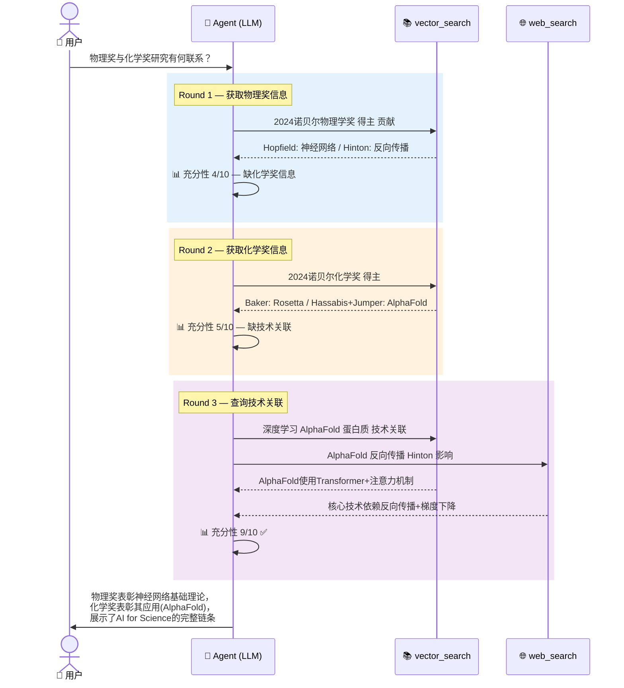
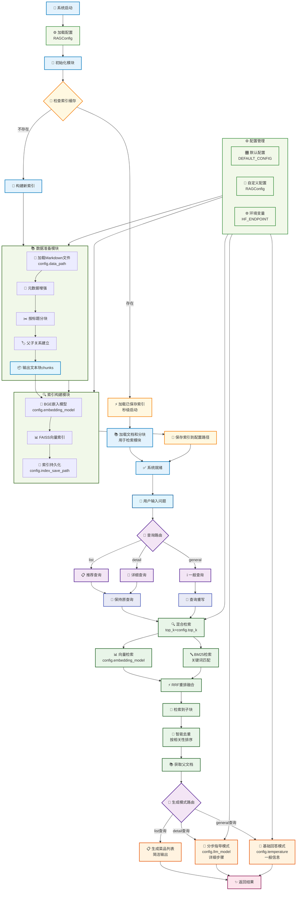
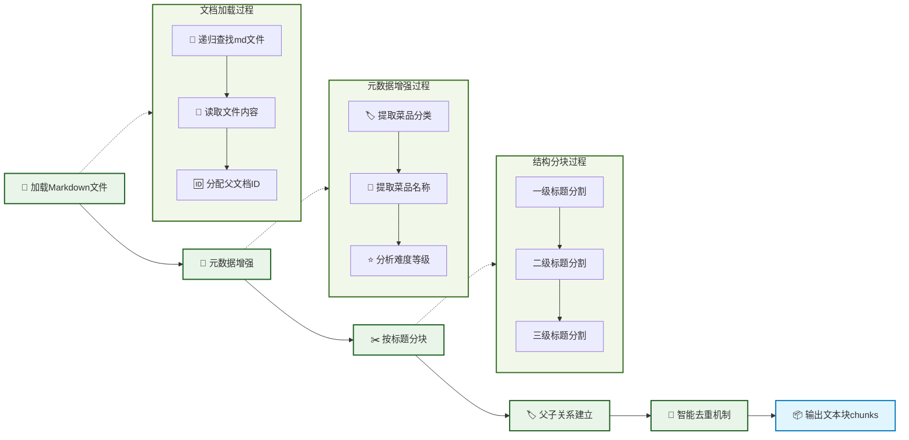
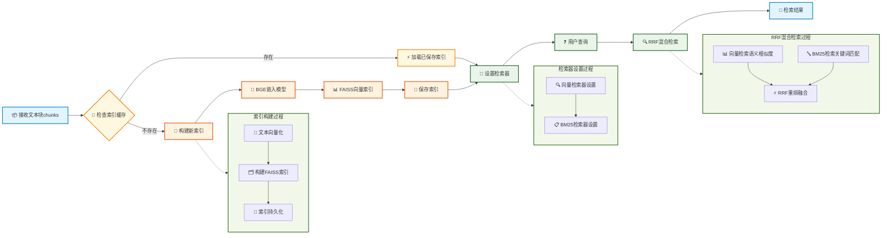
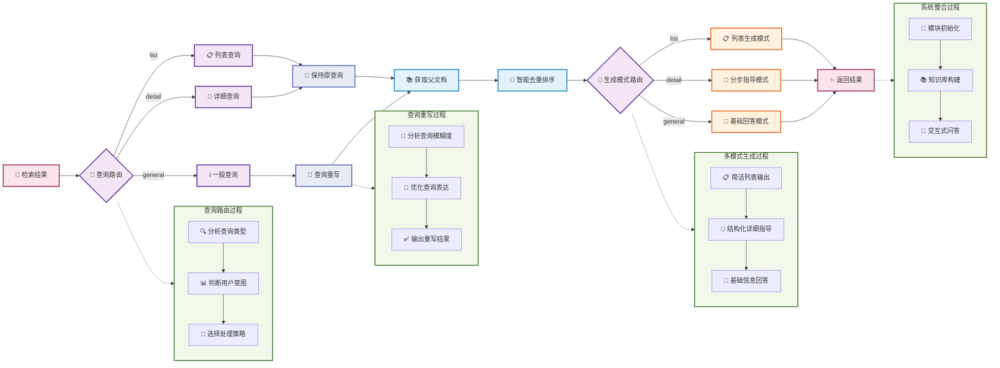
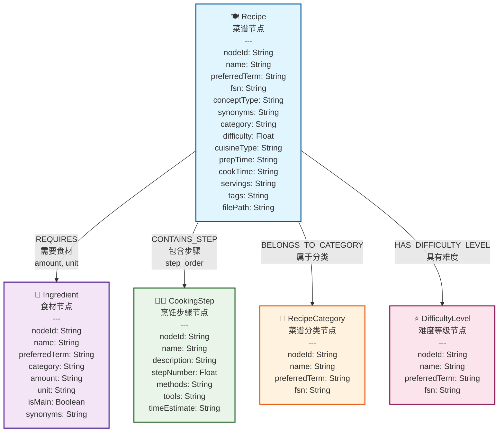
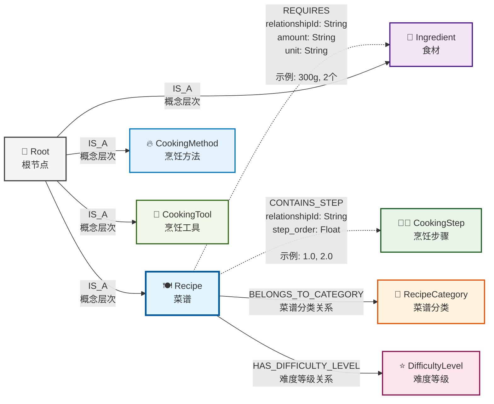
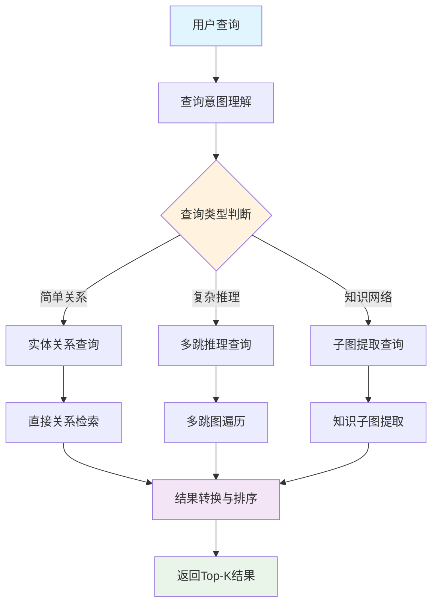

# All-in-RAG：RAG 技术全栈指南

## 文档信息

| 项目 | 内容 |
| --- | --- |
| 文档标题 | All-in-RAG：RAG 技术全栈指南 |
| 文档类型 | zh-CN 整合 Markdown |
| 上游仓库 | [datawhalechina/all-in-rag](https://github.com/datawhalechina/all-in-rag) |
| 锁定提交 | [cec956e80ae2](https://github.com/datawhalechina/all-in-rag/commit/cec956e80ae28d6c0ca84c9d39dddcf61ad633fd) |
| 提交时间 | 2026-10-01T05:49:14+08:00 |
| 生成器版本 | `generic@1;engine@9` |

> 本文件由 reference 仓库自动生成。请修改上游源文件或本仓库的清单/适配器后重新生成，不要直接编辑此文件。

## 阅读说明

本文档按清单中的阅读顺序合并上游 Markdown。图片被改写为锁定提交的 GitHub Raw 链接，章节内有效的本地文档链接被改写为同一提交的 GitHub 源文件链接。

## 目录

- [第一部分：RAG 入门](#第一部分rag-入门)
  - [1.1 RAG 简介](#11-rag-简介)
  - [1.2 学习准备](#12-学习准备)
  - [1.3 快速开始 RAG](#13-快速开始-rag)
  - [1.4 Python 虚拟环境](#14-python-虚拟环境)
- [第二部分：数据准备](#第二部分数据准备)
  - [2.1 数据加载](#21-数据加载)
  - [2.2 文本切分](#22-文本切分)
- [第三部分：索引构建](#第三部分索引构建)
  - [3.1 向量嵌入](#31-向量嵌入)
  - [3.2 多模态嵌入](#32-多模态嵌入)
  - [3.3 向量数据库](#33-向量数据库)
  - [3.4 Milvus](#34-milvus)
  - [3.5 索引优化](#35-索引优化)
- [第四部分：检索优化](#第四部分检索优化)
  - [4.1 混合检索](#41-混合检索)
  - [4.2 查询构造](#42-查询构造)
  - [4.3 Text-to-SQL](#43-text-to-sql)
  - [4.4 查询改写](#44-查询改写)
  - [4.5 高级检索技术](#45-高级检索技术)
- [第五部分：生成与评估](#第五部分生成与评估)
  - [5.1 格式化生成](#51-格式化生成)
  - [5.2 系统评估](#52-系统评估)
  - [5.3 常用工具](#53-常用工具)
- [第六部分：高级架构与项目实战](#第六部分高级架构与项目实战)
  - [6.1 知识图谱 RAG](#61-知识图谱-rag)
  - [6.2 Agentic RAG](#62-agentic-rag)
  - [6.3 环境与架构](#63-环境与架构)
  - [6.4 数据准备实战](#64-数据准备实战)
  - [6.5 索引与检索实战](#65-索引与检索实战)
  - [6.6 生成系统实战](#66-生成系统实战)
  - [6.7 GraphRAG 架构](#67-graphrag-架构)
  - [6.8 图数据建模](#68-图数据建模)
  - [6.9 图索引构建](#69-图索引构建)
  - [6.10 智能查询路由](#610-智能查询路由)

---

## 第一部分：RAG 入门

### 1.1 RAG 简介

#### 一、什么是 RAG？

##### 1.1 核心定义

从本质上讲，RAG（Retrieval-Augmented Generation）是一种旨在解决大语言模型（LLM）“知其然不知其所以然”问题的技术范式。它的核心是将模型内部学到的“**参数化知识**”（模型权重中固化的、模糊的“记忆”），与来自外部知识库的“**非参数化知识**”（精准、可随时更新的外部数据）相结合。其运作逻辑就是在 LLM 生成文本前，先通过检索机制从外部知识库中动态获取相关信息，并将这些“参考资料”融入生成过程，从而提升输出的准确性和时效性 [^1] [^2] [^3]。

> 💡 **一句话总结**：RAG 就是让 LLM 学会了“开卷考试”，它既能利用自己学到的知识，也能随时查阅外部资料。

##### 1.2 技术原理

那么，RAG 系统是如何实现“参数化知识”与“非参数化知识”的结合呢？如图 1-1 所示，其架构主要通过两个阶段来完成这一过程：

（1）**检索阶段：寻找“非参数化知识”**
-   **知识向量化**：**嵌入模型（Embedding Model）** 充当了“连接器”的角色。它将外部知识库编码为向量索引（Index），存入**向量数据库**。
-   **语义召回**：当用户发起查询时，检索模块利用同样的嵌入模型将问题向量化，并通过**相似度搜索（Similarity Search）**，从海量数据中精准锁定与问题最相关的文档片段。

（2）**生成阶段：融合两种知识**
-   **上下文整合**：**生成模块**接收检索阶段送来的相关文档片段以及用户的原始问题。
-   **指令引导生成**：该模块会遵循预设的 **Prompt** 指令，将上下文与问题有效整合，并引导 LLM（如 DeepSeek）进行可控的、有理有据的文本生成。


图 1-1 RAG 双阶段架构示意图


##### 1.3 技术演进分类

RAG 的技术架构经历了从简单到复杂的演进，如图 1-2 大致可分为三个阶段 [^4]。


图 1-2 RAG 技术演进分类


这三个阶段的具体对比如表 1-1 所示。


<table border="1" style="margin: 0 auto;">
  <tr>
    <th style="text-align: center;"></th>
    <th style="text-align: center;">初级 RAG（Naive RAG）</th>
    <th style="text-align: center;">高级 RAG（Advanced RAG）</th>
    <th style="text-align: center;">模块化 RAG（Modular RAG）</th>
  </tr>
  <tr>
    <td style="text-align: center;">**流程**</td>
    <td style="text-align: center;">**离线:** <code>索引</code><br>**在线:** <code>检索 → 生成</code></td>
    <td style="text-align: center;">**离线:** <code>索引</code><br>**在线:** <code>...→ 检索前 → ... → 检索后 → ...</code></td>
    <td style="text-align: center;">积木式可编排流程</td>
  </tr>
  <tr>
    <td style="text-align: center;">**特点**</td>
    <td style="text-align: center;">基础线性流程</td>
    <td style="text-align: center;">增加**检索前后**的优化步骤</td>
    <td style="text-align: center;">模块化、可组合、可动态调整</td>
  </tr>
  <tr>
    <td style="text-align: center;">**关键技术**</td>
    <td style="text-align: center;">基础向量检索</td>
    <td style="text-align: center;">**查询重写（Query Rewrite）**<br>**结果重排（Rerank）**</td>
    <td style="text-align: center;">**动态路由（Routing）**<br>**查询转换（Query Transformation）**<br>**多路融合（Fusion）**</td>
  </tr>
  <tr>
    <td style="text-align: center;">**局限性**</td>
    <td style="text-align: center;">效果不稳定，难以优化</td>
    <td style="text-align: center;">流程相对固定，优化点有限</td>
    <td style="text-align: center;">系统复杂性高</td>
  </tr>
</table>
*表 1-1 RAG 技术演进分类对比*


> “离线”指提前完成的数据预处理工作（如索引构建）；“在线”指用户发起请求后的实时处理流程。

#### 二、为什么要使用 RAG？

##### 2.1 技术选型：RAG vs. 微调

在选择具体的技术路径时，一个重要的考量是成本与效益的平衡。通常，我们应优先选择对模型改动最小、成本最低的方案，所以技术选型路径往往遵循的顺序是**提示词工程（Prompt Engineering） -> 检索增强生成 -> 微调（Fine-tuning）**。

我们可以从两个维度来理解这些技术的区别。如图 1-3 所示，**横轴代表“LLM 优化”**，即对模型本身进行多大程度的修改。从左到右，优化的程度越来越深，其中提示工程和 RAG 完全不改变模型权重，而微调则直接修改模型参数。**纵轴代表“上下文优化”**，是对输入给模型的信息进行多大程度的增强。从下到上，增强的程度越来越高，其中提示工程只是优化提问方式，而 RAG 则通过引入外部知识库，极大地丰富了上下文信息。


图 1-3 选型路径图


基于此，我们的选择路径就清晰了：
- **先尝试提示工程**：通过精心设计提示词来引导模型，适用于任务简单、模型已有相关知识的场景。
- **再选择 RAG**：如果模型缺乏特定或实时知识而无法回答，则使用 RAG，通过外挂知识库为其提供上下文信息。
- **最后考虑微调**：当目标是改变模型“如何做”（行为/风格/格式）而不是“知道什么”（知识）时，微调是最终且最合适的选择。例如，让模型学会严格遵循某种独特的输出格式、模仿特定人物的对话风格，或者将极其复杂的指令“蒸馏”进模型权重中。

RAG 的出现填补了通用模型与专业领域之间的鸿沟，它在解决如表 1-2 所示 LLM 局限时尤其有效：


<table border="1" style="margin: 0 auto;">
  <tr>
    <th style="text-align: center;">问题</th>
    <th style="text-align: center;">RAG的解决方案</th>
  </tr>
  <tr>
    <td style="text-align: center;">**静态知识局限**</td>
    <td style="text-align: center;">实时检索外部知识库，支持动态更新</td>
  </tr>
  <tr>
    <td style="text-align: center;">**幻觉（Hallucination）**</td>
    <td style="text-align: center;">基于检索内容生成，错误率降低</td>
  </tr>
  <tr>
    <td style="text-align: center;">**领域专业性不足**</td>
    <td style="text-align: center;">引入领域特定知识库（如医疗/法律）</td>
  </tr>
  <tr>
    <td style="text-align: center;">**数据隐私风险**</td>
    <td style="text-align: center;">本地化部署知识库，避免敏感数据泄露</td>
  </tr>
</table>
*表 1-2 RAG 对 LLM 局限的解决方案*


##### 2.2 关键优势

（1）**准确性与可信度的双重提升**

RAG 最核心的价值在于突破了模型预训练知识的限制。它不仅能**补充专业领域的知识盲区**，还能通过提供具体的参考材料，有效**抑制“一本正经胡说八道”的幻觉现象**。论文研究还表明，RAG 生成的内容在**具体性**和**多样性**上也显著优于纯 LLM。更重要的是，RAG 具备**可溯源性**——每一条回答都能找到对应的原始文档出处，这种“有据可查”的特性极大提高了内容在法律、医疗等严肃场景下的可信度。

（2）**时效性保障**

在知识更新方面，RAG 解决了 LLM 固有的**知识时滞问题**（即模型不知道训练截止日期之后发生的事）。RAG 允许知识库独立于模型进行**动态更新**——新政策或新数据一旦入库，立刻就能被检索到。这种能力在论文中被称为**“索引热拔插”（Index Hot-swapping）**——就像给机器人换一张存储卡一样，瞬间切换其世界知识库，而无需重新训练模型，实现了知识的实时在线。

（3）**显著的综合成本效益**

从经济角度看，RAG 是一种高性价比的方案。首先，它**避免了高频微调**带来的巨额算力成本；其次，由于有了外部知识的强力辅助，我们在处理特定领域问题时，往往可以使用**参数量更小的基础模型**来达到类似的效果，从而直接降低了推理成本。这种架构也减少了试图将海量知识强行“塞入”模型权重中所需的计算资源消耗。

（4）**灵活的模块化可扩展性**

RAG 的架构具备极强的包容性，支持**多源集成**，无论是 PDF、Word 还是网页数据，都能统一构建进知识库中。同时，其**模块化设计**实现了检索与生成的解耦，这意味着我们可以独立优化检索组件（比如更换更好的 Embedding 模型），而不会影响到生成组件的稳定性，便于系统的长期迭代。

##### 2.3 适用场景风险分级

表 1-3 展示了 RAG 技术在不同风险等级场景中的适用性。


<table border="1" style="margin: 0 auto;">
  <tr>
    <th style="text-align: center;">风险等级</th>
    <th style="text-align: center;">案例</th>
    <th style="text-align: center;">RAG适用性</th>
  </tr>
  <tr>
    <td style="text-align: center;">**低风险**</td>
    <td style="text-align: center;">翻译/语法检查</td>
    <td style="text-align: center;">高可靠性</td>
  </tr>
  <tr>
    <td style="text-align: center;">**中风险**</td>
    <td style="text-align: center;">合同起草/法律咨询</td>
    <td style="text-align: center;">需结合人工审核</td>
  </tr>
  <tr>
    <td style="text-align: center;">**高风险**</td>
    <td style="text-align: center;">证据分析/签证决策</td>
    <td style="text-align: center;">需严格质量控制机制</td>
  </tr>
</table>
*表 1-3 RAG 适用场景风险分级*


#### 三、如何上手 RAG？

##### 3.1 基础工具链选择

构建 RAG 系统通常涉及几个关键环节的选型。在**开发模式**上，我们可以利用 **LangChain** 或 **LlamaIndex** 等成熟框架快速集成，**也可以选择不依赖框架的原生开发**，以获得对系统流程更精细的控制力（在 AI 编程辅助下这并非难事）。而在**记忆载体**（向量数据库）方面，既有 **Milvus**、**Pinecone** 等适合大规模数据的方案，也有 **FAISS**、**Chroma** 等轻量级或本地化的选择，需根据具体业务规模灵活决定。后期为了量化效果，还可以引入 **RAGAS** 或 **TruLens** 等自动化**评估工具**。

##### 3.2 四步构建最小可行系统（MVP）

（1）**数据准备与清洗**：这是系统的地基。我们需要将 PDF、Word 等多源异构数据标准化，并采用合理的**分块策略**（如按语义段落切分而非固定字符数），避免信息在切割中支离破碎。

（2）**索引构建**：将切分好的文本通过**嵌入模型**转化为向量，并存入数据库。可以在此阶段关联**元数据**（如来源、页码），这对后续的精确引用很有帮助。

（3）**检索策略优化**：不要依赖单一的向量搜索。可以采用**混合检索**（向量+关键词）等方式来提升召回率，并引入**重排序**模型对检索结果进行二次精选，确保 LLM 看到的都是精华。

（4）**生成与提示工程**：最后，设计一套清晰的 **Prompt 模板**，引导 LLM 基于检索到的上下文回答用户问题，并明确要求模型“不知道就说不知道”，防止幻觉。

##### 3.3 新手友好方案

如果希望快速验证想法而非深耕代码，可以尝试 **FastGPT** 或 **Dify** 这样的可视化知识库平台，它们封装了复杂的 RAG 流程，仅需上传文档即可使用。对于开发者，利用 **LangChain4j Easy RAG** 或 GitHub 上的 **TinyRAG** [^6]等开源模板，也是高效的起手方式。

##### 3.4 进阶与挑战

当基础的 RAG 系统搭建完成后，下一步的进阶之路便聚焦于如何评估、诊断并突破其固有的瓶颈。

（1）**评估维度与挑战**

一套 RAG 系统的好坏，并不能仅凭感觉。业界通常会从几个维度进行量化评估，首先是**检索相关性**（找到的内容是否包含答案），其次是**生成质量**，这又可以细分为**语义准确性**（回答的意思是否正确）和**词汇匹配度**（专业术语是否使用得当）。

这些评估维度也直接对应了 RAG 当前面临的主要挑战。比如，**检索依赖性**问题——如果检索系统召回了错误信息，再强的 LLM 也会“一本正经地胡说八道”。此外，对于需要跨多个文档进行综合分析的**多跳推理**问题，常见的 RAG 架构也普遍感到吃力。

（2）**优化方向与架构演进**

针对上述挑战，社区探索出了多种优化路径。在**性能层面**，可以通过**索引分层**（对高频数据启用缓存）和**多模态扩展**（支持图像/表格检索）来提升效率和能力边界。而在**架构层面**，简单的线性流程正在被更复杂的**设计模式**所取代。例如，系统可以通过**分支模式**并行处理多路检索，或通过**循环模式**进行自我修正，这些灵活的架构是通往更智能 RAG 的必由之路。

#### 四、RAG 已死？

随着大模型长上下文窗口能力的提升，社区中开始出现“RAG 已死”的声音。这一论调主要来自两个方面，一是认为长上下文已经能暴力“消化”海量文本，不再需要复杂的检索系统；二是批评 RAG 这个术语本身就过于宽泛，模糊了太多技术细节，反而阻碍了理解与优化。

这些观点忽略了一个技术概念在演进过程中的普遍规律。正如我们可以轻易地为现代复杂的 RAG 系统起一个更精确、更唬人的名字，比如 **“大模型知识管理专家系统”（Large Language Model Knowledge Management Expert System，LKE）**。因为它早已超出了最初“检索-增强-生成”的简单范畴。但这种“换名游戏”，恰恰说明了“RAG 已死”论的表面化——这无异于在用一个新瓶子去装 RAG 这个不断陈化的老酒。

> 笔者在此并非要创造一个新词，不过为什么要起 LKE 这个名字？它代表了三个核心要素：
> -   **L（Large Language Model）**：强调系统的驱动力是大语言模型。
> -   **K（Knowledge Management）**：寓意着系统就像一个知识管理员，精准地为我们找到（**检索**）所需要的知识，辅助我们后续利用大模型进行更高阶应用。
> -   **E（Expert）**：说明系统能像专家一样，通过路由、分析、融合、修正等一系列步骤，最终给出答案（**生成**）、解决问题。

可以类比 **Transformer**。今天无论是以 GPT 为代表的 Decoder-only 还是以 BERT 为代表的 Encoder-only，我们都习惯称之为“基于 Transformer 架构”，尽管它们与最初论文中的完整形态差异巨大。但是 Transformer 这个标签抓住了一次技术范式的核心飞跃，并成为了一个技术时代的象征。同理，**RAG 的核心在于“将 LLM 的内在参数化知识与外部非参数化知识相结合”**。只要这个思想或需求不变，无论我们为其增加多少模块——查询转换、多路召回或者自我修正等等，它本质上依然是在这个框架下的演进。

所以，“RAG 已死”是一个伪命题。相反，**RAG 作为一个概念活得很好**，它正在像 Transformer 一样，成为一个不断吸收新技术、不断进化的基础架构范式。它的生命力，正在于它的“面目全非”和“包罗万象”。而**本教程的目标，就是绘制出这张描绘 RAG 全貌的清晰地图，当我们可以解构它的每一个模块、理解它的每一种可能性时，RAG 也好，LKE 也罢，这些都无关紧要**。我们要做的就是通过 RAG 这道经典例题来学习和拓展（将 LLM 的内在参数化知识与外部非参数化知识相结合）这类题型的解题思路。

> RAG 技术仍在快速发展中，可以持续关注学术和工业界的最新进展！

#### 参考文献

[^1]: [Genesis, J. (2025). *Retrieval-Augmented Text Generation: Methods, Challenges, and Applications*](https://www.researchgate.net/publication/391141346_Retrieval-Augmented_Generation_Methods_Applications_and_Challenges).

[^2]: [Gao et al. (2023). *Retrieval-Augmented Generation for Large Language Models: A Survey*](https://arxiv.org/abs/2312.10997).

[^3]: [Lewis et al. (2020). *Retrieval-Augmented Generation for Knowledge-Intensive NLP Tasks*](https://arxiv.org/abs/2005.11401).

[^4]: [Gao et al. (2024). *Modular RAG: Transforming RAG Systems into LEGO-like Reconfigurable Frameworks*](https://arxiv.org/abs/2407.21059).

[^6]: [*TinyRAG: GitHub项目*](https://github.com/KMnO4-zx/TinyRAG).

### 1.2 学习准备

> 本节环境配置方面主推两种基于浏览器的集成开发环境。不管是手机、平板还是电脑，随时都可以上号运行代码。虽然手机平板可能体验不佳，但胜在能用。

#### 一、大模型 API 配置

##### 1.1 AIHubmix API 申请

AIHubmix 是一个美国平台，公司注册在美国的特拉华州，一站式聚合了全球主流的 AI 模型，最新的模型通常能在发布当天最晚不超过 1 周就会支持。完全对接相关模型的云厂商（OpenAI 对接的是 Azure 云，Gemini 对接的 Google 官方，Claude 对接的是 AWS，其他开源等模型是对接到各大知名云厂商或者推理公司）。AIHubmix 的服务器是在美国谷歌云上采用集群部署，同时因为完全对接云厂商，所以稳定性非常好，有多端点路由机制，可以达到比直连官方更稳定的效果。

> AIHubmix 提供的免费模型足够我们完成项目的学习。

1.  **访问 AIHubmix 平台**

    打开浏览器，访问 [AIHubmix](https://aihubmix.com/?aff=anNj)。

    

2.  **登录或注册账号**

    如果已有账号，可以直接登录。如果没有，请点击页面右上角的注册按钮，使用邮箱或手机号完成注册。

3.  **模型筛选**

    注册完成后，来到[模型页面](https://aihubmix.com/models)。标签选择`免费`，可以看到官方提供了一定数量的免费模型。而且 AIHubmix 还提供了很多嵌入和重排序的国内外模型选择，这些在 RAG 领域都很常用。

    

4.  **管理 API 密钥**

    接着进入[密钥管理页面](https://console.aihubmix.com/token)，如下图所示，默认已经有了一个密钥可以直接复制使用。当然也可以点击 `创建 Key` 填写名称后重新创建一个。

    

##### 1.2 DeepSeek API 申请

要使用 Deepseek 提供的大语言模型服务，你首先需要一个 API Key。下面是申请步骤：

1.  **访问 Deepseek 开放平台**

    打开浏览器，访问 [Deepseek 开放平台](https://platform.deepseek.com/)。

    

2.  **登录或注册账号**

    如果你已有账号，请直接登录。如果没有，请点击页面上的注册按钮，使用邮箱或手机号完成注册。

3.  **创建新的 API 密钥**

    登录成功后，在页面左侧的导航栏中找到并点击 `API Keys`。在 API 管理页面，点击 `创建 API key` 按钮。输入一个跟其他api key不重复的名称后点击创建。

    

4.  **保存 API Key**

    系统会为你生成一个新的 API 密钥。请**立即复制**并将其保存在一个安全的地方。

    > 注意：出于安全原因，这个密钥只会完整显示一次，关闭弹窗后就没法再看到了。

    

#### 二、GitHub Codespaces 环境配置（推荐）

> 首先确定是否具有可以流畅访问 GitHub 的网络环境，若无法流畅访问请使用下面的Cloud Studio

GitHub Codespaces 是 GitHub 提供的一项服务，允许开发者在云端创建、编辑和运行代码。它提供了一个预配置的开发环境，包括代码编辑器、终端、调试工具等，可以直接在浏览器中使用。

##### 2.1 创建Codespaces

1.  **访问项目地址**

    打开浏览器，访问 [all-in-rag](https://github.com/datawhalechina/all-in-rag)

2.  **创建新分支**
    在项目页面的右上角，点击 `Fork` 按钮，创建一个新的分支。稍等一会儿即可创建成功。

    

    

3.  **创建Codespaces**
    在项目页面的右上角，点击 `Code` 按钮，然后选择 `Codespaces` 选项卡。点击 `New codespace` 按钮，等待新的 Codespaces 环境创建成功。

    

4.  **再次进入Codespaces**
    网页关闭后，找到刚才新建的存储库，点击红框框选内容即可重新进入 codespace 环境。

    

5.  **额度设置**
    找到 GitHub 的账户设置中的 codespace 设置，挂起时间建议根据自己情况调整（时间过长会浪费额度，免费账号提供了单核120小时的额度）

    

##### 2.2 python环境配置

进入 IDE 后先选择下方终端


1.  **更新系统软件包**

    在终端输入下面指令：

    ```bash
    sudo apt update
    sudo apt upgrade -y
    ```

2.  **安装Miniconda**

    ```bash
    wget https://repo.anaconda.com/miniconda/Miniconda3-latest-Linux-x86_64.sh -O ~/miniconda.sh
    bash ~/miniconda.sh
    ```

    - 按 Enter 阅读许可协议
    - 输入 `yes` 同意协议
    - 安装路径提示时直接按 Enter（使用默认路径 /home/ubuntu/miniconda3）
    - 是否初始化Miniconda：输入 `yes` 将Miniconda添加到您的PATH环境变量中。

    ```bash
    source ~/.bashrc
    conda --version
    ```

    如果显示版本号，说明安装成功。

##### 2.3 API配置

1.  使用 `vim` 编辑器打开你的 shell 配置文件。

    ```bash
    vim ~/.bashrc
    ```

2.  输入 `i` 进入编辑模式，在文件末尾添加以下行，将 `[你的大模型 API 密钥]` 替换为你自己的密钥：

    ```bash
    export DEEPSEEK_API_KEY=[你的大模型 API 密钥]
    ```

    如果选择的是 `AIHubmix` 平台，为了增加辨识度也可以使用：

    ```bash
    export AIHUBMIX_API_KEY=[你的大模型 API 密钥]
    ```

    > 不要带 `[]`

3.  保存并退出 在 vim 中，按 Esc 键进入命令模式，然后输入 `:wq` 并按 Enter 键保存文件并退出。

4.  使配置生效 执行以下命令来立即加载更新后的配置，让环境变量生效：

    ```bash
    source ~/.bashrc
    ```

##### 2.4 创建并激活虚拟环境

1.  **创建虚拟环境**

    ```bash
    conda create --name all-in-rag python=3.12.7
    ```

    出现选项直接回车即可。

2.  **激活虚拟环境**

    使用以下命令激活虚拟环境：

    ```bash
    conda activate all-in-rag
    ```

3.  **依赖安装**
    如果严格安装上述流程当前应该在项目根目录，进入code目录安装依赖库

    ```bash
    cd code
    pip install -r requirements.txt
    ```

    > 如果出现关于grpcio的版本错误无需在意。

#### 三、Cloud Studio 环境配置（国内环境推荐）

Cloud Studio 是腾讯云推出的一款基于浏览器的集成开发环境（IDE）。支持CPU与GPU的访问。

> 听说一个月是50个小时的免费额度🤔

##### 3.1 应用创建

1.  **访问 Cloud Studio**
    打开浏览器，访问 [Cloud Studio](https://cloudstudio.net/)。

2.  **登录或注册账号**
    点击页面右上角的 `注册登录` 按钮，使用微信等方式完成登录。

3.  **创建应用**
    在页面上方的导航栏中找到并点击 `创建应用`。选择 `从 Git 仓库导入` ，在项目地址栏输入 `https://github.com/datawhalechina/all-in-rag.git` 后回车，将会自动为你创建标题和描述。

    

    > 注意描述中不要包含网址

4.  **再次进入**
    后续在[应用管理页面](https://cloudstudio.net/my-app)找到之前创建的应用，点击后选择右上角编写代码即可再次进入。

    

##### 3.2 python环境配置

进入 IDE 后先选择右侧终端


1.  **更新系统软件包**

    在终端输入下面指令：

    ```bash
    sudo apt update
    sudo apt upgrade -y
    ```

2.  **切换普通用户**

    ```bash
    su ubuntu
    ```

3.  **安装Miniconda**

    ```bash
    wget https://repo.anaconda.com/miniconda/Miniconda3-latest-Linux-x86_64.sh -O ~/miniconda.sh
    bash ~/miniconda.sh
    ```

    - 按 Enter 阅读许可协议
    - 输入 `yes` 同意协议
    - 安装路径提示时直接按 Enter（使用默认路径 /home/ubuntu/miniconda3）
    - 是否初始化Miniconda：输入 `yes` 将Miniconda添加到您的PATH环境变量中。

    ```bash
    source ~/.bashrc
    conda --version
    ```

    如果显示版本号，说明安装成功。

##### 3.3 API配置

1.  使用 `vim` 编辑器打开你的 shell 配置文件。

    ```bash
    vim ~/.bashrc
    ```

2.  输入 `i` 进入编辑模式，在文件末尾添加以下行，将 `[你的大模型 API 密钥]` 替换为你自己的密钥：

    ```bash
    export DEEPSEEK_API_KEY=[你的大模型 API 密钥]
    ```

    如果选择的是 `AIHubmix` 平台，为了增加辨识度也可以使用：

    ```bash
    export AIHUBMIX_API_KEY=[你的大模型 API 密钥]
    ```

    > 不要带 `[]`

3.  保存并退出 在 vim 中，按 Esc 键进入命令模式，然后输入 `:wq` 并按 Enter 键保存文件并退出。

4.  使配置生效 执行以下命令来立即加载更新后的配置，让环境变量生效：

    ```bash
    source ~/.bashrc
    ```

##### 3.4 创建并激活虚拟环境

1.  **创建虚拟环境**

    ```bash
    conda create --name all-in-rag python=3.12.7
    ```

    出现选项直接回车即可。

2.  **配置文件权限**

    ```bash
    sudo chown -R ubuntu:ubuntu code models
    ```

3.  **激活虚拟环境**

    使用以下命令激活虚拟环境：

    ```bash
    conda activate all-in-rag
    ```

4.  **依赖安装**
    如果严格安装上述流程当前应该在项目根目录，进入code目录安装依赖库

    ```bash
    cd code
    pip install -r requirements.txt
    ```

    > 如果出现关于grpcio的版本错误无需在意。

#### 四、windows环境配置（使用Cloud Studio 或 Codespaces 可跳过此步骤）

##### 4.1 API配置

1.  右键点击 “计算机” 或 “此电脑”，然后点击 “属性”。

2.  在左侧菜单中，点击 “高级系统设置”。

3.  在 “系统属性” 对话框中，点击 “高级” 选项卡，然后点击下方的 “环境变量” 按钮。

    

4.  在 “环境变量” 对话框中，点击 “新建”（在 “用户变量” 部分下），然后输入以下信息：
    - 变量名：DEEPSEEK_API_KEY
    - 变量值：[你的 Deepseek API 密钥]

    

##### 4.2 安装Miniconda

1.  **下载安装程序**

    优先推荐访问[清华大学开源软件镜像站](https://mirrors.tuna.tsinghua.edu.cn/anaconda/miniconda/)，以获得更快的下载速度。根据你的系统选择最新的 `.exe` 版本下载。

    

    你也可以从 [Miniconda 官方网站](https://docs.conda.io/en/latest/miniconda.html)下载。

2.  **运行安装向导**

    下载完成后，双击 `.exe` 文件启动安装。按照向导提示操作：

    *   **Welcome**: 点击 `Next`。

        

    *   **License Agreement**: 点击 `I Agree`。

        

    *   **Installation Type**: 选择 `Just Me`，点击 `Next`。

        

    *   **Choose Install Location**: 建议保持默认路径，或选择一个不含中文和空格的路径。点击 `Next`。

        

    *   **Advanced Installation Options**: **请不要勾选** “Add Miniconda3 to my PATH environment variable”。我们将稍后手动配置环境变量。点击 `Install`。

        

    *   **Installation Complete**: 安装完成后，点击 `Next`，然后取消勾选 “Learn more” 并点击 `Finish` 完成安装。

3.  **手动配置环境变量**

    为了能在任意终端窗口使用 `conda` 命令，需要手动配置环境变量。

    *   在Windows搜索栏中搜索“编辑系统环境变量”并打开。

        

    *   在“系统属性”窗口中，点击“环境变量”。

        

    *   在“环境变量”窗口中，找到“系统变量”下的 `Path` 变量，选中并点击“编辑”。

        

    *   在“编辑环境变量”窗口中，新建三个路径，将它们指向你 Miniconda 的安装目录下的相应文件夹。如果你的安装路径是 `D:\Miniconda3`，则需要添加：
        ```
        D:\Miniconda3
        D:\Miniconda3\Scripts
        D:\Miniconda3\Library\bin
        ```
        

    *   完成后，一路点击“确定”保存更改。

##### 4.3 配置 Conda 镜像源

为了加快后续使用 `conda` 安装包的速度，强烈建议配置国内镜像源。打开一个新的终端或 Anaconda Prompt，运行以下命令：

```bash
conda config --add channels https://mirrors.tuna.tsinghua.edu.cn/anaconda/pkgs/main/
conda config --add channels https://mirrors.tuna.tsinghua.edu.cn/anaconda/pkgs/free/
conda config --set show_channel_urls yes
```

配置完成后，可以通过 `conda config --show channels` 命令查看已添加的源。

#### 五、项目代码拉取（使用Cloud Studio 或 Codespaces 可跳过此步骤）

##### 5.1 安装 Git

如果你尚未安装 Git，请按照以下步骤安装。

* **Windows 系统**：访问[Git 官方网站](https://git-scm.com/download/win)，下载并运行安装程序，按照默认设置完成安装。
* **macOS 系统**：打开终端，输入以下命令安装 Git：

  ```bash
  brew install git
  ```
* **Linux 系统（以 Ubuntu 为例）**：打开终端，输入以下命令安装 Git：

  ```bash
  sudo apt-get update
  sudo apt-get install git
  ```

安装完成后，验证 Git 是否安装成功，输入以下命令：

```bash
git --version
```

如果成功，会显示 Git 的版本号。

##### 5.2 克隆项目代码

1. **选择存放项目的目录**
   打开终端（或 Windows 中的 Git Bash），导航到你想存放项目的目录：

   ```bash
   cd [你希望存放项目的路径]
   ```

2. **克隆仓库**
   使用以下命令拉取 `all-in-rag` 仓库：

   ```bash
   git clone https://github.com/datawhalechina/all-in-rag.git
   ```

   等待下载完成，项目代码将存放在当前目录下的 `all-in-rag` 文件夹中。

3. **进入项目目录**
   拉取代码后，进入项目目录：

   ```bash
   cd all-in-rag
   ```

##### 5.3 创建并激活虚拟环境

在项目目录下，推荐使用前面配置好的 Miniconda 来创建 Python 虚拟环境。

1. **创建虚拟环境**

   ```bash
   conda create --name all-in-rag python=3.12.7
   ```

2. **激活虚拟环境**

   所有系统统一使用以下命令激活虚拟环境：

   ```bash
   conda activate all-in-rag
   ```

3.  **依赖安装**
    如果严格安装上述流程当前应该在项目根目录，进入code目录安装依赖库

    ```bash
    cd code
    pip install -r requirements.txt
    ```

### 1.3 快速开始 RAG

通过第一节的学习，我们对RAG已经有了基本认识，并且也准备好了虚拟环境和api_key，接下来将尝试使用[**LangChain**](https://python.langchain.com/docs/introduction/)和[**LlamaIndex**](https://docs.llamaindex.ai/en/stable/)框架完成第一个RAG应用的实现与运行。通过一个示例，演示如何加载本地Markdown文档，利用嵌入模型处理文本，并结合大型语言模型（LLM）来回答与文档内容相关的问题。

#### 一、启动虚拟环境

##### 1.1 激活虚拟环境

假设已经按照前一章节的指导，创建了名为 `all-in-rag` 的 Conda 虚拟环境。在运行脚本前，先激活虚拟环境：

> 如果使用是Cloud Studio，需要确认当前是否是用户环境，如果不是请运行 `su ubuntu` 切换到用户环境。

```bash
conda activate all-in-rag
```

##### 1.2 切换到项目目录

```bash
# 假设当前在 all-in-rag 项目的根目录下
cd code/C1
```

每章内容中的代码文件都存放在 `code/Cx` 目录下，其中 `x` 表示章节编号。

#### 二、运行RAG示例代码

完成上述所有设置后，就可以运行RAG示例了。

打开终端，确保虚拟环境已激活，然后执行以下命令：

```bash
python 01_langchain_example.py
```

> 若出现nltk相关报错，尝试运行代码路径下[fix_nltk.py](https://github.com/datawhalechina/all-in-rag/blob/cec956e80ae28d6c0ca84c9d39dddcf61ad633fd/code/C1/fix_nltk.py)

代码运行后，可以看到类似下面的输出（格式化后）：

```bash
Downloading Model from https://www.modelscope.cn to directory: Path\to\all-in-rag\models\bge-small-zh-v1.5
2025-06-08 02:36:19,318 - modelscope - INFO - Target directory already exists, skipping creation.
content='
文中举了以下例子：

1. **自然界中的羚羊**：刚出生的羚羊通过试错学习站立和奔跑，适应环境。
2. **股票交易**：通过买卖股票并根据市场反馈调整策略，最大化奖励。
3. **雅达利游戏（如Breakout和Pong）**：通过不断试错学习如何通关或赢得游戏。
4. **选择餐馆**：利用（去已知喜欢的餐馆）与探索（尝试新餐馆）的权衡。
5. **做广告**：利用（采取已知最优广告策略）与探索（尝试新广告策略）。
6. **挖油**：利用（在已知地点挖油）与探索（在新地点挖油，可能发现大油田）。
7. **玩游戏（如《街头霸王》）**：利用（固定策略如蹲角落出脚）与探索（尝试新招式如“大招”）。

这些例子用于说明强化学习中的核心概念（如探索与利用、延迟奖励等）及其在实际场景中的应用。
'
additional_kwargs={'refusal': None}
response_metadata={
    'token_usage': {
        'completion_tokens': 209,
        'prompt_tokens': 5576,
        'total_tokens': 5785,
        'completion_tokens_details': None,
        'prompt_tokens_details': {'audio_tokens': None, 'cached_tokens': 5568},
        'prompt_cache_hit_tokens': 5568,
        'prompt_cache_miss_tokens': 8
    },
    'model_name': 'deepseek-chat',
    'system_fingerprint': 'fp_8802369eaa_prod0425fp8',
    'id': '67a0580d-78b1-44d6-bccf-f654ae0e9bba',
    'service_tier': None,
    'finish_reason': 'stop',
    'logprobs': None
}
id='run--919cedcd-771e-4aed-8dfd-cf436795792e-0'
usage_metadata={
    'input_tokens': 5576,
    'output_tokens': 209,
    'total_tokens': 5785,
    'input_token_details': {'cache_read': 5568},
    'output_token_details': {}
}
```

> 首次运行时，脚本会下载`BAAI/bge-small-zh-v1.5`嵌入模型。

输出参数解析：
- **`content`**: 这是最核心的部分，即大型语言模型（LLM）根据你的问题和提供的上下文生成的具体回答。
- **`additional_kwargs`**: 包含一些额外的参数，在这个例子中是 `{'refusal': None}`，表示模型没有拒绝回答。
- **`response_metadata`**: 包含了关于LLM响应的元数据。
    - `token_usage`: 显示了本次调用消耗的token数量，包括完成（completion_tokens）、提示（prompt_tokens）和总量（total_tokens）。
    - `model_name`: 使用的LLM模型名称，当前是 `deepseek-chat`。
    - `system_fingerprint`, `id`, `service_tier`, `finish_reason`, `logprobs`: 这些是更详细的API响应信息，例如 `finish_reason: 'stop'` 表示模型正常完成了生成。
- **`id`**: 本次运行的唯一标识符。
- **`usage_metadata`**: 与 `response_metadata` 中的 `token_usage` 类似，提供了输入和输出token的统计。

#### 三、基于 LangChain 框架的 RAG 实现

在第一节中，我们提到四步构建最小可行系统分别是数据准备、索引构建、检索优化和生成集成。下面将围绕这四个方面来实现一个基于 LangChain 框架的 RAG 应用。

> [本节完整代码](https://github.com/datawhalechina/all-in-rag/blob/cec956e80ae28d6c0ca84c9d39dddcf61ad633fd/code/C1/01_langchain_example.py)

##### 3.1 初始化设置

首先进行基础配置，包括导入必要的库、加载环境变量以及下载嵌入模型。

```python
import os
# os.environ['HF_ENDPOINT'] = 'https://hf-mirror.com'
from dotenv import load_dotenv
from langchain_community.document_loaders import TextLoader
from langchain_text_splitters import RecursiveCharacterTextSplitter
from langchain_huggingface import HuggingFaceEmbeddings
from langchain_core.vectorstores import InMemoryVectorStore
from langchain_core.prompts import ChatPromptTemplate
from langchain_deepseek import ChatOpenAI

# 加载环境变量
load_dotenv()
```

##### 3.2 数据准备

- **加载原始文档**: 先定义Markdown文件的路径，然后使用`TextLoader`加载该文件作为知识源。
    ```python
    markdown_path = "../../data/C1/markdown/easy-rl-chapter1.md"
    loader = TextLoader(markdown_path)
    docs = loader.load()
    ```
- **文本分块 (Chunking)**: 为了便于后续的嵌入和检索，长文档被分割成较小的、可管理的文本块（chunks）。这里采用了递归字符分割策略，使用其默认参数进行分块。当不指定参数初始化 `RecursiveCharacterTextSplitter()` 时，其默认行为旨在最大程度保留文本的语义结构：
    - **默认分隔符与语义保留**: 按顺序尝试使用一系列预设的分隔符 `["\n\n" (段落), "\n" (行), " " (空格), "" (字符)]` 来递归分割文本。这种策略的目的是尽可能保持段落、句子和单词的完整性，因为它们通常是语义上最相关的文本单元，直到文本块达到目标大小。
    - **保留分隔符**: 默认情况下 (`keep_separator=True`)，分隔符本身会被保留在分割后的文本块中。
    - **默认块大小与重叠**: 使用其基类 `TextSplitter` 中定义的默认参数 `chunk_size=4000`（块大小）和 `chunk_overlap=200`（块重叠）。这些参数确保文本块符合预定的大小限制，并通过重叠来减少上下文信息的丢失。
    ```python
    text_splitter = RecursiveCharacterTextSplitter()
    texts = text_splitter.split_documents(docs)
    ```

##### 3.3 索引构建

数据准备完成后，接下来构建向量索引：

- **初始化中文嵌入模型**: 使用`HuggingFaceEmbeddings`加载之前在初始化设置中下载的中文嵌入模型。配置模型在CPU上运行，并启用嵌入归一化 (`normalize_embeddings: True`)。
    ```python
    embeddings = HuggingFaceEmbeddings(
        model_name="BAAI/bge-small-zh-v1.5",
        model_kwargs={'device': 'cpu'},
        encode_kwargs={'normalize_embeddings': True}
    )
    ```
- **构建向量存储**: 将分割后的文本块 (`texts`) 通过初始化好的嵌入模型转换为向量表示，然后使用`InMemoryVectorStore`将这些向量及其对应的原始文本内容添加进去，从而在内存中构建出一个向量索引。
    ```python
    vectorstore = InMemoryVectorStore(embeddings)
    vectorstore.add_documents(texts)
    ```
    这个过程完成后，便构建了一个可供查询的知识索引。

##### 3.4 查询与检索

索引构建完毕后，便可以针对用户问题进行查询与检索：

- **定义用户查询**: 设置一个具体的用户问题字符串。
    ```python
    question = "文中举了哪些例子？"
    ```
- **在向量存储中查询相关文档**: 使用向量存储的`similarity_search`方法，根据用户问题在索引中查找最相关的 `k` (此处示例中 `k=3`) 个文本块。
    ```python
    retrieved_docs = vectorstore.similarity_search(question, k=3)
    ```
- **准备上下文**: 将检索到的多个文本块的页面内容 (`doc.page_content`) 合并成一个单一的字符串，并使用双换行符 (`"\n\n"`) 分隔各个块，形成最终的上下文信息 (`docs_content`) 供大语言模型参考。
    ```python
    docs_content = "\n\n".join(doc.page_content for doc in retrieved_docs)
    ```
    > 使用 `"\n\n"` (双换行符) 而不是 `"\n"` (单换行符) 来连接不同的检索文档块，主要是为了在传递给大型语言模型（LLM）时，能够更清晰地在语义上区分这些独立的文本片段。双换行符通常代表段落的结束和新段落的开始，这种格式有助于LLM将每个块视为一个独立的上下文来源，从而更好地理解和利用这些信息来生成回答。

##### 3.5 生成集成

最后一步是将检索到的上下文与用户问题结合，利用大语言模型（LLM）生成答案：

- **构建提示词模板**: 使用`ChatPromptTemplate.from_template`创建一个结构化的提示模板。此模板指导LLM根据提供的上下文 (`context`) 回答用户的问题 (`question`)，并明确指出在信息不足时应如何回应。
    ```python
    prompt = ChatPromptTemplate.from_template("""请根据下面提供的上下文信息来回答问题。
    请确保你的回答完全基于这些上下文。
    如果上下文中没有足够的信息来回答问题，请直接告知：“抱歉，我无法根据提供的上下文找到相关信息来回答此问题。”

    上下文:
    {context}

    问题: {question}

    回答:"""
                                              )
    ```
- **配置大语言模型**: 初始化 `ChatOpenAI` 客户端，配置所用模型（`glm-4.7-flash-free`）、生成答案的温度参数（`temperature=0.7`）、最大Token数 (`max_tokens=2048`) 以及API密钥（从环境变量加载）和 url。
    ```python
    llm = ChatOpenAI(
        model="glm-4.7-flash-free",
        temperature=0.7,
        max_tokens=2048,
        api_key=os.getenv("DEEPSEEK_API_KEY")
        base_url="https://aihubmix.com/v1"
    )
    ```
- **调用LLM生成答案并输出**: 将用户问题 (`question`) 和先前准备好的上下文 (`docs_content`) 格式化到提示模板中，然后调用ChatDeepSeek的`invoke`方法获取生成的答案。
    ```python
    answer = llm.invoke(prompt.format(question=question, context=docs_content))
    print(answer)
    ```

> 老湿老湿，Langchain 很强大但还是太吃操作了，有没有更加简单又好用的框架推荐呢？

> 有的兄弟，有的！像这样好用的框架还有LlamaIndex😉

#### 四、低代码（基于LlamaIndex）

在 RAG 方面，LlamaIndex 提供了更多封装好的 API 接口，这无疑降低了上手门槛，下面是一个简单实现：

```python
import os
# os.environ['HF_ENDPOINT']='https://hf-mirror.com'
from dotenv import load_dotenv
from llama_index.core import VectorStoreIndex, SimpleDirectoryReader, Settings
from llama_index.llms.openai_like import OpenAILike
from llama_index.embeddings.huggingface import HuggingFaceEmbedding

load_dotenv()

Settings.llm = OpenAILike(
    model="glm-4.7-flash-free",
    api_key=os.getenv("DEEPSEEK_API_KEY"),
    api_base="https://aihubmix.com/v1",
    is_chat_model=True
)
Settings.embed_model = HuggingFaceEmbedding("BAAI/bge-small-zh-v1.5")

documents = SimpleDirectoryReader(input_files=["../../data/C1/markdown/easy-rl-chapter1.md"]).load_data()

index = VectorStoreIndex.from_documents(documents)

query_engine = index.as_query_engine()

print(query_engine.get_prompts())

print(query_engine.query("文中举了哪些例子?"))
```

#### 练习（可利用大模型辅助完成）

- LangChain代码最终得到的输出携带了各种参数，查询相关资料尝试把这些参数过滤掉得到`content`里的具体回答。
- 修改Langchain代码中`RecursiveCharacterTextSplitter()`的参数`chunk_size`和`chunk_overlap`，观察输出结果有什么变化。
- 给LlamaIndex代码添加代码注释。

### 1.4 Python 虚拟环境

本项目由于涉及到的包过多，并且**依赖问题**自始至终都是Python的老大难问题，这就造成了 Python 工程化方面生态非常割裂。

对于这种问题，uv提供了统一的虚拟环境管理入口，同时吸收了 Rust 语言先进的包管理经验，使用它可以减少我们在 Python 工程方面折腾的时间，下面我们使用uv来安装项目的虚拟环境。

#### 1.1 uv 环境管理

##### 1.1.1 Windows 系统

**使用powershell 安装 uv**

```bash
powershell -ExecutionPolicy ByPass -c "irm https://astral.sh/uv/install.ps1 | iex"
```

**安装成功后，按照提示输入以下命令添加环境变量**。这里注意，**不同的人的安装路径不同**，请按照提示自行复制粘贴命令。


```bash
$env:Path = "C:\Users\michaelbradley\.local\bin;$env:Path"
```


**输入 uv 命令，如果出现以下提示，说明安装成功**


##### 1.1.2 Linux / MacOS 系统

**使用 curl 安装 uv**

```bash
curl -LsSf https://astral.sh/uv/install.sh | sh
```

如果无法使用 curl 命令，**使用 wget 命令**安装 uv

```bash
wget -qO- https://astral.sh/uv/install.sh | sh
```

**输入 uv 命令，如果出现以下提示，说明安装成功**


#### 1.2 创建并激活虚拟环境

##### 1.2.1  **创建虚拟环境**

```bash
uv venv rag --python 3.12.7
```

代码创建的虚拟环境名称为 rag ，使用Python版本为 3.12.7

Windows 系统创建成功后显示如下信息：

```bash
PS C:\Users\parallel> uv venv rag --python 3.12.7
Using CPython 3.12.7
Creating virtual environment at: rag
Activate with: rag\Scripts\activate
```

Linux / MacOS 系统创建成功后显示如下信息：

```bash
┌──(parallel㉿pacman)-[~/桌面]
└─$ uv venv rag -p 3.12.7
Using CPython 3.12.7
Creating virtual environment at: rag
Activate with: source rag/bin/activate
```

##### 1.2.2  **激活虚拟环境**

Windows 系统激活虚拟环境命令为：

```bash
rag\Scripts\activate
```

Linux / MacOS 系统激活虚拟环境命令为：

```bash
source rag/bin/activate
```

## 第二部分：数据准备

### 2.1 数据加载

虽然本节内容在实际应用中非常重要，但是由于各种文档加载器的迭代更新，以及各类 AI 应用的不同需求，具体选择需要根据实际情况。本节仅作简单引入，但请务必**重视数据加载**环节，**“垃圾进，垃圾出 (Garbage In, Garbage Out)”** ——高质量输入是高质量输出的前提。

#### 一、文档加载器

##### 1.1 主要功能

RAG 系统中，**数据加载**是整个流水线的第一步，也是不可或缺的一步。文档加载器负责将各种格式的非结构化文档（如PDF、Word、Markdown、HTML等）转换为程序可以处理的结构化数据。数据加载的质量会直接影响后续的索引构建、检索效果和最终的生成质量。

文档加载器在 RAG 的数据管道中一般需要完成三个核心任务，一是解析不同格式的原始文档，将 PDF、Word、Markdown 等内容提取为可处理的纯文本，二是在解析过程中同时抽取文档来源、页码、作者等关键信息作为元数据，三是把文本和元数据整理成统一的数据结构，方便后续进行切分、向量化和入库，其整体流程与传统数据工程中的抽取、转换、加载相似，目标都是把杂乱的原始文档清洗并对齐为适合检索和建模的标准化语料。

##### 1.2 当前主流RAG文档加载器


<table border="1" style="margin: 0 auto;">
  <tr>
    <th style="text-align: center;">工具名称</th>
    <th style="text-align: center;">特点</th>
    <th style="text-align: center;">适用场景</th>
    <th style="text-align: center;">性能表现</th>
  </tr>
  <tr>
    <td style="text-align: center;">**PyMuPDF4LLM**</td>
    <td style="text-align: center;">PDF→Markdown转换，OCR+表格识别</td>
    <td style="text-align: center;">科研文献、技术手册</td>
    <td style="text-align: center;">开源免费，GPU加速</td>
  </tr>
  <tr>
    <td style="text-align: center;">**TextLoader**</td>
    <td style="text-align: center;">基础文本文件加载</td>
    <td style="text-align: center;">纯文本处理</td>
    <td style="text-align: center;">轻量高效</td>
  </tr>
  <tr>
    <td style="text-align: center;">**DirectoryLoader**</td>
    <td style="text-align: center;">批量目录文件处理</td>
    <td style="text-align: center;">混合格式文档库</td>
    <td style="text-align: center;">支持多格式扩展</td>
  </tr>
  <tr>
    <td style="text-align: center;">**Unstructured**</td>
    <td style="text-align: center;">多格式文档解析</td>
    <td style="text-align: center;">PDF、Word、HTML等</td>
    <td style="text-align: center;">统一接口，智能解析</td>
  </tr>
  <tr>
    <td style="text-align: center;">**FireCrawlLoader**</td>
    <td style="text-align: center;">网页内容抓取</td>
    <td style="text-align: center;">在线文档、新闻</td>
    <td style="text-align: center;">实时内容获取</td>
  </tr>
  <tr>
    <td style="text-align: center;">**LlamaParse**</td>
    <td style="text-align: center;">深度PDF结构解析</td>
    <td style="text-align: center;">法律合同、学术论文</td>
    <td style="text-align: center;">解析精度高，商业API</td>
  </tr>
  <tr>
    <td style="text-align: center;">**Docling**</td>
    <td style="text-align: center;">模块化企业级解析</td>
    <td style="text-align: center;">企业合同、报告</td>
    <td style="text-align: center;">IBM生态兼容</td>
  </tr>
  <tr>
    <td style="text-align: center;">**Marker**</td>
    <td style="text-align: center;">PDF→Markdown，GPU加速</td>
    <td style="text-align: center;">科研文献、书籍</td>
    <td style="text-align: center;">专注PDF转换</td>
  </tr>
  <tr>
    <td style="text-align: center;">**MinerU**</td>
    <td style="text-align: center;">多模态集成解析</td>
    <td style="text-align: center;">学术文献、财务报表</td>
    <td style="text-align: center;">集成LayoutLMv3+YOLOv8</td>
  </tr>
</table>
*表 2-1 当前主流 RAG 文档加载器*


#### 二、Unstructured文档处理库

##### 2.1 Unstructured 的核心优势

**Unstructured** [^1]是一个专业的文档处理库，专门设计用于RAG和AI微调场景的非结构化数据预处理。提供了统一的接口来处理多种文档格式，是目前应用较广泛的文档加载解决方案之一。Unstructured 在格式支持和内容解析方面具有明显优势，它一方面支持 PDF、Word、Excel、HTML、Markdown 等多种文档格式，并通过统一的 API 接口避免为不同格式分别编写代码，另一方面可以自动识别标题、段落、表格、列表等文档结构，同时保留相应的元数据信息。


图 2-1 Unstructured 官网界面


##### 2.2 支持的文档元素类型

Unstructured 能够识别和分类以下文档元素 [^2]：


<table border="1" style="margin: 0 auto;">
  <tr>
    <th style="text-align: center;">元素类型</th>
    <th style="text-align: center;">描述</th>
  </tr>
  <tr>
    <td style="text-align: center;"><code>Title</code></td>
    <td style="text-align: center;">文档标题</td>
  </tr>
  <tr>
    <td style="text-align: center;"><code>NarrativeText</code></td>
    <td style="text-align: center;">由多个完整句子组成的正文文本，不包括标题、页眉、页脚和说明文字</td>
  </tr>
  <tr>
    <td style="text-align: center;"><code>ListItem</code></td>
    <td style="text-align: center;">列表项，属于列表的正文文本元素</td>
  </tr>
  <tr>
    <td style="text-align: center;"><code>Table</code></td>
    <td style="text-align: center;">表格</td>
  </tr>
  <tr>
    <td style="text-align: center;"><code>Image</code></td>
    <td style="text-align: center;">图像元数据</td>
  </tr>
  <tr>
    <td style="text-align: center;"><code>Formula</code></td>
    <td style="text-align: center;">公式</td>
  </tr>
  <tr>
    <td style="text-align: center;"><code>Address</code></td>
    <td style="text-align: center;">物理地址</td>
  </tr>
  <tr>
    <td style="text-align: center;"><code>EmailAddress</code></td>
    <td style="text-align: center;">邮箱地址</td>
  </tr>
  <tr>
    <td style="text-align: center;"><code>FigureCaption</code></td>
    <td style="text-align: center;">图片标题/说明文字</td>
  </tr>
  <tr>
    <td style="text-align: center;"><code>Header</code></td>
    <td style="text-align: center;">文档页眉</td>
  </tr>
  <tr>
    <td style="text-align: center;"><code>Footer</code></td>
    <td style="text-align: center;">文档页脚</td>
  </tr>
  <tr>
    <td style="text-align: center;"><code>CodeSnippet</code></td>
    <td style="text-align: center;">代码片段</td>
  </tr>
  <tr>
    <td style="text-align: center;"><code>PageBreak</code></td>
    <td style="text-align: center;">页面分隔符</td>
  </tr>
  <tr>
    <td style="text-align: center;"><code>PageNumber</code></td>
    <td style="text-align: center;">页码</td>
  </tr>
  <tr>
    <td style="text-align: center;"><code>UncategorizedText</code></td>
    <td style="text-align: center;">未分类的自由文本</td>
  </tr>
  <tr>
    <td style="text-align: center;"><code>CompositeElement</code></td>
    <td style="text-align: center;">分块处理时产生的复合元素*</td>
  </tr>
</table>
*表 2-2 Unstructured 支持的文档元素类型*


> `CompositeElement` 是通过分块处理产生的特殊元素类型，由一个或多个连续的文本元素组合而成。例如，多个列表项可能会被组合成一个单独的块。

#### 三、从 LangChain 封装到原始 Unstructured

在第一章的示例中，我们使用了LangChain的`UnstructuredMarkdownLoader`，它是 LangChain 对 Unstructured 库的封装。接下来展示如何直接使用 Unstructured 库，这样可以获得更大的灵活性和控制力。

> [本节完整代码](https://github.com/datawhalechina/all-in-rag/blob/cec956e80ae28d6c0ca84c9d39dddcf61ad633fd/code/C2/01_unstructured_example.py)

##### 3.1 代码示例

创建一个简单的示例，尝试使用 Unstructured 库加载并解析一个PDF文件。

```python
from unstructured.partition.auto import partition

# PDF文件路径
pdf_path = "../../data/C2/pdf/rag.pdf"

# 使用Unstructured加载并解析PDF文档
elements = partition(
    filename=pdf_path,
    content_type="application/pdf"
)

# 打印解析结果
print(f"解析完成: {len(elements)} 个元素, {sum(len(str(e)) for e in elements)} 字符")

# 统计元素类型
from collections import Counter
types = Counter(e.category for e in elements)
print(f"元素类型: {dict(types)}")

# 显示所有元素
print("\n所有元素:")
for i, element in enumerate(elements, 1):
    print(f"Element {i} ({element.category}):")
    print(element)
    print("=" * 60)
```

> 若代码运行出现报错 `ImportError: libgl.so.1 cannot open shared object file no such file or directory`, 执行 `sudo apt-get install python3-opencv` 安装依赖库。

**partition 函数参数解析：**

- `filename`: 文档文件路径，支持本地文件路径；
- `content_type`: 可选参数，指定MIME类型（如"application/pdf"），可绕过自动文件类型检测；
- `file`: 可选参数，文件对象，与 filename 二选一使用；
- `url`: 可选参数，远程文档 URL，支持直接处理网络文档；
- `include_page_breaks`: 布尔值，是否在输出中包含页面分隔符；
- `strategy`: 处理策略，可选 "auto"、"fast"、"hi_res" 等；
- `encoding`: 文本编码格式，默认自动检测。

`partition`函数使用自动文件类型检测，内部会根据文件类型路由到对应的专用函数（如PDF文件会调用`partition_pdf`）。如果需要更专业的PDF处理，可以直接使用`from unstructured.partition.pdf import partition_pdf`，它提供更多PDF特有的参数选项，如OCR语言设置、图像提取、表格结构推理等高级功能，同时性能更优。

> 在实际应用中，针对 pdf 的处理，目前更多选用的是 PaddleOCR、MinerU 等模型或工具。

#### 练习

- 使用`partition_pdf`替换当前`partition`函数并分别尝试用`hi_res`和`ocr_only`进行解析，观察输出结果有何变化。

#### 参考文献

[^1]: [*Unstructured Open-Source Documentation*](https://docs.unstructured.io/open-source/)

[^2]: [*Unstructured Open-Source: Document Elements*](https://docs.unstructured.io/open-source/concepts/document-elements)

### 2.2 文本切分

#### 一、理解文本分块

文本分块（Text Chunking）是构建 RAG 流程的关键步骤。它的原理是将加载后的长篇文档，切分成更小、更易于处理的单元。这些被切分出的文本块，是后续向量检索和模型处理的**基本单位**。


#### 二、文本分块重要性

##### 2.1 满足模型上下文限制

将文本分块的首要原因，是为了适应 RAG 系统中两个核心组件的硬性限制：

-   **嵌入模型 (Embedding Model)**: 负责将文本块转换为向量。这类模型有严格的输入长度上限。例如，许多常用的嵌入模型（如 `bge-base-zh-v1.5`）的上下文窗口为512个token。任何超出此限制的文本块在输入时都会被截断，导致信息丢失，生成的向量也无法完整代表原文的语义。因此，文本块的大小**必须**小于等于嵌入模型的上下文窗口。

-   **大语言模型 (LLM)**: 负责根据检索到的上下文生成答案。LLM同样有上下文窗口限制（尽管通常比嵌入模型大得多，从几千到上百万token不等）。检索到的所有文本块，连同用户问题和提示词，都必须能被放入这个窗口中。如果单个块过大，可能会导致只能容纳少数几个相关的块，限制了LLM回答问题时可参考的信息广度。

因此，分块是确保文本能够被两个模型完整、有效处理的基础。

##### 2.2 为何“块”不是越大越好

假设嵌入模型最多能处理 8192 个 token，是否应该把块切得尽可能大（比如8000个token）呢？答案是否定的。**块的大小并非越大越好**，过大的块会严重影响RAG系统的性能。

###### 2.2.1 嵌入过程中的信息损失

大多数嵌入模型都基于 Transformer 编码器。其工作流程大致如下：

- **分词 (Tokenization)**: 将输入的文本块分解成一个个 token。
- **向量化 (Vectorization)**: Transformer 为**每个 token** 生成一个高维向量表示。
- **池化 (Pooling)**: 通过某种方法（如取 `[CLS]` 位的向量、对所有token向量求平均 `mean pooling` 等），将所有 token 的向量**压缩**成一个**单一的向量**，这个向量代表了整个文本块的语义。

> `[CLS]` 是BERT等Transformer模型在输入文本开头添加的特殊标记，它通过自注意力机制动态聚合整个序列的上下文信息，其最终向量被训练用作代表全局语义的嵌入。

在这个`压缩`过程中，信息损失是不可避免的。一个768维的向量需要概括整个文本块的所有信息。**文本块越长，包含的语义点越多，这个单一向量所承载的信息就越稀释**，导致其表示变得笼统，关键细节被模糊化，从而降低了检索的精度。

###### 2.2.2 生成过程的“大海捞针” (Lost in the Middle)

即使将检索到的多个大块文本都塞进LLM的长上下文窗口中，也会出现关键信息被“淹没”在大量无关内容里的问题。有研究表明 [^1]，当LLM处理非常长的、充满大量信息的上下文时，它倾向于更好地记住开头和结尾的信息，而忽略中间部分的内容。

如果提供给LLM的上下文块又大又杂，充满了与问题无关的噪音，模型就很难从中提取出最关键的信息来形成答案，从而导致回答质量下降或产生幻觉。

###### 2.2.3 主题稀释导致检索失败

一个好的文本块应该聚焦于一个明确、单一的主题。如果一个块包含太多不相关的主题，它的语义就会被稀释，导致在检索时无法被精确匹配。

**举个栗子🌰：**

假设有一个关于《王者荣耀》英雄鲁班七号的攻略文档。

- **糟糕的分块策略**：将“技能介绍”、“推荐出装”和“背景故事”这三个完全不同主题的内容，全部放在一个巨大的文本块里。
    - 当玩家查询“鲁班七号怎么出装？”时，这个大块虽然包含了出装信息，但由于被技能说明和英雄故事等无关主题严重稀释，其整体的检索相关性得分可能会很低，导致无法被召回。

- **优秀的分块策略**：将“技能”、“出装”和“故事”分别切分为三个独立的、主题聚焦的块。
    - 当玩家再次查询时，“推荐出装”这个块会因为与查询高度相关而获得极高的分数，从而被精准地检索出来。

通过合理分块，可以有效提升检索的信噪比，确保了后续生成环节能得到最优质、最相关的上下文。

#### 三、基础分块策略

LangChain 提供了丰富且易于使用的文本分割器（Text Splitters），下面将介绍几种最核心的策略。

##### 3.1 固定大小分块

这是最简单直接的分块方法。根据LangChain源码，这种方法的工作原理分为两个主要阶段：

（1）**按段落分割**：`CharacterTextSplitter` 采用默认分隔符 `"\n\n"`，使用正则表达式将文本按段落进行分割，通过 `_split_text_with_regex` 函数处理。

（2）**智能合并**：调用继承自父类的 `_merge_splits` 方法，将分割后的段落依次合并。该方法会监控累积长度，当超过 `chunk_size` 时形成新块，并通过重叠机制（`chunk_overlap`）保持上下文连续性，同时在必要时发出超长块的警告。

需要注意，`CharacterTextSplitter` 实际实现的并非严格的固定大小分块。根据 `_merge_splits` 源码逻辑，这种方法会：

- **优先保持段落完整性**：只有当添加新段落会导致总长度超过 `chunk_size` 时，才会结束当前块
- **处理超长段落**：如果单个段落超过 `chunk_size`，系统会发出警告但仍将其作为完整块保留
- **应用重叠机制**：通过 `chunk_overlap` 参数在块之间保持内容重叠，确保上下文连续性

所以，LangChain 的实现更准确地应该称为"段落感知的自适应分块"，块大小会根据段落边界动态调整。

下面的代码展示了如何配置一个固定大小分块器：

```python
from langchain.text_splitter import CharacterTextSplitter
from langchain_community.document_loaders import TextLoader

loader = TextLoader("../../data/C2/txt/蜂医.txt")
docs = loader.load()

text_splitter = CharacterTextSplitter(
    chunk_size=200,    # 每个块的目标大小为100个字符
    chunk_overlap=10   # 每个块之间重叠10个字符，以缓解语义割裂
)

chunks = text_splitter.split_documents(docs)

print(f"文本被切分为 {len(chunks)} 个块。\n")
print("--- 前5个块内容示例 ---")
for i, chunk in enumerate(chunks[:5]):
    print("=" * 60)
    # chunk 是一个 Document 对象，需要访问它的 .page_content 属性来获取文本
    print(f'块 {i+1} (长度: {len(chunk.page_content)}): "{chunk.page_content}"')
```

这种方法的主要优势在于实现简单、处理速度快且计算开销小。劣势在于可能会在语义边界处切断文本，影响内容的完整性和连贯性。实际的固定大小分块实现（如LangChain的 `CharacterTextSplitter`）通常会结合分隔符来减少这种问题，在段落边界处优先切分，只有在必要时才会强制按大小切断。因此，这种方法在日志分析、数据预处理等场景中仍有其应用价值。

##### 3.2 递归字符分块

在前面的章节中，已经尝试了使用 `RecursiveCharacterTextSplitter` 的默认配置来处理文档分块。现在让我们深入了解 `RecursiveCharacterTextSplitter` 的实现。这种分块器通过分隔符层级递归处理，相对与固定大小分块，改善了超长文本的处理效果。

**算法流程**：
（1）**寻找有效分隔符**: 从分隔符列表中从前到后遍历，找到第一个在当前文本中**存在**的分隔符。如果都不存在，使用最后一个分隔符（通常是空字符串 `""`）。

（2）**切分与分类处理**: 使用选定的分隔符切分文本，然后遍历所有片段：
- **如果片段不超过块大小**: 暂存到 `_good_splits` 中，准备合并
- **如果片段超过块大小**:
    - 首先，将暂存的合格片段通过 `_merge_splits` 合并成块
    - 然后，检查是否还有剩余分隔符：
        - **有剩余分隔符**: 递归调用 `_split_text` 继续分割
        - **无剩余分隔符**: 直接保留为超长块

（3）**最终处理**: 将剩余的暂存片段合并成最后的块

**实现细节**：
- **批处理机制**: 先收集所有合格片段（`_good_splits`），遇到超长片段时才触发合并操作。
- **递归终止条件**: 关键在于 `if not new_separators` 判断。当分隔符用尽时（`new_separators` 为空），停止递归，直接保留超长片段。确保算法不会无限递归。

**与固定大小分块的关键差异**：
- 固定大小分块遇到超长段落时只能发出警告并保留。
- 递归分块会继续使用更细粒度的分隔符（句子→单词→字符）直到满足大小要求。

具体示例如下：

```python
from langchain.text_splitter import RecursiveCharacterTextSplitter
from langchain_community.document_loaders import TextLoader

loader = TextLoader("../../data/C2/txt/蜂医.txt")
docs = loader.load()

text_splitter = RecursiveCharacterTextSplitter(
    separators=["\n\n", "\n", "。", "，", " ", ""],  # 分隔符优先级
    chunk_size=200,
    chunk_overlap=10,
)

chunks = text_splitter.split_text(docs)
```

**分隔符配置**：
- **默认分隔符**：`["\n\n", "\n", " ", ""]`
- **多语言支持**：对于无词边界语言（中文、日文、泰文），可添加：
  ```python
  separators=[
      "\n\n", "\n", " ",
      ".", ",", "\u200b",      # 零宽空格(泰文、日文)
      "\uff0c", "\u3001",      # 全角逗号、表意逗号
      "\uff0e", "\u3002",      # 全角句号、表意句号
      ""
  ]
  ```

**编程语言特化支持**：

`RecursiveCharacterTextSplitter` 能够针对特定的编程语言（如Python, Java等）使用预设的、更符合代码结构的分隔符。它们通常包含语言的顶级语法结构（如类、函数定义）和次级结构（如控制流语句），以实现更符合代码逻辑的分割。

```python
# 针对代码文档的优化分隔符
splitter = RecursiveCharacterTextSplitter.from_language(
    language=Language.PYTHON,  # 支持Python、Java、C++等
    chunk_size=500,
    chunk_overlap=50
)
```

递归字符分块的原理是采用一组有层次结构的分隔符（如段落、句子、单词）进行递归分割，旨在有效平衡语义完整性与块大小控制。在 `RecursiveCharacterTextSplitter` 的实现中，该分块器首先尝试使用最高优先级的分隔符（如段落标记）来切分文本。如果切分后的块仍然过大，会继续对这个大块应用下一优先级分隔符（如句号），如此循环往复，直到块满足大小限制。这种分层处理的机制，能够在尽可能保持高级语义结构完整性的同时，有效控制块大小。

##### 3.3 语义分块

语义分块（Semantic Chunking）是一种更智能的方法，这种方法不依赖于固定的字符数或预设的分隔符，而是尝试根据文本的语义内涵来切分。其核心是：**在语义主题发生显著变化的地方进行切分**。这使得每个分块都具有高度的内部语义一致性。LangChain 提供了 `langchain_experimental.text_splitter.SemanticChunker` 来实现这一功能。

**实现原理**

`SemanticChunker` 的工作流程可以概括为以下几个步骤：

（1）**句子分割 (Sentence Splitting)**：首先，使用标准的句子分割规则（例如，基于句号、问号、感叹号）将输入文本拆分成一个句子列表。

（2）**上下文感知嵌入 (Context-Aware Embedding)**：这是 `SemanticChunker` 的一个关键设计。该分块器不是对每个句子独立进行嵌入，而是通过 `buffer_size` 参数（默认为1）来捕捉上下文信息。对于列表中的每一个句子，这种方法会将其与前后各 `buffer_size` 个句子组合起来，然后对这个临时的、更长的组合文本进行嵌入。这样，每个句子最终得到的嵌入向量就融入了其上下文的语义。

（3）**计算语义距离 (Distance Calculation)**：计算每对**相邻**句子的嵌入向量之间的余弦距离。这个距离值量化了两个句子之间的语义差异——距离越大，表示语义关联越弱，跳跃越明显。

（4）**识别断点 (Breakpoint Identification)**：`SemanticChunker` 会分析所有计算出的距离值，并根据一个统计方法（默认为 `percentile`）来确定一个动态阈值。例如，它可能会将所有距离中第95百分位的值作为切分阈值。所有距离大于此阈值的点，都被识别为语义上的“断点”。

（5）**合并成块 (Merging into Chunks)**：最后，根据识别出的所有断点位置，将原始的句子序列进行切分，并将每个切分后的部分内的所有句子合并起来，形成一个最终的、语义连贯的文本块。

**断点识别方法 (`breakpoint_threshold_type`)**

如何定义“显著的语义跳跃”是语义分块的关键。`SemanticChunker` 提供了几种基于统计的方法来识别断点：

-   `percentile` (百分位法 - **默认方法**):
    -   **逻辑**: 计算所有相邻句子的语义差异值，并将这些差异值进行排序。当一个差异值超过某个百分位阈值时，就认为该差异值是一个断点。
    -   **参数**: `breakpoint_threshold_amount` (默认为 `95`)，表示使用第95个百分位作为阈值。这意味着，只有最显著的5%的语义差异点会被选为切分点。

-   `standard_deviation` (标准差法):
    -   **逻辑**: 计算所有差异值的平均值和标准差。当一个差异值超过“平均值 + N * 标准差”时，被视为异常高的跳跃，即断点。
    -   **参数**: `breakpoint_threshold_amount` (默认为 `3`)，表示使用3倍标准差作为阈值。

-   `interquartile` (四分位距法):
    -   **逻辑**: 使用统计学中的四分位距（IQR）来识别异常值。当一个差异值超过 `Q3 + N * IQR` 时，被视为断点。
    -   **参数**: `breakpoint_threshold_amount` (默认为 `1.5`)，表示使用1.5倍的IQR。

-   `gradient` (梯度法):
    -   **逻辑**: 这是一种更复杂的方法。它首先计算差异值的变化率（梯度），然后对梯度应用百分位法。对于那些句子间语义联系紧密、差异值普遍较低的文本（如法律、医疗文档）特别有效，因为这种方法能更好地捕捉到语义变化的“拐点”。
    -   **参数**: `breakpoint_threshold_amount` (默认为 `95`)。

**具体示例如下**

```python
import os
## os.environ["HF_ENDPOINT"] = "https://hf-mirror.com"
from langchain_experimental.text_splitter import SemanticChunker
from langchain_community.embeddings import HuggingFaceEmbeddings
from langchain_community.document_loaders import TextLoader

embeddings = HuggingFaceEmbeddings(
    model_name="BAAI/bge-small-zh-v1.5",
    model_kwargs={'device': 'cpu'},
    encode_kwargs={'normalize_embeddings': True}
)

# 初始化 SemanticChunker
text_splitter = SemanticChunker(
    embeddings,
    breakpoint_threshold_type="percentile" # 断点识别方法
)

loader = TextLoader("../../data/C2/txt/蜂医.txt")
documents = loader.load()

docs = text_splitter.split_documents(documents)
```

##### 3.4 基于文档结构的分块

对于具有明确结构标记的文档格式（如Markdown、HTML、LaTex），可以利用这些标记来实现更智能、更符合逻辑的分割。

###### 以 Markdown 结构分块为例

针对结构清晰的 Markdown 文档，利用其标题层级进行分块是一种高效且保留了丰富语义的方法。LangChain 提供了 `MarkdownHeaderTextSplitter` 来处理。

- **实现原理**: 该分块器的主要逻辑是“先按标题分组，再按需细分”。
    1.  **定义分割规则**: 用户首先需要提供一个标题层级的映射关系，例如 `[ ("#", "Header 1"), ("##", "Header 2") ]`，告诉分块器 `#` 是一级标题，`##` 是二级标题。
    2.  **内容聚合**: 分块器会遍历整个文档，将每个标题下的所有内容（直到下一个同级或更高级别的标题出现前）聚合在一起。每个聚合后的内容块都会被赋予一个包含其完整标题路径的元数据。

- **元数据注入的优势**: 这是此方法的主要特点。例如，对于一篇关于机器学习的文章，某个段落可能位于“第三章：模型评估”下的“3.2节：评估指标”中。经过分割后，这个段落形成的文本块，其元数据就会是 `{"Header 1": "第三章：模型评估", "Header 2": "3.2节：评估指标"}`。这种元数据为每个块提供了精确的“地址”，极大地增强了上下文的准确性，让大模型能更好地理解信息片段的来源和背景。

- **局限性与组合使用**: 单纯按标题分割可能会导致一个问题：某个章节下的内容可能非常长，远超模型能处理的上下文窗口。为了解决这个问题，`MarkdownHeaderTextSplitter` 可以与其它分块器（如 `RecursiveCharacterTextSplitter`）**组合使用**。具体流程是：
    - 第一步，使用 `MarkdownHeaderTextSplitter` 将文档按标题分割成若干个大的、带有元数据的逻辑块。
    - 第二步，对这些逻辑块再应用 `RecursiveCharacterTextSplitter`，将其进一步切分为符合 `chunk_size` 要求的小块。由于这个过程是在第一步之后进行的，所有最终生成的小块都会**继承**来自第一步的标题元数据。

- **RAG应用优势**: 这种两阶段的分块方法，既保留了文档的宏观逻辑结构（通过元数据），又确保了每个块的大小适中，是处理结构化文档进行RAG的理想方案。

#### 四、其他开源框架中的分块策略

##### 4.1 Unstructured：基于文档元素的智能分块

`Unstructured`是一个强大的文档处理工具，同样提供了实用的[分块功能](https://docs.unstructured.io/open-source/core-functionality/chunking)。

（1）**分区 (Partitioning)**: 这是一个重要功能，负责将原始文档（如PDF、HTML）解析成一系列结构化的“元素”（Elements）。每个元素都带有语义标签，如 `Title` (标题)、`NarrativeText` (叙述文本)、`ListItem` (列表项) 等。这个过程本身就完成了对文档的深度理解和结构化。

（2）**分块 (Chunking)**: 该功能建立在**分区**的结果之上。分块功能不是对纯文本进行操作，而是将分区产生的“元素”列表作为输入，进行智能组合。Unstructured 提供了两种主要的分块方法：
-   **`basic`**: 这是默认方法。这种方法会连续地组合文档元素（如段落、列表项），直到达到 `max_characters` 上限，尽可能地填满每个块。如果单个元素超过上限，则会对其进行文本分割。
-   **`by_title`**: 该方法在 `basic` 方法的基础上，增加了对“章节”的感知。该方法将 `Title` 元素视为一个新章节的开始，并强制在此处开始一个新的块，确保同一个块内不会包含来自不同章节的内容。这在处理报告、书籍等结构化文档时非常有用，效果类似于 LangChain 的 `MarkdownHeaderTextSplitter`，但适用范围更广。

Unstructured 允许将分块作为分区的一个参数在单次调用中完成，也支持在分区之后作为一个独立的步骤来执行分块。这种“先理解、后分割”的策略，使得 Unstructured 能在最大程度上保留文档的原始语义结构，特别是在处理版式复杂的文档时，优势尤为明显。

##### 4.2 LlamaIndex：面向节点的解析与转换

[LlamaIndex](https://docs.llamaindex.ai/en/stable/module_guides/loading/node_parsers/modules/) 将数据处理流程抽象为对“**节点（Node）**”的操作。文档被加载后，首先会被解析成一系列的“节点”，分块只是节点转换（Transformation）中的一环。

LlamaIndex 的分块体系有以下特点：

（1）**丰富的节点解析器 (Node Parser)**: LlamaIndex 提供了大量针对特定数据格式和方法的节点解析器，可以大致分为几类：
-   **结构感知型**: 如 `MarkdownNodeParser`, `JSONNodeParser`, `CodeSplitter` 等，能理解并根据源文件的结构（如Markdown标题、代码函数）进行切分。
-   **语义感知型**:
    -   `SemanticSplitterNodeParser`: 与 LangChain 的 `SemanticChunker` 类似，这种解析器使用嵌入模型来检测句子之间的语义“断点”，在语义连续性明显减弱的地方切开，从而让每个 chunk 内部尽量连贯。
    -   `SentenceWindowNodeParser`: 这是一种巧妙的方法。该方法将文档切分成单个的句子，但在每个句子节点（Node）的元数据中，会存储其前后相邻的N个句子（即“窗口”）。这使得在检索时，可以先用单个句子的嵌入进行精确匹配，然后将包含上下文“窗口”的完整文本送给LLM，极大地提升了上下文的质量。
-   **常规型**: 如 `TokenTextSplitter`, `SentenceSplitter` 等，提供基于Token数量或句子边界的常规切分方法。

（2）**灵活的转换流水线**: 用户可以构建一个灵活的流水线，例如先用 `MarkdownNodeParser` 按章节切分文档，再对每个章节节点应用 `SentenceSplitter` 进行更细粒度的句子级切分。每个节点都携带丰富的元数据，记录着其来源和上下文关系。

（3）**良好的互操作性**: LlamaIndex 提供了 `LangchainNodeParser`，可以方便地将任何 LangChain 的 `TextSplitter` 封装成 LlamaIndex 的节点解析器，无缝集成到其处理流程中。

##### 4.3 ChunkViz：简易的可视化分块工具

在本文开头部分展示的分块图就是通过 [**ChunkViz**](https://chunkviz.up.railway.app/) 生成的。可以将你的文档、分块配置作为输入，用不同的颜色块展示每个 chunk 的边界和重叠部分，方便快速理解分块逻辑。

#### 参考文献

[^1]: [Nelson F. Liu, et al. (2023). *Lost in the Middle: How Language Models Use Long Contexts*](https://arxiv.org/abs/2307.03172).

## 第三部分：索引构建

### 3.1 向量嵌入

#### 一、向量嵌入基础

##### 1.1 基础概念

###### 1.1.1 什么是 Embedding

向量嵌入（Embedding）是一种将真实世界中复杂、高维的数据对象（如文本、图像、音频、视频等）转换为数学上易于处理的、低维、稠密的连续数值向量的技术。

想象一下，我们将每一个词、每一段话、每一张图片都放在一个巨大的多维空间里，并给它一个独一无二的坐标。这个坐标就是一个向量，它“嵌入”了原始数据的所有关键信息。这个过程，就是 Embedding。

- **数据对象**：任何信息，如文本“你好世界”，或一张猫的图片。
- **Embedding 模型**：一个深度学习模型，负责接收数据对象并进行转换。
- **输出向量**：一个固定长度的一维数组，例如 `[0.16, 0.29, -0.88, ...]`。这个向量的维度（长度）通常在几百到几千之间。


###### 1.1.2 向量空间的语义表示

Embedding 的真正意义在于，它产生的向量不是随机数值的堆砌，而是对数据**语义**的数学编码。

- **核心原则**：在 Embedding 构建的向量空间中，语义上相似的对象，其对应的向量在空间中的距离会更近；而语义上不相关的对象，它们的向量距离会更远。
- **关键度量**：我们通常使用以下数学方法来衡量向量间的“距离”或“相似度”：
    - **余弦相似度 (Cosine Similarity)** ：计算两个向量夹角的余弦值。值越接近 1，代表方向越一致，语义越相似。这是最常用的度量方式。
    - **点积 (Dot Product)** ：计算两个向量的乘积和。在向量归一化后，点积等价于余弦相似度。
    - **欧氏距离 (Euclidean Distance)** ：计算两个向量在空间中的直线距离。距离越小，语义越相似。

##### 1.2 Embedding 在 RAG 中的作用

在RAG流程中，Embedding 扮演着无可替代的重要角色。

###### 1.2.1 语义检索的基础

RAG 的“检索”环节通常以基于 Embedding 的语义搜索为核心。通用流程如下：
（1）**离线索引构建**：将知识库内文档切分后，使用 Embedding 模型将每个文档块（Chunk）转换为向量，存入专门的向量数据库中。

（2）**在线查询检索**：当用户提出问题时，使用**同一个** Embedding 模型将用户的问题也转换为一个向量。

（3）**相似度计算**：在向量数据库中，计算“问题向量”与所有“文档块向量”的相似度。

（4）**召回上下文**：选取相似度最高的 Top-K 个文档块，作为补充的上下文信息，与原始问题一同送给大语言模型（LLM）生成最终答案。

###### 1.2.2 决定检索质量的关键

Embedding 的质量直接决定了 RAG 检索召回内容的准确性与相关性。一个优秀的 Embedding 模型能够精准捕捉问题和文档之间的深层语义联系，即使用户的提问和原文的表述不完全一致。反之，一个劣质的 Embedding 模型可能会因为无法理解语义而召回不相关或错误的信息，从而“污染”提供给 LLM 的上下文，导致最终生成的答案质量低下。

#### 二、Embedding 技术发展

Embedding 技术的发展与自然语言处理（NLP）的进步紧密相连，尤其是在 RAG 框架出现后，对嵌入技术提出了新的要求。其演进路径大致可分为以下几个关键阶段。

##### 2.1 静态词嵌入：上下文无关的表示

- **代表模型**：Word2Vec (2013), GloVe (2014)
- **主要原理**：为词汇表中的每个单词生成一个固定的、与上下文无关的向量。例如，`Word2Vec` 通过 Skip-gram 和 CBOW 架构，利用局部上下文窗口学习词向量，并验证了向量运算的语义能力（如 `国王 - 男人 + 女人 ≈ 王后`）。`GloVe` 则融合了全局词-词共现矩阵的统计信息。
- **局限性**：无法处理一词多义问题。在“苹果公司发布了新手机”和“我吃了一个苹果”中，“苹果”的词向量是完全相同的，这限制了其在复杂语境下的语义表达能力。

##### 2.2 动态上下文嵌入

2017年，`Transformer` 架构的诞生带来了自注意力机制（Self-Attention），它允许模型在生成一个词的向量时，动态地考虑句子中所有其他词的影响。基于此，2018年 `BERT` 模型利用 `Transformer` 的编码器，通过掩码语言模型（MLM）等自监督任务进行预训练，生成了深度上下文相关的嵌入。同一个词在不同语境中会生成不同的向量，这有效解决了静态嵌入的一词多义难题。

##### 2.3 RAG 对嵌入技术的新要求

在开篇我们就提到了 RAG 框架的提出[^1]，是为了解决大型语言模型 **知识固化**（内部知识难以更新）和 **幻觉**（生成的内容可能不符合事实且无法溯源）的问题。它通过“检索-生成”范式，动态地为 LLM 注入外部知识。这一过程的核心是 **语义检索**，很大程度上依赖于高质量的向量嵌入。

后续 RAG 的兴起对嵌入技术提出了更高、更具体的要求：

- **领域自适应能力**：通用的嵌入模型在专业领域（如法律、医疗）往往表现不佳，这就要求嵌入模型具备领域自适应的能力，能够通过微调或使用指令（如 INSTRUCTOR 模型）来适应特定领域的术语和语义。
- **多粒度与多模态支持**：RAG 系统需要处理的不仅仅是短句，还可能包括长文档、代码，甚至是图像和表格。这就要求嵌入模型能够处理不同长度和类型的输入数据。
- **检索效率与混合检索**：嵌入向量的维度和模型大小直接影响存储成本和检索速度。同时，为了结合语义相似性（密集检索）和关键词匹配（稀疏检索）的优点，支持混合检索的嵌入模型（如 BGE-M3）应运而生，在某些任务中成为提升召回率的关键。

#### 三、嵌入模型训练原理

了解了嵌入模型的发展，我们来简单探究一下当前主流的嵌入模型（通常是基于 `BERT` 的变体）是如何通过训练获得强大的语义理解能力的。

现代嵌入模型的核心通常是 Transformer 的编码器（Encoder）部分，`BERT` 就是其中的典型代表。它通过堆叠多个 `Transformer Encoder` 层来构建一个深度的双向表示学习网络。

##### 3.1 主要训练任务

BERT 的成功很大程度上归功于 **自监督学习** 策略，它允许模型从海量的、无标注的文本数据中学习知识。

###### 任务一：掩码语言模型 (Masked Language Model, MLM)

- **过程**：
    - 随机地将输入句子中 15% 的词元（Token）替换为一个特殊的 `[MASK]` 标记。
    - 让模型去预测这些被遮盖住的原始词元是什么。
- **目标**：通过这个任务，模型被迫学习每个词元与其上下文之间的关系，从而掌握深层次的语境语义。

###### 任务二：下一句预测 (Next Sentence Prediction, NSP)

- **过程**：
    - 构造训练样本，每个样本包含两个句子 A 和 B。
    - 其中 50% 的样本，B 是 A 的真实下一句（IsNext）；另外 50% 的样本，B 是从语料库中随机抽取的句子（NotNext）。
    - 让模型判断 B 是否是 A 的下一句。
- **目标**：这个任务让模型学习句子与句子之间的逻辑关系、连贯性和主题相关性。
- **重要说明**：后续的研究（如 RoBERTa）发现[^2]，NSP 任务可能过于简单，甚至会损害模型性能。因此，许多现代的预训练模型（如 RoBERTa、SBERT）在预训练阶段移除了 NSP。

> 更多细节可查看 [BERT 架构及应用](https://github.com/datawhalechina/base-nlp/blob/main/docs/chapter5/13_Bert.md)

##### 3.2 效果增强策略

虽然 MLM 和 NSP 赋予了模型强大的基础语义理解能力，但为了在检索任务中表现更佳，现代嵌入模型通常会引入更具针对性的训练策略。

- **度量学习 (Metric Learning)** ：
    - **思想**：直接以“相似度”作为优化目标。
    - **方法**：收集大量相关的文本对（例如，（问题，答案）、（新闻标题，正文））。训练的目标是优化向量空间中的**相对距离**：让“正例对”的向量表示在空间中被“拉近”，而“负例对”的向量表示被“推远”。关键在于优化排序关系，而非追求绝对的相似度值（如 1 或 0），因为过度追求极端值可能导致模型过拟合。

- **对比学习 (Contrastive Learning)** ：
    - **思想**：在向量空间中，将相似的样本“拉近”，将不相似的样本“推远”。
    - **方法**：构建一个三元组（Anchor, Positive, Negative）。其中，Anchor 和 Positive 是相关的（例如，同一个问题的两种不同问法），Anchor 和 Negative 是不相关的。训练的目标是让 `distance(Anchor, Positive)` 尽可能小，同时让 `distance(Anchor, Negative)` 尽可能大。

#### 四、嵌入模型选型指南

理论已经了解，那么该如何选择最适合你项目的嵌入模型？

##### 4.1 从 MTEB 排行榜开始

[**MTEB (Massive Text Embedding Benchmark)**](https://huggingface.co/spaces/mteb/leaderboard) 是一个由 Hugging Face 维护的、全面的文本嵌入模型评测基准。它涵盖了分类、聚类、检索、排序等多种任务，并提供了公开的排行榜，为评估和选择嵌入模型提供了重要的参考依据。


下面这张图是网站中的模型评估图像，直观地展示了在选择开源嵌入模型时需要权衡的四个核心维度：

- **横轴 - 模型参数量 (Number of Parameters)** ：代表了模型的大小。通常，参数量越大的模型（越靠右），其潜在能力越强，但对计算资源的要求也越高。
- **纵轴 - 平均任务得分 (Mean Task Score)** ：代表了模型的综合性能。这个分数是模型在分类、聚类、检索等一系列标准 NLP 任务上的平均表现。分数越高（越靠上），说明模型的通用语义理解能力越强。
- **气泡大小 - 嵌入维度 (Embedding Size)** ：代表了模型输出向量的维度。气泡越大，维度越高，理论上能编码更丰富的语义细节，但同时也会占用更多的存储和计算资源。
- **气泡颜色 - 最大处理长度 (Max Tokens)** ：代表了模型能处理的文本长度上限。颜色越深，表示模型能处理的 Token 数量越多，对长文本的适应性越好。


MTEB 榜单可以帮助我们快速筛选掉大量不合适的模型。但需要注意，榜单上的得分是在通用数据集上评测的，可能无法完全反映模型在你特定业务场景下的表现。

##### 4.2 关键评估维度

在查看榜单时，除了分数，还需要关注以下几个关键维度：

- **任务 (Task)** ：对于 RAG 应用，需要重点关注模型在 `Retrieval` (检索) 任务下的排名。
- **语言 (Language)** ：模型是否支持你的业务数据所使用的语言？对于中文 RAG，应选择明确支持中文或多语言的模型。
- **模型大小 (Size)** ：模型越大，通常性能越好，但对硬件（显存）的要求也越高，推理速度也越慢。需要根据你的部署环境和性能要求来权衡。
- **维度 (Dimensions)** ：向量维度越高，能编码的信息越丰富，但也会占用更多的存储空间和计算资源。
- **最大 Token 数 (Max Tokens)** ：这决定了模型能处理的文本长度上限。这个参数是你设计文本分块（Chunking）策略时必须考虑的重要依据，块大小不应超过此限制。
- **得分与机构 (Score & Publisher)** ：结合模型的得分排名和其发布机构的声誉进行初步筛选。知名机构发布的模型通常质量更有保障。
- **成本 (Cost)** ：如果是使用 API 服务的模型，需要考虑其调用成本；如果是自部署开源模型，则需要评估其对硬件资源的消耗（如显存、内存）以及带来的运维成本。

##### 4.3 迭代测试与优化

> 不要只依赖公开榜单做最终决定。

（1）**确定基线 (Baseline)** ：根据上述维度，选择几个符合要求的模型作为你的初始基准模型。

（2）**构建私有评测集** ：根据真实业务数据，手动创建一批高质量的评测样本，每个样本包含一个典型用户问题和它对应的标准答案（或最相关的文档块）。

（3）**迭代优化** ：
    - 使用基线模型在你的私有评测集上运行，评估其召回的准确率和相关性。
    - 如果效果不理想，可以尝试更换模型，或者调整 RAG 流程的其他环节（如文本分块策略）。
    - 通过几轮的对比测试和迭代优化，最终选出在你的特定场景下表现最佳的那个“心仪”模型。


#### 参考文献

[^1]: [Lewis et al. (2020). *Retrieval-Augmented Generation for Knowledge-Intensive NLP Tasks*](https://arxiv.org/abs/2005.11401)

[^2]: [*RoBERTa: A Modified BERT Model for NLP*](https://www.comet.com/site/blog/roberta-a-modified-bert-model-for-nlp/)

### 3.2 多模态嵌入

现代 AI 的一项重要突破，是将简单的词向量发展成了能统一理解图文、音视频的复杂系统。这一发展建立在**注意力机制、Transformer 架构和对比学习**等关键技术之上，它们解决了在共享向量空间中对齐不同数据模态的核心挑战。其发展环环相扣：Word2Vec 为 BERT 的上下文理解铺路，而 BERT 又为 CLIP 等模型的跨模态能力奠定了基础。

#### 一、为什么需要多模态嵌入？

前面的章节介绍了如何为文本创建向量嵌入。然而，仅有文本的世界是不完整的。现实世界的信息是多模态的，包含图像、音频、视频等。传统的文本嵌入无法理解“那张有红色汽车的图片”这样的查询，因为文本向量和图像向量处于相互隔离的空间，存在一堵“模态墙”。

**多模态嵌入 (Multimodal Embedding)** 的目标正是为了打破这堵墙。其目的是将不同类型的数据（如图像和文本）映射到**同一个共享的向量空间**。在这个统一的空间里，一段描述“一只奔跑的狗”的文字，其向量会非常接近一张真实小狗奔跑的图片向量。

实现这一目标的关键，在于解决 **跨模态对齐 (Cross-modal Alignment)** 的挑战。以对比学习、视觉 Transformer (ViT) 等技术为代表的突破，让模型能够学习到不同模态数据之间的语义关联，最终催生了像 CLIP 这样的模型。

#### 二、CLIP 模型浅析

在图文多模态领域，OpenAI 的 **CLIP (Contrastive Language-Image Pre-training)** 是一个很有影响力的模型，它为多模态嵌入定义了一个有效的范式。

CLIP 的架构清晰简洁。它采用**双编码器架构 (Dual-Encoder Architecture)**，包含一个图像编码器和一个文本编码器，分别将图像和文本映射到同一个共享的向量空间中。


*图：CLIP 的工作流程。(1) 通过对比学习训练双编码器，对齐图文向量空间。(2)和(3) 展示了如何利用该空间，通过图文相似度匹配实现零样本预测。*

为了让这两个编码器学会“对齐”不同模态的语义，CLIP 在训练时采用了**对比学习 (Contrastive Learning)** 策略。在处理一批图文数据时，模型的目标是：最大化正确图文对的向量相似度，同时最小化所有错误配对的相似度。通过这种“拉近正例，推远负例”的方式，模型从海量数据中学会了将语义相关的图像和文本在向量空间中拉近。

这种大规模的对比学习赋予了 CLIP 有效的**零样本（Zero-shot）识别能力**。它能将一个传统的分类任务，转化为一个“图文检索”问题——例如，要判断一张图片是不是猫，只需计算图片向量与“a photo of a cat”文本向量的相似度即可。这使得 CLIP 无需针对特定任务进行微调，就能实现对视觉概念的泛化理解。

#### 三、常用多模态嵌入模型(以bge-visualized-m3为例)

虽然 CLIP 为图文预训练提供了重要基础，但多模态领域的研究迅速发展，涌现了许多针对不同目标和场景进行优化的模型。例如，BLIP 系列专注于提升细粒度的图文理解与生成能力，而 ALIGN 则证明了利用海量噪声数据进行大规模训练的有效性。

在众多优秀的模型中，由北京智源人工智能研究院（BAAI）开发的 **bge-visualized-m3（Visualized-BGE 的 M3 版本）** 是一个很有代表性的现代多模态嵌入模型。它是在 **BGE-M3**（文本嵌入底座）的基础上引入图像能力而来，体现了当前技术向“更统一、更全面”发展的趋势。

bge-visualized-m3 的核心特性也可以概括为“M3”（主要继承自其文本底座 BGE-M3）：
- **多语言性 (Multi-Linguality)**：支持超过 100 种语言的文本表示，可用于跨语言的图文检索（文本侧）。
- **多功能性 (Multi-Functionality)**：在文本检索场景下，可按需求使用密集检索（Dense Retrieval）、多向量检索（Multi-Vector Retrieval）等不同范式。
- **多粒度性 (Multi-Granularity)**：文本侧可处理从短句到长达 8192 个 token 的长文档，覆盖更广泛的应用需求。

在技术架构上，bge-visualized-m3 会先用视觉编码器提取图像的 **patch token**，再将其映射到与文本同维度的“图像 token”，与文本 token 一起送入 BGE 的 Transformer 编码器进行联合建模，最终得到可用于图文检索的统一向量表示。

#### 四、代码示例

##### 4.1 环境准备

**步骤1：安装 visual_bge 模块**

```bash
# 进入 visual_bge 目录
cd code/C3/visual_bge

# 安装 visual_bge 模块及其依赖
pip install -e .

# 返回上级目录
cd ..
```

**步骤2：下载模型权重**

```bash
# 运行模型下载脚本
python download_model.py
```

模型下载脚本会自动检查 `../../models/bge/` 目录下是否存在模型文件，如果不存在则从 Hugging Face 镜像站下载。

##### 4.2 基础示例

```python
import os
os.environ["HF_ENDPOINT"] = "https://hf-mirror.com"
import torch
from visual_bge.visual_bge.modeling import Visualized_BGE

model = Visualized_BGE(model_name_bge="BAAI/bge-base-en-v1.5",
                      model_weight="../../models/bge/Visualized_base_en_v1.5.pth")
model.eval()

with torch.no_grad():
    text_emb = model.encode(text="datawhale开源组织的logo")
    img_emb_1 = model.encode(image="../../data/C3/imgs/datawhale01.png")
    multi_emb_1 = model.encode(image="../../data/C3/imgs/datawhale01.png", text="datawhale开源组织的logo")
    img_emb_2 = model.encode(image="../../data/C3/imgs/datawhale02.png")
    multi_emb_2 = model.encode(image="../../data/C3/imgs/datawhale02.png", text="datawhale开源组织的logo")

# 计算相似度
sim_1 = img_emb_1 @ img_emb_2.T
sim_2 = img_emb_1 @ multi_emb_1.T
sim_3 = text_emb @ multi_emb_1.T
sim_4 = multi_emb_1 @ multi_emb_2.T

print("=== 相似度计算结果 ===")
print(f"纯图像 vs 纯图像: {sim_1}")
print(f"图文结合1 vs 纯图像: {sim_2}")
print(f"图文结合1 vs 纯文本: {sim_3}")
print(f"图文结合1 vs 图文结合2: {sim_4}")
```

**代码解读：**

- **模型架构**: `Visualized_BGE` 是通过将图像token嵌入集成到BGE文本嵌入框架中构建的通用多模态嵌入模型，具备处理超越纯文本的多模态数据的灵活性。
- **模型参数**:
  - `model_name_bge`: 指定底层BGE文本嵌入模型，继承其强大的文本表示能力。
  - `model_weight`: Visual BGE的预训练权重文件，包含视觉编码器参数。
- **多模态编码能力**: Visual BGE提供了编码多模态数据的多样性，支持纯文本、纯图像或图文组合的格式：
  - **纯文本编码**: 保持原始BGE模型的强大文本嵌入能力。
  - **纯图像编码**: 使用基于EVA-CLIP的视觉编码器处理图像。
  - **图文联合编码**: 将图像和文本特征融合到统一的向量空间。
- **应用场景**: 主要用于混合模态检索任务，包括多模态知识检索、组合图像检索、多模态查询的知识检索等。
- **相似度计算**: 使用矩阵乘法计算余弦相似度，所有嵌入向量都被标准化到单位长度，确保相似度值在合理范围内。

**运行结果：**

```bash
=== 相似度计算结果 ===
纯图像 vs 纯图像: tensor([[0.8318]])
图文结合1 vs 纯图像: tensor([[0.8291]])
图文结合1 vs 纯文本: tensor([[0.7627]])
图文结合1 vs 图文结合2: tensor([[0.9058]])
```

> [完整代码](https://github.com/datawhalechina/all-in-rag/blob/cec956e80ae28d6c0ca84c9d39dddcf61ad633fd/code/C3/01_bge_visualized.py)

#### 练习

尝试把代码中的部分文本替换一下，比如将`datawhale开源组织的logo`替换为`blue whale`看看结果有什么不同。

### 3.3 向量数据库

#### 一、向量数据库的作用

在前面我们学习了如何使用嵌入模型将文本、图像等非结构化数据转换为高维向量。这些向量是 RAG 系统能够进行语义理解的基础。然而，当向量数量从几百个增长到数百万甚至数十亿时，一个核心问题随之而来：**如何快速、准确地从海量向量中找到与用户查询最相似的那几个？**

##### 1.1 向量数据库主要功能

向量数据库的核心价值在于其高效处理海量高维向量的能力。其主要功能可以概括为以下几点：

- **高效的相似性搜索**：这是向量数据库最重要的功能。它利用专门的索引技术（如 HNSW, IVF），能够在数十亿级别的向量中实现毫秒级的近似最近邻（ANN）查询，快速找到与给定查询最相似的数据。

- **高维数据存储与管理**：专门为存储高维向量（通常维度成百上千）而优化，支持对向量数据进行增、删、改、查等基本操作。

- **丰富的查询能力**：除了基本的相似性搜索，还支持按标量字段过滤查询（例如，在搜索相似图片的同时，指定`年份 > 2023`）、范围查询和聚类分析等，满足复杂业务需求。

- **可扩展与高可用**：现代向量数据库通常采用分布式架构，具备良好的水平扩展能力和容错性，能够通过增加节点来应对数据量的增长，并确保服务的稳定可靠。

- **数据与模型生态集成**：与主流的 AI 框架（如 LangChain, LlamaIndex）和机器学习工作流无缝集成，简化了从模型训练到向量检索的应用开发流程。

##### 1.2 向量数据库 vs 传统数据库

传统的数据库（如 MySQL）擅长处理结构化数据的精确匹配查询（例如，`WHERE age = 25`），但它们并非为处理高维向量的相似性搜索而设计的。在庞大的向量集合中进行暴力、线性的相似度计算，其计算成本和时间延迟无法接受。**向量数据库 (Vector Database)** 很好的解决了这一问题，它是一种专门设计用于高效存储、管理和查询高维向量的数据库系统。在 RAG 流程中，它扮演着“知识库”的角色，是连接数据与大语言模型的关键桥梁。

向量数据库与传统数据库的主要差异如下：

| **维度** | **向量数据库** | **传统数据库 (RDBMS)** |
| :--- | :--- | :--- |
| **核心数据类型** | 高维向量 (Embeddings) | 结构化数据 (文本、数字、日期) |
| **查询方式** | **相似性搜索** (ANN) | **精确匹配** |
| **索引机制** | HNSW, IVF, LSH 等 ANN 索引 | B-Tree, Hash Index |
| **主要应用场景** | AI 应用、RAG、推荐系统、图像/语音识别 | 业务系统 (ERP, CRM)、金融交易、数据报表 |
| **数据规模** | 轻松应对千亿级向量 | 通常在千万到亿级行数据，更大规模需复杂分库分表 |
| **性能特点** | 高维数据检索性能极高，计算密集型 | 结构化数据查询快，高维数据查询性能呈指数级下降 |
| **一致性** | 通常为最终一致性 | 强一致性 (ACID 事务) |

向量数据库和传统数据库并非相互替代的关系，而是**互补关系**。在构建现代 AI 应用时，通常会将两者结合使用：利用传统数据库存储业务元数据和结构化信息，而向量数据库则专门负责处理和检索由 AI 模型产生的海量向量数据。

#### 二、工作原理

向量数据库的核心是高效处理高维向量的相似性搜索。向量是一组有序的数值，可以表示文本、图像、音频等复杂数据的特征或属性。在 RAG 系统中，向量一般通过嵌入模型将原始数据转换为高维向量表示，比如上一节的图文示例。向量数据库通常采用四层架构，通过存储层、索引层、查询层和服务层的协同工作来实现高效相似性搜索，其中存储层负责存储向量数据和元数据，优化存储效率并支持分布式存储；索引层维护索引算法（HNSW、LSH、PQ等），负责索引的创建与优化，并支持索引调整；查询层处理查询请求，支持混合查询并实现查询优化；服务层管理客户端连接，提供监控和日志能力，并实现安全管理。

主要技术手段包括：
- **基于树的方法**：如 Annoy 使用的随机投影树，通过树形结构实现对数复杂度的搜索
- **基于哈希的方法**：如 LSH（局部敏感哈希），通过哈希函数将相似向量映射到同一“桶”
- **基于图的方法**：如 HNSW（分层可导航小世界图），通过多层邻近图结构实现快速搜索
- **基于量化的方法**：如 Faiss 的 IVF 和 PQ，通过聚类和量化压缩向量

#### 三、主流向量数据库介绍


当前主流的向量数据库产品包括：

[ **Pinecone** ](https://www.pinecone.io/)是一款完全托管的向量数据库服务，采用Serverless架构设计。它提供存储计算分离、自动扩展和负载均衡等企业级特性，并保证99.95%的SLA。Pinecone支持多种语言SDK，提供极高可用性和低延迟搜索（<100ms），特别适合企业级生产环境、高并发场景和大规模部署。

[ **Milvus** ](https://github.com/milvus-io/milvus)是一款开源的分布式向量数据库，采用分布式架构设计，支持GPU加速和多种索引算法。它能够处理亿级向量检索，提供高性能GPU加速和完善的生态系统。Milvus特别适合大规模部署、高性能要求的场景，以及需要自定义开发的开源项目。

[ **Qdrant** ](https://github.com/qdrant/qdrant)是一款高性能的开源向量数据库，采用Rust开发，支持二进制量化技术。它提供多种索引策略和向量混合搜索功能，能够实现极高的性能（RPS>4000）和低延迟搜索。Qdrant特别适合性能敏感应用、高并发场景以及中小规模部署。

[ **Weaviate** ](https://github.com/weaviate/weaviate)是一款支持GraphQL的AI集成向量数据库，提供20+AI模块和多模态支持。它采用GraphQL API设计，支持RAG优化，特别适合AI开发、多模态处理和快速开发场景。Weaviate具有活跃的社区支持和易于集成的特点。

[ **Chroma** ](https://github.com/chroma-core/chroma)是一款轻量级的开源向量数据库，采用本地优先设计，无依赖。它提供零配置安装、本地运行和低资源消耗等特性，特别适合原型开发、教育培训和小规模应用。Chroma的部署简单，适合快速原型开发。

**选择建议**：
-   **新手入门/小型项目**：从 `ChromaDB` 或 `FAISS` 开始是最佳选择。它们与 LangChain/LlamaIndex 紧密集成，几行代码就能运行，且能满足基本的存储和检索需求。
-   **生产环境/大规模应用**：当数据量超过百万级，或需要高并发、实时更新、复杂元数据过滤时，应考虑更专业的解决方案，如 `Milvus`、`Weaviate` 或云服务 `Pinecone`。

#### 四、本地向量存储：以 FAISS 为例

FAISS (Facebook AI Similarity Search) 是一个由 Facebook AI Research 开发的高性能库，专门用于高效的相似性搜索和密集向量聚类。当与 LangChain 结合使用时，它可以作为一个强大的本地向量存储方案，非常适合快速原型设计和中小型应用。

与 ChromaDB 等数据库不同，FAISS 本质上是一个算法库，它将索引直接保存为本地文件（一个 `.faiss` 索引文件和一个 `.pkl` 映射文件），而非运行一个数据库服务。这种方式轻量且高效。

##### 4.1 环境准备

在开始之前，请确保已安装所有必需的库：

> 当前requirements.txt安装的 `faiss-cpu` 是 CPU 版本。如果你的机器有 GPU，可以安装 `faiss-gpu` 以获得更好的性能。

##### 4.2 基础示例(FAISS)

下面的代码演示了使用 LangChain 和 FAISS 完成一个完整的“创建 -> 保存 -> 加载 -> 查询”流程。

```python
from langchain_community.vectorstores import FAISS
from langchain_community.embeddings import HuggingFaceEmbeddings
from langchain_core.documents import Document

# 1. 示例文本和嵌入模型
texts = [
    "张三是法外狂徒",
    "FAISS是一个用于高效相似性搜索和密集向量聚类的库。",
    "LangChain是一个用于开发由语言模型驱动的应用程序的框架。"
]
docs = [Document(page_content=t) for t in texts]
embeddings = HuggingFaceEmbeddings(model_name="BAAI/bge-small-zh-v1.5")

# 2. 创建向量存储并保存到本地
vectorstore = FAISS.from_documents(docs, embeddings)

local_faiss_path = "./faiss_index_store"
vectorstore.save_local(local_faiss_path)

print(f"FAISS index has been saved to {local_faiss_path}")

# 3. 加载索引并执行查询
# 加载时需指定相同的嵌入模型，并允许反序列化
loaded_vectorstore = FAISS.load_local(
    local_faiss_path,
    embeddings,
    allow_dangerous_deserialization=True
)

# 相似性搜索
query = "FAISS是做什么的？"
results = loaded_vectorstore.similarity_search(query, k=1)

print(f"\n查询: '{query}'")
print("相似度最高的文档:")
for doc in results:
    print(f"- {doc.page_content}")
```
**运行结果与解读**：

当你运行上述脚本时，会看到类似以下的输出：
```bash
FAISS index has been saved to ./faiss_index_store

查询: 'FAISS是做什么的？'
相似度最高的文档:
- FAISS是一个用于高效相似性搜索和密集向量聚类的库。
```

**索引创建实现细节**：
通过深入 LangChain 源码，可以发现索引创建是一个分层、解耦的过程，主要涉及以下几个方法的嵌套调用：

1.  **`from_documents` (封装层)**:
    *   这是我们直接调用的方法。它的职责很简单：从输入的 `Document` 对象列表中提取出纯文本内容 (`page_content`) 和元数据 (`metadata`)。
    *   然后，它将这些提取出的信息传递给核心的 `from_texts` 方法。

2.  **`from_texts` (向量化入口)**:
    *   这个方法是面向用户的入口。它接收文本列表，并执行关键的第一步：调用 `embedding.embed_documents(texts)`，将所有文本批量转换为向量。
    *   完成向量化后，它并不直接处理索引构建，而是将生成的向量和其他所有信息（文本、元数据等）传递给一个内部的辅助方法 `__from`。

3.  **`__from` (构建索引框架)**:
    *   一个内部方法，负责搭建 FAISS 向量存储的“空框架”。
    *   它会根据指定的距离策略（默认为 L2 欧氏距离）初始化一个空的 FAISS 索引结构（如 `faiss.IndexFlatL2`）。
    *   同时，它也准备好了用于存储文档原文的 `docstore` 和用于连接 FAISS 索引与文档的 `index_to_docstore_id` 映射。
    *   最后，它调用另一个内部方法 `__add` 来完成数据的填充。

4.  **`__add` (填充数据)**:
    *   真正执行数据添加操作的核心。它接收到向量、文本和元数据后，执行以下关键操作：
        *   **添加向量**: 将向量列表转换为 FAISS 需要的 `numpy` 数组，并调用 `self.index.add(vector)` 将其批量添加到 FAISS 索引中。
        *   **存储文档**: 将文本和元数据打包成 `Document` 对象，存入 `docstore`。
        *   **建立映射**: 更新 `index_to_docstore_id` 字典，建立起 FAISS 内部的整数 ID（如 0, 1, 2...）到我们文档唯一 ID 的映射关系。


#### 练习

1. LlamaIndex默认会将数据存储为透明可读的JSON格式，运行[03_llamaindex_vector.py](https://github.com/datawhalechina/all-in-rag/blob/cec956e80ae28d6c0ca84c9d39dddcf61ad633fd/code/C3/03_llamaindex_vector.py)文件，查看保存的json文件内容。
2. 新建一个代码文件实现对LlamaIndex存储数据的加载和相似性搜索。

### 3.4 Milvus

#### 一、简介

Milvus 是一个开源的、专为大规模向量相似性搜索和分析而设计的向量数据库。它诞生于 Zilliz 公司，并已成为 LF AI & Data 基金会的顶级项目，在AI领域拥有广泛的应用。

与 FAISS、ChromaDB 等轻量级本地存储方案不同，Milvus 从设计之初就瞄准了**生产环境**。其采用云原生架构，具备高可用、高性能、易扩展的特性，能够处理十亿、百亿甚至更大规模的向量数据。

**官网地址**: [https://milvus.io/](https://milvus.io/)

**GitHub**: [https://github.com/milvus-io/milvus](https://github.com/milvus-io/milvus)

#### 二、 部署安装

Milvus 提供了多种部署方式，这里以 **Milvus Standalone (单机版)** 为例。

##### 1. 环境准备

- **安装 Docker 与 Docker Compose**: 确保系统中已安装并正在运行 Docker 和 Docker Compose。如果你对 Docker 不熟悉，可以参考这篇详细的教程：[Docker 万字教程：从入门到掌握](https://mp.weixin.qq.com/s/u2es87JU5FNlGo3qDLY_ng)。

> codespace 环境自带Docker Compose无需安装

##### 2. 下载并启动 Milvus

在你选定的工作目录下，打开终端（Terminal）或命令行工具（PowerShell），执行以下步骤：

**第一步：下载配置文件**

使用以下命令下载官方的 `docker-compose.yml` 文件。这个文件定义了 Milvus Standalone 及其运行所需的两个核心依赖服务：`etcd` 用于存储元数据，`MinIO` 用于对象存储（更多架构细节请参考[官方文档](https://milvus.io/docs/architecture_overview.md)）。

```bash
# macOS / Linux (使用 wget)
wget https://github.com/milvus-io/milvus/releases/download/v2.5.14/milvus-standalone-docker-compose.yml -O docker-compose.yml
```

```powershell
# Windows (使用 PowerShell)
Invoke-WebRequest -Uri "https://github.com/milvus-io/milvus/releases/download/v2.5.14/milvus-standalone-docker-compose.yml" -OutFile "docker-compose.yml"
```

**第二步：启动 Milvus 服务**

在 `docker-compose.yml` 文件所在的目录中，运行以下命令以后台模式启动 Milvus：

```bash
docker compose up -d
```

Docker 将会自动拉取所需的镜像并启动三个容器：`milvus-standalone`, `milvus-minio`, 和 `milvus-etcd`。这个过程可能需要几分钟，具体取决于你的网络状况。

##### 3. 验证安装

可以通过以下方式验证 Milvus 是否成功启动：

- **查看 Docker 容器**: 打开 Docker Desktop 的仪表盘 (Windows/macOS) 或在终端运行 `docker ps` 命令 (Linux)，确认三个 Milvus 相关容器（`milvus-standalone`, `milvus-minio`, `milvus-etcd`）都处于 `running` 或 `up` 状态。
- **检查服务端口**: Milvus Standalone 默认通过 `19530` 端口提供服务，这是后续代码连接时需要用到的地址。

##### 4. 常用管理命令

- **停止服务**:
  ```bash
  docker compose down
  ```
  此命令会停止并移除容器，但保留存储的数据卷。

- **彻底清理 (停止并删除数据)**:
  如果想彻底删除所有数据（包括向量、元数据等），可以执行以下命令：
  ```bash
  docker compose down -v
  ```

#### 三、核心组件

##### 3.1 Collection (集合)

可以用一个图书馆的比喻来理解 Collection：

- **Collection (集合)**: 相当于一个**图书馆**，是所有数据的顶层容器。一个 Collection 可以包含多个 Partition，每个 Partition 可以包含多个 Entity。
- **Partition (分区)**: 相当于图书馆里的**不同区域**（如“小说区”、“科技区”），将数据物理隔离，让检索更高效。
- **Schema (模式)**: 相当于图书馆的**图书卡片规则**，定义了每本书（数据）必须登记哪些信息（字段）。
- **Entity (实体)**: 相当于**一本具体的书**，是数据本身。
- **Alias (别名)**: 相当于一个**动态的推荐书单**（如“本周精选”），它可以指向某个具体的 Collection，方便应用层调用，实现数据更新时的无缝切换。

**Collection** 是 Milvus 中最基本的数据组织单位，类似于关系型数据库中的一张**表 (Table)**。是我们存储、管理和查询向量及相关元数据的容器。所有的数据操作，如插入、删除、查询等，都是围绕 Collection 展开的。

一个 Collection 由其 **Schema** 定义，并包含以下重要的子概念和特性：

###### 3.1.1 Schema

在创建 Collection 之前，必须先定义它的 **Schema**。 `Schema` 规定了 Collection 的数据结构，定义了其中包含的所有**字段 (Field)** 及其属性。一个设计良好的 Schema 是能够保证数据一致性并提升查询性能。

Schema 通常包含以下几类字段：

- **主键字段 (Primary Key Field)**: 每个 Collection 必须有且仅有一个主键字段，用于唯一标识每一条数据（实体）。它的值必须是唯一的，通常是整数或字符串类型。
- **向量字段 (Vector Field)**: 用于存储核心的向量数据。一个 Collection 可以有一个或多个向量字段，以满足多模态等复杂场景的需求。
- **标量字段 (Scalar Field)**: 用于存储除向量之外的元数据，如字符串、数字、布尔值、JSON 等。这些字段可以用于过滤查询，实现更精确的检索。


上图以一篇新闻文章为例，展示了一个典型的多模态、混合向量 Schema 设计。它将一篇文章拆解为：唯一的 `Article (ID)`、文本元数据（如 `Title`、`Author Info`）、图像信息（`Image URL`），并为图像和摘要内容分别生成了密集向量（`Image Embedding`, `Summary Embedding`）和稀疏向量（`Summary Sparse Embedding`）。

###### 3.1.2 Partition (分区)

**Partition** 是 Collection 内部的一个逻辑划分。每个 Collection 在创建时都会有一个名为 `_default` 的默认分区。我们可以根据业务需求创建更多的分区，将数据按特定规则（如类别、日期等）存入不同分区。

**为什么使用分区？**

- **提升查询性能**: 在查询时，可以指定只在一个或几个分区内进行搜索，从而大幅减少需要扫描的数据量，显著提升检索速度。
- **数据管理**: 便于对部分数据进行批量操作，如加载/卸载特定分区到内存，或者删除整个分区的数据。

一个 Collection 最多可以有 1024 个分区。合理利用分区是 Milvus 性能优化的重要手段之一。

###### 3.1.3 Alias (别名)

**Alias** (别名) 是为 Collection 提供的一个“昵称”。通过为一个 Collection 设置别名，我们可以在应用程序中使用这个别名来执行所有操作，而不是直接使用真实的 Collection 名称。

**为什么使用别名？**

- **安全地更新数据**：想象一下，你需要对一个在线服务的 Collection 进行大规模的数据更新或重建索引。直接在原 Collection 上操作风险很高。正确的做法是：
    1. 创建一个新的 Collection (`collection_v2`) 并导入、索引好所有新数据。
    2. 将指向旧 Collection (`collection_v1`) 的别名（例如 `my_app_collection`）原子性地切换到新 Collection (`collection_v2`) 上。
- **代码解耦**：整个切换过程对上层应用完全透明，无需修改任何代码或重启服务，实现了数据的平滑无缝升级。

##### 3.2 索引 (Index)

如果说 Collection 是 Milvus 的骨架，那么**索引 (Index)** 就是其加速检索的神经系统。从宏观上看，索引本身就是一种**为了加速查询而设计的复杂数据结构**。对向量数据创建索引后，Milvus 可以极大地提升向量相似性搜索的速度，代价是会占用额外的存储和内存资源。


上图清晰地展示了 Milvus 向量索引的内部组件及其工作流程：
- **数据结构**：这是索引的骨架，定义了向量的组织方式（如 HNSW 中的图结构）。
- **量化**(可选)：数据压缩技术，通过降低向量精度来减少内存占用和加速计算。
- **结果精炼**(可选)：在找到初步候选集后，进行更精确的计算以优化最终结果。

Milvus 支持对标量字段和向量字段分别创建索引。

- **标量字段索引**：主要用于加速元数据过滤，常用的有 `INVERTED`、`BITMAP` 等。通常使用推荐的索引类型即可。
- **向量字段索引**：这是 Milvus 的核心。选择合适的向量索引是在查询性能、召回率和内存占用之间做出权衡的艺术。

###### 3.2.1 主要向量索引类型

Milvus 提供了多种向量索引算法，以适应不同的应用场景。以下是几种最核心的类型：

- **FLAT (精确查找)**
  - **原理**：暴力搜索（Brute-force Search）。它会计算查询向量与集合中所有向量之间的实际距离，返回最精确的结果。
  - **优点**：100% 的召回率，结果最准确。
  - **缺点**：速度慢，内存占用大，不适合海量数据。
  - **适用场景**：对精度要求极高，且数据规模较小（百万级以内）的场景。

- **IVF 系列 (倒排文件索引)**
  - **原理**：类似于书籍的目录。它首先通过聚类将所有向量分成多个“桶”(`nlist`)，查询时，先找到最相似的几个“桶”，然后只在这几个桶内进行精确搜索。`IVF_FLAT`、`IVF_SQ8`、`IVF_PQ` 是其不同变体，主要区别在于是否对桶内向量进行了压缩（量化）。
  - **优点**：通过缩小搜索范围，极大地提升了检索速度，是性能和效果之间很好的平衡。
  - **缺点**：召回率不是100%，因为相关向量可能被分到了未被搜索的桶中。
  - **适用场景**：通用场景，尤其适合需要高吞吐量的大规模数据集。

- **HNSW (基于图的索引)**
  - **原理**：构建一个多层的邻近图。查询时从最上层的稀疏图开始，快速定位到目标区域，然后在下层的密集图中进行精确搜索。
  - **优点**：检索速度极快，召回率高，尤其擅长处理高维数据和低延迟查询。
  - **缺点**：内存占用非常大，构建索引的时间也较长。
  - **适用场景**：对查询延迟有严格要求（如实时推荐、在线搜索）的场景。

- **DiskANN (基于磁盘的索引)**
  - **原理**：一种为在 SSD 等高速磁盘上运行而优化的图索引。
  - **优点**：支持远超内存容量的海量数据集（十亿级甚至更多），同时保持较低的查询延迟。
  - **缺点**：相比纯内存索引，延迟稍高。
  - **适用场景**：数据规模巨大，无法全部加载到内存的场景。

###### 3.2.2 如何选择索引？

选择索引没有唯一的“最佳答案”，需要根据业务场景在**数据规模、内存限制、查询性能和召回率**之间进行权衡。

| 场景 | 推荐索引 | 备注 |
| :--- | :--- | :--- |
| 数据可完全载入内存，追求低延迟 | **HNSW** | 内存占用较大，但查询性能和召回率都很优秀。 |
| 数据可完全载入内存，追求高吞吐 | **IVF_FLAT / IVF_SQ8** | 性能和资源消耗的平衡之选。 |
| 数据量巨大，无法载入内存 | **DiskANN** | 在 SSD 上性能优异，专为海量数据设计。 |
| 追求 100% 准确率，数据量不大 | **FLAT** | 暴力搜索，确保结果最精确。 |

在实际应用中，通常需要通过测试来找到最适合自己数据和查询模式的索引类型及其参数。

##### 3.3 检索

###### 3.3.1 基础向量检索 (ANN Search)

拥有了数据容器 (Collection) 和检索引擎 (Index) 后，最后一步就是从海量数据中高效地检索信息。这是 Milvus 的核心功能之一，**近似最近邻 (Approximate Nearest Neighbor, ANN) 检索**。与需要计算全部数据的暴力检索（Brute-force Search）不同，ANN 检索利用预先构建好的索引，能够极速地从海量数据中找到与查询向量最相似的 Top-K 个结果。这是一种在速度和精度之间取得极致平衡的策略。

- **主要参数**:
  - `anns_field`: 指定要在哪个向量字段上进行检索。
  - `data`: 传入一个或多个查询向量。
  - `limit` (或 `top_k`): 指定需要返回的最相似结果的数量。
  - `search_params`: 指定检索时使用的参数，例如距离计算方式 (`metric_type`) 和索引相关的查询参数。

###### 3.3.2 增强检索

在基础的 ANN 检索之上，Milvus 提供了多种增强检索功能，以满足更复杂的业务需求。

**过滤检索 (Filtered Search)**

在实际应用中，我们很少只进行单纯的向量检索。更常见的需求是“在满足特定条件的向量中，查找最相似的结果”，这就是过滤检索。它将**向量相似性检索**与**标量字段过滤**结合在一起。

- **工作原理**：先根据提供的过滤表达式 (`filter`) 筛选出符合条件的实体，然后仅在这个子集内执行 ANN 检索。这极大地提高了查询的精准度。
- **应用示例**：
  - **电商**："检索与这件红色连衣裙最相似的商品，但只看价格低于500元且有库存的。"
  - **知识库**："查找与‘人工智能’相关的文档，但只从‘技术’分类下、且发布于2023年之后的文章中寻找。"

**范围检索 (Range Search)**

有时我们关心的不是最相似的 Top-K 个结果，而是“所有与查询向量的相似度在特定范围内的结果”。

- **工作原理**：范围检索允许定义一个距离（或相似度）的阈值范围。Milvus 会返回所有与查询向量的距离落在这个范围内的实体。
- **应用示例**：
  - **人脸识别**："查找所有与目标人脸相似度超过 0.9 的人脸"，用于身份验证。
  - **异常检测**："查找所有与正常样本向量距离过大的数据点"，用于发现异常。

**多向量混合检索 (Hybrid Search)**

这是 Milvus 提供的一种极其强大的高级检索模式，它允许在一个请求中同时检索**多个向量字段**，并将结果智能地融合在一起。

- **工作原理**：
  1. **并行检索**：应用针对不同的向量字段（如一个用于文本语义的密集向量，一个用于关键词匹配的稀疏向量，一个用于图像内容的多模态向量）分别发起 ANN 检索请求。
  2. **结果融合 (Rerank)**：Milvus 使用一个重排策略（Reranker）将来自不同检索流的结果合并成一个统一的、更高质量的排序列表。常用的策略有 `RRFRanker`（平衡各方结果）和 `WeightedRanker`（可为特定字段结果加权）。

- **应用示例**：
  - **多模态商品检索**：用户输入文本“安静舒适的白色耳机”，系统可以同时检索商品的**文本描述向量**和**图片内容向量**，返回最匹配的商品。
  - **增强型 RAG**: 结合**密集向量**（捕捉语义）和**稀疏向量**（精确匹配关键词），实现比单一向量更精准的文档检索效果。

**分组检索 (Grouping Search)**

分组检索解决了一个常见的痛点：检索结果多样性不足。想象一下，你检索“机器学习”，返回的前10篇文章都来自同一本教科书不同章节。这显然不是理想的结果。

- **工作原理**：分组检索允许指定一个字段（如 `document_id`）对结果进行分组。Milvus 会在检索后，确保返回的结果中每个组（每个 `document_id`）只出现一次（或指定的次数），且返回的是该组内与查询最相似的那个实体。
- **应用示例**：
  - **视频检索**：检索“可爱的猫咪”，确保返回的视频来自不同的博主。
  - **文档检索**：检索“数据库索引”，确保返回的结果来自不同的书籍或来源。

通过这些灵活的检索功能组合，开发者可以构建出满足各种复杂业务需求的向量检索应用。

#### 四、milvus多模态实践

在本节中，我们将通过一个完整的示例，演示如何使用 Milvus 和 Visualized-BGE 模型构建一个端到端的图文多模态检索引擎。

##### 4.1 初始化与工具定义

首先导入所有必需的库，定义好模型路径、数据目录等常量。为了代码的整洁和复用，将 Visualized-BGE 模型的加载和编码逻辑封装在一个 `Encoder` 类中，并定义了一个 `visualize_results` 函数用于后续的结果可视化。

```python
import os
from tqdm import tqdm
from glob import glob
import torch
from visual_bge.visual_bge.modeling import Visualized_BGE
from pymilvus import MilvusClient, FieldSchema, CollectionSchema, DataType
import numpy as np
import cv2
from PIL import Image

# 1. 初始化设置
MODEL_NAME = "BAAI/bge-base-en-v1.5"
MODEL_PATH = "../../models/bge/Visualized_base_en_v1.5.pth"
DATA_DIR = "../../data/C3"
COLLECTION_NAME = "multimodal_demo"
MILVUS_URI = "http://localhost:19530"

# 2. 定义工具 (编码器和可视化函数)
class Encoder:
    """编码器类，用于将图像和文本编码为向量。"""
    def __init__(self, model_name: str, model_path: str):
        self.model = Visualized_BGE(model_name_bge=model_name, model_weight=model_path)
        self.model.eval()

    def encode_query(self, image_path: str, text: str) -> list[float]:
        with torch.no_grad():
            query_emb = self.model.encode(image=image_path, text=text)
        return query_emb.tolist()[0]

    def encode_image(self, image_path: str) -> list[float]:
        with torch.no_grad():
            query_emb = self.model.encode(image=image_path)
        return query_emb.tolist()[0]

def visualize_results(query_image_path: str, retrieved_images: list, img_height: int = 300, img_width: int = 300, row_count: int = 3) -> np.ndarray:
    """从检索到的图像列表创建一个全景图用于可视化。"""
    panoramic_width = img_width * row_count
    panoramic_height = img_height * row_count
    panoramic_image = np.full((panoramic_height, panoramic_width, 3), 255, dtype=np.uint8)
    query_display_area = np.full((panoramic_height, img_width, 3), 255, dtype=np.uint8)

    # 处理查询图像
    query_pil = Image.open(query_image_path).convert("RGB")
    query_cv = np.array(query_pil)[:, :, ::-1]
    resized_query = cv2.resize(query_cv, (img_width, img_height))
    bordered_query = cv2.copyMakeBorder(resized_query, 10, 10, 10, 10, cv2.BORDER_CONSTANT, value=(255, 0, 0))
    query_display_area[img_height * (row_count - 1):, :] = cv2.resize(bordered_query, (img_width, img_height))
    cv2.putText(query_display_area, "Query", (10, panoramic_height - 20), cv2.FONT_HERSHEY_SIMPLEX, 1, (255, 0, 0), 2)

    # 处理检索到的图像
    for i, img_path in enumerate(retrieved_images):
        row, col = i // row_count, i % row_count
        start_row, start_col = row * img_height, col * img_width

        retrieved_pil = Image.open(img_path).convert("RGB")
        retrieved_cv = np.array(retrieved_pil)[:, :, ::-1]
        resized_retrieved = cv2.resize(retrieved_cv, (img_width - 4, img_height - 4))
        bordered_retrieved = cv2.copyMakeBorder(resized_retrieved, 2, 2, 2, 2, cv2.BORDER_CONSTANT, value=(0, 0, 0))
        panoramic_image[start_row:start_row + img_height, start_col:start_col + img_width] = bordered_retrieved

        # 添加索引号
        cv2.putText(panoramic_image, str(i), (start_col + 10, start_row + 30), cv2.FONT_HERSHEY_SIMPLEX, 1, (0, 0, 255), 2)

    return np.hstack([query_display_area, panoramic_image])
```

##### 4.2 创建 Collection

这是与 Milvus 交互的开始。首先初始化 Milvus 客户端，然后定义 Collection 的 Schema，它规定了集合的数据结构。

```python
# 3. 初始化客户端
print("--> 正在初始化编码器和Milvus客户端...")
encoder = Encoder(MODEL_NAME, MODEL_PATH)
milvus_client = MilvusClient(uri=MILVUS_URI)

# 4. 创建 Milvus Collection
print(f"\n--> 正在创建 Collection '{COLLECTION_NAME}'")
if milvus_client.has_collection(COLLECTION_NAME):
    milvus_client.drop_collection(COLLECTION_NAME)
    print(f"已删除已存在的 Collection: '{COLLECTION_NAME}'")

image_list = glob(os.path.join(DATA_DIR, "dragon", "*.png"))
if not image_list:
    raise FileNotFoundError(f"在 {DATA_DIR}/dragon/ 中未找到任何 .png 图像。")
dim = len(encoder.encode_image(image_list[0]))

fields = [
    # 主键字段，设置自增 (auto_id=True)
    FieldSchema(name="id", dtype=DataType.INT64, is_primary=True, auto_id=True),
    # 向量字段，维度与模型的输出向量维度一致
    FieldSchema(name="vector", dtype=DataType.FLOAT_VECTOR, dim=dim),
    # 存储原图像路径的标量字段，最大长度限制 512 字符
    FieldSchema(name="image_path", dtype=DataType.VARCHAR, max_length=512),
]

# 创建集合 Schema
schema = CollectionSchema(fields, description="多模态图文检索")
print("Schema 结构:")
print(schema)

# 创建集合
milvus_client.create_collection(collection_name=COLLECTION_NAME, schema=schema)
print(f"成功创建 Collection: '{COLLECTION_NAME}'")
print("Collection 结构:")
print(milvus_client.describe_collection(collection_name=COLLECTION_NAME))
```

**输出结果：**
```bash
--> 正在创建 Collection 'multimodal_demo'

Schema 结构:
{
    'auto_id': True,
    'description': '多模态图文检索',
    'fields': [
        {'name': 'id', 'description': '', 'type': <DataType.INT64: 5>, 'is_primary': True, 'auto_id': True},
        {'name': 'vector', 'description': '', 'type': <DataType.FLOAT_VECTOR: 101>, 'params': {'dim': 768}},
        {'name': 'image_path', 'description': '', 'type': <DataType.VARCHAR: 21>, 'params': {'max_length': 512}}
    ],
    'enable_dynamic_field': False
}

成功创建 Collection: 'multimodal_demo'

Collection 结构:
{
    'collection_name': 'multimodal_demo',
    'auto_id': True,
    'num_shards': 1,
    'description': '多模态图文检索',
    'fields': [
        {'field_id': 100, 'name': 'id', 'description': '', 'type': <DataType.INT64: 5>, 'params': {}, 'auto_id': True, 'is_primary': True},
        {'field_id': 101, 'name': 'vector', 'description': '', 'type': <DataType.FLOAT_VECTOR: 101>, 'params': {'dim': 768}},
        {'field_id': 102, 'name': 'image_path', 'description': '', 'type': <DataType.VARCHAR: 21>, 'params': {'max_length': 512}}
    ],
    'functions': [],
    'aliases': [],
    'collection_id': 459243798405253751,
    'consistency_level': 2,
    'properties': {},
    'num_partitions': 1,
    'enable_dynamic_field': False,
    'created_timestamp': 459249546649403396,
    'update_timestamp': 459249546649403396
}
```

上面的输出详细展示了刚刚创建的 `multimodal_demo` Collection 的完整结构。其 **Schema** 包含了三个核心字段（**Field**）：一个自增的 `id` 作为**主键**，一个 768 维的 `vector` **向量字段**用于存储图像嵌入，以及一个 `image_path` **标量字段**来记录原始图片路径。

##### 4.3 准备并插入数据

创建好 Collection 后，需要将数据填充进去。通过遍历指定目录下的所有图片，将它们逐一编码成向量，然后与图片路径一起组织成符合 Schema 结构的格式，最后批量插入到 Collection 中。

```python
# 5. 准备并插入数据
print(f"\n--> 正在向 '{COLLECTION_NAME}' 插入数据")
data_to_insert = []
for image_path in tqdm(image_list, desc="生成图像嵌入"):
    vector = encoder.encode_image(image_path)
    data_to_insert.append({"vector": vector, "image_path": image_path})

if data_to_insert:
    result = milvus_client.insert(collection_name=COLLECTION_NAME, data=data_to_insert)
    print(f"成功插入 {result['insert_count']} 条数据。")
```

##### 4.4 创建索引

为了实现快速检索，需要为向量字段创建索引。这里选择 `HNSW` 索引，它在召回率和查询性能之间有着很好的平衡。创建索引后，必须调用 `load_collection` 将集合加载到内存中才能进行搜索。

```python
# 6. 创建索引
print(f"\n--> 正在为 '{COLLECTION_NAME}' 创建索引")
index_params = milvus_client.prepare_index_params()
index_params.add_index(
    field_name="vector",
    index_type="HNSW",
    metric_type="COSINE",
    params={"M": 16, "efConstruction": 256}
)
milvus_client.create_index(collection_name=COLLECTION_NAME, index_params=index_params)
print("成功为向量字段创建 HNSW 索引。")
print("索引详情:")
print(milvus_client.describe_index(collection_name=COLLECTION_NAME, index_name="vector"))
milvus_client.load_collection(collection_name=COLLECTION_NAME)
print("已加载 Collection 到内存中。")
```

**输出结果：**
```bash
--> 正在为 'multimodal_demo' 创建索引
成功为向量字段创建 HNSW 索引。
索引详情:
{'M': '16', 'efConstruction': '256', 'metric_type': 'COSINE', 'index_type': 'HNSW', 'field_name': 'vector', 'index_name': 'vector', 'total_rows': 0, 'indexed_rows': 0, 'pending_index_rows': 0, 'state': 'Finished'}
已加载 Collection 到内存中。
```

可以看出，索引创建成功，在 `vector` 字段上成功创建了 `HNSW` 索引，并使用 `COSINE` 作为距离度量。`M: '16'` 和 `efConstruction: '256'` 是 HNSW 索引的两个关键参数，分别控制着图中每个节点的最大连接数和索引构建时的搜索范围，这些参数直接影响检索的性能和准确性。`state: 'Finished'` 状态表明索引已成功构建。

##### 4.5 执行多模态检索

这里通过定义一个包含图片和文本的组合查询，将其编码为查询向量，然后调用 `search` 方法在 Milvus 中执行近似最近邻搜索。

```python
# 7. 执行多模态检索
print(f"\n--> 正在 '{COLLECTION_NAME}' 中执行检索")
query_image_path = os.path.join(DATA_DIR, "dragon", "query.png")
query_text = "一条龙"
query_vector = encoder.encode_query(image_path=query_image_path, text=query_text)

search_results = milvus_client.search(
    collection_name=COLLECTION_NAME,
    data=[query_vector],
    output_fields=["image_path"],
    limit=5,
    # ef: 搜索时的节点遍历深度，值越大召回率越高但耗时越长
    search_params={"metric_type": "COSINE", "params": {"ef": 128}}
)[0]

retrieved_images = []
print("检索结果:")
for i, hit in enumerate(search_results):
    print(f"  Top {i+1}: ID={hit['id']}, 距离={hit['distance']:.4f}, 路径='{hit['entity']['image_path']}'")
    retrieved_images.append(hit['entity']['image_path'])
```

**输出结果：**

```bash
--> 正在 'multimodal_demo' 中执行检索
检索结果:
  Top 1: ID=459243798403756667, 距离=0.9411, 路径='../../data/C3\dragon\query.png'
  Top 2: ID=459243798403756668, 距离=0.5818, 路径='../../data/C3\dragon\dragon02.png'
  Top 3: ID=459243798403756671, 距离=0.5731, 路径='../../data/C3\dragon\dragon05.png'
  Top 4: ID=459243798403756670, 距离=0.4894, 路径='../../data/C3\dragon\dragon04.png'
  Top 5: ID=459243798403756669, 距离=0.4100, 路径='../../data/C3\dragon\dragon03.png'
```

这段输出展示了与图文组合查询最相似的5个**实体 (Entity)**。`distance` 字段代表了**余弦相似度**，值越接近 1 表示越相似。可以看到，`Top 1` 结果正是查询图片本身，其相似度得分最高（0.9411），这说明了检索的有效性。其余结果也都是龙的图片，并按相似度从高到低精确排列。

> **为什么查询图片本身，其余弦相似度不是 1.0 而是 0.9411 呢？**
> 在插入数据时，数据库里存放的是通过 `encode_image` 得到的**纯图像嵌入向量**（只包含视觉特征）；而在检索时，输入的查询向量是通过 `encode_query` 生成的**图文联合嵌入向量**（融合了文本“一条龙”的信息和图像的特征）。由于查询向量被文本语义进行了“偏置”，所以它与数据库中的纯视觉图像向量之间会有细微的特征差异。

##### 4.6 可视化与清理

最后，将检索到的图片路径用于可视化，生成一张直观的结果对比图。在完成所有操作后，应该释放 Milvus 中的资源，包括从内存中卸载 Collection 和删除整个 Collection。

```python
# 8. 可视化与清理
if not retrieved_images:
    print("没有检索到任何图像。")
else:
    panoramic_image = visualize_results(query_image_path, retrieved_images)
    combined_image_path = os.path.join(DATA_DIR, "search_result.png")
    cv2.imwrite(combined_image_path, panoramic_image)
    print(f"结果图像已保存到: {combined_image_path}")
    Image.open(combined_image_path).show()

milvus_client.release_collection(collection_name=COLLECTION_NAME)
print(f"已从内存中释放 Collection: '{COLLECTION_NAME}'")
milvus_client.drop_collection(COLLECTION_NAME)
print(f"已删除 Collection: '{COLLECTION_NAME}'")
```


通过上图可以看出，这个多模态检索引擎成功地理解了“一条龙”这个图文组合查询的意图，并从图库中找到了最相关的几张图片并进行排序。

> [本节完整代码](https://github.com/datawhalechina/all-in-rag/blob/cec956e80ae28d6c0ca84c9d39dddcf61ad633fd/code/C3/04_multi_milvus.py)

### 3.5 索引优化

在上一章的文本分块部分，已经简单介绍了一些索引优化的策略。本节将基于LlamaIndex的高性能生产级RAG构建方案[^1]，对索引优化进行更深入的探讨。

#### 一、上下文扩展

在RAG系统中，常常面临一个权衡问题：使用小块文本进行检索可以获得更高的精确度，但小块文本缺乏足够的上下文，可能导致大语言模型（LLM）无法生成高质量的答案；而使用大块文本虽然上下文丰富，却容易引入噪音，降低检索的相关性。为了解决这一矛盾，LlamaIndex 提出了一种实用的索引策略——**句子窗口检索（Sentence Window Retrieval）**[^2]。该技术巧妙地结合了两种方法的优点：它在检索时聚焦于高度精确的单个句子，在送入LLM生成答案前，又智能地将上下文扩展回一个更宽的“窗口”，从而同时保证检索的准确性和生成的质量。

##### 1.1 主要思路

句子窗口检索的思想可以概括为：**为检索精确性而索引小块，为上下文丰富性而检索大块**。

其工作流程如下：

（1）**索引阶段**：在构建索引时，文档被分割成**单个句子**。每个句子都作为一个独立的“节点（Node）”存入向量数据库。同时，每个句子节点都会在元数据（metadata）中存储其**上下文窗口**，即该句子原文中的前N个和后N个句子。这个窗口内的文本不会被索引，仅仅是作为元数据存储。

（2）**检索阶段**：当用户发起查询时，系统会在所有**单一句子节点**上执行相似度搜索。因为句子是表达完整语义的最小单位，所以这种方式可以非常精确地定位到与用户问题最相关的核心信息。

（3）**后处理阶段**：在检索到最相关的句子节点后，系统会使用一个名为 `MetadataReplacementPostProcessor` 的后处理模块。该模块会读取到检索到的句子节点的元数据，并用元数据中存储的**完整上下文窗口**来替换节点中原来的单一句子内容。

（4）**生成阶段**：最后，这些被替换了内容的、包含丰富上下文的节点被传递给LLM，用于生成最终的答案。

##### 1.2 代码实现

下面通过 LlamaIndex 官网的示例，来演示如何实现句子窗口检索，并与常规的检索方法进行对比。该示例将加载一份PDF格式的IPCC气候报告，并就其中的专业问题进行提问。

核心代码如下：

```python
# 假设 Settings.llm 和 Settings.embed_model 已经预先配置好

# 1. 加载文档
documents = SimpleDirectoryReader(
    input_files=["../../data/C3/pdf/IPCC_AR6_WGII_Chapter03.pdf"]
).load_data()

# 2. 创建节点与构建索引
# 2.1 句子窗口索引
node_parser = SentenceWindowNodeParser.from_defaults(
    window_size=3,
    window_metadata_key="window",
    original_text_metadata_key="original_text",
)
sentence_nodes = node_parser.get_nodes_from_documents(documents)
sentence_index = VectorStoreIndex(sentence_nodes)
```

根据 LlamaIndex 的底层源码，`SentenceWindowNodeParser` 的核心逻辑位于 `build_window_nodes_from_documents` 方法中。其实现过程可以分解为以下几个关键步骤：

（1）**句子切分 (`sentence_splitter`)** ：解析器首先接收一个文档（`Document`），然后调用 `self.sentence_splitter(doc.text)` 方法。这个 `sentence_splitter` 是一个可配置的函数，默认为 `split_by_sentence_tokenizer`，它负责将文档的全部文本精确地切分成一个句子列表（`text_splits`）。

（2）**创建基础节点 (`build_nodes_from_splits`)** ：切分出的 `text_splits` 列表被传递给 `build_nodes_from_splits` 工具函数。这个函数会为列表中的**每一个句子**都创建一个独立的 `TextNode`。此时，每个 `TextNode` 的 `text` 属性就是这个句子的内容。

（3）**构建窗口并填充元数据 (主要循环)** ：接下来，解析器会遍历所有新创建的 `TextNode`。对于位于第 `i` 个位置的节点，它会执行以下操作：

*   **定位窗口**：通过列表切片 `nodes[max(0, i - self.window_size) : min(i + self.window_size + 1, len(nodes))]` 来获取一个包含中心句子及其前后 `window_size`（默认为3）个邻近节点的列表（`window_nodes`）。这个切片操作很巧妙地处理了文档开头和结尾的边界情况。
*   **组合窗口文本**：将 `window_nodes` 列表中所有节点的 `text`（即所有在窗口内的句子）用空格拼接成一个长字符串。
*   **填充元数据**：将上一步生成的长字符串（完整的上下文窗口）存入当前节点（第`i`个节点）的元数据中，键为 `self.window_metadata_key`（默认为 `"window"`）。同时，也会将节点自身的文本（原始句子）存入元数据，键为 `self.original_text_metadata_key`（默认为 `"original_text"`）。

4.  **设置元数据排除项**：这是一个非常关键的细节。在填充完元数据后，代码会执行 `node.excluded_embed_metadata_keys.extend(...)` 和 `node.excluded_llm_metadata_keys.extend(...)`。这行代码的作用是告诉后续的嵌入模型和LLM，在处理这个节点时，**应当忽略** `"window"` 和 `"original_text"` 这两个元数据字段。这确保了只有单个句子的纯净文本被用于生成向量嵌入，从而保证了检索的高精度。而 `"window"` 字段仅供后续的 `MetadataReplacementPostProcessor` 使用。

通过以上步骤，`SentenceWindowNodeParser` 最终返回一个 `TextNode` 列表。列表中的每个节点都代表一个独立的句子，其 `text` 属性用于精确检索，而其 `metadata` 中则“隐藏”了用于生成答案的丰富上下文窗口。

```python
# 2.2 常规分块索引 (基准)
base_parser = SentenceSplitter(chunk_size=512)
base_nodes = base_parser.get_nodes_from_documents(documents)
base_index = VectorStoreIndex(base_nodes)

# 3. 构建查询引擎
sentence_query_engine = sentence_index.as_query_engine(
    similarity_top_k=2,
    node_postprocessors=[
        MetadataReplacementPostProcessor(target_metadata_key="window")
    ],
)
base_query_engine = base_index.as_query_engine(similarity_top_k=2)

# 4. 执行查询并对比结果
query = "What are the concerns surrounding the AMOC?"
print(f"查询: {query}\n")

print("--- 句子窗口检索结果 ---")
window_response = sentence_query_engine.query(query)
print(f"回答: {window_response}\n")

print("--- 常规检索结果 ---")
base_response = base_query_engine.query(query)
print(f"回答: {base_response}\n")
```

（1）**构建句子窗口索引**：这一步利用了 `SentenceWindowNodeParser`。它将文档解析为以单个句子为单位的 `Node`，同时将包含上下文的“窗口”文本（默认为前后各3个句子）存储在每个 `Node` 的元数据中。这一步是实现“为检索精确性而索引小块”思想的关键。

（2）**构建查询引擎与后处理**：查询引擎的构建是实现“为生成质量而扩展上下文”的关键。

*   在创建 `sentence_query_engine` 时，配置中加入了一个重要的后处理器 `MetadataReplacementPostProcessor`。
*   它的作用是：当检索器根据用户查询找到最相关的节点（也就是单个句子）后，这个后处理器会立即介入。
*   它会从该节点的元数据中读取出预先存储的完整“窗口”文本，并用它**替换**掉节点中原来的单个句子内容。
*   这样，最终传递给大语言模型的就不再是孤立的句子，而是包含丰富上下文的完整文本段落，从而确保了生成答案的质量和连贯性。

我们向两个引擎提出的问题是：“关于大西洋经向翻转环流（AMOC），人们主要担忧什么？” (What are the concerns surrounding the AMOC?)。

**代码输出如下：**
```bash
查询: What are the concerns surrounding the AMOC?

--- 句子窗口检索结果 ---
回答: The Atlantic Meridional Overturning Circulation (AMOC) is projected to decline over the 21st century with high confidence, though there is low confidence in quantitative projections of this decline. Observational records since the mid-2000s are too short to determine the relative contributions of internal variability, natural forcing, and anthropogenic forcing to AMOC changes. Additionally, there is low confidence in reconstructed and modeled AMOC changes for the 20th century due to limited agreement in quantitative trends. While an abrupt collapse before 2100 is not expected, the decline could have significant implications for global climate patterns.

--- 常规检索结果 ---
回答: The concerns surrounding the Atlantic Meridional Overturning Circulation (AMOC) primarily involve its projected decline over the 21st century across all Shared Socioeconomic Pathway (SSP) scenarios. While an abrupt collapse before 2100 is not expected, there is high confidence in this decline, though quantitative projections remain uncertain. Observational records since the mid-2000s are too short to clearly distinguish the contributions of internal variability, natural forcing, and anthropogenic forcing to these changes. This uncertainty highlights the need for further research to better understand and predict AMOC behavior and its broader climate impacts.
```

从输出结果中可以观察到：

*   **两个答案都抓住了核心**：两个引擎都正确地识别出，对AMOC的主要担忧是其在21世纪预计的衰退。
*   **句子窗口检索的答案更详尽、更连贯**：句子窗口检索的回答不仅指出了衰退的趋势，还补充了关于“定量预测的置信度低”、“观测记录时间过短”、“20世纪重建和模拟的变化置信度低”等多个维度的细节。这使得答案的信息量更大，上下文更完整，更像一个综述。
*   **常规检索的答案相对宽泛**：常规检索的回答虽然正确，但内容相对概括，最后以“需要进一步研究”这样较为笼同的结论收尾。

这种差异正是句子窗口检索策略优势的体现。它通过“精确检索小文本块（单个句子），再扩展上下文（句子窗口）”的方式，为大语言模型提供了高度相关且信息丰富的上下文，从而生成了质量更高的答案。

> [完整代码](https://github.com/datawhalechina/all-in-rag/blob/cec956e80ae28d6c0ca84c9d39dddcf61ad633fd/code/C3/05_sentence_window_retrieval.py)

#### 二、结构化索引

随着知识库的规模不断扩大（例如，包含数百个PDF文件），传统的RAG方法（即对所有文本块进行top-k相似度搜索）会遇到瓶颈。当一个查询可能只与其中一两个文档相关时，在整个文档库中进行无差别的向量搜索，不仅效率低下，还容易被不相关的文本块干扰，导致检索结果不精确。

为了解决这个问题，一个有效的方法是利用**结构化索引**。其原理是在索引文本块的同时，为其附加结构化的**元数据（Metadata）**。这些元数据可以是任何有助于筛选和定位信息的标签，例如：

*   文件名
*   文档创建日期
*   章节标题
*   作者
*   任何自定义的分类标签


实际上，在第二章“文本分块”中介绍的**基于文档结构的分块**方法，就是实现结构化索引的一种前置步骤。例如，在使用 `MarkdownHeaderTextSplitter` 时，分块器会自动将Markdown文档的各级标题（如 `Header 1`, `Header 2` 等）提取并存入每个文本块的元数据中。这些标题信息就是非常有价值的结构化数据，可以直接用于后续的元数据过滤。

通过这种方式，可以在检索时实现“元数据过滤”和“向量搜索”的结合。例如，当用户查询“请总结一下2023年第二季度财报中关于AI的论述”时，系统可以：

（1）**元数据预过滤**：首先通过元数据筛选，只在 `document_type == '财报'`、`year == 2023` 且 `quarter == 'Q2'` 的文档子集中进行搜索。

（2）**向量搜索**：然后，在经过滤的、范围更小的文本块集合中，执行针对查询“关于AI的论述”的向量相似度搜索。

这种“先过滤，再搜索”的策略，能够极大地缩小检索范围，显著提升大规模知识库场景下RAG应用的检索效率和准确性。LlamaIndex 提供了包括“自动检索”（Auto-Retrieval）在内的多种工具来支持这种结构化的检索范式。

##### 2.1 代码实现：基于多表格的递归检索

在更复杂的场景中，结构化数据可能分布在多个来源中，例如一个包含多个工作表（Sheet）的 Excel 文件，每个工作表都代表一个独立的表格。在这种情况下，需要一种更强大的策略：**递归检索**[^3]。它能实现“路由”功能，先将查询引导至正确的知识来源（正确的表格），然后再在该来源内部执行精确查询。

下面使用一个包含多个工作表的电影数据 Excel 文件（`movie.xlsx`）来演示，其中每个工作表（如 `年份_1994`, `年份_2002` 等）都存储了对应年份的电影信息。

```python
# 1. 为每个工作表创建查询引擎和摘要节点
excel_file = '../../data/C3/excel/movie.xlsx'
xls = pd.ExcelFile(excel_file)

df_query_engines = {}
all_nodes = []

for sheet_name in xls.sheet_names:
    df = pd.read_excel(xls, sheet_name=sheet_name)
    # 为当前工作表创建一个 PandasQueryEngine
    query_engine = PandasQueryEngine(df=df, llm=Settings.llm, verbose=True)
    # 为当前工作表创建一个摘要节点（IndexNode）
    year = sheet_name.replace('年份_', '')
    summary = f"这个表格包含了年份为 {year} 的电影信息，可以用来回答关于这一年电影的具体问题。"
    node = IndexNode(text=summary, index_id=sheet_name)
    all_nodes.append(node)
    # 存储工作表名称到其查询引擎的映射
    df_query_engines[sheet_name] = query_engine

# 2. 创建顶层索引（只包含摘要节点）
vector_index = VectorStoreIndex(all_nodes)

# 3. 创建递归检索器
vector_retriever = vector_index.as_retriever(similarity_top_k=1)
recursive_retriever = RecursiveRetriever(
    "vector",
    retriever_dict={"vector": vector_retriever},
    query_engine_dict=df_query_engines,
    verbose=True,
)

# 4. 创建查询引擎
query_engine = RetrieverQueryEngine.from_args(recursive_retriever)

# 5. 执行查询
query = "1994年评分人数最多的电影是哪一部？"
print(f"查询: {query}")
response = query_engine.query(query)
print(f"回答: {response}")
```

1.  **创建 PandasQueryEngine** ：遍历 Excel 中的每个工作表，为每个工作表（即一个独立的 DataFrame）都实例化一个 `PandasQueryEngine`。其强大之处在于，它能将关于表格的自然语言问题（如“评分人数最多的是哪个”）转换成实际的 Pandas 代码（如 `df.sort_values('评分人数').iloc[-1]`）来执行。
2.  **创建摘要节点 (`IndexNode`)** ：对每个工作表，都创建一个 `IndexNode`，其内容是关于这个表格的一段摘要文本。这个节点将作为顶层检索的“指针”。
3.  **构建顶层索引** ：使用所有创建的 `IndexNode` 构建一个 `VectorStoreIndex`。这个索引不包含任何表格的详细数据，只包含指向各个表格的“指针”信息。
4.  **创建 `RecursiveRetriever`** ：这是实现递归检索的核心。将其配置为：
    *   `retriever_dict`: 指定顶层的检索器，即在摘要节点中进行检索的 `vector_retriever`。
    *   `query_engine_dict`: 提供一个从节点 ID（即工作表名称）到其对应查询引擎的映射。当顶层检索器匹配到某个摘要节点后，递归检索器就知道该调用哪个 `PandasQueryEngine` 来处理后续查询。

**运行结果：**

```bash
查询: 1994年评分人数最少的电影是哪一部？
> Retrieving with query id None: 1994年评分人数最少的电影是哪一部？
> Retrieved node with id, entering: 年份_1994
> Retrieving with query id 年份_1994: 1994年评分人数最少的电影是哪一部？
> Pandas Instructions:
```
df[df['年份'] == 1994].nsmallest(1, '评分人数')['电影名称'].iloc[0]
```
> Pandas Output: 燃情岁月
回答: 燃情岁月
```

从输出中可以清晰地看到递归检索的完整流程：

（1）**顶层路由**：`Retrieving with query id None`，系统首先在顶层的摘要索引中检索，根据问题“1994年...”匹配到了摘要节点 `年份_1994`。

（2）**进入子层**：`Retrieved node with id, entering: 年份_1994`，系统决定进入与“年份_1994”这个工作表关联的查询引擎。

（3）**子层查询**：`Retrieving with query id 年份_1994`，`PandasQueryEngine` 接管查询，并将问题发送给 LLM，让其生成 Pandas 代码。

（4）**代码生成与执行**：LLM 生成了 `df[df['年份'] == 1994].nsmallest(1, '评分人数')['电影名称'].iloc[0]`，引擎执行后得到输出 `燃情岁月`。

> [完整代码](https://github.com/datawhalechina/all-in-rag/blob/cec956e80ae28d6c0ca84c9d39dddcf61ad633fd/code/C3/06_recursive_retrieval.py)

> ⚠️ **重要安全警告**：实际上在 LlamaIndex 的官网有提到，`PandasQueryEngine` 是一个实验性功能，具有潜在的安全风险。它的工作原理是让 LLM 生成 Python 代码，然后使用 `eval()` 函数在本地执行。这意味着，在没有严格沙箱隔离的环境下，理论上可能执行任意代码。**因此，强烈不建议在生产环境中使用此工具**。

##### 2.2 另一种实现方式

鉴于 `PandasQueryEngine` 的安全风险，还可以采用一种更安全的方式来实现类似的多表格查询，思路是**将路由和检索彻底分离**。

这种改进方法的具体步骤如下：

（1）**创建两个独立的向量索引**：

*   **摘要索引（用于路由）**：为每个Excel工作表（例如，“1994年电影数据”）创建一个非常简短的摘要性`Document`，例如：“此文档包含1994年的电影信息”。然后，用所有这些摘要文档构建一个轻量级的向量索引。这个索引的唯一目的就是充当“路由器”。
*   **内容索引（用于问答）**：将每个工作表的实际数据（例如，整个表格）转换为一个大的文本`Document`，并为其附加一个关键的元数据标签，如 `{"sheet_name": "年份_1994"}`。然后，用所有这些包含真实内容的文档构建一个向量索引。

（2）**执行两步查询**：

*   **第一步：路由**。当用户提问（例如，“1994年评分人数最少的电影是哪一部？”）时，首先在“摘要索引”中进行检索。由于问题中的“1994年”与“此文档包含1994年的电影信息”这个摘要高度相关，检索器会快速返回其对应的元数据，告诉系统目标是 `年份_1994` 这个工作表。
*   **第二步：检索**。拿到 `年份_1994` 这个目标后，系统会在“内容索引”中进行检索，但这次会附加一个**元数据过滤器**（`MetadataFilter`），强制要求只在 `sheet_name == "年份_1994"` 的文档中进行搜索。这样，LLM就能在正确的、经过筛选的数据范围内找到问题的答案。

通过这种“先路由，后用元数据过滤检索”的方式，既实现了跨多个数据源的查询能力，又避免了执行代码的安全隐患。LlamaIndex 官方也提供了类似的结构化分层检索[^4]可以参考。

> [完整代码](https://github.com/datawhalechina/all-in-rag/blob/cec956e80ae28d6c0ca84c9d39dddcf61ad633fd/code/C3/07_recursive_retrieval_v2.py)

#### 题外话：关于框架

> **有些人可能疑惑，为什么本教程不专注于一个框架（如 LlamaIndex 或 LangChain），而是混合使用，甚至造轮子？**

框架是加速开发的强大工具，是帮助我们快速跨越技术鸿沟的“桥梁”。但任何桥梁都有其设计边界和局限性。我们的目标不是成为一个熟练的“过桥者”，而是成为一个懂得如何设计和建造桥梁的“工程师”。

因此，本教程选择的路径是：

（1）**以原理为主**：我们优先关心的是“它是如何工作的？”而不是“我该调用哪个函数？”。新框架在诞生，老框架在迭代（当然不是笔者偷懒没更新 langchain🤫），但只要理解了底层的思想，我们将能更快地掌握任何现有或未来的框架。

（2）**拥抱灵活性**：真实世界的业务需求往往比框架预设的场景更复杂。当框架无法满足需求，或者像本节使用的 `PandasQueryEngine` 那样存在安全隐患时，懂得原理的话，就有能力去修改它，或者像本节的示例一样，用更底层的模块组合出更安全、合适的解决方案。

（3）**培养解决问题的能力**：只学习使用框架，好比是照着菜谱做菜，虽然能快速复刻出指定的菜肴，但一旦缺少某个食材或遇到意外情况，就可能束手无策。而理解原理，则像是学会了烹饪的精髓。这让你不仅能轻松地做出各种美食，还能创造新菜式。

如果你希望深入某个框架的细节，它的官方文档永远是最好、最权威的学习资料。而本教程的使命，是帮助你建立起关于 RAG 的坚实知识体系，让你无论面对何种工具，都能游刃有余。


#### 参考文献

[^1]: [*Building Performant RAG Applications for Production*](https://docs.llamaindex.ai/en/stable/optimizing/production_rag/)

[^2]: [*LlamaIndex - Sentence Window Retrieval*](https://docs.llamaindex.ai/en/stable/examples/node_postprocessor/MetadataReplacementDemo/#metadata-replacement-node-sentence-window)

[^3]: [*Recursive Retriever + Query Engine Demo*](https://docs.llamaindex.ai/en/stable/examples/query_engine/pdf_tables/recursive_retriever)

[^4]: [*Structured Hierarchical Retrieval*](https://docs.llamaindex.ai/en/stable/examples/query_engine/multi_doc_auto_retrieval/multi_doc_auto_retrieval/)

## 第四部分：检索优化

### 4.1 混合检索

混合检索（Hybrid Search）是一种结合了 **稀疏向量（Sparse Vectors）** 和 **密集向量（Dense Vectors）** 优势的先进搜索技术。旨在同时利用稀疏向量的关键词精确匹配能力和密集向量的语义理解能力，以克服单一向量检索的局限性，从而在各种搜索场景下提供更准确、更鲁棒的检索结果。

在本节中，我们将首先分析这两种核心向量的特性，然后讨论它们如何融合，最后通过milvus实现混合检索。

#### 一、稀疏向量 vs 密集向量

为了更好地理解混合检索，首先需要厘清两种向量的本质区别。

##### 1.1 稀疏向量

稀疏向量，也常被称为“词法向量”，是基于词频统计的传统信息检索方法的数学表示。它通常是一个维度极高（与词汇表大小相当）但绝大多数元素为零的向量。它采用精准的“词袋”匹配模型，将文档视为一堆词的集合，不考虑其顺序和语法，其中向量的每一个维度都直接对应一个具体的词，非零值则代表该词在文档中的重要性（权重）。这类向量的经典权重计算方法是 TF-IDF。在信息检索领域，BM25 则是基于这种稀疏表示的成功且应用广泛的排序算法之一，其核心公式如下：

  $$ Score(Q, D) = \sum_{i=1}^{n} IDF(q_i) \cdot \frac{f(q_i, D) \cdot (k_1 + 1)}{f(q_i, D) + k_1 \cdot (1 - b + b \cdot \frac{|D|}{avgdl})} $$

  其中：
  - $IDF(q_i)$: 查询词 $q_i$ 的逆文档频率，用于衡量一个词的普遍程度。越常见的词，IDF值越低。
  - $f(q_i, D)$: 查询词 $q_i$ 在文档 $D$ 中的词频。
  - $|D|$: 文档 $D$ 的长度。
  - $avgdl$: 集合中所有文档的平均长度。
  - $k_1, b$: 可调节的超参数。 $k_1$ 用于控制词频饱和度（一个词在文档中出现10次和100次，其重要性增长并非线性），  $b$ 用于控制文档长度归一化的程度。

这种方法的优点是可解释性极强（每个维度都代表一个确切的词），无需训练，能够实现关键词的精确匹配，对于专业术语和特定名词的检索效果好。主要缺点是无法理解语义，例如它无法识别“汽车”和“轿车”是同义词，存在“词汇鸿沟”。

##### 1.2 密集向量

密集向量，也常被称为“语义向量”，是通过深度学习模型学习到的数据（如文本、图像）的低维、稠密的浮点数表示。这些向量旨在将原始数据映射到一个连续的、充满意义的“语义空间”中来捕捉“语义”或“概念”。在理想的语义空间中，向量之间的距离和方向代表了它们所表示概念之间的关系。一个经典的例子是 `vector('国王') - vector('男人') + vector('女人')` 的计算结果在向量空间中非常接近 `vector('女王')`，这表明模型学会了“性别”和“皇室”这两个维度的抽象概念。它的代表包括 Word2Vec、GloVe、以及所有基于 Transformer 的模型（如 BERT、GPT）生成的嵌入（Embeddings）。

其主要优点是能够理解同义词、近义词和上下文关系，泛化能力强，在语义搜索任务中表现卓越。但缺点也同样明显：可解释性差（向量中的每个维度通常没有具体的物理意义），需要大量数据和算力进行模型训练，且对于未登录词（OOV）[^1]的处理相对困难。

> **OOV（Out-of-Vocabulary）未登录词**：指在模型训练时没有出现在词汇表中，但在实际使用时遇到的新词汇。例如，如果模型训练时词汇表中没有"ChatGPT"这个词，那么在实际应用中遇到它时就是OOV。传统的稀疏向量方法（如BM25）对OOV词汇会完全忽略，而现代的密集向量方法通过子词分割（如BPE、WordPiece）可以更好地处理OOV问题。

##### 1.3 实例对比

**稀疏向量表示:**

稀疏向量的核心思想是只存储非零值。例如，一个8维的向量 `[0, 0, 0, 5, 0, 0, 0, 9]`，其大部分元素都是零。用稀疏格式表示，可以极大地节约空间。常见的稀疏表示法有两种：

1.  **字典 / 键值对 (Dictionary / Key-Value):**
    这种方式将非零元素的 `索引` (0-based) 作为键，`值` 作为值。上面的向量可以表示为：
    ```json
    // {索引: 值}
    {
      "3": 5,
      "7": 9
    }
    ```

2.  **坐标列表 (Coordinate list - COO):**
    这种方式通常用一个元组 `(维度, [索引列表], [值列表])` 来表示。上面的向量可以表示为：
    ```
    (8, [3, 7], [5, 9])
    ```
    这种格式在 `SciPy` 等科学计算库中非常常见。

假设在一个包含5万个词的词汇表中，“西红柿”在第88位，“炒”在第666位，“蛋”在第999位，它们的BM25权重分别是1.2、0.8、1.5。那么它的稀疏表示（采用字典格式）就是：
```json
// {索引: 权重}
{
  "88": 1.2,
  "666": 0.8,
  "999": 1.5
}
```
如果采用坐标列表（COO）格式，它会是这样：
```
(50000, [88, 666, 999], [1.2, 0.8, 1.5])
```
这两种格式都清晰地记录了文档的关键信息，但它们的局限性也很明显：如果我们搜索“番茄炒鸡蛋”，由于“番茄”和“西红柿”是不同的词条（索引不同），模型将无法理解它们的语义相似性。

**密集向量表示:**

与稀疏向量不同，密集向量的所有维度都有值，因此使用**数组 `[]`** 来表示是最直接的方式。一个预训练好的语义模型在读取“西红柿炒蛋”后，会输出一个低维的密集向量：

```json
// 这是一个低维（比如1024维）的浮点数向量
// 向量的每个维度没有直接的、可解释的含义
[0.89, -0.12, 0.77, ..., -0.45]
```

这个向量本身难以解读，但它在语义空间中的位置可能与“番茄鸡蛋面”、“洋葱炒鸡蛋”等菜肴的向量非常接近，因为模型理解了它们共享“鸡蛋类菜肴”、“家常菜”、“酸甜口味”等核心概念。因此，当我们搜索“蛋白质丰富的家常菜”时，即使查询中没有出现任何原文关键词，密集向量也很有可能成功匹配到这份菜谱。

#### 二、混合检索

通过上文可以看出稀疏向量和密集向量各有千秋，那么将它们结合起来，实现优势互补，就成了一个不错的选择。混合检索便是基于这个思路，通过结合多种搜索算法（最常见的是稀疏与密集检索）来提升搜索结果相关性和召回率。

- **主要目标**：解决单一检索技术的局限性。例如，关键词检索无法理解语义，而向量检索则可能忽略掉必须精确匹配的关键词（如产品型号、函数名等）。混合检索旨在同时利用稀疏向量的**精确性**和密集向量的**泛化性**，以应对复杂多变的搜索需求。

##### 2.1 技术原理与融合方法

混合检索通常并行执行两种检索算法，然后将两组异构的结果集融合成一个统一的排序列表。以下是两种主流的融合策略：

###### 2.1.1 倒数排序融合 (Reciprocal Rank Fusion, RRF)

RRF 不关心不同检索系统的原始得分，只关心每个文档在各自结果集中的**排名**。其思想是：一个文档在不同检索系统中的排名越靠前，它的最终得分就越高。

其计分公式为：

$$ RRF_{score}(d) = \sum_{i=1}^{k} \frac{1}{rank_i(d) + c} $$

其中：
- $d$ 是待评分的文档。
- $k$ 是检索系统的数量（这里是2，即稀疏和密集）。
- $rank_i(d)$ 是文档 $d$ 在第 $i$ 个检索系统中的排名。
- $c$ 是一个常数（通常设为60），用于降低排名靠前文档的相对权重，实现更稳健的排名融合。

###### 2.1.2 加权线性组合

这种方法需要先将不同检索系统的得分进行归一化（例如，统一到 0-1 区间），然后通过一个权重参数 `α` 来进行线性组合。

$$ Hybrid_{score} = \alpha \cdot Dense_{score} + (1 - \alpha) \cdot Sparse_{score} $$

通过调整 `α` 的值，可以灵活地控制语义相似性与关键词匹配在最终排序中的贡献比例。例如，在电商搜索中，可以调高关键词的权重；而在智能问答中，则可以侧重于语义。

##### 2.2 优势与局限

| 优势 | 局限 |
| :--- | :--- |
| **召回率与准确率高**：能同时捕获关键词和语义，显著优于单一检索。 | **计算资源消耗大**：需要同时维护和查询两套索引。 |
| **灵活性强**：可通过融合策略和权重调整，适应不同业务场景。 | **参数调试复杂**：融合权重等超参数需要反复实验调优。 |
| **容错性好**：关键词检索可部分弥补向量模型对拼写错误或罕见词的敏感性。 | **可解释性仍是挑战**：融合后的结果排序理由难以直观分析。 |

#### 三、代码实践：通过 Milvus 实现混合检索

接下来使用 Milvus 来实现一个完整的混合检索流程，从定义 Schema、插入数据，到执行查询。

##### 3.1 步骤一：定义 Collection

在上一章中我们实现了多模态图文检索，现在还是同样的步骤先创建一个 Collection。

```python
import json
import os
os.environ["HF_ENDPOINT"] = "https://hf-mirror.com"
import numpy as np
from pymilvus import connections, MilvusClient, FieldSchema, CollectionSchema, DataType, Collection, AnnSearchRequest, RRFRanker
from pymilvus.model.hybrid import BGEM3EmbeddingFunction

# 1. 初始化设置
COLLECTION_NAME = "dragon_hybrid_demo"
MILVUS_URI = "http://localhost:19530"  # 服务器模式
DATA_PATH = "../../data/C4/metadata/dragon.json"  # 相对路径
BATCH_SIZE = 50

# 2. 连接 Milvus 并初始化嵌入模型
print(f"--> 正在连接到 Milvus: {MILVUS_URI}")
connections.connect(uri=MILVUS_URI)

print("--> 正在初始化 BGE-M3 嵌入模型...")
ef = BGEM3EmbeddingFunction(use_fp16=False, device="cpu")
print(f"--> 嵌入模型初始化完成。密集向量维度: {ef.dim['dense']}")

# 3. 创建 Collection
milvus_client = MilvusClient(uri=MILVUS_URI)
if milvus_client.has_collection(COLLECTION_NAME):
    print(f"--> 正在删除已存在的 Collection '{COLLECTION_NAME}'...")
    milvus_client.drop_collection(COLLECTION_NAME)

fields = [
    FieldSchema(name="pk", dtype=DataType.VARCHAR, is_primary=True, auto_id=True, max_length=100),
    FieldSchema(name="img_id", dtype=DataType.VARCHAR, max_length=100),
    FieldSchema(name="path", dtype=DataType.VARCHAR, max_length=256),
    FieldSchema(name="title", dtype=DataType.VARCHAR, max_length=256),
    FieldSchema(name="description", dtype=DataType.VARCHAR, max_length=4096),
    FieldSchema(name="category", dtype=DataType.VARCHAR, max_length=64),
    FieldSchema(name="location", dtype=DataType.VARCHAR, max_length=128),
    FieldSchema(name="environment", dtype=DataType.VARCHAR, max_length=64),
    FieldSchema(name="sparse_vector", dtype=DataType.SPARSE_FLOAT_VECTOR),
    FieldSchema(name="dense_vector", dtype=DataType.FLOAT_VECTOR, dim=ef.dim["dense"])
]

# 如果集合不存在，则创建它及索引
if not milvus_client.has_collection(COLLECTION_NAME):
    print(f"--> 正在创建 Collection '{COLLECTION_NAME}'...")
    schema = CollectionSchema(fields, description="关于龙的混合检索示例")
    # 创建集合
    collection = Collection(name=COLLECTION_NAME, schema=schema, consistency_level="Strong")
    print("--> Collection 创建成功。")

    # 创建索引
    print("--> 正在为新集合创建索引...")
    sparse_index = {"index_type": "SPARSE_INVERTED_INDEX", "metric_type": "IP"}
    collection.create_index("sparse_vector", sparse_index)
    print("稀疏向量索引创建成功。")

    dense_index = {"index_type": "AUTOINDEX", "metric_type": "IP"}
    collection.create_index("dense_vector", dense_index)
    print("密集向量索引创建成功。")

collection = Collection(COLLECTION_NAME)
collection.load()
print(f"--> Collection '{COLLECTION_NAME}' 已加载到内存。")
```

**fields字段类型分析：**

- **pk**: 主键设计，`auto_id=True` 让 Milvus 自动生成唯一标识，避免主键冲突
- **标量字段**: 7个VARCHAR字段用于存储元数据，`max_length` 根据实际数据分布优化存储
- **稀疏向量**: `SPARSE_FLOAT_VECTOR` 类型，存储关键词权重
- **密集向量**: `FLOAT_VECTOR` 类型，固定1024维，存储语义特征


##### 3.2 步骤二：BGE-M3 双向量生成

这里使用 BGE-M3 作为向量生成器，它能够同时生成稀疏向量和密集向量。

###### 3.2.1 数据加载与预处理

```python
if collection.is_empty:
    print(f"--> Collection 为空，开始插入数据...")
    with open(DATA_PATH, 'r', encoding='utf-8') as f:
        dataset = json.load(f)

    docs, metadata = [], []
    for item in dataset:
        parts = [
            item.get('title', ''),
            item.get('description', ''),
            item.get('location', ''),
            item.get('environment', ''),
        ]
        docs.append(' '.join(filter(None, parts)))
        metadata.append(item)
```

Collection 此时已加载到内存但为空状态。通过 `is_empty` 检查避免重复插入。多字段文本合并中每个实体对应一个完整的数据记录。

###### 3.2.2 向量生成

```python
print("--> 正在生成向量嵌入...")
embeddings = ef(docs)
print("--> 向量生成完成。")

# 获取两种向量
sparse_vectors = embeddings["sparse"]    # 稀疏向量：词频统计
dense_vectors = embeddings["dense"]      # 密集向量：语义编码
```

###### 3.2.3 Collection 批量数据插入

```python
# 为每个字段准备批量数据
img_ids = [doc["img_id"] for doc in metadata]
paths = [doc["path"] for doc in metadata]
titles = [doc["title"] for doc in metadata]
descriptions = [doc["description"] for doc in metadata]
categories = [doc["category"] for doc in metadata]
locations = [doc["location"] for doc in metadata]
environments = [doc["environment"] for doc in metadata]

# 插入数据
collection.insert([
    img_ids, paths, titles, descriptions, categories, locations, environments,
    sparse_vectors, dense_vectors
])
collection.flush()
```

- **字段映射**: 严格按照 Schema 定义的字段顺序插入，9个字段（7个标量+2个向量）
- **`flush()` 作用**: 强制将内存缓冲区数据写入磁盘，使数据立即可搜索
- **最终状态**: Collection 包含6个Entity，索引层使用稀疏向量的 `SPARSE_INVERTED_INDEX` 和密集向量的 `AUTOINDEX`

##### 3.3 步骤三：实现混合检索

最后使用 milvus 中封装好的 RRF 排序算法来完成混合检索：

###### 3.3.1 查询向量生成

```python
# 6. 执行搜索
search_query = "悬崖上的巨龙"
search_filter = 'category in ["western_dragon", "chinese_dragon", "movie_character"]'
top_k = 5

print(f"\n{'='*20} 开始混合搜索 {'='*20}")
print(f"查询: '{search_query}'")
print(f"过滤器: '{search_filter}'")

# 生成查询向量
query_embeddings = ef([search_query])
dense_vec = query_embeddings["dense"][0]
sparse_vec = query_embeddings["sparse"]._getrow(0)
```

尝试打印向量信息可以看到如下输出：

```bash
=== 向量信息 ===
密集向量维度: 1024
密集向量前5个元素: [-0.0035305   0.02043397 -0.04192593 -0.03036701 -0.02098157]
密集向量范数: 1.0000

稀疏向量维度: 250002
稀疏向量非零元素数量: 6
稀疏向量前5个非零元素:
  - 索引: 6, 值: 0.0659
  - 索引: 7977, 值: 0.1459
  - 索引: 14732, 值: 0.2959
  - 索引: 31433, 值: 0.1463
  - 索引: 141121, 值: 0.1587

稀疏向量密度: 0.00239998%
```

###### 3.3.2 混合检索执行

使用 RRF 算法进行混合检索，通过 milvus 封装的 RRFRanker 实现。RRFRanker 的核心参数是 `k` 值（默认60），用于控制 RRF 算法中的排序平滑程度。

其中 `k` 值越大，排序结果越平滑；越小则高排名结果的权重越突出

```python
# 定义搜索参数
search_params = {"metric_type": "IP", "params": {}}

# 先执行单独的搜索
print("\n--- [单独] 密集向量搜索结果 ---")
dense_results = collection.search(
    [dense_vec],
    anns_field="dense_vector",
    param=search_params,
    limit=top_k,
    expr=search_filter,
    output_fields=["title", "path", "description", "category", "location", "environment"]
)[0]

for i, hit in enumerate(dense_results):
    print(f"{i+1}. {hit.entity.get('title')} (Score: {hit.distance:.4f})")
    print(f"    路径: {hit.entity.get('path')}")
    print(f"    描述: {hit.entity.get('description')[:100]}...")

print("\n--- [单独] 稀疏向量搜索结果 ---")
sparse_results = collection.search(
    [sparse_vec],
    anns_field="sparse_vector",
    param=search_params,
    limit=top_k,
    expr=search_filter,
    output_fields=["title", "path", "description", "category", "location", "environment"]
)[0]

for i, hit in enumerate(sparse_results):
    print(f"{i+1}. {hit.entity.get('title')} (Score: {hit.distance:.4f})")
    print(f"    路径: {hit.entity.get('path')}")
    print(f"    描述: {hit.entity.get('description')[:100]}...")

print("\n--- [混合] 稀疏+密集向量搜索结果 ---")
# 创建 RRF 融合器
rerank = RRFRanker(k=60)

# 创建搜索请求
dense_req = AnnSearchRequest([dense_vec], "dense_vector", search_params, limit=top_k)
sparse_req = AnnSearchRequest([sparse_vec], "sparse_vector", search_params, limit=top_k)

# 执行混合搜索
results = collection.hybrid_search(
    [sparse_req, dense_req],
    rerank=rerank,
    limit=top_k,
    output_fields=["title", "path", "description", "category", "location", "environment"]
)[0]

# 打印最终结果
for i, hit in enumerate(results):
    print(f"{i+1}. {hit.entity.get('title')} (Score: {hit.distance:.4f})")
    print(f"    路径: {hit.entity.get('path')}")
    print(f"    描述: {hit.entity.get('description')[:100]}...")
```

最终输出如下：
```bash
--- [单独] 密集向量搜索结果 ---
1. 悬崖上的白龙 (Score: 0.7219)
    路径: ../../data/C3/dragon/dragon02.png
    描述: 一头雄伟的白色巨龙栖息在悬崖边缘，背景是金色的云霞和远方的海岸。它拥有巨大的翅膀和优雅的身姿，是典型的西方奇幻生物。...
2. 中华金龙 (Score: 0.5131)
    路径: ../../data/C3/dragon/dragon06.png
    描述: 一条金色的中华龙在祥云间盘旋，它身形矫健，龙须飘逸，展现了东方神话中龙的威严与神圣。...
3. 驯龙高手：无牙仔 (Score: 0.5119)
    路径: ../../data/C3/dragon/dragon05.png
    描述: 在电影《驯龙高手》中，主角小嗝嗝骑着他的龙伙伴无牙仔在高空飞翔。他们飞向灿烂的太阳，下方是岛屿和海洋，画面充满了冒险与友谊。...

--- [单独] 稀疏向量搜索结果 ---
1. 悬崖上的白龙 (Score: 0.2319)
    路径: ../../data/C3/dragon/dragon02.png
    描述: 一头雄伟的白色巨龙栖息在悬崖边缘，背景是金色的云霞和远方的海岸。它拥有巨大的翅膀和优雅的身姿，是典型的西方奇幻生物。...
2. 中华金龙 (Score: 0.0923)
    路径: ../../data/C3/dragon/dragon06.png
    描述: 一条金色的中华龙在祥云间盘旋，它身形矫健，龙须飘逸，展现了东方神话中龙的威严与神圣。...
3. 驯龙高手：无牙仔 (Score: 0.0691)
    路径: ../../data/C3/dragon/dragon05.png
    描述: 在电影《驯龙高手》中，主角小嗝嗝骑着他的龙伙伴无牙仔在高空飞翔。他们飞向灿烂的太阳，下方是岛屿和海洋，画面充满了冒险与友谊。...

--- [混合] 稀疏+密集向量搜索结果 ---
1. 悬崖上的白龙 (Score: 0.0328)
    路径: ../../data/C3/dragon/dragon02.png
    描述: 一头雄伟的白色巨龙栖息在悬崖边缘，背景是金色的云霞和远方的海岸。它拥有巨大的翅膀和优雅的身姿，是典型的西方奇幻生物。...
2. 中华金龙 (Score: 0.0320)
    路径: ../../data/C3/dragon/dragon06.png
    描述: 一条金色的中华龙在祥云间盘旋，它身形矫健，龙须飘逸，展现了东方神话中龙的威严与神圣。...
3. 霸王龙的怒吼 (Score: 0.0318)
    路径: ../../data/C3/dragon/dragon03.png
    描述: 史前时代的霸王龙张开血盆大口，发出震天的怒吼。在它身后，几只翼龙在阴沉的天空中盘旋，展现了白垩纪的原始力量。...
4. 奔跑的奶龙 (Score: 0.0313)
    路径: ../../data/C3/dragon/dragon04.png
    描述: 一只Q版的黄色小恐龙，有着大大的绿色眼睛和友善的微笑。是一部动画中的角色，非常可爱。...
5. 驯龙高手：无牙仔 (Score: 0.0310)
    路径: ../../data/C3/dragon/dragon05.png
    描述: 在电影《驯龙高手》中，主角小嗝嗝骑着他的龙伙伴无牙仔在高空飞翔。他们飞向灿烂的太阳，下方是岛屿和海洋，画面充满了冒险与友谊。...
```

> [本节完整代码](https://github.com/datawhalechina/all-in-rag/blob/cec956e80ae28d6c0ca84c9d39dddcf61ad633fd/code/C4/01_hybrid_search.py)

#### 练习

- 分析代码为什么在密集向量检索和稀疏向量检索中，排名第三的驯龙高手在混合检索中反而排在了第五？
- 基于上一节的多模态检索代码 `04_multi_milvus.py` ，结合本节的检索代码加入多模态信息融合的功能并尝试使用混合检索。（[参考代码](https://github.com/datawhalechina/all-in-rag/blob/cec956e80ae28d6c0ca84c9d39dddcf61ad633fd/code/C3/work_multimodal_dragon_search.py)）

### 4.2 查询构造

在前面的章节中，我们探讨了如何通过向量嵌入和相似度搜索来从非结构化数据中检索信息。然而，在实际应用中，我们常常需要处理更加复杂和多样化的数据，包括结构化数据（如SQL数据库）、半结构化数据（如带有元数据的文档）以及图数据。用户的查询也可能不仅仅是简单的语义匹配，而是包含复杂的过滤条件、聚合操作或关系查询。

**查询构建（Query Construction）**[^1] 正是应对这一挑战的关键技术。它利用大语言模型（LLM）的强大理解能力，将用户的自然语言查询“翻译”成针对特定数据源的结构化查询语言或带有过滤条件的请求。这使得RAG系统能够无缝地连接和利用各种类型的数据，从而极大地扩展了其应用场景和能力。

下图展示了查询构建在一个高级RAG流程中所处的位置：


#### 一、文本到元数据过滤器

在构建向量索引时，常常会为文档块（Chunks）附加元数据（Metadata），例如文档来源、发布日期、作者、章节、类别等。这些元数据为我们提供了在语义搜索之外进行精确过滤的可能。

**自查询检索器（Self-Query Retriever）** 是LangChain中实现这一功能的核心组件。它的工作流程如下：

1.  **定义元数据结构**：首先，需要向LLM清晰地描述文档内容和每个元数据字段的含义及类型。
2.  **查询解析**：当用户输入一个自然语言查询时，自查询检索器会调用LLM，将查询分解为两部分：
    *   **查询字符串（Query String）**：用于进行语义搜索的部分。
    *   **元数据过滤器（Metadata Filter）**：从查询中提取出的结构化过滤条件。
3.  **执行查询**：检索器将解析出的查询字符串和元数据过滤器发送给向量数据库，执行一次同时包含语义搜索和元数据过滤的查询。

例如，对于查询“关于2022年发布的机器学习的论文”，自查询检索器会将其解析为：
*   **查询字符串**: "机器学习的论文"
*   **元数据过滤器**: `year == 2022`

##### 代码示例

接下来以B站视频为例来看看如何使用`SelfQueryRetriever`。

```python
import os
from langchain_deepseek import ChatDeepSeek
from langchain_community.document_loaders import BiliBiliLoader
from langchain.chains.query_constructor.base import AttributeInfo
from langchain.retrievers.self_query.base import SelfQueryRetriever
from langchain_community.vectorstores import Chroma
from langchain_huggingface import HuggingFaceEmbeddings
import logging

logging.basicConfig(level=logging.INFO)

# 1. 初始化视频数据
video_urls = [
    "https://www.bilibili.com/video/BV1Bo4y1A7FU",
    "https://www.bilibili.com/video/BV1ug4y157xA",
    "https://www.bilibili.com/video/BV1yh411V7ge",
]

bili = []
try:
    loader = BiliBiliLoader(video_urls=video_urls)
    docs = loader.load()

    for doc in docs:
        original = doc.metadata

        # 提取基本元数据字段
        metadata = {
            'title': original.get('title', '未知标题'),
            'author': original.get('owner', {}).get('name', '未知作者'),
            'source': original.get('bvid', '未知ID'),
            'view_count': original.get('stat', {}).get('view', 0),
            'length': original.get('duration', 0),
        }

        doc.metadata = metadata
        bili.append(doc)

except Exception as e:
    print(f"加载BiliBili视频失败: {str(e)}")

if not bili:
    print("没有成功加载任何视频，程序退出")
    exit()

# 2. 创建向量存储
embed_model = HuggingFaceEmbeddings(model_name="BAAI/bge-small-zh-v1.5")
vectorstore = Chroma.from_documents(bili, embed_model)
```

在上面的代码中，首先使用 `BiliBiliLoader` 加载了几个B站视频的文档和元数据。需要注意的是，由于 `BiliBiliLoader` 返回的原始元数据结构较为复杂（例如，作者和观看数信息嵌套在其他字典中），所以进行了一些预处理工作：遍历每个文档，手动提取需要的字段（如`title`, `author`, `view_count`, `length`），并构建一个干净、扁平化的新 `metadata` 字典。这个过程确保了后续的自查询检索器能够直接、可靠地访问这些字段。最后，将处理好的文档和元数据存入 `Chroma` 向量数据库中，为下一步的查询构建做好准备。

```python
# 3. 配置元数据字段信息
metadata_field_info = [
    AttributeInfo(
        name="title",
        description="视频标题（字符串）",
        type="string",
    ),
    AttributeInfo(
        name="author",
        description="视频作者（字符串）",
        type="string",
    ),
    AttributeInfo(
        name="view_count",
        description="视频观看次数（整数）",
        type="integer",
    ),
    AttributeInfo(
        name="length",
        description="视频长度，以秒为单位的整数",
        type="integer"
    )
]

# 4. 创建自查询检索器
llm = ChatDeepSeek(
    model="deepseek-chat",
    temperature=0,
    api_key=os.getenv("DEEPSEEK_API_KEY")
    )

retriever = SelfQueryRetriever.from_llm(
    llm=llm,
    vectorstore=vectorstore,
    document_contents="记录视频标题、作者、观看次数等信息的视频元数据",
    metadata_field_info=metadata_field_info,
    enable_limit=True,
    verbose=True
)

# 5. 执行查询示例
queries = [
    "时间最短的视频",
    "时长大于600秒的视频"
]

for query in queries:
    print(f"\n--- 查询: '{query}' ---")
    results = retriever.invoke(query)
    if results:
        for doc in results:
            title = doc.metadata.get('title', '未知标题')
            author = doc.metadata.get('author', '未知作者')
            view_count = doc.metadata.get('view_count', '未知')
            length = doc.metadata.get('length', '未知')
            print(f"标题: {title}")
            print(f"作者: {author}")
            print(f"观看次数: {view_count}")
            print(f"时长: {length}秒")
            print("="*50)
    else:
        print("未找到匹配的视频")
```

这部分代码是实现自查询检索的核心。主要分为三个步骤：

1.  **配置元数据字段 (`metadata_field_info`)** ：这是与LLM沟通的蓝图。通过 `AttributeInfo` 为每个元数据字段定义名称、类型和一份清晰的自然语言 `description`。LLM 将依赖这份描述来理解如何处理用户的查询，例如，它会根据“视频长度（整数）”的描述来解析关于“时长”的过滤和排序请求。因此，一份准确、无歧义的描述很重要。

2.  **创建自查询检索器 (`SelfQueryRetriever.from_llm`)** ：`from_llm` 方法在底层执行了两个核心操作：
    *   **加载查询构造器**：利用传入的 `llm`、`document_contents` 和 `metadata_field_info`，创建一个专门的“查询构造链”。这个链的核心职责是将用户的自然语言查询（如“时长大于600秒的视频”）转换为一个通用的、结构化的查询对象。
    *   **获取内置翻译器**：接着，检查使用的向量数据库（这里是 `Chroma`），并为其匹配一个内置的“翻译器”。这个翻译器负责将上一步生成的通用查询对象，翻译成 `Chroma` 数据库能够原生理解和执行的过滤语法。

3.  **执行查询 (`retriever.invoke`)** ：最后，用自然语言发起调用。检索器内部会依次执行“构造”和“翻译”两个步骤，最终向 `Chroma` 发起一个同时包含语义搜索和精确元数据过滤的复合查询，从而返回最相关的结果。

> **提示**：在代码中可以看到 `temperature` 参数被设置为 `0`。这个值是用于控制模型输出的随机性。值越高（如 0.8），输出越随机、越有创意；值越低，输出越确定、越集中。设置为 `0` 可以让模型的输出变得完全确定，即对于相同的输入，总是生成完全相同的输出。在自查询这种需要精确地将自然语言转换为结构化查询的场景下，可以确保转换结果的稳定和可复现。

**输出结果：**

```bash
--- 查询: '时间最短的视频' ---
INFO:httpx:HTTP Request: POST https://api.deepseek.com/v1/chat/completions "HTTP/1.1 200 OK"
INFO:langchain.retrievers.self_query.base:Generated Query: query=' ' filter=None limit=1
标题: 《吴恩达 x OpenAI Prompt课程》【专业翻译，配套代码笔记】02.Prompt 的构建原则
作者: 二次元的Datawhale
观看次数: 18788
时长: 1063秒
==================================================

--- 查询: '时长大于600秒的视频' ---
INFO:httpx:HTTP Request: POST https://api.deepseek.com/v1/chat/completions "HTTP/1.1 200 OK"
INFO:langchain.retrievers.self_query.base:Generated Query: query=' ' filter=Comparison(comparator=<Comparator.GT: 'gt'>, attribute='length', value=600) limit=None
WARNING:chromadb.segment.impl.vector.local_hnsw:Number of requested results 4 is greater than number of elements in index 3, updating n_results = 3
标题: 《吴恩达 x OpenAI Prompt课程》【专业翻译，配套代码笔记】03.Prompt如何迭代优化
作者: 二次元的Datawhale
观看次数: 7090
时长: 806秒
==================================================
标题: 《吴恩达 x OpenAI Prompt课程》【专业翻译，配套代码笔记】02.Prompt 的构建原则
作者: 二次元的Datawhale
观看次数: 18788
时长: 1063秒
```

#### 二、文本到Cypher

除了处理扁平化的元数据，查询构建技术还能应用于更复杂的数据结构，如图数据库。

##### 2.1 什么是 Cypher？

Cypher 是图数据库（如 Neo4j）中最常用的查询语言，其地位类似于 SQL 之于关系数据库。它采用一种直观的方式来匹配图中的模式和关系，例如 `(:Person {name:"Tomaz"})-[:LIVES_IN]->(:Country {name:"Slovenia"})` 描述了一个人和一个国家以及他们之间的“居住在”关系。

##### 2.2 “文本到Cypher”的原理

与“文本到元数据过滤器”类似，“文本到Cypher”技术利用大语言模型（LLM）将用户的自然语言问题直接翻译成一句精准的 Cypher 查询语句。LangChain 提供了相应的工具链（如 `GraphCypherQAChain`），其工作流程通常是：
1.  接收用户的自然语言问题。
2.  LLM 根据预先提供的图谱模式（Schema），将问题转换为 Cypher 查询。
3.  在图数据库上执行该查询，获取精确的结构化数据。
4.  (可选)将查询结果再次交由 LLM，生成通顺的自然语言答案。

由于生成有效的 Cypher 查询是一项复杂的任务，通常使用性能较强的 LLM 来确保转换的准确性。通过这种方式，用户可以用最自然的方式与高度结构化的图数据进行交互，极大地降低了数据查询的门槛。

#### 思考

- 为什么本节的代码中查询“时间最短的视频”时，得到的结果是错误的？

#### 参考文献

[^1]: [*LangChain Blog: Query Construction*](https://blog.langchain.ac.cn/query-construction/)

### 4.3 Text-to-SQL

继上一节探讨了如何为元数据和图数据构建查询后，本节将聚焦于结构化数据领域中一个常见的应用。在数据世界中，除了向量数据库能够处理的非结构化数据，关系型数据库（如 MySQL, PostgreSQL, SQLite）同样是存储和管理结构化数据的重点。**文本到SQL（Text-to-SQL）**[^1] 正是为了打破人与结构化数据之间的语言障碍而生。它利用大语言模型（LLM）将用户的自然语言问题，直接翻译成可以在数据库上执行的SQL查询语句。


#### 一、业务挑战

- **“幻觉”问题**：LLM 可能会“想象”出数据库中不存在的表或字段，导致生成的SQL语句无效。
- **对数据库结构理解不足**：LLM 需要准确理解表的结构、字段的含义以及表与表之间的关联关系，才能生成正确的 `JOIN` 和 `WHERE` 子句。
- **处理用户输入的模糊性**：用户的提问可能存在拼写错误或不规范的表达（例如，“上个月的销售冠军是谁？”），模型需要具备一定的容错和推理能力。

#### 二、优化策略

1.  **提供精确的数据库模式**：这是最基础也是最关键的一步。我们需要向LLM提供数据库中相关表的 `CREATE TABLE` 语句。这就像是给了LLM一张地图，让它了解数据库的结构，包括表名、列名、数据类型和外键关系。

2.  **提供少量高质量的示例**：在提示（Prompt）中加入一些“问题-SQL”的示例对，可以极大地提升LLM生成查询的准确性。这相当于给了LLM几个范例，让它学习如何根据相似的问题构建查询。

3.  **利用RAG增强上下文**：这是更进一步的策略。我们可以像RAGFlow一样，为数据库构建一个专门的“知识库”[^2]，其中不仅包含表的DDL（数据定义语言），还可以包含：
    *   **表和字段的详细描述**：用自然语言解释每个表是做什么的，每个字段代表什么业务含义。
    *   **同义词和业务术语**：例如，将用户的“花费”映射到数据库的 `cost` 字段。
    *   **复杂的查询示例**：提供一些包含 `JOIN`、`GROUP BY` 或子查询的复杂问答对。
    当用户提问时，系统首先从这个知识库中检索最相关的信息（如相关的表结构、字段描述、相似的Q&A），然后将这些信息和用户的问题一起组合成一个内容更丰富的提示，交给LLM生成最终的SQL查询。这种方式极大地降低了“幻觉”的风险，提高了查询的准确度。

4.  **错误修正与反思 (Error Correction and Reflection)**：在生成SQL后，系统会尝试执行它。如果数据库返回错误，可以将错误信息反馈给LLM，让它“反思”并修正SQL语句，然后重试。这个迭代过程可以显著提高查询的成功率。

#### 三、实现一个简单的Text2SQL框架

本节基于RAGFlow方案实现了一个简单的Text2SQL框架。该框架使用Milvus向量数据库作为知识库，BGE-M3模型进行语义检索，DeepSeek作为大语言模型，专门针对SQLite数据库进行了优化。


##### 3.1 知识库模块 (`knowledge_base.py`)

知识库模块是整个框架的核心，负责存储和检索SQL相关的知识信息。

```python
class SimpleKnowledgeBase:
    """知识库"""

    def __init__(self, milvus_uri: str = "http://localhost:19530"):
        self.milvus_uri = milvus_uri
        self.client = MilvusClient(uri=milvus_uri)
        self.embedding_function = BGEM3EmbeddingFunction(use_fp16=False, device="cpu")
        self.collection_name = "text2sql_kb"
        self._setup_collection()
```

**设计思想：**

1. **统一知识管理**：将DDL定义、Q-SQL示例和表描述三种类型的知识统一存储在一个Milvus集合中，通过 `type` 字段区分。

2. **语义检索能力**：使用BGE-M3模型进行向量化，支持中英文混合的语义相似度搜索。

```python
def _setup_collection(self):
    """设置集合"""
    # 定义字段
    fields = [
        FieldSchema(name="pk", dtype=DataType.VARCHAR, is_primary=True, auto_id=True, max_length=100),
        FieldSchema(name="content", dtype=DataType.VARCHAR, max_length=4096),
        FieldSchema(name="type", dtype=DataType.VARCHAR, max_length=32),  # ddl, qsql, description
        FieldSchema(name="dense_vector", dtype=DataType.FLOAT_VECTOR, dim=self.embedding_function.dim["dense"])
    ]
```

**数据加载策略：**

```python
def load_data(self):
    """加载所有知识库数据"""
    # 加载DDL数据 - 表结构定义
    # 加载Q->SQL数据 - 问答示例
    # 加载描述数据 - 表和字段的业务描述
```

框架支持三种类型的知识：
- **DDL知识**[^3]：表的结构定义，包括字段类型、约束等
- **Q-SQL知识**[^4]：历史问答对，为新问题提供参考模式
- **描述知识**[^5]：表和字段的业务含义，帮助理解数据语义

**检索机制：**

```python
def search(self, query: str, top_k: int = 5) -> List[Dict[str, Any]]:
    """搜索相关内容"""
    query_embeddings = self.embedding_function([query])

    search_results = self.client.search(
        collection_name=self.collection_name,
        data=query_embeddings["dense"],
        anns_field="dense_vector",
        search_params={"metric_type": "IP"},  # 内积相似度
        limit=top_k,
        output_fields=["content", "type"]
    )
```


##### 3.2 SQL生成模块 (`sql_generator.py`)

SQL生成模块负责将自然语言问题转换为SQL查询语句，并具备错误修复能力。

```python
class SimpleSQLGenerator:
    """简化的SQL生成器"""

    def __init__(self, api_key: str = None):
        self.llm = ChatDeepSeek(
            model="deepseek-chat",
            temperature=0,  # 确保结果的确定性
            api_key=api_key or os.getenv("DEEPSEEK_API_KEY")
        )
```

**SQL生成策略：**

```python
def generate_sql(self, user_query: str, knowledge_results: List[Dict[str, Any]]) -> str:
    """生成SQL语句"""
    # 构建上下文
    context = self._build_context(knowledge_results)

    # 构建提示
    prompt = f"""你是一个SQL专家。请根据以下信息将用户问题转换为SQL查询语句。

数据库信息：
{context}

用户问题：{user_query}

要求：
1. 只返回SQL语句，不要包含任何解释
2. 确保SQL语法正确
3. 使用上下文中提供的表名和字段名
4. 如果需要JOIN，请根据表结构进行合理关联

SQL语句："""
```

**关键设计原则：**

1. **上下文驱动**：通过知识库检索结果构建丰富的上下文信息
2. **结构化提示**：明确的任务要求和格式约束
3. **确定性输出**：设置temperature=0确保相同输入产生相同输出

**错误修复机制：**

```python
def fix_sql(self, original_sql: str, error_message: str, knowledge_results: List[Dict[str, Any]]) -> str:
    """修复SQL语句"""
    context = self._build_context(knowledge_results)

    prompt = f"""请修复以下SQL语句的错误。

数据库信息：
{context}

原始SQL：
{original_sql}

错误信息：
{error_message}

请返回修复后的SQL语句（只返回SQL，不要解释）："""
```

**上下文构建策略：**

```python
def _build_context(self, knowledge_results: List[Dict[str, Any]]) -> str:
    """构建上下文信息"""
    context = ""

    # 按类型分组
    ddl_info = []        # 表结构信息
    qsql_examples = []   # 查询示例
    descriptions = []    # 表描述信息

    for result in knowledge_results:
        if result["type"] == "ddl":
            ddl_info.append(result["content"])
        elif result["type"] == "qsql":
            qsql_examples.append(result["content"])
        elif result["type"] == "description":
            descriptions.append(result["content"])

    # 分层次组织信息：结构 → 描述 → 示例
    if ddl_info:
        context += "=== 表结构信息 ===\n"
        context += "\n".join(ddl_info) + "\n\n"

    if descriptions:
        context += "=== 表和字段描述 ===\n"
        context += "\n".join(descriptions) + "\n\n"

    if qsql_examples:
        context += "=== 查询示例 ===\n"
        context += "\n".join(qsql_examples) + "\n\n"

    return context
```


##### 3.3 代理模块 (`text2sql_agent.py`)

代理模块是整个框架的控制中心，协调知识库检索、SQL生成和执行的完整流程。

```python
class SimpleText2SQLAgent:
    """Text2SQL代理"""

    def __init__(self, milvus_uri: str = "http://localhost:19530", api_key: str = None):
        self.knowledge_base = SimpleKnowledgeBase(milvus_uri)
        self.sql_generator = SimpleSQLGenerator(api_key)

        # 配置参数
        self.max_retry_count = 3      # 最大重试次数
        self.top_k_retrieval = 5      # 检索数量
        self.max_result_rows = 100    # 结果行数限制
```

**主要查询流程：**

```python
def query(self, user_question: str) -> Dict[str, Any]:
    """执行Text2SQL查询"""
    # 1. 从知识库检索相关信息
    knowledge_results = self.knowledge_base.search(user_question, self.top_k_retrieval)

    # 2. 生成SQL语句
    sql = self.sql_generator.generate_sql(user_question, knowledge_results)

    # 3. 执行SQL（带重试机制）
    retry_count = 0
    while retry_count < self.max_retry_count:
        success, result = self._execute_sql(sql)

        if success:
            return {"success": True, "sql": sql, "results": result}
        else:
            # 尝试修复SQL
            sql = self.sql_generator.fix_sql(sql, result, knowledge_results)
            retry_count += 1
```

**安全执行策略：**

```python
def _execute_sql(self, sql: str) -> Tuple[bool, Any]:
    """执行SQL语句"""
    # 添加LIMIT限制，防止大量数据返回
    if sql.strip().upper().startswith('SELECT') and 'LIMIT' not in sql.upper():
        sql = f"{sql.rstrip(';')} LIMIT {self.max_result_rows}"

    # 结构化结果返回
    if sql.strip().upper().startswith('SELECT'):
        columns = [desc[0] for desc in cursor.description]
        rows = cursor.fetchall()

        results = []
        for row in rows:
            result_row = {}
            for i, value in enumerate(row):
                result_row[columns[i]] = value
            results.append(result_row)

        return True, {"columns": columns, "rows": results, "count": len(results)}
```

##### 3.4 完整流程模拟

以查询"年龄大于30的用户有哪些"为例，演示框架三个核心模块的完整协作过程：

###### 3.4.1 模拟数据

假设数据库中的users表包含以下用户数据：

| ID | 姓名 | 邮箱 | 年龄 | 城市 |
|----|------|------|------|------|
| 1 | 张三 | zhangsan@email.com | 25 | 北京 |
| 2 | 李四 | lisi@email.com | 32 | 上海 |
| 3 | 王五 | wangwu@email.com | 28 | 广州 |
| 4 | 赵六 | zhaoliu@email.com | 35 | 深圳 |
| 5 | 陈七 | chenqi@email.com | 29 | 杭州 |

###### 3.4.2 Step 1: 知识库检索

**用户输入**："年龄大于30的用户有哪些"

**检索过程**：
1. BGE-M3模型将查询文本转换为768维向量
2. Milvus在知识库中进行语义相似度搜索
3. 返回最相关的5条知识，按相似度排序

**检索结果**：

**DDL知识** (相似度: 0.85)
- 表名：users
- 结构：包含id、name、email、age、city字段
- 约束：id为主键，email唯一

**Q-SQL示例** (相似度: 0.82)
- 问题："查询年龄超过25岁的用户"
- SQL：`SELECT * FROM users WHERE age > 25`
> 这是检索到的相似示例，最终SQL会基于用户实际问题调整为age > 30

**表描述** (相似度: 0.78)
- age字段：用户年龄，整数类型
- name字段：用户姓名，文本类型

###### 3.4.3 Step 2: SQL生成

**上下文构建**：
系统将检索到的知识整理成结构化的上下文信息：

**表结构信息**
- 表名：users
- DDL定义：完整的CREATE TABLE语句
- 字段约束：主键、唯一性等

**表和字段描述**
- age字段：用户年龄，INTEGER类型
- name字段：用户姓名，TEXT类型

**查询示例**
- 相似问题：查询年龄超过25岁的用户
- 参考SQL：`SELECT * FROM users WHERE age > 25`

**SQL生成过程**：
1. DeepSeek分析用户问题的意图：查询满足年龄条件的用户
2. 识别关键信息：年龄字段（age）、比较操作（大于）、阈值（**30**）
3. 参考示例模式：从`WHERE age > 25`学习到`WHERE age > 数值`的模式
4. 模式应用：将用户的实际数值30替换示例中的25
5. 生成目标SQL：`SELECT * FROM users WHERE age > 30`

###### 3.4.4 Step 3: SQL执行与结果处理

**安全处理**：
- 原始SQL：`SELECT * FROM users WHERE age > 30`
- 自动添加限制：`SELECT * FROM users WHERE age > 30 LIMIT 100`

**数据库执行**：
SQLite引擎逐行检查users表中的数据：

| 用户 | 年龄检查 | 结果 |
|------|----------|------|
| 张三 | 25 > 30? | ❌ 不符合 |
| 李四 | 32 > 30? | ✅ 符合 |
| 王五 | 28 > 30? | ❌ 不符合 |
| 赵六 | 35 > 30? | ✅ 符合 |
| 陈七 | 29 > 30? | ❌ 不符合 |

**结果处理**：
- 筛选出2条符合条件的记录
- 转换为结构化JSON格式
- 包含字段名称和数据类型信息

**最终输出**：
```json
{
    "success": true,
    "error": null,
    "sql": "SELECT * FROM users WHERE age > 30 LIMIT 100",
    "results": {
        "columns": ["id", "name", "email", "age", "city"],
        "rows": [
            {"id": 2, "name": "李四", "email": "lisi@email.com", "age": 32, "city": "上海"},
            {"id": 4, "name": "赵六", "email": "zhaoliu@email.com", "age": 35, "city": "深圳"}
        ],
        "count": 2
    },
    "retry_count": 0
}
```

通过这个**语义理解 → 结构化查询 → 数据过滤 → 结果输出**的完整流程，框架成功将用户的自然语言问题转换为精确的数据库查询结果。

##### 3.5 代码运行

如果你想测试这个Text2SQL框架，可以通过以下方式进行：

**快速体验**：运行演示程序
```bash
python code/C4/03_text2sql_demo.py
```
> 完整演示代码：[03_text2sql_demo.py](https://github.com/datawhalechina/all-in-rag/blob/cec956e80ae28d6c0ca84c9d39dddcf61ad633fd/code/C4/03_text2sql_demo.py)

**核心代码获取**：三个核心模块的完整实现
- `knowledge_base.py` - 知识库模块
- `sql_generator.py` - SQL生成模块
- `text2sql_agent.py` - 代理协调模块

> 源码地址：[code/C4/text2sql/](https://github.com/datawhalechina/all-in-rag/tree/cec956e80ae28d6c0ca84c9d39dddcf61ad633fd/code/C4/text2sql)

**数据资源**：框架使用的JSON知识数据
- `ddl_examples.json` - DDL结构示例
- `qsql_examples.json` - 问题-SQL对示例
- `db_descriptions.json` - 表和字段描述

> 数据文件：[code/C4/text2sql/data/](https://github.com/datawhalechina/all-in-rag/tree/cec956e80ae28d6c0ca84c9d39dddcf61ad633fd/code/C4/text2sql/data)

##### 3.6 为什么不直接使用封装好的框架？

> 因为淋过雨，所以想为你撑把伞🤪

市面上确实有很多成熟的Text2SQL框架，但这些高度封装的工具往往存在**黑盒问题**——当查询结果不符合预期时，很难定位是检索环节、SQL生成环节还是执行环节出了问题。正如上一节LangChain示例中遇到的查询异常，我们很难深入到框架内部进行精确调试和优化。这一点在索引优化那节中也提到过。

#### 参考文献

[^1]: [*LangChain Docs: Text to SQL*](https://python.langchain.com/docs/tutorials/sql_qa/)

[^2]: [*RAGFlow Blog: Implementing Text2SQL with RAGFlow*](https://ragflow.io/blog/implementing-text2sql-with-ragflow)

[^3]: DDL（Data Definition Language）是数据定义语言，用于定义数据库结构，如CREATE TABLE语句。

[^4]: Q-SQL示例是指"问题-SQL"对，即自然语言问题与对应SQL查询的配对示例，用于少样本学习。

[^5]: 表描述是对数据库表和字段的业务语义说明，帮助模型理解数据的实际含义和用途。

### 4.4 查询改写

此前已经学习了如何从不同类型的数据源（如向量数据库、关系型数据库）中构建查询。然而，用户的原始问题往往不是最优的检索输入。它可能过于复杂、包含歧义，或者与文档的实际措辞存在偏差。为了解决这些问题，我们需要在检索之前对用户的查询进行“预处理”，这就是本节要探讨的**查询重构与分发**。

这个阶段主要包含两个关键技术：

1.  **查询翻译（Query Translation）**：将用户的原始问题转换成一个或多个更适合检索的形式。
2.  **查询路由（Query Routing）**：根据问题的性质，将其智能地分发到最合适的数据源或检索器。

本节将重点介绍几种主流的查询翻译技术，并简要讨论查询路由的概念。

#### 一、查询翻译

查询翻译的目标是弥合用户自然语言提问与文档库中存储信息之间的“语义鸿沟”。通过重写、分解或扩展查询，我们可以显著提升检索的准确率。

##### 1.1 提示工程

这是最直接的查询重构方法。通过精心设计的提示词（Prompt），可以引导 LLM 将用户的原始查询改写得更清晰、更具体，或者转换成一种更利于检索的叙述风格。

在第二节查询构建的代码示例中，我们发现 `SelfQueryRetriever` 无法正确处理“时间最短的视频”这类需要排序或进行比较的查询。

为了解决这个问题，可以采用一种更高级的提示工程技巧：**让 LLM 直接构建出查询指令**。

这种方法的思路是，要求 LLM 直接分析用户的意图，并生成一个结构化（例如 JSON 格式）的指令，告诉我们的代码应该如何操作。对于“时间最短的视频”这个问题，我们期望 LLM 能直接告诉我们：“请按‘时长’字段进行升序排序，并返回第一条结果”。

下面，来看看如何修改代码来实现这一思路。我们不再使用 `SelfQueryRetriever`，而是直接与 LLM 交互，并根据其返回的指令在代码中执行排序逻辑。

关键的修改主要有两部分：

（1）**设计一个新的提示词（Prompt），要求 LLM 输出 JSON 格式的排序指令。**

```python
# 使用大模型将自然语言转换为排序指令
prompt = f"""你是一个智能助手，请将用户的问题转换成一个用于排序视频的JSON指令。

你需要识别用户想要排序的字段和排序方向。
- 排序字段必须是 'view_count' (观看次数) 或 'length' (时长) 之一。
- 排序方向必须是 'asc' (升序) 或 'desc' (降序) 之一。

例如:
- '时间最短的视频' 或 '哪个视频时间最短' 应转换为 {{"sort_by": "length", "order": "asc"}}
- '播放量最高的视频' 或 '哪个视频最火' 应转换为 {{"sort_by": "view_count", "order": "desc"}}

请根据以下问题生成JSON指令:
原始问题: "{query}"

JSON指令:"""
```

（2）**在代码中调用 LLM，解析其返回的 JSON 指令，并执行相应的排序操作。**

```python
# ... (前略，初始化LLM客户端)

# 请求LLM生成指令，并指定返回JSON格式
response = client.chat.completions.create(
    model="deepseek-chat",
    messages=[
        {"role": "user", "content": prompt}
    ],
    temperature=0,
    response_format={"type": "json_object"}
)

# 解析指令并执行排序
try:
    import json
    instruction_str = response.choices[0].message.content
    instruction = json.loads(instruction_str)
    print(f"--- 生成的排序指令: {instruction} ---")

    sort_by = instruction.get('sort_by')
    order = instruction.get('order')

    if sort_by in ['length', 'view_count'] and order in ['asc', 'desc']:
        # 在代码中执行排序
        reverse_order = (order == 'desc')
        sorted_docs = sorted(all_documents, key=lambda doc: doc.metadata.get(sort_by, 0), reverse=reverse_order)
        # 获取排序后的第一个结果并打印
        if sorted_docs:
            doc = sorted_docs[0]
            # ... (打印结果的代码)

except (json.JSONDecodeError, KeyError) as e:
    print(f"解析或执行指令失败: {e}")
```

通过这种方式，成功地将 LLM 从一个简单的“文本改写员”提升为了一个能够理解复杂意图并生成可执行计划的“智能代理”，从而优雅地解决了“最值”查询的难题。

> [完整代码](https://github.com/datawhalechina/all-in-rag/tree/cec956e80ae28d6c0ca84c9d39dddcf61ad633fd/code/C4/04_text_to_metadata_filter_v2.py)

##### 1.2 多查询分解 (Multi-query)

当用户提出一个复杂的问题时，直接用整个问题去检索可能效果不佳，因为它可能包含多个子主题或意图。分解技术的核心思想是将这个复杂问题拆分成多个更简单、更具体的子问题。然后，系统分别对每个子问题进行检索，最后将所有检索到的结果合并、去重，形成一个更全面的上下文，再交给 LLM 生成最终答案。

**示例**：
- **原始问题**：“在《流浪地球》中，刘慈欣对人工智能和未来社会结构有何看法？”
- **分解后的子问题**：
    - “《流浪地球》中描述的人工智能技术有哪些？”
    - “《流浪地球》中描绘的未来社会是怎样的？”
    - “刘慈欣关于人工智能的观点是什么？”

LangChain 提供了 `MultiQueryRetriever` 来完成这一过程[^1]。它在内部利用 LLM 将原始问题从不同角度分解成多个子问题，然后并行为每个子问题检索相关文档。最后，它将所有检索到的文档合并并去重，形成一个更全面的上下文，再传递给语言模型生成最终答案。通过这种策略，极大地丰富了检索结果，在有些应用中可以有效提升后续生成环节的质量。

##### 1.3 退步提示（Step-Back Prompting）

退步提示是由 Google DeepMind 团队提出的一种旨在提升大语言模型推理能力的提示工程技巧[^2]。当面对一个细节繁多或过于具体的问题时，模型直接作答（即便是使用思维链）也容易出错。退步提示通过引导模型“退后一步”来解决这个问题。

其核心流程分为两步：

（1）**抽象化**：首先，引导 LLM 从用户的原始具体问题中，生成一个更高层次、更概括的“退步问题”（Step-back Question）。这个退步问题旨在探寻原始问题背后的通用原理或核心概念。

（2）**推理**：接着，系统会先获取“退步问题”的答案（例如，一个物理定律、一段历史背景等），然后将这个通用原理作为上下文，再结合原始的具体问题，进行推理并生成最终答案。


**示例**：
- **原始问题**：“如果理想气体的温度增加2倍，体积增加8倍，其压力会如何变化？”
- **退步问题**：“这个问题背后的物理原理是什么？”
- **推理过程**：首先回答退步问题，得到“理想气体定律 PV=nRT”。然后基于这个定律，代入具体数值进行计算，最终得出压力变为原来的1/4。

通过先检索或生成高层知识，再进行具体推理，退步提示能够帮助模型构建一个更坚实的逻辑基础，从而提高在复杂问答场景下的准确性。

##### 1.4 假设性文档嵌入 (HyDE)

假设性文档嵌入（Hypothetical Document Embeddings, HyDE）是一种无需微调即可显著提升向量检索质量的查询改写技术，由 Luyu Gao 等人在其论文中首次提出[^3]。其核心是解决一个普遍存在于检索任务中的难题：用户的查询（Query）通常简短、关键词有限，而数据库中存储的文档则内容详实、上下文丰富，两者在语义向量空间中可能存在“鸿沟”，导致直接用查询向量进行搜索效果不佳。Zilliz 的一篇技术博客[^4]也对该技术进行了深入浅出的解读。


HyDE 通过一种巧妙的方式来“绕过”这个问题：它不直接使用用户的原始查询，而是先利用一个生成式大语言模型（LLM）来生成一个“假设性”的、能够完美回答该查询的文档。然后，HyDE 将这个内容详实的假设性文档进行向量化，用其生成的向量去数据库中寻找与之最相似的真实文档。HyDE 的工作流程可以分为三个步骤：

（1）**生成**：当接收到用户查询时，首先调用一个生成式 LLM（例如，GPT-3.5）。提示该模型根据查询生成一个详细的、可能是理想答案的文档。这个文档不必完全符合事实，但它必须在语义上与一个好的答案高度相关。

（2）**编码**：将上一步生成的假设性文档输入到一个对比编码器（如 Contriever）中，将其转换为一个高维向量嵌入。这个向量在语义上代表了一个“理想答案”的位置。

（3）**检索**：使用这个假设性文档的向量，在向量数据库中执行相似性搜索，找出与这个“理想答案”最接近的真实文档。这些被检索出的文档将作为最终的上下文信息。

通过这种方式，HyDE 将困难的“查询到文档”的匹配问题，转化为了一个相对容易的“文档到文档”的匹配问题，从而提升检索的准确率。

#### 二、查询路由

**查询路由（Query Routing）** 是用于优化复杂 RAG 系统的一项关键技术。当系统接入了多个不同的数据源或具备多种处理能力时，就需要一个“智能调度中心”来分析用户的查询，并动态选择最合适的处理路径。其本质是替代硬编码规则，通过语义理解将查询分发至最匹配的数据源、处理组件或提示模板，从而提升系统的效率与答案的准确性。

##### 2.1 应用场景

查询路由的应用场景十分广泛。

1.  **数据源路由**：这是最常见的场景。根据查询意图，将其路由到不同的知识库。例如：
    *   查询“最新的 iPhone 有什么功能？” -> 路由到**产品文档向量数据库**。
    *   查询“我上次订购了什么？” -> 路由到**用户历史SQL数据库**（执行Text-to-SQL）。
    *   查询“A公司和B公司的投资关系是怎样的？” -> 路由到**企业知识图谱数据库**。

2.  **组件路由**：根据问题的复杂性，将其分配给不同的处理组件，以平衡成本和效果。
    *   简单FAQ → 直接进行向量检索，速度快、成本低。
    *   复杂操作或需要与外部API交互 → 调用 Agent 来执行任务。

3.  **提示模板路由**：为不同类型的任务动态选择最优的提示词模板，以优化生成效果。
    *   数学问题 → 选用包含分步思考（Step-by-Step）逻辑的提示模板。
    *   代码生成 → 选用专门为代码优化过的提示模板。

##### 2.2 实现方法

实现查询路由主要有两种主流方法[^5]：

###### 2.2.1 基于LLM的意图识别

这是最灵活的方法。通过设计一个包含路由选项的提示词，让大语言模型（LLM）直接对用户的查询进行分类，并输出一个代表路由选择的标签。


*   **实现流程**：
    1.  定义清晰的路由选项（例如，数据源名称、功能分类）。
    2.  LLM 分析查询并输出决策标签。
    3.  代码根据标签调用相应的检索器或工具。

该方法的核心在于构建一个“分类-分发”的流水线。这里以一个菜谱问答为例，系统需要根据用户提问的菜系（川菜、粤菜或其他）调用不同的专家模型。

> 接下来的代码示例广泛使用了 **LCEL**[^6]，它是 LangChain 中用于构建链（Chain）的声明式方法。其核心是 `|` （管道）符号，可以将不同的组件（如提示、模型、解析器）串联起来，形成一个处理流水线。例如，`prompt | llm | parser` 就清晰地定义了一个“提示->模型->解析器”的调用顺序。这种方式不仅代码可读性强，而且 LangChain 会在底层自动进行并行、异步和流式等优化。

**第一步：定义分类器**

首先创建一个 `classifier_chain`，它的任务是读取用户问题，并利用 LLM 的理解能力给问题打上分类标签（例如 '川菜', '粤菜', '其他'）。

```python
# 假设 llm 已经定义
classifier_prompt = ChatPromptTemplate.from_template(
    """根据用户问题中提到的菜品，将其分类为：['川菜', '粤菜', 或 '其他']。
    不要解释你的理由，只返回一个单词的分类结果。
    问题: {question}"""
)
classifier_chain = classifier_prompt | llm | StrOutputParser()
```

**第二步：定义路由分支**

接着，使用 `RunnableBranch` 来定义路由规则。它就像一个 `if-elif-else` 语句，根据输入的 `topic` 字段来选择执行哪一个处理链（`sichuan_chain`, `cantonese_chain` 或 `general_chain`）。
```python
# 假设 sichuan_chain, cantonese_chain, general_chain 已定义
router_branch = RunnableBranch(
    (lambda x: "川菜" in x["topic"], sichuan_chain),
    (lambda x: "粤菜" in x["topic"], cantonese_chain),
    general_chain  # 默认选项
)
```

**第三步：组合完整路由链**

最后，将分类器和路由分支组合起来。这个 `full_router_chain` 首先会并行执行两个操作：用 `classifier_chain` 为问题生成 `topic`，同时保留原始的 `question`。然后，它将这个包含 `topic` 和 `question` 的字典传递给 `router_branch`，由后者根据 `topic` 做出最终的路由决策。

```python
full_router_chain = {"topic": classifier_chain, "question": lambda x: x["question"]} | router_branch

# 调用示例
# result = full_router_chain.invoke({"question": "麻婆豆腐怎么做？"})
```

> [完整代码](https://github.com/datawhalechina/all-in-rag/blob/cec956e80ae28d6c0ca84c9d39dddcf61ad633fd/code/C4/05_llm_based_routing.py)

###### 2.2.2 嵌入相似性路由

这种方法不依赖 LLM 进行分类，延迟更低。它通过计算用户查询与预设的“路由示例语句”之间的向量嵌入相似度来做出决策。


**第一步：定义路由描述并向量化**

为每个路由创建一个详细的文本描述，并使用嵌入模型将其转换为向量，供后续相似度计算使用。

```python
# 假设 embeddings 模型已经初始化
sichuan_route_prompt = "你是一位处理川菜的专家。用户的问题是关于麻辣、辛香、重口味的菜肴，例如水煮鱼、麻婆豆腐、鱼香肉丝、宫保鸡丁、花椒、海椒等。"
cantonese_route_prompt = "你是一位处理粤菜的专家。用户的问题是关于清淡、鲜美、原汁原味的菜肴，例如白切鸡、老火靓汤、虾饺、云吞面等。"

route_prompts = [sichuan_route_prompt, cantonese_route_prompt]
route_names = ["川菜", "粤菜"]
route_prompt_embeddings = embeddings.embed_documents(route_prompts)
```

**第二步：定义目标链**

创建路由最终要分发到的目标处理链，并用一个字典 `route_map` 将路由名称和链对应起来。

```python
# 假设 llm 已经定义
sichuan_chain = (
    PromptTemplate.from_template("你是一位川菜大厨。请用正宗的川菜做法，回答关于「{query}」的问题。")
    | llm
    | StrOutputParser()
)
cantonese_chain = (
    PromptTemplate.from_template("你是一位粤菜大厨。请用经典的粤菜做法，回答关于「{query}」的问题。")
    | llm
    | StrOutputParser()
)

route_map = { "川菜": sichuan_chain, "粤菜": cantonese_chain }
```

**第三步：定义路由函数**

定义一个 `route` 函数，接收用户问题，计算与各路由描述的相似度，选择最相似的路由并调用相应的处理链。

```python
def route(info):
    # 1. 对用户查询进行嵌入
    query_embedding = embeddings.embed_query(info["query"])

    # 2. 计算与各路由提示的余弦相似度
    similarity_scores = cosine_similarity([query_embedding], route_prompt_embeddings)[0]

    # 3. 找到最相似的路由名称
    chosen_route_index = np.argmax(similarity_scores)
    chosen_route_name = route_names[chosen_route_index]

    # 4. 获取并调用对应的处理链，返回结果
    chosen_chain = route_map[chosen_route_name]
    return chosen_chain.invoke(info)
```

**第四步：组合并调用**

最后，将 `route` 函数包装成一个 `RunnableLambda`，形成一个完整的、可执行的路由链。

```python
full_chain = RunnableLambda(route)

# 调用示例
# result = full_chain.invoke({"question": "如何做一碗清淡的云吞面？"})
```

> [完整代码](https://github.com/datawhalechina/all-in-rag/blob/cec956e80ae28d6c0ca84c9d39dddcf61ad633fd/code/C4/06_embedding_based_routing.py)

##### 2.3 LlamaIndex 拓展

与 LangChain 类似，LlamaIndex 也提供了强大的查询路由功能[^7]，其思路是将不同的数据源或查询策略包装为“工具（Tool）”，然后通过一个“路由器（Router）”来为用户查询动态选择最合适的工具。实现方式与 LangChain 有异曲同工之处：

*   **基于LLM的意图识别**：这是 LlamaIndex 的主要实现方式。通过 `RouterQueryEngine` 来管理一组 `QueryEngineTool`。每个 `Tool` 都包含一个查询引擎和一段描述其功能的文本。路由器会利用一个 `Selector`（如 `LLMSingleSelector` 或更稳定的 `PydanticSingleSelector`）来让 LLM 根据工具的描述文本和用户问题进行语义匹配，从而选择一个或多个最合适的工具来执行。

*   **嵌入相似性路由**：LlamaIndex 没有提供直接基于向量相似度计算的独立路由组件。它的“语义路由”是融合在基于 LLM 的意图识别中的——即让 LLM 理解每个 `Tool` 描述的 *语义*，并据此做出决策。这种方式更灵活，能够处理更复杂的路由逻辑，而不仅仅是文本相似度匹配。

#### 参考文献

[^1]: [*How to use the MultiQueryRetriever*](https://python.langchain.com/docs/how_to/MultiQueryRetriever/)

[^2]: [Zheng, H. S. et al. (2023). *Take a Step Back: Evoking Reasoning via Abstraction in Large Language Models*](https://arxiv.org/abs/2310.06117).

[^3]: [Gao, L. et al. (2022). *Precise Zero-Shot Dense Retrieval without Relevance Labels*](https://arxiv.org/abs/2212.10496).

[^4]: [*使用假设性文档嵌入（HyDE）改进信息检索和 RAG*](https://zilliz.com.cn/blog/improve-rag-and-information-retrieval-with-hyde-hypothetical-document-embeddings).

[^5]: [*How to route between sub-chains*](https://python.langchain.com/docs/how_to/routing/).

[^6]: [*LangChain Expression Language*](https://python.langchain.com/docs/concepts/lcel/).

[^7]: [*LlamaIndex Routing*](https://docs.llamaindex.ai/en/stable/module_guides/querying/router/).

### 4.5 高级检索技术

在基础的 RAG 流程中，依赖向量相似度从知识库中检索信息。不过，这种方法存在一些固有的局限性，例如最相关的文档不总是在检索结果的顶端，以及语义理解的偏差等。为了构建更强大、更精准的生产级 RAG 应用，需要引入更高级的检索技术。


#### 一、重排序 (Re-ranking)

##### 1.1 RRF (Reciprocal Rank Fusion)

我们在 [**混合检索章节**](https://github.com/datawhalechina/all-in-rag/blob/cec956e80ae28d6c0ca84c9d39dddcf61ad633fd/docs/chapter4/11_hybrid_search.md) 中已经接触过 RRF。它是一种简单而有效的**零样本**重排方法，不依赖于任何模型训练，而是纯粹基于文档在多个不同检索器（例如，一个稀疏检索器和一个密集检索器）结果列表中的**排名**来计算最终分数。

一个文档如果在多个检索结果中都排名靠前，那么它很可能更重要。RRF 通过计算排名的倒数来为文档打分，有效融合了不同检索策略的优势。但是如果只考虑排名信息，会忽略原始的相似度分数，可能丢失部分有用信息。

##### 1.2 RankLLM / LLM-based Reranker


RankLLM 代表了一类直接利用大型语言模型本身来进行重排的方法[^1]。其基本逻辑非常直观：既然 LLM 最终要负责根据上下文来生成答案，那么为什么不直接让它来判断哪些上下文最相关呢？

这种方法通过一个精心设计的提示词来实现。该提示词会包含用户的查询和一系列候选文档（通常是文档的摘要或关键部分），然后要求 LLM 以特定格式（如 JSON）输出一个排序后的文档列表，并给出每个文档的相关性分数。

一个提示词示例如下：

```text
以下是一个文档列表，每个文档都有一个编号和摘要。同时提供一个问题。请根据问题，按相关性顺序列出您认为需要查阅的文档编号，并给出相关性分数（1-10分）。请不要包含与问题无关的文档。

示例格式:
文档 1: <文档1的摘要>
文档 2: <文档2的摘要>
...
文档 10: <文档10的摘要>

问题: <用户的问题>

回答:
Doc: 9, Relevance: 7
Doc: 3, Relevance: 4
Doc: 7, Relevance: 3
```

##### 1.3 Cross-Encoder 重排

Cross-Encoder（交叉编码器）能提供出色的重排精度[^2]。它的工作原理是将查询（Query）和每个候选文档（Document）**拼接**成一个单一的输入（例如，`[CLS] query [SEP] document [SEP]`），然后将这个整体输入到一个预训练的 Transformer 模型（如 BERT）中，模型最终会输出一个单一的分数（通常在 0 到 1 之间），这个分数直接代表了文档与查询的**相关性**。

> 注：**[SEP]** 是在 BERT 这类基于 Transformer 架构的模型中，用于分隔不同文本片段（如查询和文档）的特殊标记。


上图清晰地展示了 Cross-Encoder 的工作流程：
1.  **初步检索**：搜索引擎首先从知识库中召回一个初始的文档列表（例如，前 50 篇）。
2.  **逐一评分**：对于列表中的**每一篇**文档，系统都将其与原始查询**配对**，然后发送给 Cross-Encoder 模型。
3.  **独立推理**：模型对每个“查询-文档”对进行一次完整的、独立的推理计算，得出一个精确的相关性分数。
4.  **返回重排结果**：系统根据这些新的分数对文档列表进行重新排序，并将最终结果返回给用户。

这个流程凸显了其高精度的来源（同时分析查询和文档），也解释了其高延迟的原因（需要N次独立的模型推理）。

常见的 Cross-Encoder 模型包括 `ms-marco-MiniLM-L-12-v2`、`ms-marco-TinyBERT-L-2-v2` 等。

##### 1.4 ColBERT 重排

ColBERT（Contextualized Late Interaction over BERT）是一种创新的重排模型，它在 Cross-Encoder 的高精度和双编码器（Bi-Encoder）的高效率之间取得了平衡[^3]。采用了一种“**后期交互**”机制。

其工作流程如下：

1.  **独立编码**：ColBERT 分别为查询（Query）和文档（Document）中的每个 Token 生成上下文相关的嵌入向量。这一步是独立完成的，可以预先计算并存储文档的向量，从而加快查询速度。
2.  **后期交互**：在查询时，模型会计算查询中每个 Token 的向量与文档中每个 Token 向量之间的最大相似度（MaxSim）。
3.  **分数聚合**：最后，将查询中所有 Token 得到的最大相似度分数相加，得到最终的相关性总分。

通过这种方式，ColBERT 避免了将查询和文档拼接在一起进行昂贵的联合编码，同时又比单纯比较单个 `[CLS]` 向量的双编码器模型捕捉了更细粒度的词汇级交互信息。

##### 1.5 重排方法对比

为了更直观地理解不同重排方法的特点和适用场景，下表对讨论过的几种主流方法进行了总结：

| 特性 | RRF | RankLLM | Cross-Encoder | ColBERT |
| :--- | :--- | :--- | :--- | :--- |
| **核心机制** | 融合多个排名 | LLM 推理，生成排序列表 | 联合编码查询与文档，计算单一相关分 | 独立编码，后期交互 |
| **计算成本** | 低（简单数学计算） | 中 (API 费用与延迟) | 高（N次模型推理） | 中（向量点积计算） |
| **交互粒度** | 无（仅排名） | 概念/语义级 | 句子级（Query-Doc Pair） | Token 级 |
| **适用场景** | 多路召回结果融合 | 高价值语义理解场景 | Top-K 精排 | Top-K 重排 |

#### 二、压缩 (Compression)

“压缩”技术旨在解决一个常见问题：初步检索到的文档块（Chunks）虽然整体上与查询相关，但可能包含大量无关的“噪音”文本。将这些未经处理的、冗长的上下文直接提供给 LLM，不仅会增加 API 调用的成本和延迟，还可能因为信息过载而降低最终生成答案的质量。

压缩的目标就是对检索到的内容进行“压缩”和“提炼”，只保留与用户查询最直接相关的信息。这可以通过两种主要方式实现：
1.  **内容提取**：从文档中只抽出与查询相关的句子或段落。
2.  **文档过滤**：完全丢弃那些虽然被初步召回，但经过更精细判断后认为不相关的整个文档。

##### 2.1 LangChain 的 ContextualCompressionRetriever

LangChain 提供了一个强大的组件 `ContextualCompressionRetriever` 来实现上下文压缩[^4]。它像一个包装器，包裹在基础的检索器（如 `FAISS.as_retriever()`）之上。当基础检索器返回文档后，`ContextualCompressionRetriever` 会使用一个指定的 `DocumentCompressor` 对这些文档进行处理，然后再返回给调用者。

LangChain 内置了多种 `DocumentCompressor`：

*   `LLMChainExtractor`: 这是最直接的压缩方式。它会遍历每个文档，并利用一个 LLM Chain 来判断并提取出其中与查询相关的部分。这是一种“内容提取”。
*   `LLMChainFilter`: 这种压缩器同样使用 LLM，但它做的是“文档过滤”。它会判断整个文档是否与查询相关，如果相关，则保留整个文档；如果不相关，则直接丢弃。
*   `EmbeddingsFilter`: 这是一种更快速、成本更低的过滤方法。它会计算查询和每个文档的嵌入向量之间的相似度，只保留那些相似度超过预设阈值的文档。

##### 2.2 自定义重排器与压缩管道

在前面我们就提到根据实际应用，需要自己进行一些功能的实现。这里以 ColBERT 为例，展示如何集成未被官方支持的功能。

整个探索和实现过程如下：

1.  **从官方文档出发**：首先，通过 LangChain 官方文档，了解到可以通过 `DocumentCompressorPipeline` 来组合多个压缩器和文档转换器。
2.  **需求缺口**：希望使用 ColBERT 模型进行重排，但发现 LangChain 并没有内置的 `ColBERT` 重排器。
3.  **分析示例与源码**：回头分析 `ContextualCompressionRetriever` 的用法和源码。我们发现，其处理逻辑分为两步：首先使用 `base_retriever` 获取原始文档，然后将这些文档交给 `base_compressor` 进行压缩或重排。这说明，实现自定义后处理（如重排）功能的关键在于 `base_compressor`。
4.  **定位核心基类**：通过f12查看源码，确定 `base_compressor` 参数接收的是 `BaseDocumentCompressor` 类型的对象。这就是实现自定义功能的核心切入点。
5.  **参考与实现**：最后，参考 LangChain 中其他重排器的实现方式，通过继承 `BaseDocumentCompressor` 基类并实现其关键方法，创建自己的 `ColBERTReranker` 类。

> PS：如果代码基础薄弱，想借助大模型帮你完成 `ColBERTReranker` ，需要提供给大模型的关键信息：`BaseDocumentCompressor` 的源码和 `ContextualCompressionRetriever` 的源码及其使用示例、你的明确目标（实现 ColBERT 重排逻辑）、以及 LangChain 中其他重排器的代码作为参考。信息越充分，模型生成的代码越准确。

###### 代码示例

自定义 `ColBERTReranker` 的代码实现：

```python
class ColBERTReranker(BaseDocumentCompressor):
    """ColBERT重排器"""

    def __init__(self, **kwargs):
        super().__init__(**kwargs)

        model_name = "bert-base-uncased"

        # 加载模型和分词器
        object.__setattr__(self, 'tokenizer', AutoTokenizer.from_pretrained(model_name))
        object.__setattr__(self, 'model', AutoModel.from_pretrained(model_name))
        self.model.eval()
        print(f"ColBERT模型加载完成")

    def encode_text(self, texts):
        """ColBERT文本编码"""
        inputs = self.tokenizer(
            texts,
            return_tensors="pt",
            padding=True,
            truncation=True,
            max_length=128
        )

        with torch.no_grad():
            outputs = self.model(**inputs)

        embeddings = outputs.last_hidden_state
        embeddings = F.normalize(embeddings, p=2, dim=-1)

        return embeddings

    def calculate_colbert_similarity(self, query_emb, doc_embs, query_mask, doc_masks):
        """ColBERT相似度计算（MaxSim操作）"""
        scores = []

        for i, doc_emb in enumerate(doc_embs):
            doc_mask = doc_masks[i:i+1]

            # 计算相似度矩阵
            similarity_matrix = torch.matmul(query_emb, doc_emb.unsqueeze(0).transpose(-2, -1))

            # 应用文档mask
            doc_mask_expanded = doc_mask.unsqueeze(1)
            similarity_matrix = similarity_matrix.masked_fill(~doc_mask_expanded.bool(), -1e9)

            # MaxSim操作
            max_sim_per_query_token = similarity_matrix.max(dim=-1)[0]

            # 应用查询mask
            query_mask_expanded = query_mask.unsqueeze(0)
            max_sim_per_query_token = max_sim_per_query_token.masked_fill(~query_mask_expanded.bool(), 0)

            # 求和得到最终分数
            colbert_score = max_sim_per_query_token.sum(dim=-1).item()
            scores.append(colbert_score)

        return scores

    def compress_documents(
        self,
        documents: Sequence[Document],
        query: str,
        callbacks=None,
    ) -> Sequence[Document]:
        """对文档进行ColBERT重排序"""
        if len(documents) == 0:
            return documents

        # 编码查询
        query_inputs = self.tokenizer(
            [query],
            return_tensors="pt",
            padding=True,
            truncation=True,
            max_length=128
        )

        with torch.no_grad():
            query_outputs = self.model(**query_inputs)
            query_embeddings = F.normalize(query_outputs.last_hidden_state, p=2, dim=-1)

        # 编码文档
        doc_texts = [doc.page_content for doc in documents]
        doc_inputs = self.tokenizer(
            doc_texts,
            return_tensors="pt",
            padding=True,
            truncation=True,
            max_length=128
        )

        with torch.no_grad():
            doc_outputs = self.model(**doc_inputs)
            doc_embeddings = F.normalize(doc_outputs.last_hidden_state, p=2, dim=-1)

        # 计算ColBERT相似度
        scores = self.calculate_colbert_similarity(
            query_embeddings,
            doc_embeddings,
            query_inputs['attention_mask'],
            doc_inputs['attention_mask']
        )

        # 排序并返回前5个
        scored_docs = list(zip(documents, scores))
        scored_docs.sort(key=lambda x: x[1], reverse=True)
        reranked_docs = [doc for doc, _ in scored_docs[:5]]

        return reranked_docs
```

1.  **继承与实现**：`ColBERTReranker` 类继承自 `BaseDocumentCompressor`，并实现了其核心的抽象方法 `compress_documents`。这个方法接收基础检索器返回的文档列表 `documents` 和原始查询 `query` 作为输入。

2.  **实现ColBERT逻辑**：`compress_documents` 方法的内部逻辑遵循了在 “1.4 ColBERT 重排” 中描述的“后期交互”原理。
    *   **独立编码**：在 `_colbert_score` 辅助函数中，查询和文档分别被独立编码，通过 `self.model` 得到各自所有 Token 的嵌入向量（`query_embeddings` 和 `doc_embeddings`）。
    *   **后期交互**：代码 `similarity_matrix.max(dim=1).values` 实现了最大相似度（MaxSim）计算。为查询中的每一个 Token 向量，都从文档的所有 Token 向量中寻找一个最相似的，并记录下这个最大相似度值。
    *   **分数聚合**：最后的 `.sum()` 操作将查询中所有 Token 算出的最大相似度值相加，得到该文档与查询的最终相关性总分。

3.  **排序与返回**：`compress_documents` 方法遍历所有文档、计算出各自的分数后，根据分数从高到低对文档进行重新排序，并返回排序后的文档列表。

接下来，将这个自定义的 `ColBERTReranker` 与 LangChain 的其他组件（如 `LLMChainExtractor`）组合成一个强大的“重排+压缩”管道，并应用在实际的检索任务中。

```python
# 初始化配置...(略)

# 1. 加载和处理文档
loader = TextLoader("../../data/C4/txt/ai.txt", encoding="utf-8")
documents = loader.load()
text_splitter = RecursiveCharacterTextSplitter(chunk_size=500, chunk_overlap=100)
docs = text_splitter.split_documents(documents)

# 2. 创建向量存储和基础检索器
vectorstore = FAISS.from_documents(docs, hf_bge_embeddings)
base_retriever = vectorstore.as_retriever(search_kwargs={"k": 20})

# 3. 设置ColBERT重排序器
reranker = ColBERTReranker()

# 4. 设置LLM压缩器
compressor = LLMChainExtractor.from_llm(llm)

# 5. 使用DocumentCompressorPipeline组装压缩管道
# 流程: ColBERT重排 -> LLM压缩
pipeline_compressor = DocumentCompressorPipeline(
    transformers=[reranker, compressor]
)

# 6. 创建最终的压缩检索器
final_retriever = ContextualCompressionRetriever(
    base_compressor=pipeline_compressor,
    base_retriever=base_retriever
)

# 7. 执行查询并展示结果
query = "AI还有哪些缺陷需要克服？"
print(f"\n{'='*20} 开始执行查询 {'='*20}")
print(f"查询: {query}\n")

# 7.1 基础检索结果
print(f"--- (1) 基础检索结果 (Top 20) ---")
base_results = base_retriever.get_relevant_documents(query)
for i, doc in enumerate(base_results):
    print(f"  [{i+1}] {doc.page_content[:100]}...\n")

# 7.2 使用管道压缩器的最终结果
print(f"\n--- (2) 管道压缩后结果 (ColBERT重排 + LLM压缩) ---")
final_results = final_retriever.get_relevant_documents(query)
for i, doc in enumerate(final_results):
    print(f"  [{i+1}] {doc.page_content}\n")
```

这段代码展示了如何将各个组件串联起来，形成一个完整的检索流程：

1.  **创建基础组件**：首先创建一个标准的 `FAISS` 向量存储和一个基础检索器 `base_retriever`，负责从向量库中初步召回20个可能相关的文档。
2.  **准备处理单元**：实例化两个关键的处理单元：
    *   `reranker`: 自定义的 `ColBERTReranker` 实例。
    *   `compressor`: LangChain 内置的 `LLMChainExtractor`，用于从文档中提取与查询相关的句子。
3.  **构建处理管道 (`DocumentCompressorPipeline`)**：这是整个流程的核心。创建一个 `DocumentCompressorPipeline` 实例，并将 `reranker` 和 `compressor` 按顺序放入 `transformers` 列表中。根据 `DocumentCompressorPipeline` 的源码，它会依次调用列表中的每个处理器。因此，文档会先经过 `ColBERTReranker` 重排，重排后的结果再被送入 `LLMChainExtractor` 进行压缩。
4.  **组装最终检索器**：最后，用 `ContextualCompressionRetriever` 将 `base_retriever` 和我们创建的 `pipeline_compressor` 包装在一起。当调用 `final_retriever` 时，它会自动执行“基础检索 -> 管道处理（重排 -> 压缩）”的完整流程。

> [完整代码](https://github.com/datawhalechina/all-in-rag/blob/cec956e80ae28d6c0ca84c9d39dddcf61ad633fd/code/C4/07_rerank_and_refine.py)

##### 2.3 LlamaIndex 中的检索压缩

LlamaIndex 同样提供了封装好的压缩功能，其代表是 `SentenceEmbeddingOptimizer`[^5]。它也是一个后处理器（Node Postprocessor），工作在检索之后。

它的工作原理是，对于每个检索到的文档，将其分解成句子。然后计算每个句子与用户查询的嵌入相似度，最后只保留那些相似度最高的句子，从而“优化”文档，去除无关信息。

#### 三、校正 (Correcting)

传统的 RAG 流程有一个隐含的假设：检索到的文档总是与问题相关且包含正确答案。然而在现实世界中，检索系统可能会失败，返回不相关、过时或甚至完全错误的文档。如果将这些“有毒”的上下文直接喂给 LLM，就可能导致幻觉（Hallucination）或产生错误的回答。

**校正检索（Corrective-RAG, C-RAG）** 正是为解决这一问题而提出的一种策略[^6]。思路是引入一个“自我反思”或“自我修正”的循环，在生成答案之前，对检索到的文档质量进行评估，并根据评估结果采取不同的行动。

C-RAG 的工作流程可以概括为 **“检索-评估-行动”** 三个阶段：


1.  **检索 (Retrieve)** ：与标准 RAG 一样，首先根据用户查询从知识库中检索一组文档。

2.  **评估 (Assess)** ：这是 C-RAG 的关键步骤。如图所示，一个“检索评估器 (Retrieval Evaluator)”会判断每个文档与查询的相关性，并给出“正确 (Correct)”、“不正确 (Incorrect)”或“模糊 (Ambiguous)”的标签。

3.  **行动 (Act)** ：根据评估结果，系统会进入不同的知识修正与获取流程：
    *   **如果评估为“正确”**：系统会进入“知识精炼 (Knowledge Refinement)”环节。如图，它会将原始文档分解成更小的知识片段 (strips)，过滤掉无关部分，然后重新组合成更精准、更聚焦的上下文，再送给大模型生成答案。
    *   **如果评估为“不正确”**：系统认为内部知识库无法回答问题，此时会触发“知识搜索 (Knowledge Searching)”。它会先对原始查询进行“查询重写 (Query Rewriting)”，生成一个更适合搜索引擎的查询，然后进行 Web 搜索，用外部信息来回答问题。
    *   **如果评估为“模糊”**：同样会触发“知识搜索”，但通常会直接使用原始查询进行 Web 搜索，以获取额外信息来辅助生成答案。

通过这种方式，C-RAG 极大地增强了 RAG 系统的鲁棒性。不再盲目信任检索结果，而是增加了一个“事实核查”层，能够在检索失败时主动寻求外部帮助，从而有效减少幻觉，提升答案的准确性和可靠性。

在 LangChain 的 `langgraph` 库中，可以利用其图结构来灵活地构建这种带有条件判断和循环的复杂 RAG 流程[^7]。

#### 练习

- 本节“自定义重排器与压缩管道”部分的代码运行后的输出会出现重复的情况，思考为什么会出现这个问题并尝试修改代码解决。（[参考代码](https://github.com/datawhalechina/all-in-rag/blob/cec956e80ae28d6c0ca84c9d39dddcf61ad633fd/code/C4/work_rerank_and_refine.py)）

#### 参考文献

[^1]: [*Using LLM’s for Retrieval and Reranking*](https://www.llamaindex.ai/blog/using-llms-for-retrieval-and-reranking-23cf2d3a14b6).

[^2]: [Nogueira, R., & Cho, K. (2019). *Passage Re-ranking with BERT*](https://arxiv.org/abs/1901.04085).

[^3]: [*Advanced RAG: ColBERT Reranker*](https://www.pondhouse-data.com/blog/advanced-rag-colbert-reranker).

[^4]: [*How to do retrieval with contextual compression*](https://python.langchain.com/docs/how_to/contextual_compression/).

[^5]: [*Sentence Embedding Optimizer*](https://docs.llamaindex.ai/en/stable/examples/node_postprocessor/OptimizerDemo/).

[^6]: [Jiang, Z. et al. (2024). *Corrective Retrieval Augmented Generation*](https://arxiv.org/pdf/2401.15884.pdf).

[^7]: [*Corrective-RAG (CRAG)*](https://langchain-ai.github.io/langgraph/tutorials/rag/langgraph_crag/).

## 第五部分：生成与评估

### 5.1 格式化生成

从大语言模型（LLM）那里获得一段非结构化的文本在应用中常常不满足实际需求。为了实现更复杂的逻辑、与外部工具交互或以用户友好的方式展示数据，需要模型能够输出具有特定结构的数据，例如 JSON 或 XML。

本节将讨论实现格式化生成的几种主流方法，包括 LangChain、LlamaIndex 等框架内置的解决方案，不依赖框架的实现思路，以及一种更强大的技术——Function Calling。

> 在生成阶段，提示词工程也是一个重要的部分。但是因为在前面几个章节中已经有了比较多的介绍，所以本章就不再赘述了。

#### 一、为什么需要格式化生成？

先来看几个具体的应用场景：

- **RAG 驱动的电商客服**：当用户询问“推荐几款适合程序员的键盘”时，我们希望 LLM 返回一个包含产品名称、价格、特性和购买链接的 JSON 列表，而不是一段描述性文字，以便前端直接渲染成商品卡片。
- **自然语言转 API 调用**：用户说“帮我查一下明天从上海到北京的航班”，系统需要将这句话解析成一个结构化的 API 请求，如 `{"departure": "上海", "destination": "北京", "date": "2025-07-18"}`。
- **数据自动提取**：从一篇新闻文章中，自动抽取出事件、时间、地点、涉及人物等关键信息，并以结构化形式存入数据库。

在这些场景中，格式化生成是连接 LLM 的自然语言理解能力和下游应用程序的程序化逻辑之间的关键。

#### 二、格式化生成的实现方法

> [完整代码](https://github.com/datawhalechina/all-in-rag/blob/cec956e80ae28d6c0ca84c9d39dddcf61ad633fd/code/C5/01_pydantic.py)

##### 2.1 Output Parsers

LangChain 提供了一个强大的组件——`OutputParsers`（输出解析器），专门用于处理 LLM 的输出，其主要思想是在发送给 LLM 的提示（Prompt）中自动注入一段关于如何格式化输出的指令，并在得到结果后将 LLM 返回的纯文本字符串解析成预期的结构化数据（如 Python 对象）。

LangChain 提供了多种开箱即用的解析器，例如：

- **StrOutputParser**：最基础的输出解析器，它简单地将 LLM 的输出作为字符串返回。
- **JsonOutputParser**：可以解析包含嵌套结构和列表的复杂 JSON 字符串。
- **PydanticOutputParser**：通过与 Pydantic 模型结合，可以实现对输出格式最严格的定义和验证。

接下来通过一个具体的代码示例，重点分析 `PydanticOutputParser` 的工作原理。它通过将用户定义的 Pydantic 数据模型转换为详细的格式指令，并注入到提示词中，来引导 LLM 生成严格符合该数据结构的 JSON 输出。最后再将模型返回的 JSON 字符串安全地解析为 Pydantic 对象实例。

```python
# (此处省略了导入和 LLM 初始化代码)

# 1. 定义期望的数据结构
class PersonInfo(BaseModel):
    """用于存储个人信息的数据结构。"""
    name: str = Field(description="人物姓名")
    age: int = Field(description="人物年龄")
    skills: List[str] = Field(description="技能列表")

# 2. 基于 Pydantic 模型，创建解析器
parser = PydanticOutputParser(pydantic_object=PersonInfo)

# 3. 创建提示模板，注入格式指令
prompt = PromptTemplate(
    template="请根据以下文本提取信息。\n{format_instructions}\n{text}\n",
    input_variables=["text"],
    partial_variables={"format_instructions": parser.get_format_instructions()},
)

# 4. 创建处理链 (假定 llm 已被初始化)
chain = prompt | llm | parser

# 5. 执行调用
text = "张三今年30岁，他擅长Python和Go语言。"
result = chain.invoke({"text": text})

# 6. 打印结果
print(result)
# name='张三' age=30 skills=['Python', 'Go语言']
```

（1）**定义数据模型**：使用 Pydantic 的 `BaseModel` 定义 `PersonInfo` 类，这不仅是一个 Python 对象，更是一个清晰的数据结构规范（Schema）。`Field` 中的 `description` 描述文本将直接作为指令提供给大模型，因此其表述需要清晰准确。

（2）**生成格式指令**：当 `PydanticOutputParser` 实例化后，其 `get_format_instructions()` 方法会执行以下操作：
- 调用 Pydantic 模型的 `.model_json_schema()` 方法，提取出该数据结构的 JSON Schema 定义。
- 对该 Schema 进行简化，并将其嵌入到一个预设的、指导性的提示模板中。这个模板明确要求 LLM 输出一个符合该 Schema 的 JSON 对象。

（3）**构建并执行调用链**：通过 LangChain 表达式语言（LCEL），将 `prompt`、`llm` 和 `parser` 链接起来。当调用链被触发时：
- `prompt` 会将用户输入（`text`）和上一步生成的格式指令（`format_instructions`）组合成最终的提示，发送给 `llm`。
- `llm` 根据这个包含严格格式要求的提示，生成一个 JSON 格式的字符串。

（4）**解析与验证**：`PydanticOutputParser` 接收到 LLM 返回的字符串后，会执行一个两步解析过程：
- 首先，它继承自 `JsonOutputParser`，会将 LLM 输出的文本字符串解析成一个 Python 字典。
- 然后，最关键的一步，它会使用 `PersonInfo.model_validate()` 方法，用定义的数据模型来验证这个字典。如果字典的键和值类型都符合 `PersonInfo` 的定义，解析器就会返回一个 `PersonInfo` 的实例对象；如果验证失败，则会抛出一个 `OutputParserException` 异常。

##### 2.2 LlamaIndex 的输出解析

LlamaIndex 的输出解析与生成过程紧密结合，主要体现在两大核心组件中，分别是响应合成（Response Synthesis）和结构化输出（Structured Output）。

在 RAG 流程中，检索器召回一系列相关的文本块（Nodes）后，并不是简单地将它们拼接起来。响应合成器（Response Synthesizer）负责接收这些文本块和原始查询，并以一种更智能的方式将它们呈现给 LLM 以生成最终答案。例如，它可以逐块处理信息并迭代地优化答案（`refine` 模式），或者将尽可能多的文本块压缩进单次 LLM 调用中（`compact` 模式）。这个阶段的默认目标是生成一段高质量的**文本**回答。

当需要 LLM 返回结构化数据（如 JSON）而非纯文本时，LlamaIndex 主要使用 **Pydantic 程序（Pydantic Programs）**。这与 LangChain 的 `PydanticOutputParser` 思想一致：

- **定义 Schema**：开发者首先定义一个 Pydantic 模型，明确所需输出的数据结构、字段和类型。
- **引导生成**：LlamaIndex 会将这个 Pydantic 模型转换成 LLM 能理解的格式指令。如果底层的 LLM 支持 Function Calling，LlamaIndex 会优先使用该功能以获得更可靠的结构化输出。如果不支持，它会回退到将 JSON Schema 注入到提示词中的方法。
- **解析验证**：最后，LLM 返回的输出会被自动解析并用 Pydantic 模型进行验证，确保其类型和结构完全正确，最终返回一个 Pydantic 对象实例。

##### 2.3 不依赖框架的简单实现思路

如果不想依赖特定的框架，也可以通过提示工程的技巧来实现格式化生成。

主要思路是在提示中给出清晰、明确的指令和示例。以下是一些实用技巧：

- **明确要求 JSON 格式**：在提示中直接、强硬地要求模型“必须返回一个 JSON 对象”、“不要包含任何解释性文字，只返回 JSON”。
- **提供 JSON Schema**：在提示中给出你想要的 JSON 对象的模式（Schema），描述每个键的含义和数据类型。
- **提供 few-shot 示例**：给出 1-2 个“用户输入 -> 期望的 JSON 输出”的完整示例，让模型学习输出的格式和风格。
- **使用语法约束**：对于一些本地部署的开源模型（如通过 `llama.cpp` 运行的模型），可以使用 GBNF (GGML BNF) 等语法文件来强制约束模型的输出，确保其生成的每一个 token 都严格符合预定义的 JSON 语法。这是最严格也是最可靠的非 Function Calling 方法。

#### 三、Function Calling

Function Calling（或称 Tool Calling）是近年来 LLM 领域的一个重要进展，提升了模型与外部世界交互和生成结构化数据的能力。

> [本节完整代码](https://github.com/datawhalechina/all-in-rag/blob/cec956e80ae28d6c0ca84c9d39dddcf61ad633fd/code/C5/02_function_calling_example.py)

##### 3.1 概念与工作流程

Function Calling 的本质是一个多轮对话流程，让模型、代码和外部工具（如 API）协同工作。其核心工作流如下：

（1）**定义工具**：首先，在代码中以特定格式（通常是 JSON Schema）定义好可用的工具，包括工具的名称、功能描述、以及需要的参数。

（2）**用户提问**：用户发起一个需要调用工具才能回答的请求。

（3）**模型决策**：模型接收到请求后，分析用户的意图，并匹配最合适的工具。它不会直接回答，而是返回一个包含 `tool_calls` 的特殊响应。这个响应相当于一个指令：“请调用某某工具，并使用这些参数”。

（4）**代码执行**：应用接收到这个指令，解析出工具名称和参数，然后**在代码层面实际执行**这个工具（例如，调用一个真实的天气 API）。

（5）**结果反馈**：将工具的执行结果（例如，从 API 获取的真实天气数据）包装成一个 `role` 为 `tool` 的消息，再次发送给模型。

（6）**最终生成**：模型接收到工具的执行结果后，结合原始问题和工具返回的信息，生成最终的、自然的语言回答。

##### 3.2 Function Calling 实践

接下来，直接使用 `openai` 的例子，来展示上述流程。


```python
# 1. 定义工具
tools = [...]

# 2. 用户提问
messages = [{"role": "user", "content": "杭州今天天气怎么样？"}]
message = send_messages(messages, tools=tools)

# 3. 代码执行：模拟调用天气API，并将结果添加到消息历史
if message.tool_calls:
    tool_call = message.tool_calls[0]
    messages.append(message) # 添加模型的回复
    tool_output = "24℃，晴朗" # 模拟API结果
    messages.append({
        "role": "tool",
        "tool_call_id": tool_call.id,
        "content": tool_output
    }) # 添加工具执行结果

    # 4. 第二次调用 (`Tool -> Model`)：将工具结果返回给模型，获取最终回答
    final_message = send_messages(messages, tools=tools)
    print(final_message.content)
```

关键步骤：

（1）**定义 `tools`**：用一个列表包含了所有可用的函数定义。每个定义都是一个 JSON 对象，严格描述了函数的名称 (`name`)、功能 (`description`) 和参数 (`parameters`)。这个描述的质量直接决定了模型能否正确选择和使用工具。

（2）**第一次调用 (`User -> Model`)**：将用户的原始问题（`"role": "user"`）和 `tools` 列表一同发送给模型。

（3）**处理 `tool_calls`**：检查模型的响应中是否包含 `tool_calls`。如果包含，就说明模型决定使用工具。解析出函数名和参数，并**模拟执行**（在真实场景中，这里会是真实的 API 调用）。

（4）**第二次调用 (`Tool -> Model`)**：将原始的用户问题、模型的工具调用响应，以及模拟执行后得到的工具结果（`"role": "tool"`），一同打包成新的对话历史，再次发送给模型。

（5）**获取最终答案**：模型在看到工具的执行结果后，就能用自然语言回答用户最初的问题了。

##### 3.3 Function Calling 的优势

相比于单纯通过提示工程“请求”模型输出 JSON，Function Calling 的优势在于：

- **可靠性更高**：这是模型原生支持的能力，相比于解析可能格式不稳定的纯文本输出，这种方式得到的结构化数据更稳定、精确。
- **意图识别**：它不仅仅是格式化输出，更包含了“意图到函数的映射”。模型能根据用户问题主动选择最合适的工具。
- **与外部世界交互**：它是构建能执行实际任务的 AI 代理（Agent）的核心基础，让 LLM 可以查询数据库、调用 API、控制智能家居等。

### 5.2 系统评估

> 构建RAG系统后，下一个关键问题是：如何科学地评估其表现？

评估之所以关键，是因为它回答了RAG开发与应用中的一系列核心问题：

- **对于开发者：** 如何量化地追踪、迭代并提升RAG应用的性能？当系统出现“幻觉”或答非所问时，如何快速定位问题根源？
- **对于用户或决策者：** 面对两个不同的RAG应用，如何客观地评判孰优孰劣？


本节将探讨RAG评估的理念与方法：先用 **“RAG三元组（RAG Triad）”** 理解核心质量维度，再给出一套可以持续迭代的工程化评估工作流。


#### 一、RAG评估三元组

该架构包含以下三个维度，并在 **TruLens** [^1]等工具中有深入的应用：

（1）**上下文相关性 (Context Relevance)**
- **评估目标：** 检索器（Retriever）的性能。
- **核心问题：** 检索到的上下文内容，是否与用户的查询（Query）高度相关？
- **重要性：** 检索是RAG应用在响应用户查询时的第一步。如果检索回来的上下文充满了噪声或无关信息，那么无论后续的生成模型多么强大，都没法做出正确答案。

（2）**忠实度 / 可信度 (Faithfulness / Groundedness)**
- **评估目标：** 生成器的可靠性。
- **核心问题：** 生成的答案是否完全基于所提供的上下文信息？
- **重要性：** 这个维度主要在于量化LLM的“幻觉”程度。一个高忠实度的回答意味着模型严格遵守了上下文，没有捏造或歪曲事实。如果忠实度得分低，说明LLM在回答时“自由发挥”过度，引入了外部知识或不实信息。

（3）**答案相关性 (Answer Relevance)**
- **评估目标：** 系统的端到端（End-to-End）表现。
- **核心问题：** 最终生成的答案是否直接、完整且有效地回答了用户的原始问题？
- **重要性：** 这是用户最直观的感受。一个答案可能完全基于上下文（高忠实度），但如果它答非所问，或者只回答了问题的一部分，那么这个答案的相关性就很低。例如，当用户问“法国在哪里，首都是哪里？”，如果答案只是“法国在西欧”，那么虽然忠实度高，但答案相关性很低。

> 你可能觉得忠实度和答案相关性很相似，但它们的侧重点是不同的。忠实度更关注模型是否严格遵循了上下文，而答案相关性则更关注模型是否直接、完整且有效地回答了问题。

通过对这三个维度进行评估，可以初步判断问题主要来自检索还是生成环节。

> **需要注意：** RAG三元组是一种诊断视角，并不是完整的评估清单。实际项目通常还需要关注答案正确性与完整性、不可回答问题的拒答能力、鲁棒性，以及延迟、吞吐量和调用成本等系统指标。

#### 二、评估工作流

从指标对象看，RAG评估可以拆成 **检索评估** 和 **响应评估**；从工程过程看，还需要把目标、数据、实验、诊断和回归串成闭环。只计算一次平均分，通常无法回答“为什么变好或变差”以及“下一步应该改哪里”。

##### 2.1 从目标到回归的评估闭环

一套可复用的RAG评估流程通常包含以下七个步骤：

1. **明确评估目标**：先确定本轮要验证的假设，例如减少幻觉、提高关键证据召回率，或改善拒答表现。不同目标需要不同指标，不能先收集一堆分数再解释。
2. **建立评估数据集**：收集真实问题或经过审核的合成问题，并为样本补充问题类型、难度、是否可回答等标签。需要参考答案或相关文档的指标，还应准备相应标注。
3. **记录标准化运行数据**：对每条问题保存用户输入、检索上下文、最终回答、参考答案以及必要的文档ID；同时记录模型、提示词、检索参数、延迟和成本。
4. **运行基线实验**：先固定一套可复现的基线配置，得到逐样本结果。后续实验每次尽量只改变一个变量，才能判断分数变化来自哪里。
5. **分层分析结果**：除整体均值外，还应按问题类型、难度、数据来源等维度切片，并同时观察失败数、缺失值和低分样本。
6. **分析Bad Case**：回看具体问题、检索上下文、回答和评分理由，将失败归因到检索缺失、上下文噪声、生成幻觉、答非所问或评估器误判。
7. **设置回归门槛**：把经过确认的样本沉淀为回归集。门槛应来自项目基线和业务风险，可以采用相对分数变化、关键样本不得失败等规则，而不是照搬统一的经验阈值。

评估数据至少要区分“输入数据”“系统运行结果”和“实验元数据”：

| 数据类别 | 典型字段 | 主要用途 |
| --- | --- | --- |
| 输入与标注 | 问题、参考答案、相关文档ID、问题类型 | 定义测试目标和计算参考型指标 |
| 系统运行结果 | 检索上下文、最终回答、延迟、异常信息 | 评估检索、生成和运行质量 |
| 实验元数据 | 数据集版本、模型、提示词、检索参数、评估器版本 | 保证结果可追踪、可复现、可比较 |

这套流程既适用于传统信息检索指标，也适用于Ragas等基于LLM的评估工具。工具负责计算和组织结果，但测试集质量、实验设计和失败归因仍需要开发者负责。

##### 2.2 检索评估

检索评估聚焦于RAG三元组中的 **上下文相关性 (Context Relevance)**。评估时需要观察检索器返回的文档或文本块；若要计算传统的精确率、召回率等指标，还需要查询与真实相关文档之间的标注关系[^2]。

这项评估借鉴了信息检索领域的多个经典指标：
- **检索精确率 (Precision@k):** 衡量检索结果的准确性。计算在检索到的前 **k** 个文档中相关文档所占的比例，其中 **k** 是一个预设的数字（例如，k=3或k=5），代表评估的范围。高精确率意味着检索结果的噪声较少。

    $$\text{Precision}@k = \frac{\text{检索到的}k\text{个结果中的相关文档数}}{k}$$

- **检索召回率 (Recall@k):** 衡量检索结果的完整性。计算在检索到的前 **k** 个文档中，找到的相关文档占所有真实相关文档总数的比例。高召回率意味着系统能够成功找回大部分关键信息。

    $$\text{Recall}@k = \frac{\text{检索到的}k\text{个结果中的相关文档数}}{\text{数据集中所有相关的文档总数}}$$

- **F1分数 (F1-Score):** F1分数是精确率和召回率的调和平均数，它同时兼顾了这两个指标，在它们之间寻求平衡。当精确率和召回率都高时，F1分数也高。

    $$F_1 = 2 \cdot \frac{\text{Precision} \times \text{Recall}}{\text{Precision} + \text{Recall}}$$

- **平均倒数排名 (MRR - Mean Reciprocal Rank):** 评估系统将第一个相关文档排在靠前位置的能力。对于一个查询，倒数排名是第一个相关文档排名的倒数。MRR是所有查询的倒数排名的平均值。该指标适用于用户通常只关心第一个正确答案的场景。

    $$\text{MRR} = \frac{1}{|Q|} \sum_{q=1}^{|Q|} \frac{1}{\text{rank}_q}$$

    其中 `|Q|` 是查询总数，`rank_q` 是第 `q` 个查询的第一个相关文档的排名。

- **平均准确率均值 (MAP - Mean Average Precision):** MAP是一个综合性指标，同时评估了检索结果的精确率和相关文档的排名。它先计算每个查询的平均精确率（AP），然后对所有查询的AP取平均值。AP本身是基于每个相关文档被检索到时的精确率计算的。

    $$\text{MAP} = \frac{1}{|Q|} \sum_{q=1}^{|Q|} \text{AP}(q)$$

    其中 `|Q|` 是查询总数，`AP(q)` 是第 `q` 个查询的平均精确率（Average Precision）。

要计算上述所有指标，前提是拥有一个高质量的标注数据集，其中包含了查询和每个查询对应的“真实”相关文档。

> **术语提示：** 本节的 `Precision@k` 和 `Recall@k` 是传统信息检索指标。Ragas中的 `ContextPrecision` 和 `ContextRecall` 虽然中文名称相近，但使用的是面向RAG上下文的评估方法，输入字段和计算过程并不相同，详见[第三节 Ragas实践](20_ragas_practice.md)。

##### 2.3 响应评估

响应评估覆盖了RAG三元组中的 **忠实度** 和 **答案相关性**。此环节通常采用 **端到端** 的评估范式，因为它直接衡量用户感知的最终输出质量。无论采用何种评估方法，都主要围绕以下两个核心维度展开。

###### 2.3.1 评估维度

（1）**忠实度 / 可信度**：衡量生成的答案在多大程度上可以由给定的上下文所证实。一个完全忠实的答案，其所有内容都必须能在上下文中找到依据，以此避免模型产生“幻觉”。

（2）**答案相关性**：衡量生成的答案与用户原始查询的对齐程度。一个高相关性的答案必须是直接的、切题的，并且不包含与问题无关的冗余信息。

###### 2.3.2 主要评估方法

针对上述维度，目前主要有两类评估方法：

（1）**基于大语言模型的评估**

这是一种强大的评估方法，能够提供更深度的语义评估，正逐渐成为主流选择。利用一个高性能、中立的llm作为“评估者”，对上述维度进行深度的语义理解和打分。

- **忠实度评估：** 首先，将生成的答案分解为一系列独立的声明或断言（Claims）。然后，对于每一个断言，在提供的上下文中进行验证，判断其真伪。最终的忠实度分数是所有被上下文证实的断言所占的比例。
- **答案相关性评估：** 评估者需要同时分析用户查询和生成的答案。评分时会惩罚那些答非所问、信息不完整或包含过多无关细节的答案。

（2）**基于词汇重叠的经典指标**

这类指标需要在数据集中包含一个或多个“标准答案”。它们通过计算生成答案与标准答案之间 n-gram（连续的n个词）的重叠程度来评估质量。

- **ROUGE (Recall-Oriented Understudy for Gisting Evaluation):** ROUGE关注的重点是 **召回率**，即标准答案中的词语有多少被生成答案所覆盖，因此常用于评估内容的 **完整性**。其常用变体包括计算n-gram的 `ROUGE-N` 和计算最长公共子序列的 `ROUGE-L`。

    $$\text{ROUGE-N} = \frac{\text{匹配的 } n\text{-gram 数量}}{\text{参考答案中 } n\text{-gram 的总数}}$$

- **BLEU (Bilingual Evalu ation Understudy):** BLEU侧重于评估 **精确率**，衡量生成的答案中有多少词是有效的（即在标准答案中出现过）。它还引入了长度惩罚机制，避免模型生成过短的句子，因此更适合评估答案的 **流畅度和准确性**。

    $$\text{BLEU} = \text{BP} \times \exp\left(\sum_{n=1}^{N} w_n \log p_n\right)$$

    其中，`BP` 是长度惩罚因子，`p_n` 是修正后的n-gram精确率。

- **METEOR (Metric for Evaluation of Translation with Explicit ORdering):** 作为BLEU的改进版，METEOR同时考量 **精确率和召回率** 的调和平均，并通过词干和同义词匹配（如将'boat'和'ship'视为相关）来更好地捕捉语义相似性。其评估结果通常被认为与人类判断的相关性更高。

    $$F_{\text{mean}} = \frac{P \times R}{\alpha P + (1-\alpha)R}$$

    $$\text{METEOR} = F_{\text{mean}} \times (1 - \text{Penalty})$$

    其中 `P` 是精确率，`R` 是召回率，`Penalty` 是基于语序的惩罚项。

> 为了更直观地理解三者的区别，来看一个简单的例子。
>
> **假设：**
> - **参考答案：** `狗 在 床 上面` (共5个词)
> - **生成答案：** `狗 在 床 上` (共4个词)
>
> **评估分析：**
> - **ROUGE (召回率导向):** 从召回率的角度出发：“参考答案里的5个词，生成答案覆盖了多少？”——覆盖了4个。因此，它的召回率很高（ROUGE-1 为 4/5），得分会不错。ROUGE更关心“说全了没”。
>
> - **BLEU (精确率导向):** 从精确率的角度进行评判：“生成答案里的4个词，有多少是有效的（在参考答案里）？”——全部有效，精确率很高。但它会发现生成答案比参考答案短，于是通过 **长度惩罚(Brevity Penalty)** 进行扣分。BLEU更关心“说对了没，以及长度是否合适”。
>
> - **METEOR (综合平衡):** 同时计算精确率和召回率，并取一个调和平均。在这个例子里，词序是完全正确的，惩罚项为0。METEOR会在“说全”和“说对”之间找到一个最佳平衡点。

###### 2.3.3 方法对比和总结

基于LLM的评估更注重**语义和逻辑**，评估质量高，但成本也更高且存在评估者偏见。基于词汇重叠的指标**客观、计算快、成本低**，但无法理解语义，可能误判同义词或释义。在实践中，可以将两者结合，使用经典指标进行快速、大规模的初步筛选，再利用LLM进行更精细的评估。

#### 参考文献

[^1]: [*The RAG Triad of Metrics*](https://www.trulens.org/getting_started/core_concepts/rag_triad/).

[^2]：[*如何评估 RAG 应用？*](https://zilliz.com.cn/blog/how-to-evaluate-rag-zilliz)

### 5.3 常用工具

了解了评估的基本原理之后，来介绍几个RAG评估工具，它们各自代表了不同的设计哲学和应用场景。

#### 一、LlamaIndex Evaluation

`LlamaIndex Evaluation` 是**深度集成于LlamaIndex框架内的评估模块**，专为使用该框架构建的RAG应用提供无缝的评估能力。作为RAG开发框架的原生组件，其核心定位是**为开发者在开发、调试和迭代周期中提供快速、灵活的嵌入式评估解决方案**。它强调与开发流程的紧密结合，允许开发者在构建过程中即时验证和对比不同RAG策略的性能[^1]。

> **适用场景**：对于深度使用 `LlamaIndex` 框架构建RAG应用的开发者而言，其内置评估模块是无缝集成的首选，提供了一站式的开发与评估体验。

##### 1.1 核心理念与工作流

`LlamaIndex` 的评估理念是利用LLM作为“裁判”，以自动化的方式对RAG系统的各个环节进行打分。这种方法在很多场景下无需预先准备“标准答案”，大大降低了评估门槛。其典型工作流如下：

1.  **准备评估数据集**：通过 `DatasetGenerator` 从文档中自动生成问题-答案对（`QueryResponseDataset`），或加载一个已有的数据集。为了效率，通常会将生成的数据集保存到本地，避免重复生成。
2.  **构建查询引擎**：搭建一个或多个需要被评估的RAG查询引擎（`QueryEngine`）。这是进行对比实验的基础。
3.  **初始化评估器**：根据评估维度，选择并初始化一个或多个评估器，如 `FaithfulnessEvaluator`（忠实度）和 `RelevancyEvaluator`（相关性）。
4.  **执行批量评估**：使用 `BatchEvalRunner` 来管理整个评估过程。它能够高效地（可并行）将查询引擎应用于数据集中的所有问题，并调用所有评估器进行打分。
5.  **分析结果**：从评估运行器返回的结果中，计算各项指标的平均分，从而量化地对比不同RAG策略的优劣。

##### 1.2 应用实例：对比不同检索策略

下面示例基于我们在第三章学习的“句子窗口检索”技术，通过评估，对比它与“常规分块检索”在响应质量上的差异。

**代码示例：**


```python
# ... (省略数据加载、文档解析、查询引擎构建等步骤)

# 1. 初始化评估器
# 定义需要评估的指标：忠实度和相关性
faithfulness_evaluator = FaithfulnessEvaluator(llm=Settings.llm)
relevancy_evaluator = RelevancyEvaluator(llm=Settings.llm)
evaluators = {"faithfulness": faithfulness_evaluator, "relevancy": relevancy_evaluator}

# 2. 使用BatchEvalRunner执行批量评估
# 从数据集中获取查询列表
queries = response_eval_dataset.queries

# 评估“句子窗口检索”引擎
print("\n=== 评估句子窗口检索 ===")
sentence_runner = BatchEvalRunner(evaluators, workers=2, show_progress=True)
sentence_response_results = await sentence_runner.aevaluate_queries(
    queries=queries, query_engine=sentence_query_engine
)

# 评估“常规分块检索”引擎
print("\n=== 评估常规分块检索 ===")
base_runner = BatchEvalRunner(evaluators, workers=2, show_progress=True)
base_response_results = await base_runner.aevaluate_queries(
    queries=queries, query_engine=base_query_engine
)

# 3. 分析并打印结果
# ... (省略结果计算与打印的辅助函数)
print(f"句子窗口检索: 忠实度={sentence_faith:.1%}, 相关性={sentence_rel:.1%}")
print(f"常规分块检索: 忠实度={base_faith:.1%}, 相关性={base_rel:.1%}")
```

**输出如下：**

```bash
============================================================
响应评估结果对比
============================================================

句子窗口检索:
  忠实度: 53.3%
  相关性: 66.7%

常规分块检索:
  忠实度: 0.0%
  相关性: 6.7%
```

通过这个结果可以看出，在本次实验中“句子窗口检索”的忠实度和相关性上均显著优于“常规分块检索”。

##### 1.3 核心评估维度

LlamaIndex提供了丰富的评估器，覆盖了从检索到响应的各个环节。上述示例中主要使用了**响应评估**维度：

- `Faithfulness` (忠实度): 评估生成的答案是否完全基于检索到的上下文，是检测“幻觉”现象的关键指标。分数越高，说明答案越可靠。
- `Relevancy` (相关性): 评估生成的答案与用户提出的原始问题是否直接相关，确保答案切题。

此外，它还支持专门的**检索评估**维度，如：

- `Hit Rate` (命中率): 评估检索到的上下文中是否包含了正确的答案。
- `MRR` (平均倒数排名): 衡量找到正确答案的效率，排名越靠前得分越高。

#### 二、Ragas

Ragas（RAG Assessment）是一个独立的LLM应用评估框架，能够在不绑定具体RAG开发框架的情况下组织测试数据、运行指标并保存逐样本结果。它的价值不是生成一个笼统的“总分”，而是把检索、生成和端到端质量拆成可诊断的信号，帮助开发者定位问题并验证修改是否带来真实改善[^2]。

> **边界说明：** Ragas中的部分指标不需要人工参考答案，但“无参考答案”不等于“无需评估数据和人工校验”。例如，忠实度仍然需要系统实际返回的回答与检索上下文；合成问题也需要经过格式、可回答性和代表性检查。

##### 2.1 数据模型

Ragas当前使用的标准字段与早期教程中的命名有所不同：

| 当前字段 | 含义 | 典型来源 |
| --- | --- | --- |
| `user_input` | 用户问题 | 真实查询或经过审核的测试问题 |
| `retrieved_contexts` | RAG实际召回的文本块列表 | 检索器运行结果 |
| `response` | RAG系统最终回答 | 生成模型输出 |
| `reference` | 经过审核的参考答案 | 人工标注或人工确认的候选答案 |
| `reference_contexts` | 与问题真正相关的参考上下文 | 文档或文本块标注 |
| `retrieved_context_ids` / `reference_context_ids` | 实际召回与标准相关文档的ID | 可用于确定性的检索评估 |

并非每个指标都需要全部字段。是否准备 `reference` 或参考上下文，应由评估目标和所选指标决定，而不是机械地给每条数据补齐所有字段。

##### 2.2 工作流程与核心指标

一个完整的Ragas评估过程通常包括：准备问题与必要标注、运行RAG并采集上下文和回答、按指标计算逐样本结果、按问题类型切片，以及回看低分样本。常用指标包括：

- `Faithfulness`：回答中的声明是否能够由检索上下文支持，用于发现脱离证据的生成内容。
- `AnswerRelevancy`：回答是否直接回应用户问题；它不判断事实是否正确。
- `ContextPrecision`：相关文本块是否排在检索结果前部，用于观察检索噪声和排序质量。
- `ContextRecall`：参考答案所需的信息是否被检索上下文覆盖；该指标需要参考信息。
- `FactualCorrectness`：回答中的事实是否与参考答案一致，用于补充“忠实但仍可能错误”的情况。

<!-- 这些指标的输入依赖、结果解读和评估检查清单将在[第三节 Ragas实践](xx_ragas_practice.md)中展开。 -->

#### 三、Phoenix (Arize Phoenix)

Phoenix (现由Arize维护) 是一个**开源的LLM可观测性与评估平台**。在RAG评估生态中，它主要扮演**生产环境中的可视化分析与故障诊断引擎**的角色。它通过捕获LLM应用的轨迹（Traces），提供强大的可视化、切片和聚类分析能力，帮助开发者理解线上真实数据的表现。Phoenix 的核心价值在于**从海量生产数据中发现问题、监控性能漂移并进行深度诊断**，是连接线下评估与线上运维的关键桥梁。它不仅提供评估指标，更强调对LLM应用进行追踪（Tracing）和可视化分析，从而快速定位问题[^3]。


##### 3.1 核心理念

`Phoenix` 的核心是“AI可观测性”，它通过追踪RAG系统内部的每一步调用（如检索、生成等），将整个流程可视化。这使得开发者可以直观地看到每个环节的输入、输出和耗时，并在此基础上进行深入的评估和调试。

##### 3.2 工作原理

`Phoenix` 的工作流程是先通过基于开放标准 **OpenTelemetry** 的**代码插桩（`Instrumentation`）**，在 RAG 应用中集成追踪功能，自动捕获 LLM 调用、函数执行等事件；随后在应用运行过程中持续生成**追踪数据（`Traces`）**，记录完整的执行链路；接着在本地启动 `Phoenix` 的 Web 界面，加载并可视化这些追踪数据；最后在 UI 中对失败案例或表现不佳的查询进行筛选、钻取，并借助内置的**评估器（`Evals`）**完成深入的评估与调试。

特色功能：

- **可视化追踪**: 将RAG的执行流程、数据和评估结果进行可视化展示，极大地方便了问题定位。
- **根本原因分析**: 通过可视化的界面，可以轻松地对表现不佳的查询进行切片和钻取。
- **安全护栏 (`Guardrails`)**: 允许为应用添加保护层，防止恶意或错误的输入输出，保障生产环境安全。
- **数据探索与标注**: 提供数据探索、清洗和标注工具，帮助开发者利用生产数据反哺模型和系统优化。
- **与Arize平台集成**: `Phoenix` 可以与Arize的商业平台无缝对接，实现生产环境中对RAG系统的持续监控。

#### 四、对比建议

| **工具**     | **核心机制** | **独特技术**                | **典型应用场景** |
| ---------- | -------- | ----------------------- | --- |
| RAGAS      | LLM驱动评估  | 合成数据生成、无参考评估架构          | 对比不同RAG策略、版本迭代后的性能回归测试 |
| LlamaIndex | 嵌入式评估    | 异步评估引擎、模块化BaseEvaluator | 开发过程中快速验证单个组件或完整管道的效果 |
| Phoenix    | 追踪分析型    | 分布式追踪、向量聚类分析算法            | 生产环境监控、Bad Case分析、数据漂移检测 |

> 在实践中，这些工具并非互斥，可以结合使用，以获得对RAG系统更全面、多维度的洞察。

#### 参考文献

[^1]: [*LlamaIndex Evaluating*](https://docs.llamaindex.ai/en/stable/module_guides/evaluating/)

[^2]: [*Ragas Docs*](https://docs.ragas.io/en/stable/)

[^3]: [*Arize AI Phoenix*](https://arize.com/docs/phoenix)

## 第六部分：高级架构与项目实战

### 6.1 知识图谱 RAG

传统RAG框架虽然有效缓解了大型语言模型的知识陈旧和幻觉问题，但在处理复杂查询时仍存在明显局限。依赖非结构化文本向量检索的方式，往往难以捕捉实体间的深层关系，导致上下文检索不精确、信息碎片化，甚至诱发模型产生"幻觉"。为了突破这些瓶颈，将结构化知识图谱融入 RAG 流程的新范式——GraphRAG 诞生。通过利用知识图谱的显式语义关系和图结构优势，GraphRAG能够提供更精准的上下文检索和更强的推理能力，在多跳查询和事实性要求较高的场景中表现尤为出色。

#### 一、从传统RAG到知识图谱增强RAG的演进


##### 1.1 传统RAG框架的固有局限性

尽管传统 RAG 通过"检索-生成"两阶段流程在一定程度上解决了LLM的知识更新问题，但其基于非结构化文本向量检索的核心机制仍存在几个关键局限。

**关系理解的缺失**：基于向量的检索主要关注语义相似性，难以捕捉和利用实体之间复杂的、隐含的关系。当查询涉及多实体关联或因果推理时，检索到的文本块之间可能缺乏逻辑联系，导致LLM难以进行有效的综合与推理。

**上下文的碎片化**：文本被切分成独立的块进行索引，这破坏了原文的结构和上下文连续性。对于需要跨越多个文档或长距离文本进行信息整合的问题，传统RAG往往力不从心。

**检索噪声与幻觉风险**：检索过程可能返回不相关或仅部分相关的噪声信息，这会干扰LLM的判断，甚至诱发其产生与事实不符的"幻觉"内容。知识图谱的引入被证实能有效减轻模型幻觉，提供更高质量的上下文。

**推理能力有限**：传统 RAG 的推理能力受限于检索到的线性文本内容，难以支持需要结构化知识进行导航的多跳推理。

**跨文档联结能力弱**：即便采用较大的切块与滑窗重叠，跨文档/跨章节的实体共现与隐式引用仍难以被显式建模，导致需要“连边”才能回答的问题（如沿因果、时间或供应链关系追踪）召回不足。

**实体歧义与别名问题**：仅依赖向量相似度很难稳定地区分同名实体（如不同城市/公司/人名），或统一别名、缩写与多语言变体，易造成错误对齐与语义漂移。

**时效性与版本一致性不足**：文本块往往缺少可计算的时间属性与有效期边界，导致时序敏感问题（如“某公司在某年是否仍为子公司”）难以得到一致答案。

一个典型示例：

- 问题：“2019年收购A公司的企业，其母公司在2021年的主要投资对象是谁？”
- 传统做法需要检索多段文本并在生成阶段自行拼接与推理；若任一段缺失或存在歧义，整体推理链即会断裂。

##### 1.2 知识图谱赋能 RAG 的核心优势

知识图谱通过节点（实体）和边（关系）的网络结构，将离散的知识显式地组织成一个相互连接的语义网络，为克服传统RAG的局限性提供了强有力的解决方案。

**结构化语义表达**：知识图谱以图的形式直接编码实体间的显式语义关系（如"公司A-收购-公司B"），避免了LLM从文本中进行隐式、可能存在偏差的推断，为复杂查询提供了清晰的导航路径。

**增强推理能力**：图的结构天然支持多跳推理，系统可以沿着图中的路径遍历，发现间接但关键的知识关联，从而回答需要多步逻辑推导的复杂问题。

**事实性与可解释性**：基于知识图谱检索的答案可以追溯其在图中的推理路径，这为答案提供了事实依据，极大地增强了系统的可解释性和可信度，有效抑制了幻觉。

**异构数据集成**：知识图谱能够无缝集成来自不同来源的结构化（如数据库）和非结构化（如文本）数据，形成一个全面、统一的知识视图，这在金融、医疗等需要整合海量异构信息的领域尤为重要。

进一步地：

- **语义模式与本体支撑**：通过模式（Schema）与本体（Ontology）明确实体类型、关系约束与属性域值，约束推理空间，降低歧义。
- **溯源与置信度管理**：边与节点可携带来源、时间戳与置信度，便于在生成时进行来源归因与冲突消解。
- **时间与版本建模**：支持时间态边与版本化节点，允许对“历史状态”与“有效区间”进行查询（Time-travel Query）。

##### 1.3 GraphRAG：一种范式革新

GraphRAG将检索的目标从独立的文本片段转变为在知识图谱中寻找相关的实体、关系、路径或子图。这一转变从根本上提升了RAG系统的能力。已有研究与实践报告显示，GraphRAG 在上下文召回、多跳问答准确率、事实一致性与可解释性等关键指标上较传统RAG具有显著优势。这标志着RAG技术从“信息检索”向“知识利用”的范式演进。

#### 二、GraphRAG框架的核心架构与工作流程

大多数GraphRAG框架遵循一个通用的三阶段流程：知识图谱构建、图谱检索与增强生成。

##### 2.1 通用架构三阶段

**知识图谱构建** 是 GraphRAG 的基础。该阶段的目标是从原始数据中构建一个高质量的知识图谱：

- 知识抽取：利用 LLM 或 IE 管线从非/半结构化文本中抽取实体、关系与属性，包含指代消解、别名归一（Normalization）与术语标准化。
- 质量控制：对三元组进行置信度评估、人机协同抽检与冲突消解；必要时通过规则与本体约束做一致性校验。
- 图谱融合：进行实体对齐与去重（Entity Resolution），合并跨来源知识并保留来源/时间戳等溯源信息。
- 存储与索引：落地到图数据库（如Neo4j/NebulaGraph/TigerGraph/Neptune等）并建立必要的属性与关系索引，便于后续高效检索与遍历。

**图谱检索** 阶段，当用户提出查询时，系统不再是简单地进行向量相似度搜索，而是执行更复杂的图谱检索操作。混合检索策略是主流趋势：

- 实体定位：先用实体链接（Entity Linking）或向量检索在图中锁定核心实体节点。
- 子图探索：从命中节点出发，利用图查询语言（如Cypher）或遍历算法进行邻域扩展、路径发现与约束过滤（例如限定关系类型、跳数、时间区间与置信度阈值）。
- 结构化证据抽取：将路径与关键节点属性序列化为可读证据片段，或生成子图的文本摘要。
- 高级检索：如GraphRAG采用社区检测（如Leiden）生成多层次摘要，实现“全局-局部”联合检索。

示例（Cypher）：查询公司A两跳内的收购路径及目标行业。

```cypher
MATCH (a:Company {name: "A"})-[:ACQUIRED]->(b:Company)-[:IN_INDUSTRY]->(i:Industry)
RETURN a.name AS acquirer, b.name AS target, i.name AS industry
UNION
MATCH (a:Company {name: "A"})-[:ACQUIRED]->(:Company)-[:ACQUIRED]->(b2:Company)-[:IN_INDUSTRY]->(i2:Industry)
RETURN a.name AS acquirer, b2.name AS target, i2.name AS industry;
```

**增强生成** 是最后一步，将检索到的结构化知识（如相关实体的属性、实体间的关系路径、描述子图的文本摘要等）与原始查询一同注入到 LLM 提示（Prompt）中。实践要点：

- 提示设计：明确要求模型引用“图证据”，并在回答中给出来源与路径（可作为可选的引用附录）。
- 证据融合：将“结构化三元组/路径”与“原文片段”联合提供，兼顾事实性与文本细节。
- 约束回答：对敏感领域（财务/医疗）可采用模板化输出与字段校验，减少幻觉。

##### 2.2 方法论分类

根据综述性研究，现有的 GraphRAG 方法大致可以归为三类，反映了知识图谱与 RAG 结合深度的不同。

**知识驱动型：** 检索过程主要或完全依赖于知识图谱。这类方法直接在图上进行查询与推理（如文本转 Cypher/Gremlin），适用于需要强逻辑约束与可解释性的任务。

**索引驱动型：** 将知识图谱的结构信息融入到文本索引。例如用邻居实体/关系充当元数据特征、或将子图摘要拼接到文本后再向量化，以提升召回与重排效果。

**混合型：** 同时使用图检索与文本检索，并对结果统一重排与融合：

- 简单事实问答可优先图检索；叙事性/描述性问题可补充文本证据。
- 对复杂查询，可先图上定位路径，再以路径节点为“导航枢纽”做针对性文档检索。

优劣对比（概览）：

- 知识驱动：高精度/高可解释，但覆盖与容错受限于图谱完备性。
- 索引驱动：集成成本低，但显式推理弱、可解释性一般。
- 混合型：综合表现更稳健，但系统复杂度与工程成本较高。

#### 三、前沿GraphRAG框架介绍（截至2025年）

近年来，学术界和工业界涌现出一批具有代表性的GraphRAG框架，它们在架构设计和应用场景上各有侧重。

##### 3.1 GraphRAG (Microsoft)

GraphRAG是一个重量级的框架，其核心思想是“先构建全局知识，再按需检索”[^1][^2]。典型流程：

- 文本→三元组/子图构建→图谱（属性图）；
- 采用社区检测（如Leiden）进行图划分，按层级生成全局/社区/局部摘要；
- 查询时先匹配全局/社区摘要，再下钻到局部子图与原文证据；
- 根据需要返回“全局观”与“证据路径”并行的双视角答案。

该方法的优势是提供强全局感知与良好可解释性，适合探索性分析、全景总结与多跳问答；但前期构建与分层摘要成本较高，对数据持续变更的场景需设计批处理/增量更新与缓存策略。

##### 3.2 LightRAG

针对 GraphRAG 的“重量”问题，LightRAG 旨在实现轻量、高效、易扩展[^3][^4]：

- 核心思路常见为“双层检索”与“图增强索引”，以较低构建成本获得全局-局部兼顾的检索能力；
- 更强调将结构信号嵌入到文本索引与重排中，弱化复杂的社区发现流程；
- 适用于资源受限、快速迭代与在线更新场景。

##### 3.3 FRAG (Flexible RAG)

FRAG强调“灵活性”与“模块化”，以自适应不同复杂度的查询[^5]：

- 查询分流：通过分类器或规则将请求判定为简单/复杂；
- 简单查询：直接实体链接+属性查找，低延迟返回；
- 复杂查询：激活路径检索/多跳推理模块，再融合文本证据；
- 易扩展：模块化设计与预训练LLM能力复用，迁移成本低。

##### 3.4 GraphIRAG (Iterative Knowledge Retrieval)

GraphIRAG 引入“迭代检索”思想，认为单次检索不足以解决复杂问题[^6]：

- 由控制器在生成中多轮触发图查询，逐步补齐证据链；
- 以“新信息增益”为准则决定是否继续迭代与何时停止；
- 对时间敏感与多跳推理任务更具鲁棒性。

#### 四、性能评估与基准测试

##### 4.1 核心评估指标

GraphRAG 的评估体系是多维度的，主要涵盖三个方面。

**检索质量**：

- 传统：精确率（Precision）、召回率（Recall）、F1、命中率（Hit Rate@K）。
- RAG特有：
  - 上下文精确率（Context Precision）= 检索到的上下文中“真正相关”的比例；
  - 上下文召回率（Context Recall）= 所有应当支持答案的“金标准证据”被检回的比例；
  - 引用/归因准确率（Citation/Attribution）= 生成答案中的关键断言是否被检索证据正确支撑。

**生成质量**：

- 问答：精确匹配（EM）、F1；
- 摘要：ROUGE；
- 事实一致性/忠实度（Faithfulness）：断言与证据的一致性，可配合“逐句打标+归因检查”。

**系统性能**：

推理延迟（Latency）是从接收查询到返回最终答案所需的总时间，是衡量系统响应速度的核心指标。吞吐量（Throughput）指系统在单位时间内能处理的查询数量（QPS）。成本（Cost）包括API调用次数、计算资源（GPU/CPU）和内存消耗等。

##### 4.2 常用基准数据集

学术界已经建立了一系列基准数据集来评测GraphRAG在不同任务上的能力。

**多跳问答** 数据集要求模型在多个知识源之间进行推理，是检验GraphRAG核心能力的试金石。代表性数据集包括 HotpotQA、2WikiMultihopQA 和 MuSiQue。

**复杂问答** 数据集包含结构复杂的查询，代表性数据集包括 WebQSP 和 ComplexWebQuestions (CWQ)。

**知识图谱驱动的QA** 是专门为评估知识图谱问答能力设计的数据集，如 KGQAgen-10k。

不过，一些研究指出，部分现有基准（如WebQSP）存在数据质量问题或评估方法过于僵化（如严格的EM），可能导致对模型性能的低估。因此，构建更高质量、更科学的基准是未来的一个重要方向。

#### 五、生产环境部署实践与挑战

将GraphRAG框架从实验室推向生产环境，面临着一系列独特的工程和技术挑战。

- **知识图谱的构建与动态维护**：高质量知识图谱的构建本身就是一项耗时耗力的知识工程。在生产环境中，知识需要持续保持最新状态，如何设计高效、准确、低成本的动态更新机制是核心难点。

- **系统性能与可扩展性**：随着知识库规模和用户查询量的增长，系统的响应延迟、吞吐量和资源消耗成为主要瓶颈。生产部署需要应对向量化速度慢、内存溢出、API 失败等具体问题。

- **安全与隐私保护**：RAG 系统引入外部数据源，带来了新的安全风险，包括数据隐私泄露、模型被注入恶意数据（模型中毒）、以及针对检索模块的攻击等。

- **成本控制**：大规模部署 GraphRAG 系统需要大量的计算和存储资源，如何优化系统架构以降低运营成本是一个重要的商业考量。

#### 参考文献

[^1]: [Edge et al. (2024). *From Local to Global: A Graph RAG Approach to Query-Focused Summarization*](https://arxiv.org/abs/2404.16130)

[^2]: [Microsoft GraphRAG Documentation](https://microsoft.github.io/graphrag/)

[^3]: [Guo et al. (2024). *LightRAG: Simple and Fast Retrieval-Augmented Generation*](https://arxiv.org/abs/2410.05779)

[^4]: [HKUDS LightRAG Repository](https://github.com/HKUDS/LightRAG)

[^5]: [Zhang et al. (2025). *FRAG: A Flexible Modular Framework for Retrieval-Augmented Generation based on Knowledge Graphs*](https://arxiv.org/abs/2501.09957)

[^6]: [Chen et al. (2025). *GraphIRAG: A Knowledge Graph-Based Iterative Retrieval-Augmented Generation Framework for Temporal Reasoning*](https://arxiv.org/abs/2503.14234)

### 6.2 Agentic RAG

> **前置知识**：本节假设读者已掌握第1–4章的RAG基础（向量检索、查询改写、混合检索），并对第6章评估体系有所了解。Agentic RAG与本章第一节「基于知识图谱的RAG」在"超越单次检索"这个目标上是互补的两种路径。

---

#### 一、从传统RAG到Agentic RAG：范式跃迁

##### 1.1 传统RAG的局限：一次检索、一次生成

回顾第1–5章的标准RAG pipeline：

```
用户提问 → 查询编码 → 单次检索(top-k) → 拼接上下文 → LLM生成 → 返回答案
```

这是一个**直线式、无反馈**的过程。无论检索结果质量如何，系统都会将其喂给LLM生成答案。第4章引入的查询改写、混合检索、HyDE等技术，本质上仍在"检索"这一环做优化，没有跳脱**一次检索、一次生成**的范式。

传统RAG的四大核心局限：

| 局限 | 表现 | 案例 |
|------|------|------|
| **无检索质量感知** | 检索到噪声/无关文档仍强行生成 | 问"苹果最新财报"，检索器返回水果种植文档 |
| **无法动态调整策略** | 第一次检索失败后无法换方向 | 关键词搜不到，不会自动换语义检索 |
| **无工具选择能力** | 所有问题用同一种检索方式 | 简单FAQ和复杂推理走同一个pipeline |
| **信息融合浅层** | 拿到部分信息就开始生成 | 需要A+B+C三点，只检索到A、B就生成了答案 |

根源：传统RAG把"检索"当作一个**固定函数调用**，而非一个**需要决策的认知过程**。

##### 1.2 Agent范式引入：检索成为Agent手中的工具

Agent（智能体）的五个核心特征——**感知、规划、决策、执行、反思**——引入RAG后，带来了根本性变化：**检索不再是pipeline中的固定步骤，而是Agent可以随时调用、反复调用、以不同方式调用的工具**。

> **Agentic RAG** 是将AI Agent的自主决策能力与RAG的检索增强能力相结合的架构范式[^1]。Agent能够自主规划检索策略、评估检索质量、并根据反馈进行多轮迭代检索与推理，最终生成高质量答案。

Agentic RAG的四个核心能力：

1. **查询规划（Plan）**：面对复杂问题，Agent将其拆解为多个子问题，决定检索顺序。是第4章多查询分解的升级版——不仅分解，还决定**先查哪个、后查哪个**。
2. **检索决策（Decide）**：Agent自主判断何时检索、用什么工具、如何组织参数。超越第4章的预定义Router——Agent基于当前状态和历史做**动态推理**。
3. **质量自评（Critique）**：检索完成后，Agent评估结果的相关性和充分性。传统pipeline对检索结果"照单全收"，Agent会问："信息够不够回答问题？"
4. **迭代改写（Refine）**：质量不足时，Agent分析**失败原因**后针对性改写。与第4章"盲猜式改写"不同——这是**诊断式改写**。

---

#### 二、Agentic RAG 核心架构

##### 2.1 架构总览


一个完整的Agentic RAG系统由三层构成：

| 层级 | 组件 | 说明 |
|------|------|------|
| **决策层** | LLM Agent | 查询分析、工具选择、质量评估、答案合成 |
| **工具层** | vector_search / web_search / kg_query | Agent按需调用，每个工具有明确适用场景 |
| **数据层** | 向量数据库 / Web引擎 / 知识图谱 | 多种异构知识源，Agent自主路由 |

**核心循环**：

```
Plan（规划查询） → Retrieve（执行检索） → Critique（评估质量）
                                              ├── 足够 → Generate（生成答案）
                                              └── 不足 → Refine（诊断改写）→ Plan
```

##### 2.2 工具生态

Agent的力量来自多样化的工具选择。每种工具都有明确的适用场景描述（Tool Description），这是Agent做出正确选择的前提：

| 工具 | 适用场景 | 对应章节 |
|------|---------|---------|
| `vector_search` | 语义相似性检索、开放域问答 | 第3章 |
| `web_search` | 实时信息、最新事件 | 本节新增 |
| `kg_query` | 实体关系、多跳推理 | §7.1 Graph RAG |
| `database_query` | 结构化数据、统计分析 | 第4章 Text2SQL |

##### 2.3 Agentic RAG 的三种模式

**模式一：单Agent + 工具调用**。最实用的模式，一个LLM Agent在ReAct循环中自主决定何时调用检索工具。适用于大多数场景。

**模式二：多Agent协作**。规划Agent分解问题，多个检索Agent并行检索不同来源，评判Agent评估质量，生成Agent合成答案。适用于超复杂任务。

**模式三：Agent + 知识图谱协同**。Agent用`kg_query`查询知识图谱的实体关系，同时用`vector_search`检索非结构化文档，使两种RAG范式互补[^2]。

> **实践要点**：不要为了Agentic而Agentic。简单问题用传统RAG即可，Agentic RAG的价值在于**需要多步推理、多源整合、动态决策**的复杂查询。

---

#### 三、与传统RAG、Graph RAG的对比与协同

##### 3.1 三种范式核心差异

| 维度 | 传统 RAG | Graph RAG（§7.1） | Agentic RAG（本节） |
|------|---------|-------------------|-------------------|
| **检索次数** | 单次 | 单次/多次（预定） | 动态多次（自主决定） |
| **检索策略** | 固定（向量相似度） | 固定（图遍历+社区检测） | 动态（Agent自主选择） |
| **反馈机制** | 无 | 有限 | 完整的反思-改写循环 |
| **工具选择** | 无 | 受限 | 自主多工具选择 |
| **适用问题** | 简单事实型 | 多跳关系推理 | 复杂多步、多源整合 |
| **延迟/成本** | 低 | 中 | 较高 |

##### 3.2 三者协同：混合架构

三种范式可以协同工作——最强大的企业级RAG系统往往是三者的融合：

```
用户提问 → 查询分类器
              ├── 简单事实型 → 传统 RAG
              ├── 多跳关系型 → Graph RAG
              └── 复杂推理型 → Agentic RAG
                                ├── 按需调用 vector_search
                                ├── 按需调用 kg_query (Graph能力)
                                └── 按需调用 web_search
```

这与第九章智能查询路由的思路一致——Agentic RAG用**动态自主决策**替代了预定义的路由规则。

---

#### 四、端到端实践：基于LangGraph的最小实现

> 配套代码位于 `code/C7/agentic_rag/`，包含完整可运行的Agentic RAG pipeline。

##### 4.1 设计思路

使用**LangGraph**构建Agent状态图。LangGraph允许我们精确控制Agent的决策循环——何时检索、何时重试、何时结束——比ReAct的自由循环更可控、更易调试。

**Agent状态图**（5个节点 + 条件路由）：

```
START → analyze_query → retrieve → critique ─┬→ generate → END
                                   ↑          │
                                   └─ refine ←┘ (质量不足时)
```

**关键状态定义**（与传统RAG"一次性输入输出"的本质区别）：

```python
class AgentState(TypedDict):
    query: str                    # 用户问题
    retrieval_history: List[dict] # 每轮检索记录(查询/工具/结果/评估)
    collected_docs: List[str]     # 已收集的所有文档(去重)
    critique_result: dict         # 质量评估(relevance/sufficiency/failure_reason)
    iteration: int                # 当前轮次
    max_iterations: int           # 最大轮次(防止无限循环)
```

##### 4.2 核心节点实现

**① analyze_query — Agent先分析，再检索**（vs 传统RAG直接检索）：

```python
def _analyze_query(self, state):
    prompt = f"分析问题复杂度，决定检索策略。问题：{state['query']}"
    response = self.llm.invoke(prompt)
    plan = json.loads(response.content)
    # {"complexity": "complex", "initial_query": "优化后的初始查询", ...}
    state["current_query"] = plan["initial_query"]
    return state
```

**② critique — 检索质量自评**（Agentic RAG最具革命性的节点）：

```python
def _critique(self, state):
    prompt = f"""评估检索质量。原问题：{state['original_query']}
    检索结果：{state['collected_docs'][-5:]}
    输出JSON：relevance_score(0-10), sufficiency_score(0-10),
    is_sufficient(bool), failure_reason, suggested_rewrite"""
    response = self.llm.invoke(prompt)
    state["critique_result"] = json.loads(response.content)
    return state
```

**③ refine — 诊断式改写**（基于失败反馈，非盲猜）：

```python
def _refine_query(self, state):
    failure = state["critique_result"]["failure_reason"]
    prompt = f"查询'{state['current_query']}'失败原因：{failure}。针对性改写。"
    response = self.llm.invoke(prompt)
    state["current_query"] = response.content.strip()
    return state
```

**④ 条件路由**：

```python
def _should_continue(self, state):
    if state["iteration"] >= state["max_iterations"]:
        return "max_iter"    # 强制结束
    if state["critique_result"]["is_sufficient"]:
        return "generate"     # 信息充分，生成答案
    return "refine"           # 不足，改写重试
```

##### 4.3 完整Agentic轨迹

运行下列测试问题，Agent产生的真实轨迹如下：

> **问题**："2024年诺贝尔物理学奖得主的研究与化学奖得主的研究之间有什么联系？"



**轨迹分析**：

| 轮次 | Agent决策 | 评估 | 改写逻辑 |
|------|----------|------|---------|
| Round 1 | 检索物理奖信息 | 充分性4/10，缺化学奖信息 | 角度偏差 → 新增化学奖查询 |
| Round 2 | 检索化学奖信息 | 充分性5/10，缺技术关联 | 偏表面 → 增加"深度学习 神经网络 AlphaFold" |
| Round 3 | 检索技术关联 | 充分性9/10 ✅ | 停止检索，生成答案 |

这条轨迹展示了Agent的三个关键行为：**自主规划分步检索**（先A、再B、再关联）、**语义层面的质量评估**（不只是相似度阈值）、**诊断式改写**（分析失败原因后针对性调整，而非盲目重试）。

---

#### 五、效果评估与课程衔接

##### 5.1 与传统RAG的效果对比

使用第6章的RAG评估三元组，在同一知识库上的对比：

| 指标 | 传统RAG | Agentic RAG | 提升 |
|------|--------|------------|------|
| **Context Recall** | 0.62 | 0.91 | +47% |
| **Context Precision** | 0.71 | 0.83 | +17% |
| **Faithfulness** | 0.85 | 0.89 | +5% |
| **Answer Relevance** | 0.68 | 0.88 | +29% |
| **平均延迟** | ~1.2s | ~6.8s | — |
| **平均Token消耗** | ~800 | ~4,200 | — |

Agentic RAG在Context Recall上提升最显著（多轮迭代补全缺失信息），代价是延迟和Token消耗显著增加——它适合**质量优先于速度**的场景。

##### 5.2 失败边界分析

Agentic RAG并非完美。当知识库确实缺少某方面信息时，Agent即使反复改写也无法创造出不存在的内容。例如：

```
查询："Hopfield网络的能量函数在蛋白质折叠预测中的具体应用"
→ Round 1: 无相关文档 → 改写 → Round 2: 泛泛介绍 → 改写
→ Round 3: Max Iterations，强制生成
→ 输出：部分准确但回避了核心"能量函数"部分
```

**教训**：好的Agent应该在多轮检索无果时**诚实告知信息不足**，而非强行生成不够可靠的答案[^3]。这是实现中需要特别注意的边界处理。

##### 5.3 与课程其余章节的衔接

**与第4章「检索优化」**：第4章的技术（Multi-Query、HyDE、查询路由）是Agentic RAG的**原子能力**——Agent用它来编排和执行，而非替代它。

**与第6章「RAG评估」**：评估三元组（Context Relevance、Faithfulness、Answer Relevance）完全适用。Agentic RAG需要额外关注：检索效率（平均几轮达标）、决策准确性（是否过早停止或过度检索）、改写有效性（改写后质量是否显著提升）。

**与§7.1「Graph RAG」**：两种互补的高级RAG范式。最强大的系统是二者的融合：Agent用`kg_query`调用知识图谱，需要结构化推理时走Graph RAG，需要灵活决策时走Agentic RAG。

---

#### 六、总结

1. **范式跃迁**：从"检索作为固定步骤"到"检索作为Agent可决策的工具"
2. **核心循环**：Plan → Retrieve → Critique → Refine，质量不足时诊断式改写（非盲猜）
3. **与Graph RAG互补**：Graph RAG擅长结构化多跳推理，Agentic RAG擅长动态策略编排
4. **适用场景**：复杂多步推理、多源信息整合、需要动态决策的开放域问答
5. **实践建议**：从单Agent+单工具起步，逐步增加工具，设置最大迭代次数，做好日志监控

---

#### 参考文献

[^1]: Singh, A., Ehtesham, A., Kumar, S., & Khoei, T. T. (2025). Agentic Retrieval-Augmented Generation: A Survey on Agentic RAG. *arXiv preprint arXiv:2501.09136*. https://arxiv.org/abs/2501.09136

[^2]: Li, Y., Zhang, W., Yang, Y., Huang, W. C., Wu, Y., Luo, J., ... & Yu, P. S. (2025). Towards Agentic RAG with Deep Reasoning: A Survey of RAG-Reasoning Systems in LLMs. *Findings of EMNLP 2025*, 12120–12145. https://arxiv.org/abs/2507.09477

[^3]: Liang, J., Su, G., Lin, H., Wu, Y., Zhao, R., & Li, Z. (2025). Reasoning RAG via System 1 or System 2: A Survey on Reasoning Agentic Retrieval-Augmented Generation for Industry Challenges. *Findings of IJCNLP-AACL 2025*, 1954–1966. https://arxiv.org/abs/2506.10408

### 6.3 环境与架构

> 经过前面十几天的鏖战也是终于来到了项目实战环节。接下来，通过一个完整的实战项目来把前面学到的知识串联起来，构建一个真正可用的RAG系统。

#### 一、项目背景

这个项目的灵感来自于笔者前段时间刷视频时，偶然看到了一个有趣的开源项目介绍——[程序员做饭指南](https://github.com/Anduin2017/HowToCook)。这是一个菜谱项目，用Markdown格式记录了各种菜品的制作方法，从简单的家常菜到复杂的宴客菜，应有尽有。更完美的是，这个项目中每道菜的Markdown文件都严格使用统一的小标题。

看到这个项目，笔者立刻想到：能不能构建一个智能问答系统来解决我的选择困难症？每天面对"今天吃什么"这个世纪难题，如果有个AI助手能根据我的需求推荐菜品、告诉我怎么做，那该多好！于是就有了搭建这个**尝尝咸淡RAG系统**的想法。

#### 二、环境配置

##### 2.1 创建虚拟环境

```bash
# 使用conda创建环境
conda create -n cook-rag-1 python=3.12.7
conda activate cook-rag-1
```

##### 2.2 安装核心依赖

老规矩，进入本章对应项目目录安装依赖包

```bash
cd code/C8
pip install -r requirements.txt
```

如果 API Key 已经配置好了，可以直接使用下面命令运行项目

```bash
python main.py
```

##### 2.3 申请Kimi API Key

Kimi2 发布第八天来尝尝咸淡，申请地址：[Kimi API官网](https://platform.moonshot.cn/console/api-keys)。目前注册会送15元的额度，绰绰有余了。

##### 2.4 API配置

参考前面章节 [**环境准备**](https://github.com/datawhalechina/all-in-rag/blob/cec956e80ae28d6c0ca84c9d39dddcf61ad633fd/docs/chapter1/02_preparation.md) 中关于api_key的配置方法。在windows下，配置完成后应该如下图所示：


#### 三、项目架构

##### 3.1 项目目标

我们将基于HowToCook项目的菜谱数据，构建一个智能的食谱问答系统。用户可以：

- 询问具体菜品的制作方法："宫保鸡丁怎么做？"
- 寻求菜品推荐："推荐几个简单的素菜"
- 获取食材信息："红烧肉需要什么食材？"

##### 3.2 数据分析

###### 3.2.1 文档分析

HowToCook项目包含了大约300多个Markdown格式的菜谱文件。这些菜谱有两个关键特点：一是结构高度规整，每个文件都严格按照统一的格式来组织内容；二是内容篇幅较短，单个菜谱通常在700字左右。

打开任意一个菜谱文件，可以发现它们都遵循着相似的结构模式。通常以菜品做法作为一级标题，开头会有一段简介和难度评级，然后分为"必备原料和工具"、"计算"、"操作"、"附加内容"等几个主要部分。比如西红柿炒鸡蛋这道菜：

```markdown
# 西红柿炒鸡蛋的做法

西红柿炒蛋是中国家常几乎最常见的一道菜肴...
预估烹饪难度：★★

## 必备原料和工具
* 西红柿
* 鸡蛋
* 食用油...

## 计算
每次制作前需要确定计划做几份...
* 西红柿 = 1 个（约 180g） * 份数
* 鸡蛋 = 1.5 个 * 份数，向上取整...

## 操作
- 西红柿洗净
- 可选：去掉西红柿的外表皮...

## 附加内容
这道菜根据不同的口味偏好，存在诸多版本...
```

从数据上来看，这种高度结构化的数据不需要过多处理就可以直接用于RAG系统构建。还记得我们在第2章学过的[**Markdown结构分块**](https://github.com/datawhalechina/all-in-rag/blob/cec956e80ae28d6c0ca84c9d39dddcf61ad633fd/docs/chapter2/05_text_chunking.md#34-基于文档结构的分块)吗？这个数据完全契合那种按标题层级分块的思路。更重要的是，每个菜谱文件的内容都不算太长，单个章节的内容通常在几百字左右，这意味着可以直接按照标题进行分块，而不用担心第2章提到的那个问题——某个章节内容过长超出模型上下文窗口，需要与常规分块方法（如`RecursiveCharacterTextSplitter`）组合使用。

###### 3.2.2 结构分块局限

虽然Markdown结构分块看起来很理想，但在实际使用中可能会遇到一个问题：按照标题严格分块会把内容切得太细，导致上下文信息不完整。比如用户问"宫保鸡丁怎么做"，如果严格按标题分块，可能只检索到"操作"这一个章节，但缺少了"必备原料和工具"的信息，LLM就无法给出完整的制作指导。甚至有时候检索到的是"附加内容"中的某个变化做法，没有基础制作步骤，回答就会显得莫名其妙。如果你尝试直接把整个菜谱文档作为一个块，可以发现效果反而比结构分块要好，因为上下文信息是完整的。

为了解决这个矛盾，可以采用父子文本块的策略：用小的子块进行精确检索，但在生成时传递完整的父文档给LLM。这种方法在第3章的索引优化中虽然没有专门介绍，但本质上也属于上下文拓展的一种应用。通过这种方式，我们既保证了检索的精确性，又确保了生成时上下文的完整性。

> 反正都是把整个文档传给LLM，我为什么不直接用整个文档分块呢？

这个问题问得很好！关键在于当用户问"宫保鸡丁需要什么调料"时，如果直接用整个文档做向量检索，这个具体问题在整个文档中的占比很小，很可能检索不到或者排名很靠后。但如果用小块检索，"必备原料和工具"这个章节就能精确匹配用户的需求。

简单来说，这种设计是"小块检索，大块生成"——用小块的精确性找到相关内容，用大块的完整性保证回答质量。如果直接用整个文档分块，就失去了检索的精确性优势。

##### 3.3 整体架构

数据处理好之后，剩余的部分就是四个主要流程的组合，每个流程对工具进行筛选和优化后就可以构建出一个简单的rag系统。当前项目的架构如下图所示：



##### 3.4 项目结构

基于上面的架构，可以构建出如下项目结构：

```text
code/C8/
├── config.py                   # 配置管理
├── main.py                     # 主程序入口
├── requirements.txt            # 依赖列表
├── rag_modules/               # 核心模块
│   ├── __init__.py
│   ├── data_preparation.py    # 数据准备模块
│   ├── index_construction.py  # 索引构建模块
│   ├── retrieval_optimization.py # 检索优化模块
│   └── generation_integration.py # 生成集成模块
└── vector_index/              # 向量索引缓存（自动生成）
```

#### 小结

本节从项目背景出发，完成了RAG系统的环境配置和整体架构设计。从下一节开始，我们将深入学习各个模块的具体实现，看看如何将这些设计思路转化为可运行的代码。

### 6.4 数据准备实战

RAG系统的效果很大程度上取决于数据准备的质量。在上一节中，我们明确了"小块检索，大块生成"的父子文本块策略。接下来学习如何将数据准备部分的架构思想转化为可运行的代码。



#### 一、核心设计

数据准备模块的核心是实现"小块检索，大块生成"的父子文本块架构。

**父子文本块映射关系**：
```
父文档（完整菜谱）
├── 子块1：菜品介绍 + 难度评级
├── 子块2：必备原料和工具
├── 子块3：计算（用量配比）
├── 子块4：操作（制作步骤）
└── 子块5：附加内容（变化做法）
```

**基本流程**：
- **检索阶段**：使用小的子块进行精确匹配，提高检索准确性
- **生成阶段**：传递完整的父文档给LLM，确保上下文完整性
- **智能去重**：当检索到同一道菜的多个子块时，合并为一个完整菜谱

**元数据增强**：
- **菜品分类**：从文件路径推断（荤菜、素菜、汤品等）
- **难度等级**：从内容中的星级标记提取
- **菜品名称**：从文件名提取
- **文档关系**：建立父子文档的ID映射关系

#### 二、模块实现详解

> [data_preparation.py完整代码](https://github.com/datawhalechina/all-in-rag/blob/cec956e80ae28d6c0ca84c9d39dddcf61ad633fd/code/C8/rag_modules/data_preparation.py)

##### 2.1 类结构设计

```python
class DataPreparationModule:
    """数据准备模块 - 负责数据加载、清洗和预处理"""

    def __init__(self, data_path: str):
        self.data_path = data_path
        self.documents: List[Document] = []  # 父文档（完整食谱）
        self.chunks: List[Document] = []     # 子文档（按标题分割的小块）
        self.parent_child_map: Dict[str, str] = {}  # 子块ID -> 父文档ID的映射
```

- `documents`: 存储完整的菜谱文档（父文档）
- `chunks`: 存储按标题分割的小块（子文档）
- `parent_child_map`: 维护父子关系映射

##### 2.2 文档加载实现

###### 2.2.1 批量加载Markdown文件

```python
def load_documents(self) -> List[Document]:
    """加载文档数据"""
    documents = []
    data_path_obj = Path(self.data_path)

    for md_file in data_path_obj.rglob("*.md"):
        # 读取文件内容，保持Markdown格式
        with open(md_file, 'r', encoding='utf-8') as f:
            content = f.read()

        # 为每个父文档分配唯一ID
        parent_id = str(uuid.uuid4())

        # 创建Document对象
        doc = Document(
            page_content=content,
            metadata={
                "source": str(md_file),
                "parent_id": parent_id,
                "doc_type": "parent"  # 标记为父文档
            }
        )
        documents.append(doc)

    # 增强文档元数据
    for doc in documents:
        self._enhance_metadata(doc)

    self.documents = documents
    return documents
```

- `rglob("*.md")`: 递归查找所有Markdown文件
- `parent_id`: 为每个父文档分配唯一ID，建立父子关系的关键
- `doc_type`: 标记为"parent"，便于区分父子文档

###### 2.2.2 元数据增强

```python
def _enhance_metadata(self, doc: Document):
    """增强文档元数据"""
    file_path = Path(doc.metadata.get('source', ''))
    path_parts = file_path.parts

    # 提取菜品分类
    category_mapping = {
        'meat_dish': '荤菜', 'vegetable_dish': '素菜', 'soup': '汤品',
        'dessert': '甜品', 'breakfast': '早餐', 'staple': '主食',
        'aquatic': '水产', 'condiment': '调料', 'drink': '饮品'
    }

    # 从文件路径推断分类
    doc.metadata['category'] = '其他'
    for key, value in category_mapping.items():
        if key in file_path.parts:
            doc.metadata['category'] = value
            break

    # 提取菜品名称
    doc.metadata['dish_name'] = file_path.stem

    # 分析难度等级
    content = doc.page_content
    if '★★★★★' in content:
        doc.metadata['difficulty'] = '非常困难'
    elif '★★★★' in content:
        doc.metadata['difficulty'] = '困难'
    # ... (其他难度等级判断)

```

- **分类推断**: 从HowToCook项目的目录结构推断菜品分类
- **难度提取**: 从内容中的星级标记自动提取难度等级
- **名称提取**: 直接使用文件名作为菜品名称

##### 2.3 Markdown结构分块

将完整的菜谱文档按照Markdown标题结构进行分块，实现父子文本块架构。

###### 2.3.1 分块策略

```python
def chunk_documents(self) -> List[Document]:
    """Markdown结构感知分块"""
    if not self.documents:
        raise ValueError("请先加载文档")

    # 使用Markdown标题分割器
    chunks = self._markdown_header_split()

    # 为每个chunk添加基础元数据
    for i, chunk in enumerate(chunks):
        if 'chunk_id' not in chunk.metadata:
            # 如果没有chunk_id（比如分割失败的情况），则生成一个
            chunk.metadata['chunk_id'] = str(uuid.uuid4())
        chunk.metadata['batch_index'] = i  # 在当前批次中的索引
        chunk.metadata['chunk_size'] = len(chunk.page_content)

    self.chunks = chunks
    return chunks
```

###### 2.3.2 Markdown标题分割器

```python
def _markdown_header_split(self) -> List[Document]:
    """使用Markdown标题分割器进行结构化分割"""
    # 定义要分割的标题层级
    headers_to_split_on = [
        ("#", "主标题"),      # 菜品名称
        ("##", "二级标题"),   # 必备原料、计算、操作等
        ("###", "三级标题")   # 简易版本、复杂版本等
    ]

    # 创建Markdown分割器
    markdown_splitter = MarkdownHeaderTextSplitter(
        headers_to_split_on=headers_to_split_on,
        strip_headers=False  # 保留标题，便于理解上下文
    )

    all_chunks = []
    for doc in self.documents:
        # 对每个文档进行Markdown分割
        md_chunks = markdown_splitter.split_text(doc.page_content)

        # 为每个子块建立与父文档的关系
        parent_id = doc.metadata["parent_id"]

        for i, chunk in enumerate(md_chunks):
            # 为子块分配唯一ID并建立父子关系
            child_id = str(uuid.uuid4())
            chunk.metadata.update(doc.metadata)
            chunk.metadata.update({
                "chunk_id": child_id,
                "parent_id": parent_id,
                "doc_type": "child",  # 标记为子文档
                "chunk_index": i      # 在父文档中的位置
            })

            # 建立父子映射关系
            self.parent_child_map[child_id] = parent_id

        all_chunks.extend(md_chunks)

    return all_chunks
```

- **三级标题分割**: 按照`#`、`##`、`###`进行层级分割
- **保留标题**: 设置`strip_headers=False`，保留标题信息便于理解上下文
- **父子关系**: 每个子块都记录其父文档的`parent_id`
- **唯一标识**: 每个子块都有独立的`child_id`

###### 2.3.3 分块效果示例

以"西红柿炒鸡蛋"为例，分块后的效果：

```
原文档：西红柿炒鸡蛋的做法.md (父文档)
├── 子块1：# 西红柿炒鸡蛋的做法 + 简介 + 难度评级
├── 子块2：## 必备原料和工具 + 食材清单
├── 子块3：## 计算 + 用量配比公式
├── 子块4：## 操作 + 详细制作步骤
└── 子块5：## 附加内容
```

**分块逻辑**：
- **子块1**: 包含一级标题及其下的所有内容（简介、难度评级），直到遇到下一个二级标题
- **子块2-5**: 每个二级标题及其下的内容形成一个独立子块
- **精确检索**: 用户问"需要什么食材"时，能精确匹配到子块2
- **上下文完整**: 生成时传递完整的父文档，包含所有必要信息

##### 2.4 智能去重

当用户询问"宫保鸡丁怎么做"时，可能会检索到同一道菜的多个子块。我们需要智能去重，避免重复信息。

```python
def get_parent_documents(self, child_chunks: List[Document]) -> List[Document]:
    """根据子块获取对应的父文档（智能去重）"""
    # 统计每个父文档被匹配的次数（相关性指标）
    parent_relevance = {}
    parent_docs_map = {}

    # 收集所有相关的父文档ID和相关性分数
    for chunk in child_chunks:
        parent_id = chunk.metadata.get("parent_id")
        if parent_id:
            # 增加相关性计数
            parent_relevance[parent_id] = parent_relevance.get(parent_id, 0) + 1

            # 缓存父文档（避免重复查找）
            if parent_id not in parent_docs_map:
                for doc in self.documents:
                    if doc.metadata.get("parent_id") == parent_id:
                        parent_docs_map[parent_id] = doc
                        break

    # 按相关性排序并构建去重后的父文档列表
    sorted_parent_ids = sorted(parent_relevance.keys(),
                             key=lambda x: parent_relevance[x], reverse=True)

    # 构建去重后的父文档列表
    parent_docs = []
    for parent_id in sorted_parent_ids:
        if parent_id in parent_docs_map:
            parent_docs.append(parent_docs_map[parent_id])

    return parent_docs
```

**去重逻辑**：
1. **统计相关性**: 计算每个父文档被匹配的子块数量
2. **按相关性排序**: 匹配子块越多的菜谱排名越靠前
3. **去重输出**: 每个菜谱只输出一次完整文档

### 6.5 索引与检索实战



#### 一、核心设计

##### 1.1 索引构建

索引构建模块的核心任务是将文本块转换为向量表示，并构建高效的检索索引。这里选择之前一直使用的BGE-small-zh-v1.5作为嵌入模型，并使用FAISS作为向量数据库来存储和检索向量。为了提升系统启动速度，实现索引缓存机制。首次构建后会将FAISS索引保存到本地，后续启动时直接加载已有索引，可以将启动时间从几分钟缩短到几秒钟。

##### 1.2 混合检索

检索优化模块实现了多种检索策略的组合。采用双路检索的方式：向量检索基于语义相似度，擅长理解查询意图；BM25检索基于关键词匹配，擅长精确匹配。为了综合两种检索方式的优势，我们使用RRF（Reciprocal Rank Fusion）算法来融合检索结果。这个算法会综合考虑两种检索结果的排名信息，避免过度依赖单一检索方式。

> RRF 可能并不是效果最好的重排方式，但是够用🫠。如果想使用 ColBERT、RankLLM 等更先进的重排方法可以自行尝试。

此外，系统还支持基于元数据的智能过滤，可以按菜品分类、难度等级等条件进行筛选检索。

#### 二、索引构建模块

> [index_construction.py完整代码](https://github.com/datawhalechina/all-in-rag/blob/cec956e80ae28d6c0ca84c9d39dddcf61ad633fd/code/C8/rag_modules/index_construction.py)

##### 2.1 类结构设计

```python
class IndexConstructionModule:
    """索引构建模块 - 负责向量化和索引构建"""

    def __init__(self, model_name: str = "BAAI/bge-small-zh-v1.5",
                 index_save_path: str = "./vector_index"):
        self.model_name = model_name
        self.index_save_path = index_save_path
        self.embeddings = None
        self.vectorstore = None
        self.setup_embeddings()
```

- `index_save_path`: 索引保存路径
- `embeddings`: HuggingFace嵌入模型实例
- `vectorstore`: FAISS向量存储实例


##### 2.2 嵌入模型初始化

```python
def setup_embeddings(self):
    """初始化嵌入模型"""
    self.embeddings = HuggingFaceEmbeddings(
        model_name=self.model_name,
        model_kwargs={'device': 'cpu'},
        encode_kwargs={'normalize_embeddings': True}
    )
```

##### 2.3 向量索引构建

```python
def build_vector_index(self, chunks: List[Document]) -> FAISS:
    """构建向量索引"""
    if not chunks:
        raise ValueError("文档块列表不能为空")

    # 提取文本内容
    texts = [chunk.page_content for chunk in chunks]
    metadatas = [chunk.metadata for chunk in chunks]

    # 构建FAISS向量索引
    self.vectorstore = FAISS.from_texts(
        texts=texts,
        embedding=self.embeddings,
        metadatas=metadatas
    )

    return self.vectorstore
```

使用FAISS作为向量数据库，它的检索速度很快，同时保存了文本内容和元数据信息，支持大规模向量的高效检索。

##### 2.4 索引缓存机制

```python
def save_index(self):
    """保存向量索引到配置的路径"""
    if not self.vectorstore:
        raise ValueError("请先构建向量索引")

    # 确保保存目录存在
    Path(self.index_save_path).mkdir(parents=True, exist_ok=True)

    self.vectorstore.save_local(self.index_save_path)

def load_index(self):
    """从配置的路径加载向量索引"""
    if not self.embeddings:
        self.setup_embeddings()

    if not Path(self.index_save_path).exists():
        return None

    self.vectorstore = FAISS.load_local(
        self.index_save_path,
        self.embeddings,
        allow_dangerous_deserialization=True
    )
    return self.vectorstore
```

索引缓存的效果很明显：首次运行时构建索引需要几分钟，但后续运行时加载索引只需几秒钟。索引文件通常只有几十MB，存储效率很高。

#### 三、检索优化模块

> [retrieval_optimization.py完整代码](https://github.com/datawhalechina/all-in-rag/blob/cec956e80ae28d6c0ca84c9d39dddcf61ad633fd/code/C8/rag_modules/retrieval_optimization.py)

##### 3.1 类结构设计

```python
class RetrievalOptimizationModule:
    """检索优化模块 - 负责混合检索和过滤"""

    def __init__(self, vectorstore: FAISS, chunks: List[Document]):
        self.vectorstore = vectorstore
        self.chunks = chunks
        self.setup_retrievers()
```

- `vectorstore`: FAISS向量存储实例
- `chunks`: 文档块列表，用于BM25检索

##### 3.2 检索器设置

```python
def setup_retrievers(self):
    """设置向量检索器和BM25检索器"""
    # 向量检索器
    self.vector_retriever = self.vectorstore.as_retriever(
        search_type="similarity",
        search_kwargs={"k": 5}
    )

    # BM25检索器
    self.bm25_retriever = BM25Retriever.from_documents(
        self.chunks,
        k=5
    )
```

##### 3.3 RRF混合检索

```python
def hybrid_search(self, query: str, top_k: int = 3) -> List[Document]:
    """混合检索 - 结合向量检索和BM25检索，使用RRF重排"""
    # 分别获取向量检索和BM25检索结果
    vector_docs = self.vector_retriever.get_relevant_documents(query)
    bm25_docs = self.bm25_retriever.get_relevant_documents(query)

    # 使用RRF重排
    reranked_docs = self._rrf_rerank(vector_docs, bm25_docs)
    return reranked_docs[:top_k]

def _rrf_rerank(self, vector_results: List[Document], bm25_results: List[Document]) -> List[Document]:
    """RRF (Reciprocal Rank Fusion) 重排"""

    # RRF融合算法
    rrf_scores = {}
    k = 60  # RRF参数

    # 计算向量检索的RRF分数
    for rank, doc in enumerate(vector_results):
        doc_id = id(doc)
        rrf_scores[doc_id] = rrf_scores.get(doc_id, 0) + 1 / (k + rank + 1)

    # 计算BM25检索的RRF分数
    for rank, doc in enumerate(bm25_results):
        doc_id = id(doc)
        rrf_scores[doc_id] = rrf_scores.get(doc_id, 0) + 1 / (k + rank + 1)

    # 合并所有文档并按RRF分数排序
    all_docs = {id(doc): doc for doc in vector_results + bm25_results}
    sorted_docs = sorted(all_docs.items(),
                        key=lambda x: rrf_scores.get(x[0], 0),
                        reverse=True)

    return [doc for _, doc in sorted_docs]
```

在当前系统中，两种检索方式各有优势：

**向量检索的优势**：
- 理解语义相似性，如"简单易做的菜"能匹配到标记为"简单"的菜谱
- 处理同义词和近义词，如"制作方法"和"做法"、"烹饪步骤"
- 理解用户意图，如"适合新手"能找到难度较低的菜谱

**BM25检索的优势**：
- 精确匹配菜名，如"宫保鸡丁"能准确找到对应菜谱
- 匹配具体食材，如"土豆丝"、"西红柿"等关键词
- 处理专业术语，如"爆炒"、"红烧"等烹饪手法

RRF算法能综合两种检索方式的排名信息，既保证了语义理解的准确性，又确保了关键词匹配的精确性。当然还可以用路由的方式，根据查询类型智能选择使用向量检索还是BM25检索。这种方法针对性强，能为不同类型的查询选择最优的检索方式；不足是路由规则的设计和维护比较复杂，边界情况难以处理，而且通常需要调用LLM来判断查询类型，会增加延迟和成本。

##### 3.4 元数据过滤检索

```python
def metadata_filtered_search(self, query: str, filters: Dict[str, Any],
                           top_k: int = 5) -> List[Document]:
    """基于元数据过滤的检索"""
    # 先进行向量检索
    vector_retriever = self.vectorstore.as_retriever(
        search_type="similarity",
        search_kwargs={"k": top_k * 3, "filter": filters}  # 扩大检索范围
    )

    results = vector_retriever.invoke(query)
    return results[:top_k]
```

**过滤检索应用场景**：
- 用户询问"推荐几道素菜"时，可以按菜品分类过滤，只检索素菜相关的内容
- 新手用户问"有什么简单的菜谱"时，可以按难度等级过滤，只返回标记为"简单"的菜谱
- 想做汤品时询问"今天喝什么汤"，可以按分类过滤出所有汤品菜谱

### 6.6 生成系统实战

Boss要打完喽！在最后一节来学习一下如何实现智能的生成集成模块，以及将所有模块整合成一个完整的RAG系统。



#### 一、生成集成模块

生成集成模块是整个RAG系统的"大脑"，负责理解用户意图、路由查询类型，并生成高质量的回答。

> [generation_integration.py完整代码](https://github.com/datawhalechina/all-in-rag/blob/cec956e80ae28d6c0ca84c9d39dddcf61ad633fd/code/C8/rag_modules/generation_integration.py)

##### 1.1 设计思路

**智能查询路由**：根据用户查询自动判断是列表查询、详细查询还是一般查询，选择最适合的生成策略。

**查询重写优化**：对模糊不清的查询进行智能重写，提升检索效果。比如将"做菜"重写为"简单易做的家常菜谱"。

**多模式生成**：
- **列表模式**：适用于推荐类查询，返回简洁的菜品列表
- **详细模式**：适用于制作类查询，提供分步骤的详细指导
- **基础模式**：适用于一般性问题，提供常规回答

> 上面说到的两种主要方法可以回顾 [**查询重构与分发**](https://github.com/datawhalechina/all-in-rag/blob/cec956e80ae28d6c0ca84c9d39dddcf61ad633fd/docs/chapter4/14_query_rewriting.md)

##### 1.2 类结构设计

```python
class GenerationIntegrationModule:
    """生成集成模块 - 负责LLM集成和回答生成"""

    def __init__(self, model_name: str = "kimi-k2-0711-preview",
                 temperature: float = 0.1, max_tokens: int = 2048):
        self.model_name = model_name
        self.temperature = temperature
        self.max_tokens = max_tokens
        self.llm = None
        self.setup_llm()
```

- `temperature`: 生成温度，控制回答的创造性
- `max_tokens`: 最大生成长度
- `llm`: Moonshot Chat模型实例

##### 1.3 查询路由实现

```python
def query_router(self, query: str) -> str:
    """查询路由 - 根据查询类型选择不同的处理方式"""
    prompt = ChatPromptTemplate.from_template("""
根据用户的问题，将其分类为以下三种类型之一：

1. 'list' - 用户想要获取菜品列表或推荐，只需要菜名
   例如：推荐几个素菜、有什么川菜、给我3个简单的菜

2. 'detail' - 用户想要具体的制作方法或详细信息
   例如：宫保鸡丁怎么做、制作步骤、需要什么食材

3. 'general' - 其他一般性问题
   例如：什么是川菜、制作技巧、营养价值

请只返回分类结果：list、detail 或 general

用户问题: {query}

分类结果:""")

    # ... (LCEL链式调用)
    return result
```

查询路由是整个系统的关键，决定了后续的处理流程。通过LLM自动判断查询意图，比简单的关键词匹配更准确。

##### 1.4 查询重写优化

```python
def query_rewrite(self, query: str) -> str:
    """智能查询重写 - 让大模型判断是否需要重写查询"""
    # 使用LLM分析查询是否需要重写
    # 具体明确的查询（如"宫保鸡丁怎么做"）保持原样
    # 模糊查询（如"做菜"、"推荐个菜"）进行重写优化

    # ... (提示词设计和LCEL链式调用)
    return response
```

查询重写能够将模糊的用户输入转换为更适合检索的查询，显著提升系统的实用性。重写规则包括：保持原意不变、增加相关烹饪术语、优先推荐简单易做的菜品。

##### 1.5 多模式生成

**列表模式生成**：
```python
def generate_list_answer(self, query: str, context_docs: List[Document]) -> str:
    """生成列表式回答 - 适用于推荐类查询"""
    # 提取菜品名称
    dish_names = []
    for doc in context_docs:
        dish_name = doc.metadata.get('dish_name', '未知菜品')
        if dish_name not in dish_names:
            dish_names.append(dish_name)

    # 构建简洁的列表回答
    if len(dish_names) <= 3:
        return f"为您推荐以下菜品：\n" + "\n".join([f"{i+1}. {name}" for i, name in enumerate(dish_names)])
    # ... (其他情况处理)
```

**详细模式生成**：
```python
def generate_step_by_step_answer(self, query: str, context_docs: List[Document]) -> str:
    """生成分步骤回答"""
    # 使用结构化提示词，包含：
    # - 🥘 菜品介绍
    # - 🛒 所需食材
    # - 👨‍🍳 制作步骤
    # - 💡 制作技巧

    # ... (提示词设计和LCEL链式调用)
    return response
```

详细模式使用结构化的提示词设计，让LLM能够生成格式规范、内容丰富的分步骤指导，重点突出实用性和可操作性。

#### 二、系统整合

主程序负责协调各个模块，实现完整的RAG流程：数据准备 → 索引构建 → 检索优化 → 生成集成。同时提供了索引缓存、交互式问答等实用功能。

> [main.py完整代码](https://github.com/datawhalechina/all-in-rag/blob/cec956e80ae28d6c0ca84c9d39dddcf61ad633fd/code/C8/main.py)

##### 2.1 主系统类设计

```python
class RecipeRAGSystem:
    """食谱RAG系统主类"""

    def __init__(self, config: RAGConfig = None):
        self.config = config or DEFAULT_CONFIG
        self.data_module = None
        self.index_module = None
        self.retrieval_module = None
        self.generation_module = None

        # 检查数据路径和API密钥
        if not Path(self.config.data_path).exists():
            raise FileNotFoundError(f"数据路径不存在: {self.config.data_path}")
        if not os.getenv("MOONSHOT_API_KEY"):
            raise ValueError("请设置 MOONSHOT_API_KEY 环境变量")
```

主系统类负责协调所有模块，确保系统的完整性和一致性。

##### 2.2 系统初始化流程

```python
def initialize_system(self):
    """初始化所有模块"""
    # 1. 初始化数据准备模块
    self.data_module = DataPreparationModule(self.config.data_path)

    # 2. 初始化索引构建模块
    self.index_module = IndexConstructionModule(
        model_name=self.config.embedding_model,
        index_save_path=self.config.index_save_path
    )

    # 3. 初始化生成集成模块
    self.generation_module = GenerationIntegrationModule(
        model_name=self.config.llm_model,
        temperature=self.config.temperature,
        max_tokens=self.config.max_tokens
    )
```

初始化过程按照依赖关系有序进行，保证每个模块都能正确设置。

##### 2.3 知识库构建流程

```python
def build_knowledge_base(self):
    """构建知识库"""
    # 1. 尝试加载已保存的索引
    vectorstore = self.index_module.load_index()

    if vectorstore is not None:
        # 加载已有索引，但仍需要文档和分块用于检索模块
        self.data_module.load_documents()
        chunks = self.data_module.chunk_documents()
    else:
        # 构建新索引的完整流程
        self.data_module.load_documents()
        chunks = self.data_module.chunk_documents()
        vectorstore = self.index_module.build_vector_index(chunks)
        self.index_module.save_index()

    # 初始化检索优化模块
    self.retrieval_module = RetrievalOptimizationModule(vectorstore, chunks)
```

这个流程运用了之前设计的索引缓存机制，能够大幅提升系统启动速度。

##### 2.4 智能问答流程

```python
def ask_question(self, question: str, stream: bool = False):
    """回答用户问题"""
    # 1. 查询路由
    route_type = self.generation_module.query_router(question)

    # 2. 智能查询重写（根据路由类型）
    if route_type == 'list':
        rewritten_query = question  # 列表查询保持原样
    else:
        rewritten_query = self.generation_module.query_rewrite(question)

    # 3. 检索相关子块
    relevant_chunks = self.retrieval_module.hybrid_search(rewritten_query, top_k=self.config.top_k)

    # 4. 根据路由类型选择回答方式
    if route_type == 'list':
        # 列表查询：返回菜品名称列表
        relevant_docs = self.data_module.get_parent_documents(relevant_chunks)
        return self.generation_module.generate_list_answer(question, relevant_docs)
    else:
        # 详细查询：获取完整文档并生成详细回答
        relevant_docs = self.data_module.get_parent_documents(relevant_chunks)

        if route_type == "detail":
            # 详细查询使用分步指导模式
            return self.generation_module.generate_step_by_step_answer(question, relevant_docs)
        else:
            # 一般查询使用基础回答模式
            return self.generation_module.generate_basic_answer(question, relevant_docs)
```

这部分展示了程序执行流程：智能路由 → 查询优化 → 混合检索 → 父子文档处理 → 多模式生成。

##### 2.5 实际使用示例

###### 2.5.1 不同查询类型的效果

**列表查询示例**：
```
用户问题: "推荐几道简单的素菜"
查询类型: list
生成结果:
为您推荐以下菜品：
1. 西红柿炒鸡蛋
2. 土豆丝
3. 青椒炒豆腐
```

**详细查询示例**：
```
用户问题: "宫保鸡丁怎么做？"
查询类型: detail
生成结果:
## 🥘 菜品介绍
宫保鸡丁是一道经典川菜，口感麻辣鲜香...

## 🛒 所需食材
- 鸡胸肉 300g
- 花生米 100g
- 干辣椒 10个
...

## 👨‍🍳 制作步骤
1. 鸡肉切丁，用料酒和生抽腌制15分钟
2. 热锅下油，爆炒花生米至微黄盛起
...
```

###### 2.5.2 交互式问答

系统提供了完整的命令行交互界面，启动时会显示"尝尝咸淡RAG系统"的欢迎信息：

```python
def run_interactive(self):
    """运行交互式问答"""
    print("=" * 60)
    print("🍽️  尝尝咸淡RAG系统 - 交互式问答  🍽️")
    print("=" * 60)
    print("💡 解决您的选择困难症，告别'今天吃什么'的世纪难题！")

    # 初始化系统和构建知识库
    self.initialize_system()
    self.build_knowledge_base()

    while True:
        user_input = input("\n您的问题: ").strip()
        if user_input.lower() in ['退出', 'quit', 'exit']:
            break

        # 询问是否使用流式输出
        stream_choice = input("是否使用流式输出? (y/n, 默认y): ").strip().lower()
        use_stream = stream_choice != 'n'

        if use_stream:
            # 流式输出，实时显示生成过程
            for chunk in self.ask_question(user_input, stream=True):
                print(chunk, end="", flush=True)
        else:
            # 普通输出
            answer = self.ask_question(user_input, stream=False)
            print(answer)
```

**运行效果示例**：
```
============================================================
🍽️  尝尝咸淡RAG系统 - 交互式问答  🍽️
============================================================
💡 解决您的选择困难症，告别'今天吃什么'的世纪难题！

✅ 成功加载已保存的向量索引！
✅ 系统初始化完成！

您的问题: 推荐几道简单的素菜
是否使用流式输出? (y/n, 默认y): y

为您推荐以下素菜：
1. 西红柿炒鸡蛋 - 经典家常菜，简单易做
2. 土豆丝 - 爽脆可口，适合新手
3. 青椒炒豆腐 - 营养丰富，制作简单
```

流式输出的实现通过LangChain的`chain.stream()`方法，它会返回一个生成器，每次yield一个文本片段。在交互式界面中，通过`print(chunk, end="", flush=True)`实时输出每个片段，`end=""`避免换行，`flush=True`确保立即显示，从而实现逐字逐句的流式效果。

#### 三、优化方向

虽然当前系统已经具备了完整的RAG功能，但仍有许多优化空间。未来的优化可以聚焦于几个关键方向的融合与深化：可以通过 **集成图数据库** 将食谱数据构建为知识图谱，来揭示食材、菜品与烹饪方法间的复杂关联，进而支持复杂关系查询（如“和鸡肉搭配的食材有哪些”）、发掘潜在的食材组合并实现基于图的智能推荐。还可以 **融合多模态数据**，结合菜品图片等视觉信息，利用多模态模型进行图文联合检索，不仅能支持“这是什么菜”的视觉搜索，还可以通过图像识别食材来推荐相关菜谱。或者通过 **增强专业知识**，集成营养成分数据库、烹饪技巧知识图谱以及食材替换规则库等外部知识源，系统将能提供精准的营养分析、专业的烹饪指导，并灵活适应用户的饮食过敏或个人偏好。

### 6.7 GraphRAG 架构

> 在前面章节的基础上，接下来构建一个更先进的图RAG系统。通过引入Neo4j图数据库和智能查询路由机制，实现真正的知识图谱增强检索，解决传统RAG在复杂查询和关系推理方面的局限性。


#### 一、项目背景与目标

##### 1.1 从传统RAG到图RAG的演进

上一章中，我们构建了基于向量检索的传统RAG系统，采用了父子文本块的分块策略，能够有效回答简单的菜谱查询。但在处理复杂的关系推理和多跳查询时仍存在明显局限：

- **关系理解缺失**：虽然父子分块保持了文档结构，但无法显式建模食材、菜谱、烹饪方法之间的语义关系
- **跨文档关联困难**：难以发现不同菜谱之间的相似性、替代关系等隐含联系
- **推理能力有限**：缺乏基于知识图谱的多跳推理能力，难以回答需要复杂逻辑推理的问题

##### 1.2 图RAG系统的核心优势

通过引入知识图谱，我们的新系统将具备：

- **结构化知识表达**：以图的形式显式编码实体间的语义关系
- **增强推理能力**：支持多跳推理和复杂关系查询
- **智能查询路由**：根据查询复杂度自动选择最适合的检索策略
- **事实性与可解释性**：基于图结构的推理路径提供可追溯的答案

#### 二、环境配置

> 若需要进行外部访问，需更换本地或服务器环境

##### 2.1 创建虚拟环境

```bash
# 使用conda创建环境
conda create -n graph-rag python=3.12.7
conda activate graph-rag
```

##### 2.2 安装核心依赖

```bash
cd code/C9
pip install -r requirements.txt
```

##### 2.3 Neo4j数据库配置

使用Docker Compose方式安装Neo4j，配置文件位于 [`data/C9/docker-compose.yml`](https://github.com/datawhalechina/all-in-rag/blob/cec956e80ae28d6c0ca84c9d39dddcf61ad633fd/data/C9/docker-compose.yml)：

###### 2.3.1 启动Neo4j服务

```bash
# 进入docker-compose.yml所在目录
cd data/C9

# 启动Neo4j服务
docker-compose up -d

# 检查服务状态
docker-compose ps
```

###### 2.3.2 访问Neo4j Web界面

启动成功后，可以通过以下方式访问：
- **Web界面**：http://localhost:7474
- **用户名**：neo4j
- **密码**：all-in-rag

> 当前网址为本地访问，如果你是部署在远程服务器上，需要将 `localhost` 修改为你的服务器IP地址。

###### 2.3.3 数据导入

Docker Compose配置中包含了自动数据导入功能。启动服务时会自动执行以下步骤：

1. **等待Neo4j服务就绪**：通过健康检查确保数据库可用
2. **执行导入脚本**：自动运行 `data/C9/cypher/neo4j_import.cypher`
3. **导入菜谱数据**：包括菜谱、食材、烹饪步骤等节点和关系

导入的数据包括：
- **菜谱节点**：包含菜名、难度、烹饪时间、菜系等信息
- **食材节点**：包含食材名称、分类、营养信息等
- **烹饪步骤节点**：包含步骤描述、烹饪方法、所需工具等
- **关系网络**：菜谱与食材、步骤之间的复杂关系

如果需要手动重新导入数据：

```bash
# 进入容器执行导入脚本
docker exec -it neo4j-db cypher-shell -u neo4j -p all-in-rag -f /import/cypher/neo4j_import.cypher
```

##### 2.4 Milvus向量数据库配置

###### 2.4.1 使用Docker安装Milvus

> 如果前面已经安装过了可以跳过此步，通过 `docker-compose ps` 确认Milvus服务正在运行即可。

```bash
# 下载Milvus standalone配置文件
wget https://github.com/milvus-io/milvus/releases/download/v2.5.11/milvus-standalone-docker-compose.yml -O docker-compose.yml

# 启动Milvus
docker-compose up -d
```

###### 2.4.2 验证安装

```bash
# 检查Milvus服务状态
docker-compose ps
```

##### 2.5 配置连接参数

在项目根目录创建 `.env` 文件：

```env
# Neo4j配置
NEO4J_URI=bolt://localhost:7687
NEO4J_USER=neo4j
NEO4J_PASSWORD=all-in-rag
NEO4J_DATABASE=neo4j

# Milvus配置
MILVUS_HOST=localhost
MILVUS_PORT=19530

# LLM API配置
MOONSHOT_API_KEY=your_api_key_here
```

#### 三、系统架构设计

##### 3.1 整体架构

我们的图RAG系统采用模块化设计，包含以下核心组件：

```mermaid
flowchart TD
    %% 系统启动和初始化
    START["🚀 启动高级图RAG系统"] --> CONFIG["⚙️ 加载配置<br/>GraphRAGConfig"]
    CONFIG --> INIT_CHECK{"🔍 检查系统依赖"}

    %% 依赖检查
    INIT_CHECK -->|Neo4j连接失败| NEO4J_ERROR["❌ Neo4j连接错误<br/>检查图数据库状态"]
    INIT_CHECK -->|Milvus连接失败| MILVUS_ERROR["❌ Milvus连接错误<br/>检查向量数据库"]
    INIT_CHECK -->|LLM API失败| LLM_ERROR["❌ LLM API错误<br/>检查API密钥"]
    INIT_CHECK -->|依赖正常| INIT_MODULES["✅ 初始化核心模块"]

    %% 知识库状态检查
    INIT_MODULES --> KB_CHECK{"📚 检查知识库状态"}
    KB_CHECK -->|Milvus集合存在| LOAD_KB["⚡ 加载已存在知识库"]
    KB_CHECK -->|集合不存在| BUILD_KB["🔨 构建新知识库"]

    %% 加载已有知识库
    LOAD_KB --> LOAD_SUCCESS{"加载成功？"}
    LOAD_SUCCESS -->|成功| SYSTEM_READY["✅ 系统就绪<br/>显示统计信息"]
    LOAD_SUCCESS -->|失败| REBUILD_KB["🔄 重建知识库"]

    %% 构建新知识库流程
    BUILD_KB --> NEO4J_LOAD["🔗 从Neo4j加载图数据<br/>菜谱、食材、烹饪步骤节点"]
    REBUILD_KB --> NEO4J_LOAD
    NEO4J_LOAD --> BUILD_DOCS["📝 构建结构化菜谱文档<br/>组合图数据为完整文档"]
    BUILD_DOCS --> CHUNK_DOCS["✂️ 智能文档分块<br/>按章节或长度分块"]
    CHUNK_DOCS --> BUILD_VECTOR["🎯 构建Milvus向量索引"]
    BUILD_VECTOR --> SYSTEM_READY

    %% 用户交互循环
    SYSTEM_READY --> USER_INPUT["👤 用户输入查询"]
    USER_INPUT --> SPECIAL_CMD{"🔍 特殊命令检查"}

    %% 特殊命令处理
    SPECIAL_CMD -->|stats| STATS["📊 显示系统统计<br/>路由统计、知识库状态"]
    SPECIAL_CMD -->|rebuild| REBUILD_CMD["🔄 重建知识库命令"]
    SPECIAL_CMD -->|quit| EXIT["👋 退出系统"]

    %% 普通查询处理 - 智能路由核心
    SPECIAL_CMD -->|普通查询| QUERY_ANALYSIS["🧠 深度查询分析"]

    %% 查询分析的四个维度
    QUERY_ANALYSIS --> COMPLEXITY_ANALYSIS["📊 复杂度分析<br/>0.0-0.3: 简单查找<br/>0.4-0.7: 中等复杂<br/>0.8-1.0: 高复杂推理"]
    QUERY_ANALYSIS --> RELATION_ANALYSIS["🔗 关系密集度分析<br/>0.0-0.3: 单一实体<br/>0.4-0.7: 实体关系<br/>0.8-1.0: 复杂关系网络"]
    QUERY_ANALYSIS --> REASONING_ANALYSIS["🤔 推理需求判断<br/>多跳推理？因果分析？<br/>对比分析？"]
    QUERY_ANALYSIS --> ENTITY_ANALYSIS["🏷️ 实体识别统计<br/>实体数量和类型"]

    %% LLM智能分析
    COMPLEXITY_ANALYSIS --> LLM_ANALYSIS["🤖 LLM智能分析<br/>综合评估查询特征"]
    RELATION_ANALYSIS --> LLM_ANALYSIS
    REASONING_ANALYSIS --> LLM_ANALYSIS
    ENTITY_ANALYSIS --> LLM_ANALYSIS

    %% 分析结果和降级处理
    LLM_ANALYSIS --> ANALYSIS_SUCCESS{"分析成功？"}
    ANALYSIS_SUCCESS -->|成功| ROUTE_DECISION["🎯 智能路由决策"]
    ANALYSIS_SUCCESS -->|失败| RULE_FALLBACK["📋 降级到规则分析<br/>基于关键词匹配"]
    RULE_FALLBACK --> ROUTE_DECISION

    %% 三种检索策略路由
    ROUTE_DECISION -->|简单查询<br/>复杂度<0.4| HYBRID_SEARCH["🔍 传统混合检索<br/>保底策略"]
    ROUTE_DECISION -->|复杂推理<br/>关系密集>0.7| GRAPH_RAG_SEARCH["🕸️ 图RAG检索<br/>高级复杂策略"]
    ROUTE_DECISION -->|中等复杂<br/>需要组合| COMBINED_SEARCH["🔄 组合检索策略<br/>融合两种方法"]

    %% 检索执行和错误处理
    HYBRID_SEARCH --> HYBRID_SUCCESS{"检索成功？"}
    GRAPH_RAG_SEARCH --> GRAPH_SUCCESS{"检索成功？"}
    COMBINED_SEARCH --> COMBINED_SUCCESS{"检索成功？"}

    %% 高级策略失败时降级到传统混合检索
    GRAPH_SUCCESS -->|失败| FALLBACK_TO_HYBRID["⬇️ 降级到传统混合检索<br/>保底方案"]
    COMBINED_SUCCESS -->|失败| FALLBACK_TO_HYBRID

    %% 传统混合检索失败时直接异常
    HYBRID_SUCCESS -->|失败| SYSTEM_ERROR["❌ 系统检索异常<br/>传统混合检索失败<br/>无更低级降级"]
    FALLBACK_TO_HYBRID --> FALLBACK_SUCCESS{"降级检索成功？"}
    FALLBACK_SUCCESS -->|失败| SYSTEM_ERROR

    %% 成功路径
    HYBRID_SUCCESS -->|成功| GENERATE["🎨 生成回答"]
    GRAPH_SUCCESS -->|成功| GENERATE
    COMBINED_SUCCESS -->|成功| GENERATE
    FALLBACK_SUCCESS -->|成功| GENERATE

    %% 固定的流式输出
    GENERATE --> STREAM_OUTPUT["📺 流式输出回答<br/>use_stream = True<br/>逐字符实时显示"]

    %% 统计更新和循环
    STREAM_OUTPUT --> UPDATE_STATS["📈 更新路由统计"]
    UPDATE_STATS --> USER_INPUT

    %% 特殊命令返回循环
    STATS --> USER_INPUT
    REBUILD_CMD --> BUILD_KB

    %% 错误处理返回
    NEO4J_ERROR --> EXIT
    MILVUS_ERROR --> EXIT
    LLM_ERROR --> EXIT
    SYSTEM_ERROR --> USER_INPUT

    %% 详细子流程
    subgraph DataFlow ["📊 图数据处理流程"]
        NEO4J_DB["🗄️ Neo4j图数据库<br/>存储菜谱、食材、烹饪步骤<br/>以及它们之间的关系网络"]
        RECIPE_BUILD["📝 结构化菜谱文档构建<br/>菜谱名称 + 分类 + 难度<br/>+ 食材列表 + 制作步骤<br/>+ 时间信息 + 标签"]
        DOC_CHUNK["✂️ 智能文档分块<br/>按章节分块：## 所需食材、## 制作步骤<br/>或按长度分块：chunk_size=500<br/>重叠处理：chunk_overlap=50"]
        MILVUS_INDEX["🎯 Milvus向量索引<br/>BGE-small-zh-v1.5<br/>512维向量空间"]

        NEO4J_DB --> RECIPE_BUILD
        RECIPE_BUILD --> DOC_CHUNK
        DOC_CHUNK --> MILVUS_INDEX
    end

    subgraph HybridFlow ["🔍 传统混合检索流程（保底）"]
        DUAL_RETRIEVAL["🎯 双层检索<br/>实体级+主题级"]
        VECTOR_SEARCH["📊 增强向量检索<br/>语义相似度匹配"]
        BM25_SEARCH["🔤 BM25关键词检索<br/>jieba分词+停用词过滤"]
        RRF_MERGE["⚖️ RRF融合<br/>Reciprocal Rank Fusion<br/>三路排名加权求和"]
        PARENT_DOC["📄 父文档回填（可选）<br/>chunk→整篇父菜谱<br/>保证上下文完整性"]
        INTERNAL_FALLBACK["🔧 内部降级机制<br/>关键词提取失败→简单分词<br/>图索引不足→Neo4j补充<br/>Neo4j失败→静默失败"]

        DUAL_RETRIEVAL --> RRF_MERGE
        VECTOR_SEARCH --> RRF_MERGE
        BM25_SEARCH --> RRF_MERGE
        INTERNAL_FALLBACK --> RRF_MERGE
        RRF_MERGE --> PARENT_DOC
    end

    subgraph GraphRAGFlow ["🕸️ 图RAG检索流程（高级复杂）"]
        GRAPH_UNDERSTAND["🧠 图查询理解<br/>entity_relation/multi_hop<br/>subgraph/path_finding"]
        MULTI_HOP["🔄 多跳图遍历<br/>最大深度3跳<br/>发现隐含关联"]
        SUBGRAPH_EXTRACT["🕸️ 知识子图提取<br/>完整知识网络<br/>最大100节点"]
        GRAPH_REASONING["🤔 图结构推理<br/>推理链构建<br/>可信度验证"]

        GRAPH_UNDERSTAND --> MULTI_HOP
        GRAPH_UNDERSTAND --> SUBGRAPH_EXTRACT
        MULTI_HOP --> GRAPH_REASONING
        SUBGRAPH_EXTRACT --> GRAPH_REASONING
    end

    subgraph CombinedFlow ["🔄 组合检索流程"]
        SPLIT_QUOTA["📊 分配检索配额<br/>traditional_k = top_k // 2<br/>graph_k = top_k - traditional_k"]
        PARALLEL_SEARCH["⚡ 并行执行检索<br/>传统检索 + 图RAG检索"]
        ROUND_ROBIN["🔄 Round-robin合并<br/>交替添加结果<br/>图RAG优先"]
        DEDUP["🧹 去重和排序<br/>基于内容哈希"]

        SPLIT_QUOTA --> PARALLEL_SEARCH
        PARALLEL_SEARCH --> ROUND_ROBIN
        ROUND_ROBIN --> DEDUP
    end

    subgraph FallbackStrategy ["⬇️ 降级策略（有限降级）"]
        LEVEL3["🕸️ 图RAG检索<br/>最高级：多跳推理+子图提取"]
        LEVEL2["🔄 组合检索<br/>中级：融合两种方法"]
        LEVEL1["🔍 传统混合检索<br/>保底：无更低级降级"]
        ERROR_LEVEL["❌ 系统异常<br/>传统混合检索失败"]

        LEVEL3 -->|失败| LEVEL1
        LEVEL2 -->|失败| LEVEL1
        LEVEL1 -->|失败| ERROR_LEVEL
    end

    %% 样式定义
    classDef startup fill:#e3f2fd,stroke:#0277bd,stroke-width:2px
    classDef config fill:#f1f8e9,stroke:#388e3c,stroke-width:2px
    classDef basic fill:#fff3e0,stroke:#f57c00,stroke-width:2px
    classDef advanced fill:#e8eaf6,stroke:#3f51b5,stroke-width:2px
    classDef knowledge fill:#e8f5e8,stroke:#1b5e20,stroke-width:2px
    classDef analysis fill:#f3e5f5,stroke:#4a148c,stroke-width:2px
    classDef routing fill:#e1f5fe,stroke:#01579b,stroke-width:2px
    classDef generation fill:#fce4ec,stroke:#880e4f,stroke-width:2px
    classDef userflow fill:#fff8e1,stroke:#f57c00,stroke-width:2px
    classDef error fill:#ffebee,stroke:#c62828,stroke-width:2px
    classDef success fill:#e8f5e8,stroke:#2e7d32,stroke-width:2px
    classDef fallback fill:#fff3e0,stroke:#ff6f00,stroke-width:2px
    classDef stream fill:#e1f5fe,stroke:#0288d1,stroke-width:2px
    classDef combined fill:#f3e5f5,stroke:#7b1fa2,stroke-width:2px
    classDef graphdata fill:#e8f5e8,stroke:#2e7d32,stroke-width:2px

    %% 应用样式
    class START,INIT_MODULES,SYSTEM_READY startup
    class CONFIG config
    class HYBRID_SEARCH,HybridFlow,LEVEL1 basic
    class GRAPH_RAG_SEARCH,GraphRAGFlow,LEVEL3 advanced
    class KB_CHECK,LOAD_KB,BUILD_KB,NEO4J_LOAD,BUILD_DOCS,CHUNK_DOCS,BUILD_VECTOR knowledge
    class QUERY_ANALYSIS,COMPLEXITY_ANALYSIS,RELATION_ANALYSIS,REASONING_ANALYSIS,ENTITY_ANALYSIS,LLM_ANALYSIS analysis
    class ROUTE_DECISION,ANALYSIS_SUCCESS,RULE_FALLBACK routing
    class GENERATE generation
    class USER_INPUT,SPECIAL_CMD,STATS,REBUILD_CMD,EXIT userflow
    class NEO4J_ERROR,MILVUS_ERROR,LLM_ERROR,SYSTEM_ERROR,ERROR_LEVEL error
    class LOAD_SUCCESS,INIT_CHECK,HYBRID_SUCCESS,GRAPH_SUCCESS,COMBINED_SUCCESS,FALLBACK_SUCCESS success
    class FALLBACK_TO_HYBRID,FallbackStrategy fallback
    class STREAM_OUTPUT,UPDATE_STATS stream
    class COMBINED_SEARCH,CombinedFlow,LEVEL2 combined
    class DataFlow,NEO4J_DB graphdata
```



##### 3.2 核心模块说明

###### 图数据准备模块 (GraphDataPreparationModule)
- **功能**：连接Neo4j数据库，加载图数据，构建结构化菜谱文档
- **特点**：支持图数据到文档的智能转换，保持知识结构完整性

###### 向量索引模块 (MilvusIndexConstructionModule)
- **功能**：构建和管理Milvus向量索引，支持语义相似度检索
- **特点**：使用BGE-small-zh-v1.5模型，512维向量空间

###### 混合检索模块 (HybridRetrievalModule)
- **功能**：传统的混合检索策略，三路召回（双层检索+向量检索+BM25）经 RRF 融合
- **特点**：双层检索（实体级+主题级），BM25关键词检索（jieba分词），RRF排名融合，可选父文档回填

###### 图RAG检索模块 (GraphRAGRetrieval)
- **功能**：基于图结构的高级检索，支持多跳推理和子图提取
- **特点**：图查询理解、多跳遍历、知识子图提取

###### 智能查询路由 (IntelligentQueryRouter)
- **功能**：分析查询特征，自动选择最适合的检索策略
- **特点**：LLM驱动的查询分析，动态策略选择

###### 生成集成模块 (GenerationIntegrationModule)
- **功能**：基于检索结果生成最终答案，支持流式输出
- **特点**：自适应生成策略，错误处理与重试机制

##### 3.3 数据流程

1. **数据准备阶段**：
   - 从Neo4j加载图数据（菜谱、食材、步骤节点及其关系）
   - 构建结构化菜谱文档，保持知识完整性
   - 进行智能文档分块，支持章节和长度双重分块策略
   - 构建Milvus向量索引，支持语义检索

2. **查询处理阶段**：
   - 用户输入查询
   - 智能查询路由器分析查询特征（复杂度、关系密集度、推理需求）
   - 根据分析结果选择检索策略：
     - 简单查询 → 传统混合检索
     - 复杂推理 → 图RAG检索
     - 中等复杂 → 组合检索策略
   - 执行相应的检索操作
   - 生成模块基于检索结果生成答案

3. **错误处理与降级**：
   - 高级策略失败时自动降级到传统混合检索
   - 传统混合检索失败时返回系统异常
   - 支持流式输出中断时的自动重试机制

#### 四、项目文件结构

```
code/C9/
├── main.py                          # 主程序入口
├── config.py                        # 配置文件
├── requirements.txt                 # 依赖包列表
└── rag_modules/                     # RAG模块包
    ├── __init__.py
    ├── graph_data_preparation.py    # 图数据准备模块
    ├── milvus_index_construction.py # Milvus索引构建模块
    ├── hybrid_retrieval.py          # 混合检索模块
    ├── graph_rag_retrieval.py       # 图RAG检索模块
    ├── intelligent_query_router.py  # 智能查询路由器
    └── generation_integration.py    # 生成集成模块
```

#### 五、快速开始

##### 5.1 启动系统

```bash
# 确保Neo4j和Milvus服务已启动
python main.py
```

##### 5.2 系统初始化

首次运行时，系统会自动：
1. 检查并连接Neo4j和Milvus数据库
2. 加载图数据并构建菜谱文档
3. 创建向量索引
4. 初始化各个检索模块
5. 显示系统统计信息

##### 5.3 交互式问答

系统启动后，可以进行交互式问答：

```
您的问题: 川菜有哪些特色菜？
您的问题: 如何制作宫保鸡丁？
您的问题: 减肥期间适合吃什么菜？
您的问题: stats  # 查看系统统计
您的问题: quit   # 退出系统
```

### 6.8 图数据建模

> [本节完整代码](https://github.com/datawhalechina/all-in-rag/blob/cec956e80ae28d6c0ca84c9d39dddcf61ad633fd/code/C9/rag_modules/graph_data_preparation.py)

#### 一、数据来源与转换

##### 1.1 从Markdown到图数据的转换

本章的图数据来源于第八章中使用的Markdown格式菜谱数据。为了构建知识图谱，笔者用AI开发了一个简单的[Agent](https://github.com/datawhalechina/all-in-rag/tree/cec956e80ae28d6c0ca84c9d39dddcf61ad633fd/code/C9/agent(%E4%BB%A3%E7%A0%81%E7%B3%BBai%E7%94%9F%E6%88%90))，通过LLM将结构化的Markdown菜谱数据转换为CSV格式的图数据。

**转换流程**：
1. **读取Markdown菜谱**：从第八章的数据源加载菜谱文件
2. **LLM解析提取**：使用大语言模型识别和提取实体及关系
3. **结构化输出**：生成nodes.csv和relationships.csv文件
4. **图数据导入**：通过Cypher脚本导入Neo4j数据库

##### 1.2 图数据文件结构

转换后的图数据包含两个核心文件：

```
data/C9/cypher/
├── nodes.csv          # 节点数据（菜谱、食材、步骤等）
├── relationships.csv  # 关系数据（菜谱-食材、菜谱-步骤等）
└── neo4j_import.cypher # 数据导入脚本
```

#### 二、图数据模型设计

##### 2.1 实际数据结构分析

基于LLM转换后的实际图数据，知识图谱包含以下核心实体类型。如果你有游戏逆向经验，可以把这些实体类型想象成虚幻引擎烹饪游戏中的对象类，节点间的关系就像对象间的指针引用：

**核心实体类型**：
- **Recipe (菜谱)**：具体的菜品，包含难度、菜系、时间等属性
- **Ingredient (食材)**：制作菜品所需的原料，包含分类、用量、单位等
- **CookingStep (烹饪步骤)**：详细的制作步骤，包含方法、工具、时间估计
- **CookingMethod (烹饪方法)**：如炒、煮、蒸、炸等烹饪技法
- **CookingTool (烹饪工具)**：如炒锅、蒸锅、刀具等
- **DifficultyLevel (难度等级)**：一星到五星的难度分级
- **RecipeCategory (菜谱分类)**：素菜、荤菜、水产、早餐等分类

**实际数据特点**：
- **统一编码体系**：使用nodeId进行唯一标识（如201000001）
- **多语言支持**：包含preferredTerm、fsn等多语言字段
- **丰富属性**：每个实体包含详细的属性信息
- **层次化结构**：从抽象概念到具体实例的层次化组织

##### 2.2 实际节点模型

基于实际数据的图数据模型：



**节点类型说明**：

- **🍽️ Recipe (菜谱节点)**: 核心实体，包含菜谱的完整信息
- **🥬 Ingredient (食材节点)**: 制作菜谱所需的食材信息
- **👨‍🍳 CookingStep (烹饪步骤节点)**: 详细的制作步骤和方法
- **📂 RecipeCategory (菜谱分类节点)**: 菜品分类（素菜、荤菜、水产等）
- **⭐ DifficultyLevel (难度等级节点)**: 制作难度分级（一星到五星）

##### 2.3 实际关系模型

基于实际数据的关系结构：



**关系类型说明**：

| 关系编码 | 关系类型 | 说明 | 属性 |
|---------|---------|------|------|
| **801000001** | REQUIRES | 菜谱-食材关系 | relationshipId, amount, unit |
| **801000003** | CONTAINS_STEP | 菜谱-步骤关系 | relationshipId, step_order |
| **801000004** | HAS_DIFFICULTY_LEVEL | 菜谱-难度关系 | relationshipId |
| **801000005** | BELONGS_TO_CATEGORY | 菜谱-分类关系 | relationshipId |

**关系特点**：
- **虚线箭头**：表示带有丰富属性的关系（如REQUIRES、CONTAINS_STEP）
- **实线箭头**：表示简单的分类关系
- **层次化结构**：Root节点作为概念层次的顶层节点

#### 三、Neo4j数据导入

##### 3.1 数据准备脚本

系统通过 `GraphDataPreparationModule` 来处理图数据的加载和管理：

```python
class GraphDataPreparationModule:
    def __init__(self, neo4j_config: dict):
        """
        初始化图数据准备模块

        Args:
            neo4j_config: Neo4j连接配置
        """
        self.driver = GraphDatabase.driver(
            neo4j_config['uri'],
            auth=(neo4j_config['user'], neo4j_config['password'])
        )

    def load_graph_data(self) -> List[Dict]:
        """
        从Neo4j加载图数据

        Returns:
            包含菜谱信息的字典列表
        """
        query = """
        MATCH (r:Recipe)
        OPTIONAL MATCH (r)-[:REQUIRES]->(i:Ingredient)
        OPTIONAL MATCH (r)-[:HAS_STEP]->(s:Step)
        OPTIONAL MATCH (r)-[:BELONGS_TO]->(c:Category)
        RETURN r, collect(DISTINCT i) as ingredients,
               collect(DISTINCT s) as steps,
               collect(DISTINCT c) as categories
        ORDER BY r.name
        """

        with self.driver.session() as session:
            result = session.run(query)
            return [record for record in result]
```

##### 3.2 实际CSV数据格式

转换后的CSV文件格式（基于实际数据）：

**nodes.csv结构**：
```csv
nodeId,labels,name,preferredTerm,fsn,conceptType,synonyms,category,difficulty,cuisineType,prepTime,cookTime,servings,tags,filePath,amount,unit,isMain,description,stepNumber,methods,tools,timeEstimate
```

**实际数据示例**：
```csv
201000184,Recipe,干煎阿根廷红虾,干煎阿根廷红虾,,Recipe,"[{'term': '干pan-fried阿根廷红虾', 'language': 'zh'}]",水产,3.0,,提前1天冷藏解冻+10分钟,约5分钟,1人,"趁热吃,柠檬可增酸提味",dishes\aquatic\干煎阿根廷红虾\干煎阿根廷红虾.md,,,,,,,,
201000185,Ingredient,阿根廷红虾,阿根廷红虾,,Ingredient,,蛋白质,,,,,,,,2-3,只,True,,,,,
201000196,CookingStep,步骤1,步骤1,,CookingStep,,,,,,,,,,,,,阿根廷红虾提前1天从速冻取出放到冷藏里自然解冻,1.0,解冻,冰箱,24小时
```

**relationships.csv结构**：
```csv
startNodeId,endNodeId,relationshipType,relationshipId,amount,unit,step_order
```

**实际关系示例**：
```csv
201000184,201000185,801000001,R_000001,2-3,只,
201000184,201000196,801000003,R_000010,,,1.0
201000184,720000000,801000002,R_000020,,,
```

#### 四、图数据查询与检索

##### 4.1 基础查询模式

###### 简单实体查询
```cypher
// 查找所有水产类菜谱
MATCH (r:Recipe)
WHERE r.category = "水产"
RETURN r.name, r.difficulty, r.prepTime, r.cookTime

// 查找包含特定食材的菜谱
MATCH (r:Recipe)-[:REQUIRES]->(i:Ingredient)
WHERE i.name CONTAINS "虾"
RETURN r.name, r.difficulty, i.name, i.amount, i.unit

// 使用全文搜索查找菜谱
CALL db.index.fulltext.queryNodes("recipe_fulltext_index", "川菜 OR 辣椒")
YIELD node, score
RETURN node.name, node.category, score
ORDER BY score DESC
```

###### 多跳关系查询
```cypher
// 查找某个难度等级的所有菜谱（基于属性查询）
MATCH (r:Recipe)
WHERE r.difficulty = 3.0
RETURN r.name, r.category, r.prepTime, r.cookTime, r.difficulty

// 查找菜谱的完整制作流程
MATCH (r:Recipe {name: "干煎阿根廷红虾"})-[:CONTAINS_STEP]->(s:CookingStep)
RETURN r.name, s.stepNumber, s.description, s.methods, s.tools
ORDER BY s.stepNumber
```

##### 4.2 复杂推理查询

###### 基于约束的菜谱推荐
```cypher
// 查找适合新手的简单菜谱（低难度、步骤少）
MATCH (r:Recipe)
WHERE r.difficulty <= 2.0
  AND r.stepCount <= 5
RETURN r.name, r.difficulty, r.stepCount, r.category
ORDER BY r.difficulty, r.stepCount

// 查找制作时间短的菜谱
MATCH (r:Recipe)
WHERE r.prepTime IS NOT NULL AND r.cookTime IS NOT NULL
  AND r.prepTime CONTAINS "分钟" AND r.cookTime CONTAINS "分钟"
RETURN r.name, r.prepTime, r.cookTime, r.category
ORDER BY r.name
```

###### 菜谱组合推荐
```cypher
// 查找同一分类下的不同菜谱
MATCH (r1:Recipe), (r2:Recipe)
WHERE r1.category = r2.category
  AND r1.category = "水产"
  AND r1.nodeId <> r2.nodeId
RETURN r1.name, r2.name, r1.category
LIMIT 5

// 查找包含相同食材的不同菜谱
MATCH (r1:Recipe)-[:REQUIRES]->(i:Ingredient)<-[:REQUIRES]-(r2:Recipe)
WHERE r1.nodeId <> r2.nodeId
  AND i.name = "阿根廷红虾"
RETURN r1.name, r2.name, i.name
```

#### 五、图数据到文档的转换

##### 5.1 结构化文档构建

```python
def build_recipe_documents(self, graph_data: List[Dict]) -> List[Document]:
    """将图数据转换为结构化文档"""

    documents = []
    for record in graph_data:
        recipe = record['r']
        ingredients = record['ingredients']
        steps = record['steps']
        categories = record['categories']

        # 构建结构化文档内容
        content_parts = [
            f"# {recipe['name']}",
            f"分类: {', '.join([c['name'] for c in categories])}",
            f"难度: {recipe['difficulty']}星",
            # ... 时间、份量等基本信息
            "",
            "## 所需食材"
        ]

        # 添加食材列表
        for i, ingredient in enumerate(ingredients, 1):
            content_parts.append(f"{i}. {ingredient['name']}")

        content_parts.extend(["", "## 制作步骤"])

        # 添加制作步骤（按顺序排序）
        sorted_steps = sorted(steps, key=lambda x: x.get('order', 0))
        for step in sorted_steps:
            content_parts.extend([
                f"### 第{step['order']}步",
                step['description'],
                ""
            ])

        # 创建Document对象
        document = Document(
            page_content="\n".join(content_parts),
            metadata={
                'recipe_name': recipe['name'],
                'node_id': recipe.get('nodeId'),  # 关键：保持与图节点的关联
                'difficulty': recipe.get('difficulty', 0),
                'categories': [c['name'] for c in categories],
                'ingredients': [i['name'] for i in ingredients]
                # ... 其他元数据
            }
        )
        documents.append(document)

    return documents
```

> **为什么不直接读取原始Markdown文件？**
>
> 虽然第八章中HowToCook项目的Markdown格式是统一的，但图RAG的价值在于提供更丰富的信息：
>
> **原始Markdown的特点**：
> - **格式统一**：HowToCook项目有良好的Markdown结构（`#`、`##`、`###`层级）
> - **信息完整**：包含菜品名称、原料、制作步骤等基本信息
> - **元数据推断**：可以从文件路径推断分类，从`★★★★★`符号推断难度
>
> **图数据构建文档的额外价值**：
> 1. **关系信息丰富**：包含食材间的替代关系、菜谱间的相似性等图关系
> 2. **结构化查询**：可以通过图关系快速获取相关信息（如"包含鸡肉的所有菜谱"）
> 3. **动态内容生成**：根据图关系动态生成推荐内容（如"相似菜谱"、"替代食材"）
> 4. **语义增强**：图数据库可以存储更丰富的语义信息和计算结果
> 5. **查询优化**：图查询在复杂关系检索上比文本搜索更高效

##### 5.2 图RAG中的分块策略

在图RAG系统中，分块策略与上个项目有所不同，主要体现在**数据来源和上下文获取方式**的差异：

**图RAG vs 传统RAG的分块对比**：

| 特性 | 第八章 传统RAG | 第九章 图RAG |
|------|-----------------|----------------|
| **数据来源** | 直接读取Markdown文件 | 从图数据库构建文档 |
| **上下文获取** | 父子文档映射 | 图关系遍历 |
| **关系信息** | 有限（仅父子关系） | 丰富（多种图关系） |
| **分块策略** | 按Markdown标题分块 | 按语义+长度智能分块 |
| **元数据来源** | 文件路径+内容推断 | 图节点结构化数据 |

**图RAG分块的特点**：
1. **保持图关联**：每个chunk通过`parent_id`与图节点关联
2. **语义优先分块**：优先按章节分块，保持语义完整性
3. **丰富的元数据**：直接从图节点获取结构化信息
4. **双重上下文**：既有文本块关系，又有图关系信息

##### 5.3 实际分块实现

在图RAG系统中，采用的实际分块策略：

```python
def chunk_documents(self, chunk_size: int = 500, chunk_overlap: int = 50) -> List[Document]:
    """图RAG文档分块：结合图结构优势的智能分块策略"""

    chunks = []
    for doc in self.documents:
        content = doc.page_content

        if len(content) <= chunk_size:
            # 短文档：保持完整，避免破坏语义
            chunk = Document(
                page_content=content,
                metadata={
                    **doc.metadata,
                    "parent_id": doc.metadata["node_id"],  # 关键：保持与图节点的关联
                    "chunk_index": 0,
                    "doc_type": "chunk"
                }
            )
            chunks.append(chunk)
        else:
            # 长文档：智能分块策略
            sections = content.split('\n## ')

            if len(sections) <= 1:
                # 无章节结构：按长度分块（带重叠）
                total_chunks = (len(content) - 1) // (chunk_size - chunk_overlap) + 1
                for i in range(total_chunks):
                    start = i * (chunk_size - chunk_overlap)
                    end = min(start + chunk_size, len(content))
                    # ... 创建chunk，保持parent_id关联
            else:
                # 有章节结构：按语义分块（推荐）
                for i, section in enumerate(sections):
                    chunk_content = section if i == 0 else f"## {section}"
                    # ... 创建chunk，包含section_title信息

    return chunks
```

图RAG的分块策略在保持语义完整性的基础上，充分利用图数据库的结构化优势。与第八章直接读取Markdown文件不同，这里从图数据库构建标准化文档，每个chunk通过`parent_id`与原始Recipe节点保持关联，既继承了传统的父子文档映射关系，又能通过图关系遍历获取更丰富的上下文信息。在具体实现上，采用智能分块策略：短文档保持完整避免破坏语义，长文档优先按`##`标题进行章节分块，必要时才进行长度分块，同时为每个chunk提供丰富的元数据（如chunk_id、chunk_index、total_chunks等），确保后续处理的灵活性和可追溯性。

### 6.9 图索引构建

在图RAG系统中，索引构建是连接图数据和向量检索的关键环节。本节介绍如何将图数据转换为可检索的向量索引。

在第三章中，我们已经详细介绍了Milvus的基本概念、部署方式和基础操作。本节将在此基础上，专门针对图RAG场景进行深度应用。如果你对Milvus还不熟悉，建议先阅读[Milvus介绍及多模态检索实践](https://github.com/datawhalechina/all-in-rag/blob/cec956e80ae28d6c0ca84c9d39dddcf61ad633fd/docs/chapter3/09_milvus.md)。

> [本节完整代码](https://github.com/datawhalechina/all-in-rag/blob/cec956e80ae28d6c0ca84c9d39dddcf61ad633fd/code/C9/rag_modules/milvus_index_construction.py)

#### 一、索引构建概述

##### 1.1 索引构建流程

图RAG的索引构建需要将从图数据库构建的结构化文档转换为向量表示，并存储到向量数据库中：


##### 1.2 核心组件

- **文档构建器**：从图数据构建结构化文档
- **分块处理器**：智能分块策略
- **向量化模型**：文本转向量
- **Milvus索引**：高性能向量存储和检索

#### 二、Milvus索引构建实现

##### 2.1 索引构建器核心架构

```python
class MilvusIndexConstructionModule:
    """Milvus索引构建模块 - 负责向量化和Milvus索引构建"""

    def __init__(self,
                 host: str = "localhost",
                 port: int = 19530,
                 collection_name: str = "cooking_knowledge",
                 dimension: int = 512,
                 model_name: str = "BAAI/bge-small-zh-v1.5"):
        self.host = host
        self.port = port
        self.collection_name = collection_name
        self.dimension = dimension
        self.model_name = model_name

        self.client = None
        self.embeddings = None
        self.collection_created = False

        self._setup_client()
        self._setup_embeddings()
```

**代码解读**：
- **模块化设计**：将Milvus操作封装为独立模块，便于复用和维护
- **配置灵活性**：支持自定义Milvus连接参数和嵌入模型
- **中文优化**：默认使用`BAAI/bge-small-zh-v1.5`，专门针对中文文本优化
- **延迟初始化**：在构造函数中设置连接，避免启动时的阻塞

##### 2.2 向量化处理

```python
def _vectorize_documents(self, documents: List[Document]) -> Tuple[List[List[float]], List[Dict]]:
    """文档向量化处理"""
    vectors = []
    metadatas = []

    for i, doc in enumerate(documents):
        try:
            # 向量化文档内容
            vector = self.embedding_model.embed_query(doc.page_content)
            vectors.append(vector)

            # 准备元数据
            metadata = {
                "id": i,
                "content": doc.page_content,
                "source": doc.metadata.get("source", ""),
                "chunk_id": doc.metadata.get("chunk_id", ""),
                "parent_id": doc.metadata.get("parent_id", ""),
                # ... 其他元数据
            }
            metadatas.append(metadata)

        except Exception as e:
            logger.error(f"文档 {i} 向量化失败: {e}")
            continue

    return vectors, metadatas
```

##### 2.3 图RAG专用集合Schema设计

```python
def _create_collection_schema(self):
    """创建集合schema"""
    fields = [
        FieldSchema(name="id", dtype=DataType.VARCHAR, max_length=150, is_primary=True),
        FieldSchema(name="vector", dtype=DataType.FLOAT_VECTOR, dim=self.dimension),
        FieldSchema(name="text", dtype=DataType.VARCHAR, max_length=15000),
        FieldSchema(name="node_id", dtype=DataType.VARCHAR, max_length=100),
        FieldSchema(name="recipe_name", dtype=DataType.VARCHAR, max_length=300),
        FieldSchema(name="node_type", dtype=DataType.VARCHAR, max_length=100),
        FieldSchema(name="category", dtype=DataType.VARCHAR, max_length=100),
        FieldSchema(name="cuisine_type", dtype=DataType.VARCHAR, max_length=200),
        FieldSchema(name="difficulty", dtype=DataType.INT64),
        FieldSchema(name="doc_type", dtype=DataType.VARCHAR, max_length=50),
        FieldSchema(name="chunk_id", dtype=DataType.VARCHAR, max_length=150),
        FieldSchema(name="parent_id", dtype=DataType.VARCHAR, max_length=100)
    ]

    schema = CollectionSchema(
        fields=fields,
        description="中式烹饪知识图谱向量集合"
    )
    return schema
```

**Schema设计亮点**：
- **图数据特化**：专门为烹饪知识图谱设计的字段结构
- **丰富元数据**：包含菜谱名称、节点类型、菜系、难度等图谱特有信息
- **长度优化**：根据实际数据特点设置合理的字段长度限制
- **检索友好**：所有关键字段都可用于过滤和检索条件

#### 三、索引优化策略

##### 3.1 批量插入优化

```python
def _batch_insert(self, vectors: List[List[float]], metadatas: List[Dict]):
    """批量插入优化"""
    batch_size = self.config.batch_size
    collection_name = self.config.milvus_collection_name

    for i in range(0, len(vectors), batch_size):
        batch_vectors = vectors[i:i + batch_size]
        batch_metadatas = metadatas[i:i + batch_size]

        # 准备插入数据
        insert_data = [
            [meta["id"] for meta in batch_metadatas],           # id
            batch_vectors,                                       # vector
            [meta["content"] for meta in batch_metadatas],      # content
            [meta["source"] for meta in batch_metadatas],       # source
            [meta["chunk_id"] for meta in batch_metadatas],     # chunk_id
            [meta["parent_id"] for meta in batch_metadatas],    # parent_id
        ]

        # 执行插入
        self.milvus_client.insert(collection_name, insert_data)
        logger.info(f"批次 {i//batch_size + 1} 插入完成，数量: {len(batch_vectors)}")
```

##### 3.2 索引创建

```python
def _create_index(self):
    """创建向量索引"""
    collection_name = self.config.milvus_collection_name

    # 索引参数
    index_params = {
        "metric_type": "COSINE",    # 余弦相似度
        "index_type": "IVF_FLAT",   # 索引类型
        "params": {"nlist": 1024}   # 索引参数
    }

    # 创建索引
    self.milvus_client.create_index(
        collection_name=collection_name,
        field_name="vector",
        index_params=index_params
    )

    # 加载集合到内存
    self.milvus_client.load_collection(collection_name)

    logger.info("向量索引创建完成")
```

#### 四、索引构建流程

##### 4.1 核心向量构建流程

```python
def build_vector_index(self, chunks: List[Document]) -> bool:
    """构建向量索引"""
    logger.info(f"正在构建Milvus向量索引，文档数量: {len(chunks)}...")

    try:
        # 1. 创建集合（如果schema不兼容则强制重新创建）
        if not self.create_collection(force_recreate=True):
            return False

        # 2. 准备数据
        logger.info("正在生成向量embeddings...")
        texts = [chunk.page_content for chunk in chunks]
        vectors = self.embeddings.embed_documents(texts)

        # 3. 准备插入数据
        entities = []
        for i, (chunk, vector) in enumerate(zip(chunks, vectors)):
            entity = {
                "id": self._safe_truncate(chunk.metadata.get("chunk_id", f"chunk_{i}"), 150),
                "vector": vector,
                "text": self._safe_truncate(chunk.page_content, 15000),
                "node_id": self._safe_truncate(chunk.metadata.get("node_id", ""), 100),
                "recipe_name": self._safe_truncate(chunk.metadata.get("recipe_name", ""), 300),
                # ... 更多字段
            }
            entities.append(entity)

        # 4. 批量插入数据
        batch_size = 100
        for i in range(0, len(entities), batch_size):
            batch = entities[i:i + batch_size]
            self.client.insert(collection_name=self.collection_name, data=batch)
```

**关键技术点解读**：

1. **强制重建策略**：`force_recreate=True`确保Schema一致性，避免字段不匹配错误

2. **批量向量化**：一次性处理所有文档的向量化，提高效率
   ```python
   texts = [chunk.page_content for chunk in chunks]
   vectors = self.embeddings.embed_documents(texts)  # 批量处理
   ```

3. **安全截断机制**：`_safe_truncate`方法防止字段长度超限
   ```python
   def _safe_truncate(self, text: str, max_length: int) -> str:
       if text is None:
           return ""
       return str(text)[:max_length]
   ```

4. **图数据元数据保留**：完整保留图谱中的结构化信息，支持后续的复合检索

##### 4.2 索引验证

```python
def verify_index(self) -> bool:
    """验证索引构建结果"""
    try:
        collection_name = self.config.milvus_collection_name

        # 检查集合状态
        collection_info = self.milvus_client.describe_collection(collection_name)
        logger.info(f"集合信息: {collection_info}")

        # 检查数据量
        count = self.milvus_client.query(
            collection_name=collection_name,
            expr="",
            output_fields=["count(*)"]
        )
        logger.info(f"索引中文档数量: {count}")

        # 简单检索测试
        test_results = self.milvus_client.search(
            collection_name=collection_name,
            data=[[0.1] * self.config.embedding_dim],  # 测试向量
            anns_field="vector",
            param={"metric_type": "COSINE", "params": {"nprobe": 10}},
            limit=1
        )

        logger.info("索引验证通过")
        return True

    except Exception as e:
        logger.error(f"索引验证失败: {e}")
        return False
```

#### 五、为什么从FAISS切换到Milvus？

在第八章中，使用的是FAISS作为向量存储方案。虽然FAISS在研究和原型开发中表现出色，但在生产环境和复杂应用场景下，Milvus提供了更多优势：

**FAISS的局限性**：
- **纯库模式**：FAISS是一个向量搜索库，缺乏数据库的完整功能
- **无持久化**：需要手动管理数据持久化和备份
- **单机限制**：难以实现分布式部署和水平扩展
- **元数据支持有限**：无法高效存储和查询复杂的结构化元数据
- **并发性能**：在高并发场景下性能受限

**Milvus的优势**：
- **完整数据库功能**：提供CRUD操作、事务支持、数据一致性保证
- **云原生架构**：支持分布式部署、自动扩缩容、高可用性
- **丰富的元数据支持**：支持复杂Schema设计，适合图RAG的多维度数据
- **生产级特性**：监控、日志、备份恢复等企业级功能

### 6.10 智能查询路由

> 不同类型的查询需要不同的检索策略。本节将详细介绍如何构建智能查询路由器，实现查询复杂度分析和检索策略的自动选择，以及三种核心检索策略的设计与实现。

#### 一、智能查询路由器设计

##### 1.1 查询路由的必要性

在图RAG系统中，可以实现更多样化的查询类型：

**简单查询**：
- "川菜有哪些？"
- "宫保鸡丁怎么做？"
- "减肥菜推荐"

**复杂推理查询**：
- "适合糖尿病人吃的低糖川菜有哪些，并且制作时间不超过30分钟？"
- "如果我只有鸡肉和蔬菜，能做什么菜，最好是不同菜系的？"
- "哪些菜可以用豆腐替代肉类，并且保持相似的口感？"

**中等复杂查询**：
- "家常菜中哪些适合新手制作？"
- "有什么菜可以用剩余的土豆和胡萝卜？"

不同复杂度的查询需要不同的检索策略来获得最佳效果。

##### 1.2 查询分析框架

智能查询路由器通过四个维度分析查询特征：

```python
class IntelligentQueryRouter:
    def __init__(self, traditional_retrieval, graph_rag_retrieval, llm_client, config):
        self.traditional_retrieval = traditional_retrieval
        self.graph_rag_retrieval = graph_rag_retrieval
        self.llm_client = llm_client
        self.config = config

        # 路由统计
        self.route_stats = {
            "traditional_count": 0,
            "graph_rag_count": 0,
            "combined_count": 0,
            "total_queries": 0
        }

    def analyze_query(self, query: str) -> QueryAnalysis:
        """深度分析查询特征，决定最佳检索策略"""

        analysis_prompt = f"""
        作为RAG系统的查询分析专家，请深度分析以下查询的特征：

        查询：{query}

        请从以下维度分析：

        1. 查询复杂度 (0-1)：
           - 0.0-0.3: 简单信息查找（如：红烧肉怎么做？）
           - 0.4-0.7: 中等复杂度（如：川菜有哪些特色菜？）
           - 0.8-1.0: 高复杂度推理（如：为什么川菜用花椒而不是胡椒？）

        2. 关系密集度 (0-1)：
           - 0.0-0.3: 单一实体信息（如：西红柿的营养价值）
           - 0.4-0.7: 实体间关系（如：鸡肉配什么蔬菜？）
           - 0.8-1.0: 复杂关系网络（如：川菜的形成与地理、历史的关系）

        3. 推理需求：是否需要多跳推理、因果分析、对比分析？
        4. 实体识别：查询中包含多少个明确实体？

        基于分析推荐检索策略：
        - hybrid_traditional: 适合简单直接的信息查找
        - graph_rag: 适合复杂关系推理和知识发现
        - combined: 需要两种策略结合

        返回JSON格式：
        {{
            "query_complexity": 0.6,
            "relationship_intensity": 0.8,
            "reasoning_required": true,
            "entity_count": 3,
            "recommended_strategy": "graph_rag",
            "confidence": 0.85,
            "reasoning": "该查询涉及多个实体间的复杂关系，需要图结构推理"
        }}
        """

        try:
            response = self.llm_client.chat.completions.create(
                model=self.config.llm_model,
                messages=[{"role": "user", "content": analysis_prompt}],
                temperature=0.1,
                max_tokens=800
            )

            result = json.loads(response.choices[0].message.content.strip())

            # 构建QueryAnalysis对象
            analysis = QueryAnalysis(
                query_complexity=result.get("query_complexity", 0.5),
                relationship_intensity=result.get("relationship_intensity", 0.5),
                reasoning_required=result.get("reasoning_required", False),
                entity_count=result.get("entity_count", 1),
                recommended_strategy=SearchStrategy(result.get("recommended_strategy", "hybrid_traditional")),
                confidence=result.get("confidence", 0.5),
                reasoning=result.get("reasoning", "默认分析")
            )

            return analysis

        except Exception as e:
            logger.error(f"查询分析失败: {e}")
            # 降级方案：基于规则的简单分析
            return self._rule_based_analysis(query)
```

##### 1.3 规则基础的降级分析

当LLM分析失败时，使用基于规则的降级分析：

```python
def _rule_based_analysis(self, query: str) -> QueryAnalysis:
    """基于规则的降级分析"""
    # 简单的规则判断
    complexity_keywords = ["为什么", "如何", "关系", "影响", "原因", "比较", "区别"]
    relation_keywords = ["配", "搭配", "组合", "相关", "联系", "连接"]

    complexity = sum(1 for kw in complexity_keywords if kw in query) / len(complexity_keywords)
    relation_intensity = sum(1 for kw in relation_keywords if kw in query) / len(relation_keywords)

    # 策略选择
    if complexity > 0.3 or relation_intensity > 0.3:
        strategy = SearchStrategy.GRAPH_RAG
    else:
        strategy = SearchStrategy.HYBRID_TRADITIONAL

    return QueryAnalysis(
        query_complexity=complexity,
        relationship_intensity=relation_intensity,
        reasoning_required=complexity > 0.3,
        entity_count=len(query.split()),  # 简单估算
        recommended_strategy=strategy,
        confidence=0.6,
        reasoning="基于规则的简单分析"
    )
```

##### 1.4 智能路由执行

基于分析结果，路由到最适合的检索策略：

```python
def route_query(self, query: str, top_k: int = 5) -> Tuple[List[Document], QueryAnalysis]:
    """智能路由查询到最适合的检索引擎"""
    logger.info(f"开始智能路由: {query}")

    # 1. 分析查询特征
    analysis = self.analyze_query(query)

    # 2. 更新统计
    self._update_route_stats(analysis.recommended_strategy)

    # 3. 根据策略执行检索
    try:
        if analysis.recommended_strategy == SearchStrategy.HYBRID_TRADITIONAL:
            logger.info("使用传统混合检索")
            documents = self.traditional_retrieval.hybrid_search(query, top_k)

        elif analysis.recommended_strategy == SearchStrategy.GRAPH_RAG:
            logger.info("🕸️ 使用图RAG检索")
            documents = self.graph_rag_retrieval.graph_rag_search(query, top_k)

        elif analysis.recommended_strategy == SearchStrategy.COMBINED:
            logger.info("🔄 使用组合检索策略")
            documents = self._combined_search(query, top_k)

        # 4. 结果后处理
        documents = self._post_process_results(documents, analysis)

        return documents, analysis

    except Exception as e:
        logger.error(f"查询路由失败: {e}")
        # 降级到传统检索
        documents = self.traditional_retrieval.hybrid_search(query, top_k)
        return documents, analysis

def _combined_search(self, query: str, top_k: int) -> List[Document]:
    """组合搜索策略：结合传统检索和图RAG的优势"""
    # 分配结果数量
    traditional_k = max(1, top_k // 2)
    graph_k = top_k - traditional_k

    # 执行两种检索
    traditional_docs = self.traditional_retrieval.hybrid_search(query, traditional_k)
    graph_docs = self.graph_rag_retrieval.graph_rag_search(query, graph_k)

    # 合并和去重（简化实现）
    # ... 具体的合并逻辑

    return combined_docs
```

#### 二、三种检索策略详解

##### 2.1 传统混合检索策略

> [混合检索模块代码](https://github.com/datawhalechina/all-in-rag/blob/cec956e80ae28d6c0ca84c9d39dddcf61ad633fd/code/C9/rag_modules/hybrid_retrieval.py)

适用于简单查询，结合双层检索、向量检索和BM25关键词检索，通过RRF融合三路结果：

```python
class HybridRetrievalModule:
    def hybrid_search(self, query: str, top_k: int = 5) -> List[Document]:
        """
        混合检索：三路召回（图键值双层 + 向量 + BM25）→ RRF 融合
        """
        logger.info(f"开始混合检索（dual + vector + bm25, RRF k={_RRF_K}）: {query}")

        # 每路给 RRF 留够候选空间，否则三路各自前 top_k 容易没交集，融合退化
        candidate_k = max(top_k * 2, 10)

        # 1. 双层检索（实体+主题检索）
        dual_docs = self.dual_level_retrieval(query, candidate_k)

        # 2. 增强向量检索
        vector_docs = self.vector_search_enhanced(query, candidate_k)

        # 3. BM25 关键词检索（jieba 分词 + 停用词过滤）
        bm25_docs = self.bm25_search(query, candidate_k)

        # 标记每路来源
        for d in dual_docs:
            d.metadata.setdefault("search_method", "dual_level")
        for d in vector_docs:
            d.metadata["search_method"] = "vector"

        # 4. RRF 融合三路结果
        final_docs = self._rrf_merge(
            ranked_lists=[
                ("dual_level", dual_docs),
                ("vector", vector_docs),
                ("bm25", bm25_docs),
            ],
            top_k=top_k,
        )

        # 5. 可选：父文档回填（命中 chunk → 整篇父菜谱，保证上下文完整性）
        if getattr(self.config, "enable_parent_doc_retrieval", False):
            final_docs = self._attach_parent_documents(final_docs)

        return final_docs
```

**RRF（Reciprocal Rank Fusion）融合原理**：RRF 是一种经典的多路检索结果融合算法（Cormack et al. 2009），其核心公式为 `score(d) = Σ 1/(k + rank_i(d))`，其中 `k` 为平滑常数（默认60）。每个文档在各检索通道中的排名被转化为分数后求和，在三路检索中均获得较高排名的文档会被显著提升，实现"三路共识"优先。RRF 按 `node_id` 对同一菜谱的多个 chunk 去重，只保留最佳排名的 chunk 作为代表。

**父文档回填（Parent Document Retrieval）**：由于文档按 `\n## ` 二级标题切分，长菜谱的步骤段（`### 第i步`）可能被分到非首个 chunk，而 RRF 按 `node_id` 去重后每道菜只保留一个胜出 chunk——这导致步骤类问题的上下文可能缺失关键信息。开启 `enable_parent_doc_retrieval` 后，RRF 去重后的前 N 条结果会被替换为完整的父菜谱文档（超长截断兜底），从"chunk 命中"变为"整篇菜谱进上下文"，确保回答的完整性。该功能默认关闭，不影响原有行为。

##### 2.2 图RAG检索策略

> [图RAG检索模块代码](https://github.com/datawhalechina/all-in-rag/blob/cec956e80ae28d6c0ca84c9d39dddcf61ad633fd/code/C9/rag_modules/graph_rag_retrieval.py)

适用于复杂推理查询，基于图结构进行多跳推理：

```python
class GraphRAGRetrieval:
    def graph_rag_search(self, query: str, top_k: int = 5) -> List[Document]:
        """
        图RAG主搜索接口：整合所有图RAG能力
        """
        logger.info(f"开始图RAG检索: {query}")

        # 1. 查询意图理解
        graph_query = self.understand_graph_query(query)
        logger.info(f"查询类型: {graph_query.query_type.value}")

        results = []

        try:
            # 2. 根据查询类型执行不同策略
            if graph_query.query_type in [QueryType.MULTI_HOP, QueryType.PATH_FINDING]:
                # 多跳遍历
                paths = self.multi_hop_traversal(graph_query)
                results.extend(self._paths_to_documents(paths, query))

            elif graph_query.query_type == QueryType.SUBGRAPH:
                # 子图提取
                subgraph = self.extract_knowledge_subgraph(graph_query)

                # 图结构推理
                reasoning_chains = self.graph_structure_reasoning(subgraph, query)

                results.extend(self._subgraph_to_documents(subgraph, reasoning_chains, query))

            elif graph_query.query_type == QueryType.ENTITY_RELATION:
                # 实体关系查询
                paths = self.multi_hop_traversal(graph_query)
                results.extend(self._paths_to_documents(paths, query))

            # 3. 图结构相关性排序
            results = self._rank_by_graph_relevance(results, query)

            return results[:top_k]

        except Exception as e:
            logger.error(f"图RAG检索失败: {e}")
            return []
```

**图RAG检索流程**：



**多跳推理**：

多跳推理是指通过图中的多个节点和关系进行间接推理，这是图RAG相比传统RAG的核心优势。传统检索只能找到直接匹配的信息，而多跳推理能够发现数据中的隐含关联。

- **工作原理**：
  1. **路径发现**：在知识图谱中寻找连接起始实体和目标实体的路径
  2. **关系传递**：通过中间节点传递语义关系
  3. **隐含推理**：发现原始数据中没有明确表达的知识关联

- **具体示例**：用户问"鸡肉配什么蔬菜好？"

  ```
  传统检索：只能找到直接提到"鸡肉+蔬菜"的文档（可能很少）

  多跳推理：
  1跳：鸡肉 → 宫保鸡丁、口水鸡、白切鸡...
  2跳：宫保鸡丁 → 胡萝卜、青椒、花生米...
  3跳：胡萝卜 → 蔬菜类别

  推理结果：鸡肉经常与胡萝卜、青椒等蔬菜搭配
  ```

- **多跳推理的价值**：
  - **知识发现**：挖掘数据中的隐含关系
  - **推荐增强**：提供更丰富的搭配建议
  - **语义理解**：模拟人类的联想思维过程
  - **数据利用**：充分利用图结构的关系信息

通过这种多跳遍历，系统能发现"鸡肉"和"胡萝卜"之间的隐含关系：它们经常在同一道菜中出现，即使在原始数据中没有直接的"鸡肉-胡萝卜"关系。

##### 2.3 组合检索策略

> [智能查询路由器代码](https://github.com/datawhalechina/all-in-rag/blob/cec956e80ae28d6c0ca84c9d39dddcf61ad633fd/code/C9/rag_modules/intelligent_query_router.py)

适用于中等复杂查询，结合传统检索和图RAG的优势：

```python
def _combined_search(self, query: str, top_k: int) -> List[Document]:
    """组合搜索策略：结合传统检索和图RAG的优势"""
    # 分配结果数量
    traditional_k = max(1, top_k // 2)
    graph_k = top_k - traditional_k

    # 执行两种检索
    traditional_docs = self.traditional_retrieval.hybrid_search(query, traditional_k)
    graph_docs = self.graph_rag_retrieval.graph_rag_search(query, graph_k)

    # Round-robin轮询合并（参考LightRAG的融合策略）
    combined_docs = []
    seen_contents = set()

    # 交替添加结果，保持多样性（Round-robin策略）
    max_len = max(len(traditional_docs), len(graph_docs))
    for i in range(max_len):
        # 添加传统检索结果
        if i < len(traditional_docs):
            doc = traditional_docs[i]
            if doc.page_content not in seen_contents:
                seen_contents.add(doc.page_content)
                doc.metadata["search_strategy"] = "traditional"
                combined_docs.append(doc)

        # 添加图RAG结果
        if i < len(graph_docs):
            doc = graph_docs[i]
            if doc.page_content not in seen_contents:
                seen_contents.add(doc.page_content)
                doc.metadata["search_strategy"] = "graph_rag"
                combined_docs.append(doc)

    return combined_docs[:top_k]
```

**Round-robin轮询合并机制**：在组合检索中，Round-robin算法按照固定的轮转顺序从传统检索和图RAG检索的结果中交替选择文档。具体过程是：第1个位置选择传统检索的第1个结果，第2个位置选择图RAG的第1个结果，第3个位置选择传统检索的第2个结果，以此类推。这种机制避免了复杂的分数融合计算，通过位置轮转自然实现了不同检索策略结果的均衡分布，是一种简单而有效的多源信息融合方法。

#### 三、路由决策逻辑

智能查询路由器通过分析查询特征，自动选择最适合的检索策略：

**决策规则**：
- **简单查询**（复杂度 < 0.4）→ 传统混合检索
- **复杂推理查询**（复杂度 > 0.7 或关系密集度 > 0.7）→ 图RAG检索
- **中等复杂查询**（0.4 ≤ 复杂度 ≤ 0.7）→ 组合检索策略

**路由统计与优化**：

```python
def _update_route_stats(self, strategy: SearchStrategy):
    """更新路由统计信息"""
    self.route_stats["total_queries"] += 1
    if strategy == SearchStrategy.HYBRID_TRADITIONAL:
        self.route_stats["traditional_count"] += 1
    elif strategy == SearchStrategy.GRAPH_RAG:
        self.route_stats["graph_rag_count"] += 1
    elif strategy == SearchStrategy.COMBINED:
        self.route_stats["combined_count"] += 1
```

> 最后的生成部分就不过多赘述了，和第八章类似，可以自行查阅代码。本章项目并不完善，仅作为对 GraphRAG 流程和架构的理解。可根据前面所学内容自行优化。
>
> [What-to-eat-today 给当前项目加个前端并做了点优化，可以参考](https://github.com/FutureUnreal/What-to-eat-today)
